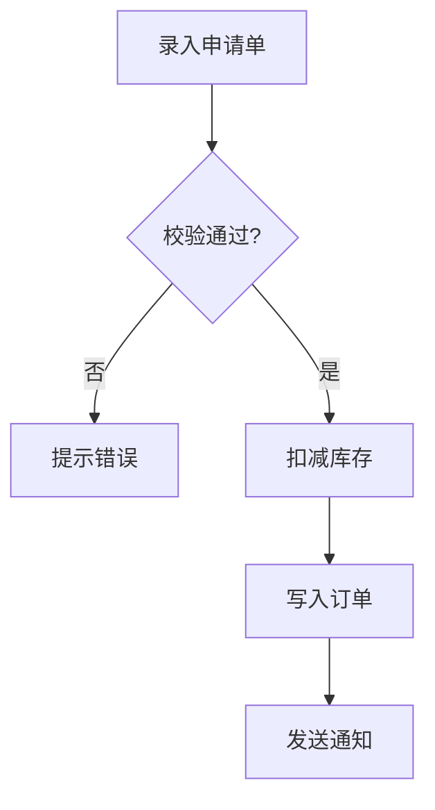

**Before proceeding, read openspec/rules/ai-coding.md for AI coding guardrails.** In Phase 1 (Exploration), follow Section 1 (Zero-Assumption). In Phase 2 (Proposal), follow Section 2 (Design-First). In Phase 3 (Verification), check Sections 3-5 for compliance.

One-stop automated workflow from exploration to archive.

This workflow guides you through:
1. **Exploration phase** - Persistent file + grill-with-docs questioning (L1-L5 user confirmation)
2. **Proposal phase** - Create change with all artifacts (automated)
3. **Verification phase** - Automatic quality check (automated)
4. **Auto-Apply phase** - Automatic implementation without confirmation gate
5. **Auto-Archive phase** - Automatic archiving on completion

---

## Phase 1: Exploration

**Input**: User's topic description (what they want to build).

Use the **TodoWrite tool** to initialize tracking: `[{"content": "Phase 1: Exploration", "status": "in_progress"}, {"content": "Phase 2: Proposal", "status": "pending"}, {"content": "Phase 3: Verification", "status": "pending"}, {"content": "Phase 4: Auto-Apply", "status": "pending"}, {"content": "Phase 5: Auto-Archive", "status": "pending"}]`

### 1.1 Create Exploration File (MANDATORY CHECKPOINT)

**⚠️ MANDATORY: File creation checkpoint at Phase 1 start**

When user invokes this command, system MUST create an exploration file before proceeding:

```bash
# Determine keyword from user's topic
# Pattern: <keyword>-explore-<sequence>.md
# Example: "add user authentication" -> user-auth-explore-001.md
```

**File Creation Process**:

1. **Extract keyword** from user's topic
   - Convert to kebab-case (max 50 chars)
   - Default to "explore" if extraction fails

2. **Determine sequence number**
   - Find highest sequence for that keyword in `openspec/explorations/`
   - Increment sequence (001, 002, etc.)

3. **Handle filename collisions**
   - If file exists, increment sequence
   - If collision persists after 3 retries, append timestamp suffix
   - Log collision resolution for transparency

4. **Create file at**: `openspec/explorations/<keyword>-explore-<sequence>.md`

5. **Verify file creation**
   - Check file exists and is writable
   - If verification fails, abort and report error
   - Log creation status to user

**Checkpoint Enforcement**:
- System MUST NOT proceed to questioning without valid exploration file
- If file creation fails, system MUST stop and report error
- User MUST be informed of file creation status

Use `path.join()` for cross-platform compatibility.

**TodoWrite tracking**: Initialize TodoWrite with Phase 1 items:
```
- [ ] Phase 1: 创建探索文件
- [ ] Phase 1: 提示词校验门
- [ ] Phase 1: CONTEXT.md 检查
- [ ] Phase 1: 关键词检测与分析
- [ ] Phase 1: Grill-with-docs 追问
- [ ] Phase 1: 完成检测与确认
```

### 1.1.2 Prompt Validation Gate (MANDATORY CHECKPOINT)

**⚠️ MANDATORY: 本门在任何探索动作之前执行，不得跳过。本门是澄清门（确认 WHAT）——管线虽为全自动，但自动化的起点在基线确认之后，MUST NOT 因 auto 语义跳过或静默通过本门。**

**门的校验对象是用户最终提供的需求描述**：调用未携带主题时，先交互收集主题描述，再以收集后的描述执行本门，MUST NOT 对空输入执行校验。

### Prompt Validation Gate (提示词校验门)

**Step 1 — 清晰度自检**: 逐维判定用户输入，标记 `✅ 清晰` / `⚠️ 歧义` / `❌ 缺失`

| 维度 | 判定问题 | 升级为硬不明确的信号 |
| :--- | :--- | :--- |
| 目标 Goal | 要做什么、为什么做？ | 只有笼统动词（如"优化一下"）而无预期结果 |
| 对象 Object | 落在哪个模块 / 文件 / 页面 / 接口 / 行为？ | 无法定位对象，或存在多个可能对象 |
| 范围 Scope | 改动边界？明确不做什么？ | 边界开放且影响面不可控 |
| 约束 Constraints | 不能破坏什么？兼容性 / 技术栈限制？ | 与既有实现存在互斥约束 |
| 验收 Acceptance | 怎样算完成？ | 无任何可验证的完成判据 |
| 歧义 Ambiguity | 有无多义说法、指代不清、前后矛盾？ | 影响范围 / 行为契约 / 验收的实质歧义 |

**Step 2 — 分级判定**

- **清晰**（目标 Goal / 对象 Object / 范围 Scope / 歧义 Ambiguity 均无 `❌` 与实质 `⚠️`）→ 用一句话复述你的理解，然后**直接进入探索**；不输出校验表格、不要求用户确认
- **不明确**（任一维 `❌` 或存在实质 `⚠️`）→ 执行 Step 3，并**阻塞等待确认**
- **软不明确**（仅细节级歧义，不涉及范围 / 行为契约 / 验收标准）→ 记为 `[假设]` 并继续，不进入 Step 3

**Step 3 — 提示词优化**（仅不明确分支）

- **不篡改用户原始意图**：只做结构化与约束补全，绝不擅自增加用户未提出的需求
- 推断补齐的内容标 `[推断]`，无法推断的内容标 `[待确认]`；禁止把猜测写成既定事实
- 输出两部分：`【优化后提示词】`（目标 / 对象 / 范围 / 约束 / 验收 / 已知歧义）+ `【优化说明】`（改了哪里、为什么）
- 列出仍需用户补充的信息项

**Step 4 — 确认门（阻塞）**

- 呈现 `【优化后提示词】` 与 `【优化说明】` 后**停下来等待用户确认或修改**
- 用户确认前 MUST NOT 进入探索、创建探索文件、扫描代码库或发起追问
- 出口有四条，不得只认一条：① 用户确认 → 以优化版为基线；② 用户修改 → 以修改版为基线；③ 用户拒绝优化 → 记录原始提示词，按其原有理解继续；④ 用户显式授权按推断继续（如"你按你的判断来"）→ 将推断项标 `[推断]` 记入基线后继续。**MUST NOT 反复要求确认而陷入等待死循环。**

**Step 5 — 落盘提示词基线**

- 将「原始提示词」与「确认后的提示词基线」一并写入探索产物的 `## 提示词基线` 段（保留原始提示词供审计）
- 下游（提案 / 设计 / 规格 / 任务）以**提示词基线**为唯一语义来源；基线变更 MUST 回到本门重新确认

**入口形态适配**

- 校验对象 = 用户**最终提供**的需求描述：调用未携带描述时，先交互收集，再以收集后的描述执行本门；**MUST NOT 对空输入执行校验**
- 输入为**变更名**时，以该变更的既有制品为校验与探讨对象，MUST NOT 把变更名本身当作需求提示词评估清晰度
- 已存在经用户确认的提示词基线时（尤其上游已完成本门），**直接通过，不重复校验或再次要求确认**

**本技能内的执行要求**：

- 门的位置固定在此处：探索文件已创建（1.1），而 CONTEXT.md 检查（1.1.5）、代码库扫描（1.2.1）与 grill 追问（1.3）均在其后
- 用户确认或修改前 MUST NOT 推进到 1.1.5 及之后的任何步骤，MUST NOT 以"稍后由 L1-L5 追问兜底"为由放行
- 校验结论（原始提示词 + 确认后的提示词基线）写入探索文件 1.2 结构中的 `## 提示词基线` 段

### 1.1.5 CONTEXT.md Startup Check (MANDATORY CHECKPOINT)

**⚠️ MANDATORY: CONTEXT.md check at Phase 1 start — BEFORE questioning begins**

1. **Check if `openspec/CONTEXT.md` exists** using Glob or Read tool
2. **If EXISTS**: Read all existing terms and inject them into exploration.md 术语表 section
   - Use existing terminology in all questions (do not re-define)
3. **If NOT EXISTS**: Record "No existing glossary — will create during exploration" in exploration.md 术语表 section
   - Mark TodoWrite: `- [ ] Phase 1: 创建 CONTEXT.md`

**Checkpoint Enforcement**:
- System MUST check CONTEXT.md existence before entering Section 1.3 questioning
- If CONTEXT.md exists, terms MUST be loaded into exploration.md before first question

### 1.2 Initialize Structured Format

Write the initial file structure with enhanced sections:

```markdown
## Background
<User's initial description>

## 提示词基线 (Prompt Baseline)

**原始提示词**: <用户最初提供的原文，未经改写>

**确认后的提示词基线**: <经 1.1.2 校验门确认的版本；清晰输入时即原始提示词本身>

> 下游（提案 / 设计 / 规格 / 任务）以提示词基线为唯一语义来源；基线若变更 MUST 回到 1.1.2 重新确认。

## 功能流程图 (Functional Flowchart)

<!-- 1.5.5 强制产出：Mermaid flowchart TD 承担顺序与分支骨架，节点 id N<序号> 在图中与表中 MUST 稳定一致 -->
<!-- 初始为空；探索分析完成后由 1.5.5 填写并经流程最终确认门确认 -->

| 节点 | 操作 | 触发条件 | 证据位置 | 异常路径 |
| :--- | :--- | :--- | :--- | :--- |
| N1 | <操作> | <前置条件，无则 "—"> | <文件:行 或 类.方法；新建功能标 [新建] + 预期产物> | <失败去向 → N<id>，无则 "—"> |

> 确认后的流程图 = **流程基准**；未经用户确认的流程图 MUST NOT 作为提案的生成锚点。
> 发现遗漏节点 MUST 回到 1.5.5 更新并重新确认，MUST NOT 在 tasks.md 中静默补节点。

## Codebase Findings

### Discovered Files
- <file-path>: <relevance-reason>

### Identified Symbols
- <symbol-name> (<file-path>:<line>): <reason>

### Pattern Matches
- <pattern-name>: <example-location>

## Questions
<Empty initially - accumulates Q&A>

## 术语表

| 术语 | 定义 | 避免使用 |
|------|------|---------|
<!-- Terms resolved during grilling and written to CONTEXT.md -->

## 架构决策

<!-- ADRs created during exploration -->
- ADR-0001: <title> — <summary>
  File: `openspec/docs/adr/0001-<slug>.md`

## 边界场景

<!-- Boundary scenarios constructed for each decision -->
- [ ] <scenario description>

## Decision Process

### Decision: <topic>
**Options Considered**:
- Option A: <description>
- Option B: <description>

**Pros/Cons**:
- Option A: <pros> vs <cons>
- Option B: <pros> vs <cons>

**Chosen**: Option A
**Rationale**: <reason>

## Decisions
<Empty initially - accumulates confirmed choices>

## Scope Changes
| 变更时间 | 变更类型 | 变更描述 | 原因 |
|---------|---------|---------|------|
| <!-- expand/shrink/pivot --> | <!-- description --> | <!-- reason --> |

## Pending
### For Phase 2 Impact Analysis
- <Symbol name> (<File location>) - Priority: HIGH

### Security Concerns
- <Vulnerability type>: <Affected area> - Fix: <Approach>

### Business Validation
- <Validation question>: <Context>

### Unresolved Decisions
- <Decision pending confirmation>
```

**Section Guidelines**:
- **Codebase Findings**: Records discoveries from exploration (files, symbols, patterns)
- **Decision Process**: Tracks decision evolution with rationale
- **Pending**: Categorized by type for Phase 2 attention

### 1.2.0.5 Capability Exploration Memory Injection (MANDATORY CHECKPOINT)

**⚠️ MANDATORY: Inject capability-level exploration memory before questioning begins**

After structured format initialization:

1. **Infer involved capabilities** from the user's topic
   - Use Glob tool to scan `openspec/specs/` directory for module names
   - Match topic keywords against module names (same logic as change naming module identification)

2. **Detect capability memory file**
   - For each involved capability `<capability>`, check if `openspec/specs/<capability>/explorations.md` exists (use `path.join()`)

3. **Inject memory (when file exists)**
   - Read the file and inject historical Decisions, 术语, and 边界场景 into the exploration context
   - Write a summary into exploration.md `## Codebase Findings` under a "### Capability Exploration Memory (injected)" subsection
   - Sections marked `已过时（由 <change-name> 取代）` serve as historical reference ONLY — the superseding change's decisions are current

4. **No memory file**
   - Log: "无能力级探索记忆 — 全新探索"
   - Proceed with normal exploration

**Checkpoint Enforcement**:
- System MUST execute capability memory detection before entering questioning
- Injected memory MUST be reflected in exploration.md before the first question

### 1.2.1 Mandatory CodeGraph Base Scan (MANDATORY CHECKPOINT)

**⚠️ MANDATORY: CodeGraph base scan before questioning begins**

After structured format initialization, system MUST execute mandatory CodeGraph base scan:

0. **Check CodeGraph availability (mandatory first action)**:
   - **MUST run `codegraph_status` FIRST.** Until it returns unavailable, you MUST NOT use Glob/Grep for file or symbol investigation — the `codegraph_*` tools below are the primary path, not an optional one.
   - If available: proceed with CodeGraph tools below
   - If `codegraph_status` confirms unavailable (uninitialized or error): ONLY THEN log "CodeGraph not initialized — using Glob/Grep fallback" and skip to the fallback below
   - Grep/Glob is a last resort, permitted ONLY after `codegraph_status` confirms unavailability — never as a shortcut to skip CodeGraph

1. **Scan project file structure** using `codegraph_files` tool
   - Get full project file tree with metadata
   - Identify relevant directories and files matching exploration topic
   - Write results to `## Codebase Findings > Discovered Files`

2. **Search for relevant symbols** using `codegraph_search` tool
   - Search for symbols matching exploration topic keywords
   - Record discovered symbols with file:line locations
   - Write results to `## Codebase Findings > Identified Symbols`

   **Note**: `codegraph_context` is deferred to Section 1.4 (after questioning, when task description is clearer).

3. **Record scan results** in exploration file:
   ```markdown
   ## Codebase Findings

   ### Discovered Files
   - <file-path>: <relevance-reason>

   ### Identified Symbols
   - <symbol-name> (<file-path>:<line>): <reason>

   ### Pattern Matches
   - <pattern-name>: <example-location>
   ```

**Fallback (last resort)**: Permitted ONLY after `codegraph_status` confirms CodeGraph MCP tools are unavailable (uninitialized or error):
- Fall back to Glob tool for file structure discovery
- Fall back to Grep tool for symbol search
- Record in exploration file: "CodeGraph unavailable — used Glob/Grep fallback"
- Continue with normal exploration flow

### 1.2.1.5 Multi-Project CodeGraph Agent Scan (CONDITIONAL CHECKPOINT)

After the 1.2.1 base scan (current project), system MUST check if the exploration context contains references to other project paths (e.g., SOURCE_PROJECT from auto-migration, or other repo paths mentioned in the user's topic).

**When other project paths are detected**:

1. **Check CodeGraph initialization** for each other project path:
   - Run Bash `ls <path>/.codegraph/` to check whether the target project has a `.codegraph/` directory (directory contents listed — including codegraph.db — means CodeGraph is initialized). Do NOT use Glob to check dot-prefixed directories (Glob returns false negatives for them)
   - If initialized (ls succeeds): proceed with Agent scan
   - If not initialized (ls fails — directory does not exist): log WARN "Other project <path> does not have CodeGraph initialized — falling back to Glob/Grep" and fall back to Glob/Grep

2. **Spawn sub-agent** for each other project with CodeGraph initialized:
   - Use the `Agent` tool to spawn a sub-agent
   - Sub-agent prompt: "Scan the project at <path> using CodeGraph tools (codegraph_files + codegraph_search + codegraph_context). Limit scanning depth (maxDepth: 3, maxNodes: 20). Report findings in structured format."
   - **Sub-agent instructions**: The sub-agent MUST use the `projectPath` parameter on codegraph tools to target the other project. The sub-agent MUST NOT modify any files.

3. **Merge results**: Write sub-agent findings into exploration.md under:
   ```markdown
   ### Other Project Findings
   **Project**: <path>
   ... findings ...
   ```

**Error Handling**:
- Agent spawn failure or timeout (>120s): log WARN, fall back to Glob/Grep for that project
- One project failure does NOT affect other projects
- If the other project path is the same as the current project, skip Agent scan

### 1.3 Grill-with-docs Questioning

**Full exploration process that must NOT be skipped or abbreviated.**

Ask questions one at a time. Each question must include AI's recommendation. Use the exploration file to track progress.

**Question types** (ask until clear):

1. **L1: Intent Confirmation** - "Do I understand correctly?"
2. **L2: Solution Confirmation** - "Which approach fits?"
3. **L3: Exception Handling** - "How should errors be handled?"
4. **L4: Consistency Check** - "Does this conflict with existing code?"
5. **L5: Boundary Scenarios** - "What about edge cases?"

**After each answer**, write to the exploration file:
- Record the question in the Questions section
- Record the answer in the Decisions section
- Update the 边界场景 section if new scenarios emerge
- Update the 术语表 section if new terms are defined

**Questioning guidance**:
- **Do explore codebase first** - Before asking a question, check if the codebase already answers it
- **Do provide recommendations** - Every question should include AI's recommended answer
- **Do record decisions** - Every confirmed decision goes into exploration.md
- **Don't skip questions** - Keep asking until truly clear
- **Don't ask all at once** - One question at a time, build on previous answers

### 1.4 Analysis (Keyword Detection & Auto-Execution)

**Detection**: Analyze user's topic for keywords matching analysis categories.

**Auto-execution rule**: When a keyword is detected, execute the corresponding analysis directly without asking the user. The read-only passthrough principle covers all analysis tools.

**Analysis types** (auto-execute on keyword match):

1. **Security Analysis** (keywords: security, 安全, vulnerability, 漏洞, auth, 权限, XSS, SQL注入)
   - Tool: `codegraph_search` for security symbols
   - Output: `### Security Findings` in exploration.md

2. **Architecture Flow** (keywords: architecture, 架构, flow, 流程, call chain, 调用链, data flow, 数据流)
   - Tool: `codegraph_explore` with relevant symbols
   - Output: `### Architecture Flow` and `### Business Flow` in exploration.md

3. **Impact Analysis Preparation** (all topics — always run)
   - Tool: `codegraph_search` for relevant symbols
   - Output: `### Identified Symbols` in exploration.md Pending section

### 1.5 Impact Analysis (Auto-Execute)

**Auto-execution rule**: When the Pending section contains symbols for impact analysis, execute `codegraph_impact` directly without asking. If no symbols exist, skip with a log line.

```
mcp__codegraph__codegraph_impact --symbol <symbol> --direction upstream --maxDepth 3
```

**Parallel execution for multiple symbols**: When two or more impact symbols are identified, issue the impact queries in parallel (multiple tool calls in a single response round) instead of one at a time. Merge all results into the artifact impact sections. A single symbol keeps the existing single-query behavior.

**Impact result structure**:
```
{
  "risk": "LOW | MEDIUM | HIGH | CRITICAL",
  "summary": "N direct callers, M processes affected",
  "affected_processes": ["process1", "process2"],
  "affected_modules": ["module1", "module2"],
  "byDepth": {
    "d1": ["direct caller symbols"],
    "d2": ["indirect caller symbols"],
    "d3": ["transitive caller symbols"]
  }
}
```

### 1.5.5 Functional Flowchart & Flow Final Confirmation Gate (MANDATORY CHECKPOINT)

**⚠️ MANDATORY: 探索分析完成后必须强制产出功能流程图，并经流程最终确认门确认后才进入 1.6。本确认门是确认门（确认流程基准）——管线虽为全自动，但流程基准的确认是自动化的前置条件，MUST NOT 因 auto 语义跳过或静默通过本门；未经用户确认的流程图 MUST NOT 作为 propose 的生成锚点。**

触发点：1.3 grill L1-L5 与 1.4 关键词分析均已执行、1.5 影响分析之后。

### 功能流程图（Functional Flowchart）

**Step 1 — 生成流程图与节点清单**

把探索发现的业务功能流程固化为探索产物的 `## 功能流程图` 段，由两部分组成：



节点清单表（表头与列以本场景列集为准）：

本场景列集（共 5 列）：节点 / 操作 / 触发条件 / 证据位置 / 异常路径

| 节点 | 操作 | 触发条件 | 证据位置 | 异常路径 |
| :--- | :--- | :--- | :--- | :--- |
<节点 | 操作 | 触发条件 | 证据位置 | 异常路径>

列定义：

| 列名 | 填写要求 | 必填性 |
| :--- | :--- | :--- |
| 节点 | 节点标识，形如 N1 / N2，在流程图与清单表中 MUST 稳定一致 | 必填 |
| 操作 | 该节点完成的操作，业务语义表述（如"扣减库存"） | 必填 |
| 触发条件 | 执行本节点的前置条件；无前置条件时以 "—" 占位 | 可选 |
| 证据位置 | 既有代码标 `文件:行` 或 类.方法；新建功能标 `[新建]` 并写明预期产物 | 必填 |
| 异常路径 | 本节点失败时的去向，用 `→ N<id>` 指向目标节点；无异常分支时以 "—" 占位 | 可选 |

**节点定义与准入规则**：

- **节点粒度** MUST 为**可独立验证的业务操作单元**（一次用户操作 / 一次业务判定 / 一次数据写入 / 一次外部调用）；MUST NOT 细到代码行级，MUST NOT 粗到模块级
- **节点标识** MUST 在 Mermaid 图与清单表中一致；一个功能含多条独立流程时 SHALL 按流程分小节组织（`### 流程 1` / `### 流程 2`），节点标识 SHALL **全局唯一递增**
- **证据追溯是硬约束**：每个节点 MUST 填写证据位置（`文件:行` 或 类.方法）；**新建功能**节点 SHALL 标 `[新建]` 并写明预期产物（新增哪个类 / 页面 / 接口），MUST NOT 要求预测文件路径；**无法追溯证据的节点 MUST NOT 进入清单**——虚假节点会成为提案的生成锚点，把偏差结构化固化，比散文偏差更难发现
- 节点数超过 50 时 SHALL 按子流程分节：主流程图以子流程节点聚合，子流程各自展开清单表

**Step 2 — 流程最终确认门（阻塞）**

向用户呈现流程图与节点清单并**停止等待确认**；用户确认前 MUST NOT 进入探索完成检测，MUST NOT 将流程图传递给提案阶段。

出口有四条，不得只认一条：

① 用户确认 → 以确认版为**流程基准**
② 用户修改 → 以修改版为流程基准
③ 用户拒绝 → 记录原始流程图与**未确认状态**：提案降级为仅凭探索产物生成，验证的节点覆盖度维度 SKIP
④ 用户显式授权按推断继续 → 将推断节点标 `[推断]` 记入后继续

**MUST NOT 反复要求确认或陷入等待死锁。**

**Step 3 — 落盘与回改规则**

- 流程图与节点清单落盘为探索产物的 `## 功能流程图` 段，随探索文件迁移一并进入变更目录
- 确认后的流程图 = **流程基准**，是独立于提案自身的交叉验证锚点（区别于既有业务步骤维度的"自证"）
- 探索或提案阶段发现**遗漏节点**时 MUST 回到本步骤更新流程图并**重新经用户确认**；MUST NOT 在任务清单中静默补节点——静默补全正是偏差的主要来源
- 流程基准变更 MUST 回到本确认门重新确认

**本技能内的执行要求**：

- **强制产出**：把探索发现的业务功能流程固化为探索文件 1.2 结构中的 `## 功能流程图` 段（该段已在 1.2 预留）；Mermaid 流程图与节点清单表的节点 id MUST 稳定一致
- **节点证据追溯**：每节点 MUST 填证据位置——既有代码标 `文件:行` 或 类.方法，**新建功能**节点标 `[新建]` 并写明预期产物；**无法追溯证据的节点 MUST NOT 进入清单**
- **四出口确认门**：呈现流程图与节点清单后停止等待确认，出口四条（确认 / 修改 / 拒绝后记录未确认状态并按原理解继续 / 显式授权按推断继续），**MUST NOT 反复要求确认或陷入等待死锁**
- **回改规则**：探索或提案阶段发现**遗漏节点**时 MUST 回到本步骤（1.5.5）更新流程图与节点清单并**重新经用户确认**；MUST NOT 在 tasks.md 中静默补节点
- **节点数超 50**：按子流程分节，主流程图以子流程节点聚合、子流程各自展开清单表
- **确认前不得推进**：用户确认前 MUST NOT 进入 1.6 完成检测，MUST NOT 向提案阶段传递流程基准
- **流程基准用途**：确认后的流程图 = **流程基准**，随探索文件迁移（2.1）一并进入变更目录，由下游 propose / verify 共同消费

### 1.6 Completion Check

Before declaring exploration complete, verify:

1. **CONSISTENCY CHECK**: Review all decisions for conflicts
   - If no hard conflicts: proceed to Phase 2 directly (consistency passthrough — no user confirmation needed)
   - If hard conflict detected: present conflicting decisions to user, ask for direction, then proceed

2. **REQUIREMENTS CHECK**: All L1-L5 questions answered? If not, continue asking

3. **FILE CHECK**: exploration.md has all sections populated? Write any missing sections

4. **ANNOUNCE**: "## Exploration Complete ✓" and "Checks passed — generating proposal directly"

---

## Phase 2: Proposal

**Phase 2 executes automatically after Phase 1 completion. No user confirmation needed (consistency passthrough).**

### 2.0 Impact Analysis (Auto-Execute)

If Pending section contains symbols, run impact analysis for each symbol:
```bash
mcp__codegraph__codegraph_impact --symbol <symbol> --direction upstream
```

**Parallel execution for multiple symbols**: When two or more impact symbols are identified, issue the impact queries in parallel (multiple tool calls in a single response round). Merge all results into the artifact impact sections; a single symbol keeps the existing single-query behavior.

**Results stored for**:
- proposal.md: Impact Analysis section
- design.md: Architecture Impact section

### 2.1 Migrate Exploration File

Move exploration file from `openspec/explorations/` to change directory:
```bash
mv openspec/explorations/<keyword>-explore-<sequence>.md openspec/changes/<change-name>/exploration.md
```

**Preserve the exploration file — do NOT delete it.**

### 2.2 Inline Artifact Generation

Proceed directly to inline artifact generation (no complexity evaluation, no method selection):

1. Run `venus spec status --change "<name>" --json`
2. Loop through artifacts in dependency order: proposal → specs → design → tasks
3. For each artifact: `venus spec instructions <artifact-id> --change "<name>" --json` → Write file
4. Verify each file exists after writing

**CLI availability detection**: If the first `venus spec status` call fails with a command-not-found signature ("command not found" / "不是内部或外部命令" / "not recognized"), log "venus CLI not found in PATH — switching to CLI-degraded generation mode" and switch to CLI-degraded mode:
- Generate artifacts in built-in dependency order: proposal → specs → design → tasks
- Use embedded artifact structure rules (from this template)
- Track progress with TodoWrite tool
- Do NOT retry CLI calls mid-flow

**During inline generation, handle CLI failures:**
- If a CLI call fails (non-command-not-found error): report the error, suggest re-running `venus spec status --change "<name>" --json` to locate the first `status: "ready"` artifact and resume generation from it (resume semantics — do NOT regenerate already-completed artifacts), and continue with the next artifact
- CLI-degraded mode already handles command-not-found; this handles other CLI errors (e.g., JSON parse failure)

### 2.3 Task Type Labels (for tasks.md generation)

- Each task MUST include a type label: `- [ ] [代码] N.M ...` or `- [ ] [DB脚本] N.M ...` etc.
- Supplement tasks (non-`[代码]`) MUST include `产出:` field as indented content
- Default output path: `attachments/<filename>` (relative to changeRoot)

---

## Phase 3: Verification

**Phase 3 executes automatically after Phase 2 artifact generation completes. No user confirmation needed.**

### 3.1 Auto-Execute Verification

- Skip method-specific prompt — Do NOT show "Propose 方式一步生成" or similar
- Skip user choice — Do NOT ask [立即验证] / [跳过验证]
- Execute directly — Run D1-D5 verification automatically

### 3.2 Run Verification

- Invoke the `venus_spec_verify_proposal` **skill** (via Skill tool) for D1-D5 scoring
- Fallback to AI inline scoring + WARN log if the skill is unavailable; never silently skip
- Calculate coverage rates and overall score (unified 90% threshold)
- Detect tech stack from config.yaml context

### 3.3 Handle Results

**PASS (≥90%)**:
- Auto-execute deep proposal review: invoke the `venus_tr_impl_review_proposal` skill (via Skill tool) for deep review (no [Yes/No] prompt); fallback to AI inline deep review + WARN log if the skill is unavailable; never silently skip
- Display results alongside verification report
- **Auto-generate requirement document**: after deep review completes, non-interactively invoke the `venus_tr_docs_requirement_doc` skill (via Skill tool); output to `openspec/changes/<change-name>/需求文档.md`; on failure log WARN and continue
- **Auto-transition to Phase 4**: After requirement document generation (or skip on failure), automatically enter Phase 4 (auto-apply)

**FAIL (<90%)**:
- Auto-generate fix suggestions and apply fixes
- Re-run verification automatically
- Do NOT generate the requirement document until fixes pass re-verification
- If still FAIL: [Manual edit] [Return to exploration] [View detailed diff] (no skip-to-apply path)

---

## Phase 4: Auto-Apply

**Phase 4 executes automatically after Phase 3 verification passes. No user confirmation needed — the apply runs with auto-mode=true to skip the design confirmation gate.**

### 4.1 Auto-Execute Apply

After verification passes (≥90%) and the requirement document is generated:
- Announce: "## Auto-Apply Phase" with a clear header
- Display: "Verification passed — automatically entering apply phase"
- Construct the apply context with:
  - `auto-mode=true` — to skip the design confirmation gate (consistent with venus_spec_apply: Input passes auto-mode=true; Step 5.5 confirmation gate is skipped in auto-mode, directly entering Step 6 batch scheduling)
  - `change-name` — the current change name from the workflow context
- Execute the apply workflow logic (following the venus_spec_apply skill's Step 6+ batch scheduling behavior with auto-mode=true)
- All apply tasks are implemented automatically with the existing batch scheduling

### 4.2 Auto-Apply Error Handling

- **Compile check fails** (after 3 auto-fix attempts): pause and wait for user instructions — do NOT proceed to archive
- **Sub-agent fails**: auto-retry once; if retry fails, pause and report
- **User interrupts**: complete current batch, mark remaining tasks as incomplete, then pause

---

## Phase 5: Auto-Archive

**Phase 5 executes automatically after Phase 4 (auto-apply) completes and compile check passes. No user confirmation needed.**

### 5.1 Auto-Execute Archive

After apply completes and compile check passes:
- Announce: "## Auto-Archive Phase" with a clear header
- Display: "Apply complete — automatically entering archive phase"
- Construct the archive context with:
  - `change-name` — the current change name (skips the change selection prompt)
- Execute the archive workflow logic (following the venus_spec_archive skill template)
- All archive steps execute automatically: delta spec sync, CONTEXT.md sync, CodeGraph check, exploration memory sync, directory move, ARCHIVE-INDEX.md update

### 5.2 Auto-Archive Error Handling

- **Delta spec sync conflict**: auto-merge with conflict markers (non-blocking)
- **CONTEXT.md sync fails**: log warning, continue (non-blocking)
- **CodeGraph not initialized**: skip CodeGraph steps, continue (non-blocking)
- **Exploration memory sync fails**: log warning, continue (non-blocking)
- **Archive target already exists**: fail with error, suggest renaming

### 5.3 Completion

After auto-archive completes:
- Display the full completion summary with all phases
- Show: "## Auto-Workflow Complete ✓"

---

## Guardrails

- **Don't skip questioning** - Keep asking until truly clear
- **MUST validate prompt before exploring** - 1.1.2 提示词校验门是强制 checkpoint：清晰输入一句话复述理解后直通；不明确输入须先做提示词优化并等待用户确认或修改，未确认前 MUST NOT 推进到 1.1.5 及之后的任何步骤
- **Auto semantics never skip the clarification gate** - 1.1.2 是澄清门（确认 WHAT），管线为全自动不构成跳过理由；基线确认是自动化的起点
- **Don't deadlock on the confirmation gate** - 1.1.2 确认门有四条出口（确认 / 修改 / 拒绝后按原理解继续 / 显式授权按推断继续），不得反复要求确认
- **Do persist the prompt baseline** - 原始提示词与确认后的基线一并写入探索文件 `## 提示词基线` 段；基线变更 MUST 回到 1.1.2 重新确认
- **MUST produce the functional flowchart** - 1.5.5 是强制 checkpoint：探索分析完成后 MUST 产出探索文件 `## 功能流程图` 段（Mermaid + 节点清单）并执行流程最终确认门；确认前 MUST NOT 进入 1.6，MUST NOT 把未确认流程图当作 propose 锚点
- **Auto semantics never skip the flowchart confirmation gate** - 1.5.5 是确认门（确认流程基准），管线为全自动不构成跳过理由；流程基准的确认是自动化的前置条件
- **Don't deadlock on the flowchart gate** - 1.5.5 确认门有四条出口（确认 / 修改 / 拒绝后记录未确认状态并按原理解继续 / 显式授权按推断继续），拒绝时 propose 降级为仅凭 exploration.md、verify 节点覆盖度维度 SKIP，不得反复要求确认
- **MUST NOT silently add flowchart nodes in tasks** - 发现遗漏节点 MUST 回到 1.5.5 更新流程图并重新经用户确认，MUST NOT 在 tasks.md 中静默补节点
- **Don't auto-proceed on conflict** - Phase transitions proceed automatically when the 1.6 consistency checks pass (consistency passthrough); ask the user only when a hard conflict is detected
- **Do execute read-only operations directly** - File reading, CodeGraph queries, and analysis steps (impact analysis) run without asking the user for confirmation
- **Read-only passthrough does not cover clarification gates** - grill L1-L5 requirement-clarification gates still wait for user confirmation
- **Do auto-verify** - automatically verify after proposal without user prompt
- **Do auto-apply after verification pass** - Phase 4 executes automatically with auto-mode=true (venus_spec_apply Step 5.5 gate skipped)
- **Do auto-archive after apply complete** - Phase 5 executes automatically with change name passed from context (following the venus_spec_archive skill template)
- **Do auto-generate requirement doc** - After full pass, first invoke `venus_tr_impl_review_proposal` for deep review (fallback inline deep review + WARN), then non-interactively invoke `venus_tr_docs_requirement_doc`; on FAIL do not generate; on generation failure WARN and continue
- **MUST create file before questioning** - Phase 1 checkpoint is mandatory
- **MUST verify file before migration** - Phase 2 checkpoint is mandatory
- **MUST preserve source on migration failure** - Never lose user data
- **MUST NOT offer method selection** - Phase 2 proceeds directly to inline propose-style generation
- **Do explore codebase** - Before asking, check if codebase answers the question
- **Do provide recommendations** - Every question includes AI's recommendation
- **Do update file real-time** - After each exchange, write to exploration file
- **Do use structured format** - Background, Questions, Decisions, Pending sections
- **Do show quantified scores** - Verification results include coverage percentages
- **Do inject capability memory** - Phase 1 reads specs/<capability>/explorations.md when it exists
- **Do scan other projects with CodeGraph** - When exploration context contains other project paths, spawn sub-agent to scan them using CodeGraph projectPath parameter; fall back to Glob/Grep on failure
- **Don't lose exploration** - File persists even on abandon (unless deleted)
