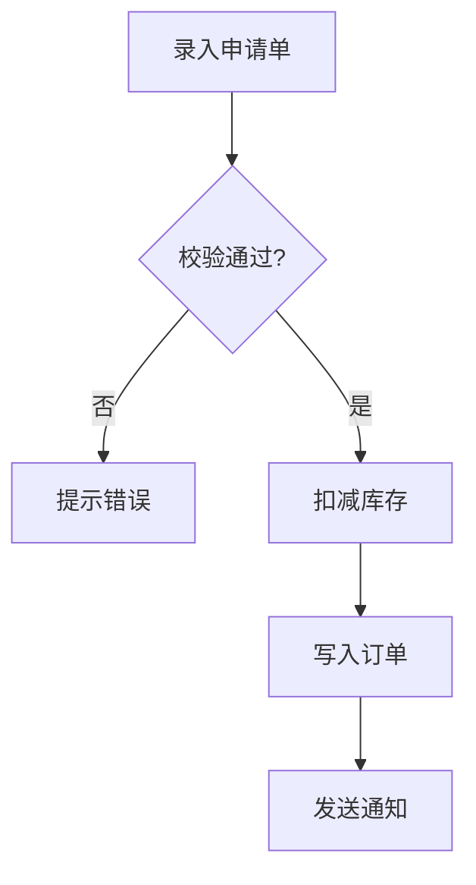

# 功能流程图与交叉验证（Functional Flowchart & Cross-Verification）— 探索记录

> 探索对象：VenusAgentTools 自身 5 个工作流技能模板（explore / workflow / auto-workflow / debug / genfull）
> 目标：探索阶段生成「功能流程图 + 关键操作节点清单」，经用户最终确认后作为 propose / verify 阶段的结构化交叉验证基准，消除提案与任务偏离探索结果的问题

---

## Background

用户原始诉求（原文）：

> 对 explore\workflow\auto-workflow\debug\genfull 指令 SKILL 探索结果，功能流程生成对应功能流程图，流程图需要涉及探索发现关键操作节点，用户进行流程最终确认，用于提案生成 propose、提案验证 verify 阶段，根据探索结果、流程图进行交叉验证，当前仅根据探索结果和记忆文件对比时，生成提案内容和任务和实际探索结果存在偏差

**问题诊断（探索起点）**：

现状下 propose 阶段的语义来源有两处——探索产物（exploration.md 的 Decisions / 术语表 / 边界场景）与能力探索记忆（`openspec/specs/<cap>/explorations.md`）。二者均为**自然语言散文**，缺乏结构化的流程骨架：

1. **Decisions 是离散结论，不是流程**：无法表达"操作节点 A 必须先于 B""条件 C 成立时才走分支 D"这类**顺序与分支约束**
2. **验证无法定位偏差**：`venus_spec_verify_proposal` 的 D1 只统计「已匹配决策数 / 总决策数」，散文式比对面宽判不细——命中 80% 决策却漏掉关键节点的分支，仍可能 PASS
3. **任务拆解无锚点**：tasks 由 AI 从散文重构流程，重构过程即偏差引入点；缺少"应覆盖哪些节点"的显式清单

**用户裁决的 4 项关键歧义**（提示词校验门 1.1.2 产出）：

| # | 歧义点 | 裁决 |
| :--- | :--- | :--- |
| ① | 流程图描述对象 | **业务功能流程**（被探索功能自身的操作/处理流程），非技能编排流程 |
| ② | 制品落位 | **探索文件内新增段落**（对齐 `## 提示词基线` 模式） |
| ③ | 交叉验证载体 | **verify 新增独立维度**（节点覆盖度），与现有维度同权重纳入 90% 阈值 |
| ④ | 适用范围 | **5 技能全加**，debug 用缺陷变体 |

---

## Analysis

### Security Findings

无新增攻击面。本次为**技能正文（prompt 文本）变更**，不触及运行时代码路径、不新增命令执行、不扩大 `allowed-tools` 白名单——与先例 `add-prompt-validation-gate` 同类。

唯一的"安全"约束是**反幻觉**：流程图节点若允许 AI 凭"常见模式"想象，则虚假节点会成为 propose 的生成锚点，把偏差**结构化固化**（比散文偏差更难发现）。故必须强制节点证据追溯（对齐 `tr-docs-feature-doc` 规则 4：流程图必须基于实际代码路径）。

### Architecture Flow

```
探索阶段（5 技能：explore / workflow / auto-workflow / debug / genfull）
   │
   ▼
┌────────────────────────────────────────┐
│ ① 提示词校验门（既有，1.1.2 / Phase 0）  │  → `## 提示词基线`
└──────────────┬─────────────────────────┘
               ▼
┌────────────────────────────────────────┐
│ ② 代码库探索 + grill L1-L5（既有）       │
└──────────────┬─────────────────────────┘
               ▼
┌────────────────────────────────────────┐
│ ③ 功能流程图生成（★新增）                │
│    Mermaid 流程图 + 关键操作节点清单      │
└──────────────┬─────────────────────────┘
               ▼
┌────────────────────────────────────────┐
│ ④ 流程最终确认门（★新增，阻塞）           │
└──────────────┬─────────────────────────┘
               ▼
   探索产物 `## 功能流程图` 段（★新增落盘）
               │
        ┌──────┴───────┐
        ▼              ▼
   propose         verify
   节点 → design.md  「流程图节点覆盖度」维度（★新增）
   节点 → tasks.md   提案/任务覆盖节点 / 总节点
                         └→ 纳入 90% 统一阈值
```

### Impact Analysis（codegraph_impact）

| 符号 | 上游影响 | 结论 |
| :--- | :--- | :--- |
| `deriveCommandContent` | **16 个符号** —— 7 个 spec-* CommandTemplate 全部依赖 | **不修改**（零爆炸半径），仅新增模块 + 编辑模板文件 |
| `getSpecProposeSkillTemplate` | 3 符号（自身 + 同文件 CommandTemplate + 文件） | 编辑正文，注册结构不变 |
| `getSpecVerifyProposalSkillTemplate` | 3 符号（同上） | 编辑正文，注册结构不变 |
| `getTrImplDebugSkillTemplate` | 2 符号（自身 + 文件） | 编辑正文，注册结构不变 |
| `getSpecExploreSkillTemplate` / `getTrImplWorkflowSkillTemplate` / `getTrImplAutoWorkflowSkillTemplate` / `getTrImplGenfullSkillTemplate` | 各 2-3 符号（registry 注册 + 测试） | 编辑正文，注册结构不变 |
| 新增共享模块（如 `flowchart-gate.ts`） | 无上游 | 纯新增，无爆炸半径 |

**技能总数保持 27** → `test/templates.test.ts:14` / `test/commands.test.ts` 的硬断言无需改动。

---

## 提示词基线

### 原始提示词

> 对 explore\workflow\auto-workflow\debug\genfull 指令 SKILL 探索结果，功能流程生成对应功能流程图，流程图需要涉及探索发现关键操作节点，用户进行流程最终确认，用于提案生成 propose、提案验证 verify 阶段，根据探索结果、流程图进行交叉验证，当前仅根据探索结果和记忆文件对比时，生成提案内容和任务和实际探索结果存在偏差

### 确认后的提示词基线

> 在 5 个工作流技能（`venus_spec_explore` / `venus_tr_impl_workflow` / `venus_tr_impl_auto_workflow` / `venus_tr_impl_debug` / `venus_tr_impl_genfull`）的**探索阶段**新增「功能流程图」制品：把探索发现的功能流程固化为 **Mermaid 流程图 + 关键操作节点清单** 的结构化中间产物，节点须为探索实际发现的操作节点；经**用户最终确认**后，作为 `propose`（提案生成）与 `verify`（提案验证）阶段的**交叉验证基准**。
>
> - **对象**：制品写入方为 5 个技能的探索阶段；消费方为 `venus_spec_propose`（design/tasks 以节点清单为生成锚点）与 `venus_spec_verify_proposal`（新增节点覆盖度维度）；`[推断]` 复用 `prompt-gate.ts` 的共享文本块模式
> - **范围**：含探索阶段流程图生成 + 用户最终确认门 + 落盘、propose 消费、verify 交叉验证；不含改 apply / archive
> - **约束**：遵循单一文本源；流程图与提示词基线同属唯一语义来源；改模板后须 `pnpm build && pnpm generate:skills` 并递增版本号（AGENTS.md 第 1、8 条）；节点必须可追溯到探索证据（反幻觉）
> - **验收**：verify 新增「流程图节点覆盖度」评分并纳入 90% 阈值；5 技能产物均含流程图段落且经用户确认；快照与派生一致性测试通过

**原始提示词保留供审计优化是否篡改用户意图。基线为下游唯一语义来源，基线变更 MUST 回到提示词校验门重新确认。**

---

## Codebase Findings

### Discovered Files

| 文件 | 角色 | 本次关联 |
| :--- | :--- | :--- |
| `src/core/templates/prompt-gate.ts`（173 行） | 提示词校验门**共享文本唯一源**（同日归档先例） | **直接参照的架构样板** |
| `src/core/templates/workflows/spec-explore.ts`（343 行） | `venus_spec_explore`，stance not workflow；command 自动派生 | 流程图段落 + 确认门的接入点 |
| `src/core/templates/workflows/tr-impl-workflow.ts`（2164 行） | `venus_tr_impl_workflow`，Phase 1 有 1.1→1.7 checkpoint 体系 | 接入点（1.1.2 之后） |
| `src/core/templates/workflows/tr-impl-auto-workflow.ts`（569 行） | 与 workflow 同构精简版 | 接入点（1.1.2 之后） |
| `src/core/templates/workflows/tr-impl-debug.ts`（499 行） | Startup → Phase 1 强制复现 | 接入点（缺陷变体） |
| `src/core/templates/workflows/tr-impl-genfull.ts`（334 行） | Phase 0 → Stage 1 委派 explore | 接入点（Phase 0 内） |
| `src/core/templates/workflows/spec-propose.ts`（约 350 行） | 提案生成（内联 G1-G3 协议） | **消费方**：以节点清单为锚点 |
| `src/core/templates/workflows/spec-verify-proposal.ts`（约 500 行） | D1-D9 量化评分门 | **消费方**：新增节点覆盖度维度 |
| `src/core/templates/derive-command.ts` | 指令正文派生器（`<!-- CMD:SKIP -->` 裁剪） | **不修改**（16 符号爆炸半径） |
| `test/templates.test.ts`、`test/skills-parity.test.ts` | 技能总数 27 硬断言 / 快照逐字节一致 | 改动后必须同步 |

### Identified Symbols

- `buildPromptGateBlock`（prompt-gate.ts:119）/ `buildPromptGateCompact`（prompt-gate.ts:163）— **样板函数签名**
- `PROMPT_GATE` / `PROMPT_GATE_BUG` 常量：5 个技能模板的 block 版；4 个 tr_impl 技能另有 `PROMPT_GATE_COMPACT`
- `getSpecExploreSkillTemplate` / `getTrImplWorkflowSkillTemplate` / `getTrImplAutoWorkflowSkillTemplate` / `getTrImplDebugSkillTemplate` / `getTrImplGenfullSkillTemplate`
- `getSpecProposeSkillTemplate` / `getSpecVerifyProposalSkillTemplate` — 消费方
- `deriveCommandContent`（derive-command.ts:23）

### Pattern Matches

**① 共享文本块模式（先例 `add-prompt-validation-gate`，今日归档）**

```
src/core/templates/prompt-gate.ts          ← 唯一源（参数化渲染函数 + 维度常量）
      │  import + buildPromptGateBlock(dims) 内联
      ▼
5 个技能模板正文（spec-explore / tr-impl-workflow / auto-workflow / debug / genfull）
      │  pnpm build && pnpm generate:skills
      ▼
skills/<name>/SKILL.md 快照 → venus init 安装到目标项目 .claude/
```

- **不新增技能**：技能总数 27 保持不变，避免同步 6+ 处断言与依赖注入链
- **参数化渲染**：需求版（`REQUIREMENT_DIMENSIONS`）与缺陷版（`BUG_DIMENSIONS`）仅维度表不同，流程文本共享 → 本次**同样适用**（业务流程图 vs 缺陷流程图变体）

**② 命令派生双轨制（关键约束）**

| 技能 | CommandTemplate.content 来源 | 改 skill 正文后 |
| :--- | :--- | :--- |
| `spec-explore` | `deriveCommandContent(instructions)` 自动派生 | 自动同步；块**不得**被 `<!-- CMD:SKIP -->` 包裹（指令版同样需要） |
| `tr-impl-workflow` / `auto-workflow` / `debug` / `genfull` | 手写压缩版正文 | **必须手工同步压缩版** |

**③ 探索产物段落式制品先例**：`## 提示词基线`（原始 + 确认后一并落盘）→ 本制品沿同一模式新增段落，`explore → 变更 exploration.md` 迁移随之自动跟随。

### 既有验证体系（消费方现状）

`venus_spec_verify_proposal` D1-D9 评分：

| 维度 | 算法 | 与本次的关系 |
| :--- | :--- | :--- |
| D1 Requirements | 已匹配决策 / 总决策 | **散文比对**，正是偏差漏检处 |
| D2 Technical | 已匹配技术选型 / 总选型 | 不受影响 |
| D3 Tasks | 有任务的需求 / 总需求 | 需求粒度粗，无流程节点锚点 |
| D4 Boundaries / D5 Pending | 已处理 / 总数 | 不受影响 |
| D6-D9 条件维度 | D9 Business Steps 由「流程/状态机/多步骤/条件分支/事务」关键词触发 | **语义相邻**：D9 检查复杂操作是否拆解，但无外部基准可比对 |

**关键发现**：D9 已识别的「复杂操作拆解」需求，恰好缺乏**独立于提案自身的锚点**——目前拆解是否完整只能由 AI 自证。流程图节点清单正好补上这个**外部基准**。

### 既有规格覆盖

- `openspec/specs/spec-workflow-skills/spec.md`：覆盖 explore / propose / apply / archive / verify / verify-proposal
- `openspec/specs/tr-workflow-suite-skills/spec.md`：覆盖 tr-impl-workflow / auto-workflow / debug / requirement-doc / review-proposal
- `openspec/specs/spec-workflow-skills/explorations.md` 与 `tr-workflow-suite-skills/explorations.md`：均含 `add-prompt-validation-gate` 记忆段（**直接前序先例**）

### 能力探索记忆（1.2.0.5 注入）

**来自 `add-prompt-validation-gate`（2026-09-24 归档）的强制约束**：

1. **复用方式**：共享文本块内置，**不新增技能**（新增技能需同步 6+ 处技能总数断言与依赖注入链，与入口级检查不成比例）→ 本次沿用
2. **位置编号**：workflow / auto-workflow 置于 1.1.2（探索文件创建之后）；debug 置于 Startup 段内、Phase 1 之前；genfull 置于 Phase 0 内
3. **不修改 `deriveCommandContent`**（16 符号影响面）
4. **explore 的门文本 MUST NOT 被 `<!-- CMD:SKIP -->` 包裹**
5. **幂等**：genfull Phase 0 产出基线后，Stage 1 委派的 explore 检测到既有基线直接通过
6. **确认门 MUST 有四条出口**（确认 / 修改 / 拒绝后按原理解继续 / 显式授权按推断继续），否则会陷入等待死锁
7. **`.claude/` 纳管入库；`openspec/`、`.venus/`、`.codegraph/` 被 .gitignore（本地产物不入库）**

---

## Questions

→ 见 `## Decision Process`（L1-L5 追问逐条裁决）

---

## 术语表

| 术语 | 定义 | Avoid |
| :--- | :--- | :--- |
| 功能流程图 | 探索阶段产出的结构化中间制品：Mermaid 流程图 + 关键操作节点清单，描述被探索功能的业务操作/处理流程 | 流程图（无上下文简称）、业务流程图（需求文档第四章的下游表达）、架构图 |
| 关键操作节点 | 功能流程图中的最小可验证操作单元（一次用户操作 / 业务判定 / 数据写入 / 外部调用），必须可追溯代码证据（`文件:行`），新建功能标 `[新建]` | 步骤（口语）、任务（与 tasks 混淆） |
| 流程最终确认门 | 探索阶段末尾对功能流程图与节点清单的阻塞确认门，确认后成为 propose / verify 的流程基准 | 确认门（与提示词校验门混淆） |
| 节点覆盖度 | `spec-verify-proposal` 新增维度：design / tasks 覆盖的节点数 ÷ 流程图总节点数；无流程图段落时 SKIP | 覆盖率（过于宽泛） |
| 流程基准 | 经用户确认的功能流程图制品，作为**独立于提案自身**的交叉验证锚点（区别于 D9 的自证） | 基线（与提示词基线混淆） |
| 缺陷链路 | debug 技能的功能流程图变体：只列缺陷相关节点（前置条件 → 触发 → 异常 → 根因），异常/根因节点显式标记 | 缺陷流程（口语）、复现步骤（是 debug Phase 1 的另一产物） |

**已同步至 `openspec/CONTEXT.md`**（1.3.3 要求：术语确认后立即写盘，不批量、不延迟）

---

## 架构决策

本次无独立 ADR（不满足「难以逆转 + 无上下文会意外 + 真实权衡」三条件）。架构决策见 `## Decisions`（复用先例 `prompt-gate.ts` 共享文本块模式，属既定架构下的应用，非新架构选择）。

---

## 边界场景

（完整的场景→处理规则表见 `### L5 — 边界` 一节，此处汇总**需在实现时显式处理**的场景）

1. **新建功能无代码证据** → 节点证据位置标 `[新建]` + 预期产物；**MUST NOT** 要求预测文件路径
2. **探索后发现遗漏节点** → MUST 回探索更新流程图 + 重新确认；**MUST NOT** 在 tasks 静默补节点
3. **超大流程（50+ 节点）** → 子流程分节 + 主流程聚合节点
4. **用户拒绝确认流程图** → 出口③：记录未确认状态，propose 降级，verify SKIP；**MUST NOT** 死锁
5. **无流程图段落的既有变更**（`archive/` 下 10 个）→ verify 维度 SKIP，**MUST NOT** FAIL
6. **explore 纯概念探讨**（无业务功能流程）→ 记录「本次无功能流程」直通，**MUST NOT** 阻断
7. **auto-workflow 全自动语境** → 流程最终确认门是**确认门**，auto 语义 **MUST NOT** 跳过（对齐先例：auto 语义不构成跳过澄清门的理由）
8. **genfull 委派链幂等** → genfull Phase 0 已确认流程图后，Stage 1 委派的 explore 检测到既有流程基准时**直接通过**，不重复确认

---

## Decision Process

### 1.3.1 决策树

**节点说明**：`[L?]` 标注该决策在 L1-L5 追问中的层级归属；缩进表示父子依赖（父决策先裁决）。

```
D0 [L1] 产出强度：功能流程图强制产出还是条件触发？
 ├─ D1 [L2] 制品结构：流程图 + 节点清单的字段定义
 │   ├─ D2 [L2] 节点粒度：什么算"关键操作节点"？
 │   │   └─ D3 [L2] 节点证据追溯：必须绑定代码符号吗？
 │   └─ D4 [L2] 多流程处理：一个功能多条流程时如何组织？
 ├─ D5 [L2] 用户最终确认门形态：独立门还是并入 L5 门？
 │   └─ D6 [L3] 确认门出口：复用四条出口？
 ├─ D7 [L2] propose 消费方式：design/tasks 如何以节点为锚点？
 ├─ D8 [L3] verify 评分：新增独立维度还是增强既有维度？（已由校验门裁决：新增独立维度）
 │   ├─ D9 [L3] 节点覆盖度算法：精确匹配 vs 语义匹配？部分覆盖如何计分？
 │   └─ D10 [L3] 兼容性：无流程图的既有变更/归档变更如何处理？
 ├─ D11 [L4] 与既有 D9（Business Steps）的关系：保留 / 合并 / 替换？
 ├─ D12 [L4] 术语一致性：CONTEXT.md 新增术语与既有"提示词基线""蒸馏确认门"划界
 └─ D13 [L5] debug 缺陷变体：复现→定位→修复流程的节点形态
```

**遍历顺序**：L1（D0）→ L2（D1→D2→D3→D4→D5→D7）→ L3（D6→D9→D10）→ L4（D11→D12）→ L5（D13 + 边界场景构造）

### L1 — 意图（What to do?）

**问题**：功能流程图在 5 个技能中的产出强度：一律强制产出，还是分级触发？

**AI 建议**：分级强度，与提示词校验门的分级门完全对齐。

**用户裁决（✅ 已确认）**：**分级强度（采纳）**

- **4 个流程技能**（`venus_tr_impl_workflow` / `venus_tr_impl_auto_workflow` / `venus_tr_impl_genfull` / `venus_tr_impl_debug`）→ **强制产出**功能流程图
- **`venus_spec_explore`** → **条件触发**：探索中浮现明确业务功能流程时产出并确认；无流程时记录「本次无功能流程」直通，**不阻断**

**决策依据**：先例 `add-prompt-validation-gate` 对 explore 采用条件触发的记忆原文为「**不把"无固定步骤、无强制产出"的探索模式改造成固定流程**」；对 explore 强制将连带要求修订其技能定位与 `spec-workflow-skills` 规格，改动面与核心目标不成比例。

**否决方案**：一律强制（违背先例教训、连带改规格）；一律条件触发（流程编排器可能因"判定无流程"跳过，弱化改造效果）。

**推导出的 D0 决策**：`D0 = 分级强度：4 流程技能强制 + explore 条件触发`

### L2 — 方案（How to do it?）

**问题**：`## 功能流程图` 段的制品结构与节点定义 —— 流程图与节点清单如何组织？「关键操作节点」的粒度与证据要求？

**AI 建议**：Mermaid 流程图（顺序/分支骨架）+ 节点清单表（可验证字段），节点粒度 = 可独立验证的业务操作单元，必须绑定代码证据位置。

**用户裁决（✅ 已确认）**：**图 + 节点清单表（采纳）**

**制品形态（`## 功能流程图` 段）**：

````markdown


### 关键操作节点清单

| 节点 | 操作 | 触发条件 | 证据位置 | 异常路径 |
| :--- | :--- | :--- | :--- | :--- |
| N1 | 录入申请单 | 用户点击新增 | OrderAction.java:88 | 必填校验失败 → N3 |
| N2 | 校验通过? | — | OrderService.java:120 | — |
| N4 | 扣减库存 | N2 成立 | StockDao.java:45 | 库存不足 → 事务回滚 |
| N6 | 发送通知 | N5 成功 | NotifyUtil.java:30 | 发送失败 → 记日志不阻断 |
````

**节点定义（D1/D2/D3 合并裁决）**：

- **节点 id**：`N<序号>`，在 Mermaid 与清单表中**稳定一致**（verify 匹配的键）
- **节点粒度**：**可独立验证的业务操作单元**（一次用户操作、一次业务判定、一次数据写入、一次外部调用）；非"代码行"级，非"模块"级
- **证据追溯（强制，反幻觉）**：每节点必须有 `证据位置`（文件:行 或 类.方法），无法追溯的节点 MUST NOT 进入清单 —— 对齐 `tr-docs-feature-doc` 规则 4
- **触发条件 / 异常路径**：订单作者必须写出前置条件与失败分支，分支用 `→ N<id>` 指向目标节点

**决策依据（代码库交叉验证）**：
1. verify 的节点覆盖度算法需要**可枚举、可逐一匹配的节点标识** —— Mermaid 节点 id 天然胜任，散文不行
2. propose 的 tasks 拆解需要**节点级证据位置**才能把任务落到位
3. 先例纪律：`tr-impl-workflow` 1.3.3「Code cross-validation」+ `tr-docs-feature-doc` 规则 4「流程图必须基于实际代码路径」

**否决方案**：纯 Mermaid 图（verify 需解析图文本，无结构化锚点）；表格优先（复杂分支/回环图形表达力弱）。

**推导出的 D4 决策**：`D4 = 多流程处理：一个功能含多条独立流程时，按流程分小节（### 流程 1 / 流程 2），节点 id 全局唯一递增`

**待 L4 确认的 [推断] 决策**：

- `[推断] D5 = 确认门形态：独立阻塞门（「流程最终确认门」），置于代码库探索与 grill 之后、探索阶段结束之前`
- `[推断] D7 = propose 消费方式：design.md 引用流程图与节点清单；tasks.md 的每个任务标注对应节点 id（`[N4]` 形），实现节点→任务的可追溯映射`

### L3 — 异常（What if it fails?）

**问题**：verify 新增「流程图节点覆盖度」维度的判定算法与失败处理 —— 如何算"覆盖"？无流程图时怎么办？

**AI 建议**：语义等价匹配 + 纳入 90% 统一阈值；无流程图 → 维度 SKIP。

**用户裁决（✅ 已确认）**：**语义匹配 + 缺失 SKIP（采纳）**

**维度定义（D6/D9/D10 合并裁决）**：

| 要素 | 定义 |
| :--- | :--- |
| 维度名 | 流程图节点覆盖度（Flowchart Node Coverage） |
| 评分公式 | `覆盖度 = 被 design/tasks 覆盖的节点数 / 流程图总节点数 × 100%` |
| 覆盖判定 | **优先**按节点 id 显式标注（tasks 任务标注 `[N4]`）；**未标注时**允许 AI 语义等价判定（同一操作的不同措辞算命中） |
| 阈值 | 纳入 90% 统一阈值，**与现有维度同权重**参与平均 |
| 总分公式 | 复用 `spec-verify-proposal.ts:309` 既有公式 `(D1+...+D5 + sum(triggered)) / (5 + triggered_count)`，**不改算法核心** |
| 触发条件 | 探测到探索产物含 `## 功能流程图` 段 → 触发 |
| **缺失处理** | **无流程图段落 → 维度 SKIP，不计入分母**（与 D6-D9 条件维度同构，`spec-verify-proposal.ts:78-92` 既有机制） |

**决策依据（代码库交叉验证）**：
1. 现有 D6-D9 已是**条件触发维度**，按 change type 检测后才执行 —— SKIP 机制无需发明
2. 总分公式已是 `sum(triggered) / (5 + triggered_count)` —— 新维度纳入 `triggered` 集合即复用
3. **兼容性硬约束**：`openspec/changes/archive/` 下 10 个既有变更均无流程图段落，设 FAIL 会使重新验证全部失败

**否决方案**：严格 id 标注匹配（对措辞差异零容忍，标注遗漏被判为真偏差）；无流程图即 FAIL（使归档变更与纯文档变更全部失败，且与 L1 的 explore 条件触发自相矛盾）。

**推导出的决策**：`D6 = 确认门出口复用提示词校验门的四条出口模型`（[推断]，待 L4 确认）

### L4 — 一致性（Is it consistent?）

**交叉决策一致性检查**（读取已记录的 D0-D10）：**未发现互相矛盾的决策对**。L1（分级强度）↔ L3（缺失 SKIP）互相支撑；L2（节点 id 稳定）↔ L3（按 id 优先匹配）互相支撑。

**代码库交叉验证发现 2 处相邻制品需划界**（非矛盾，但术语会撞车）：

| 既有制品 | 位置 | 与本次的关系 |
| :--- | :--- | :--- |
| **D9: Business Steps** | `spec-verify-proposal.ts:87`（关键词触发） | 检查提案**自身**是否拆解复杂操作 —— 属"自证"，无外部基准 |
| **业务流程图** | `tr-docs-requirement-doc.ts:100`「from design.md Decisions and Context」 | 从 design.md 派生的**下游表达**（需求文档第四章） |

**链的自洽性**：探索期「功能流程图」（源）→ `design.md`（propose 消费）→ 需求文档「业务流程图」（下游表达）。三段不冲突，但两个"流程图"必须显式划界。

**用户裁决（✅ 已确认）**：**三者职责分离，D9 保留（采纳）**

- **D9 保留不动**：继续检查提案自证拆解（无流程图变更仍有该检查）
- **新维度 = 外部基准的他证**：与探索期流程图逐节点比对（D9 查"是否拆了"，新维度查"是否拆对/拆全"）
- **tr-docs-requirement-doc 的业务流程图不改**：它是 design.md 的下游表达，本次不触碰

**D11 决策**：`D11 = D9 保留 + 新维度他证 + 需求文档业务流程图不改`
**D12 决策**：`D12 = 术语划界（见术语表与 CONTEXT.md 同步）`

### L5 — 边界（When does it NOT apply?）

**构造的边界场景**（对 L2「节点必须绑定代码证据位置」规则做压力测试）：

| # | 边界场景 | 对 L2 规则的冲击 |
| :--- | :--- | :--- |
| 1 | **新建功能**（探索尚不存在的功能，如"新增 MFA 登录"） | ⚠️ **规则失效** —— 无既有代码，节点拿不到 `文件:行`；强行要求会**诱发编造路径**（正是反幻觉要防的） |
| 2 | **探索后发现遗漏节点**（propose 时意识到还有节点 N7） | 若允许在 tasks 里静默补，流程基准失去约束力 —— 偏差正是这样产生的 |
| 3 | **超大流程**（50+ 节点） | 清单表爆炸，用户无法有效确认 |
| 4 | **用户拒绝确认流程图** | 门卡死（同提示词门的死锁风险） |

**问题**：「节点必须绑定代码证据」规则在何时不适用？

**AI 建议**：分级证据 —— 既有代码节点标 `文件:行`；新建功能节点标 `[新建]`（不预测文件路径）。

**用户裁决（✅ 已确认）**：**分级证据 + `[新建]` 标记（采纳）**

**L5 决议（边界场景处理）**：

| 场景 | 处理规则 |
| :--- | :--- |
| **新建功能**（无既有代码） | 节点证据位置标 `[新建]`，**不要求预测文件路径**（避免过早决策与路径猜测被误判为反幻觉失败）；但须写明**预期产物**（新增哪个类/页面/接口） |
| **探索后发现遗漏节点** | MUST **回到探索阶段**更新流程图并**重新经用户确认**；**禁止在 tasks 中静默补节点**（偏差的主要来源正是这种静默补全） |
| **超大流程**（50+ 节点） | 按**子流程分节**组织，主流程图中以子流程节点聚合，子流程各自展开清单表 |
| **用户拒绝确认流程图** | 出口③（拒绝）：记录原始流程图 + 未确认状态；propose 降级为仅凭 exploration.md；verify 该维度 **SKIP**。**MUST NOT 陷入等待死锁**（复用提示词校验门的四条出口模型 → `D6` 确认） |

**D6 决策确认**：`D6 = 流程最终确认门复用提示词校验门的四条出口模型`（由 [推断] 升级为 ✅ 已确认）

### L5b — debug 缺陷变体形态

**问题**：校验门裁决④留下了「debug 用变体」，但**变体形态**未定。

**AI 建议**：缺陷链路变体 —— 只列缺陷相关的操作节点，异常与根因节点显式标记。

**用户裁决（✅ 已确认）**：**缺陷链路变体（采纳）**

**debug 变体制品形态（`## 功能流程（缺陷链路）` 段）**：

````markdown
```mermaid
flowchart TD
  N1[打开导出页] --> N2[选择日期范围]
  N2 --> N3[点击导出]
  N3 --> N4{数据量 > 5000?}
  N4 -- 是 --> N5[导出超时错误] 🔴异常
  N4 -- 否 --> N6[生成 Excel]
  N5 --> N7[分批查询缺失] 🟠根因
```

| 节点 | 操作 | 证据位置 | 标记 |
| :--- | :--- | :--- | :--- |
| N2 | 选择日期范围 | ExportPage.jsp:62 | — |
| N3 | 点击导出 | ExportAction.java:140 | — |
| N5 | 导出超时错误 | ExportService.java:210 | 🔴异常 |
| N7 | 分批查询缺失 | ExportDao.java:88 | 🟠根因 |
````

**与需求版的三点差异（D13）**：

1. **节点范围**：只列**缺陷链路相关**节点（前置条件 → 触发 → 异常 → 根因），非功能全流程
2. **节点标记**：新增 `🔴异常` / `🟠根因` 标记列
3. **验证口径**：verify 检查**修复方案与回归测试是否覆盖「异常节点 + 根因节点」**（而非全节点覆盖度）

**决策依据**：debug 的 Phase 1 是**强制复现**，缺陷链路与复现步骤天然衔接；节点证据位置在缺陷场景天然充足（bug 必有代码）；完整业务流程图方案与复现步骤重叠且确认成本高。

**否决方案**：完整业务流程图变体（节点多、与复现步骤重叠）；与需求版同构（丢失异常/根因标记，降低验证价值）。

---

## Decisions

| # | 决策 | 内容 | 层级 |
| :--- | :--- | :--- | :--- |
| **D0** | 产出强度 | **分级强度**：4 个流程技能（workflow / auto-workflow / genfull / debug）**强制**产出；`spec-explore` **条件触发**（无流程时记「本次无功能流程」直通） | L1 ✅ |
| **D1** | 制品结构 | `## 功能流程图` 段 = **Mermaid 流程图 + 关键操作节点清单表**；节点 id `N<序号>` 在图中与表中稳定一致 | L2 ✅ |
| **D2** | 节点粒度 | **可独立验证的业务操作单元**（一次用户操作 / 业务判定 / 数据写入 / 外部调用）；非代码行级、非模块级 | L2 ✅ |
| **D3** | 证据追溯 | 每节点**必须**有 `证据位置`；新建功能标 `[新建]` + 预期产物；无法追溯的节点 MUST NOT 进入清单 | L2/L5 ✅ |
| **D4** | 多流程处理 | 一个功能含多条独立流程时**按流程分小节**，节点 id **全局唯一递增** | L2 ✅ |
| **D5** | 确认门形态 | **独立阻塞门**（「流程最终确认门」），置于代码库探索与 grill 之后、探索阶段结束之前 | L2 [推断]→L5b 默认采纳 |
| **D6** | 确认门出口 | **复用提示词校验门的四条出口模型**（确认 / 修改 / 拒绝后按原理解继续 / 显式授权按推断继续），MUST NOT 死锁 | L5 ✅ |
| **D7** | propose 消费 | design.md 引用流程图与节点清单；**tasks.md 每个任务标注对应节点 id**（`[N4]` 形），实现节点→任务可追溯映射 | L2 [推断]→L4 默认采纳 |
| **D8** | verify 载体 | **新增独立维度**（「流程图节点覆盖度」），不并入 D1/D3 | 校验门 ✅ |
| **D9** | 覆盖度算法 | `覆盖度 = 被覆盖节点数 / 总节点数`；**优先按节点 id 显式标注**判定，未标注时允许 **AI 语义等价判定**；纳入 90% 统一阈值、同权重 | L3 ✅ |
| **D10** | 缺失兼容 | 无流程图段落 → 维度 **SKIP**（不计入分母），复用 D6-D9 条件维度机制；**MUST NOT** FAIL | L3 ✅ |
| **D11** | 与 D9 划界 | **D9 保留不动**（提案自证拆解）；新维度 = **外部流程基准的他证**；`tr-docs-requirement-doc` 的业务流程图**不改** | L4 ✅ |
| **D12** | 术语划界 | 新增 6 术语写入 CONTEXT.md（见术语表），与「提示词基线」「业务流程图」「D9」显式划界 | L4 ✅ |
| **D13** | debug 变体 | **缺陷链路变体**：只列缺陷相关节点，新增 `🔴异常`/`🟠根因` 标记列；验证口径 = 修复方案与回归测试覆盖「异常节点 + 根因节点」 | L5b ✅ |

**实现约束（承自先例能力记忆）**：

- **D14** 复用方式：新增共享文本块模块（如 `src/core/templates/flowchart-gate.ts`），构建期内联进 5 个技能正文；**不新增技能**（技能总数保持 27）
- **D15** `deriveCommandContent` **不修改**（16 符号影响面）
- **D16** 4 个 tr_impl 技能的**手写压缩指令正文必须手工同步**（spec-explore 自动派生）
- **D17** explore 的流程图文本 **MUST NOT** 被 `<!-- CMD:SKIP -->` 包裹（指令版同样需要）

---

## Scope Changes

| 变更项 | 类型 | 说明 |
| :--- | :--- | :--- |
| 新增 `src/core/templates/flowchart-gate.ts` | 新增文件 | 共享文本块唯一源（参数化：需求版 / 缺陷链路版） |
| 编辑 5 个技能模板正文 | 修改 | spec-explore / tr-impl-workflow / auto-workflow / debug / genfull |
| 编辑 4 个手写指令压缩正文 | 修改 | tr_impl 四技能的 CommandTemplate.content |
| 编辑 `spec-propose.ts` 正文 | 修改 | tasks 生成时标注节点 id（D7） |
| 编辑 `spec-verify-proposal.ts` 正文 | 修改 | 新增节点覆盖度维度 + SKIP 机制 + 总分公式纳入 |
| 新增测试断言 | 新增 | 5 技能含流程图段落 + 派生一致性 |
| 版本号 + CHANGELOG | 修改 | AGENTS.md 第 8 条（功能变更 → minor） |
| `openspec/CONTEXT.md` 术语 | 修改 | 新增 6 术语（已写盘） |

**不包含（明确边界）**：不改 apply / archive / bulk-archive / review-proposal；不改 `tr-docs-requirement-doc` 的业务流程图；不改 `deriveCommandContent`；不新增 CLI 命令；不改 D9 算法。

---

## Pending

### For Phase 2 Impact Analysis

（1.2.1 已执行 `codegraph_impact`，结果见 `## Analysis > Impact Analysis`；以下为 propose 阶段需复核的符号清单）

| 符号 | 影响面 | propose 动作 |
| :--- | :--- | :--- |
| `deriveCommandContent` | 16 符号 | **不改**（零爆炸半径） |
| `getSpecProposeSkillTemplate` | 3 符号 | 编辑正文（tasks 节点标注） |
| `getSpecVerifyProposalSkillTemplate` | 3 符号 | 编辑正文（新增维度） |
| `getTrImplDebugSkillTemplate` | 2 符号 | 编辑正文（缺陷链路变体） |
| `getSpecExploreSkillTemplate` | 3 符号 | 编辑正文（条件触发）+ 派生指令自动同步 |
| `getTrImplWorkflowSkillTemplate` | 3 符号 | 编辑正文 + **手工同步压缩指令版** |
| `getTrImplAutoWorkflowSkillTemplate` | 3 符号 | 编辑正文 + **手工同步压缩指令版** |
| `getTrImplGenfullSkillTemplate` | 3 符号 | 编辑正文 + **手工同步压缩指令版** |
| 新增共享模块 | 无上游 | 纯新增 |

**技能总数 27 不变** → `test/templates.test.ts:14` / `test/commands.test.ts` 硬断言无需改动。

### Security Concerns

无新增攻击面（纯 prompt 文本变更）。**唯一的语义安全约束 = 反幻觉**：

- 节点必须有证据位置（`文件:行`）或 `[新建]` 标记，**禁止** AI 凭"常见模式"想象节点
- 虚假节点会成为 propose 的生成锚点，把偏差**结构化固化**（比散文偏差更难发现）
- 用户最终确认门是最后一道闸：节点清单须经用户显式确认后才可作为流程基准

### Business Validation

| 验收项 | 判据 |
| :--- | :--- |
| 5 技能产出流程图 | 4 个流程技能强制产出；explore 条件触发（无流程时记「本次无功能流程」） |
| 用户最终确认 | 流程图产出后**阻塞等待确认**；四条出口齐备，MUST NOT 死锁 |
| verify 新维度生效 | 含 `## 功能流程图` 段的变更被评分；无该段落的变更 SKIP |
| 偏差可定位 | verify 报告能列出**未覆盖的节点 id 清单**（而非仅一个覆盖度百分比） |
| 兼容性 | `archive/` 下 10 个既有变更重新验证时**不 FAIL** |
| 幂等 | genfull Phase 0 确认后，Stage 1 委派的 explore 不重复确认 |
| 测试 | 5 技能含流程图段落断言 + 派生一致性测试（spec-explore）+ 快照重新生成通过 |
