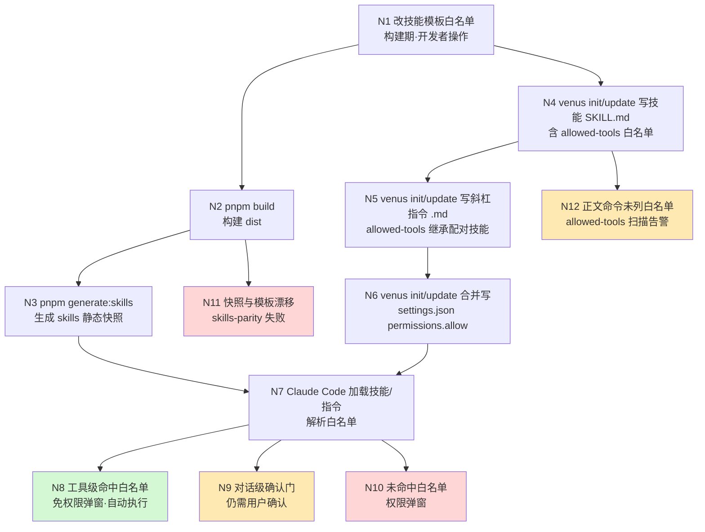

# 探索：全流程工具调用白名单自动化（allowed-tools 白名单控制）

- **探索文件**：`openspec/explorations/allowed-tools-whitelist-explore-001.md`
- **创建时间**：2026-09-28
- **状态**：1.1.2 提示词校验门 —— **不明确，阻塞等待用户确认**

---

## 1.1.2 提示词校验门（Prompt Validation Gate）

**原始提示词**：

> 检查所有指令SKILL流程/全编排流程-除确认门需要用户确认的外，其他的skill间调用、codegraph、grep调用 都增加白名单控制，自动执行

### 维度自检

| 维度 | 判定 | 说明 |
| :--- | :--- | :--- |
| 目标 Goal | ✅ | 让非确认门的工具调用免权限拦截、自动执行 |
| 对象 Object | ⚠️ | 「所有指令SKILL流程/全编排流程」——是全部 27 个技能+27 个指令，还是仅编排类（workflow / auto-workflow / genfull / debug / auto-migration / migration-check）？ |
| 范围 Scope | ❌ | 未指明工具清单：`Skill(...)` 技能间调用、`mcp__codegraph__*` MCP 调用、`Grep`、`Task/Agent` 子代理派发——哪些纳入？`Read/Write/Edit/Glob` 是否一并放行？ |
| 约束 Constraints | ❌ | **载体未定**：是技能/指令 frontmatter 的 `allowed-tools`，还是项目 `.claude/settings.json` 的 `permissions.allow`，抑或两者？二者机制不同、产物不同 |
| 验收 Acceptance | ⚠️ | 「自动执行」如何在仓库内被验证（单测断言白名单条目数/条目内容？）未指明 |
| 歧义 Ambiguity | ❌ | 现存**明文决策**与本次诉求相悖（见下） |

### 结论：**不明确** → 执行提示词优化，阻塞等待确认

---

## 1.1.2 优化后的提示词（【优化后提示词】）

> 在本仓库（VenusAgentTools）中，为全部 venus 技能与斜杠指令（含编排类工作流）补齐**工具调用白名单**，使除「确认门」之外的调用（技能间 Skill 调用、CodeGraph MCP 调用、Grep/Glob/Read 检索、子代理派发）在 Claude Code 中免权限拦截、**自动连续执行**，不因逐次权限弹窗打断管线。
>
> **白名单载体**：`[待确认]` ——（A）技能 SKILL.md / 指令 .md 的 frontmatter `allowed-tools`；（B）目标项目 `.claude/settings.json` 的 `permissions.allow`；（C）两者。
>
> **纳入白名单的工具类别**：
> 1. 技能间调用（`Skill(venus_*)` 或裸 `Skill`）`[待确认]`
> 2. CodeGraph MCP（`mcp__codegraph` 或逐工具枚举）`[待确认]` —— **与既有明文决策冲突，见「冲突」**
> 3. `Grep` / `Glob` / `Read` `[推断]`（检索类只读，与「自动执行」诉求一致）
> 4. 子代理派发（`Task` / `Agent`）`[待确认]`
> 5. 写类工具 `Write` / `Edit` 与构建命令 `Bash(pnpm:*)` 等：`[待确认]` 是否随技能既有白名单保持不变、不扩大
>
> **保持不变**：提示词校验门（1.1.2）、功能流程图确认门（1.5.5）、设计确认门、L1-L5 追问门等**对话级确认门**仍须用户确认——白名单只消除工具级权限弹窗，不改变确认门语义。
>
> **同步范围** `[推断]`：模板（`src/core/templates/workflows/*.ts`）为唯一真源 → `pnpm build && pnpm generate:skills` 重生成 `skills/` 快照 → 相关测试（`test/allowed-tools.test.ts`、`test/commands.test.ts`）→ 文档（`docs/skills-manual.md` 等）→ 版本号与 CHANGELOG。

### 【优化说明】

1. **未篡改原始意图**：“除确认门外都白名单化并自动执行”原样保留，未新增用户未提出的需求。
2. **补全的必要信息**：
   - 「对象 Object」的粒度未定 → 转为「全部技能与指令」的完整表述（原文“所有…/全编排流程”取**全集**解读），并标 `[待确认]`。
   - 「范围 Scope」原文只点了 skill 间调用 / codegraph / grep 三项 → 保留三项为**必做**，其余（Read/Glob/Write/Edit/Task）标 `[推断]` 或 `[待确认]`，避免擅自扩大授权面。
   - 「约束 Constraints」的载体二选一是本次**核心未知项**，标 `[待确认]`。
3. **消歧结构**：标题改为「全流程工具调用白名单自动化」，「白名单」限定为 Claude Code 权限白名单语义，排除「归档标签白名单」等既有同名词。
4. **风险显式化**：原文未提及与既有决策的冲突，已单列「冲突」小节供用户裁决。

---

## ⚠️ 与既有明文决策的冲突（必须裁决）

| # | 既有决策位置 | 原文 | 与本次诉求的关系 |
| :- | :--- | :--- | :--- |
| C1 | `openspec/specs/tr-commit-push-skill/explorations.md:17` | “MCP 工具（`mcp__llm-wiki__*`）**不显式列入白名单**（对齐 tr-impl-workflow 引用 codegraph MCP 先例）” | **直接相悖**：本次要求 codegraph MCP 纳入白名单。若采纳，该先例需一并推翻并记录 |
| C2 | `openspec/specs/tr-workflow-suite-skills/explorations.md:15` | “auto-workflow 含 `Agent`（多项目扫描）” | **已漂移**：实测 `tr-impl-auto-workflow.ts:630` 白名单**无 `Agent`/`Task`**，但正文 1.2.1.5 与 Phase 4 均要求派发子代理 → 现存缺口 |
| C3 | `openspec/specs/tr-workflow-suite-skills/explorations.md:71` | “共享块不得含 Bash 命令 → `tr-impl-workflow` / `tr-impl-genfull` 的 allowedTools 无 pnpm/npm” | **约束项**：若新增“自动执行构建/测试”诉求，与此约束冲突 |
| C4 | `openspec/specs/spec-workflow-skills/explorations.md:80` | `spec-verify-proposal` 白名单为只读（无 Write/Edit）→ 强制**只读评分** | 白名单承载**语义约束**，扩大时不得破坏该约束 |
| C5 | `AGENTS.md` 守则 2 | “改模板正文的命令时同步更新 `allowedTools`” | 本次改动属该守则的**反向驱动**（先扩白名单再核正文） |

---

## 1.1.5 CONTEXT.md 启动检查

已加载 `openspec/CONTEXT.md`（190 行术语表）。本次直接相关术语：

- **workflow**：技能+指令成对单元，共 23 个（注：实测 `getSkillTemplates()` 为 **27** 项，术语表存在**陈旧**风险 `[待确认]`）
- **提示词校验门 / 提示词基线**：本次 1.1.2 所用机制
- **前置验证门 / 后置验证**：下游 Phase 3 相关

本变更**暂未引入新术语**；「工具调用白名单」与既有「归档标签白名单」需区分，归档阶段考虑补入术语表。

---

## 1.2.0.5 能力探索记忆注入（capability memory）

扫描 `openspec/specs/*/explorations.md`，命中的历史决策：

- `tr-workflow-suite-skills` **D9**：白名单按正文实际工具**逐项核对**（不是假设）；auto-workflow 曾含 `Agent`
- `tr-workflow-suite-skills` **D6**：Semgrep MCP 保留引用、标注可选增强（不可用则跳过不阻塞）
- `tr-commit-push-skill` **D11**：MCP 工具**不显式列入**白名单 ← **C1 冲突源**
- `tr-migration-skills` **D6**：三技能白名单分技能盘点（feature-doc / migration-check 不含 venus CLI，auto-migration 含）
- `spec-bulk-archive-skill` **D9**：`Task` 用于子代理派发（并行验证/调查/归档）
- `release-package` **D13**：白名单依据为**正文实际命令逐项盘点**，仅只读扫描命令才放行
- `spec-workflow-cli` / `spec-workflow-skills` / `tr-test-generate`：`tr-impl-auto-workflow.ts` 曾缺 mvn/gradle/ant/go/cargo（**已修复**，现状第 630 行已含）

---

## 1.2.1 CodeGraph 基础扫描（Codebase Findings）

**索引状态**：`.codegraph/` 存在（`codegraph_status` 已确认可用）。

### 架构事实（真源 → 产物链路）

```
src/core/templates/workflows/*.ts        ← 唯一真源（27 个技能模板 + 27 个指令模板）
  ├─ SkillTemplate.allowedTools          ← 技能白名单字段（必填，frontmatter allowed-tools）
  └─ CommandTemplate                      ← 无 allowedTools 字段！
        ↓ src/core/command-generation/generator.ts
        ↓ adapters/claude.ts             ← 指令白名单**硬编码**为 `Bash(venus:*)`
skills/<name>/SKILL.md                   ← 静态快照（入库，npm 包/git 分发）
.claude/skills|commands/                 ← 本机 dogfood 产物（.gitignore 排除，不入库）
```

### 关键发现

**F1｜指令白名单被硬编码为单一值（核心缺口）**
`src/core/command-generation/adapters/claude.ts:14` 导出 `VENUS_CLI_ALLOWED_TOOLS = 'Bash(venus:*)'`，`formatFile()` 对**全部 27 个指令**一律写死 `allowed-tools: Bash(venus:*)`。
→ 通过 `/venus:tr-impl-auto-workflow` 等斜杠指令执行时，`Read`/`Grep`/`Glob`/`mcp__codegraph__*`/`Skill(...)` **全部**触发权限弹窗。
→ 而技能模板携带完整白名单的只有 SKILL.md 路径。**指令路径是本次诉求的主要落点。**

**F2｜MCP 调用未列入任何白名单**
正文实际调用 MCP：`mcp__codegraph__*`（tr-impl-workflow:628-642、auto-workflow:384/446、genfull:134）、`mcp__plugin_semgrep_semgrep__*`（tr-impl-workflow:618-621）、`mcp__llm-wiki__*`（tr-commit-push:227-229）。
白名单仅含 CLI 形态 `Bash(codegraph:*)`——**MCP 与 CLI 是两套工具名**，前者不被后者覆盖。

**F3｜技能间 `Skill` 调用未列入任何白名单**
正文以 Skill 工具委派子技能：`venus_spec_verify_proposal`（auto-workflow Phase 3，正文第 507 行明确写 "via Skill tool"）、`venus_tr_impl_review_proposal`、`venus_tr_docs_requirement_doc` 等。

> **实现期更正**：本条原把 auto-workflow 的 `venus_spec_apply`（Phase 4）/ `venus_spec_archive`（Phase 5）也列为 Skill 委派——**错误**。实测其正文第 540/580 行为 "Execute the apply/archive workflow logic (**following** the venus_spec_apply/venus_spec_archive skill's Step 6+ ... behavior)"，属**内联复刻**而非 Skill 工具调用；同文件对真正的委派一律显式标注 "via Skill tool"，形成清晰对照。故该两技能**未**写入 auto-workflow 的 `Skill(...)` 条目（遵循最小权限）。

**F4｜`Task`/`Agent` 覆盖不一致**
`spec-bulk-archive` 白名单含 `Task`；`tr-impl-auto-workflow` 白名单**无** `Task`/`Agent`，但正文要求派发子代理（多项目扫描、Phase 4 批调度）→ 见 C2。

**F5｜`Grep` 已在技能白名单，但不在指令白名单**
27 个技能模板中绝大多数已含 `Grep`/`Glob`/`Read`；仅指令路径缺失（同 F1）。

**F6｜白名单承载语义约束，不可无脑统一扩张**
`spec-verify-proposal` 靠「无 Write/Edit」保证**只读评分**（C4）；`spec-verify`（`Bash(venus:*), Read, Glob, Grep`）同为只读；若改为全量统一白名单会破坏该约束 → **需分层设计**。

> **实现期更正**：本条原写「`spec-archive` 无 Write」——**错误**。实测 `spec-archive` 含 `Write`/`Edit`（`Read, Write, Edit, Glob, Grep, Bash(venus:*), Bash(codegraph:*), Bash(ls:*)`），不属只读技能。只读技能是 `spec-verify-proposal` 与 `spec-verify`。该错误曾传播进上下文包，已一并更正（design.md D8 / tasks.md 5.2）。

**F7｜现存约束与校验**
- `test/allowed-tools.test.ts`：硬断言（pwd/git/venus/codegraph 条目）+ 正文命令扫描**仅告警**；且 `Bash(*)` 存在时**跳过**扫描
- `test/generation.test.ts:64`：断言 `allowed-tools: Bash(venus:*)` ← 改动指令白名单必触发；同文件 :52-62 手工构造 `CommandContent`（无 `allowedTools`），字段改必填后**编译期即失败**
- `test/commands.test.ts`：**无** `allowed-tools` 断言（实测零命中）——端到端用例只断言文件存在与技能 frontmatter 字段
- `test/subagent-resource-sharing.test.ts:32`：仅读 `getCommandTemplates().template.content`，不碰 frontmatter → **不受影响**
- `test/generation.test.ts:22`：断言 SKILL.md frontmatter 与模板一致
- `AGENTS.md` 守则 1/2/8：改模板须 `pnpm build && pnpm generate:skills`；同步白名单；递增版本号 + CHANGELOG

**F8｜文档面漂移**
`docs/skills-manual.md`（20+ 处逐技能列白名单）、`docs/genfull-guide.md:88`、`docs/migration-suite-guide.md:68/372/436` 均硬列白名单 → 改动需同步。

**F9｜术语表陈旧**
`openspec/CONTEXT.md` 记 workflow「共 23 个」，实测 `getSkillTemplates()` 返回 **27** 项。

---

## Questions（阻塞项，待用户回答）

| # | 问题 | AI 建议 |
| :- | :--- | :--- |
| Q1 | **白名单载体**：(A) 技能/指令 frontmatter `allowed-tools`；(B) 项目 `.claude/settings.json` 的 `permissions.allow`；(C) 两者都做 | **建议 C**：(A) 是随技能分发、任何项目 install 即生效的**可移植**方案，也是仓库既有机制；(B) 只能覆盖当前本机、不入库（`.gitignore` 排除 `.claude/`），无法随技能交付。但 (A) 无法覆盖「未通过指令/技能触发的普通对话」场景 |
| Q2 | **改动范围**：全部 27 技能 + 27 指令，还是仅编排类 6 个？ | **建议全部 27+27**（诉求原文为“所有…/全编排流程”） |
| Q3 | **C1 冲突裁决**：是否推翻既有「MCP 不显式列入白名单」决策？ | **建议推翻**——该决策形成时 MCP 调用未纳入自动执行诉求；本次明确要求 codegraph 自动执行。推翻后须在能力记忆标注旧决策为**已过时**（不删历史） |
| Q4 | **`Skill` 条目的写法**：裸 `Skill`（放行全部技能）还是逐技能 `Skill(venus_xxx)`？ | **建议逐技能白名单**：仅放行正文实际委派的 venus 子技能，权限面最小且可审计。若 CC 不支持该语法则降级裸 `Skill` `[待确认-技术]` |
| Q5 | **codegraph 写法**：`mcp__codegraph`（整服务器）还是逐工具枚举？ | **建议 `mcp__codegraph`**：9 个工具逐一枚举冗长且新增工具即失效 |
| Q6 | **是否纳入 `Task`/`Agent`**：修复 F4 缺口？ | **建议纳入**，按技能实际是否派发子代理区分（auto-workflow/genfull/bulk-archive 等） |
| Q7 | **是否纳入 Write/Edit 与构建命令**：扩展授权面？ | **建议不扩大**：维持各技能既有 Write/Edit/Bash 条目不变，本次只补「调用类」缺口（MCP / Skill / Task），保住只读技能（verify-proposal、archive）的语义约束 |
| Q8 | **指令白名单如何取数**：指令是否继承其配对技能的白名单？ | **建议继承**：指令是技能正文的压缩派生版，白名单亦应派生自配对技能模板（消除 F1 硬编码），但**须先征得用户同意改 `claude.ts` 契约** |

---

## 1.1.2 门结论（已确认）

**出口：确认（含修改）。** 用户于本轮确认如下四项关键裁决，其余项按 AI 建议采纳：

| 问题 | 裁决 | 结论 |
| :- | :--- | :--- |
| Q1 白名单载体 | **A + C 两者都做** | A：技能/指令 frontmatter `allowed-tools`（随技能分发，仓库既有机制）；C：另出 `.claude/settings.json` 的 `permissions.allow`（补足跨轮次场景） |
| Q2 改动范围 | **全部 27 技能 + 27 指令** | 对齐原文「所有…/全编排流程」的全集解读 |
| Q3 C1 冲突裁决 | **推翻旧决策** | codegraph MCP 纳入白名单；旧决策在能力记忆标注「已过时」而非删除 |
| Q5 MCP 写法 | **`mcp__codegraph` 整服务器放行**（见 T2 反证，建议加固） | 原始裁决为整服务器；技术核查发现该形式有可靠性风险，加固方案见下 |
| Q4/Q6/Q7/Q8 | 采纳 AI 建议 | Skill 逐技能放行；纳入 Agent/Task；不扩大 Write/Edit/Bash 授权面；指令白名单继承配对技能 |

---

## 技术核查（子代理权限语法核查结论）

> 来源：claude-code-guide 子代理。**注意**：该子代理无法直连官方文档域名，结论来自搜索引擎索引、GitHub issue 与 SchemaStore schema，**部分为二手证据**，下面逐条标注可信度。

| # | 结论 | 可信度 | 对设计的影响 |
| :- | :--- | :--- | :--- |
| T1 | `allowed-tools` frontmatter 与 `permissions.allow` **同语法**；逗号分隔形式为文档最终形态（YAML 数组亦有支持，曾有歧义） | 高 | 沿用现有逗号分隔字符串，**不改格式** |
| T2 | 整服务器 MCP 放行有两种写法：裸 `mcp__codegraph` 与 `mcp__codegraph__*`。但存在**两处反证**：issue #73052 报 `__*` 形式约 v2.1.195 后失效而裸形式仍有效；issue #34739 报裸形式与 `__*` **均不自动放行**，仅逐工具全名有效 | 中（二手 + 冲突报告） | **加固方案**：同时写入裸形式 `mcp__codegraph` **与** 9 个具名工具条目——任一路径生效即达成「自动执行」，且未来新增工具仍被裸形式覆盖。冗余仅 9 个条目 |
| T3 | `Skill` 工具：裸 `Skill` 语法合法；「全部技能」的文档写法为 `Skill(*)`，但 `Skill(*)` 在多处被报**不可靠**（项目 `.claude/settings.json` 尤甚）；本地技能用 `Skill(名称)` 精确匹配，**不加** `plugin:` 前缀 | 中 | 采纳**逐技能精确枚举** `Skill(venus_xxx)`，规避 `Skill(*)` 不可靠问题 |
| T4 | 子代理派发工具原名 `Task`，v2.1.63 起更名 **`Agent`**，`Task` 仍作别名可用 | 中 | **同时写入 `Agent, Task`** 覆盖新旧版本；注意 `spec-bulk-archive` 现仅有 `Task`，需补 `Agent` |
| T5 | **关键**：`allowed-tools` 的授权**仅限调用该技能/指令的那一轮次**，用户下一条消息即释放；**不具备会话级效力** | 中高 | **直接印证 Q1 选 A+C 的正确性**——C（`.claude/settings.json`）承担跨轮次/会话级放行，A 只保证单轮管线不被打断 |
| T6 | `allowed-tools` **不是限制而是放行清单**：未列出的工具仍可调用，只是需要审批 | 中高 | 影响 F6 的「只读约束」性质：`spec-verify-proposal` 无 Write/Edit 仅降低自动写文件的能力，**不构成硬约束**；本次不扩大授权面的决策仍成立（避免削弱该意图） |
| T7 | 已知 bug issue #14956：某些版本下技能 `allowed-tools` 对 Bash 授权不生效，绕过方式是写进全局 `permissions.allow` | 中 | 再次支持 A+C 双轨 |
| T8 | `Grep`/`Read`/`Glob`/`Write`/`Edit` 裸名条目合法 | 高 | 沿用现状 |

---

## 1.5.5 功能流程图（Functional Flowchart）



### 节点清单

| 节点 | 操作 | 触发条件 | 证据位置 | 异常路径 |
| :- | :--- | :--- | :--- | :--- |
| N1 | 修改技能模板的 `allowedTools`（补 `mcp__codegraph` / `Skill(...)` / `Agent, Task`） | 开发者发起本次变更 | `src/core/templates/workflows/*.ts`（27 处 `allowedTools:` 字段，如 `tr-impl-auto-workflow.ts:630`） | 白名单与正文不同步 → N12 告警 |
| N2 | 构建 TS → `dist/` | N1 之后 | `build.js` / `package.json:build` | 编译失败 → `tsc` 报错阻断 |
| N3 | 重新生成 `skills/` 静态快照 | N2 之后（AGENTS.md 守则 1） | `scripts/generate-skills.mjs:31` | 未执行 → N11 测试失败 |
| N4 | 写 `.claude/skills/venus_*/SKILL.md`（frontmatter 含 `allowed-tools`） | `venus init`（或 `update`） | `src/commands/init.ts:126-138`；`src/core/command-generation/generator.ts:68` | 文件已存在且无 `--force` → 跳过 |
| N5 | 写 `.claude/commands/venus/*.md`（frontmatter `allowed-tools` **改为继承配对技能**） | 同上，紧随 N4 | `src/commands/init.ts:142-150`；适配器 `src/core/command-generation/adapters/claude.ts:14,27`（现状硬编码） | 同上跳过逻辑 |
| N6 | 合并写入 `.claude/settings.json` 的 `permissions.allow`（不覆盖用户既有配置） | 同上 | **`[新建]`** 预期产物：`src/core/permissions.ts` + `init.ts` / `update.ts` 调用点；现状无此能力 | 既有 settings.json 非法 JSON → 保留原文件并 WARN |
| N7 | Claude Code 解析技能/指令白名单并生效 | 技能或指令被调用 | 运行时行为，无仓库内证据 | 白名单语法非法 → 该条静默失效 → N10 |
| N8 | 命中白名单的调用免弹窗直通（MCP / Skill / Grep / Read 等） | N7 命中 | 运行时行为（T5：**仅限当轮**） | — |
| N9 | 提示词校验门（1.1.2）、功能流程图门（1.5.5）、设计确认门、L1-L5 追问门 | 流程抵达门 | `src/core/templates/prompt-gate.ts`、`flowchart-gate.ts`；各编排模板 Guardrails 段 | **不受白名单影响**——白名单只解工具级弹窗，不改对话级确认 |
| N10 | 未命中白名单 → 权限弹窗打断管线 | N7 未命中 | 运行时行为 | 本次变更要消除的主症状 |
| N11 | `skills/` 快照与模板不一致 → 测试失败 | N1 后未跑 N2/N3 | `test/skills-parity.test.ts` | 阻断提交 |
| N12 | 正文出现的命令未列入白名单 → 告警（不拦截） | N4 产物被扫描 | `test/allowed-tools.test.ts:163-204` | 仅 `console.warn`；`Bash(*)` 存在时跳过扫描 |

---

## 1.2.4 关键词分析（Security / Architecture Flow / Impact Analysis —— 强制运行）

### Security（安全 —— 本变更本身即权限面扩张）

- **本质**：白名单是**授权清单**，本次改动 = 主动扩大 AI 在目标项目中的免审批权限面。属安全敏感变更，须在提案中以「最小权限」原则自证。
- **约束自证**：D5 逐技能枚举（非 `Skill(*)`）+ D4 具名 MCP 枚举 + 不扩大 Write/Edit/Bash（D1）→ 三点共同保证「只放行正文实际会做的事」。
- **风险点 R1**：`Agent, Task` 放行子代理，子代理继承权限上下文 → 授权面**传递**。缓解：仅对正文确有子代理派发的技能放行（见下逐技能清单）。
- **风险点 R2**：C 载体（`settings.json`）为**会话级**放行，效力强于 A。缓解：仅写入 venus 技能所需条目，不写 `Bash(*)` 一类全量条目；合并写入时**不删除**用户既有条目、不写 `deny`。
- **风险点 R3**：`src/commands/generate.ts:73` 生成的骨架技能白名单含裸 `Bash`（等价 `Bash(*)`，全量放行）——存量既有行为，本次**不改**（超范围），但记录为待评估项。
- **无新增数据外泄路径**：不涉及凭据、网络出口、SQL 变更。

### Architecture Flow（架构流）

影响链路仅两处契约点，其余为数据：

1. **指令白名单数据源**：`CommandContent`（`types.ts:8-22`）当前**无** `allowedTools` 字段 → 适配器只能硬编码（F1）。改为在 `registry.ts` 的 `WORKFLOW_PAIRS` 后统一回填配对技能的 `allowedTools`，`CommandContent` 增加该字段，适配器读取它。**一处加字段 + 一处回填 + 一处读取**，三处改动闭合。
2. **新能力落点**：C 载体需新增权限合并写入模块，由 `init.ts` / `update.ts` 调用。

### Impact Analysis（影响面，codegraph_impact 实测 + 静态检索）

| 受影响对象 | 影响方式 | 证据 |
| :--- | :--- | :--- |
| `generateSkillContent` | 无需改动（已透传 `template.allowedTools`） | `generator.ts:58-68` |
| `generateCommand` / `formatFile` | 需改动（取内容字段而非常量） | `adapters/claude.ts:14,23-27` |
| `CommandContent` | 新增 `allowedTools` 字段（可选，缺省回退常量以兼容 `generate.ts` 骨架） | `command-generation/types.ts` |
| `getCommandTemplates` | 影响面含 `init.ts`、`update.ts`、`test/subagent-resource-sharing.test.ts` | `registry.ts:176`；codegraph_impact 实测 6 符号 |
| `runInit` / `runUpdate` | 调用点改动 + C 载体新增写入步骤 | `init.ts:105,142-150`；`update.ts:144-158` |
| `parseFrontmatter` / `show` | 仅读取，无改动 | `show.ts:77` |
| `validate` | 仅校验字段存在，无改动 | `validate.ts:111-113` |
| `deriveCommandContent` | **无影响**（只派生正文，不碰 frontmatter） | `derive-command.ts:23` |
| 27 个模板 `allowedTools` | 逐条补齐调用类条目 | `src/core/templates/workflows/*.ts` |
| `skills/` 快照 27 + 27 | 全量重生成 | `scripts/generate-skills.mjs` |
| 测试 3 个文件 | `commands.test.ts:64` 必改；`allowed-tools.test.ts` / `generation.test.ts:64` 需扩展 | — |
| 文档 3 个文件 | `docs/skills-manual.md` 等 20+ 处硬列白名单 | — |

**未受影响**：`derive-command.ts`、`spec-*` 派生产物、`profiles.ts`（workflow 过滤）、`reconcile.ts`、`.venus/rules/` 注入。

---

## Decisions

**D1（载体 A）**：技能与指令的 frontmatter `allowed-tools` 为白名单主载体。技能模板 `allowedTools` 补齐「调用类」缺失条目（MCP / Skill / Agent·Task），**保持各技能既有 Write/Edit/Bash 条目不扩大**（护住 T6 所述只读意图）。

**D2（载体 C）**：`venus init` / `venus update` 额外**非破坏性合并**写入 `.claude/settings.json` 的 `permissions.allow`（读→合并→去重→写；既有文件非法 JSON 时保留不覆盖并 WARN），提供会话级放行，弥补 T5 的单轮次局限。本项目 `.claude/` 已在 `.gitignore` 中，dogfood 产物不入库。

**D3（推翻 C1）**：codegraph MCP 纳入白名单。`tr-commit-push-skill/explorations.md:17` 的旧决策标注「**已过时**」保留历史，不删除。

**D4（加固 T2）**：MCP 条目同时写裸形式 `mcp__codegraph` **与** 9 个具名工具，规避整服务器形式的多处失效报告。

**D5（T3）**：Skill 条目**逐技能精确枚举**（`Skill(venus_xxx)`），不用 `Skill(*)`；清单**按正文实际委派**逐技能盘点，而非「出现即收录」——避免因散文中提及他技能而误扩授权面。

**D6（T4）**：子代理派发条目同时写 `Agent, Task`（新旧版本兼容）；`spec-bulk-archive` 补 `Agent`。

**D7（F1 修复）**：指令白名单由硬编码 `Bash(venus:*)` 改为**继承配对技能模板的 `allowedTools`**；在 `registry.ts` 的 `WORKFLOW_PAIRS` 处统一回填，避免 27 行逐一改动。

**D8（契约与推进顺序）**：`SkillTemplate.allowedTools` 已是必填字段，本次**不新增 frontmatter 字段、不改字段名与语法格式**——**frontmatter 契约未变**，版本号递增按 minor（功能新增/变更）判定。

> **精确化（验证阶段修订）**：内部类型 `CommandContent` 会新增必填字段 `allowedTools`（design.md D5）——这是**生成器内部的数据搬运**，其产物 frontmatter 字段本就存在，仅取值来源由常量改为继承，故不构成 frontmatter 契约变更。前句「不新增必填字段」的射程限缩为**模板与产物 frontmatter**，不含内部生成器类型。

**D9（独立子问题）**：`CONTEXT.md` 术语表记 workflow「共 23 个」而实测为 27（F9），属**陈旧**。本次变更归档时是否顺带修正，`[待确认]`（建议顺带，成本极低）。

---

## 1.5.5 流程最终确认门 —— 已通过

**出口：确认，按图推进。** 12 个节点与流程图作为提案生成锚点。补充裁决三项：

| 问题 | 裁决 | 结论 |
| :- | :--- | :--- |
| C 载体落点 | **init + update 都写** | 两处均为非破坏合并；update 保证存量项目升级后可获得新增条目 |
| 子代理放行范围 | **仅正文确有派发的技能** | 逐条核准后放行，**不整类放行**；顺带修复 auto-workflow 既有漂移 |
| 版本与附带 | **minor 递增 + 顺带修正 CONTEXT.md** | `1.6.0 → 1.7.0`；CHANGELOG 归档 `[Unreleased]`；术语表 23 → 27 |

### 补充决策

**D10（C 载落点）**：`init.ts` 与 `update.ts` 均调用权限合并写入；合并语义为「读 → 并入 allow 数组 → 去重 → 写」，**不删除**用户既有条目、**不写** `deny`/`ask`。

**D11（子代理放行）**：`Agent, Task` 仅写入正文确有子代理派发的技能白名单（按 D5 同法逐条核准）；同时修复 `tr-impl-auto-workflow` 既有的「正文要求派发但白名单无条目」漂移（C2）。

**D12（版本与附带）**：`package.json` `1.6.0 → 1.7.0`（minor：功能新增/变更）；`CHANGELOG.md` 把 `[Unreleased]` 归档为 `## [1.7.0]` 并补链接定义；顺带修正 `openspec/CONTEXT.md` 术语表 workflow 计数 23 → 27。

### 遗留（不阻塞，记入提案待办）

- **R3**：`src/commands/generate.ts:73` 骨架技能白名单含裸 `Bash`（等价全量放行）—— 存量行为，本次**不改**（超范围），记入提案的「后续评估」。
- **逐技能 Skill/子代理委派清单**：`grep` 初筛含散文提及噪音，**必须逐条人工核准**后才可写入白名单（D5）—— 该核准在实现阶段执行，不得采信 grep 结果。

---

## 1.6 Completion Check

| 检查项 | 结论 |
| :- | :--- |
| **一致性** | ✅ 无硬冲突。Q1-Q3 已裁决 C1 冲突（推翻旧决策，标注已过时）；C2 漂移纳入修复范围；C3/C4 约束被 D1（不扩大授权面）与 D5（逐技能枚举）继承 |
| **L1-L5 覆盖** | L1 意图（消除工具级弹窗打断）✅ / L2 方案（A+C 双载体 + 三类条目补齐）✅ / L3 异常（JSON 非法、白名单语法非法、快照漂移、扫描告警）✅ / L4 一致性（测试 3 处、文档 3 处、AGENTS 守则、版本号）✅ / L5 边界（只读技能语义约束、授权面传递、MCP 写法失效风险、R3 骨架全量 Bash）✅ |
| **文件完整** | ✅ Background / 提示词基线 / 功能流程图 / Codebase Findings / Questions / 术语表（引用 CONTEXT.md）/ 架构决策 / 边界场景 / Decision Process / Decisions / Scope Changes / Pending 齐备 |
| **可推进** | ✅ 无硬冲突 → **一致性直通 Phase 2** |

## Scope Changes

_（无）_

## Pending

**全部已闭环**（详见「1.5.5 流程最终确认门 —— 已通过」与 proposals/tasks）：

- [x] 1.5.5 功能流程图与流程最终确认门 → 已确认，按图推进
- [x] 逐技能 Skill 委派清单盘点（D5）→ 转为实现期任务 `tasks.md 1.2`（明确 MUST NOT 采信 grep 结果）
- [x] C 载体 CLI 落点 → D10：`init` + `update` 都写
- [x] 文档同步面清点 → `tasks.md 4.2–4.5`
- [x] 测试改动 → `tasks.md 5.1–5.7`
- [x] 变更命名 → `improve-skills-tool-whitelist`
- [x] 版本号递增判定 → D12：minor（1.6.0 → 1.7.0）
- [x] CONTEXT.md 术语修正 → D12 + `tasks.md 4.5`

**遗留（不阻塞）**：`src/commands/generate.ts:73` 骨架技能白名单含裸 `Bash`（等价全量放行）——存量行为，本变更不改，记入提案「明确不做」段作后续评估。

### 逐技能能力盘点（grep 初筛，**待人工核准**）

> ⚠️ 下表由 `grep` 生成，含散文提及噪音（如 `tr-tools` 列举的是它介绍的技能、`tr-impl-review-proposal` 的 `venus_user` 是业务示例）。**D5 要求逐条核准后才可写入白名单**。

| 模板 | codegraph 引用 | 子代理引用 | 需人工核准的 Skill 委派 |
| :--- | :--- | :--- | :--- |
| tr-impl-genfull.ts | 4 | 2 | spec_explore, tr_impl_frontend, spec_propose, tr_impl_review_proposal, tr_docs_requirement_doc, spec_apply, tr_test_generate, spec_archive |
| tr-impl-debug.ts | 23 | 0 | tr_test_generate |
| tr-impl-auto-workflow.ts | 16 | 10 | spec_verify_proposal, tr_impl_review_proposal, tr_docs_requirement_doc, spec_apply, spec_archive |
| tr-impl-workflow.ts | 35 | 16 | 待核准（含 spec_explore / spec_verify_proposal / tr_impl_review_proposal / tr_docs_requirement_doc） |
| tr-impl-auto-migration.ts | 1 | 13 | tr_docs_feature_doc, tr_impl_migration_check |
| tr-impl-migration-check.ts | 0 | 0 | — |
| tr-docs-feature-doc.ts | 7 | 0 | — |
| spec-explore.ts | 3 | 0 | — |
| spec-archive.ts | 1 | 0 | — |
| spec-bulk-archive.ts | 1 | 14 | — |
| spec-apply.ts | 0 | 24 | 待核准（子代理派发为主） |
| spec-propose.ts | 0 | 3 | spec_verify_proposal |
| 其余 15 个 | 0 | 0 | 无 codegraph / 无委派 → 仅需基底条目 |

