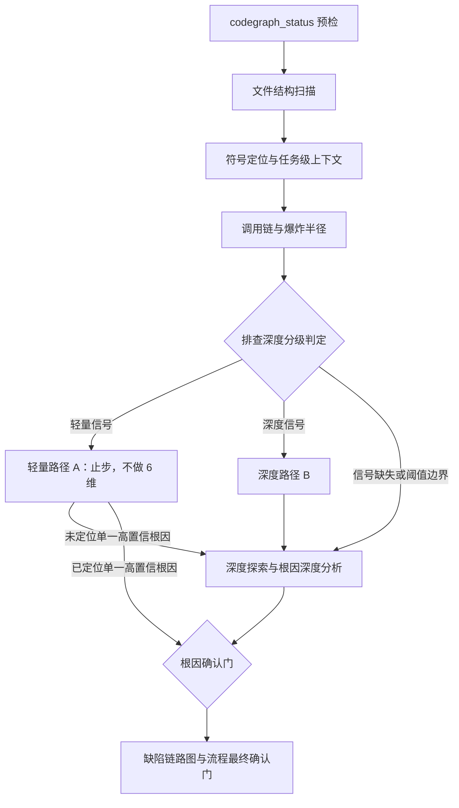
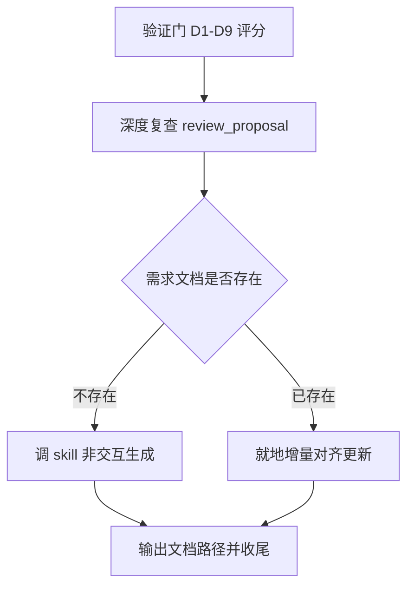

# debug 技能两处编排逻辑优化 — 探索记录

> 探索对象：VenusAgentTools 自身 `venus_tr_impl_debug` 技能模板（`src/core/templates/workflows/tr-impl-debug.ts`）
> 目标：优化 1）排查深度分级逻辑（事前按需求大小/范围判定轻量 vs 深度）；2）需求文档更新逻辑（已有文档时判定生成 vs 就地对齐更新）

## Background

用户原始诉求（原文）：

> 分析优化debug指令skill，1）探索深度逻辑优化，根据需求大小、涉及范围，来确定是在功能逻辑内处理，还是需要深度探索；2）需求文档更新逻辑调整，根据实际情况判断是否调用skill指令，进行生成文档还是直接对齐已有文档进行更新

---

## 提示词基线

> **状态：已确认（2026-09-28）** —— 用户就三个方案问题（分级机制 / 分级依据 / 文档更新分支）给出裁决，据此视为对优化后提示词的确认；Q1 门出口未单独作答，经判定按「确认，按此继续」处理（避免确认门死锁）。

### 原始提示词

（见上 Background 段引文）

### 校验结论

| 维度 | 判定 | 说明 |
| :--- | :--- | :--- |
| 目标 Goal | ✅ | 优化 `venus_tr_impl_debug` 技能的两处编排逻辑 |
| 对象 Object | ⚠️ 轻微 | "debug 指令 skill" 推断为本项目 `venus_tr_impl_debug`（skill + 手写 command 双产物），排除同名 `openspec-debug` |
| 范围 Scope | ⚠️ 实质 | 两处落点方向明确（Phase 2 排查深度、Phase 7.3 需求文档），具体落点与既有步骤的关系未指定 |
| 约束 Constraints | ❌ | 未提及（可从 AGENTS.md / 既有规约推导 → [推断]） |
| 验收 Acceptance | ❌ | 未提及（可从既有测试体系推导 → [推断]） |
| 歧义 Ambiguity | ⚠️ 实质 | 分级判定标准未定义；"直接对齐已有文档进行更新"的语义与判定依据未定义 |

### 优化后提示词（已确认 · 下游唯一语义来源）

> 优化 `venus_tr_impl_debug` 技能（`src/core/templates/workflows/tr-impl-debug.ts`，含 skill 正文 + 手写 command 压缩版正文两层，二者语义须一致）的两处编排逻辑，同步 delta spec 与生成产物快照：
>
> **1）排查深度分级**：在 Phase 2（排查定位）引入「按 bug 大小与影响范围**事前**判定排查深度」的机制——轻量缺陷走"功能逻辑内处理"路径（限 2.2.1–2.2.3 常规查询，不做 6 维深度分析）；重缺陷直接进入深度探索路径（`codegraph_explore` + 6 维根因分析）。
>
> **2）需求文档更新逻辑**：调整 Phase 7.3 需求文档产出的分支判定——当变更目录内**已存在** `需求文档.md`（如来自 tr-impl-workflow / auto-workflow 的先前产出）时，不再无条件调 skill 覆盖重生成，而是按实际情况判定「调 `venus_tr_docs_requirement_doc` skill 重新生成」还是「由 debug 技能就地增量对齐更新已有文档」（保留人工填写的基本信息、评审记录等非生成内容）。

### 门内裁决（[待确认] 项的消解结果）

| 待确认项 | 裁决 | 说明 |
| :--- | :--- | :--- |
| 分级机制与既有 2.2.4 的关系 | **事前分级 + 2.2.4 事后触发保留为升级兜底** | 新增 2.2.4「排查深度分级」事前选路径（轻量 A / 深度 B）；原 2.2.4 事后触发顺位为 2.2.5「升级兜底」——路径 A 未定位单一高置信根因时升级进深度路径 |
| 分级判定信号 | **代码库客观信号** | `codegraph_impact` 爆炸半径（受影响符号/文件数）+ 是否跨模块 + 根因是否在 2.2.2 一步可定位；不增加用户交互 |
| 需求文档已存在时的处理 | **分支：存在则就地对齐** | 已存在 → debug 就地增量对齐（保留人工填写的基本信息/评审记录等非生成内容）；不存在 → 调 skill 生成 |

### 推断项（[推断]，待探索阶段验证或用户纠正）

- **约束**：技能名/类型/总数不变；frontmatter `allowedTools` 与正文命令同步；改动后依次 `pnpm build && pnpm generate:skills` 且 `pnpm test` 全绿；不修改 `deriveCommandContent` 派生器；版本号按 AGENTS.md 守则 8 递增 + CHANGELOG 归档同步提交
- **验收**：`pnpm build` + `pnpm test`（含 `skills-parity` / `allowed-tools`）全绿；skill 与 command 两版正文语义一致；delta spec 覆盖新增行为；生成产物快照更新

---

## 功能流程图

> 流程基准 = **改造后 `venus_tr_impl_debug` 技能的运行编排流程**（本变更为技能模板变更，其"业务功能"即技能的编排行为）。节点 id 全局唯一递增，图中与表中一致。

### 流程 1：Phase 2 排查深度分级链路



### 流程 2：Phase 7.3 需求文档更新分支链路



### 关键操作节点清单

| 节点 | 操作 | 触发条件 | 证据位置 | 异常路径 |
| :--- | :--- | :--- | :--- | :--- |
| N1 | codegraph_status 预检 | Phase 2 开始（强制首动作） | `tr-impl-debug.ts:141-148` | 不可用 → Glob/Grep 降级，记入诊断记录 |
| N2 | 文件结构扫描（files / Glob 降级） | N1 完成 | `tr-impl-debug.ts:150-155` | — |
| N3 | 符号定位与任务级上下文（search + context） | N2 完成 | `tr-impl-debug.ts:157-161` | — |
| N4 | 调用链与爆炸半径（callers/callees/impact） | N3 完成 | `tr-impl-debug.ts:163-167` | — |
| N5 | **排查深度分级判定**（新增） | N4 完成 | `[新建]` `tr-impl-debug.ts` 2.2.3.5 节（预期产物：三条信号 + 阈值 + 路径选择规则） | 信号缺失或阈值边界 → 取深度路径（D9） |
| N6 | 轻量路径 A：止步，不做 6 维 | N5 判轻量 | `[新建]` 同上 | 未定位单一高置信根因 → N8 升级兜底 |
| N7 | 深度路径 B（进入深度探索入口） | N5 判深度 | `[新建]` 同上（入口）+ `tr-impl-debug.ts:169-183`（2.2.4 内容） | — |
| N8 | 深度探索 + 6 维根因深度分析 | N7；或 N6 未定位根因（升级兜底，D3） | `tr-impl-debug.ts:169-183`（**内容不变，触发条件扩展**） | — |
| N9 | 根因确认门（零假设） | N8 完成；或 N6 已定位根因 | `tr-impl-debug.ts:197-201` | 多候选/置信不足 → STOP 待用户选择 |
| N10 | 缺陷链路图与流程最终确认门 | N9 通过 | `tr-impl-debug.ts:203-218` | 用户拒绝 → 记未确认态继续（D4：与分级解耦，恒强制） |
| N11 | 验证门 D1-D9 评分 | Phase 7 开始 | `tr-impl-debug.ts:378-386` | FAIL → 自动修复循环，不复跑生成 |
| N12 | 深度复查（review_proposal skill） | N11 PASS | `tr-impl-debug.ts:402` | skill 不可用 → 内联复查 + WARN |
| N13 | **需求文档存在性判定**（新增） | N12 完成 | `[新建]` `tr-impl-debug.ts` 7.3 节（预期产物：判定分支 + `path.join()` 路径） | 目录不可读 → WARN + 按不存在处理 |
| N14 | 调 skill 非交互生成需求文档 | N13 判**不存在** | `tr-impl-debug.ts:404-408`（既有行为） | 生成失败/被打断 → WARN + 继续 |
| N15 | **就地增量对齐更新**（新增） | N13 判**已存在** | `[新建]` `tr-impl-debug.ts` 7.3 节（预期产物：人工域白名单 `## 基本信息` / `## 八、评审记录` + 一~七重派生规则） | 文档格式破损 → 补建缺失章节 + WARN |
| N16 | 输出文档路径提示并收尾 | N14 / N15 完成 | `tr-impl-debug.ts:408` | — |

---

## Codebase Findings

### CodeGraph 状态与降级记录

`codegraph_status` → 可用（43 files / 340 nodes / 456 edges，native backend）。但 `codegraph_files`（`src/core/templates`）只列出 12 个文件，`codegraph_search` 对 `TrImplDebug` / `Debug` / `PromptGate` 均返回 **No results**。

**结论：索引陈旧** —— 未覆盖 2026-09-24（`add-prompt-validation-gate` / `add-flowchart-cross-verify`）之后新增的文件（`tr-impl-debug.ts`、`prompt-gate.ts`、`flowchart-gate.ts`、`tr-impl-workflow.ts`、`spec-*.ts`）。

**降级处置**：CodeGraph 已按 1.2.1 要求先做 status/files/search 三步；因目标区域**未被索引**（非"未初始化"），对该区域改用 Grep 补齐，findings 结构保持一致。记录："CodeGraph 部分降级 —— 索引陈旧未覆盖目标文件，Grep 补齐"。

### Discovered Files

- `src/core/templates/workflows/tr-impl-debug.ts`：**主改动目标**。579 行；`getTrImplDebugSkillTemplate()`（:29）正文含 Phase 1–7 + Startup 门 0 + 2.5 缺陷链路图；`getTrImplDebugCommandTemplate()`（:478）**手写压缩正文**（非派生）
- `src/core/templates/workflows/tr-docs-requirement-doc.ts`：需求文档 skill（398 行）。**关键既有规则**（:216）："When the target file already exists, overwrite it silently — regeneration is idempotent and must not block on questions"；输出路径路由（:203-214）按归档状态分派
- `src/core/templates/prompt-gate.ts` / `flowchart-gate.ts`：共享单一源（构建期内联进 5 技能正文）——**本次不改**（改动被 5 技能共享，爆炸半径大且与本需求无关）
- `src/core/templates/registry.ts`：`WORKFLOW_PAIRS` 注册（:120）——注册结构不变，**不改**
- `src/core/profiles.ts`：`'tr-impl-debug': ['tr-docs-requirement-doc', 'spec-verify-proposal']`（:61）——依赖注入关系，**不改**
- `test/templates.test.ts`：debug 断言（:116 `scenarioMark: '🟠根因'`；:134 读取 instructions 断言）——需核对是否受正文改动影响
- `test/allowed-tools.test.ts`：debug 白名单断言（:56, :68）——**若正文新增命令须同步同步白名单**（AGENTS.md 守则 2）
- `skills/`：静态快照，改动后须 `pnpm generate:skills` 重生成（否则 `test/skills-parity.test.ts` 失败）
- `openspec/specs/tr-workflow-suite-skills/spec.md`：delta spec 目标能力（含 "tr-impl-debug 强制复现与根因确认门" :125、"tr-impl-debug 关联变更判定与调试循环" :163）
- `package.json` / `CHANGELOG.md`：守则 8 版本号同步（本类改动 minor）

### Identified Symbols

- `getTrImplDebugSkillTemplate` (`src/core/templates/workflows/tr-impl-debug.ts:29`)：目标 skill 正文唯一源
- `getTrImplDebugCommandTemplate` (`src/core/templates/workflows/tr-impl-debug.ts:478`)：手写 command 正文（须手工同步，非派生）
- `getTrDocsRequirementDocSkillTemplate` (`src/core/templates/workflows/tr-docs-requirement-doc.ts:6`)：需求文档生成 skill（被 debug Phase 7.3 调用）

### 现状锚点（改动落点证据）

| 需求 | 现状位置 | 现状行为 |
| :--- | :--- | :--- |
| 需求 1 分级 | `tr-impl-debug.ts:169-183`（2.2.4） | **已是事后条件触发**："Trigger: when the regular CodeGraph queries above (2.2.1–2.2.3) cannot locate a single high-confidence root cause. When a high-confidence root cause is already located, SKIP this section" —— 即"简单 bug 走轻量路径"已存在，缺的是**按大小/范围的事前分级** |
| 需求 1 command 版 | `tr-impl-debug.ts:515` | 压缩描述同一句条件触发 |
| 需求 2 文档 | `tr-impl-debug.ts:404-408` | 无条件调 `venus_tr_docs_requirement_doc` 非交互生成 → `openspec/changes/<change-name>/需求文档.md` |
| 需求 2 command 版 | `tr-impl-debug.ts:565` | "PASS: ... then auto-invoke the `venus_tr_docs_requirement_doc` **skill** in non-interactive mode → `.../需求文档.md`; on failure log WARN and continue" |
| 需求 2 skill 侧 | `tr-docs-requirement-doc.ts:216` | 目标文件已存在时**静默覆盖**（幂等重生成）—— 即现状必然覆盖人工内容 |

### 一致性问题（待 L4 裁决）

1. **编号惯例冲突**：既有惯例（`add-flowchart-cross-verify` D6 / `add-prompt-validation-gate` D5）为"沿用十进制插入法，**不重排既有编号**"。而门内裁决所选方案把分级放在 2.2.4、原 2.2.4 顺延为 2.2.5 —— **属重排**。替代方案：新增为 `2.2.3.5`（介于 2.2.3 与 2.2.4 之间），原 2.2.4 编号与内容不动，仅**扩展其触发条件**为「分级=深度路径 ∨ 常规查询未定位根因」。
2. **同构逻辑未同步**：需求文档的"PASS 后非交互生成"同构存在于 `tr-impl-workflow.ts:1382,2191`、`tr-impl-auto-workflow.ts:510,591,648`、`tr-impl-genfull.ts:193` —— 若仅改 debug，则三处行为不一致；但用户诉求明确限于 debug。**待裁决是否扩范围**。
3. **2.2.4 语义澄清**：门内预览把"原 2.2.4"表述为"升级兜底"步骤，但原 2.2.4 的内容**就是深度探索本身**（`codegraph_explore` + 6 维根因分析），并非独立兜底步骤；"兜底"实为其**触发条件之一**。实现时须避免误建"空兜底步骤"。

---

### 关键词分析（Security / Architecture Flow / Impact Analysis —— 强制全跑）

#### Security Findings

无运行时代码路径变更：本次为**纯技能正文（prompt 文本）编辑**，不新增命令执行、不扩大 `allowed-tools` 白名单（若正文新增外部命令须同步白名单 —— 本方案未引入新命令）。

语义安全约束（三条，均为"防篡改"性质）：

1. **分级信号不得凭猜测**：2.2.3.5 的信号取值 MUST 可追溯到 `codegraph_impact` / Grep 实测结果，否则违反零假设原则（不得为走轻量路径而编造"半径小"）
2. **就地对齐 MUST NOT 覆盖人工域**：否则等于静默篡改人工评审结论，性质重于"覆盖重生成"
3. **就地对齐 MUST NOT 丢章节**：一~七重新派生时不得删除章节；制品已移除的内容才可删

#### Architecture Flow

```
Phase 2 排查定位（改造后）
├─ 2.2.0  codegraph_status 预检（强制首动作）
├─ 2.2.1  files ─► 2.2.2 search+context ─► 2.2.3 callers/impact
│                                              │ 产出信号 (a)(b)(c)
│                                              ▼
├─ 2.2.3.5  排查深度分级（新增 · 十进制插入）
│      ├─ 轻量信号 ─► 路径 A：止步，不做 6 维 ─────┐
│      └─ 深度信号 ─► 路径 B ──────────┐          │
│                                       ▼          │
└─ 2.2.4  深度探索与根因深度分析 ◄──────┴──────────┘
     （编号/内容不动；触发条件扩展为「深度信号 ∨ 路径 A 未定位根因」）
          │
          ▼
     2.4 根因确认门 ─► 2.5 缺陷链路图确认门（与分级解耦 · 恒强制）──► Phase 3
```

```
Phase 7.3 验证 PASS（改造后）
   ↓ ① 深度复查 venus_tr_impl_review_proposal
   ↓ ② 判定：openspec/changes/<change-name>/需求文档.md 是否存在？（仅 active 变更目录）
   ├─ 不存在 ─► 调 venus_tr_docs_requirement_doc skill 非交互生成
   └─ 已存在 ─► 就地增量对齐更新
                  ├─ 人工域（## 基本信息 / ## 八、评审记录）MUST NOT 覆盖
                  └─ 一~七 按更新后制品重新派生
   ↓ ③ 失败降级：WARN + 继续（既有行为不变）
```

#### Impact Analysis

| 符号 | 上游影响 | 结论 |
| :--- | :--- | :--- |
| `getTrImplDebugSkillTemplate` | `registry.ts:120` 注册、`test/templates.test.ts:134` 读正文断言、`skills/` 快照 | **编辑正文**；注册结构与技能总数（27）不变 |
| `getTrImplDebugCommandTemplate` | `registry.ts:120`、`skills/` 快照 | **编辑正文**（手写压缩版，**须手工同步**，非派生） |
| `getTrDocsRequirementDocSkillTemplate` | `codegraph_impact`：仅 2 符号（自身 + 文件），**叶模板** | **不修改**（零爆炸半径）；debug 仅作调用方 |
| `prompt-gate.ts` / `flowchart-gate.ts` | 5 技能正文共享内联源 | **不修改**（爆炸半径大且与本需求无关） |
| `profiles.ts` DEPS | `'tr-impl-debug': ['tr-docs-requirement-doc', 'spec-verify-proposal']` | **不修改**（依赖关系不变） |
| `openspec/specs/tr-workflow-suite-skills/spec.md` | 本能力规格 | **新增 delta spec**（归档时合并） |

---

## Questions（L1–L5 grill 结论）

| 层级 | 问题 | AI 推荐 | 用户裁决 |
| :--- | :--- | :--- | :--- |
| L1 意图 | 优化目标 = debug 技能两处编排逻辑 | — | 由门内基线确立，无冲突直通 |
| L2 方案 | 分级信号可操作化 | 三条客观信号 + 明确阈值 | **采信推荐** |
| L3 异常 | 就地对齐时如何保护人工内容 | 人工域白名单保护 | **采信推荐** |
| L4 一致性 | 分级步骤编号方案（冲突：不重排惯例 vs 门内预览重排） | 十进制插入 `2.2.3.5` | **采信推荐** |
| L4 一致性 | 需求文档分支的改动范围（同构逻辑另有 3 处） | 仅改 debug | **采信推荐** |
| L5 边界 | CodeGraph 不可用时分级信号如何取 | 分级仍生效 + 代理信号 | **采信推荐** |
| L5 边界 | 路径 A 下 2.5 缺陷链路图是否仍强制 | 解耦、维持强制 | **采信推荐** |
| L5 边界 | 「已有需求文档」存在性判定的路径范围 | 仅 active 变更目录 | **采信推荐** |
| L5 收口 | 门内 `[推断]` 约束/验收是否采信 | 采信 | **采信推荐** |

---

## 术语表

- **排查深度分级**：Phase 2 在常规查询之后、深度探索之前，按 bug 大小与影响范围选定排查路径的判定步骤（新编号 2.2.3.5）。事前判定，区别于原 2.2.4 的"未定位根因才升级"事后触发。
  _Avoid_: 分级门（口语）、探索深度（歧义，易与 explore 技能的探索阶段混淆）
- **轻量路径（路径 A）**：分级判定为小范围/根因显式时采用的路径 —— 止步于 2.2.1–2.2.3 常规查询，不执行 6 维根因深度分析。
  _Avoid_: 快速路径、简化模式
- **深度路径（路径 B）**：分级判定为大范围/跨模块/根因不明时采用的路径 —— 进入 2.2.4 执行 `codegraph_explore` + 6 维根因深度分析。
  _Avoid_: 重路径、完整模式
- **升级兜底**：原 2.2.4 的事后触发条件（常规查询未定位单一高置信根因）在改造后的角色 —— 作为轻量路径的纠偏出口，**不是独立步骤**（其内容即 2.2.4 深度探索本身）。
  _Avoid_: 2.2.5（不存在该编号）、兜底步骤
- **人工域**：需求文档中由人工填写、重生成时 MUST NOT 覆盖的段落 —— `## 基本信息`（需求编号/需求名称/交付时间）与 `## 八、评审记录`。
  _Avoid_: 手填段、只读段
- **就地增量对齐**：debug 技能在需求文档已存在时直接改写该文件：人工域逐字保留，一~七按更新后的制品重新派生。
  _Avoid_: 覆盖重生成（指 skill 侧的静默覆盖行为）、合并（易与 git merge 混淆）

---

## 架构决策

- **D1 分级位置与编号**：分级新增为 `2.2.3.5`（十进制插入，介于 2.2.3 与 2.2.4 之间），**不重排既有编号** —— 遵守 `add-prompt-validation-gate` D5 与 `add-flowchart-cross-verify` D6 确立的惯例，保住既有文档/记忆中对 `2.2.4` 的引用有效性。
- **D2 分级信号（三条客观信号，任一命中即深度路径）**：
  - (a) **爆炸半径**：`codegraph_impact` 在 depth ≤ 2 的受影响符号数 ≥ 5 **或** 受影响文件数 ≥ 3
  - (b) **跨模块**：受影响范围跨 ≥ 2 个模块/目录
  - (c) **根因清晰度**：2.2.2（`codegraph_search` + `codegraph_context`）未能一步定位单一高置信根因
- **D3 兜底保留**：原 2.2.4 的事后触发保留，其触发条件扩展为「**分级为深度路径（B）** ∨ **轻量路径下未定位单一高置信根因**」。因此 2.2.4 不是独立兜底步骤 —— 其内容（explore + 6 维）不变，仅触发条件放宽。
- **D4 与 2.5 解耦**：分级结果**只**影响 2.2.4 是否执行；2.5 缺陷链路图与流程最终确认门维持 MANDATORY，不因走轻量路径而豁免（不动 `add-flowchart-cross-verify` 确立的不变量）。
- **D5 信号降级**：CodeGraph 不可用（Glob/Grep 降级）时分级**仍生效** —— 信号 (a) 降级为 Grep 代理指标（受影响文件数阈值），信号 (b)(c) 不依赖 CodeGraph 照常判定；诊断记录标注「信号降级」。保持与 2.2.0 既有降级路径的连续性。
- **D6 需求文档分支**：Phase 7.3 在深度复查之后、生成之前插入存在性判定，**判定范围仅 `openspec/changes/<change-name>/需求文档.md`**（debug 只操作 active 变更；归档变更会新建变更，其目录必无该文件）；不存在 → 调 `venus_tr_docs_requirement_doc` skill 非交互生成（既有行为）。
- **D7 人工域白名单**：存在时走**就地增量对齐** —— `## 基本信息` 与 `## 八、评审记录` 为人工域 MUST NOT 覆盖（含占位符状态）；`一~七` 按更新后制品重新派生。不调 skill（避免其"静默覆盖"规则 `tr-docs-requirement-doc.ts:216` 抹掉人工内容）。
- **D8 改动范围**：**仅 `tr-impl-debug.ts`**（skill 正文 + 手写 command 正文双处同步）；`tr-docs-requirement-doc` 满足零爆炸半径（叶模板）故不改；`tr-impl-workflow` / `tr-impl-auto-workflow` / `tr-impl-genfull` 的同构"PASS 后生成需求文档"逻辑**不同步**，记为**已知落差**。
- **D9 阈值取保守**：分级信号落在阈值边界（无法判定是否超阈）时**取深度路径** —— 宁可多查不漏，与零假设原则一致。

---

## 边界场景

- **CodeGraph 不可用**（未初始化 / 索引陈旧 / 工具未挂载）→ 信号 (a) 降级为 Grep 代理指标，(b)(c) 照常；分级仍生效，诊断记录标注「信号降级」（D5）
- **路径 A 下未定位根因** → 经升级兜底进入 2.2.4（D3），不阻塞排查
- **需求文档不存在** → 调 skill 非交互生成，路径 `openspec/changes/<change-name>/需求文档.md`（D6）
- **变更刚由 Phase 3 新建** → 目录下必无需求文档 → 恒走 skill 生成分支
- **人工域为占位符**（需求编号/交付时间为 `REQ-YYYY-XXX` / `YYYY-MM-DD`）→ 仍 MUST NOT 覆盖，保持占位
- **既有需求文档格式破损**（缺章节）→ 就地对齐时补建缺失章节并记录 WARN，不静默放过
- **路径 A（轻量）** → 2.5 缺陷链路图与确认门仍强制产出（D4）
- **分级信号处于阈值边界** → 取深度路径（D9）
- **命令版正文须手工同步** —— debug 的 command 正文是手写压缩版（非 `deriveCommandContent` 派生），改 skill 正文不会自动同步（既有双轨制陷阱）
- **共享块不得含 Bash 命令** —— `prompt-gate.ts` / `flowchart-gate.ts` 内联进 5 技能，而 `tr-impl-workflow` / `tr-impl-genfull` 的 `allowedTools` 无 pnpm/npm；本次未触及共享块，约束仍适用（既有边界）

---

## Decision Process

1. **门 0（1.1.2 提示词校验门）**：判定"不明确"（范围 ⚠️ 实质、歧义 ⚠️ 实质）→ 输出优化后提示词 → 用户就方案三问裁决 → 视为确认；落盘 `## 提示词基线`
2. **能力记忆注入**：扫 `openspec/specs/tr-workflow-suite-skills/explorations.md`（3 次归档沉淀），提取"不重排既有编号"惯例、"手写 command 双轨制"、"共享块不得含 Bash"等硬约束
3. **CodeGraph 基线扫描**：status 可用但索引陈旧（未覆盖 2026-09-24 后文件）→ 记录降级、Grep 补齐
4. **L4 澄清编号惯例冲突**：门内裁决的预览含重排（2.2.4/2.2.5），与能力记忆的"不重排"惯例冲突 → 提出`2.2.3.5` 十进制插入方案 → 用户采信
5. **L2/L3 落地**：信号可操作化（三条客观信号 + 阈值）、人工内容保护（人工域白名单）
6. **L5 闭合**：降级模式、2.5 解耦、路径范围、`[推断]` 项收口

---

## Decisions

D1 分级位置与编号（`2.2.3.5`）· D2 三条客观信号 + 阈值 · D3 兜底保留为 2.2.4 触发条件扩展 · D4 与 2.5 解耦 · D5 信号降级仍生效 · D6 需求文档分支（仅 active 目录）· D7 人工域白名单 · D8 改动范围仅 debug · D9 阈值边界取保守 —— 详见「架构决策」段。

---

## Scope Changes

| 时点 | 变更 | 处置 |
| :--- | :--- | :--- |
| 初始诉求 | debug 技能两处逻辑（排查深度 + 需求文档更新） | — |
| 门 0 裁决 | 追加"分级机制与既有 2.2.4 的关系"为显式设计点 | 门内消解：事前分级 + 兜底保留 |
| L4 提出 | 编号惯例冲突（重排 vs 不重排） | 消解为十进制插入，**未扩范围** |
| L4 提出 | 同构"PASS 后生成需求文档"逻辑另有 3 处（workflow / auto-workflow / genfull） | 裁决**仅改 debug**，明确排除其余三处，记为已知落差 |
| L5 提出 | 路径 A 下 2.5 是否豁免 | 裁决解耦，**不改** 2.5 |

---

## Pending

- ~~`[待确认]` **分级阈值具体数值**~~ → **已裁决（1.5.5 流程最终确认门）：采信 AI 提议阈值** —— (a) `codegraph_impact` depth ≤ 2 受影响符号数 ≥ 5 **或** 受影响文件数 ≥ 3；(b) 跨 ≥ 2 个模块/目录；(c) 2.2.2 未能一步定位单一高置信根因
- `[待确认]` command 压缩版正文的具体措辞（实现期确定，须与 skill 正文语义一致）
- **索引陈旧**：CodeGraph 未覆盖 `tr-impl-debug.ts` 等 2026-09-24 后的文件 —— 建议后续单独变更重建索引，**不在本次范围**
- **已知落差**：workflow / auto-workflow / genfull 的需求文档生成分支未同步 —— 建议后续单独变更处理，**不在本次范围**

---

## 1.5.5 流程最终确认门（已通过）

| 出口 | 裁决 |
| :--- | :--- |
| 流程图与 16 节点清单 | **确认，以本流程为基准** —— 成为 propose 的生成锚点 |
| 分级阈值数值 | **采信 AI 提议阈值**（见 Pending 第 1 条） |

用户确认后，本流程基准成为 propose / verify 的**独立交叉验证锚点**（verify 的「流程图节点覆盖度」维度以此为分母）。
