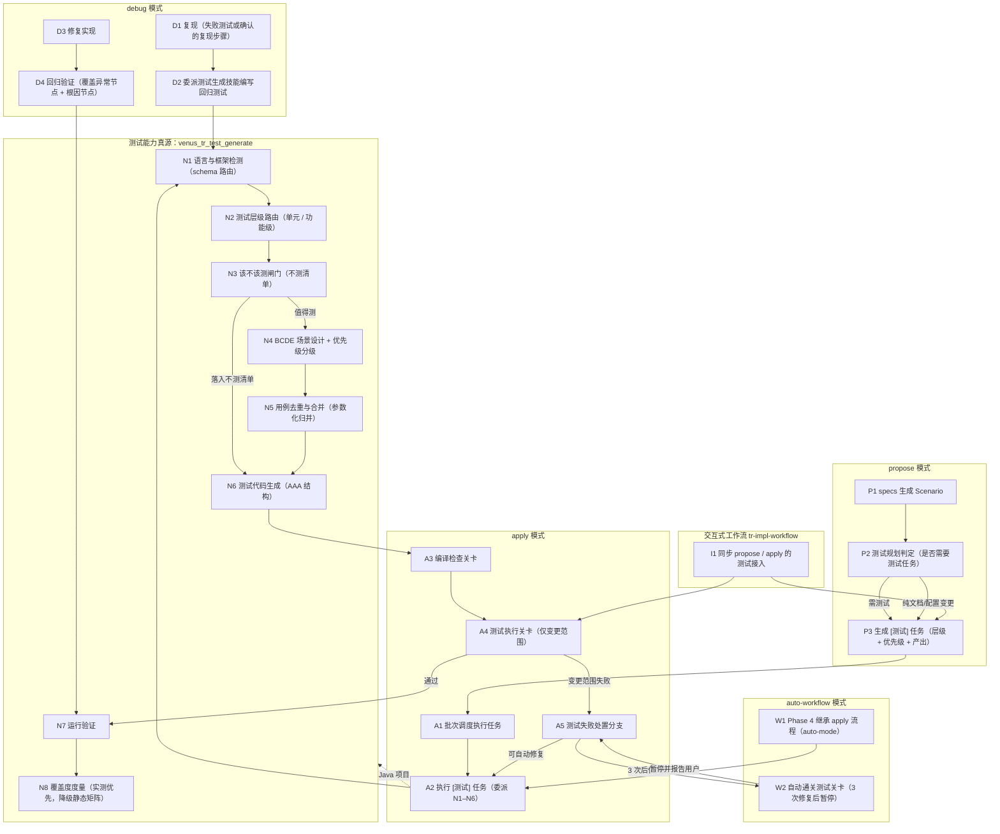

# 探索：测试用例生成能力优化与合理化

> 关键词：test-cases-rationalize | 序号：001 | 状态：进行中

---

## Background

### 原始诉求

分析 `venus_tr_test_generate` 测试用例生成 skill，对**提案生成 propose / 功能实现 apply / auto-workflow / debug** 四种模式中的测试用例生成与实现能力进行优化调整，进行功能测试用例合理化。

### 现状总览

| 模式 | 对应模板 | 当前测试能力 |
|---|---|---|
| propose | `src/core/templates/workflows/spec-propose.ts` | **零测试内容**——全文 0 处测试相关，tasks.md 模板无 `[测试]` 类型标签 |
| apply | `src/core/templates/workflows/spec-apply.ts` | 仅有 `[测试数据]` 补充文档标签；Step 8 编译检查 Java 用 `mvn compile -DskipTests`，**无测试执行关卡** |
| auto-workflow | `src/core/templates/workflows/tr-impl-auto-workflow.ts` | **零测试内容**——Phase 2 任务标签未含 `[测试]`，Phase 4 直接复用 apply → 继承 apply 缺口 |
| debug | `src/core/templates/workflows/tr-impl-debug.ts` | 有强制回归测试（4.2）+ 验证口径（异常节点+根因节点），但**未委派** `venus_tr_test_generate`，自行编写 |
| 被优化对象 | `src/core/templates/workflows/tr-test.ts`（785 行）→ `skills/venus_tr_test_generate/` | v3.0 三段式：主 SKILL 语言无关 + `references/schema-java.md` + `references/schema-node.md` |

**核心结论（初判）**：四种模式中只有 debug 具备测试产能，其余三种为 0；且 debug 的测试产能与 `venus_tr_test_generate` 完全脱钩，导致框架风格对齐、BCDE 覆盖、反模式防护这些已沉淀的能力**无法复用**。

---

## 提示词基线

### 1.1.2 提示词校验门（澄清门）

**校验对象**：用户最终提供的主题描述

> 分析venus_tr_test_generate测试用例生成skill，对提案生成propose\功能实现apply\auto-workflow\debug模式中测试用例生成和实现能力，进行优化调整，进行功能测试用例合理化

**六维校验**：

| 维度 | 结论 | 说明 |
|---|---|---|
| 目标 Goal | ⚠️ | "优化调整测试用例生成和实现能力" 方向明确，但"**合理化**"无判定标准——是"减少冗余用例"还是"提升覆盖度"还是"修正标注错误"，三种解读指向不同改法 |
| 对象 Object | ⚠️ | 四个模式明确；但"测试用例生成**和实现**能力"中"实现"歧义——(a) 指"生成测试用例这一能力的实现" (b) 指"测试驱动实现代码（TDD）" |
| 范围 Scope | ❌ | 未说明边界：是否允许改 `TASKS_TEMPLATE`（影响全部 spec 技能的 tasks 格式）？是否同步修订已漂移的能力 spec？是否含 `venus_tr_impl_workflow`（交互式工作流，同样有测试缺口但未被点名）？ |
| 约束 Constraints | ❌ | 未说明：是否必须保持向后兼容（既有 tasks.md 的 `[代码]` 格式）？是否可删除 BCDE 固定配额？ |
| 验收 Acceptance | ❌ | 未说明：怎么算完成——`pnpm test` 全绿 + 快照一致，还是需要端到端跑一次四种模式？ |
| 歧义 Ambiguity | ❌ | "功能测试用例"歧义：指"functional test（功能级测试，区别于单元测试）"还是"针对功能的测试用例（= 单元测试用例）" |

**校验结论**：**不明确**（3 项 ❌ + 2 项实质 ⚠️）→ 触发提示词优化，阻塞等待用户确认。

### 优化后提示词

> 【优化后提示词】
>
> 以 `venus_tr_test_generate` 为测试能力的**唯一真源**，补齐 propose / apply / auto-workflow / debug 四种模式在测试用例生成与执行上的能力缺口，并修正该技能自身在用例设计规则上的不合理处。
>
> **一、合理化 `venus_tr_test_generate` 的用例设计规则**（`src/core/templates/workflows/tr-test.ts`）
> - 修正 BCDE 场景矩阵的**标注自相矛盾**（示例中"参数为 null → 抛异常"被标为 B，按 BCDE 自身定义应为 Boundary/Exception）
> - 将"场景数量固定配额"改为**按被测方法价值分级**的取舍规则（该测什么、该跳过什么）
> - 新增**用例去重与合并**规则，避免为凑数生成低价值用例
> - 修正与能力 spec 的漂移（spec 要求 FIRST 原则，实现中已丢失）
>
> **二、四模式能力补齐**（[推断]部分已标注）
> - **propose**：tasks.md 新增 `[测试]` 任务类型标签，让测试成为提案中可追踪的规划项 [推断]
> - **apply**：补充文档标签列表加入 `[测试]`；Step 8 增加测试执行关卡（与编译检查并列）[推断]
> - **auto-workflow**：Phase 2 任务标签同步；Phase 4 自动执行测试关卡 [推断]
> - **debug**：回归测试编写改为委派 `venus_tr_test_generate`（复用框架检测/BCDE/反模式防护），保留既有"必须覆盖异常节点+根因节点"的验证口径
>
> **三、一致性修复**
> - `tr-commit-push.ts:64` 已假设存在 `[测试]` 标签，与 templates/spec-apply 三处标签集不一致 → 统一
>
> 【优化说明】
> - **推断项**（标 `[推断]`）：四模式的具体接入点是推断的，因为需求只给了"优化调整"而未指定改法。若你的本意是别的接入方式，请指出。
> - **[待确认]**：验收口径、是否同步修订既有能力 spec、是否触及 `venus_tr_impl_workflow`（未被点名但有同样缺口）——见下方 Questions。
> - **未篡改原始意图**：仍以"四种模式的测试能力优化 + 用例合理化"为范围，未新增用户未提出的需求。
> - **未增加新技能**：不新增技能类型/技能，仅在既有模板内补齐。

---

## Codebase Findings

### F1. `venus_tr_test_generate` 现状（v3.0，多 schema 模式）

- 真源：`src/core/templates/workflows/tr-test.ts`（785 行），快照：`skills/venus_tr_test_generate/{SKILL.md, references/schema-java.md, references/schema-node.md}`
- 五阶段流程：语言/框架检测（schema 路由）→ BCDE 场景矩阵 → 分层测试策略 → 测试代码生成 → 运行与验证
- Java schema 额外含 7 级测试位置扫描 + 测试计划确认门（J5.3）+ 模板 A-F + 遗留代码策略

### F2.（缺陷）BCDE 场景矩阵示例标注自相矛盾

`tr-test.ts:641-649` 场景矩阵模板：

| ID | 类型 | 输入条件 | 预期结果 | 问题 |
|----|------|---------|---------|------|
| TC001 | B | 合法参数 | 正常返回正确结果 | ✅ 正确 |
| TC002 | **B** | 参数为 null | 抛出参数校验异常 | ❌ 按 BCDE 定义（"Boundary：Null、空值"）应为 **Boundary** |
| TC003 | **B** | 空集合入参 | 返回空结果 | ❌ 应为 **Boundary** |
| TC004 | D | 重复提交 | 幂等处理 | ✅ 正确 |
| TC005 | E | 依赖服务超时 | 降级返回 | ✅ 正确 |

**影响**：示例是 AI 生成用例时的模仿对象，错误标注会直接传导到下游生成的测试计划中，使"边界条件"被统计为"正常路径"，覆盖度评估失真。

### F3.（缺陷）场景数量为固定配额，与"合理化"目标冲突

`tr-test.ts:651-655`「场景数量要求」为硬性区间：1-2 正常 + 2-3 边界 + 1-2 业务规则 + 1-2 异常。**对每个方法一律适用**，无"该方法是否值得测"的前置判定 → 会驱动 AI 为凑配额而生成低价值用例（纯 POJO、getter/setter、无分支的转发方法、框架回调）。

### F4.（缺口）无"该不该测"的取舍闸门

全文无以下禁止项：纯数据类（DTO/VO/Entity）、getter/setter、无逻辑转发方法、私有方法、框架生命周期回调、自动生成的代码。**建议补充**：与"反模式清单"并列，新增"不测清单"。

### F5.（缺口）无用例去重与合并规则

参数化测试仅作"推荐"（`tr-test.ts:455-456`、`673-676`），无强制"同一方法的同构输入必须合并为参数化用例"规则，也无跨方法重复用例的检测口径。

### F6.（漂移）能力 spec 要求 FIRST 原则，实现中已丢失

- `openspec/specs/tr-test-generate/spec.md:19` — `### Requirement: FIRST 原则`（SHALL 级，含 Scenario）
- `grep -c FIRST` 结果：`skills/venus_tr_test_generate/SKILL.md` = **0**，`src/core/templates/workflows/tr-test.ts` = **0**
- **结论**：spec 声明 SHALL，实现在 v3.0 重构中丢失 → 规格与实现双向不一致

### F7.（漂移）能力 spec 的「分层测试编写指南」写死 Node

`spec.md` 该需求的 Scenario 用 `vi.mock()` / `vi.spyOn()` / `test.each` 描述 Service 与工具类测试，与 v3.0「主 SKILL 语言无关」定位冲突（Java 侧应为 Mockito / `@ParameterizedTest`）。

### F8.（缺口）propose 无测试规划能力

- `src/core/templates/workflows/spec-propose.ts`：全文 grep "测试\|test\|Test\|TDD" = **0 处**
- `TASKS_TEMPLATE`（`src/core/spec/templates/index.ts:76-85`）类型标签注释仅 `[代码] / [DB脚本] / [使用说明]`，**无 `[测试]`**
- `src/core/spec/schema.ts:77` 的任务生成指令同样未含测试类型

### F9.（不一致）`[测试]` 标签三处口径不齐

| 位置 | 是否含 `[测试]` |
|---|---|
| `src/core/spec/templates/index.ts`（TASKS_TEMPLATE 注释） | ❌ |
| `src/core/templates/workflows/spec-apply.ts:194`（补充文档标签列表） | ❌（含 `[测试数据]` 但不是 `[测试]`） |
| `src/core/templates/workflows/tr-commit-push.ts:64` | ✅ 已假设存在（"提案 tasks.md 的任务类型标签（[代码]/[测试] 等）"） |

→ **无任何模板产出 `[测试]` 标签，但提交技能已假设它存在**。

### F10.（缺口）apply 无测试执行关卡

`spec-apply.ts` Step 8 编译检查流程（8.1–8.10）：Java 执行 `mvn compile -DskipTests`（:248）、`ant compile`、`gradle compileJava`——**全部显式跳过测试**；Step 8 全流程无"运行测试"环节，也无测试失败的处理分支。

### F11.（缺口）auto-workflow 全链路无测试产能

`tr-impl-auto-workflow.ts`：全文 grep 测试相关 = **0 处**（仅命令模板正文中 `spec-apply` 段落间接继承）。Phase 2 任务标签描述（:482-483）与 propose 同源，继承 F8；Phase 4 直接调用 apply 逻辑（:648），继承 F10。

### F12.（脱钩）debug 的回归测试未复用测试生成技能

`tr-impl-debug.ts`：
- 4.2 强制回归测试（:305-312）——要求"修复前失败、修复后通过"，验证口径为"必须覆盖异常节点 + 根因节点"
- :587-593 Guardrails 重复强调该口径
- **但未委派 `venus_tr_test_generate`**——回归测试的框架检测、既有风格对齐、BCDE 边界覆盖、反模式防护全部需要临时重造

### F13. 仓库修改约束（AGENTS.md）

1. 改 `src/core/templates/workflows/` 后必须 `pnpm build && pnpm generate:skills`，否则 `test/skills-parity.test.ts` 失败
2. 改模板正文命令需同步 `allowedTools`（`test/allowed-tools.test.ts`）
3. 版本号 + CHANGELOG 随功能提交一并更新（AGENTS.md 第 8 条：改技能模板行为 → minor）
4. spec 模板单一源：`spec-*.ts` 的 command 版由 `deriveCommandContent()` 派生，禁止另立手工字符串
5. 新增技能类型需改 `src/core/config.ts` 的 `SKILL_TYPES`

### F14. 本机配置

`.venus/rules/tr_test.md` 内容为占位「（待补充）测试框架与既有用例保持一致」。

---

## Questions

### Q1 [待确认] "合理化"的判定目标是什么？（多选）

- A. **减少低价值用例**——新增"该不该测"闸门 + 去重合并规则（当前 F4/F5 缺口）
- B. **提升覆盖有效性**——引入覆盖度度量（方法/分支/场景覆盖），而非仅"运行通过率"
- C. **修正标注与规则错误**——修复 BCDE 标注自相矛盾（F2）+ 规格漂移（F6/F7）
- D. **全部**（A+B+C）

### Q2 [待确认] "测试用例生成和**实现**能力"中的"实现"指什么？

- A. "生成能力"的实现方式（即改 skill 模板本身）
- B. 测试驱动实现（TDD：先写测试再写实现代码）
- C. 指"四种模式各自的实现"，即 propose/apply/auto-workflow/debug 各自模板的实现

### Q3 [待确认] "功能测试用例"是指？

- A. 针对功能的单元测试用例（= 当前 `venus_tr_test_generate` 覆盖的范围）
- B. functional test（功能级/集成测试，测完整功能链路，区别于单元测试）——这会是**新能力**

### Q4 [待确认] 改造范围边界

- A. 允许修改 `TASKS_TEMPLATE`（`src/core/spec/templates/index.ts`）——影响**全部** spec 技能的 tasks 格式（向后兼容：新增标签不破坏既有 `[代码]`）
- B. 是否同步修订已漂移的能力 spec（`openspec/specs/tr-test-generate/spec.md` 的 FIRST 原则 + Node 写死）？
- C. 是否一并处理 `venus_tr_impl_workflow`（交互式工作流，`tr-impl-workflow.ts`，未被点名但同样有测试缺口）？

### Q5 [待确认] 验收口径

- A. `pnpm test` 全绿 + `pnpm generate:skills` 快照一致
- B. 另需端到端跑一遍四种模式验证
- C. 另需补充针对本次改动的单测（如标签集一致性测试）

---

## 术语表

| 术语 | 定义 | 避免使用 |
|---|---|---|
| **BCDE 场景矩阵** | 用例场景分类法：Basic（正常）/ Boundary（边界）/ Design（业务规则）/ Exception（异常） | 四象限矩阵（易与其它方法混淆） |
| **测试用例合理化** | [待确认] 待 Q1 明确 | — |
| **测试关卡** | [推断] 在 apply/auto-workflow 流程中插入的强制测试执行与判定环节，与既有"编译检查关卡"并列 | 测试门（易与"确认门"混淆） |
| **确认门** | 阻塞等待用户显式确认的交互关卡 | 校验门 |
| **`[测试]` 任务标签** | [推断] tasks.md 中标识测试代码产出任务的类型标签，与 `[代码]`/`[DB脚本]` 并列 | — |

---

## 架构决策

| ID | 决策点 | 结论 | 状态 |
|---|---|---|---|
| AD1 | 测试能力的真源位置 | 保持 `venus_tr_test_generate` 为唯一真源，四模式**引用**而非各自实现 | 待确认 |
| AD2 | 四模式接入方式 | [推断] propose 产出 `[测试]` 任务 → apply 执行测试关卡 → auto-workflow 自动通关 → debug 委派生成技能 | 待确认（取决于 Q1–Q3） |
| AD3 | 是否新增技能/类型 | 否——仅在既有模板内补齐（遵守最小改动） | 待确认 |

---

## 边界场景

- 项目**无测试框架**（无 pom.xml/package.json 测试依赖）→ 测试关卡应降级为 WARN + 跳过，不得阻塞流程
- 项目**已有测试全部失败**（存量红）→ 测试关卡不得把存量失败算作本次变更的失败
- auto-workflow 全自动模式下测试失败 → 应比照编译失败的既有策略（3 次自动修复后暂停），不得静默通过
- apply 的 `[测试]` 任务与 `[代码]` 任务的批次调度关系（测试依赖实现完成，须串行）
- 向后兼容：既有变更的 tasks.md 不含 `[测试]` 标签时，apply 应正常执行（标签为可选增强）

---

## Decision Process

### 澄清门答复（2026-09-28）

| 问题 | 用户裁决 | 对设计的影响 |
|---|---|---|
| Q1 合理化目标 | **全选**：减少低价值用例 + 提升覆盖有效性 + 修正标注与规则错误 + 用例分级与优先级 | 四条规则线全做：不测清单/去重合并、覆盖度度量、BCDE 标注修正与 spec 漂移修订、用例 P0–P2 分级 |
| Q2 "实现"含义 | **指四种模式模板的自身改造** | 不改流程顺序语义（不做 TDD 反转），只改模板正文与关卡 |
| Q3 测试层级 | **两者都要**（单元测试 + 功能级/集成测试） | **本次最大能力扩张**——新增功能级测试层级，需设计其 schema 承载方式与适用判定 |
| Q4 范围边界 | **允许改 TASKS_TEMPLATE + 同步修订漂移的 spec + 一并处理交互式工作流** | 纳入 `tr-impl-workflow.ts`（2276 行）；`src/core/spec/templates/index.ts` 与 `src/core/spec/schema.ts` 纳入；修订 `openspec/specs/tr-test-generate/spec.md` |

### 1.2.1 CodeGraph 基础扫描结果

- `codegraph_status`：可用（48 文件 / 398 节点 / 524 边），索引部分滞后（缺 spec-propose / tr-test / tr-impl-workflow 等新模板），下述影响分析以 Grep 交叉验证为准
- `codegraph_impact("TASKS_TEMPLATE")`：仅 2 处符号（定义 + 自身）→ 消费点单一
- **Grep 交叉验证**：`TASKS_TEMPLATE` 唯一消费点为 `src/core/spec/instructions.ts:46`（经 `venus spec instructions tasks` 分发）→ 改模板是单点低成本
- **但任务格式在技能正文中被多处硬编码**，需同步（见 F15）

---

## Decisions

### D1. 测试能力真源唯一化

- **选择**：`venus_tr_test_generate` 保持为测试能力的唯一真源；propose/apply/auto-workflow/debug/交互式工作流**引用**而非各自实现测试规则
- **理由**：现状 debug 自研回归测试（F12）、其余三模式为 0，规则分散会导致风格与质量不可控；唯一真源使框架检测、风格对齐、BCDE 覆盖、反模式防护一次沉淀多处复用
- **备选**：在各模式模板内各自写测试规则（否决——五处重复维护，必然漂移）

### D2. 新增"测试层级路由"覆盖单元测试 + 功能级测试

- **选择**：在 `venus_tr_test_generate` 中新增**测试层级（Test Level）**维度，与既有"语言/框架 schema 路由"正交：层级 = 单元测试（Unit）/ 功能级测试（Functional）；层级由被测对象与变更性质自动判定
- **理由**：用户明确要求"两者都要"（Q3）；层级与语言正交，用新 schema 文件承载会与 schema-java/node 形成二维爆炸（2 语言 × 2 层级 = 4 文件）
- **备选**：新增 `references/schema-functional.md`（否决——与 schema-java/node 内容重叠，且 Java 功能级测试本就是 SpringBootTest/@WebMvcTest，已在 schema-java 模板 D 中有雏形）
- **待定**：功能级测试的承载细节见 L2 追问

### D3. `[测试]` 任务标签统一为第五类型

- **选择**：`[测试]` 与 `[代码]`/`[DB脚本]`/`[使用说明]` 并列，作为 tasks.md 的一等任务类型；`[测试]` 任务含层级子标注（`[测试][单元]` / `[测试][功能]`）
- **理由**：修 F9 三处口径不齐；使测试成为提案中可追踪、可勾选、可归档统计的规划项；`tr-commit-push.ts:64` 已按此假设工作
- **备选**：复用 `[代码]` 标签（否决——测试代码与生产代码在提交分类、验证方式、批次依赖上均不同）

### D4. apply/auto-workflow 增加"测试关卡"（与编译检查关卡并列）

- **选择**：在 Step 8 编译检查之后新增测试执行关卡，执行 `[测试]` 任务产出的测试与变更范围内的既有测试；auto-workflow 继承并自动通关
- **理由**：F10 现状是 `mvn compile -DskipTests` 显式跳过测试，"生成了测试但从不运行"使测试形同虚设
- **备选**：并入编译检查（否决——失败语义不同：编译失败是硬错误，测试失败可能是存量红或断言不符，需要不同的判定与处置分支）

### D5. debug 回归测试改为委派测试生成技能

- **选择**：`tr-impl-debug` 4.2 保留"必须覆盖异常节点+根因节点"的验证口径与"修复前失败/修复后通过"硬要求，但**测试编写动作委派** `venus_tr_test_generate`
- **理由**：复用框架检测与风格对齐，使回归测试与项目既有测试同源同风格；保留 debug 特有的验收口径（该口径是 debug 的差异化价值，不可丢）
- **备选**：维持自研（否决——F12，需临时重造框架检测逻辑）

### D6. spec 漂移按"实现为准"修订

- **选择**：`openspec/specs/tr-test-generate/spec.md` 的 FIRST 原则需求——**补回实现**（FIRST 是有效质量约束，不应删除）；分层测试指南的 Node 写死——**改为语言无关表述**
- **理由**：F6/F7。FIRST（Fast/Independent/Repeatable/Self-validating/Timely）与本次"用例合理化"目标同向，属于实现漏做而非需求过时
- **备选**：删除 FIRST 需求（否决——放弃有效约束）

---

## Scope Changes

| 时间 | 变更 | 原因 |
|---|---|---|
| 2026-09-28 | 初始探索建立 | — |
| 2026-09-28 | **范围扩张①**：纳入 `tr-impl-workflow.ts`（交互式工作流，2276 行） | 用户 Q4 裁决"一并处理交互式工作流"，保持体系一致 |
| 2026-09-28 | **范围扩张②**：纳入 `src/core/spec/templates/index.ts` 与 `src/core/spec/schema.ts` | 用户 Q4 裁决"允许改 TASKS_TEMPLATE"；`schema.ts` 的任务生成指令同源需同步 |
| 2026-09-28 | **范围扩张③**：纳入 `openspec/specs/tr-test-generate/spec.md` 修订 | 用户 Q4 裁决"同步修订漂移的能力 spec" |
| 2026-09-28 | **能力扩张**：新增"测试层级"维度（单元 + 功能级） | 用户 Q3 裁决"两者都要"——原范围仅含单元测试 |

---

## 新增 Codebase Findings（澄清门答复后补充）

### F15.（影响面）任务格式在多处技能正文中硬编码

`TASKS_TEMPLATE` 虽单点消费（`instructions.ts:46`），但任务格式描述在技能正文中重复出现，改标签需全部同步，否则技能正文与 CLI 模板指令冲突：

| 位置 | 内容 |
|---|---|
| `src/core/spec/templates/index.ts:78` | TASKS_TEMPLATE 的类型标签注释 |
| `src/core/spec/schema.ts:77` | tasks artifact 的 instruction（"[代码]/[DB脚本]/[使用说明] 等"） |
| `src/core/templates/workflows/spec-propose.ts:235-236` | 任务类型标签硬约束 + `产出:` 字段要求 |
| `src/core/templates/workflows/tr-impl-auto-workflow.ts:482-483` | 同上 |
| `src/core/templates/workflows/tr-impl-workflow.ts:1220-1221` | 同上 |
| `src/core/templates/workflows/tr-impl-workflow.ts:2162-2163` | 同上（command 版） |
| `src/core/templates/workflows/spec-apply.ts:194` | 补充文档标签列表 |
| `src/core/templates/workflows/tr-commit-push.ts:64` | 已假设含 `[测试]` |

### F16.（缺口）功能级测试无承载位置

`tr-test.ts` 阶段三"分层测试策略"按**代码层次**（Service/Controller/Utils）划分，非按**测试层级**（单元/功能级）。`schema-java.md` 模板 D（`@WebMvcTest`）与 `schema-node.md` 的 SuperTest 示例是功能级测试的雏形，但被放在"Controller 层"标题下，未抽象为独立层级概念。→ 新增层级维度时需明确二者的正交关系。

### F17.（约束）`tr-impl-workflow.ts` 同时维护 skill 版与 command 版正文

`tr-impl-workflow.ts` 中 `:1220` 与 `:2162` 出现同一段任务标签规则，分属 skill 版与 command 版正文（该文件未被纳入 `deriveCommandContent()` 单一源机制）→ 改动需双份同步，是本次改造的主要风险点。

---

## 功能流程图

### L2–L5 追问答复（2026-09-28）

| 层 | 问题 | 用户裁决 |
|---|---|---|
| L2 | 功能级测试承载方式 | **主 SKILL 加"测试层级路由"章节 + 各 schema 内加功能级小节**（不新增 schema 文件，避免 2 语言×2 层级文件爆炸） |
| L2 | 覆盖度度量方式 | **两者结合**：有工具链时实测（JaCoCo / c8），无则降级为静态"场景→用例"矩阵 |
| L5 | apply 测试关卡判定边界 | **只跑变更范围，存量红不阻塞** |
| L4 | 用例分级（P0–P2）用途 | **分级影响生成决策**：P0 必生成 / P1 默认生成 / P2 需显式确认才生成 |

### Mermaid 流程图

### 关键操作节点清单

| 节点 | 操作 | 触发条件 | 证据位置 | 异常路径 |
|---|---|---|---|---|
| N1 | 语言与框架检测（schema 路由） | 技能启动 | `tr-test.ts:599-612`（阶段一 1.1） | 未识别语言 → 输出检测结果并建议指定框架 |
| N2 | **测试层级路由（单元 / 功能级）** | N1 完成 | **[新建]** 预期产物：`tr-test.ts` 阶段一新增 1.3 小节 + 阶段三层级判定 | 项目无集成测试工具链 → 强制降级为单元测试并提示 |
| N3 | **该不该测闸门（不测清单）** | N2 完成 | **[新建]** 预期产物：`tr-test.ts` 反模式清单区新增"不测清单" | 目标落入不测清单 → 跳过设计直接记"不生成"，不占配额 |
| N4 | BCDE 场景设计 + 优先级分级 | N3 判定"值得测" | `tr-test.ts:627-655`（阶段二 BCDE 矩阵，**待改**：修正 B/T 标注矛盾 + 配额改分级） | 场景无法确认业务预期 → 标 `[待确认]` 询问用户 |
| N5 | **用例去重与合并（参数化归并）** | N4 完成 | **[新建]** 预期产物：`tr-test.ts` 阶段二新增去重规则 | 同构输入跨方法重复 → 合并为参数化用例 |
| N6 | 测试代码生成（AAA 结构） | N5 完成 | `tr-test.ts:680-704`（阶段四）；模板见 `schema-java.md` J6 / `schema-node.md` N2 | 项目风格未识别 → 用 schema 默认风格并 WARN |
| N7 | 运行验证 | N6 完成 | `tr-test.ts:708-716`（阶段五） | 测试代码写错 → 修正重跑；被测代码 bug → 衔接 `tr-impl-feature` |
| N8 | **覆盖度度量（实测优先，降级静态矩阵）** | N7 通过 | **[新建]** 预期产物：`tr-test.ts` 阶段五新增覆盖度报告段；Java 走 JaCoCo、Node 走 c8+coverage，无工具链降级为"specs Scenario → 用例"映射矩阵 | 无工具链 → 降级静态矩阵并标注"未实测" |
| P1 | specs 生成 Scenario | propose 生成 specs artifact | `src/core/spec/templates/index.ts:37-48`（SPECS_TEMPLATE） | Scenario 缺失 → 违反硬性约束（每需求至少一个 Scenario） |
| P2 | 测试规划判定（是否需要测试任务） | P1 完成 | **[新建]** 预期产物：propose 任务生成规则新增测试规划判定 | 无 Scenario 可测（纯文档变更）→ 不产出 `[测试]` 任务 |
| P3 | 生成 `[测试]` 任务（层级 + 优先级 + 产出） | P2 判定需测试 | `src/core/spec/templates/index.ts:76-85`（TASKS_TEMPLATE，**待改**）；`src/core/spec/schema.ts:77`（**待改**）；`spec-propose.ts:235-236`（**待改**）；`tr-impl-auto-workflow.ts:482-483`（**待改**）；`tr-impl-workflow.ts:1220-1221, 2162-2163`（**待改**） | 任务无层级/优先级标注 → 校验不通过（新增硬性要求） |
| A1 | 批次调度执行任务 | apply Step 6 | `spec-apply.ts:145-184` | 循环依赖 → 降级串行 |
| A2 | 执行 `[测试]` 任务（委派 N1–N6） | 批次命中 `[测试]` 任务 | `spec-apply.ts:190-200`（**待改**：补充文档标签列表增至含 `[测试]`） | 测试任务与实现任务同批 → 须串行（测试依赖实现完成） |
| A3 | 编译检查关卡 | 所有任务完成 | `spec-apply.ts:226-284`（Step 8，**保持**，Java 仍 `-DskipTests`） | 编译失败 3 次 → 暂停并等用户，不进入归档 |
| A4 | **测试执行关卡（仅变更范围）** | A3 通过 | **[新建]** 预期产物：`spec-apply.ts` Step 8 后新增 Step 8.11/9；auto-workflow Phase 4 引用 | 存量红测试 → 不计入本次失败，仅 WARN；变更范围测试失败 → 进 A5 |
| A5 | 测试失败处置分支 | A4 变更范围失败 | **[新建]** 同 A4 预期产物 | 自动修复 3 次仍失败 → 暂停并报告用户，不进入归档 |
| W1 | Phase 4 继承 apply 流程（auto-mode） | auto-workflow Phase 4 | `tr-impl-auto-workflow.ts:648`（Phase 4 段） | — |
| W2 | **自动通关测试关卡（3 次修复后暂停）** | W1 执行到 A4 | **[新建]** 预期产物：`tr-impl-auto-workflow.ts` Phase 4 段新增测试关卡引用 + Guardrails 条目 | 3 次自动修复仍失败 → 暂停等用户，MUST NOT 静默通过、MUST NOT 进入归档 |
| D1 | 复现（失败测试或确认的复现步骤） | debug Phase 1 | `tr-impl-debug.ts:101-109` | 无法自动化复现 → 用用户确认的复现步骤 |
| D2 | **委派测试生成技能编写回归测试** | debug Phase 4.2 | `tr-impl-debug.ts:305-312`（4.2，**待改**：编写动作改为委派 `venus_tr_test_generate`） | 委派失败 → 降级自研并 WARN |
| D3 | 修复实现 | D2 完成 | `tr-impl-debug.ts:299-304`（4.1） | 需 DB 变更 → 输出 DDL 并单独确认 |
| D4 | 回归验证（覆盖异常节点 + 根因节点） | D3 完成 | `tr-impl-debug.ts:307-312` + `:587-593`（Guardrails 验证口径，**保持**） | 仅覆盖触发节点 → 验证不通过 |
| I1 | **同步 propose / apply 的测试接入** | 交互式工作流运行 | `tr-impl-workflow.ts:1220-1221`（skill 版）、`:2162-2163`（command 版）（**待改**，双份同步） | 双份正文漏改其一 → 技能版与 command 版行为不一致 |

**节点粒度说明**：N1–N8 为被优化技能自身的可独立验证操作单元（用户执行 `/venus:tr-test-generate` 后逐阶段可验）；P/A/W/D/I 各节点为四种模式各自的独立操作单元。N2/N3/N5/N8/A4/A5/W2/D2/P2/P3/I1 共 11 个节点标 `[新建]`/`待改`，是本次变更的实现范围。

---

## 1.5.5 流程最终确认门记录

**确认时间**：2026-09-28 | **出口**：**确认** | **结论**：功能流程图与 23 节点清单（含 11 个新建/待改节点）作为 propose 的生成锚点。

两条流程基准决策经呈现后随流程一并确认：

1. **A3 与 A4 分离**：编译检查保持 `-DskipTests`，测试执行作为独立关卡紧随其后 → 编译失败（硬错误）与测试失败（存量红/断言不符）保有不同处置分支
2. **P2 总是产出 `[测试]` 任务**：即使判定"无需新测试"也记录该决策，使"没写测试"与"没评估过"可区分

---

## 1.6 Completion Check

| 检查项 | 结论 |
|---|---|
| **一致性** | 无硬冲突。澄清门四维裁决（Q1–Q4）与 L2–L5 追问答复相互自洽；D1–D6 决策无互斥 |
| **L1–L5 覆盖** | L1 Intent（澄清门 Q1–Q4 已定）✅ / L2 Solution（层级承载 + 覆盖度度量已定）✅ / L3 Exception（工具链缺失降级已定）✅ / L4 Consistency（D1 真源唯一化 + D6 spec 漂移修订）✅ / L5 Boundary（测试关卡判定边界 + 存量红不阻塞已定）✅ |
| **文件完整性** | Background / 提示词基线 / 功能流程图 / Codebase Findings（F1–F17） / Questions / 术语表 / 架构决策 / 边界场景 / Decision Process / Decisions（D1–D6） / Scope Changes / Pending 全部就位 ✅ |
| **硬冲突** | 无 → **一致性直通**，进入 Phase 2 |

**残留待确认项**：无阻塞项。以下为设计细节，经用户裁决已内化为决策，无需再问：
- 功能级测试的具体适用判定条件（内化为 D2 + N2 节点描述）
- JaCoCo / c8 检测的具体命令（内化为 N8 节点描述，实现阶段落地）

---

## Pending

- [x] 1.1.2 提示词校验门（用户已确认四维裁决）
- [x] 1.2.1 CodeGraph 基础扫描
- [x] `codegraph_impact` 影响分析 + Grep 交叉验证
- [ ] **L2–L5 grill 追问（进行中）**
- [ ] `## 功能流程图` 段产出 + 流程最终确认门（1.5.5）
- [ ] 1.6 Completion Check
