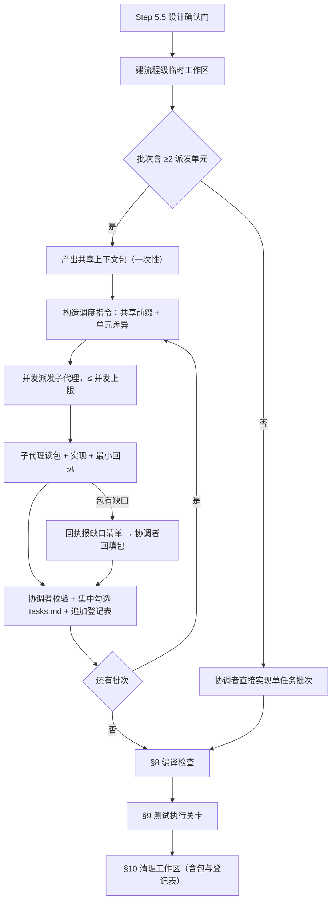
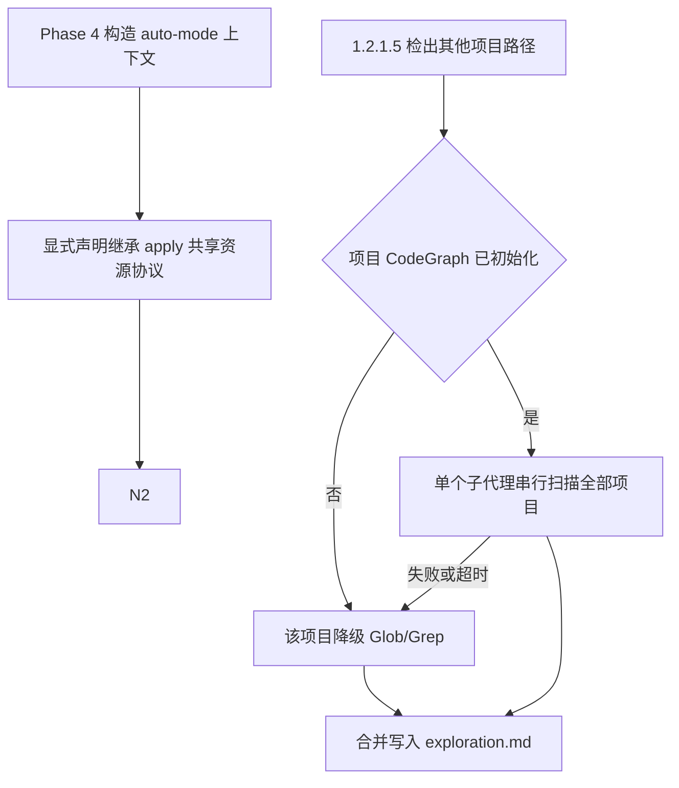
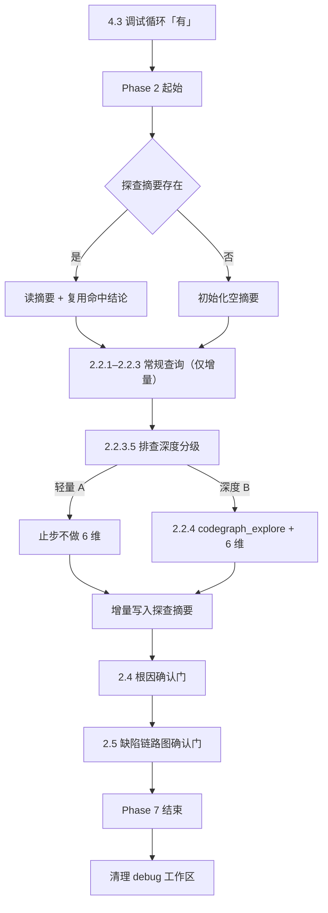
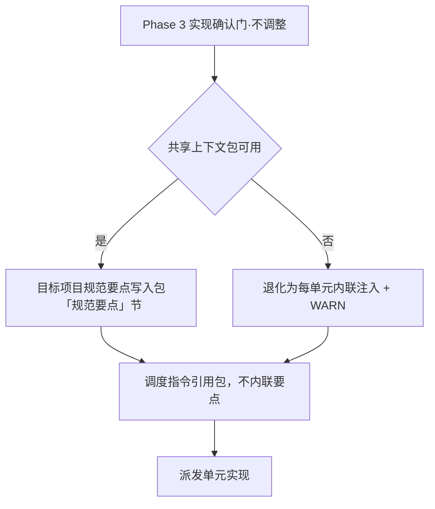

# 多子代理资源共享逻辑优化 — 探索记录

> 探索对象：VenusAgentTools 自身技能模板的**多子代理派发与资源共享**逻辑
> 技术真源：`src/core/templates/workflows/*.ts`（模板工厂）；`skills/*/SKILL.md` 为生成产物快照
> 目标：降低派发多子代理时每个子代理的 token 消耗，优化资源共享逻辑（不降低实现质量）

## Background

用户原始诉求（原文）：

> 检查 apply/auto-workflow/debug 指令 skill 中功能实现时，多 agent 分配逻辑、多 agent 资源共享逻辑，当前存在派发多 agent 时，子 agent 消耗 token 明显偏大的问题，优化资源共享逻辑

---

## 提示词基线

> **状态：已确认（2026-09-28）** —— 判定「不明确」，输出优化后提示词后，用户就四项门内裁决作答（全部采信 AI 推荐），据此视为对优化后提示词的确认。**本段为下游唯一语义来源。**

### 原始提示词

（见上 Background 段引文）

### 校验结论

| 维度 | 判定 | 说明 |
| :--- | :--- | :--- |
| 目标 Goal | ⚠️ 实质 | 方向明确（降低子代理 token 消耗），但"资源共享"未定义共享**什么资源**、以**何载体**共享；无量化目标 |
| 对象 Object | ❌ | 实测 `tr-impl-debug.ts` **全篇无任何子代理派发逻辑**（唯一 "agent" 字样在 frontmatter author）。真实多代理落点为 spec-apply / auto-workflow / workflow / auto-migration / spec-propose / bulk-archive 六处 |
| 范围 Scope | ⚠️ 实质 | 仅点名 3 个技能；但 `spec-apply` 是被 auto-workflow / auto-migration / workflow / genfull **共享复用的单一行为源**，改 apply 必然波及其余；propose / bulk-archive 的派发是否纳入未定 |
| 约束 Constraints | ❌ | 未提及（可从 AGENTS.md 守则与既有规约推导 → [推断]） |
| 验收 Acceptance | ❌ | 未提及（真实 token 计量无法在测试中复现 → 需转为可断言的结构指标 → [推断]） |
| 歧义 Ambiguity | ❌ | ① debug 无派发能力 → 是**新增**还是仅共享排查缓存？ ② "资源共享"的资源清单与载体未定义；③ token 偏大是实测观测还是推断，如何度量？ |

### 优化后提示词（已确认 · 下游唯一语义来源）

> **目标**：优化底层技能模板中**多子代理派发**的**资源共享协议**，降低每个子代理的 token 消耗；实现质量、并发上限语义、技能名/类型/总数均不变。
>
> **落点（技术真源 `src/core/templates/workflows/*.ts`）**：
>
> 1. **`spec-apply.ts`**（多代理派发主源：Step 5.5 批次计划 + Step 6 批次调度，每 dispatch unit 一个子代理）—— 引入四类共享载体：
>    - **共享上下文包**：协调者在派发前一次性产出紧凑上下文包（变更摘要 / 接口契约 / 数据结构 / 规范要点 / 文件归属表 / 代码扫描摘要）落盘于流程级临时工作区；子代理调度指令改为「先读上下文包 + 本单元任务清单」，并**禁止**重复读 proposal/specs/design 与重复 CodeGraph 查询
>    - **产出登记表**：批完成后追加该批产出文件与公开签名，供后续批次子代理跨波次共享，消除重复探索
>    - **回执最小化**：子代理回执仅报「任务 id → 状态 + 产出文件 + 公开签名」，不粘贴代码
>    - **共享指令前缀**：调度指令的单元无关部分（规范要点 / 包路径 / 回执格式 / 禁止项）固定置于前缀位置，利于提供方前缀缓存命中
> 2. **`tr-impl-auto-workflow.ts`** —— Phase 4 继承 apply 批次调度（自动获得上述协议）；并优化 1.2.1.5 多项目 CodeGraph 扫描：由「每项目一个子代理」改为**单个子代理内串行扫多个项目**，消除 N 次冷启动
> 3. **`tr-impl-debug.ts`** —— **当前无子代理派发**；[待确认] 是本变更要**新增**其多代理能力（并直接采用共享协议），还是仅指其排查/修复循环中的**探查结果缓存共享**？
>
> **[推断] 约束**：技能名/类型/总数不变；frontmatter `allowedTools` 与正文命令同步（AGENTS.md 守则 2）；改动后 `pnpm build && pnpm generate:skills`（守则 1）；`pnpm test` 全绿；同步 delta spec；版本号按守则 8 递增 + CHANGELOG 归档同步提交；不修改 `deriveCommandContent` 派生器
>
> **[待确认] 验收**：真实 token 计量无法在 vitest 中复现 → 建议以**可断言的结构指标**验收（子代理必读文件数下降 / 调度指令含共享包协议关键字 / 禁止重复读取断句存在）+ 既有测试全绿；是否需要补充实测比对？

### 门内裁决（[待确认] 项的消解结果）

| 待确认项 | 裁决 | 说明 |
| :--- | :--- | :--- |
| **debug 技能落点** | **仅共享探查缓存，不新增派发** | `tr-impl-debug` 保持单代理流程；将其 Phase 2 排查 + Phase 5 修复循环的 CodeGraph 探查结果纳入统一「探查摘要/缓存」协议，避免调试循环内重复探查。**属「优化」语义，不新增子代理派发能力** |
| **资源共享载体清单** | **四项全纳入** | 共享上下文包 + 产出登记表（跨波次）+ 回执最小化 + 共享指令前缀（缓存友好） |
| **范围边界** | **单一源 + 显式声明继承** | 只改 `spec-apply.ts` 一处作为单一源；`auto-workflow` / `auto-migration` / `workflow` / `genfull` 通过既有「继承 apply 协议」表述自动获得，**仅在措辞上显式声明继承关系，不复制协议文本到各技能**（零冗余、零漂移） |
| **验收方式** | **结构指标 + 测试回归** | 可断言的结构指标（子代理必读文件数下降 / 调度指令含共享包协议关键字 / 禁止重复读取断句存在）+ `pnpm build && pnpm generate:skills` + 全量 vitest 回归。**不追加实测 token 比对** |

### 优化说明

1. **把"资源共享"从口语词落为具体载体** —— 原文只说"优化资源共享逻辑"，未说明共享什么。落为「上下文包 / 产出登记表 / 回执最小化 / 共享指令前缀 / 临时工作区」五类载体，每类都对应一个可断言的模板文本约束
2. **纠正对象事实偏差** —— 实测 debug 技能无派发逻辑，直接按原文实现会落空；把该点列为阻塞性待确认项
3. **补出连带效应** —— `spec-apply` 是 auto-workflow / auto-migration / workflow / genfull 的共享行为源，改动实际波及 4 个未点名技能（对应「范围」⚠️）
4. **补出可判定验收** —— 原诉求无验收标准，token 计量不可测；转为结构指标 + 既有测试套件回归
5. **不篡改原始意图** —— 未新增用户未提出的需求（未引入"降低并发上限""减少子代理数量"等会损害实现质量的捷径）

---

## 功能流程图

> 流程基准 = **改造后五个技能的运行编排流程**（本变更为技能模板变更，其"业务功能"即技能的编排行为）。节点 id 全局唯一递增，图中与表中一致。
>
> 范围经 1.6 一致性裁决扩至 4 技能（`tr-impl-workflow` 同构同步 D17）+ auto-migration（D18），流程图已同步补建流程 4。

### 流程 1：apply 共享资源协议派发链路（主流程）



### 流程 2：auto-workflow 继承声明与多项目扫描合并



### 流程 3：debug 探查摘要共享链路



### 流程 4：auto-migration 规范要点写入包链路（1.6 一致性裁决 D18 补建）



### 关键操作节点清单

| 节点 | 操作 | 触发条件 | 证据位置 | 异常路径 |
| :--- | :--- | :--- | :--- | :--- |
| N1 | Step 5.5 设计确认门（auto-mode 跳过） | Step 6 之前 | `spec-apply.ts:88-139` | 用户改设计/取消 → STOP（auto-mode 无此分支） |
| N2 | 建流程级临时工作区 `.openspec-tmp/apply-<change-name>/` | N1 确认后、派发前 | `spec-apply.ts:140-143` | 项目根不可写 → 回退系统临时目录 + WARN |
| N3 | **批次派发形态判定（新增显式步）** | 批次循环取批后 | `[新建]` `spec-apply.ts` Step 6 批次循环（既有隐式判定 `:166`/`:169` 显式化） | 判定歧义 → 按多单元处理（保守） |
| N4 | 协调者直接实现单任务批次 | N3 判否 | `spec-apply.ts:166` | 失败 → 串行重试一次 → 仍失败暂停报告 `:178` |
| N5 | **产出共享上下文包（一次性）**（新增） | N3 判是，首次派发前 | `[新建]` `spec-apply.ts` Step 6 派发前（预期产物：`context-pack.md` 六节） | 工作区不可写 → 退化为既有内联注入 + WARN |
| N6 | **构造调度指令：共享前缀 + 单元差异**（改造） | N5 完成 / 下一批 | `spec-apply.ts:170-176`（改造：内联 guardrails 摘要移出 → 引用包 `## 规范要点`；共享部分固定前置） | — |
| N7 | 并发派发子代理，≤ 并发上限（默认 3） | N6 完成 | `spec-apply.ts:147-151`（上限）、`:169`（派发） | 无子代理能力 → 全串行降级 `:180-181` |
| N8 | **子代理读包 + 实现 + 最小回执**（改造） | N7 派发后 | `spec-apply.ts:170-176`（改造：必读清单收敛为「包 + 本单元任务清单」；禁止重读 proposal/specs/design 与重跑包已覆盖查询） | 子代理失败 → 自动重试一次 → 仍失败暂停报告 |
| N9 | **包缺口回执 → 协调者回填包**（新增） | N8 回执含缺口清单 | `[新建]` 同 N5 节（预期产物：回执格式含「包缺口清单」字段 + 回填规则） | 回填失败 → WARN，不阻断 |
| N10 | **协调者校验 + 集中勾选 tasks.md + 追加登记表**（改造） | 整批返回 | `spec-apply.ts:177`（改造：追加登记表行为新增） | 校验不通过 → 任务不勾选 |
| N11 | 批次循环判定「还有批次」 | N10 完成 | `spec-apply.ts:164` 批次循环 | — |
| N12 | §8 编译检查 | 全部批次完成 | `spec-apply.ts:232-286` | 3 次自动修复失败 → 暂停等用户 |
| N13 | §9 测试执行关卡 | N12 完成 | `spec-apply.ts:288-315` | 范围内失败 3 次后暂停，MUST NOT 归档 |
| N14 | §10 统一清理工作区（含包与登记表） | N12/N13 完成（含失败/跳过） | `spec-apply.ts:317-319`（内容不变，清理范围扩及包文件） | 清理失败 → WARN + 路径提示 |
| N15 | Phase 4 构造 `auto-mode=true` 上下文 | Phase 3 验证 PASS | `tr-impl-auto-workflow.ts:524-537` | 验证 FAIL → 不进 Phase 4 |
| N16 | **显式声明继承 apply 共享资源协议**（新增） | N15 完成 | `[新建]` `tr-impl-auto-workflow.ts` §4.1（预期产物：继承声明句 + MUST NOT 另立派发指令格式） | — |
| N17 | 1.2.1.5 检出其他项目路径 | 1.2.1 基线扫描后 | `tr-impl-auto-workflow.ts:301-310` | 无其他项目 → 跳过本节 |
| N18 | 逐项目判定 CodeGraph 是否已初始化 | N17 检出 | `tr-impl-auto-workflow.ts:307-310` | `ls` 失败（未初始化）→ N19 该项目降级 |
| N19 | 该项目降级 Glob/Grep + WARN | N18 判否 / N20 失败 | `tr-impl-auto-workflow.ts:310, 325-327` | 一个项目失败不影响其他项目 `:326` |
| N20 | **单个子代理串行扫描全部项目**（改造 · **两技能同构同步 D17**） | N18 判是 | `tr-impl-auto-workflow.ts:312-315` + `tr-impl-workflow.ts:363-383`（skill 版）/ `:1896-1916`（command 版）（改造：由「每项目一个子代理」合并为「一个子代理内串行扫全部项目」） | 超时 >120s → 该项目降级 Glob/Grep `:325` |
| N21 | 合并写入 exploration.md `### Other Project Findings` | N19/N20 完成 | `tr-impl-auto-workflow.ts:317-322` | — |
| N22 | debug Phase 2 起始 | 每个 bug 的排查入口（含调试循环回边） | `tr-impl-debug.ts:123-139` | — |
| N23 | **探查摘要存在性判定（新增）** | N22 开始 | `[新建]` `tr-impl-debug.ts` 2.1.5 节（预期产物：`path.join()` 路径 + 存在性分支） | 目录不可读 → 按不存在处理 + WARN |
| N24 | **读摘要 + 复用命中结论（新增）** | N23 判存在 | `[新建]` 同上（预期产物：命中范围定义 + MUST NOT 重跑规则） | 摘要格式破损 → 忽略该节 + WARN |
| N25 | 初始化空摘要 | N23 判不存在 | `[新建]` 同上 | 工作区不可写 → 仅会话内复用 + WARN |
| N26 | 2.2.1–2.2.3 常规查询（**仅增量**） | N24/N25 完成 | `tr-impl-debug.ts:150-167`（内容不变，新增"仅增量"约束） | CodeGraph 不可用 → Glob/Grep 降级 `:141-148` |
| N27 | 2.2.3.5 排查深度分级 | N26 完成 | `tr-impl-debug.ts:169-214` | 信号缺失/阈值边界 → 取深度路径 |
| N28 | 轻量路径 A：止步不做 6 维 | N27 判轻量 | `tr-impl-debug.ts:181` | 未定位单一高置信根因 → 升级兜底进 N29 |
| N29 | 深度路径 B：2.2.4 `codegraph_explore` + 6 维 | N27 判深度 / N28 未定位根因 | `tr-impl-debug.ts:216-224` | — |
| N30 | **增量写入探查摘要（新增）** | N28/N29 完成 | `[新建]` 同 N23（预期产物：写入时机 + 写入粒度） | 写入失败 → WARN，不阻断（诊断记录仍实时写） |
| N31 | 2.4 根因确认门（零假设） | N30 完成 | `tr-impl-debug.ts:233-237` | 多候选/置信不足 → STOP 待用户选择 |
| N32 | 2.5 缺陷链路图与流程最终确认门 | N31 通过 | `tr-impl-debug.ts:239-257` | 用户拒绝 → 记未确认态继续（恒强制） |
| N33 | 4.3 调试循环「有」→ 回到 Phase 1 | 每个 bug 修复完成 | `tr-impl-debug.ts:329-348` | 中途退出 → 保留已完成修复，进 Phase 5-7 `:354-357` |
| N34 | Phase 7 结束（验证 PASS + 收尾） | 所有 bug 修复完成 | `tr-impl-debug.ts:429-478` | 验证 FAIL → 自动修复循环 `:440-450` |
| N35 | **清理 debug 工作区（新增）** | N34 完成；非缺陷退出亦适用 | `[新建]` `tr-impl-debug.ts` Phase 7 收尾（预期产物：清理步 + WARN 容错） | 清理失败 → WARN + 路径提示 |
| N36 | auto-migration Phase 3 实现确认门「不调整」 | 用户确认不调整实现计划 | `tr-impl-auto-migration.ts:56`（skill 版）/ `:148`（command 版） | 用户选「需要调整」→ 呈制品编辑后重回本门 |
| N37 | **共享上下文包可用性判定（新增）** | N36 判「不调整」 | `[新建]` `tr-impl-auto-migration.ts` Phase 3（预期产物：可用性分支 + 退化路径） | 包不可用（工作区不可写 / 产出失败）→ N39 退化 |
| N38 | **目标项目规范要点写入包 `## 规范要点` 节（改造 · D18）** | N37 判可用 | `tr-impl-auto-migration.ts:56`（改造：由「每子代理指令 MUST 注入」改为「写入包，附加来源合并」；skill + command 双处） | 无目标项目规范要点 → 该节记「无」+ WARN，不阻断 |
| N39 | 退化为每单元内联注入 + WARN | N37 判不可用 | `[新建]` 同 N37（预期产物：退化分支，对齐既有内联行为） | — |
| N40 | 调度指令引用包 `## 规范要点`，不内联要点文本 | N38 / N39 完成 | `tr-impl-auto-migration.ts:56`（改造：MUST NOT 内联） | — |
| N41 | 派发单元实现（承 apply 共享资源协议） | N40 完成 | `tr-impl-auto-migration.ts:56`（既有「按 apply 协议并发批次执行」表述不变） | 失败任务串行重试一次（既有行为） |

---

## Codebase Findings

### CodeGraph 状态与降级记录

`codegraph_status` → **可用且已刷新**（83 files / 709 nodes / 941 edges，native backend）。`codegraph_files`（`src/core/templates`）列出全部 32 个源文件，**含本次三个目标文件**（`spec-apply.ts` / `tr-impl-auto-workflow.ts` / `tr-impl-debug.ts`）。`codegraph_search` 对 `getSpecApplyChangeSkillTemplate` / `getTrImplAutoWorkflowSkillTemplate` / `getTrImplDebugSkillTemplate` 均命中。**无降级，无需 Grep 补齐。**

> 对比：上一变更（`improve-tr-impl-debug-orchestration`）基线扫描时索引陈旧、目标文件缺席；本次索引已覆盖，符合能力记忆中「sync 随文件变更增量纳入」的结论。

### Discovered Files

- `src/core/templates/workflows/spec-apply.ts`（494 行）：**主改动目标 · 单一源**。`getSpecApplyChangeSkillTemplate()`（:7）正文含 Step 1–11 + 门 5.5 + 临时工作区协议；command 版由 `deriveCommandContent` 派生（:492），**改 skill 正文即同步**
- `src/core/templates/workflows/tr-impl-auto-workflow.ts`（680 行）：`getTrImplAutoWorkflowSkillTemplate()`（:29）；1.2.1.5 多项目扫描（:301-327）；Phase 4 auto-apply（:524-554）；`getTrImplAutoWorkflowCommandTemplate()`（:628）**手写压缩正文**，须手工双处同步
- `src/core/templates/workflows/tr-impl-debug.ts`（655 行）：`getTrImplDebugSkillTemplate()`（:29）；Phase 2 排查（:123-258，含 2.2.0–2.2.3.5）；Phase 4.3 调试循环（:329-364）；Phase 7 收尾（:429-478）；`getTrImplDebugCommandTemplate()`（:548）**手写压缩正文**，须手工双处同步
- `src/core/templates/derive-command.ts`：`deriveCommandContent` 仅覆盖 7 个 `spec-*.ts`。**本次不改**（自动继承新正文）
- `src/core/templates/prompt-gate.ts` / `flowchart-gate.ts`：5 技能共享内联源。**不改**（与本次无关，且改动爆炸半径大）
- `src/core/templates/registry.ts:25,33,62`：三模板的注册与 import。**不改**（注册结构不变，技能总数 27 不变）
- `src/core/profiles.ts`：依赖注入关系。**不改**
- `test/templates.test.ts`（189 行）：断言 debug 正文含 `🟠根因`、**不得含** `| 异常路径 |`（:116,138）——**改动须避开该断言面**
- `test/skills-parity.test.ts`：`skills/` 快照比对 → 改动后必须 `pnpm generate:skills`
- `test/template-derivation.test.ts`：断言 7 个 spec 工作流 `command.content === deriveCommandContent(skill.instructions)` → spec-apply 改动自动通过
- `test/allowed-tools.test.ts`：白名单扫描 → **本次不新增命令，白名单不变**

### Identified Symbols

- `getSpecApplyChangeSkillTemplate` (`spec-apply.ts:7`)：单一源正文
- `getTrImplAutoWorkflowSkillTemplate` (`tr-impl-auto-workflow.ts:29`) / `getTrImplAutoWorkflowCommandTemplate` (`:628`)
- `getTrImplDebugSkillTemplate` (`tr-impl-debug.ts:29`) / `getTrImplDebugCommandTemplate` (`:548`)

### 现状锚点（改动落点证据）

| 需求 | 现状位置 | 现状行为（**冗余根因**） |
| :--- | :--- | :--- |
| 上下文包 | `spec-apply.ts:170-176` | 调度指令 MUST 内联「每任务全量细节 + context 文件列表 + guardrails 摘要」→ **每个子代理的 prompt 都重复这一整块**，且各自再去读同一批制品 |
| 产出登记表 | 无 | 跨批次信息零共享：下一批子代理无法知道前序单元产出了什么，只能重扫代码 |
| 回执最小化 | `spec-apply.ts:176` | 仅要求「报告完成状态 + 产出文件列表」，**未约束不得粘贴代码正文** |
| 共享指令前缀 | 无 | 指令结构无固定顺序约定，单元无关段与差异段混排；无缓存友好性设计 |
| debug 探查复用 | `tr-impl-debug.ts:123-139, 329-348` | 诊断记录**仅实时记录**，Phase 6 才落盘；调试循环回边「Re-enter Phase 1 ... independent reproduction, investigation」→ **同一代码区域的 2.2.1–2.2.3 查询被逐轮重跑** |
| 多项目扫描 | `tr-impl-auto-workflow.ts:312-315` | 「每项目一个子代理」，**顺序 spawn（无并行收益）却有 N 次冷启动** —— 纯浪费 |
| auto-workflow 继承 | `tr-impl-auto-workflow.ts:536` | 仅声明「following the venus_spec_apply skill's Step 6+ batch scheduling behavior」，**未声明共享资源协议继承** → 改造后须显式补齐，否则继承语义不明 |

### 规格覆盖缺口（重要发现）

`openspec/specs/spec-workflow-skills/spec.md` 的「spec-apply 实现技能」需求（:157）**只覆盖了「呈现统一批次计划」**（:166），**完全没有覆盖派发单元 / 子代理派发 / 并发上限 / 调度指令内容 / 临时工作区协议**；`tr-workflow-suite-skills/spec.md` 的 auto-workflow 需求（:99）也只说「执行 apply 的 Step 6+ 批次调度行为」。

即：**本变更要改造的派发与资源共享机制，当前无任何主规格覆盖**。delta spec 须一并补齐该缺口（见 D11）。

---

## Questions（L1–L5 grill 结论）

| 层级 | 问题 | AI 推荐 | 用户裁决 |
| :--- | :--- | :--- | :--- |
| 门 0 对象 | debug 无派发逻辑，落点如何定 | 仅共享探查缓存，不新增派发 | **采信推荐** |
| 门 0 范围 | "资源共享"纳入哪些载体 | 四项全纳入 | **采信推荐** |
| 门 0 范围 | apply 单一源的波及边界 | 单一源 + 显式声明继承，不复制文本 | **采信推荐** |
| 门 0 验收 | 验收方式 | 结构指标 + 测试回归（不追加实测比对） | **采信推荐** |
| L2 方案 | 上下文包的产出时机与更新方式 | 一次产出 + 逐批追加登记表 | **采信推荐** |
| L4 一致性 | debug 探查摘要以何为载体 | 流程级临时工作区 `.openspec-tmp/debug-<keyword>/` | **采信推荐** |
| L5 边界 | 禁止重复读取/查询的可执行边界 | 允许查缺 + 强制回执报缺口，协调者回填 | **采信推荐** |
| L3 异常 | 包机制失效（工作区不可写 / 无 ai-coding.md）如何处置 | 退化为既有内联注入 + WARN，绝不阻断 | **采信推荐**（见 D13） |
| L4 一致性 | 派发协议在主规格中无覆盖，是否一并补齐 | 是，delta spec 补「派发协议 + 共享资源协议」需求 | **采信推荐**（见 D11） |
| L5 边界 | auto-mode 下包机制是否豁免 | 照常生效（auto 只跳过确认门） | **采信推荐**（见 D14） |
| L5 边界 | 单任务批次是否也产出包 | 否，无派发即无共享需求 | **采信推荐**（见 D15） |

---

## 术语表

- **派发单元（dispatch unit）**：批次内由一个子代理串行实现的同组任务集合（同 `group` 标签的任务聚合而成）。批次 = 若干派发单元；并发上限约束的是同时运行的**派发单元**数。
  _Avoid_: 任务组（易与 `group` 字段混淆）、子代理（那是执行者，非任务集合）
- **共享上下文包（context pack）**：协调者在首次派发前**一次性**产出的紧凑上下文制品 `context-pack.md`，落于流程级临时工作区；含变更摘要 / 契约 / 规范要点 / 文件归属表 / Codebase 摘要 / 已产出登记表六节。子代理的**唯一必读制品**。
  _Avoid_: 上下文文件（歧义）、prompt 缓存（那是提供方机制）
- **产出登记表（output ledger）**：上下文包内的 `## 已产出（跨单元可见）` 节——每批完成后协调者**追加**该批产出文件与公开签名，使后续批次子代理无需重扫代码即可获知前序产出。
  _Avoid_: 进度表（那是 tasks.md 的职责）、变更日志
- **回执最小化**：子代理的单元完成回执只含固定四列（任务 id / 状态 / 产出文件 / 公开签名），**MUST NOT 粘贴代码正文**，以压缩协调者侧上下文。
  _Avoid_: 完成报告（易理解为含详述）
- **共享指令前缀**：调度指令结构中**单元无关**的部分（包路径 / 规范要点引用 / 回执格式 / 禁止项）固定置于前缀位，单元差异（任务清单）后置，使前缀在同流程内跨派发字节一致。
  _Avoid_: 模板（那是载体，非结构约定）
- **包缺口回执**：子代理发现上下文包未覆盖其所需信息时的强制回报字段——列出"缺什么、补查了什么"；协调者据此回填包，使"是否真的未重扫"可度量。
  _Avoid_: 异常报告（那是失败路径）
- **探查摘要（investigation digest）**：`venus_tr_impl_debug` 的流程级探查缓存 `.openspec-tmp/debug-<keyword>/investigation-digest.md`——Phase 2 常规查询结论的增量落盘，供调试循环后续轮次复用，避免重跑已覆盖的 CodeGraph 查询。区别于 Phase 6 才落盘的**诊断记录**（后者是交付物，前者是流程内缓存）。
  _Avoid_: 诊断记录（那是 Phase 6 持久化产物）、排查缓存（口语）
- **文件归属表**：上下文包内的单元→允许改动文件映射节，把既有跨单元重叠检查（`spec-apply.ts:168`）的结论固化为子代理可读的约束。
  _Avoid_: 文件清单、影响面

---

## 架构决策

- **D1 共享资源协议四载体（apply 单一源）**：上下文包 / 产出登记表 / 回执最小化 / 共享指令前缀。四者共同把"每单元重复读制品 + 重复注入规范 + 无跨批信息"的冗余消除。
- **D2 包产出时机**：Step 5.5 确认后、**首次派发前一次性产出**；此后每批完成**只追加**登记表行，**不重产整包**（避免重复蒸馏）。
- **D3 包内容六节**：`## 变更摘要`（proposal Why/What 蒸馏）· `## 契约`（接口签名 / 数据结构 / 表字段，由 specs + design 蒸馏）· `## 规范要点`（`openspec/rules/ai-coding.md` 关键防护摘要，**协调者蒸馏一次**）· `## 文件归属表`（单元→文件映射）· `## Codebase 摘要`（协调者预扫描结论）· `## 已产出（跨单元可见）`（登记表）。
- **D4 调度指令瘦身**：Step 6.5 必含清单改为「**包路径（唯一必读制品）** + 本单元任务清单（全文细节）+ 回执格式 + 禁止项」；**移出**内联 guardrails 摘要（改引用包 `## 规范要点`）。任务的**细节**仍在指令内联（保证子代理无需读 tasks.md）。
- **D5 禁止项与缺口回执（边界裁决）**：子代理 MUST NOT 重读 proposal/specs/design、MUST NOT 重跑包已覆盖的 CodeGraph 查询；MAY 查包未覆盖内容，但回执 MUST 附**包缺口回执**，协调者据以回填包。
- **D6 回执格式**：`<任务 id> | <状态> | <产出文件> | <公开签名>`，MUST NOT 粘贴代码；协调者据回执更新 tasks.md（既有集中勾选不变）与登记表。
- **D7 共享指令前缀**：指令结构固定为「共享前缀（包路径 + 规范要点引用 + 回执格式 + 禁止项）→ 单元差异（任务清单）」；同流程内前缀字节一致（变更名流程内不变，故包路径稳定）。
- **D8 auto-workflow 继承声明**：`tr-impl-auto-workflow.ts` §4.1 显式声明继承 `venus_spec_apply` 的共享资源协议四载体，并 MUST NOT 另立派发指令格式；skill + 手写 command 双处同步。
- **D9 多项目扫描合并**：1.2.1.5 由「每项目一个子代理」改为「**单个子代理内串行扫描全部待查项目**」。依据：原实现为顺序 spawn（`tr-impl-workflow.ts:371` 明文 "sequentially"），**无并行收益却有 N 次冷启动**；合并为 1 次冷启动为严格改进。失败/超时降级**按项目粒度**保留（一个项目失败不影响其他项目）。
- **D10 debug 探查摘要共享**：新增 `.openspec-tmp/debug-<keyword>/investigation-digest.md`；Phase 2 起始先读（存在时）→ 同范围命中结论直接复用、MUST NOT 重跑已覆盖的 2.2.1–2.2.3 查询；2.2.1–2.2.4 每步结论**增量写入**（与既有"实时写诊断记录"并行，不替代）；调试循环回边（4.3）同样先读摘要；Phase 7 收尾统一清理（非缺陷退出路径亦适用）。目录约定与 `spec-apply` 的 `.openspec-tmp/` 同级同款（入 `.gitignore`、流程结束清理）。
- **D11 规格缺口补齐**：派发与共享资源协议在主规格中**无覆盖**（现状缺口）→ delta spec 在 `spec-workflow-skills` 新增「派发协议与共享资源协议」需求；`tr-workflow-suite-skills` 的 auto-workflow 需求补充「继承共享资源协议」与「多项目扫描单代理化」的 MODIFIED。**两个 capability 各一份 delta spec。**
- **D12 改动范围**：`spec-apply.ts`（spec 类，**单改 skill 正文**，command 自动派生）+ `tr-impl-auto-workflow.ts` / `tr-impl-debug.ts` / `tr-impl-workflow.ts`（D17）/ `tr-impl-auto-migration.ts`（D18）（tr 类，**skill 正文 + 手写 command 正文双处同步** —— 共 4 技能 × 2 处）。不改 `deriveCommandContent` / `prompt-gate.ts` / `flowchart-gate.ts` / `registry.ts` / `profiles.ts` / `allowedTools`（不新增命令）。`tr-impl-genfull.ts` **正文不改**（无派发、无 1.2.1.5、无实现阶段）。
- **D13 包机制失效降级（fail-safe）**：工作区不可写 / 包产出失败 / 项目无 `openspec/rules/ai-coding.md` → **退化为既有内联注入行为** + WARN，**绝不阻断实现**（对照 `derive-command.ts` 的 fail-safe 裁剪哲学：机制失效只会让指令更长，不会缺失防护）。
- **D14 auto-mode 不豁免**：`auto-mode=true` 只跳过 Step 5.5 设计确认门，**包机制照常生效**。
- **D15 单任务批次不产出包**：批次含 <2 派发单元时由协调者直接实现，无子代理则无共享需求 → 不产出包（避免无谓产物）。
- **D16 验收结构指标（可断言）**：`spec-apply.ts` 正文含上下文包协议段（六节齐备 / 包路径 / 一次性产出 + 追加规则）；Step 6.5 必含清单**不再含**内联 guardrails 摘要段；禁止项断句存在（禁重读 proposal/specs/design + 禁重跑已覆盖查询 + 缺口回执字段）；`tr-impl-auto-workflow.ts` 含继承声明句与「单个子代理串行扫描全部项目」；`tr-impl-debug.ts` 含探查摘要协议段。落地为 `test/` 新增断言 + 全量 vitest 回归。
- **D17 同构 1.2.1.5 同步（一致性裁决）**：`tr-impl-workflow.ts` 与 auto-workflow **完全同构**的 1.2.1.5 多项目扫描（`:363-383` skill 版 + `:1896-1916` command 版，明文 "Spawn sub-agents sequentially (one per project)"）**一并优化**为「单个子代理串行扫描全部项目」。依据：同一机制的一处优化不该只落一半，否则两技能立即漂移。**范围 +1 技能（双处同步）。**
- **D18 auto-migration 规范要点改写入包（一致性裁决）**：`tr-impl-auto-migration.ts` Phase 3 的「每个子代理调度指令 MUST 注入目标项目规范要点」（`:56` skill 版 + `:148` command 版）改为「**将目标项目规范要点写入上下文包的 `## 规范要点` 节**（作为附加来源合并）」。依据：原做法正是本次要消除的「每单元重复内联规范块」同类冗余；不改则子代理将同时收到包内要点与内联注入两份。与 D1 四载体设计一致。**范围 +1 技能（双处同步）。**

---

## 边界场景

- **工作区不可写 / `.openspec-tmp/` 创建失败** → 回退系统临时目录 + WARN（沿用 `spec-apply.ts:141` 既有回退）；再失败 → 退化为内联注入（D13）
- **项目无 `openspec/rules/ai-coding.md`** → 包 `## 规范要点` 节记"无规范文件"，子代理按通用规范执行；**不阻断**
- **单任务批次** → 不产出包（D15）
- **auto-mode** → 包机制照常生效（D14）
- **子代理拒绝/忽略包** → 回执仍按最小格式返回；协调者从"未报缺口却明显重扫"的可疑回执中**无法强制判定** → 接受此限制（模板约束力边界，不引入运行时强制）
- **包蒸馏不完美致子代理需补查** → 走缺口回执（D5），协调者回填；**回填失败 → WARN 不阻断**
- **长流程 / 上下文压缩** → 包与摘要均已落盘，复用不依赖会话上下文
- **debug 多 bug 循环** → 摘要跨 bug 复用；非缺陷退出路径（`3.5`）与中途退出（`4.3`）同样走 Phase 7 收尾清理
- **debug Phase 2 时 change 未定** → 摘要落流程级工作区（按 keyword 命名，非 change 名），Phase 3 判定关联后无需迁移
- **两处手写 command 正文** → auto-workflow / debug 的 command 版为手写压缩正文，**改 skill 正文不会自动同步**（双轨制陷阱，本能力第四次记录）
- **`test/templates.test.ts` 断言面** → debug 正文**不得含** `| 异常路径 |`（需求版列头）；新增探查摘要段须避开该列头字样
- **`deriveCommandContent` 派生面** → spec-apply 的 command 版由派生生成，新增段落默认进入 command 版（fail-safe）；若某段仅 skill 版需要（如具体文件路径细节），须用 `<!-- CMD:SKIP -->` 成对标记 —— **新增段是否标记须在实现期逐段判定**，标记错漏只会让 command 更长、不会缺失防护
- **`.openspec-tmp/` 已入 `.gitignore`（apply 既有约定）** → debug 复用同一根目录，无需重复添加
- **技能总数与注册结构不变** → 27 个技能、三个模板的注册与 import 均不动
- **allowedTools 不变** → 本次不引入任何新命令（工作区创建/清理走 Write/Edit 与既有 `Bash(git:*)`）

---

## Security / Architecture Flow / Impact Analysis（关键词分析，强制全跑）

### Security Findings

无运行时代码路径变更 —— 本次为**纯技能正文（prompt 文本）编辑**，不新增命令执行、不扩大任何 `allowedTools` 白名单。

语义安全约束（四条，均为"防机制被绕过/防篡改"性质）：

1. **禁止项 MUST NOT 退化为"允许跳过制品阅读"** —— 包是制品的**蒸馏视图**，不是替代品；包缺项时子代理 MUST 补查**制品本身**，MUST NOT 凭包内容猜测字段/契约（零假设原则）
2. **包缺口回执 MUST NOT 被忽略** —— 协调者收到缺口回执后 MUST 回填包或显式记录 WARN，MUST NOT 静默略过（否则"禁止重复读取"变成"信息缺失下强行实现"）
3. **探查摘要 MUST NOT 被当作交付物** —— 它是流程内缓存，**MUST NOT** 替代诊断记录或 Phase 6 的 `exploration.md` 持久化；清理时删除摘要**不得**影响交付物
4. **回执最小化 MUST NOT 掩盖失败细节** —— "不粘贴代码"不等于"不报错误"；失败任务回执仍须含失败原因摘要

### Architecture Flow

```
改造后 · apply 单批次派发链路（spec-apply 单一源）
Step 5.5 确认门 ──► 建 .openspec-tmp/apply-<change>/ ──► 产出 context-pack.md（一次性）
                                                              │
   ┌──────────────────────────────────────────────────────────┘
   ▼
批次循环 ──► [单任务批次?] ──是──► 协调者直接实现 ──────────────┐
   │否                                                          │
   ▼                                                           │
 构造调度指令 = 共享前缀(包路径/规范要点引用/回执格式/禁止项)     │
              + 单元差异(本单元任务清单)                        │
   ▼                                                           │
 并发派发子代理(≤ concurrency) ──► 读包 + 实现 + 最小回执        │
   │                                    │缺口                   │
   │                                    └──► 协调者回填包        │
   ▼                                                           │
 协调者校验 + 勾选 tasks.md + 追加登记表 ──► [还有批次?] ──是──►─┘
   │否
   ▼
 §8 编译检查 ──► §9 测试关卡 ──► §10 清理工作区（含包与登记表）
```

```
改造后 · auto-workflow 两处
Phase 4 ──► 构造 auto-mode 上下文 ──► 显式声明"继承 apply 共享资源协议" ──► 汇入上方批次循环
1.2.1.5 ──► 检出其他项目路径 ──► 单子代理串行扫全部项目（原：每项目一子代理 N 次冷启动）
```

```
改造后 · debug 探查摘要
Phase 2 起始 ──► [摘要存在?] ──是──► 读摘要复用命中结论
                        └──否──► 初始化空摘要
                              ▼
              2.2.1–2.2.3 仅增量查询 ──► 2.2.3.5 分级 ──► 路径 A / 路径 B
                              ▼
              增量写入摘要 ──► 2.4 根因门 ──► 2.5 缺陷链路图门
                              ▼
              4.3 循环「有」──► 回 Phase 2（复用摘要）      Phase 7 收尾 ──► 清理工作区
```

### Impact Analysis

| 符号 / 文件 | 上游影响 | 结论 |
| :--- | :--- | :--- |
| `getSpecApplyChangeSkillTemplate` | `registry.ts:62` 注册、`deriveCommandContent` 派生（`template-derivation.test.ts`）、`skills/` 快照（`skills-parity.test.ts`） | **编辑正文**；command 自动派生；注册结构不变 |
| `getTrImplAutoWorkflowSkillTemplate` / `...CommandTemplate` | `registry.ts:25`、`skills/` 快照、`allowed-tools.test.ts` | **编辑两处正文**（双轨制手工同步）；不新增命令 |
| `getTrImplDebugSkillTemplate` / `...CommandTemplate` | `registry.ts:33`、`skills/` 快照、`templates.test.ts:116,138` 断言 | **编辑两处正文**；新增段须避开 `\| 异常路径 \|` 列头断言 |
| `getTrImplWorkflowSkillTemplate` / `...CommandTemplate` | `registry.ts`、`skills/` 快照 | **编辑两处正文**（D17 同构 1.2.1.5 同步）；无实现阶段故不承载包协议 |
| `getTrImplAutoMigrationSkillTemplate` / `...CommandTemplate` | `registry.ts`、`skills/` 快照 | **编辑两处正文**（D18 规范要点改写入包） |
| `deriveCommandContent` | 7 个 spec-* 模板依赖（16 符号） | **不改**（自动继承新正文） |
| `prompt-gate.ts` / `flowchart-gate.ts` | 5 技能共享内联源 | **不改**（爆炸半径大且与本需求无关） |
| `registry.ts` / `profiles.ts` | 注册与依赖注入 | **不改**（技能总数 27 不变） |
| `openspec/specs/spec-workflow-skills/spec.md` | 本能力规格 | **新增 delta spec**（派发协议与共享资源协议需求） |
| `openspec/specs/tr-workflow-suite-skills/spec.md` | 本能力规格 | **新增 delta spec**（auto-workflow 继承 + 多项目扫描单代理化 + debug 探查摘要） |
| `openspec/CONTEXT.md` | 项目术语表 | 归档时补充 7 个新术语（派发单元 / 共享上下文包 / 产出登记表 / 回执最小化 / 共享指令前缀 / 包缺口回执 / 探查摘要） |

---

## Decision Process

1. **门 0（1.1.2 提示词校验门）**：判定「不明确」（对象 ❌ / 验收 ❌ / 歧义 ❌ / 目标 ⚠️ 实质 / 范围 ⚠️ 实质）→ 输出优化后提示词 → 用户就四项门内裁决作答（全部采信推荐）→ 落盘 `## 提示词基线`
2. **1.1.5 CONTEXT.md 启动检查**：`openspec/CONTEXT.md` 存在且术语表完整（含「测试执行关卡」「排查深度分级」「单一 prompt 源」「派生函数」等既有术语）→ 本次新增 7 术语**归档时**补充，探索期先在探索文件术语表定义
3. **1.2.0.5 能力记忆注入**：扫 `spec-workflow-skills/explorations.md`（4 次归档）+ `tr-workflow-suite-skills/explorations.md`（5 次归档），提取硬约束 —— 双轨制手写 command、不重排既有编号、共享块不得含 Bash、`deriveCommandContent` 仅覆盖 7 个 spec-*、CodeGraph 部分覆盖≠不可用、`skills/` 快照仅含 SKILL.md
4. **1.2.1 CodeGraph 基线扫描**：status 可用（83 files / 709 nodes），`codegraph_files` 覆盖全部 32 个模板源文件（含三目标），`codegraph_search` 命中三符号 → **无降级**
5. **1.2.1.5 多项目子代理扫描**：**不适用** —— 本变更主题不涉及其他项目路径（N/A，非跳过）
6. **关键词分析（强制全跑）**：Security（4 条防绕过约束）/ Architecture Flow（三张改造后链路）/ Impact Analysis（9 项符号与文件影响表）
7. **L2/L4/L5 追问**：包产出时机、debug 载载体、禁止项边界 —— 三项均采信 AI 推荐
8. **规格缺口发现**：派发协议在主规格中无覆盖 → 决策 D11 在 delta spec 中补齐

---

## Decisions

D1 共享资源协议四载体 · D2 包一次性产出 + 逐批追加 · D3 包内容六节 · D4 调度指令瘦身 · D5 禁止项与缺口回执 · D6 回执格式 · D7 共享指令前缀 · D8 auto-workflow 继承声明 · D9 多项目扫描单代理化 · D10 debug 探查摘要共享 · D11 规格缺口补齐 · D12 改动范围 · D13 包机制失效降级 · D14 auto-mode 不豁免 · D15 单任务批次不产出包 · D16 验收结构指标 · **D17 同构 1.2.1.5 同步（tr-impl-workflow）** · **D18 auto-migration 规范要点改写入包** —— 详见「架构决策」段。

---

## Scope Changes

| 时点 | 变更 | 处置 |
| :--- | :--- | :--- |
| 初始诉求 | 优化 apply/auto-workflow/debug 的多 agent 资源共享逻辑 | — |
| 门 0 发现 | debug 技能**无任何派发逻辑**（对象与事实不符） | 门内裁决：仅共享探查缓存，不新增派发 |
| 门 0 发现 | `spec-apply` 是 4 个技能的共享行为源，波及范围超出点名 | 门内裁决：单一源 + 显式声明继承，不复制文本 |
| L4 发现 | 派发协议在主规格中**无任何覆盖**（规格缺口） | 决策 D11：delta spec 一并补齐 |
| L2/L4/L5 追问 | 包产出时机 / debug 载体 / 禁止项边界 | 三项均采信 AI 推荐，**未扩范围** |
| 1.6 一致性命中 | 冲突 A：`tr-impl-workflow.ts` 与 auto-workflow 同构的 1.2.1.5 未同步会立即漂移 | **裁决 D17：同步优化**（范围 +1 技能，双处） |
| 1.6 一致性命中 | 冲突 B：`tr-impl-auto-migration.ts` 的内联规范注入与包内要点节重复 | **裁决 D18：改为写入包的 `## 规范要点` 节**（范围 +1 技能，双处） |
| 范围裁定 | `tr-impl-genfull.ts` 正文不改 | 无派发、无 1.2.1.5、无实现阶段，零改动点 |
| 范围裁定 | propose / bulk-archive 的派发**不在本次范围** | 记为已知落差，后续单独变更处理 |

---

## Pending

- ~~`[待确认]` **debug 技能的落点**~~ → **已裁决（门 0）：仅共享探查缓存，不新增派发**
- ~~`[待确认]` **"资源共享"的资源清单**~~ → **已裁决（门 0）：四项载体全纳入**
- ~~`[待确认]` **范围边界**~~ → **已裁决（门 0）：单一源 + 显式声明继承**
- ~~`[待确认]` **验收方式**~~ → **已裁决（门 0）：结构指标 + 测试回归，不追加实测 token 比对**
- ~~`[待确认]` **包产出时机**~~ → **已裁决（L2）：一次产出 + 逐批追加登记表**
- ~~`[待确认]` **debug 探查摘要载体**~~ → **已裁决（L4）：流程级临时工作区 `.openspec-tmp/debug-<keyword>/`**
- ~~`[待确认]` **禁止项可执行边界**~~ → **已裁决（L5）：允许查缺 + 强制回执报缺口**
- ~~`[待确认]` **D16 结构指标的具体断言清单**~~ → **已裁决（1.5.5 流程最终确认门）：A1–A7 全部采纳**（A1 上下文包六节+路径+产出规则 · A2 Tab 6.5 不再内联 guardrails 摘要 · A3 三项禁止句 + 缺口回执字段 · A4 指令固定顺序 · A5 auto-workflow 继承声明句 + 单子代理串行扫描（双处）· A6 debug 探查摘要段（双处）· A7 既有测试全绿）
- `[待确认]` **新增段的 `<!-- CMD:SKIP -->` 标记逐段判定** —— 属实现期决策（spec-apply 为派生模板），标记错漏只会让 command 更长、不会缺失防护
- **已知落差（不在本次范围）**：`propose`（每 capability 一子代理生成 delta spec）与 `bulk-archive`（每变更一子代理）的派发同样存在同类冗余，但**未被点名**，本次不同步
- **已知落差（不在本次范围）**：`tr-impl-workflow` / `tr-impl-genfull` 无实现阶段，不承担派发，无需同步
- **CodeGraph 索引健康**：本次基线扫描确认索引已覆盖目标文件，**无需重建**（与上一变更的陈旧索引情形不同）

---

## 1.5.5 流程最终确认门（已通过 · 含 1.6 回改后重新确认）

### 第一次确认（原基准）

| 出口 | 裁决 |
| :--- | :--- |
| 流程图（3 条链路 / 35 节点）与节点清单 | **确认，以本流程为基准** —— 成为 propose 的生成锚点；tasks 逐任务标注 `[N<id>]`，验证时节点覆盖度以此为分母 |
| D16 结构指标断言清单 | **A1–A7 全部采纳** —— 作为 `[测试]` 任务范围的界 |

### 回改（1.6 一致性命中 → 补建流程 4）

1.6 Completion Check 命中两项一致性冲突并裁决：**D17**（`tr-impl-workflow` 同构 1.2.1.5 同步）与 **D18**（`tr-impl-auto-migration` 规范要点改写入包）。其中 D18 引入了原流程图**不存在的操作节点**，按 guardrail「发现遗漏节点 MUST 回探索更新并重新确认，MUST NOT 在任务清单静默补节点」回改本步：

- 流程基准**声明范围**由「三个技能」修正为「五个技能」
- **补建流程 4**（auto-migration 规范要点写入包链路）+ 节点 **N36–N41**
- **N20 证据位置**扩展至 `tr-impl-workflow.ts` 的 skill / command 双处（D17 同构同步）
- 节点总数：35 → **41**

### 重新确认（1.6 回改后）

| 出口 | 裁决 |
| :--- | :--- |
| 回改后的流程图（4 条链路 / 41 节点） | **确认，以回改后流程为基准** |
| N36–N41 补建节点（流程 4） | **确认** |
| D16 结构指标断言清单（A1–A7） | **维持**（A5 的「单子代理串行扫描」双处断言已覆盖 `tr-impl-workflow`；新增 A8：auto-migration 规范要点写入包的断言，见下） |

> **A8（本轮追加）**：`tr-impl-auto-migration.ts` 正文（skill + command 双处）含「规范要点写入包的 `## 规范要点` 节」与「MUST NOT 内联注入」两条断句，以及退化分支（包不可用 → 内联注入 + WARN）。

**本基准为 propose / verify 的独立交叉验证锚点**（verify 的「流程图节点覆盖度」维度以 41 为分母）。
