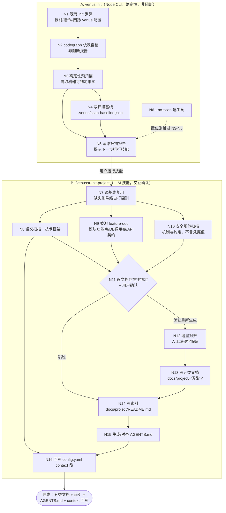

# 探索：init_project 项目自动扫描与文档体系生成

> 关键词：init-project-scan | 序号：001 | 状态：进行中

---

## Background

### 原始诉求

> 优化init_porject初始化项目能力，可以根据项目自动扫描，生成项目技术框架、模块/功能点信息、数据库及API\安全规范等信息，生成对应的md文档，和索引信息，根据不同类型放到对应目录下，最后生成对应的AGENTS.md文档，如果项目已存在对应文档，可以根据实际情况向用用确认是否要重新生成；在项目venus init时自动调用进行项目扫描，同时更新 config.yaml配置

拆解为用户可验证的四个能力：

| # | 能力 | 现状 |
|---|---|---|
| C1 | 项目自动扫描 → 生成技术框架 / 模块功能点 / 数据库 / API / 安全规范 五类 md 文档 | **不存在**（`venus_tr_init_project` 只建骨架，不扫描） |
| C2 | 生成索引信息，按类型落到对应目录 | **不存在**（无索引产物约定） |
| C3 | 生成 `AGENTS.md`，已存在时问用户是否重新生成 | **不存在**（AGENTS.md 在本仓库是手写的） |
| C4 | `venus init` 时自动调用项目扫描 + 更新 `config.yaml` | **不存在**（init 为纯 Node 确定性流程） |

### 现状总览

| 对象 | 位置 | 当前能力 |
|---|---|---|
| `venus_tr_init_project` 技能 | `src/core/templates/workflows/tr-init.ts`（88 行）→ `skills/venus_tr_init_project/SKILL.md`（59 行） | 4 步：明确目标 → 探查环境 → 输出蓝图 → 创建骨架。**零扫描、零文档生成、零索引** |
| `venus init` CLI | `src/commands/init.ts`（211 行） | 生成 SKILL+指令 → 合并 `.claude/settings.json` 权限 → `ensureProjectConfig()` 建 `.venus/` → `scanReconcileOrphans()` 孤儿扫描。**无项目内容扫描** |
| `.venus/config.yaml` | `src/core/project-config.ts:53` | `defaultConfigFileContent()` 的 `context` 是**模板占位**："待补充（如 TypeScript + Node.js 20+ / JDK 17 + Spring Boot 3）"；本仓库实例即为此占位态 |
| 既有功能地图扫描 | `venus_tr_docs_feature_doc`（437 行，4 种输出模式 + 框架档案驱动） | **已具备**全项目功能扫描能力（前端交互 / 后端方法 / 字段级 API 契约 / 数据库调用链 / 跨模块交互） |
| AGENTS.md | 仓库根 `AGENTS.md`（133 行） | 手写维护；含仓库地图 / 修改守则 / 项目约定 |
| 索引先例 | `spec-archive` 的 `ARCHIVE-INDEX.md` | 已有"索引文件"模式可参照 |

---

## 提示词基线

### 1.1.2 提示词校验门（澄清门）

**校验对象**：用户最终提供的主题描述（见 Background 引文）

**六维校验**：

| 维度 | 结论 | 说明 |
|---|---|---|
| 目标 Goal | ⚠️ | "优化 init_project 初始化项目能力" 方向明确；但**目标是"扫描产物文档体系"还是"init 骨架能力"**未界定——两者耦合方式决定整个设计 |
| 对象 Object | ✅ | 明确：`venus_tr_init_project` 技能 + `venus init` CLI + 生成物（md 文档 / 索引 / AGENTS.md / config.yaml） |
| 范围 Scope | ❌ | 未说明：文档落哪个目录（`docs/` → **入库**，`.venus/` / `openspec/` → 本仓库约定**不入库**）？五类文档的**目录命名**未给；索引是独立文件还是嵌在 AGENTS.md？是否含 `tr-docs-feature-doc` 的既有能力复用？ |
| 约束 Constraints | ❌ | **关键矛盾**：`venus init` 是纯 Node CLI，**无 LLM 能力**，无法执行"扫描项目生成技术框架/模块功能点/安全规范"这类语义分析。需求要求"在 venus init 时自动调用项目扫描"，与 CLI 能力边界直接冲突，必须先定义机制（确定性预扫描？挂起标记？纯提示？） |
| 验收 Acceptance | ❌ | 未说明：怎么算完成——`pnpm test` 全绿 + 快照一致？还是在真实项目端到端跑一次扫描出全套文档？已存在文档的"确认重生成"如何验证？ |
| 歧义 Ambiguity | ❌ | (a) "自动扫描"是**CLI 静态扫描**还是**AI 语义扫描**；(b) "更新 config.yaml 配置"更新哪些字段（`context`？新增字段？workflows？）；(c) `AGENTS.md` 与既有手写同名文件是**覆盖**还是**增量合并**；(d) 五类文档是否每类独立文件，还是合一分层 |

**校验结论**：**不明确**（4 项 ❌ + 1 项实质 ⚠️）→ 触发提示词优化，**阻塞等待用户确认**。

### 优化后提示词

> 【优化后提示词】
>
> 以"**项目扫描 → 分类文档 → 索引 → AGENTS.md**"为一条新能力链，增强 `venus_tr_init_project` 与 `venus init`，使新项目/存量项目能一键沉淀出可供 AI 代理复用的项目知识文档。
>
> **一、扫描能力（[推断] 落点待确认）**
> - 新增"项目扫描"能力：识别**技术框架**（语言/框架/版本/构建工具/包管理器）、**模块与功能点**、**数据库**（表/ORM/迁移脚本/连接配置）、**API 规范**（路由/契约/分层约定）、**安全规范**（认证/鉴权/敏感信息/校验）
> - 复用既有 `venus_tr_docs_feature_doc` 的"模块与功能点"扫描能力，**不另立第二份真源** [推断]
> - 每类产出一份 md 文档，写入**按类型分的目录**（目录落点 [待确认]）
> - 生成**索引文件**，汇总五类文档的路径与摘要（索引载体 [待确认]）
>
> **二、AGENTS.md 生成**
> - 依据扫描结果生成 `AGENTS.md`（仓库导航：项目是什么 / 仓库地图 / 常用命令 / 修改守则）
> - **已存在同名文档时，逐文档向用户确认是否重新生成**（不静默覆盖）
> - 已存在时的处置策略默认取**增量对齐**（保留人工域段落）而非整体覆盖 [推断]
>
> **三、`venus init` 自动接入（[待确认] 机制）**
> - `venus init` 时自动触发项目扫描
> - 扫描结果回写 `.venus/config.yaml` 的 `context` 段（当前是"待补充"占位）[推断]；是否新增配置字段 [待确认]
> - CLI 无 LLM 能力的边界如何处理 [待确认]
>
> 【优化说明】
> - **必须澄清的硬矛盾**：`venus init` 是 Node CLI，做不了语义扫描。"自动调用扫描"的落地方式有三种，指向不同实现，**不能替你选**：
>   - **A1 标记+提示**：init 写"待扫描"标记并提示下一步跑 `/venus:tr-init-project`，扫描由技能（LLM）执行 —— 改动小，符合 CLI 边界
>   - **A2 确定性预扫描 + 标记**：init 用 Node 提取**机器可判定的事实**（标志文件、构建工具、目录骨架、依赖清单、JDBC/路由配置），产出扫描基线；再由技能做 AI 语义增强 —— 最贴合"init 时自动调用"的字面意图
>   - **A3 纯提示**：init 只打印"建议运行扫描"，不做任何落盘 —— 最弱，通常不满足需求
> - **推断项**（标 `[推断]`）：目录落点、索引载体、AGENTS.md 合并策略、config.yaml 回写字段，均为需求未指定项，若你的本意不同请指出。
> - **未增加**任何用户未提出的需求（不引入文档版本管理、不做增量 diff 引擎、不新增 CLI 子命令以外的命令）。

### 澄清门答复（2026-09-30）

| 问题 | 用户答复 | 影响 |
|---|---|---|
| 校验门出口 | **确认，按优化后提示词推进** | 优化后提示词成为唯一语义基线 |
| `venus init` 自动扫描落地方式 | **A2 确定性预扫描 + 技能语义增强** | 新增 `src/core/project-scan.ts`（Node 提取机器事实）+ 技能做 AI 语义补全 |
| 五类文档 + 索引落点 | **`docs/project/` 按类型分子目录** | 技术框架/模块/数据库/API/安全 分子目录 + `docs/project/README.md` 索引 |
| 已存在文档处置 | **逐文档确认 + 默认增量对齐** | 复用 `人工域` 语义（CONTEXT.md:149）——人工段逐字保留，可推导段重派生 |

---

## Codebase Findings

### F1. `venus_tr_init_project` 技能现状：零扫描、零文档生成

`src/core/templates/workflows/tr-init.ts`（88 行）→ `skills/venus_tr_init_project/SKILL.md`（59 行）四步：明确初始化目标 → 探查当前环境 → 输出初始化蓝图 → 创建骨架。

- **正文零扫描**：探查仅 `ls -la`，无 CodeGraph、无框架识别、无文档生成
- **白名单极窄**：`Bash(ls:*), Bash(pwd:*), Read, Write, Glob, Grep`（tr-init.ts:10）——**无 CodeGraph MCP、无 `Agent, Task` 派发、无 `Skill(...)` 委派**。新增扫描能力必须扩白名单，且调用类条目须走 `tool-whitelist.ts` 共享常量（`AGENTS.md:63-65`）

### F2. `venus init` CLI 现状：纯确定性流程，无项目内容探测

`src/commands/init.ts:123-211` `runInit()` 五步：技能/指令生成 → `.claude/settings.json` 权限合并 → `ensureProjectConfig()` → `scanReconcileOrphans()`。全部为文件写入与产物扫描，**不读取任何项目源码/构建/配置内容**。

### F3.（关键·已有先例）init 已存在「环境自检 + 报告渲染」模式

`src/core/dependencies.ts` 的 `ensureDependencies()`（158 行）正是 init 中的**非阻断自检**范例：检测 codegraph CLI / MCP → 缺则自动安装 → **失败仅 WARN 不阻断主流程** → `renderDependencyReport()` 渲染；CLI 侧在 `src/cli/index.ts:104-106` 调用。

> **架构结论**：A2 确定性预扫描的**自然落点 = 与 `dependencies.ts` 同构新增 `src/core/project-scan.ts`**（`scanProject()` + `renderScanReport()`），在 `runInit()` 中于 deps 之后接入。CLI 改动最小、风格一致、复用既有"非阻断 + 报告"约定。

### F4. `config.yaml` 的 `context` 段是模板占位，且**无写入 API**

- `defaultConfigFileContent()`（project-config.ts:53-82）的 `context` 为占位文本："技术栈：待补充（如 TypeScript + Node.js 20+ / JDK 17 + Spring Boot 3）"；本仓库实例 `.venus/config.yaml:4-8` 即为此占位态
- `context` 段解析在 `parseProjectConfig()`（129-138，`context: |` 缩进块）
- **写入侧只有 `writeWorkflowsToConfig()`（253-296），context 无任何写入函数** → 需新增 context 写入能力

### F5.（约束）`config.yaml` 写入 MUST 沿用「逐行保留 + 段替换」策略

`writeWorkflowsToConfig()` 的实现是逐行扫描、只替换目标段、其余原样保留。实证：本仓库 `.venus/config.yaml:41-44` 有 `auto_package.runtime_dir` 段（该函数不认识此段）仍被完整保留，尾部空行亦然。

> **约束**：新增 context 写入 MUST 沿用同一策略，**MUST NOT 重新序列化整个 YAML**（否则会丢失未知段与注释，属破坏性改动）。

### F6.（可复用）功能地图扫描能力已存在

`venus_tr_docs_feature_doc`（模板 `tr-docs-feature-doc.ts`，skill 437 行）：4 种输出模式（新人上手/迁移重构/设计文档/全景扫描）+ 框架档案驱动，已覆盖前端交互 / 后端方法 / **字段级 API 契约** / **数据库调用链** / 跨模块交互。

> **结论**：五类中的「模块与功能点」「数据库调用链」「API 契约」三类**已有成熟实现**，重复实现属第二份真源。按用户确认的优化后提示词——**复用该技能，不另立真源**（经 `Skill(...)` 委派，白名单走 `skillDelegation`）。

### F7.（缺口）`venus_tr_init_project` 正文行为无能力规格覆盖

`openspec/specs/` 下 11 个能力规格中，`skill-profile` 覆盖 init 的**安装过滤 / reconcile / config** 三块（`spec.md:6`），但**没有任何能力覆盖 `venus_tr_init_project` 技能的正文行为**。本次新增的扫描行为需落新能力规格（或并入既有能力），并同步 `DEPS`/`DEFAULT_WORKFLOWS` 若有依赖变化。

### F8. 索引先例：`ARCHIVE-INDEX.md`

`spec-archive` 已有「索引文件」模式（ARCHIVE-INDEX.md，含摘要与 `[含xxx]` 补充标注，`spec-archive.ts:350`）。新能力的「文档索引」可参照其形态，但**语义不同**（归档索引 vs 项目知识文档索引）→ 需在术语表区分命名。

### F9.（约束）本仓库 `.gitignore` 排除 `.venus/` / `.claude/` / `openspec/` / `.codegraph/`

`AGENTS.md:129-132` 明确这四类为本机产物不入库。

> **推论**：用户选定的 `docs/project/` **未被排除**，是唯一能让扫描产物**入库并随项目交付**的落点。索引与五类子目录均须置于 `docs/project/` 之下才满足"可交付"。

### F10.（约束）改模板产物的强制链路

`AGENTS.md:61-65` + 三个回归测试：`test/skills-parity.test.ts`（快照一致性）、`test/allowed-tools.test.ts`（白名单）、`test/template-derivation.test.ts`（派生一致性）。改技能正文后**必须** `pnpm build && pnpm generate:skills`，否则快照测试红。

### F11.（架构）`tr-init.ts` 是**手工双写**模板，与 spec 单源机制不一致

`AGENTS.md:92-98` 规定 spec-*.ts 的 command 版由 `derive-command.ts` 从 skill 单源派生（`<!-- CMD:SKIP -->` 标记）。但 `tr-init.ts` 仍是**手工维护两份字符串**（skill instructions 于 12-56 行，command content 于 69-86 行）。

> **决策点**：本次若大幅扩写 tr-init 正文，需决定继续手工双写（改动小、但漂移风险）还是改用派生机制（消除第二份真源、但改动面扩大）。

### F12.（约束）版本号 + CHANGELOG 随本次功能提交

`AGENTS.md:99-121`：功能新增 → `package.json` minor 递增 + `CHANGELOG.md` 把 `[Unreleased]` 归档为 `## [<新版本>] - YYYY-MM-DD`，保留空 `[Unreleased]`，同步底部链接定义。

### F13.（影响面）改动链路

| 改动符号 | 位置 | 下游影响 |
|---|---|---|
| `runInit` | `init.ts:123` | `cli/index.ts` init action |
| `ensureProjectConfig` | `project-config.ts:210` | `runConfigInteractive` / `runConfigSet` / `buildProgram` / `runInit` |
| `getTrInitProjectSkillTemplate` | `tr-init.ts:6` | `registry.ts` WORKFLOW_PAIRS → `getSkillTemplates`/`getCommandTemplates` → init / update / list / show / validate |
| 技能快照 | `skills/venus_tr_init_project/SKILL.md`、`.claude/skills/...` | `skills-parity` / `allowed-tools` / `templates` / `generation` / `profiles` 测试 |

---

## 关键词触发分析（Security / Architecture Flow / Impact Analysis）

### S. Security 分析

| # | 风险 | 说明 | 处置 |
|---|---|---|---|
| S1 | **密钥泄露（最高危）** | 扫描器会读 `jdbc.properties` / `application.yml` / `hibernate.cfg.xml` 等连接配置，其中含数据库口令。产物写入 `docs/project/` **会入库并随项目交付**，泄露面从"本机"扩到"版本库+交付物" | 双重约束：(a) 扫描器（Node）**只提取配置项键名与文件路径，MUST NOT 提取取值**；(b) 技能正文显式写入该禁令。需在提案的验收标准中可验证 |
| S2 | **安全文档自身的攻击面说明** | `docs/project/security/` 会描述鉴权机制、拦截器配置。若写入默认口令、绕过方法、密钥位置细节，等于为攻击者出图 | 该文档定位为"机制与约定说明"，**MUST NOT** 含凭据值、可利用的绕过细节 |
| S3 | **白名单扩大** | 新技能需要读扫描基线、委派 feature-doc、可能派发子代理 | 按 `AGENTS.md:63-65` 三层组合、调用类条目走共享常量；`Read/Glob/Grep` 按正文实际使用增补，**不无差别补齐** |
| S4 | **扫描器读面扩大** | Node 扫描器遍历项目文件树 | 只做**只读**探测，不执行任何项目内脚本（`build.xml`/`package.json` 只解析不执行）；对超大目录设深度/数量上限，避免遍历失控 |

### A. Architecture Flow 分析

```text
[venus init (Node CLI，确定性)]
    ├─ 既有步骤 1-4（技能/指令/权限/.venus）——不变
    ├─ 既有：ensureDependencies() → 非阻断报告（dependencies.ts）
    └─ 【新增】scanProject() → 确定性预扫描基线 + 待语义增强标记   ← 与 deps 同构、非阻断
             │  产出：机器可判定事实（标志文件/构建工具/目录骨架/依赖清单/配置键名/路由形态）
             │  落点：.venus/（本机产物，不入库）——基线是脚手架，非交付物
             ▼
[/venus:tr-init-project (LLM 技能，交互确认)]
    ├─ 读预扫描基线（存在时）→ 免去重复机械探测
    ├─ 语义扫描五类：技术框架 / 模块功能点 / 数据库 / API 规范 / 安全规范
    │      └─ 「模块功能点 / DB 调用链 / API 契约」经 Skill(...) 委派 tr-docs-feature-doc（F6 复用）
    ├─ 逐文档存在性判定 → 已存在者问用户（确认 / 修改 / 跳过）
    │      └─ 确认重生成 → 增量对齐（人工域逐字保留，可推导段重派生）
    ├─ 产出 docs/project/{architecture,modules,database,api,security}/*.md + README.md 索引
    ├─ 产出 AGENTS.md（已存在 → 同样走确认 + 增量对齐）
    └─ 回写 .venus/config.yaml 的 context 段（逐行保留策略，F5）
```

**关键接口**：预扫描基线的**载体格式与位置**（JSON 于 `.venus/` vs md 于 `docs/`）、索引文件命名与结构、config.yaml `context` 的回写粒度。

### I. Impact Analysis

- **直接改动面**：`src/core/project-scan.ts`（新建）、`src/commands/init.ts`、`src/cli/index.ts`、`src/core/project-config.ts`、`src/core/templates/workflows/tr-init.ts`、`src/core/templates/tool-whitelist.ts`（若需新条目）
- **产物面**：`skills/venus_tr_init_project/SKILL.md`（快照，必须重生成）
- **规格面**：新建或并入能力规格 + `CONTEXT.md` 术语新增 + `DEPS`（若新技能引入依赖）
- **测试面**：`skills-parity` / `allowed-tools` / `templates` / `generation` / `profiles` 五个测试需复核；新增扫描器与 context 写入需新测试
- **风险等级**：**中**——改动集中在 init 链路 + 单个技能模板，无公共 API 破坏性变更；但 `.venus/config.yaml` 写入属**用户配置面**，须防破坏（F5）

---

## Questions

### 澄清门答复（第一轮，2026-09-30）

| L 层 | 问题 | 用户答复 |
|---|---|---|
| L1 意图 | `venus init` 预扫描何时跑 | **每次 init 都跑，覆盖刷新**（基线跟上项目演化） |
| L2 方案 | 基线载体 | **`.venus/scan-baseline.json`**（不入库，本机脚手架） |
| L2 方案 | tr-init 模板单源 | **改用派生机制**（`<!-- CMD:SKIP -->`），消除手工双写 |
| L4 一致性 | 是否强制委派 `tr-docs-feature-doc` | **委派但可选降级，不注入 DEPS**（默认安装集维持 9 项不变） |

### 澄清门答复（第二轮，2026-09-30）

| L 层 | 问题 | 用户答复 |
|---|---|---|
| L3 异常 | 预扫描失败处置 | **非阻断，WARN 继续**（与 `dependencies.ts` 同构） |
| L3 异常 | 某类无内容时 | **不生成该类文档，索引标"不适用" + 探测依据**（"没探测到"与"没评估过"可区分） |
| L5 边界 | 人工域界定 | **显式标记界定**（`<!-- 人工域:开始 -->` … `<!-- 人工域:结束 -->`，与 `derive-command.ts` 的 `<!-- CMD:SKIP -->` 同构） |
| L5 边界 | 产物目录与命名 | **中文文件名 + 子目录按类型**：`docs/project/README.md` 索引；`architecture/技术框架.md`、`modules/模块与功能点.md`、`database/数据库.md`、`api/API规范.md`、`security/安全规范.md` |

---

## Codebase Findings（续）：1.2.1.5 跨项目实证扫描

> 单子代理串行扫描 `Venus4A`（Web）→ `AuthServer`（Server）→ `AccountManager`（Server）。AccountManager 的 CodeGraph **未初始化**，按规约降级 Glob/Grep 并记 WARN，成功完成扫描——**一个项目失败未影响其他项目**（降级路径本身即得到验证）。

### M1. 三个项目**全部用 Ant + `build.xml`，无一个 `pom.xml`**

三项目均只有 `build.xml`（`<project default="war"|"copy">` + init/copy/update/tar/zip/gzip/clean/all target 同构），**无 `pom.xml` / `build.gradle` / `package.json`**（Venus4A 唯一的 `package.json` 是 `WebRoot/js/jquery.json-viewer/` 三方库产物，属噪声）。

> **冲击**：若扫描器以 Maven 为默认假设（业界惯例），在本用户的实际项目群里会**全军覆没**。`build.xml` 必须是一等构建信号；`pom.xml` 缺失反而是「Venus 族」的正向信号。

### M2. 项目族指纹：Ant + `src/` 直挂 + `cn/com/venustech/...` + 自研 `framework1.4.jar`

三项目结构高度同构：`src/` **直挂**（**不存在 `src/main/java`**）、包根 `cn.com.venustech.*`、自研 beststar 框架 `framework1.4.jar`（`com.beststar.framework.common.{actions,dao,exception,form}`，其中 `SystemException` / `DataStore` / `Sql` / `DataObject` 出现频次最高）、构建产物目录与源码并列（`WebRoot/` / `AuthServer/` / `AccountServer/`）。

### M3.（关键陷阱）**禁止仅凭 jar 名判定框架**

`AccountManager` 的 lib 含 `spring-2.0.5.jar` + `xbean-spring-3.3.jar`，但源码仅 **1 处** `import org.springframework` → Spring 是传递/边缘依赖。仅凭 jar 名会**误报为 Spring 项目**。

> **约束**：扫描器的框架判定 MUST 区分「jar 存在」与「源码实际使用」，前者只能作为**候选信号**（标注"候选"），结论由技能结合 import 频次判定。

### M4. 数据库检测：`DataBase.properties` 是可靠一等信号，DDL 目录可靠性低

- `DataBase.properties` 三项目**同名同键族**：`CONNECTION_TYPE1` / `DB_DRIVER1` / `DB_URL1` / `USER1` / `PASSWORD1` / `JNDI_DATASOURCE_NAME1` / `security.defaultkey` / `security.provider` → **键名固定，可正则机械提取**
- DDL/SQL 可靠性递减：Venus4A 丰富（`db/` + `doc/sqldoc/{年}/{4期项目表,dbupdate}` + `doc/Venus4A.sql` + `.pdm` 模型）→ AccountManager 仅 2 个散落 `.sql` → **AuthServer 0 个 `.sql`（探测失败）**
- Mapper XML、`hibernate.cfg.xml`、`mybatis-config.xml`：**三项目均 0 命中**（全用自研 `Sql`/`DataStore`/`DataObject` 拼 SQL）
- 多数据库适配信号：AccountManager lib 有 `ojdbc14.jar` + `sqljdbc.jar` + `ifxjdbc.jar`

### M5. API 规范：**必须靠框架档案切换，无法机械统一提取**

| 项目 | 路由声明位置 |
|---|---|
| Venus4A（Web） | `WEB-INF/action_mappings.xml`（69KB）+ `screen_mappings.xml`（121KB）+ `chart_mappings.xml`；`web.xml` 映射 `*.do` |
| AuthServer | **无路由文件**——代码内 `ActionFactory` 分发 + `BaseAction.perform()` |
| AccountManager | **无路由文件**——`MainServer` + `CommandServer` 自定义命令协议 |

交互通道数：Venus4A **5 种**（`.do` / DWR / Axis SOAP / Jersey REST / 裸 JSP）；AuthServer 2 种（Socket + SOAP）；AccountManager 3 种（Socket 命令 + SOAP + FTP）。
分层实测：**既非 Controller→Service→DAO 也非 Action→Manager→DAO**——Venus4A 是 `action/bean/dao/service/form/util`（35 模块，`service/` 非全模块都有）；AuthServer 是 `actions/bean/dao`（**无 service**）；AccountManager 是 `service/dao/bean/handler`（+ 拼写异常的 `vallation/`，本应为 validation）。

> **结论**：API 规范类**正是** `tr-docs-feature-doc` 的「框架档案」设计要解决的问题（内置 Venus4A / Spring MVC / Struts + 自动探测）。用户选定的「委派 feature-doc 复用」得到实证支撑。

### M6. 安全规范：**仅 Web 项目可机械提取，Server 项目靠配置文件键名**

- Venus4A：Servlet **Filter 链**可机械提取 —— `web.xml` 的 `XSSFilter`(17) / `HostFilter`(48) / `VenusFilter`(76，主鉴权) / `EncodingFilter`(99) / `RequestUrlFilter`(114) / `AntiSqlInjectionfilter`(124) / `CsrfFilter`(154，白名单 `src/csrfWhite.txt`)
- AuthServer / AccountManager：**无 Filter、无拦截器、无框架安全模块**（非 Web 应用）→ 只能靠配置文件键名（`security.defaultkey` / `security.provider` / `sm4Key`）+ 认证协议实现（LDAP/CA/RADIUS/TACACS+/SafeWord）
- 输入校验：**三项目 JSR-303 均 0 命中**（用自研 `ValidateException` + XSS 过滤器 + 手工校验）

### M7.（安全硬约束）**真实项目存在必须排除的敏感文件**

| 风险文件 | 项目 | 性质 |
|---|---|---|
| 根目录 `org.xml` | Venus4A | **含真实用户 PII（用户名/手机/邮箱）** |
| `database.xml` | AuthServer | **明文存放 Oracle/LDAP 口令** |
| `DataBase.properties` 的 `PASSWORD1` / `sm4Key` / `PRIVATE_KEY_4A` / `AD_USERPASSWORD` | 全部 | 凭据键 |
| `*.properties_bss` / `_idc` / `_mysql` / `.bak` / `.gzdx` 等多环境变体 | 全部 | 凭据多份副本 |
| `bin/` 编译产物（含 `.class` 与 `.sql` 副本）、`*.log`、`hs_err_pid*.log`、`accountserver.txt`(15MB) | 全部 | 体积/噪声 |

> M7 印证 S1/S2 风险为**实测存在**而非理论担忧。扫描器 MUST 内置「**只输出键名与路径、MUST NOT 输出取值**」+ 文件排除清单。

### M8. 存量文档跨度极大——验证 L5 分支设计的必要性

| 文档 | Venus4A | AuthServer | AccountManager |
|---|---|---|---|
| `AGENTS.md` | ✅ 514 行 | ❌ 无 | ❌ 无 |
| `CLAUDE.md` | ✅ 703 行 | ✅ 10.7KB | ❌ 无 |
| `README.md` | ✅ 833 行 | ❌ 无 | ❌ 无 |
| `doc/` 或 `docs/` | ✅ `doc/project_docs/`（5 份） | ❌ 无 | ❌ 无（仅 `doc/OrgList.xls`） |
| `openspec/` | ✅（config.yaml **已声明技术栈**） | ✅ | ❌ 无 |
| `.claude/` | ✅ 30+ skills | ✅ | ❌ **无** |

- **Venus4A = 全有**（最考验"逐文档确认 + 增量对齐"分支）
- **AccountManager = 全无**（最考验"纯代码产出"分支，且它连 `.claude/` 与 CodeGraph 都没有——**正是 `venus init` 的典型目标形态**）
- **Venus4A/AuthServer 的 `openspec/config.yaml` 已用结构化 YAML 声明技术栈**（`Tech stack: Java 1.8, JSP 2.x, Oracle 11g, 自定义 MVC (beststar)`）→ **扫描器应把既有 `openspec/config.yaml` 与 `.venus/config.yaml` 的 `context` 作为一等技术栈信号源**（比从 jar 推测更可靠）

### M9. JDK 版本声明需要三级回退

Venus4A 有 `.settings/org.eclipse.jdt.core.prefs`（`targetPlatform=1.8`，`compliance=1.8`）；AuthServer / AccountManager **无任何 machine-readable 版本声明**（无 pom、`.classpath` 无 JavaSE 条目，仅文档文本写 "JDK 8+"）。

> **回退链**：`pom.xml` → `.settings/org.eclipse.jdt.core.prefs` → `build.xml` 的 `source/target` → 文档文本 → **标"未知"**（MUST NOT 编造）。

---

## 术语表

### 复用既有术语（`openspec/CONTEXT.md` 已存在，MUST NOT 另立同名新词）

| 术语 | 本变更中的用法 |
|---|---|
| **人工域**（CONTEXT.md:149） | 复用其语义：由人工填写、重生成时 MUST NOT 覆盖的段落。本变更**把界定方式从"按章节"推广为"显式标记"**（D5），需在归档时更新该词条 |
| **就地增量对齐**（CONTEXT.md:152） | 复用于五类文档与 AGENTS.md 的「已存在且用户确认重生成」分支：人工域逐字保留，其余重派生 |
| **reconcile 扫描**（CONTEXT.md:68） | **MUST NOT 混用**——指 init/update 检测已装产物，与本次「项目内容扫描」正交 |
| **提示词校验门 / 提示词基线 / 功能流程图 / 流程最终确认门 / 关键操作节点**（CONTEXT.md:56-123） | 本探索过程的流程术语，行为不变 |
| **workflow / 默认集 / workflows 字段 / 依赖注入**（CONTEXT.md:38-47） | D8 的约束对象：不注入 DEPS ⇒ 默认安装集维持 9 项 |
| **会话级权限载体**（CONTEXT.md:198） | init 写入 `.claude/settings.json` 的既有机制，本变更不动 |

### 本变更新增术语（待归档写入 CONTEXT.md）

**项目扫描（project scan）**：`venus init` 与 `venus_tr_init_project` 协同的「项目知识文档沉淀」能力总称，含**确定性预扫描**（CLI）与**语义扫描**（技能）两段，产出五类文档 + 索引 + AGENTS.md。
_Avoid_: 项目分析、代码扫描（歧义，易与 codegraph 索引混淆）、与 **reconcile 扫描**混用

**确定性预扫描（deterministic pre-scan）**：`venus init` 由纯 Node 代码执行的**机器可判定事实**提取（标志文件 / 构建设施 / 目录骨架 / 依赖清单 / 配置键名 / 路由声明位置），产出**扫描基线**。不做语义判定、不执行项目内脚本、**只输出键名与路径 MUST NOT 输出取值**。
_Avoid_: CLI 扫描（口语）、静态分析（易误解为代码级分析）

**扫描基线（scan baseline）**：确定性预扫描的产物 `.venus/scan-baseline.json`（本机产物，不入库）。定位为**给技能读的脚手架**——免去技能重复机械探测，非交付物。
_Avoid_: 扫描结果（歧义，那指五类文档）、缓存（它非纯缓存，含负向结论）

**信号与候选（signal / candidate）**：扫描器输出的**判定层级**——「信号」= 观察到的事实（发现 `build.xml`）；「候选」= 可能的技术栈线索（发现 `spring-2.0.5.jar`）。扫描器 MUST NOT 输出框架结论（M3：AccountManager 有 spring jar 但仅 1 处 import，机械判定必误报）。
_Avoid_: 检测结果（混层）、框架判定（那是技能职责）

**人工域标记（manual-zone marker）**：`<!-- 人工域:开始 -->` … `<!-- 人工域:结束 -->` 成对注释，界定文档中逐字保留的段落；未标记段落一律可重派生。机制与 `derive-command.ts` 的 `<!-- CMD:SKIP -->` 同构，渲染时不可见。
_Avoid_: 保护标记（与指纹手改保护混）、注释块

**不适用类（not-applicable category）**：五类中因项目中无对应内容而不生成文档的类（如纯前端项目无数据库）；索引 MUST 列出该类并标「不适用 + 探测依据」，使「没探测到」与「没评估过」可区分。
_Avoid_: 空类、跳过项

---

## 架构决策

### A1. 确定性预扫描与语义扫描**分离**，落点与 `dependencies.ts` 同构

`venus init` 是纯 Node CLI，**无 LLM 能力**（硬约束）。故把扫描拆为两段：

| 段 | 执行者 | 职责 | 能力边界 |
|---|---|---|---|
| 确定性预扫描 | Node CLI（`src/core/project-scan.ts`） | 提取机器可判定事实 → 扫描基线 | 只读文件系统，不执行项目脚本 |
| 语义扫描 | LLM 技能（`venus_tr_init_project`） | 五类文档生成、框架判定、用户确认 | 读基线 + 按需深挖代码 |

**为何选 `dependencies.ts` 为模板**：该模块已在 init 中确立「**非阻断自检 + 报告渲染**」约定（`ensureDependencies()` + `renderDependencyReport()` + CLI 侧无条件调用），新模块沿用同一形态可使 CLI 改动最小、错误处理语义一致、测试模式（依赖注入 runner）可复用。

### A2. 复用 `tr-docs-feature-doc` 的框架档案，MUST NOT 新建第二份

M5 实证：API 规范类的识别方式在三项目间**完全不同**（`action_mappings.xml` / `ActionFactory` / `CommandServer`），正是 `tr-docs-feature-doc` 的「框架档案」设计所解决的问题。自行重实现属第二份真源。

### A3. 人工域用**显式标记**而非章节白名单

章节白名单写死在模板里，用户新增段落无法被保护；显式标记对任意内容/标题都能表达，且与 `derive-command.ts` 的 `<!-- CMD:SKIP -->` 机制同构（仓库已有先例，认知成本低）。

### A4. 扫描基线放 `.venus/`（不入库），五类文档放 `docs/project/`（入库）

F9：本仓库 `.gitignore` 排除 `.venus/` / `.claude/` / `openspec/` / `.codegraph/`。基线是**脚手架**（每次 init 覆盖刷新，无需入库）；五类文档是**交付物**（团队共享、随项目交付），必须落在未被排除的 `docs/project/`。

---

## 边界场景

| # | 场景 | 处置 |
|---|---|---|
| B1 | **零文档项目**（M8: AccountManager——无 AGENTS.md/CLAUDE.md/README/docs/openspec/.claude） | 全新建路径；技能须在**无任何既有文档**下纯代码产出五类文档 |
| B2 | **全文档项目**（M8: Venus4A——AGENTS.md 514 行 + CLAUDE.md + README + doc/project_docs/） | 逐文档确认（N11）+ 增量对齐（N12）；用户可逐份跳过 |
| B3 | **项目无 CodeGraph 索引**（AccountManager 实测） | 技能降级 Glob/Grep/Read，记 WARN，不阻断（沿用 `tr-workflow-suite-skills` 既有降级规约） |
| B4 | **敏感文件存在**（M7: `org.xml` 含真实 PII、`database.xml` 明文口令） | 扫描器内置**文件排除清单** + **只输出键名 MUST NOT 取值**；技能正文写禁令 |
| B5 | **多环境配置变体**（`_bss`/`_idc`/`_mysql`/`.bak`/`.gzdx`） | 识别为主配置的变体并合并报告，MUST NOT 逐个输出（避免清单爆炸与凭据多副本泄露） |
| B6 | **超大项目**（Venus4A 3064 文件） | 设**遍历深度与文件数上限**，超限记 WARN 并返回部分结果（不静默截断） |
| B7 | **非 Venus 族项目**（本仓库自身：TS + pnpm + `src/`） | 扫描器为通用信号提取器（D2），不假设任一技术栈；`pom.xml`/`build.xml`/`package.json` 平权受理 |
| B8 | **JDK/版本无从判定**（M9: AuthServer/AccountManager 无 machine-readable 声明） | 回退链 `pom.xml` → `.settings/*.prefs` → `build.xml` 的 source/target → 文档文本 → **标"未知"（MUST NOT 编造）** |
| B9 | **jar 名与实际使用不一致**（M3: AccountManager 有 spring jar 但 1 处 import） | 只报「候选」不下结论（A1/D2 的信号-候选分层） |
| B10 | **`config.yaml` 含未知段**（本仓库 `auto_package.runtime_dir`，project-config.ts 不认识） | 回写 `context` MUST 沿用「逐行保留 + 段替换」，MUST NOT 重新序列化 YAML（F5） |
| B11 | **基线不存在/损坏**（用户直接调技能、未跑过 init） | 技能降级自行机械探测 + WARN，不阻断（D12） |
| B12 | **某类无对应内容**（纯前端项目无数据库） | 不生成该类文档；索引标「不适用 + 探测依据」（D12） |
| B13 | **用户全部拒绝重新生成** | 不写任何文档，仅产出/更新基线 + 回写 context；流程正常结束 |

---

## Decision Process

### 澄清门答复

见上方 `## Questions` 三轮记录（2026-09-30）。

### 1.2.1 CodeGraph 基础扫描结果

`codegraph_status`：**已索引**（88 文件 / 770 节点 / 1175 边 / 2.10 MB，TS 86 + JS 2）→ 全程使用 CodeGraph，未降级。

- `codegraph_files`（`src/core`，tree）：52 文件，确认 `command-generation` / `spec` / `templates` / `templates/workflows` 四层结构，26 个 workflow 模板
- `codegraph_impact` ×3：`runInit`（→ cli/index.ts）、`ensureProjectConfig`（→ config.ts 双入口 + buildProgram + runInit）、`getTrInitProjectSkillTemplate`（→ registry.ts WORKFLOW_PAIRS）

### 1.2.1.5 多项目扫描结果

见 Codebase Findings 续（M1–M9）。三项目**串行**扫描，`projectPath` 逐项目切换；AccountManager 的 CodeGraph 未初始化 → **该项目单独降级 Glob/Grep 并记 WARN，其余项目未受影响**（降级规约实测有效）。

### 1.2.0.5 能力记忆注入

扫描 `openspec/specs/*/explorations.md`（11 个能力均有）：

- **`skill-profile`**：`tr-init-project` 属默认集；reconcile 与 config 字段的既定语义 → 本变更 MUST NOT 改动默认集与注入规则（D8）
- **`tr-workflow-suite-skills`**：5 个迁移技能均不入默认集（`explorations.md:19`）→ 与 D8「不注入」取向一致
- **`tool-call-whitelist`**：白名单三层组合与共享常量真源 → 技能扩白名单 MUST 走 `tool-whitelist.ts`
- **无能力覆盖 `venus_tr_init_project` 正文行为**（F7）→ 支撑 D11 新建独立能力规格

（`prompt-gate` / `flowchart-gate` / `subagent-resource-sharing` 三个能力为本次探索**过程所用**的机制，非变更对象。）

---

## Decisions

| # | 决策 | 依据 |
|---|---|---|
| **D1** | 新增 `src/core/project-scan.ts`（`scanProject()` + `renderScanReport()`），在 `runInit()` 中于 `ensureDependencies()` 之后接入 | A1；F3 先例 |
| **D2** | 扫描器为**通用事实提取器 + 高置信指纹**：只输出「信号」与「候选」，MUST NOT 输出框架结论 | M3 实测误报风险 |
| **D3** | 扫描基线 = `.venus/scan-baseline.json`（本机产物，不入库，每次 init 覆盖刷新） | A4；用户 L1/L2 答复 |
| **D4** | 五类文档落 `docs/project/`，子目录按类型 + 中文文件名；索引 `docs/project/README.md` | F9；用户 L5 答复 |
| **D5** | 人工域用显式标记 `<!-- 人工域:开始 -->` / `<!-- 人工域:结束 -->` 界定 | A3；与 `derive-command.ts` 同构 |
| **D6** | 已存在文档：**逐文档确认**（确认 / 修改 / 跳过）+ 默认**增量对齐**（人工域逐字保留） | 用户答复；复用 CONTEXT.md:149/152 语义 |
| **D7** | `tr-init.ts` 改用**派生机制**（`<!-- CMD:SKIP -->`），消除手工双写。**范围修正（生成期发现）**：实测 `deriveCommandContent` 仅被 7 个 `spec-*.ts` 使用，**全部 18 个 `tr-*.ts` 均手工双写** → 经用户二次确认，**仅改 `tr-init.ts` 一个**（增量迁移第二步，沿用 2026-09-14 只改 spec-* 的先例），其余 17 个 tr-* 留待后续变更；能力规格须把派生规则作用域从 `spec-*.ts` **显式扩为 `spec-*.ts` + `tr-init.ts`** | 用户 L2 答复 + 生成期实测；AGENTS.md 第 7 条 |
| **D8** | 委派 `tr-docs-feature-doc` 扫描「模块功能点 / DB 调用链 / API 契约」，**可选降级不注入 DEPS**（默认安装集维持 9 项） | A2；用户 L4 答复 |
| **D9** | 新增 `--no-scan` 逃生阀（与既有 `--no-deps` 同构） | [推断] init 既有 option 风格（cli/index.ts:51） |
| **D10** | `context` 回写沿用「**逐行保留 + 段替换**」，MUST NOT 重新序列化 YAML | F5；B10 |
| **D11** | 新建**独立能力规格** `init-project-scan`（与 `skill-profile` 平行） | F7；用户 L4 答复 |
| **D12** | 失败**非阻断**（WARN 继续）；某类无内容**不生成文档**、索引标「不适用 + 探测依据」 | 用户 L3 答复；`dependencies.ts` 同构 |
| **D13** | 敏感值防护：扫描器**只输出键名与路径（MUST NOT 取值）** + 文件排除清单；技能正文写禁令；安全文档 MUST NOT 含凭据值与可利用绕过细节 | S1/S2；M7 实测 |
| **D14** | 版本号 minor 递增 + `CHANGELOG.md` 归档，**随本次功能提交一并提交** | AGENTS.md 第 8 条（硬规约） |

---

## Scope Changes

| # | 变化 | 说明 |
|---|---|---|
| SC1 | **从「无能力」到「两段式扫描能力」** | 原始诉求只给了能力清单；探索后明确为 CLI 预扫描 + 技能语义扫描的分段架构（原始诉求未提 A2 的分离，属澄清门补充） |
| SC2 | **五类中的三类改为委派复用** | 原始诉求列举五类信息，未提复用；F6 实证「模块功能点 / DB 调用链 / API 契约」已有成熟实现 → 改为委派（用户确认） |
| SC3 | **新增「不适用类」语义** | 原始诉求未提「某类不存在怎么办」；L3 追问后确立（用户确认） |
| SC4 | **新增敏感值防护要求** | 原始诉求完全未提；M7 实测出真实 PII 与明文口令文件 → 升级为硬约束（D13）。**属安全必需的补充，非需求扩张** |
| SC5 | **`tr-init.ts` 模板机制改造** | 原始诉求未提；扩充正文会放大既有的手工双写漂移风险 → 一并改派生（用户确认） |
| SC6 | **不新增 CLI 子命令** | 保持 init 命令面不变，仅加 `--no-scan` option。MUST NOT 擅自扩张命令面 |
| SC7 | **派生规则作用域扩张（修改既有能力）** | 实测发现派生仅 7 个 `spec-*.ts` 在用、18 个 `tr-*.ts` 全为双写 → 经二次确认**仅 tr-init 改派生**，故需把 `spec-workflow-skills` 的「模板单一源派生规则」作用域从 `spec-*.ts` 扩为 `spec-*.ts` + `tr-init.ts`。**这是一条修改既有能力的规格级变化**，非新增 |

**MUST NOT 扩张**：不做文档版本管理、不做增量 diff 引擎、不新增 CLI 子命令、不改默认集与依赖注入规则、不把派生机制推广到其余 17 个 tr-* 模板。

---

## 功能流程图



### 关键操作节点清单

| 节点 | 操作 | 触发条件 | 证据位置 | 异常路径 |
|---|---|---|---|---|
| N1 | 既有 init：生成技能/指令 + 合并会话权限 + 建 `.venus/` 配置 | `venus init` 执行 | `runInit()` [init.ts:123-193](src/commands/init.ts#L123-L193)；`ensureProjectConfig()` [project-config.ts:210](src/core/project-config.ts#L210) | 权限写入失败 → `preserved-invalid` 仅告警（[init.ts:182-189](src/commands/init.ts#L182-L189)） |
| N2 | codegraph 依赖自检 + 非阻断报告 | N1 完成 | `ensureDependencies()` [dependencies.ts:112](src/core/dependencies.ts#L112)；CLI 调用 [index.ts:104-106](src/cli/index.ts#L104-L106) | 安装失败 → WARN 不阻断（[dependencies.ts:131](src/core/dependencies.ts#L131)）；`--no-deps` 跳过 |
| N3 | **[新建]** 确定性预扫描：提取机器可判定事实（标志文件/构建/目录骨架/依赖清单/配置键名/路由声明位置） | N2 完成且 `--no-scan` 未置 | 产出 `src/core/project-scan.ts` 的 `scanProject()`——与 `ensureDependencies` 同构（A1/D1） | 目录不可读 / 超时 / 超限 → 返回部分结果 + WARN（B6/D12） |
| N4 | **[新建]** 写扫描基线 | N3 产出有效结果 | 产出 `.venus/scan-baseline.json`（D3） | 写入失败 → WARN 继续，不阻断（D12） |
| N5 | **[新建]** 渲染扫描报告 + 提示下一步 | N3/N4 之后 | 产出 `renderScanReport()`，接入 CLI init action（同 [index.ts:104-106](src/cli/index.ts#L104-L106) 位置） | 无 |
| N6 | **[新建]** `--no-scan` 逃生阀 | 用户显式传参 | 产出 CLI option，与 `--no-deps` 同构（[index.ts:51](src/cli/index.ts#L51)） | 置位则跳过 N3–N5，其余流程照常 |
| N7 | **[新建]** 读基线复用；缺失/损坏则降级自行机械探测 | 技能被调用 | 读 `.venus/scan-baseline.json`；技能正文新增读取步骤（`tr-init.ts`） | 基线缺失/损坏 → WARN 降级，不阻断（B11/D12） |
| N8 | **[新建]** 语义扫描：技术框架（语言/框架/版本/构建/包管理器） | N7 完成 | 产出 `docs/project/architecture/技术框架.md`（D4） | 版本无从判定 → 走回退链后标「未知」，MUST NOT 编造（B8/M9） |
| N9 | **[新建]** 委派特征扫描：模块功能点 / DB 调用链 / API 契约 | N7 完成 | 委派 `venus_tr_docs_feature_doc`（`Skill(...)`，白名单走 `skillDelegation`，[tool-whitelist.ts:44](src/core/templates/tool-whitelist.ts#L44)） | 技能不可得 → 降级自行扫描 + WARN（D8/B3） |
| N10 | **[新建]** 安全规范扫描（机制/约定/校验） | N7 完成 | 产出 `docs/project/security/安全规范.md`（D4） | MUST NOT 含凭据值与可利用绕过细节（D13/S2） |
| N11 | **[新建]** 逐文档存在性判定 + 用户确认（确认 / 修改 / 跳过） | N8–N10 产出待落盘 | AskUserQuestion；判定既有 `AGENTS.md` 与 `docs/project/` | 用户全选「跳过」→ 不写文档，仍走 N16（B13） |
| N12 | **[新建]** 增量对齐：人工域逐字保留，其余重派生 | N11 用户选「确认重新生成」 | 复用 `人工域`（CONTEXT.md:149）/ `就地增量对齐`（:152）+ 标记语义（D5） | 无人工域标记 → 整文档重派生 |
| N13 | **[新建]** 写五类文档 | N12 完成 | 产出 `docs/project/{architecture,modules,database,api,security}/*.md`（D4） | 该类无内容 → **不生成**该文档（B12/D12） |
| N14 | **[新建]** 写索引 | N13 完成（或 N11 全跳过） | 产出 `docs/project/README.md`（D4） | 不适用类 MUST 列出并标「不适用 + 探测依据」（B12/D12） |
| N15 | **[新建]** 生成/对齐 `AGENTS.md` | N14 完成 | 产出/对齐仓库根 `AGENTS.md` | 已存在 → 走 N11/N12 同一分支（B2/D6） |
| N16 | **[新建]** 回写 `.venus/config.yaml` 的 `context` 段 | N8 完成 | 产出 `writeContextToConfig()`，沿用 [writeWorkflowsToConfig()](src/core/project-config.ts#L253) 的逐行保留策略（D10/F5） | 写入失败 → WARN 继续；MUST NOT 重新序列化 YAML（B10） |

> 节点数 16（< 50），无需分节。全部新建节点已标 `[新建]` 与预期产物；既有节点 N1/N2 已附 `文件:行` 证据。

## 1.5.5 流程最终确认门记录

**答复（2026-09-30）**：**确认，以此为流程基准**。

- 16 个节点、两段式结构（CLI 确定性段 A + 技能语义段 B）经用户核对无误
- 流程基准锁定为本探索文件的 `## 功能流程图` 段；后续 proposal / design / tasks 以此为锚点
- 该段一经确认，tasks.md MUST NOT 静默补节点；发现遗漏 MUST 回到本节更新并重新经用户确认
- 出口记录：第四条出口（授权按推断）**未启用**——用户在逐节点核对后选「确认」

---

## 1.6 Completion Check

### 一致性

| 检查项 | 结论 |
|---|---|
| 提示词基线与原始诉求一致 | ✅ 优化未篡改原始意图（四项诉求 C1–C4 全保留），补充项均记入 Scope Changes |
| 提示词基线与决策一致 | ✅ D1–D14 全部可溯至基线的四条澄清门答复之一，无基线外自增决策 |
| 流程图与决策一致 | ✅ N3/N4/N5 ↔ D1/D3；N9 ↔ D8；N11/N12 ↔ D6；N13/N14 ↔ D4/D12；N15 ↔ D6；N16 ↔ D10 |
| 与既有能力规格无硬冲突 | ✅ F7 确认无能力覆盖 `tr-init` 正文 → D11 新建能力，不修改既有 11 个能力规格；D8 保默认集 9 项不变，不触碰 `skill-profile` 的注入规则 |
| 与仓库硬规约无冲突 | ✅ D7 遵循 AGENTS.md 第 1/7 条；D14 遵循第 8 条；D13 遵循第 2 条白名单约束 |

**无硬冲突** → 一致性直通，进入 Phase 2。

### L1–L5 覆盖

| 层 | 覆盖情况 | 落点 |
|---|---|---|
| L1 Intent | ✅ 目标/触发时机明确 | 基线四条诉求 + "每次 init 都跑，覆盖刷新" |
| L2 Solution | ✅ 载体/格式/单源机制明确 | D1/D2/D3/D7 |
| L3 Exception | ✅ 失败处置 + 空类处置明确 | D12 + B1/B3/B6/B8/B11/B12/B13 |
| L4 Consistency | ✅ 委派关系 + 规格落点明确 | D8/D11 |
| L5 Boundary | ✅ 人工域 / 命名 / 扫描器定位明确 | D4/D5/D6/D2 + B1–B13 |

### 文件完整性

- `## 提示词基线` ✅（含校验门六维表 + 优化后提示词 + 优化说明 + 三轮答复）
- `## 功能流程图` ✅（Mermaid `flowchart TD` + 16 节点清单表，节点标识图/表一致）
- `## 术语表` ✅（6 条复用 + 5 条新增）
- `## Codebase Findings` ✅（F1–F13 + M1–M9）
- `## Questions` ✅（三轮答复表）
- `## Decision Process` ✅（澄清门 + CodeGraph 扫描 + 多项目扫描 + 能力记忆注入）
- `## Decisions` ✅（D1–D14）
- `## Scope Changes` ✅（SC1–SC6 + MUST NOT 扩张清单）
- `## 架构决策` ✅（A1–A4）
- `## 边界场景` ✅（B1–B13）
- 三项必跑分析 ✅（Security S1–S4 / Architecture Flow / Impact Analysis）

**结论**：完整性通过，无缺口。

---

## Pending

- [x] 提示词校验门确认（2026-09-30）
- [x] 1.2.1.5 多项目扫描（子代理完成，M1–M9 已落盘）
- [x] L1–L5 追问（三轮答复）
- [x] 功能流程图 + 流程最终确认门（2026-09-30 确认）
- [x] 1.6 Completion Check（一致性直通 / 无硬冲突）
- [ ] Phase 2 探索文件迁移至变更目录 + 制品生成
