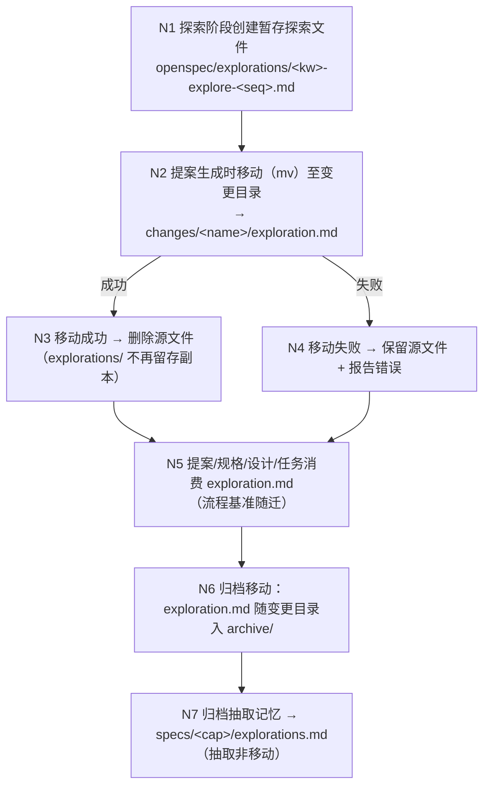
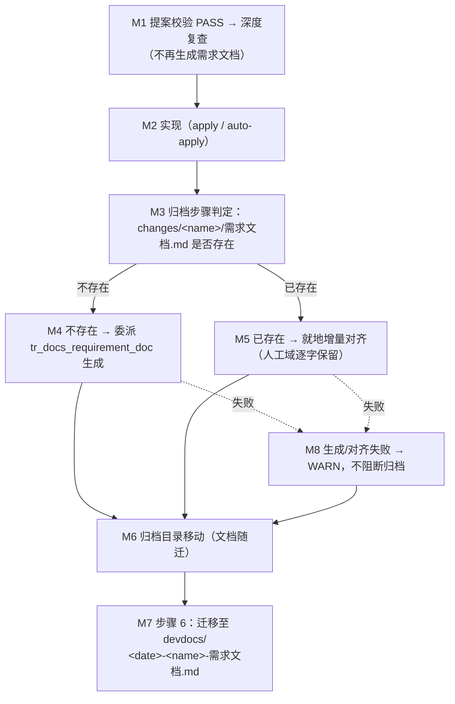
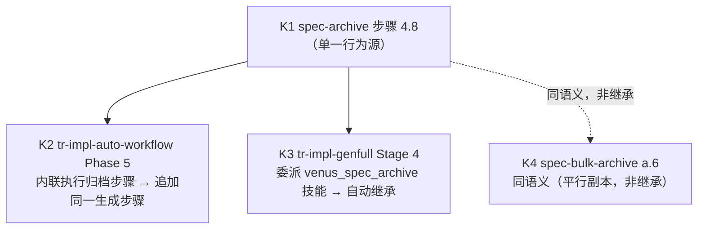

# 指令制品数据处理逻辑优化 — 探索记录

> 探索对象：VenusAgentTools 自身技能模板中**探索文件**与**需求文档**两类制品的**数据处理（落点与生成时机）**逻辑
> 技术真源：`src/core/templates/workflows/*.ts`（模板工厂）；`skills/*/SKILL.md` 为生成产物快照；`.claude/` 为本机安装产物（不入库）
> 目标：调整两条数据处理规则 —— ①提案生成时探索文件**移动**入提案（不留原件）；②需求文档改为**归档时自动生成**，提案校验通过后**不再生成**

## Background

用户原始诉求（原文）：

> 分析优化部分指令对数据的处理逻辑，包括propose\debug\workflow\auto-workflow\auto-migration\archive
> 1)生成提案时探索文件移动到提案内，不需要保留原件
> 2)需求文档生成-调整为归档时自动生成，生成提案校验完成后-不再生成

---

## 提示词基线

> **状态：已确认（2026-09-30）** —— 判定「不明确」，输出优化后提示词后，用户就四项门内裁决作答（**全部采信 AI 推荐**），据此视为对优化后提示词的确认。**本段为下游唯一语义来源。**

### 校验结论

| 维度 | 判定 | 说明 |
| :--- | :--- | :--- |
| 目标 Goal | ✔ | 两条规则方向明确：①探索文件由"复制/保留"改为"移动/不留原件"；②需求文档生成时机由"提案校验后"改为"归档时" |
| 对象 Object | ✔ | 六个点名指令的落点已实测定位到模板源：`spec-propose.ts` / `tr-impl-debug.ts` / `tr-impl-workflow.ts` / `tr-impl-auto-workflow.ts` / `tr-impl-auto-migration.ts` / `spec-archive.ts` |
| 范围 Scope | ⚠️ 实质 | ①`tr-impl-genfull.ts` 与 `spec-bulk-archive.ts` 同构但未点名；②`tr-impl-auto-migration.ts` **两个议题均无落点**（无 `openspec/explorations/` 暂存、无归档阶段），点名后实际无改动；③`openspec/explorations/` 下 9 个历史文件是否清理未定 |
| 约束 Constraints | ⚠️ | ①迁移失败时是否仍保留原件（现有 guardrail）；②归档生成需求文档的**落点**（变更目录内→再迁移 devdocs，还是直写 devdocs）；③生成失败是否阻断归档 |
| 验收 Acceptance | ❌ | 未提及 → [推断] 结构指标断言（模板文本） + `pnpm build && pnpm generate:skills` + 全量 vitest 回归 |
| 歧义 Ambiguity | ⚠️ | ①`tr-impl-debug` Phase 7.3 需求文档双分支（生成 / 就地增量对齐）的去留；②需求文档归档生成落点；③genfull / bulk-archive 是否同步；④历史探索文件是否清理 |

### 优化后提示词（待确认）

> **目标**：调整技能模板中两类制品的**数据处理逻辑**——**探索文件**（探索产物）与**需求文档**（评审产物）——的落点与生成时机，使其在全流程中**单一驻留点、单一生成时机**；技能名/类型/总数、既有确认门语义、制品格式均不变。
>
> **规则 1 — 探索文件移动入提案，不留原件（技术真源 `src/core/templates/workflows/*.ts`）**：
>
> - 提案生成时，探索文件由 `openspec/explorations/<keyword>-explore-<sequence>.md` **移动**（`mv`，非复制）至 `openspec/changes/<change-name>/exploration.md`；迁移成功即删除源文件，`openspec/explorations/` 不再保留同一探索的第二份副本。
> - 落点清单（[推断] 由代码实测补出）：`spec-propose.ts`（独立提案，0.6 关联迁移）、`tr-impl-workflow.ts`（Phase 2.3 迁移 + "Post-Migration: Source File Preservation" 整段反转）、`tr-impl-auto-workflow.ts`（Phase 2 迁移 + "Preserve the exploration file — do NOT delete it" 反转）。
> - **[推断] 安全网保留**：迁移**失败**时仍 MUST 保留源文件（现有 "If migration fails, preserve source file" 语义不变）——"不保留原件"仅适用于迁移**成功**路径。
> - `tr-impl-auto-migration.ts`：实测其 `exploration.md` **直接创建在变更目录内**，无 `openspec/explorations/` 暂存 → **[待确认] 无改动**。
> - `tr-impl-debug.ts`：实测无 `openspec/explorations/` 落点（诊断结论直接写变更目录 `exploration.md`），仅"关键词与探索文件同源同规则"的措辞引用 → **[待确认] 无改动**。
>
> **规则 2 — 需求文档改为归档时自动生成，提案校验通过后不再生成**：
>
> - **移除**：提案校验 PASS + 深度复查之后的自动生成调用（`tr-impl-auto-workflow.ts` Phase 3、`tr-impl-workflow.ts` §3.5、`tr-impl-genfull.ts` Stage 2.3、`tr-impl-debug.ts` Phase 7.3）——四条链路的"verify PASS → 生成需求文档"不再发生。
> - **新增**：`spec-archive.ts` 归档流程内**自动生成**需求文档，作为归档制品的组成部分；失败处理遵循归档既有哲学（**[推断] non-blocking，WARN 继续归档**）。
> - **[待确认] 落点方案**：归档生成落点为「归档前生成到 `openspec/changes/<change-name>/需求文档.md`，目录移动后由既有步骤 6 迁移到 `openspec/devdocs/`」（复用现有路由，最小改动）抑或「归档后直写 `openspec/devdocs/YYYY-MM-DD-<name>-需求文档.md`」（去掉迁移步骤）。
> - **[推断] 能力保留**：独立技能 `venus_tr_docs_requirement_doc` 与独立命令 `/venus:tr-docs-requirement-doc` **保留**（仅工作流不再自动调用它）；`tr-docs-requirement-doc.ts` 的路由表（active → 变更目录 / archived → devdocs）按落点方案同步。
>
> **[推断] 约束**：技能名/类型/总数不变；frontmatter `allowedTools` 与正文同步（不再委派 `tr_docs_requirement_doc` 的链路须同步摘除该 Skill 注入）；改动后 `pnpm build && pnpm generate:skills`；`pnpm test` 全绿；同步 delta spec 与 `openspec/CONTEXT.md` 术语；不修改 `deriveCommandContent` 派生器。
>
> **[待确认] 验收**：建议以**可断言的结构指标**验收（模板文本含 `mv`/移动语义断句、不含 "Preserve the exploration file" 保留断句；归档技能含需求文档生成步骤；四条提案链路不含自动生成调用）+ `pnpm build && pnpm generate:skills` + 全量 vitest 回归。是否需要追加人工流程走查？
>
> **[待确认] 范围边界**：`tr-impl-genfull.ts`（Stage 2.3 生成 + Bridge 2 呈现需求文档路径）与 `spec-bulk-archive.ts`（批量归档仅迁移需求文档）未点名 —— 是否同步调整以消除同构不一致？

### 门内裁决（[待确认] 项的消解结果）

| 待确认项 | 裁决 | 说明 |
| :--- | :--- | :--- |
| **范围边界** | **同步全部同构技能** | `tr-impl-genfull.ts` 移除 Stage 2.3 的提案后生成、其 Stage 4 归档随 `spec-archive` 自动获得生成语义；`spec-bulk-archive.ts` 同步归档生成语义。消除「同一规则在不同技能表述不一致」的漂移 |
| **归档落点** | **生成到变更目录 → 再迁移 devdocs** | 归档前生成 `openspec/changes/<change-name>/需求文档.md`，目录移动后由既有步骤 6 迁移到 `openspec/devdocs/YYYY-MM-DD-<name>-需求文档.md`；复用现有路由，devdocs 产出路径与历史归档完全一致。生成失败 non-blocking + WARN 继续归档 |
| **debug Phase 7.3** | **整段移除** | `tr-impl-debug` Phase 7 收尾不再涉及需求文档，直接 "Ready for archive"；同步摘除其 `allowedTools` 中的 `tr_docs_requirement_doc` Skill 注入与正文相关表述 |
| **历史探索文件** | **不清理，仅改新流程** | `openspec/explorations/` 下 9 个历史文件（均属已归档变更）保留不动；新流程下该目录仅作「探索中」暂存区，提案生成后即清空 |

### 优化说明

1. **把两条口语规则落为可断言的流水线不变量** —— 原文只说"移动/不保留""归档时生成"，未定义**哪一层落盘、失败怎么办、谁消费**。落为「单一驻留点 + 单一生成时机 + 失败安全网」，每条对应可断言的模板文本约束。
2. **纠正对象事实偏差** —— 点名 6 个指令中，`auto-migration` 两个议题均无落点、`debug` 议题 1 无落点；按原文逐条实现会在这两处落空，故列为待确认而非强行改动。
3. **补出连带效应** —— `spec-archive` 由 `auto-workflow` Phase 5 / `genfull` Stage 4 委派共享，是需求文档时机的**单一行为源**；改 archive 必然波及未点名的 `genfull` 与 `bulk-archive`。
4. **补出可判定验收** —— 原诉求无验收标准；转为结构指标断言 + 既有测试套件回归。
5. **不篡改原始意图** —— 未新增用户未提出的需求（未借机调整探索门、确认门、制品格式或技能集合）。

---

## 功能流程图

> **状态：已确认（2026-09-30）** —— 用户经流程最终确认门确认，三条流程与 17 个节点为本次变更的**流程基准**，作为 propose 的生成锚点。后续发现遗漏节点 MUST 回本段更新并重新确认，MUST NOT 在 tasks.md 静默补节点。
>
> 流程基准 = **改造后两类制品的流水线编排行为**（本变更为技能模板变更，其"业务功能"即各技能的编排行为）。节点 id 全局唯一递增，图中与表中一致。
>
> 三重来源：①用户两条规则；②1.1.2 澄清门四项裁决；③1.2 代码实测落点。证据位置一律为 `文件:行`（改造前现状）或 `类.方法`。

### 流程 1：探索文件数据流（暂存 → 变更目录 → 归档）

| 节点 | 操作 | 触发条件 | 证据位置 | 异常路径 |
| :--- | :--- | :--- | :--- | :--- |
| N1 创建暂存探索文件 | 在 `openspec/explorations/` 建 kebab 关键词 + 序号文件 | 进入探索阶段 | `spec-explore.ts:91`；`tr-impl-workflow.ts:59`；`tr-impl-auto-workflow.ts:80` | 工作区不可写 → 既有降级 |
| N2 移动入变更目录 | `mv` 暂存文件 → `changes/<name>/exploration.md` | 提案生成开始（Phase 2） | `spec-propose.ts:73-79`；`tr-impl-workflow.ts:1036-1050`；`tr-impl-auto-workflow.ts:458-460` | 见 N4 |
| N3 删除源文件 | 移动成功后移除 `explorations/` 源文件 | N2 成功且目标文件校验通过 | **改造点**（现状反向：`tr-impl-workflow.ts:1057-1077`、`tr-impl-auto-workflow.ts:463`） | 目标存在但校验失败 → 按失败处理，保留源件 |
| N4 保留源文件 | 迁移失败时 MUST NOT 删除源文件 | N2 失败 | `tr-impl-workflow.ts:965,1053,1081` | 既有安全网，**本变更保留不变** |
| N5 制品生成消费 | 以 exploration.md 为提案生成锚点（流程图基准） | N3/N4 之后 | `spec-propose.ts:81-86,252-262`；`tr-impl-workflow.ts:1130-1146` | 无探索文件 → 既有降级（仅凭制品生成） |
| N6 归档随迁 | exploration.md 随变更目录进入 `archive/` | 归档目录移动 | `spec-archive.ts:158-169`；`spec-bulk-archive.ts:193-200` | 归档目标已存在 → 既有报错 |
| N7 能力记忆抽取 | 抽取决策/术语/边界写 `specs/<cap>/explorations.md` | 归档移动**前** | `spec-archive.ts:130-156`；`spec-bulk-archive.ts:203-214` | 同步失败 → WARN 不阻断 |

### 流程 2：需求文档数据流（提案校验后不再生成 → 归档时生成）

| 节点 | 操作 | 触发条件 | 证据位置 | 异常路径 |
| :--- | :--- | :--- | :--- | :--- |
| M1 校验后收束 | 深度复查保留，需求文档生成调用移除 | 提案校验 PASS ≥90% | **改造点**（现状生成于 `tr-impl-workflow.ts:1391`、`tr-impl-auto-workflow.ts:517-518,675`、`tr-impl-genfull.ts:270-286`、`tr-impl-debug.ts:484-499`） | FAIL → 既有自动修复循环，不生成 |
| M2 实现 | apply 批次调度实现任务（含 auto-mode） | M1 完成 | `spec-apply.ts`（Step 6 批次调度） | 既有编译/测试门 |
| M3 归档生成判定 | 判定变更目录内 `需求文档.md` 是否存在 | 归档流程进入预归档检查点 | **新增**：`spec-archive.ts` 新步骤 4.8（插于 4.7 与 5 之间）；`spec-bulk-archive.ts` 新步骤 a.6（插于 a.5 与 b 之间） | 目录不可读 → 记 WARN 按"不存在"处理 |
| M4 生成需求文档 | 非交互委派 `venus_tr_docs_requirement_doc` | M3 判定不存在 | **新增**（委派目标：`tr-docs-requirement-doc.ts:207-215` 路由表） | 见 M8 |
| M5 就地增量对齐 | 人工域（`## 基本信息` / `## 八、评审记录`）逐字保留，一~七章按当前制品重新派生 | M3 判定已存在 | **能力迁移**自 `tr-impl-debug.ts:499,686,700`（该处整段移除） | 格式破损 → 补建章节 + WARN |
| M6 归档移入 archive | CLI 一次性迁移变更目录 | M3-M5 完成 | `spec-archive.ts:158-169` | 目标已存在 → 既有报错 |
| M7 迁移 devdocs | 将文档从归档目录移至 `openspec/devdocs/` | 归档移动后 | `spec-archive.ts:171-183`；`spec-bulk-archive.ts:215-222` | 无 `YYYY-MM-DD-` 前缀 → 退回无时间戳命名 |
| M8 失败降级 | 生成/对齐失败记 WARN 并继续归档 | M4/M5 失败 | **新增**（沿用归档非阻断哲学：`spec-archive.ts:150-151,156`） | 永不阻断归档 |

### 流程 3：归档生成的继承链（内联 vs 委派）

| 节点 | 操作 | 触发条件 | 证据位置 | 异常路径 |
| :--- | :--- | :--- | :--- | :--- |
| K1 单一行为源 | 归档生成步骤定义于 archive 技能 | 归档执行 | **新增** `spec-archive.ts` 4.8 | 失败 non-blocking（M8） |
| K2 内联继承 | auto-workflow 内联归档逻辑，需在步骤清单补同一语义（引用而非复制） | auto-workflow Phase 5 | `tr-impl-auto-workflow.ts:580-581,683` | 内联漏改 → 该链路不生成（一致性断言锁） |
| K3 委派继承 | genfull 委派 archive 技能 → 零文本改动 | genfull Stage 4 | `tr-impl-genfull.ts:274` | 委派失败 → 既有处理 |
| K4 平行副本 | bulk-archive 自持归档流程 → 需平行同语义新增 | 批量归档 | `spec-bulk-archive.ts:193` | 单变更失败隔离（既有） |

---

## Codebase Findings

> 技术真源 `src/core/templates/workflows/*.ts`（模板工厂）；`skills/*/SKILL.md` 为生成快照；`.claude/` 为本机安装产物（不入库）。`spec-*.ts` 为**单一定义源**（`deriveCommandContent` 派生指令版）；`tr-*.ts` 为 skill/command **手工双处**。

### A. 规则 1 落点（探索文件移动）

| 技能 | 落点 | 现状文本 | 处置 |
| :--- | :--- | :--- | :--- |
| `venus_spec_propose` | Step 0.6（`spec-propose.ts:73-79`） | "将探索文件**迁移**到变更目录"（未明说删源） | 明确为移动 + 删源（该段在 `CMD:SKIP` 内，指令版不含，维持现状） |
| `venus_tr_impl_workflow` | Phase 2.3（`tr-impl-workflow.ts:1036-1050`）+ **Post-Migration 保留段**（`1057-1077`）+ Phase 2.0 checkpoint（`949`） | "Post-Migration: Source File Preservation (Task 7.1)" 强制"Keep source file" | **删除整段**；`949` 改写；指令版 `2116` 同步 |
| `venus_tr_impl_auto_workflow` | Phase 2（`tr-impl-auto-workflow.ts:458-463`） | "**Preserve the exploration file — do NOT delete it.**" | 反转为移动后删源；指令版 `671` 同步 |
| `venus_tr_impl_debug` | 无 `openspec/explorations/` 落点（`tr-impl-debug.ts:144` 仅关键词同源引用；Phase 6 直写变更 `exploration.md`） | — | **无改动** |
| `venus_tr_impl_auto_migration` | `tr-impl-auto-migration.ts:40` 直建 `changes/<name>/exploration.md` | 无暂存层 | **无改动** |
| `venus_tr_impl_genfull` | `tr-impl-genfull.ts:129` 仅检查目录（委派 explore/propose） | — | **无改动** |
| `venus_spec_archive` / `venus_spec_bulk_archive` | `spec-archive.ts:155`；`spec-bulk-archive.ts:203` | "extraction copies, not moves"（指**记忆抽取**不移动） | **无改动**（语义已正确，勿误改） |

### B. 规则 2 落点（需求文档生成时机）

**移除侧（提案校验后不再生成）**

| 技能 | 落点 | 现状 |
| :--- | :--- | :--- |
| `venus_tr_impl_workflow` | `tr-impl-workflow.ts:1391`（§3.5）、`1618`（guardrail）、指令版 `2208,2280` | verify PASS → 深度复查 → #5 生成需求文档 |
| `venus_tr_impl_auto_workflow` | `tr-impl-auto-workflow.ts:517-518`（Phase 3）、`618,689`（guardrail）、指令版 `675` | PASS → 深度复查 → 生成需求文档 → Phase 4 |
| `venus_tr_impl_genfull` | `tr-impl-genfull.ts:254-295`（Stage 2.3 + 完成块）、`26,39,49,294,295,370,372,392` | Stage 2.3 生成；Bridge 2 呈现文档路径 |
| `venus_tr_impl_debug` | `tr-impl-debug.ts:484-499`（Phase 7.3 双分支）、`46,477,549,569,586,686,700` | 不存在→生成；已存在→就地增量对齐 |

**新增侧（归档时生成）**

| 技能 | 落点 | 现状 |
| :--- | :--- | :--- |
| `venus_spec_archive` | 新步骤 4.8，插于 `spec-archive.ts:157` 之前（4.7 与 5 之间）；步骤 6（`171-183`）保持 | 仅**迁移**（存在则移到 devdocs） |
| `venus_spec_bulk_archive` | 新步骤 a.6，插于 `spec-bulk-archive.ts:192` 之前（a.5 与 b 之间）；b.5（`215-222`）保持 | 仅**迁移** |
| `venus_tr_impl_auto_workflow` | `tr-impl-auto-workflow.ts:580-581,683` | 内联归档逻辑 → 需在步骤清单追加同语义 |

### C. 依赖与白名单落点

| 载体 | 落点 | 处置 |
| :--- | :--- | :--- |
| `DEPS` | `src/core/profiles.ts:44-62` | `spec-archive` / `spec-bulk-archive` **加** `tr-docs-requirement-doc`；`tr-impl-workflow` / `tr-impl-debug` / `tr-impl-genfull` **剔除**（失效）；`tr-impl-auto-workflow` **保留**（Phase 5 内联归档仍委派） |
| `DEFAULT_WORKFLOWS` | `src/core/profiles.ts:17-26` | **不改**（`spec-archive` 在默认集 → DEPS 使默认安装由 8 项变 **9 项**） |
| `spec-archive` 白名单 | `spec-archive.ts:11` | 加 `Skill(venus_tr_docs_requirement_doc)` |
| `spec-bulk-archive` 白名单 | `spec-bulk-archive.ts:11` | 同上 |
| `tr-impl-workflow` 白名单 | `tr-impl-workflow.ts` `skillDelegation` | 剔 `tr_docs_requirement_doc` |
| `tr-impl-debug` 白名单 | `tr-impl-debug.ts:583` | 剔（含 `586` compatibility 行） |
| `tr-impl-genfull` 白名单 | `tr-impl-genfull.ts` `skillDelegation` | 剔（Stage 4 委派 spec-archive，会话级 `permissions.allow` 覆盖嵌套委派） |
| `tr-impl-auto-workflow` 白名单 | `tr-impl-auto-workflow.ts:631` | **保留** |

### D. 测试落点（须同步）

| 测试 | 断言 | 影响 |
| :--- | :--- | :--- |
| `test/profiles.test.ts:35-40` | `spec-archive` → `injected` 恰为 `['spec-verify']` | 改为 `['spec-verify', 'tr-docs-requirement-doc']` |
| `test/profiles.test.ts:87-93` | `tr-impl-workflow` 注入两技能 | 剔除 `tr-docs-requirement-doc` |
| `test/profiles.test.ts:107-135` | `tr-impl-genfull` 注入 8 显式 + 2 传递（顺序断言） | `tr-docs-requirement-doc` 由显式变传递，**顺序断言**须更新 |
| `test/profiles.test.ts:137-143` | `tr-impl-debug` 注入两技能 | 剔除 `tr-docs-requirement-doc` |
| `test/commands.test.ts:135-156` | 默认集装 **8** 个、`injectedDeps` 为 `[]` | 改为 **9** 个、`['tr-docs-requirement-doc']` |
| `test/commands.test.ts:20`、`176` | 注释"默认集仅 8 个" | 同步改注释 |
| `test/skills-parity.test.ts` | 快照漂移 | `pnpm build && pnpm generate:skills` 重生成 |
| `test/allowed-tools.test.ts` | 条目合法性 / 委派条目存在性 | 新条目须合法；正文一致性扫描仅告警 |

### E. 文档与记忆落点

| 载体 | 影响 |
| :--- | :--- |
| `openspec/CONTEXT.md:23`（探索文件）、`:146`（人工域）、`:149`（就地增量对齐）、`:80`（工作流技能套件描述） | 定义需改指归档 / 移动语义 |
| `openspec/specs/` 相关能力主规格 | delta spec 触发：`spec-workflow-skills`、`tr-workflow-suite-skills`、`tool-call-whitelist`、`skill-profile`（默认集/DEPS） |
| `openspec/specs/<cap>/explorations.md` | 归档时抽取写入（既有机制） |

---

## Questions

> 均已在 1.1.2 澄清门消解（见「门内裁决」）；无遗留 `[待确认]`。

| 编号 | 问题 | 状态 |
| :--- | :--- | :--- |
| Q1 | genfull / bulk-archive 是否同步 | 已裁决：同步 |
| Q2 | 归档生成落点 | 已裁决：生成到变更目录 → 既有步骤 6 迁移 devdocs |
| Q3 | debug Phase 7.3 双分支去留 | 已裁决：整段移除，双分支能力迁移至归档 |
| Q4 | 历史探索文件是否清理 | 已裁决：不清理 |
| Q5 | 归档委派技能未安装怎么办 | 已裁决：加 DEPS 注入（默认集 8 → 9） |
| Q6 | 归档时文档已存在如何处置 | 已裁决：就地增量对齐（保人工域） |

---

## 术语表

> 1.1.5 CONTEXT.md 启动检查：`openspec/CONTEXT.md` **已存在**，已加载既有术语；本变更涉及以下术语，需在归档时同步 CONTEXT.md。

| 术语 | 现状定义（CONTEXT.md 行号） | 本变更后的定义 |
| :--- | :--- | :--- |
| **探索文件** | `:23` "持久化探索记录，propose 时可关联**迁移**为变更的 exploration.md" | 定义为「**提案生成时移动**（mv）入变更目录，**不保留原件**」；`openspec/explorations/` 仅为"探索中"暂存区 |
| **人工域** | `:146` "`需求文档.md` 中由人工填写、重生成时 MUST NOT 覆盖的段落" | 定义**不变**；触发点由 debug Phase 7.3 改指 **spec-archive 归档生成步骤** |
| **就地增量对齐** | `:149` "`venus_tr_impl_debug` Phase 7.3 …" | 主体改为 **`venus_spec_archive` 归档生成步骤（需求文档已存在分支）** |
| **需求文档** | 未单列（散见 `:146`） | 建议新增术语：**归档生成制品**——在归档预归档检查点自动生成，随归档目录迁移至 `openspec/devdocs/` |
| **单一定义源** / **能力探索记忆** | 既有 | 定义不变（本变更遵循） |

---

## 架构决策

- **D1 探索文件移动语义就地反转，不新建共享载体**：3 处独立文本（`spec-propose` / `tr-impl-workflow` / `tr-impl-auto-workflow`）各自改写。**否决**把规则上移到 `openspec/rules/artifact-generation.md`：该文件为目标项目**自持**（非 venus 分发，`venus init` 不创建），且 auto-workflow 内联生成**不引用**它 —— 依赖它等于引入新的失效面。
- **D2 需求文档时机 = 单一定义源 `spec-archive.ts`**：生成步骤只定义在 archive 技能；`genfull` 委派继承（零文本改动）、`auto-workflow` 内联继承（步骤清单追加**引用**而非复制协议文本）。对齐历史 D1（共享资源协议只写 `spec-apply.ts`）——避免"双模板漂移"实录重演。
- **D3 双分支能力整体迁移而非删除**：debug Phase 7.3 的「不存在→生成 / 已存在→就地增量对齐」迁到归档生成步骤（M4/M5）。理由：人工域保护是**能力**不是调试专属；直接删除会让 CONTEXT.md 的「人工域」「就地增量对齐」成为死词。
- **D4 DEPS 注入补齐 + 失效项剔除**：委派方必须可得（与 `spec-propose ⇒ spec-verify-proposal` 同构）；失效委派条目剔除（最小权限）。副作用：默认安装集 8 → 9 项（`DEFAULT_WORKFLOWS` 本身不改）。
- **D5 白名单同步（正文 ↔ 白名单一致性硬约束）**：新增委派方补 `Skill(venus_tr_docs_requirement_doc)`；失效方剔除。嵌套委派由**会话级 `permissions.allow`**（`buildPermissionEntries` 聚合全部已装技能）覆盖，依据 `tool-call-whitelist` 规格「会话级权限载体非破坏合并」。
- **D6 fail-safe 安全网方向不变**：迁移**失败**仍保留源文件；生成/对齐**失败**仅 WARN 不阻断归档。"不保留原件"只适用于成功路径。

---

## 边界场景

- **迁移失败 / 目标校验失败** → 保留源文件 + 报错，MUST NOT 删除（D6）
- **需求文档生成失败 / 对齐失败** → WARN，归档继续（沿用 archive 非阻断哲学）
- **需求文档已存在且人工填过评审记录** → 就地增量对齐，人工域逐字保留（M5）
- **归档流程进入时目录不可读** → 按"不存在"处理 + WARN
- **批量归档并行子代理** → 各变更独立生成，失败隔离不中止批次
- **变更无 `exploration.md`**（纯手工创建）→ 跳过移动（既有 skip 语义）
- **`/venus:spec-propose` 指令版** → Step 0 位于 `CMD:SKIP` 内，指令版不含迁移步骤（**维持现状**，不在本变更范围）
- **`auto-migration` / `debug` 无暂存探索文件** → 无改动（避免"为改动而改动"）
- **`archive/` 目标目录已存在** → 既有报错与处置不变
- **反幻觉**：`specs/<cap>/explorations.md` 是**抽取**而非移动，历史内容不删（既有"标已过时"语义）

---

## Decision Process

1. **1.1.2 提示词校验门**：判定「不明确」（对象/范围/约束/验收四维缺口）→ 输出优化后提示词（含 `[推断]`/`[待确认]`）→ 用户就 4 项裁决作答（全部采信推荐）→ 视为确认，记入 `## 提示词基线`。
2. **1.2 代码实测**：逐技能定位落点，纠正原文两处事实偏差（`auto-migration` / `debug` 规则 1 无落点）；发现 `spec-archive` 为需求文档时机的共享行为源 → 连带出 `genfull` / `bulk-archive`。
3. **1.2.0.5 能力记忆注入**：读 `specs/<cap>/explorations.md`，复用历史 D1（单一定义源）、fail-safe 降级、结构指标验收三项方法论。
4. **二次裁决（L2/L4）**：DEPS 注入策略与"已存在"处置 → 用户均采信推荐（D4/D3）。
5. **一致性裁决**：无硬冲突 → 进入 1.5.5 流程最终确认门。

---

## Decisions

1. 探索文件：提案生成时**移动**入变更目录，成功即删源；失败保留源件（D1/D6）。
2. 需求文档：**归档时生成**（archive 4.8 / bulk-archive a.6）；提案校验后**不再生成**（四条链路移除）（D2）。
3. debug Phase 7.3 双分支**整段移除**，能力**迁移**至归档生成（D3）。
4. `genfull` / `bulk-archive` **同步调整**（用户裁决）。
5. 归档生成落点 = 变更目录 → 既有步骤 6 迁移 devdocs（用户裁决）。
6. `spec-archive` / `spec-bulk-archive` **加 DEPS** `tr-docs-requirement-doc`；默认安装 8 → 9（用户裁决 + D4）。
7. "已存在"→**就地增量对齐**（用户裁决 + D3）。
8. 历史 9 个探索文件**不清理**（用户裁决）。
9. 独立技能 `venus_tr_docs_requirement_doc` 与独立指令 `/venus:tr-docs-requirement-doc` **保留**（仅工作流不再自动调用）。

---

## Scope Changes

- **+`venus_tr_impl_genfull`**：Stage 2.3 移除、Stage 4 继承说明同步（原诉求未点名，为消除同构不一致）
- **+`venus_spec_bulk_archive`**：a.6 平行新增（同上）
- **+`src/core/profiles.ts`**：DEPS 增删（用户裁决 Q5 的直接后果）
- **+白名单与测试/快照**：正文与白名单一致性为硬约束，测试断言与 `skills/` 快照必须同步（否则 CI 失败）
- **+`openspec/CONTEXT.md` 与主规格同步**：术语定义改指、delta spec 归档
- **−不做**：清理历史探索文件；改造 `/venus:spec-propose` 指令版（Step 0 仍在 `CMD:SKIP` 内）；修改 `DEFAULT_WORKFLOWS`；修改 `deriveCommandContent` 派生器；改动 `auto-migration` / `debug` 的探索文件逻辑

---

## Pending

> 无遗留 `[待确认]` 项。待实现期确认：`tr-impl-*` 双处（skill/command）改写是否逐句对齐压缩版文风；`test/profiles.test.ts` genfull 注入**顺序**断言的期望序列（由 DEPS 迭代顺序决定，实现时以实际输出锁定）。
