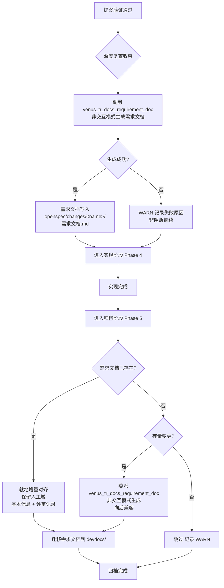

# Exploration: 需求文档生成时机调整

**创建时间**: 2026-10-10
**状态**: 探索完成 → 进入提案

---

## 提示词基线

**原始提示词**: 调整当前项目部分指令 SKILL文档生成逻辑，便于用户排查问题
1）需求文档不归档时生成，调整到提案生成验证没问题后自动生成

**确认后的提示词基线**:
调整当前项目（VenusAgentTools）中涉及需求文档生成时机的所有模板/技能文件：
1. 需求文档生成时机从"归档时（Phase 5 / Stage 4）"调整为"提案验证通过后（Phase 3 / Stage 2 收束阶段）"自动生成
2. 归档阶段不再重复生成：需求文档已存在则增量对齐（保留人工域），不存在则仍生成（向后兼容存量变更）
3. 涉及文件：`tr-impl-auto-workflow.ts`、`tr-impl-workflow.ts`、`tr-impl-genfull.ts`、`spec-archive.ts`、`spec-bulk-archive.ts`、`tr-docs-requirement-doc.ts`、`tr-impl-debug.ts`、`tr-impl-auto-migration.ts`

---

## 功能流程图

| 节点 | 操作 | 触发条件 | 证据位置 | 异常路径 |
| :--- | :--- | :--- | :--- | :--- |
| N1 | 提案验证通过（≥90%） | Phase 3 verify_proposal PASS | [新建] tr-impl-auto-workflow.ts Phase 3.3 | FAIL → 回到 auto-fix 循环 |
| N2 | 深度复查收束 | 验证通过后自动触发 deep review | [新建] tr-impl-auto-workflow.ts Phase 3.3 | deep review 失败 → WARN 继续 |
| N3 | 调用 venus_tr_docs_requirement_doc 非交互模式生成需求文档 | 深度复查收束后 | [新建] tr-impl-auto-workflow.ts:523 附近 | 技能不可用 → fallback AI 内联生成 + WARN |
| N4 | 判断生成是否成功 | N3 执行后 | [新建] tr-impl-auto-workflow.ts Phase 3.3 | — |
| N5 | 需求文档写入变更目录 | 生成成功 | tr-docs-requirement-doc.ts Step 6 | 写入失败 → WARN |
| N6 | WARN 记录失败原因，非阻断继续 | 生成失败 | [新建] tr-impl-auto-workflow.ts Phase 3.3 | — |
| N7 | 进入实现阶段 Phase 4 | N3 完成（无论成败） | tr-impl-auto-workflow.ts Phase 4 | — |
| N8 | 实现完成 | Phase 4 apply + test gate | tr-impl-auto-workflow.ts Phase 4 | 编译失败/测试失败 → 暂停 |
| N9 | 进入归档阶段 Phase 5 | Phase 4 成功 | tr-impl-auto-workflow.ts Phase 5 | — |
| N10 | 检查需求文档是否已存在 | 归档预检查点 | spec-archive.ts:158-174 step 4.8 | 目录不可读 → WARN |
| N11 | 就地增量对齐（保留人工域） | 需求文档已存在 | spec-archive.ts:168 Branch B | 对齐失败 → WARN 继续 |
| N12 | 判断是否为存量变更（走后向兼容） | 需求文档不存在 | [新建] spec-archive.ts step 4.8 | — |
| N13 | 委派 venus_tr_docs_requirement_doc 生成 | 存量变更后向兼容 | spec-archive.ts:167 Branch A | 生成失败 → WARN 继续 |
| N14 | 跳过，记录 WARN | 新流程应在验证阶段已生成 | [新建] spec-archive.ts step 4.8 | — |
| N15 | 迁移需求文档到 devdocs/ | 归档目录迁移后 | spec-archive.ts:189-201 step 6 | 迁移失败 → WARN |
| N16 | 归档完成 | 全部步骤完成 | spec-archive.ts step 8 | — |

---

## Codebase Findings

### Discovered Files

| 文件 | 相关性 |
|------|--------|
| `src/core/templates/workflows/tr-impl-auto-workflow.ts` | **核心修改** — 全自动工作流模板，Phase 3/5 需调整需求文档生成时机 |
| `src/core/templates/workflows/tr-impl-workflow.ts` | **核心修改** — 引导式工作流模板，Phase 3 需同步调整，Guardrails 需更新 |
| `src/core/templates/workflows/tr-impl-genfull.ts` | **核心修改** — 全流程编排器，Stage 2/4 需同步调整 |
| `src/core/templates/workflows/spec-archive.ts` | **核心修改** — 归档模板，step 4.8 需调整行为（新逻辑：已存在对齐/不存在后向兼容生成） |
| `src/core/templates/workflows/spec-bulk-archive.ts` | **同步修改** — 批量归档，b.5 段引用需求文档生成逻辑 |
| `src/core/templates/workflows/tr-docs-requirement-doc.ts` | **同步修改** — 需求文档技能，Caller note 需增加验证阶段为合法自动调用方 |
| `src/core/templates/workflows/tr-impl-debug.ts` | **同步修改** — 调试工作流，Phase 7 引用归档步骤 4.8，需同步更新说明 |
| `src/core/templates/workflows/tr-impl-auto-migration.ts` | **检查** — 自动迁移，可能有类似引用需同步 |
| `src/core/templates/registry.ts` | **检查** — 模板注册表，确认无硬编码引用 |

### Identified Symbols

| 符号 | 位置 | 说明 |
|------|------|------|
| `getTrImplAutoWorkflowSkillTemplate()` | tr-impl-auto-workflow.ts:30 | 全自动工作流模板，Phase 3.3 PASS 分支第 523 行和 Guardrails 第 625 行含"do NOT generate"禁令 |
| `getTrImplAutoWorkflowCommandTemplate()` | tr-impl-auto-workflow.ts:650 | 斜杠指令压缩版，Phase 3/5 描述需同步更新 |
| `getTrImplWorkflowSkillTemplate()` | tr-impl-workflow.ts:30 | 引导式工作流模板，Phase 3.5 第 1380 行和 Guardrails 含"do NOT generate"禁令 |
| `getTrImplWorkflowCommandTemplate()` | tr-impl-workflow.ts:1616 | 斜杠指令压缩版 |
| `getTrImplGenfullSkillTemplate()` | tr-impl-genfull.ts:34 | 编排器模板，Stage 2.3 第 200-203 行和 Guardrails 第 320 行含 MUST NOT 禁令 |
| `getTrImplGenfullCommandTemplate()` | tr-impl-genfull.ts:343 | 斜杠指令压缩版 |
| `getSpecArchiveChangeSkillTemplate()` | spec-archive.ts:8 | 归档模板，step 4.8 第 158-174 行为当前需求文档生成逻辑 |
| `getSpecArchiveChangeCommandTemplate()` | spec-archive.ts:371 | 斜杠指令（由 deriveCommandContent 派生） |
| `getTrDocsRequirementDocSkillTemplate()` | tr-docs-requirement-doc.ts:6 | 需求文档生成技能，Caller note 第 44 行仅列归档为自动调用方 |
| `getTrDocsRequirementDocCommandTemplate()` | tr-docs-requirement-doc.ts:256 | 斜杠指令压缩版 |

### 关键文本位置（需修改的具体行）

**tr-impl-auto-workflow.ts:**
- L523: `Converge — do NOT generate the requirement document` → 改为生成
- L586-587: Phase 5 中 `requirement document generation` → 改为对齐
- L625: Guardrails converge 规则 → 更新
- L694: Phase 5 command 版描述 → 更新
- L700: Guardrails command 版 → 更新

**tr-impl-workflow.ts:**
- L1380-1382: Phase 3.5 step 5 converge 规则 → 改为生成
- L2197: Guardrails converge 规则 → 更新

**tr-impl-genfull.ts:**
- L200-203: Stage 2.3 收束 MUST NOT → 改为生成
- L281: Stage 4 归档描述 → 改为对齐
- L320: Guardrails converge → 更新

**spec-archive.ts:**
- L158-174: step 4.8 行为描述 → 调整为新逻辑

**tr-docs-requirement-doc.ts:**
- L44: Caller note → 增加验证阶段

---

## Decisions

1. **需求文档生成时机**：从归档阶段（Phase 5 / Stage 4）提前到提案验证通过后（Phase 3 / Stage 2 收束）
   - 理由：便于用户提前排查问题——在实现开始前就能看到需求文档，而非等到全部实现完成后
   - 影响：4 个模板文件（auto-workflow / workflow / genfull / spec-archive）+ 需求文档技能 + bulk-archive + debug

2. **归档阶段行为**：需求文档已存在则增量对齐（保留人工域），不存在则仍生成（向后兼容存量变更）
   - 理由：新流程的变更在验证阶段已生成，归档时只需对齐；存量变更未经新流程，归档时仍需生成
   - 注意：spec-archive step 4.8 的 Branch A/B 行为基本保持不变，主要调整 rationale 文本

3. **生成方式**：非交互模式调用 `venus_tr_docs_requirement_doc` skill，失败非阻断
   - 理由：与归档阶段的非交互调用方式一致，保持用户体验连贯

4. **tr-docs-requirement-doc Caller note 更新**：自动调用方从"仅归档阶段"扩展为"验证阶段 + 归档阶段"
   - 理由：验证阶段成为新的合法自动调用方

---

## 边界场景

- [x] **scenario 1**: 验证通过但需求文档生成失败 → WARN 记录，非阻断继续进入实现阶段
- [x] **scenario 2**: 存量变更（旧流程创建）归档时需求文档不存在 → 仍生成（后向兼容）
- [x] **scenario 3**: 需求文档在验证阶段已生成，用户手工修改了人工域内容 → 归档时增量对齐保留人工域
- [x] **scenario 4**: genfull 委派模式下需求文档生成 → genfull Stage 2 收束时直接生成（非委派），Stage 4 归档时对齐
- [x] **scenario 5**: debug 工作流不生成需求文档 → 保持现状（debug 的 Phase 7 禁令不变）
- [x] **scenario 6**: auto-migration 工作流 → 需检查是否需要同步调整
- [x] **scenario 7**: 需求文档技能本身被独立手动调用 → 不受影响（Standalone mode 不变）

---

## Pending

（无待确认项——所有决策已明确）

---

## Scope Changes

| 变更时间 | 变更类型 | 变更描述 | 原因 |
|---------|---------|---------|------|
| 2026-10-10 | expand | 初始范围从 auto-workflow 扩展到全部 8 个相关模板文件 | 用户确认"全部涉及功能点都需要修改" |