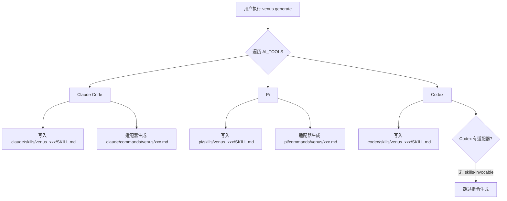

# 探索：新增 Pi/Codex 工具适配

> **创建时间**: 2026-10-12
> **触发命令**: /venus:tr-impl-auto-workflow
> **状态**: 进行中

---

## 背景 (Background)

VenusAgentTools 当前仅支持 Claude Code 作为目标 AI 编码工具。用户要求新增对 **Pi (pi.dev)** 和 **Codex (OpenAI Codex CLI)** 的工具适配，使 `venus generate` 和 `venus update` 能够为这三种工具生成技能（SKILL.md）和斜杠指令。

当前工具适配架构：
- `AI_TOOLS` 配置表（`src/core/config.ts`）：定义各工具的 skillsDir / commandsDir
- `ToolCommandAdapter` 接口（`src/core/command-generation/types.ts`）：格式化指令文件
- `CommandAdapterRegistry`（`src/core/command-generation/adapters/registry.ts`）：注册适配器
- `generateSkillContent`（`src/core/command-generation/generator.ts`）：生成 SKILL.md（格式通用）
- `runGenerate`（`src/commands/generate.ts`）：遍历 AI_TOOLS 安装技能

---

## 提示词基线

```
更新 VenusAgentTools 项目的生成指令和 SKILL 适配工具，新增对 Pi (pi.dev) 和 Codex (OpenAI Codex CLI)
两种 AI 编码工具的适配支持。

当前仅支持 Claude Code（.claude/ 目录，YAML frontmatter 格式），需扩展为同时支持：
- Pi：技能安装到 .pi/skills/，斜杠指令安装到 .pi/commands/venus/，格式同 Claude Code（YAML frontmatter + Markdown）
- Codex：技能安装到 .codex/skills/，不生成斜杠指令（Codex 为 skills-only，通过 $ 前缀调用技能）
- 注册机制：在 AI_TOOLS 配置表新增 pi/codex 条目，CommandAdapterRegistry 注册 pi 适配器（codex 无需适配器）

参考来源：
- Pi 规范：pi.dev 官方文档，遵循 Agent Skills Specification（与 Claude Code 同标准）
- Codex 规范：参考 OpenSpec v1.12.0 项目的 Codex 集成方案（.codex/skills/ 目录，skills-invocable 模式）
```

---

## 功能流程图



### 节点清单

| 节点 | 操作 | 触发条件 | 证据位置 | 异常路径 |
|:---|:---|:---|:---|:---|
| A | venus generate 入口 | 用户执行命令 | `src/commands/generate.ts:101` runGenerate | — |
| B | 遍历 AI_TOOLS | 循环安装 | `src/commands/generate.ts:129` for (const tool of AI_TOOLS) | — |
| C1 | Claude 技能安装 | tool.skillsDir = '.claude' | `src/core/config.ts:75` | — |
| C2 | Claude 指令生成 | claudeAdapter.formatFile | `src/core/command-generation/adapters/claude.ts:17` | — |
| D1 | Pi 技能安装 | **[新建]** tool.skillsDir = '.pi' | 预期产物：config.ts AI_TOOLS 新增 | — |
| D2 | Pi 指令生成 | **[新建]** piAdapter.formatFile | 预期产物：adapters/pi.ts | — |
| E1 | Codex 技能安装 | **[新建]** tool.skillsDir = '.codex' | 预期产物：config.ts AI_TOOLS 新增 | — |
| E2 | Codex 跳过指令 | **[新建]** skills-invocable 判定 | 预期产物：command-surface 判定逻辑或 generate 中条件跳过 | — |
| E3 | 仅技能，无指令 | Codex 无适配器 | — | — |

---

## Codebase 发现 (Codebase Findings)

### 1. 工具配置层 (`src/core/config.ts`)

```typescript
// 当前：仅 claude
export const AI_TOOLS: AIToolOption[] = [
    { value: 'claude', name: 'Claude Code', skillsDir: '.claude', commandsDir: '.claude/commands' },
];
```

**需要新增**：
```typescript
{ value: 'pi', name: 'Pi', skillsDir: '.pi', commandsDir: '.pi/commands' },
{ value: 'codex', name: 'Codex', skillsDir: '.codex', commandsDir: '' },
```

### 2. 适配器层

- `ToolCommandAdapter` 接口：`toolId`, `getFilePath()`, `formatFile()`
- `claudeAdapter`：写入 `.claude/commands/venus/<id>.md`，YAML frontmatter 格式
- `CommandAdapterRegistry`：静态块注册 claudeAdapter

**需要新增**：`piAdapter`（格式与 claudeAdapter 相同，目录不同）
**Codex**：无需适配器（skills-invocable）

### 3. 生成流程 (`src/commands/generate.ts`)

`runGenerate` 第 129 行遍历 `AI_TOOLS`：
- 技能写入：`tool.skillsDir/skills/<skillName>/SKILL.md` — 对三种工具通用
- 指令写入：当前隐式依赖 adapters（通过 `venus update` 命令），`generate` 命令本身只写技能

### 4. Update 流程

需要检查 `src/commands/update.ts` 中指令生成是否遍历 `CommandAdapterRegistry.getAll()`，确认新增 pi 适配器后自动生效。

### 5. OpenSpec 参考（Codex 集成模式）

从 `E:\github\OpenSpec_v1120` 项目分析：
- Codex 定义为 `skills-invocable`（`src/core/command-surface.ts`）
- 技能写入 `.agents/skills/`（共享目录）而非 `.codex/skills/`
- Codex 无 command adapter（已从注册表移除）
- 技能引用使用 `$skill-name` 前缀
- 对于 VenusAgentTools，建议使用 `.codex/skills/`（与 `.claude/`、`.pi/` 对称）

---

## 问题 (Questions)

1. ~~pi 和 codex 的具体目录规范？~~ → 已解决
2. ~~codex 是否生成指令文件？~~ → 已确认：不生成（skills-invocable）
3. ~~`AIToolOption` 的 `commandsDir` 对 codex 为空字符串时，update 流程如何跳过？~~ → **已发现关键问题**：`update.ts:110-113` 的 `if (!adapter) continue;` 会导致无适配器的工具连**技能**也被跳过——需重构为「技能始终生成，指令仅当 adapter 存在时生成」
4. ~~Pi 的指令 frontmatter 字段是否与 Claude Code 完全一致？~~ → 一致，两者均遵循 Agent Skills Specification（YAML frontmatter + Markdown）

## 关键架构发现

### 🔴 update.ts 适配器耦合问题

`src/commands/update.ts:109-113`：
```typescript
const adapter = CommandAdapterRegistry.get(tool.value);
if (!adapter) {
    continue;  // ← 跳过整个工具，包括技能生成！
}
```

当前逻辑：无适配器 → 跳过该工具的全部处理（技能 + 指令 + 权限）。
对于 Codex（skills-invocable，无适配器），这会导致技能也**不生成**。

**修复方向**：将技能生成循环独立于适配器检查之外，仅指令生成受 adapter 门控。

---

## 术语表

| 术语 | 说明 |
|:---|:---|
| Pi | pi.dev，earendil-works 开源的终端 AI 编码 Agent |
| Codex | OpenAI Codex CLI，OpenAI 的终端 AI 编码工具 |
| Agent Skills Specification | Anthropic 2025.12 发布的开放标准，SKILL.md = YAML frontmatter + MD body |
| skills-invocable | 工具通过技能机制提供指令面，不生成独立指令文件 |
| ToolCommandAdapter | VenusAgentTools 中格式化各工具指令文件的策略接口 |

---

## 架构决策

### AD-001: Codex 不生成指令文件
- **决策**：Codex 为 skills-invocable 模式，仅生成 SKILL.md，不注册 CommandAdapter
- **理由**：OpenSpec 已验证此模式；Codex 通过 `$skill-name` 调用技能，无需独立斜杠指令
- **影响**：`AIToolOption.commandsDir` 对 codex 为空；update/generate 需条件跳过指令生成

### AD-002: Pi 适配器与 Claude 适配器同构
- **决策**：Pi 的指令格式与 Claude Code 相同（YAML frontmatter + Markdown），仅输出目录不同
- **理由**：两者均遵循 Agent Skills Specification；Pi 使用 `.pi/commands/` 目录
- **影响**：piAdapter 可高度复用 claudeAdapter 的 formatFile 逻辑

### AD-003: 各工具独立目录（非共享）
- **决策**：Pi 用 `.pi/`，Codex 用 `.codex/`，Claude 用 `.claude/`，各自独立
- **理由**：VenusAgentTools 的 venus_ 前缀技能是工具专属的，非跨工具共享
- **对比**：OpenSpec 使用 `.agents/` 共享目录——VenusAgentTools 场景不同

---

## 边界场景

1. **Codex 的 commandsDir 为空**：update 命令遍历 AI_TOOLS 生成指令时需跳过 commandsDir 为空的工具
2. **Pi 指令格式差异**：若 Pi 未来引入与 Claude Code 不同的 frontmatter 字段，piAdapter 需独立演化
3. **向后兼容**：现有 Claude Code 用户不受影响；`venus update --tool pi` 需支持按工具筛选
4. **Codex 技能引用格式**：SKILL.md 正文中的技能引用是否需要 `$` 前缀？（当前 VenusAgentTools 技能正文中使用 `/venus:xxx` 格式）→ **[待确认]** 是否需要为 Codex 生成 `$venus_xxx` 引用格式的变体？

---

## 决策过程 (Decision Process)

（待 L1-L5 追问填充）

---

## 决策 (Decisions)

（待 L1-L5 追问填充）

---

## 范围变更 (Scope Changes)

（无）

---

## 待定 (Pending)

- 是否需要为 Codex 生成 `$` 前缀的技能引用变体？
- Pi 的 commands 子目录是否也用 `venus` 命名空间？