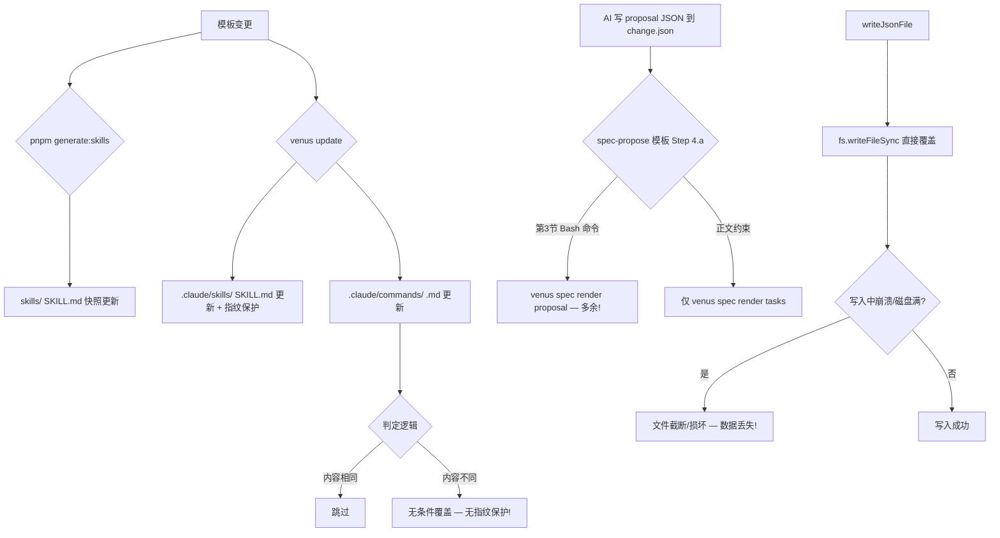

## Background

VenusAgentTools 存在三个需要修复的问题：

1. **`.claude/commands` 指令文件缺少指纹保护**：`venus update` 对 SKILL.md 有完整 6 路指纹决策树，但对 commands 使用极简 2 路判定（内容相同→跳过，不同→无条件覆盖），用户手动修改会被静默覆盖。

2. **提案 JSON 化后 .md 文件仍然生成**：`spec-propose.ts` 模板中第 3 节 Bash 命令写的是 `venus spec render <type>`（枚举了全部 4 种类型 proposal/specs/design/tasks），与正文 "仅 tasks" 约束矛盾，导致 AI agent 误调用 render 生成多余的 .md 文件。

3. **change.json 数据损坏/丢失**：`writeJsonFile()` 使用裸 `fs.writeFileSync` 直接覆盖写入，无原子性保护（无临时文件+rename）、无 try-catch 保护 `JSON.stringify`、无写入后验证、无备份恢复。用户遇到 `change.json 不存在` 和 `JSON 被破坏` 错误。

## 提示词基线 (Prompt Baseline)

**原始提示词**: 检查项目自动生成command指令时（.claude/commands）内容是否自动更新；检查提案json化生成逻辑，实际使用时出现change.json生成后md文件还会生成情况；proposal内容生成后其他内容生成时出现change.json文件不存在，修改损坏情况，需要优化数据写入逻辑，保证数据写入成功和完整性

**确认后的提示词基线**: 对 VenusAgentTools 三个问题做根因分析并修复：1) commands 指纹保护缺失；2) spec-propose 模板 render 指令矛盾导致多余 MD 生成；3) change.json 写入无原子保护导致数据损坏

## 功能流程图 (Functional Flowchart)

| 节点 | 操作 | 触发条件 | 证据位置 | 异常路径 |
| :--- | :--- | :--- | :--- | :--- |
| N1 | 模板变更 | 开发者修改 workflows/*.ts | src/core/templates/workflows/*.ts | — |
| N2 | skills 快照生成 | pnpm generate:skills | scripts/generate-skills.mjs | — |
| N3 | 产物安装更新 | venus update | src/commands/update.ts | — |
| N6 | Commands 更新 | venus update Phase 2 | src/commands/update.ts:192-199 | → N9 静默覆盖手改 |
| N7 | Commands 判定 | 内容比较 | src/commands/update.ts:194 | 无指纹 → 无条件覆盖 |
| N11 | 模板指令分发 | AI agent 执行 spec-propose | src/core/templates/workflows/spec-propose.ts:303-307 | → N12 多余 render |
| N14 | JSON 文件写入 | 任何 change.json 写入 | src/core/spec/sidecar-writer.ts:418-424 | → N17 数据损坏 |
| N15 | 直接覆盖写入 | writeJsonFile 调用 | src/core/spec/sidecar-writer.ts:423 | 无原子性、无备份 |

## Codebase Findings

### Discovered Files

- `src/commands/update.ts`: 技能与指令更新核心逻辑（commands 第 192-199 行缺少指纹判定）
- `src/commands/init.ts`: 初始化安装逻辑（commands 第 185 行仅用文件存在性检查）
- `src/commands/spec.ts`: spec 子命令组，render 命令（第 431-476 行）和 renderChangeSection（第 533-602 行）
- `src/core/command-generation/generator.ts`: generateSkillContent（两趟拼装+指纹）和 generateCommand（单趟无指纹）
- `src/core/command-generation/adapters/claude.ts`: Claude 适配器，formatFile 不写指纹字段
- `src/core/command-generation/fingerprint.ts`: SHA256 指纹生成与读取（正则仅匹配缩进格式）
- `src/core/command-generation/types.ts`: GeneratedCommand 无 fingerprintPlaceholder 字段
- `src/core/spec/sidecar-writer.ts`: writeJsonFile（第 418-424 行，裸 writeFileSync）、initChangeJson（第 885-894 行，TOCTOU）、writeChangeJson（第 549-559 行）
- `src/core/spec/sidecar-schema.ts`: ChangeSchema 类型定义
- `src/core/templates/workflows/spec-propose.ts`: 提案模板（第 303-307 行 render 指令矛盾）
- `src/core/templates/derive-command.ts`: CMD:SKIP 标记裁剪
- `src/core/templates/registry.ts`: WORKFLOW_PAIRS + allowedTools 单点回填
- `scripts/generate-skills.mjs`: skills 快照生成（仅 SKILL.md，不涉及 commands）

### Identified Symbols

- `writeJsonFile` (sidecar-writer.ts:418): 核心写入函数，无原子保护
- `initChangeJson` (sidecar-writer.ts:885): TOCTOU 竞态风险
- `readChangeJson` (sidecar-writer.ts:521): 损坏文件返回 null 被 initChangeJson 误判为"不存在"
- `generateCommand` (generator.ts:25): 单趟生成无指纹
- `generateSkillContent` (generator.ts:58): 两趟拼装有指纹（正确实现）
- `isUnmodified` (update.ts:228): 指纹自洽判定（仅用于 SKILL.md）
- `fingerprintOf` (fingerprint.ts): SHA256 哈希计算
- `renderChangeSection` (spec.ts:533): 从 change.json 渲染 MD（specs 多文件写入无两阶段提交）
- `getCommandTemplates` (registry.ts:184): 指令模板注册 + allowedTools 回填

## Decisions

### D1: 问题 1 修复策略

**选择方案**: 在 `update.ts` 指令循环中注入 fingerprint 并启用 6 路判定，而非修改 `ToolCommandAdapter` 接口

**理由**: 最小改动原则——适配器接口稳定，指纹注入在调用方内联处理；`claudeAdapter.formatFile()` 输出格式确定（`---` 闭合 YAML frontmatter），可在 update.ts 中做字符串后处理注入指纹行

### D2: 问题 2 修复策略

**选择方案**: 修复 `spec-propose.ts` 模板第 3 节 Bash 命令，将 `venus spec render <type>` 改为 `venus spec render tasks`，删除 proposal/specs/design 枚举

**理由**: 根因是模板指令矛盾——第 3 节通用 Bash 命令枚举了全部 4 种类型，AI agent 遵循 Bash 命令执行导致多余 render。修复后对齐正文"仅 tasks"约束

### D3: 问题 3 修复策略

**选择方案**: 改造 `writeJsonFile` 为原子写入五步法（序列化→写 tmp→验证→备份→rename），`readChangeJson` 增加 .bak 回退，`initChangeJson` 增加 TOCTOU 保护

**理由**: 用户已遇到实际数据损坏，这是生产级严重 bug。原子 rename 在 Windows 同盘是原子的，跨盘时有 copyFile+unlink 兜底

### D4: 实施优先级

**选择方案**: 问题 3 → 问题 2 → 问题 1

**理由**: 问题 3 是数据安全（P0），问题 2 是模板指令矛盾（P1），问题 1 是功能缺口（P1）

## Pending

无待确认项——三个问题的根因和修复路径已通过代码探索明确。