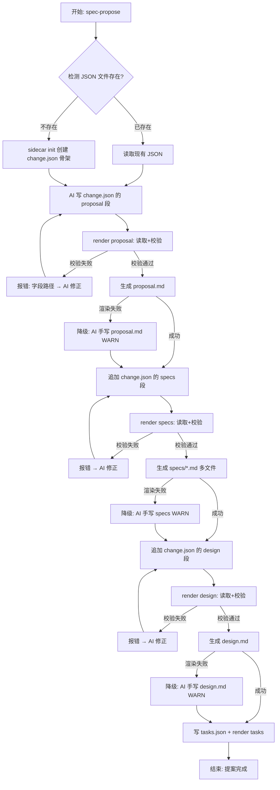

# 探索：提案制品全量 JSON 化（除 tasks 外）

## 提示词基线

### 原始提示词
> 检查项目提案生成时，json、db化逻辑，参考openspec\changes\improve-auto-workflow-allowed-tools当前只是检查生成了部分规则json文件，没有把提案其他文件json化，重新设计json化方案，需要让提案生成除task外，其他数据均json化，优化数据处理能力
> @openspec\changes\archive\2026-10-10-improve-template-dual-layer-optimization\exploration.md

### 确认后基线
> 基于当前 sidecar-schema.ts / sidecar-writer.ts / sqlite-index.ts 基础设施，重新设计提案生成的JSON化方案。目标：proposal.md、design.md、specs/*.md 的完整内容均采用 JSON-primary 架构（JSON 作为结构化数据的主产物，Markdown 由 JSON 确定性渲染供人类阅读），扩展当前的 tasks.json 主产物模式到其他制品。exploration.md 不纳入此次JSON化范围。

---

## Background
用户需求：将提案生成的所有制品（除tasks和exploration外）从Markdown为主的模式迁移到JSON-primary模式。

## Capability Exploration Memory (injected)

### artifact-json-sidecar (来自 improve-template-dual-layer-optimization)
- **Decisions**: JSON sidecar 存储于 `.venus/` 下；JSON 缺失时降级解析 MD；SQLite 存储于 `openspec/changes/archive/.venus/index.db`
- **术语**: JSON Sidecar = MD artifact 的结构化元数据加速层
- **边界**: sqlite3 CLI 不在 PATH 时所有索引功能降级跳过

**当前实际状态**（来自 fix-spec-sidecar-primary-artifact）：
- 代码基础设施完整（sidecar-schema.ts 195行 + sqlite-index.ts 391行 + sqlite-memory-backend.ts 142行）
- **JSON sidecar 产出 = 零**——模板用散文描述"After proposal.md is written → write manifest.json"，AI 易忽略
- **index.db 数据 = 零**——86KB 空库，无任何变更索引记录
- 根因：生成路径错误（模板无显式 Write 步骤）+ 架构设计缺陷（MD 先写，JSON 二级派生）

---

## Codebase Findings

### Discovered Files

| 文件 | 用途 | 相关性 |
|------|------|--------|
| `src/core/spec/sidecar-schema.ts` | 4 个 JSON sidecar 的 TS 接口 + 工厂函数 (195行) | 🔴 核心——需扩展为完整提案 schema |
| `src/core/spec/sidecar-writer.ts` | JSON 写入/校验 + renderTasksMd() (406行) | 🔴 核心——需新增 renderProposalMd/DesignMd/SpecsMd |
| `src/core/spec/sqlite-index.ts` | SQLite 跨变更索引 CRUD (391行) | 🟡 需扩展索引写入路径 |
| `src/core/spec/sqlite-memory-backend.ts` | 测试用内存后端 (142行) | 🟢 需扩展以支持新 schema |
| `src/core/spec/schema.ts` | artifact 依赖图 (117行) | 🟡 需扩展 outputPath 定义 |
| `src/core/spec/instructions.ts` | artifact 指令分发 (109行) | 🟢 模板映射需更新 |
| `src/core/spec/templates/index.ts` | 4 个 artifact MD 模板 (92行) | 🟡 模板需改为 JSON 生成指导 |
| `src/core/spec/archive.ts` | 归档逻辑 | 🟢 影响 index.db 同步 |
| `src/core/templates/workflows/spec-propose.ts` | 提案生成 SKILL 模板 | 🔴 核心——指令需从 MD→JSON 重写 |
| `src/core/templates/workflows/spec-apply.ts` | 实现 SKILL 模板 | 🟡 消费方需读 JSON |
| `src/core/templates/workflows/spec-verify.ts` | 验证 SKILL 模板 | 🟡 消费方需读 JSON |
| `src/core/templates/workflows/tr-docs-requirement-doc.ts` | 需求文档 SKILL 模板 | 🟡 消费方需读 JSON |
| `src/commands/spec.ts` | spec CLI 命令组 | 🔴 需新增 render 子命令 |
| `test/sidecar-writer.test.ts` | sidecar-writer 测试 | 🟡 需扩展测试 |
| `test/sidecar-schema.test.ts` | sidecar-schema 测试 | 🟢 已有基础 |

### Identified Symbols

| 符号 | 位置 | 用途 |
|------|------|------|
| `renderTasksMd()` | sidecar-writer.ts:315 | 唯一现有的 JSON→MD 渲染函数——是本次扩展的模板 |
| `writeTasksJson()` | sidecar-writer.ts:250 | JSON 写入+校验——新增 writeProposalJson 等的模板 |
| `validateSidecar()` | sidecar-writer.ts:89 | 4 类型校验器——需扩展至 7 类型 |
| `ManifestSchema` | sidecar-schema.ts:28 | **将被 proposal.json schema 吸收** |
| `DecisionsSchema` | sidecar-schema.ts:108 | **将被 design.json schema 吸收** |
| `CapabilitiesSchema` | sidecar-schema.ts:148 | **将被 specs.json schema 吸收** |
| `TasksSchema` | sidecar-schema.ts:74 | **保持不变**（已达标） |
| `getArtifactInstructions()` | instructions.ts:58 | artifact 模板分发——需更新 templates 映射 |
| `SPEC_DRIVEN_SCHEMA` | schema.ts:44 | artifact 依赖图——需扩展 outputPath |
| `getBuildOrder()` | schema.ts:87 | 构建序——不变 |

### Pattern Matches

- **JSON→MD 渲染模式**: `renderTasksMd()` (sidecar-writer.ts:315-363) 是单一成功范例——`renderProposalMd()` / `renderDesignMd()` / `renderSpecsMd()` 以此为模板
- **JSON 写入+校验模式**: `writeTasksJson()` (sidecar-writer.ts:250-266) 的模式——写入前 validateSidecar 校验 → 写入文件 → 返回完整数据；所有新写入函数遵循此模式
- **CLI 命令模式**: `venus spec tasks render` (来自 fix-spec-sidecar-primary-artifact tasks.md 的 REQ-006) —— 需扩展为 `venus spec render <type>` 统一命令

---

## Analysis

### Deep Analysis Trigger
- **Triggered**: Yes
- **Reason**: 用户关键词"修改"/"重新设计"/"优化" 且 CodeGraph 扫描发现大量相关现有符号
- **Scope**: sidecar-schema.ts + sidecar-writer.ts + templates + CLI commands

### Architecture Flow

```
当前数据流（断链）：
spec-propose.ts 模板
  ├── AI 写 proposal.md ✅
  ├── AI 写 design.md ✅
  ├── AI 写 specs/*.md ✅
  ├── AI 写 tasks.json ✅（唯一 JSON-primary 产物）
  ├── AI 写 manifest.json ❌（模板仅散文，零产出）
  ├── AI 写 decisions.json ❌（同上）
  └── AI 写 capabilities.json ❌（同上）

目标数据流（全量 JSON-primary）：
spec-propose.ts 模板
  ├── AI 写 proposal.json（结构化 Why/What/Capabilities/Impact）
  │   └── Bash(venus spec render proposal) → 生成 proposal.md ✅
  ├── AI 写 design.json（结构化 Context/Goals/Decisions/Risks）
  │   └── Bash(venus spec render design) → 生成 design.md ✅
  ├── AI 写 specs.json（结构化 capabilities/requirements/scenarios）
  │   └── Bash(venus spec render specs) → 生成 specs/*.md ✅
  └── AI 写 tasks.json（已达标）
      └── Bash(venus spec render tasks) → 生成 tasks.md ✅
```

### 当前 JSON Sidecar 覆盖度分析

| MD 章节 | 当前 JSON 覆盖 | 完整度 | 缺失内容 |
|---------|---------------|--------|---------|
| proposal.md Why | ❌ 无 | 0% | Why 段全文未结构化 |
| proposal.md What Changes | ❌ 无 | 0% | 变更清单未结构化 |
| proposal.md Capabilities (New) | 部分 (manifest.capabilities 仅有名字) | 20% | 缺少 description、operation type |
| proposal.md Capabilities (Modified) | ❌ 无 | 0% | 完全缺失 |
| proposal.md Impact (files) | 部分 (manifest.impactAreas) | 30% | 缺少具体文件路径+变更说明 |
| proposal.md Impact (compat) | ❌ 无 | 0% | 向后兼容说明缺失 |
| design.md Context | ❌ 无 | 0% | 架构上下文缺失 |
| design.md Goals/Non-Goals | ❌ 无 | 0% | 目标清单缺失 |
| design.md Decisions | ✅ decisions.json | 90% | alternatives/rationale/risks 均覆盖 |
| design.md Risks/Trade-offs | ❌ 无 (仅 decisions 内部的 risks) | 10% | 风险表缺失 |
| specs/*.md | 部分 (capabilities.json) | 60% | RENAMED/REMOVED 操作字段不足 |
| tasks.md | ✅ tasks.json (JSON-primary) | 100% | 完整覆盖 |

**结论**: 当前 JSON 覆盖度约 28%（仅 tasks 完整 + decisions/capabilities 部分），需要全量覆盖达到 100%。

---

## Decision Process

### Decision: JSON 文件合并 vs 保持现有 4 文件结构

**Options Considered**:
- Option A: **保持 4 文件 + 补全字段**——manifest.json / tasks.json / decisions.json / capabilities.json 保持不变，在现有 schema 上扩展字段补全缺失内容
- Option B: **3 文件映射**——proposal.json（吸收 manifest） / design.json（吸收 decisions） / specs.json（吸收 capabilities） / tasks.json 独立
- Option C: **单文件 monolith**——change.json 包含所有数据

**Pros/Cons**:
- Option A: +改动最小/回滚简单，-manifest 含义模糊（元信息 vs 提案全文混杂）/decisions 名不让"这是 design 的全部"一目了然
- Option B: +语义清晰（一个制品一个 JSON）/天然对齐 artifact 名，-旧 manifest/decisions/capabilities 文件需迁移/吸收
- Option C: -文件过大/并发写入冲突/违背"一个制品一个关注点"

**Chosen**: Option B — 3 文件映射 + tasks.json 不变
**Rationale**:
1. 语义对齐：proposal.json ↔ proposal.md, design.json ↔ design.md, specs.json ↔ specs.md, tasks.json ↔ tasks.md —— AI 和人类都能一眼看懂映射关系
2. 旧 manifest.json / decisions.json / capabilities.json 的字段全量吸收进新文件，无信息丢失
3. 旧文件在存量变更中保留（不删除），新提案生成时直接产新文件
4. 与 `fix-spec-sidecar-primary-artifact` 的 JSON-primary 方向一致

---

## 术语表

| 术语 | 定义 | 避免使用 |
|------|------|---------|
| JSON-primary | JSON 作为结构化数据的主产物，Markdown 由 JSON 确定性渲染 | JSON 主模式 |
| render*Md | 从 JSON schema 确定性渲染 Markdown 的函数（如 renderTasksMd） | 生成 MD、导出 MD |
| sidecar 合并 | 将旧 manifest/decisions/capabilities 的字段吸收进新 proposal/design/specs schema | 迁移、替换 |
| artifact 对齐 | 每个 artifact（proposal/design/specs/tasks）有对应的 JSON 主产物 | 一对一映射 |

---

## 架构决策

- ADR-0001: 3 文件映射方案（proposal.json / design.json / specs.json + tasks.json 不变）
  File: `openspec/docs/adr/0001-jsonify-proposal-files.md`（提案阶段创建）

---

## Decisions

1. **方案**: 3 文件映射（proposal.json / design.json / specs.json）
2. **向后兼容**: 旧 manifest/decisions/capabilities 保留不删；新提案直接产 3 新文件
3. **渲染函数**: 每个 JSON 类型对应一个 render*Md() 确定性渲染函数
4. **CLI 命令**: 统一 `venus spec render <type> --change <name>` 命令（type = proposal/design/specs/tasks）
5. **校验**: 每种 JSON 写入前通过 `validateSidecar()` 校验 + 渲染后的 MD 文件内容校验（图文一致性）

---

## Scope Changes
（暂无）

---

## Pending

### For Phase 2 Impact Analysis
- `writeTasksJson()` (sidecar-writer.ts:250) — 新增函数以此为模板，需确认影响面
- `validateSidecar()` (sidecar-writer.ts:89) — 类型分支需从 4→7 扩展
- `SPEC_DRIVEN_SCHEMA` (schema.ts:44) — outputPath 需增加 JSON 路径
- `getArtifactInstructions()` (instructions.ts:58) — 模板映射需更新
- `spec-propose.ts` — 模板指令重写（~80行变更）

### Unresolved Decisions
<!-- Decisions confirmed via L2 gate; no unresolved items -->

---

## 功能流程图 (Functional Flowchart)

### JSON 化后的提案生成流程



| 节点 | 操作 | 触发条件 | 证据位置 | 异常路径 |
| :--- | :--- | :--- | :--- | :--- |
| N1 | 开始 spec-propose 提案生成 | — | [新建] spec-propose.ts 模板 | — |
| N2 | 检测 JSON 文件是否已存在 | N1 后 | [新建] sidecar-writer.ts ensureSidecarDir | — |
| N3 | 读取现有 JSON（增量更新场景） | JSON 文件已存在 | [新建] spec-propose.ts Step 0 | — |
| N4 | sidecar init 创建 change.json 骨架（不覆盖） | JSON 文件不存在 | [新建] spec.ts sidecar init | — |
| N5 | AI 写 change.json 的 proposal 段（整文件累积） | N3 或 N4 后 | [新建] spec-propose.ts + artifact-generation.md G2 | 校验失败 → N7 |
| N6 | render proposal：读取 change.json + 校验 proposal 段 | N5 完成 | [新建] spec.ts render + validateSidecar('change') | 校验失败 → N7 |
| N7 | 报错提示 AI 修正 JSON 字段（含路径） | 校验失败 | [新建] render 命令错误输出 | AI 修正后 → N5 |
| N8 | 生成 proposal.md | 校验通过 | [新建] renderProposalMd | 渲染失败 → N9 |
| N9 | 降级：AI 手写 proposal.md | 渲染失败 | [新建] spec-propose.ts 降级分支 | → N10 |
| N10 | 追加 change.json 的 specs 段 | proposal 就绪 | [新建] spec-propose.ts + 协议 G2 | 校验失败 → N12 |
| N11 | render specs：读取 + 校验 specs 段 | N10 完成 | [新建] spec.ts render specs | 校验失败 → N12 |
| N12 | 报错提示 AI 修正 JSON 字段 | 校验失败 | [新建] render 命令错误输出 | AI 修正后 → N10 |
| N13 | 生成 specs/*.md 多文件（按 path 拆分） | 校验通过 | [新建] renderSpecsMd | 渲染失败 → N14 |
| N14 | 降级：AI 手写 specs/*.md | 渲染失败 | [新建] spec-propose.ts 降级分支 | → N15 |
| N15 | 追加 change.json 的 design 段 | specs 就绪 | [新建] spec-propose.ts + 协议 G2 | 校验失败 → N17 |
| N16 | render design：读取 + 校验 design 段 | N15 完成 | [新建] spec.ts render design | 校验失败 → N17 |
| N17 | 报错提示 AI 修正 JSON 字段 | 校验失败 | [新建] render 命令错误输出 | AI 修正后 → N15 |
| N18 | 生成 design.md | 校验通过 | [新建] renderDesignMd | 渲染失败 → N19 |
| N19 | 降级：AI 手写 design.md | 渲染失败 | [新建] spec-propose.ts 降级分支 | → N20 |
| N20 | 写 tasks.json + render tasks | design 就绪 | sidecar-writer.ts:250-266（保持不变） | — |
| N21 | 提案生成完成 | 所有制品就绪 | [新建] spec-propose.ts Step 5 | — |

> 确认后的流程图 = **流程基准**；未经用户确认的流程图 MUST NOT 作为提案的生成锚点。