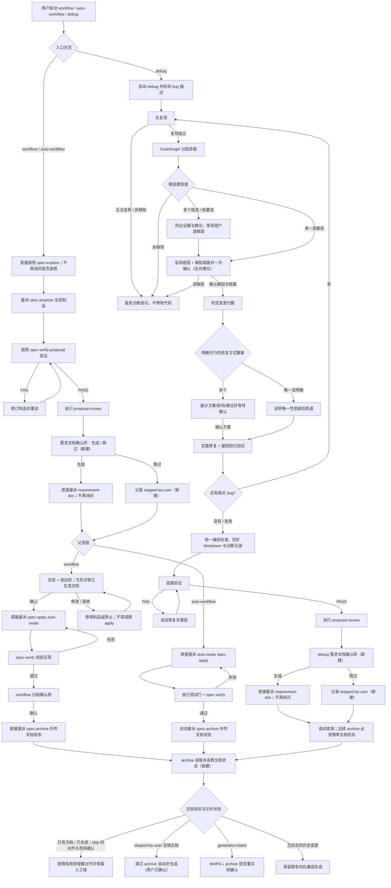

## Background

用户希望探索优化 `iagent-workflow`、`iagent-auto-workflow`、`iagent-debug` 及提案验证模式相关业务流程，重点涉及需求文档生成时机、debug 实现方案确认、单一全流程 SKILL 的流程准确度与效率，以及调用技能时重复确认的问题。

本次为 delegated Phase 1 探索：只读分析；不生成变更提案、不实现、不进入 Phase 2。

## 提示词基线 (Prompt Baseline)

**原始提示词**：

> 探索分析项目进行对不同指令技能业务逻辑进行优化：
> 1）workflow/auto-workflow/debug及提案验证模式后，不再默认自动生成需求文档，增加桥接由用户确认
> 2）优化debug流程；debug模式下，复现问题后，实现方案需要用户确实现方式是否合理，除非只有一种方式，确认后才能实现
> 3）分析检查auto-workflow/debug单一全流程SKILL流程设计是否合理，对流程设计进行优化调整，增加准确度和效率
> 4）优化workflow/auto-workflow/debug流程中设计指令桥接点，比如流程开始、中途确认后，需要调用SKILL技能时，当前存在还需要再次确认的情况，流程开始、中间用户确认后的，调用技能时应该直接执行，不需要二次确认

**确认后的提示词基线**：

探索并分析 `iagent-workflow`、`iagent-auto-workflow`、`iagent-debug` 与提案验证模式的现有 SKILL/指令流程，评估并优化以下行为：
1. workflow / auto-workflow / debug 的上层编排在验证后提供需求文档生成确认桥；独立 `iagent_spec_verify_proposal` 保持只读验证职责。确认生成则直接委派 requirement-doc；跳过则继续并记录/传递 `skipped-by-user`，避免 archive 对缺失文档自动补生成。
2. debug 流程在复现、根因与变更归属判定后，多个可行修复方式必须呈现并等待用户确认；唯一明确可行方式说明依据后可直通实现。
3. 检查 auto-workflow / debug 单一全流程 SKILL 的设计合理性，优化流程以提升准确度和效率。
4. 优化 workflow / auto-workflow / debug 中 SKILL 调用桥接：流程开始时或中途用户已确认后，后续明确授权的 SKILL 应直接执行，避免对同一推进重复确认；宿主权限策略仍独立生效。

> 当前输入的目标、对象与范围清晰，按原意直通；上面仅整理措辞，不增添需求。待通过源码与 grill 确认的细节另标 `[待确认]`，不改变本基线的既定意图。

## 功能流程图



| 节点 | 操作 | 触发条件 | 证据位置 | 异常路径 |
| :--- | :--- | :--- | :--- | :--- |
| N1 | 启动父工作流 | 用户选择 workflow / auto-workflow / debug | `workflow.ts:133-153`；`auto-workflow.ts:10-28`；`debug.ts:119-146` | 输入缺失 → 按各入口收集，不调用下游 |
| N2 | 路由到对应流程 | 已选工作流 | `workflow.ts:156-162`；`auto-workflow.ts:31-37`；`debug.ts:592-602` | 宿主能力不足 → strict 阻断或显式 degraded，不伪装委派 |
| N3 | 直接委派 `spec-explore` | workflow / auto-workflow 启动 | `workflow.ts:156-162`；`auto-workflow.ts:31-37` | 探索门未确认或回执不完整 → 留在探索，不进入提案 |
| N4 | 委派 `spec-propose` | 探索完成且流程基准已处理 | `workflow.ts:291-295`；`auto-workflow.ts:56-60` | 委派失败 / 制品无效 → 按阶段重试或报告，不进入验证 |
| N5 | 委派提案验证 | proposal 制品完成 | `workflow.ts:21-35`；`auto-workflow.ts:62-78`；`spec-verify-proposal.ts:167-206` | 技能不可用 → 内联评分并 WARN；FAIL → N6 |
| N6 | 修订并重跑提案验证 | 验证 FAIL | `workflow.ts:101-128`；`auto-workflow.ts:87-90` | 重跑仍失败 → 呈现修订/返回探索选项，不进入实现 |
| N7 | 执行提案深度复查 | 验证 PASS | `workflow.ts:81-93`；`auto-workflow.ts:81-83` | 技能不可用 → 内联只读复查并 WARN |
| N8 | 用户选择需求文档生成或跳过 `[新建]` | 父流程验证与复查 PASS | 预期产物：`src/core/templates/workflows/workflow.ts`、`auto-workflow.ts` 的验证收束段；协议 `VERIFY_PHASE` | 用户跳过 → N10；确认生成 → N9 |
| N9 | 直接委派 `requirement-doc` `[新建桥接]` | 用户明确选择生成 | `requirement-doc.ts:41-46`（非交互调用契约）；workflow/auto 白名单：`workflow.ts:562`、`auto-workflow.ts:212` | 生成失败 → WARN 并记录 `generation-failed` `[待确认]` |
| N10 | 记录 `skipped-by-user` `[新建]` | 用户选择跳过 | 预期产物：变更内持久状态 + 阶段回执；现有 `VERIFY_PHASE.handoff`：`workflows.ts:41-48` | 状态丢失 → archive 可能误走兼容生成，必须阻止该路径 |
| N11 | 分流 guided / auto | 需求文档动作完成或跳过 | `workflow.ts:315-323`；`auto-workflow.ts:93-112` | — |
| N12 | 展示实现 + 测试计划并确认 | guided workflow 验证收束 | `workflow.ts:315-323` | 修改 → N13；确认 → N14；拒绝 → 停止实现 |
| N13 | 修改制品或停止 | 用户在实现桥修改/拒绝 | `workflow.ts:319-323` | 修改完成回 N12；拒绝则不调用 apply |
| N14 | 直接委派 `spec-apply(auto-mode=true)` | 用户确认实现桥 | `workflow.ts:325-330` | apply/编译失败 → 暂停报告，不进归档 |
| N15 | 验证实现与制品一致性 | apply 完成 | `workflow.ts:344-348` | 失败 → 回 N14 修复；通过 → N16 |
| N16 | 展示归档摘要并确认 | guided workflow 实现验证通过 | `workflow.ts:351-358` | 拒绝 → 回实现，不归档 |
| N17 | 直接委派 `spec-archive` | 用户确认归档 | `workflow.ts:360-364` | 归档失败 → 报告原因；不重复询问是否调用技能 |
| N18 | 直接委派 auto-mode `spec-apply` | auto-workflow 文档桥完成 | `auto-workflow.ts:93-112` | 编译/子代理失败 → 暂停并报告，不自动归档 |
| N19 | 执行测试门与实现验证 | auto-apply 完成 | `auto-workflow.ts:120-142` | 测试/实现验证失败 → 修复重试；耗尽预算则暂停 |
| N20 | 自动委派 `spec-archive` | auto-workflow 验证通过 | `auto-workflow.ts:145-158` | 归档失败 → 报告；不得伪报完成 |
| N21 | 启动 debug 并校验缺陷输入 | 用户调用 `/iagent:debug` | `debug.ts:141-171` | 输入不明确 → 提示词澄清门；未确认不复现 |
| N22 | 建立可重复的失败复现 | bug 描述已明确 | `debug.ts:196-220` | 无法复现 → N23；复现不成立不得修复 |
| N23 | 输出诊断报告并退出修复 | 无法复现或判定为非缺陷 | `debug.ts:216-218,324-330` | 非缺陷循环项 → 保留后续 bug 循环 |
| N24 | 注入记忆并分层 CodeGraph 排查 | 复现成立 | `debug.ts:223-259`；深度分析常量 `debug.ts:17-114` | CodeGraph 不可用 → Glob/Grep 降级并记录 WARN |
| N25 | 判定根因置信度 | 常规/深度排查有结果 | `debug.ts:52-79,81-102,270-274` | 多候选/低置信 → N27；非缺陷 → N23 |
| N26 | 对单一根因与缺陷链路作一次确认 `[新建：用户已确认]` | 单一高置信根因；链路节点已知 | 当前根因门 `debug.ts:270-274` + 链路门 `debug.ts:276-300`；预期收束 `debug.ts` 对应段及 `DEBUG_INVESTIGATE` | 用户修改 → 更新排查/链路后重呈；拒绝则不修复 |
| N27 | 呈现候选根因并等待选择 | 根因不唯一或置信不足 | `debug.ts:270-274` | 未选择前不改代码；选定后生成链路并进入 N26 |
| N28 | 判定变更归属 | 根因/链路确认 | `debug.ts:303-322` | 非缺陷 → N23；已归档来源 → 新建修复变更，不改归档目录 |
| N29 | 判定可行修复方案数量 | 变更归属明确 | 修复规则 `debug.ts:337-343`；host `DEBUG_FIX` 未声明方案门：`workflows.ts:83-90` | 唯一性证据不足 → 按多方案处理，N30 |
| N30 | 展示多个方案、影响与建议并等待确认 `[新建门]` | 存在多个可行修复方案 | 预期产物：`debug.ts` Phase 4 方案段 + `DEBUG_FIX` gate/handoff (`workflows.ts:83-90`) | 修改/拒绝 → 不实现；确认一项 → N32 |
| N31 | 说明唯一可行方案及证据后直通 `[新建规则]` | 仅一项明确可行且满足项目约束 | 预期产物：`debug.ts` 修复决策段；现有零猜测护栏 `debug.ts:339-343` | DDL/schema 等既有独立确认仍保留：`debug.ts:341` |
| N32 | 精准修复并写修复前失败/修复后通过的回归测试 | 已确认方案或唯一方案路径 | `debug.ts:337-363` | 设计问题/测试失败 → 暂停修复或按既有重试/报告路径 |
| N33 | 询问是否还有相关 bug 并按 bug 重入 | 当前 bug 修复完成 | `debug.ts:365-401` | 有 → N22；无/退出 → N34；独立 bug 分流见 379-385 |
| N34 | 对累计修复执行一次编译检查并同步 Markdown/诊断 | 循环收束 | `debug.ts:404-463` | 编译遗留失败 → 报告；制品校验失败 → 修正后再验证 |
| N35 | 对变更执行提案验证 | 所有修复和探索记录已同步 | `debug.ts:466-475` | 技能不可用 → 内联评分 + WARN；FAIL → N36 |
| N36 | 自动修复验证问题并重跑 | debug 验证 FAIL | `debug.ts:477-485` | 重跑仍失败 → 手动编辑/返回探索/查看差异；不得跳过 |
| N37 | 执行提案深度复查 | debug 验证 PASS | `debug.ts:487-492` | 技能不可用 → 内联只读复查 + WARN |
| N38 | 用户确认 debug 是否生成需求文档 `[新建]` | debug 验证与复查 PASS | 预期产物：`debug.ts:487-501` 收束段；当前文本反而禁止调用 | 跳过 → N40；生成 → N39 |
| N39 | 直接委派 `requirement-doc` `[新建桥接]` | 用户明确选择生成 | `requirement-doc.ts:41-46`；当前禁止 debug 调用：`requirement-doc.ts:45`；debug 白名单缺少它：`debug.ts:579` | 生成失败 → WARN 并记录 `generation-failed`；archive 不静默重试（用户已确认） |
| N40 | 记录 `skipped-by-user` 并持久传给 archive `[新建]` | debug 用户选择跳过 | 预期产物：变更 `exploration.md` 决策/状态 + 阶段回执/归档输入；当前 `workflows.ts:83-90` 未含该字段 | 仅会话内记录 → 后续手工 archive 可能丢失状态 |
| N41 | 收束 debug 并标记可归档 | 文档生成、跳过或失败后 | `debug.ts:493-501`；输出示例 `debug.ts:542-547` | 不自动归档；按现有语义由用户调用归档技能 |
| N42 | archive 读取并消费文档状态 `[新建]` | workflow / auto / debug 进入归档 | 现有归档协议 `spec-archive.ts:160-176`；`ARCHIVE_PHASE` 仅收 `changeName`：`workflows.ts:62-69` | 状态缺失 → 仅历史/未选择状态可走兼容分支 |
| N43 | 读取文档状态与文件存在性并分流 | workflow / auto / debug 进入归档 | 预期产物：archive 按变更记录的文档状态读取；现有检查点 `spec-archive.ts:160-176` | 状态缺失 → 只对历史/未选择场景走兼容分支 |
| N44 | 对已存在文档做就地增量对齐 | 文档已存在或已生成，包括用户跳过但已有文档 | `spec-archive.ts:168-171`；人工域保护 `spec-archive.ts:170`；用户已确认此分支 | 对齐失败 → WARN，继续归档 |
| N45 | 对 `skipped-by-user` 且缺文档的变更跳过自动生成 | 用户明确选择跳过 | 用户已确认；当前反向行为 `spec-archive.ts:168-171`，预期修改该分支 | 继续归档并报告文档跳过 |
| N46 | 处理 `generation-failed` 状态 | 用户曾确认生成但首次调用失败 | 当前生成失败非阻断 `requirement-doc.ts:247-248`，archive 缺文件会生成 `spec-archive.ts:168-171`；用户已确认不静默重试 | WARN 后继续归档；用户可手工重跑 |
| N47 | 无状态的历史变更走既有后向兼容生成 | 老变更没有用户选择状态 | `spec-archive.ts:164-170` | 生成失败 → WARN，继续归档 |

> 流程基准状态：用户已确认（本轮回复“确认”，按 L5 建议接受）。新增节点 `[新建]` 是确认后的目标设计，不代表已有实现。

## Analysis

### Security Findings
- 主题不涉及安全功能；未执行 Semgrep（当前工具目录未发现可用 Semgrep 工具），不据此作安全结论。

### Architecture Flow
- 现状 `workflow`：`spec_explore` → `spec_propose` → `spec_verify_proposal` + `proposal_review` → 自动 `requirement_doc` → 实现 + 测试桥 → `spec_apply` → 实现验证 → 归档桥 → `spec_archive`。
- 现状 `auto-workflow`：与 guided 共用探索/提案/验证，PASS 后自动生成 `requirement_doc`，再自动 apply、测试、实现验证、archive。
- 现状 `debug`：复现 → CodeGraph 排查/根因门 → 缺陷链路门 → 关联变更 → 修复/回归 → 汇总编译/同步 → 验证/复查；Phase 7 禁止生成需求文档，但 archive 缺失时自动补生成。
- 本次提出的目标流程：workflow / auto-workflow / debug 各自的验证 + 复查通过后，由父编排器提供“生成/跳过”文档桥；独立 verifier 不生成文档。生成确认后直接调用 requirement-doc；跳过状态一路传给 archive。guided 保留原实现桥供评审文档后再批准实现；auto-workflow 按原 auto-mode 继续；debug 保持“可归档”收束。
- 生成期宿主编排适配会追加 strict/degraded 说明、委派清单、阶段能力与回执/门契约；它把共享模板映射为宿主机制，不改变模板中的业务顺序。

### Business Flow
- 用户确认：需求文档桥只属于 workflow / auto-workflow / debug 上层编排；`iagent_spec_verify_proposal` 保持纯验证器。
- 用户确认：选择跳过后原流程继续，记录并传递 `skipped-by-user` 给 archive，禁止其对缺失文件自动补生成；选择生成后直接调用 requirement-doc，不再询问是否调用。
- 用户确认：debug 多个可行方案须等待用户确认；只有一个明确可行方案时说明依据后直通实现。
- `workflow` 的新文档桥应位于验证 PASS + 深度复查之后；生成的文档仍可在既有实现桥前供用户评审。实现桥确认 apply 是不同业务决策，不属于重复的“是否调用技能”询问。
- `auto-workflow` 的文档桥是其自动阶段中的显式业务选择；用户确认/跳过后继续既定 auto-mode，不另设“是否调用 requirement-doc”或“是否调用 apply”询问。
- `iagent_spec_verify_proposal` 本身描述只读评分及 PASS 后内联只读深度复查，不直接生成/委派需求文档；生成动作位于上层 workflow 编排。
- `debug` 明确禁止其 Phase 7 调用 `iagent_requirement_doc`，但 `iagent_spec_archive` 的 Step 4.8 在文档缺失时仍非交互生成（为后向兼容）。`debug.ts` 的多个历史/防护段对该生成究竟在验证阶段还是归档阶段存在互相矛盾的说明。
- 新目标流程与现状的关键协议差距：`VERIFY_PHASE.handoff` 已有泛化 `requirementDoc`，但 `APPLY_PHASE` 未传递文档状态、`ARCHIVE_PHASE` 仅要求 `changeName`；debug 也在另一个用户回合调用 archive，需可靠持久化 skip 状态。
- 即使技能授权已配置，宿主层工具审批仍可能独立出现；模板应去除“是否调用下一技能”的业务询问，但不得绕过宿主权限/strict-degraded 安全策略。
- `requirement-doc` 区分独立交互模式与工作流非交互模式；非交互模式不提问、以占位符生成；已存在的文档被该技能静默覆盖，因此归档模板另规定对既有文档走就地对齐。
- 当前模板文案已声明提示词基线或上游确认门通过后不应重复确认，但没有统一说明“某个已确认桥授权直接调用下一项 SKILL”这一跨模板行为契约。权限白名单/项目权限负责放行工具调用，与业务确认门不是同一类门。

### Identified Symbols
- `getWorkflowSkillTemplate` (`src/core/templates/workflows/workflow.ts:133`)：引导式全流程；PASS 后的需求文档动作和实现桥。
- `VERIFICATION_PROTOCOL_FULL` (`src/core/templates/workflows/workflow.ts:11`)：workflow 的 PASS/FAIL 验证处理，PASS 后深度复查 + 非交互需求文档生成。
- `getAutoWorkflowSkillTemplate` (`src/core/templates/workflows/auto-workflow.ts:10`)：全自动编排；PASS 后非交互生成需求文档再 auto-apply。
- `getDebugSkillTemplate` (`src/core/templates/workflows/debug.ts:119`)：复现、排查、关联、修复、回归测试、同步、验证与收尾。
- `getSpecVerifyProposalSkillTemplate` (`src/core/templates/workflows/spec-verify-proposal.ts:167`)：只读 D1-D10 验证；本身不生成需求文档。
- `getRequirementDocSkillTemplate` (`src/core/templates/workflows/requirement-doc.ts:7`)：需求文档双模式转换器。
- `getSpecArchiveChangeSkillTemplate` (`src/core/templates/workflows/spec-archive.ts:8`)：归档时缺文档会生成，已存在则人工域保护的就地对齐。
- `WORKFLOW_PROTOCOLS` (`src/core/host-orchestration/workflows.ts:115`)：阶段输入、handoff、门、能力和重试的共享协议。
- `ORCHESTRATION_DELEGATIONS` / `renderHostOrchestrationSection` (`src/core/host-orchestration/render.ts:22,49`)：宿主生成期注入委派清单与协议说明。
- `renderDelegate` / `renderLoadSkill` (`src/core/host-orchestration/actions.ts:46,68`)：宿主原生技能委派/加载动作渲染。
- `evaluatePhaseTransition` (`src/core/host-orchestration/transition.ts:46`)：按能力、门状态和结构化回执判定阶段推进。
- `skillDelegation` (`src/core/templates/tool-whitelist.ts:48`)：为每个被委派技能生成精确调用白名单条目。
- `iagentPermissionRules` (`src/core/opencode-v2.ts:174`)：OpenCode V2 按 skill/subagent 资源生成项目权限。

## Codebase Findings

### Discovered Files
- `.opencode/skills/iagent-spec-explore/references/exploration-protocol.md`：delegated Phase 1 流程与强制门规范，已读取。
- `.opencode/skills/iagent-spec-explore/references/grill-playbook.md`：L1-L5 两批确认与实时记录规范，已读取。
- `.opencode/skills/iagent-spec-explore/references/deep-analysis.md`：修改类需求深度分析触发条件与维度，已读取。
- `.opencode/skills/iagent-spec-explore/references/flowchart-gate.md`：Mermaid + 节点表及流程最终确认门，已读取。
- `openspec/CONTEXT.md`：已有领域术语表，已读取；已载入工作流技能套件、需求文档生成时机、debug 缺陷链路、流程确认门、门预算等相关术语。
- `openspec/rules/ai-coding.md`：零猜测、设计先行/显式确认、破坏性改动暂停等全域护栏，已读取。
- `openspec/rules/artifact-generation.md`：Markdown-first 制品协议、顺序、校验、禁止新 JSON 真源，已读取。
- `.iagent/rules/*.md`：未发现本地规则文件；模板引用 `.iagent/rules/coding-rules.md`，但当前工作区未提供该文件。
- `openspec/specs/*/explorations.md`：未发现能力级探索记忆；`openspec/specs/*/spec.md` 查询亦无匹配文件。
- `src/core/templates/workflows/workflow.ts`：引导式全流程模板与内联验证协议。
- `src/core/templates/workflows/auto-workflow.ts`：全自动工作流模板。
- `src/core/templates/workflows/debug.ts`：debug 全流程模板、CodeGraph 排查协议及其参考文件。
- `src/core/templates/workflows/spec-verify-proposal.ts`：提案验证技能模板。
- `src/core/templates/workflows/requirement-doc.ts`：需求文档生成技能模板。
- `src/core/templates/workflows/spec-archive.ts`：归档及需求文档生成/对齐分支。
- `src/core/host-orchestration/{actions,hosts,protocol,render,transition,workflows}.ts`：宿主机制适配、阶段协议、回执、能力与门。
- `src/core/templates/{prompt-gate,tool-whitelist}.ts`、`src/core/opencode-v2.ts`：提示词门、技能授权白名单及 OpenCode V2 项目权限。

### Identified Symbols
- `getWorkflowSkillTemplate` (`src/core/templates/workflows/workflow.ts:133`)：workflow 编排入口。
- `getAutoWorkflowSkillTemplate` (`src/core/templates/workflows/auto-workflow.ts:10`)：auto-workflow 编排入口。
- `getDebugSkillTemplate` (`src/core/templates/workflows/debug.ts:119`)：debug 编排入口。
- `getSpecVerifyProposalSkillTemplate` (`src/core/templates/workflows/spec-verify-proposal.ts:167`)：提案验证入口。
- `getRequirementDocSkillTemplate` (`src/core/templates/workflows/requirement-doc.ts:7`)：需求文档生成入口。
- `getSpecArchiveChangeSkillTemplate` (`src/core/templates/workflows/spec-archive.ts:8`)：归档时文档检查点。
- `WORKFLOW_PROTOCOLS` (`src/core/host-orchestration/workflows.ts:115`)、`evaluatePhaseTransition` (`src/core/host-orchestration/transition.ts:46`)：阶段推进协议模型。
- `renderDelegate` (`src/core/host-orchestration/actions.ts:46`)、`renderLoadSkill` (`src/core/host-orchestration/actions.ts:68`)、`ORCHESTRATION_DELEGATIONS` (`src/core/host-orchestration/render.ts:22`)：宿主调用桥接渲染。
- `skillDelegation` (`src/core/templates/tool-whitelist.ts:48`)、`iagentPermissionRules` (`src/core/opencode-v2.ts:174`)：技能调用授权路径。

### Pattern Matches
- workflow 与 auto-workflow 以同一 `iagent_spec_verify_proposal` 技能作为验证器，但各自在上层模板规定通过后的后续行为。
- workflow / auto-workflow 都把需求文档生成放在 PASS + 深度复查之后；archive 对缺失文档另有兼容生成。
- 模板多数通过 `skillDelegation([...])` 精确白名单其直接调用的技能；宿主机制由生成期适配，不宜在共享模板硬编码 Claude-only 工具名。
- debug 流程的主体步骤与末尾 Guardrails 对回归测试由谁编写存在冲突（正文要求内联，Guardrails 要求委派 `iagent_test`）。
- debug / archive / requirement-doc 模板仍有需求文档生成时机矛盾；`CONTEXT.md` 原有矛盾已按用户确认的流程语义在 Phase 1 收尾同步。
- TodoWrite 工具、独立 `codegraph_status` / `codegraph_files` / `codegraph_search` / `codegraph_impact` 工具在当前工具目录不可用；可用的 `codegraph_explore` 已完成基础与深度源码探索并返回调用方/影响半径。未用 Grep/Glob 替代源码探索。
- `.iagent/rules/coding-rules.md` 当前不可用；全域 `openspec/rules/ai-coding.md` 与制品规则已读取。
- 本地没有匹配的能力探索记忆文件；不从历史记忆推断现行决策。

### 代码证据与流程缺口
- `workflow.ts:81-99` 与 `auto-workflow.ts:81-85`：验证 PASS 后自动 review，继而非交互生成需求文档；workflow 文案称生成后进入 Phase 3.7 实现桥，auto-workflow 随即 auto-apply。
- `workflow.ts:315-323`：实现桥在需求文档生成后，用户一次确认「实现方案 + 测试计划」才进入 Phase 4；`workflow.ts:327-335` 将 `auto-mode=true` 用于避免 apply 再确认。
- `spec-verify-proposal.ts:179,438-455`：验证技能本身只读验证，PASS 后做内联只读复查；没有 `iagent_requirement_doc` 调用。
- `requirement-doc.ts:31-45,225-226`：工作流非交互调用不提问、基本信息用占位符；生成原语对已存在文件静默覆盖，调用方需处理人工域保护。
- `spec-archive.ts:160-176`：现状归档前若文档缺失会无条件非交互生成；若已存在则就地增量对齐并保留人工域。用户已确认的目标需新增状态分支：显式 skip 不补生成；generation-failed 不静默重试。
- `debug.ts:337-363`：修复要求覆盖异常/根因节点，正文规定 debug 内联写回归测试。
- `debug.ts:487-501,564-572`：Phase 7 主文禁止 debug 生成/对齐/调用需求文档，并称 workflow/auto-workflow 验证阶段生成；Guardrails 又称文档由 ARCHIVE 生成，模板内部口径不一致。archive Step 4.8 也保留缺失时生成。
- `debug.ts:569`：尾部 Guardrail 又要求委派 `iagent_test`，与 `debug.ts:354-363` 内联写测试相反；其 `allowedTools` (`debug.ts:579`) 仅白名单 `spec_verify_proposal` 与 `proposal_review`，未列 `test`，若遵从尾部委派要求可能触发授权/审批或不可调用。
- `debug.ts:270-300`：确认根因后还强制确认缺陷链路图；随后 Phase 3 关联、Phase 4 修复，但缺少单独的“修复方案选项/确认”步骤。
- `debug.ts:365-401`：每次修复后询问是否还有相关 bug；每个后续 bug 重入复现/排查/关联/修复，并有独立变更/中途退出分支。
- `host-orchestration/workflows.ts:72-90`：debug 协议把根因调查阶段设为 gate，`fix-verify` 阶段没有 gate；与新增修复方案确认门的需求存在待对齐点。
- `host-orchestration/render.ts:22-40`：debug 宿主委派清单只有 `spec-verify-proposal`；技能模板还会调用 `proposal-review`，两者委派清单与技能白名单的维护边界需核对。
- `host-orchestration/actions.ts:46-79`：适配器渲染 `Skill` / V2 `skill` / Pi 执行方式；`transition.ts:46-71` 仅在门确认、能力与回执有效时允许推进。
- `opencode-v2.ts:44-99,174-182`：生成的主编排 agent 可调用指定 iagent skill/subagent，项目权限按资源显式允许；运行时二次审批还可能取决于目标宿主/项目配置，不可仅靠共享模板断言。
- `prompt-gate.ts:115-166`：把用户下一条消息定义为确认信号，并规定确认基线已存在时直接通过、不重复校验；可作“确认后直接继续”的现有模式参考，但未覆盖阶段技能调用的统一规则。
- `tool-whitelist.ts:4-12,48-50`：skill 权限与业务确认门是不同概念；`skillDelegation` 生成精确技能调用条目。
- `ai-coding.md:7-16,42-43`：未知项标 `[待确认]`，跨文件/重构须先设计并显式确认，冲突/破坏性改动暂停。
- `artifact-generation.md:3-50`：proposal→spec/design→tasks 的 Markdown-first 顺序与校验约束。
- `CONTEXT.md:146-153,237-238` 初次读取时对归档兼容生成与验证后生成的描述不一致；已在本轮按用户确认的父流程选择桥、显式 skip、archive 对齐/兼容分支及失败不重试语义完成同步。
- 本轮重新读取 CodeGraph 当前源码：`workflow.ts:11-130,133+`、`auto-workflow.ts:10-212`、`debug.ts:119-579`、`requirement-doc.ts:7-267`、`spec-archive.ts:8-354`、`host-orchestration/workflows.ts:20-132`、`protocol.ts:58-109`；结论与之前扫描一致。
- `host-orchestration/workflows.ts:41-68`：验证 handoff 有 `requirementDoc`，但 archive 输入只有 `changeName`；`APPLY_PHASE.handoff` 不含此状态。若显式跳过必须穿过 apply 阶段并到达 archive，现有结构还未承载完整状态。
- `debug.ts:270-300`：当前先确认根因，再单独确认缺陷链路；用户已确认高置信分支合并根因证据与链路为一个确认包，多个候选仍先选根因、再确认生成的链路。
- `debug.ts:579` 的技能白名单没有 `requirement_doc`；`requirement-doc.ts:45` 明确 `iagent_debug` MUST NOT 调用；宿主委派表 `render.ts:22-40` 中 debug 只登记 `spec-verify-proposal`。增加 debug 文档桥必须同步这些调用/权限声明。
- `WORKFLOW_PROTOCOLS` (`workflows.ts:41-90`) 当前没有文档状态的端到端 handoff，也没有 debug 多方案修复门；变更需与 `PhaseSpec` / receipt / gate 结构一起对齐。
- 影响半径：CodeGraph 对目标模板显示 registry/模板派生调用方及 `test/template-derivation.test.ts`；宿主渲染依赖 `test/host-orchestration.test.ts`、`test/claude-host-adapter.test.ts`；授权条目依赖 `test/tool-whitelist-constants.test.ts`、`test/allowed-tools.test.ts`。未执行单独 `codegraph_impact`（工具不可用）。

### 探索执行记录
- 提示词门：目标/对象/范围清晰，按原意直通；无需提示词确认停顿。
- CONTEXT 启动/收尾检查：`openspec/CONTEXT.md` 存在并已读取；Phase 1 收尾比对 glossary 后，同步了缺失的 `需求文档`、`SKILL 调用桥接`、`skipped-by-user` 术语，并更新了需求文档生成时机/归档兼容生成定义；其余既有内容保留。
- 能力记忆检查：未发现 `openspec/specs/*/explorations.md`；记录为无能力级记忆。
- CodeGraph：工具目录没有 `codegraph_status` 等独立工具，`codegraph_explore` 可用且已执行。没有因状态工具缺失改用 Grep/Glob 搜索源码。
- 修改意图触发深度分析：已对 workflow/auto-workflow/debug/verify/requirement-doc 与宿主编排做 CodeGraph 深度探索；独立 impact 工具不可用，采用 CodeGraph 返回的调用方/影响半径作为可用影响线索。
- 关键词分析：检测到 Business / Architecture / Impact（流程、逻辑、优化、桥接、确认）；主题未触发安全关键词。
- 项目规则：`openspec/rules/ai-coding.md` 与 `openspec/rules/artifact-generation.md` 已读取；本地 `.iagent/rules/coding-rules.md` 缺失。
- TodoWrite 与独立 CodeGraph 状态/文件树/符号搜索/impact 工具均不可用；以本探索文件追踪状态，以 `codegraph_explore` 作为主源码扫描路径。
- delegated continuation：重新读取本探索文件、`grill-playbook.md`、`flowchart-gate.md` 与 `CONTEXT.md` 相关术语；按用户 L1-L3 回复更新了提示词基线决策。
- 源码刷新：通过 CodeGraph 重新获取 workflow / auto-workflow / debug / requirement-doc / archive / host protocol 当前内容；用户回答与已读源码无硬冲突。
- L4：已完成，跨决策无硬冲突；确认了现存 handoff / 权限 / debug gate 代码缺口。
- L5：已有文档对齐、生成失败不静默重试、skip 持久化、debug phase split 等建议均已由用户确认。
- 流程最终确认门：用户回复“确认”，流程图已成为流程基准。
- 已执行 CONTEXT 收尾校验与 Decision 聚合一致性检查；无硬冲突。未进入 Phase 2。

### Capability Exploration Memory (injected)
- 无能力级探索记忆 — 未发现 `openspec/specs/*/explorations.md`。

## Questions

### 决策树

1. **文档桥职责与状态**：父编排器（不包括独立 verifier）→ 用户生成/跳过选择 → 持久状态传到 archive。
2. **debug 修复决策**：复现/排查 → 根因/链路确认 → 变更归属 → 修复方案数量判定 → 仅多方案时确认。
3. **SKILL 直接调用**：启动意图或确认门明确授权下一技能后直接调用；与宿主工具权限审批分开处理。
4. **L4**：对已确认决策及源码契约做冲突扫描；无硬冲突时静默直通。
5. **L5**：测试用户跳过、已有人工文档、生成失败、历史变更与多方案/单方案等边界。

### 批量 1 — L1-L3（已由用户确认）

用户答复已实时写入：

1. 独立 `iagent-spec-verify-proposal` 保持验证器职责；需求文档确认桥只由上层 workflow / auto-workflow / debug 在验证后提供。
2. 用户跳过后原流程继续，记录并传递 `skipped-by-user` 给 archive，避免 archive 自动补生成；用户确认生成后直接委派 requirement-doc，不重复询问。
3. debug 有多个可行修复方案时必须等待用户确认；只有一种明确可行方案时说明依据后可直通实现。

用户第 4 项也已足够明确：流程启动或中途业务确认后，如下一步是已明确授权的 SKILL 调用，不再增加“是否调用”的业务询问。宿主自身权限审批不在业务确认授权范围内。

### 批量 2 — L4-L5（一致性 / 边界；已由流程最终确认门确认）

**L4 一致性结果**：L1-L3 用户决策之间无硬冲突。代码层需补齐的契约不一致已定位：

- `VERIFY_PHASE` 有 `requirementDoc` handoff，但 apply 阶段不传、archive 输入不接收文档状态。
- archive 缺文档时无条件向后兼容生成；必须识别 `skipped-by-user` 才能满足用户决定。
- debug 需要新增文档桥和 requirement-doc 授权；现有 debug Guardrail 明确禁止该调用。
- debug 当前根因门与缺陷链路门分开；用户确认单一高置信常规路径合并为一个诊断确认包。多候选时仍先选根因，再确认据此生成的链路。
- `DEBUG_FIX` 把实现与验证合为一个 host phase (`workflows.ts:83-90`)；用户确认内部拆成 fix / verify-close 两阶段（仍由单一 `iagent_debug` 编排），使每阶段最多一个流程级门。
- direct skill 调用属于业务流程推进；Claude/OpenCode/Pi 的工具权限与 strict/degraded 能力仍按宿主策略执行，不得用业务确认绕过权限拒绝。

**L5 边界场景与结果**（用户回复“确认”，按建议接受）：

1. **用户跳过且文档不存在**：已由用户确认应继续流程并阻止 archive 自动补生成。
2. **用户跳过但文档已存在**：archive 仍增量对齐并保留人工域（已确认）。
3. **用户确认生成但 requirement-doc 失败**：记录 `generation-failed`、WARN 后继续；archive 不静默重试，用户可手工重跑（已确认）。
4. **后续单独调用 archive**：`skipped-by-user` 持久写入变更 `exploration.md` 并经阶段回执传递，确保另起会话归档仍遵守 skip（已确认；精确字段在后续设计中定义）。
5. **debug 多方案确认**：拒绝/修改不得实现；唯一方案须由代码与项目约束证明。数据库/schema 的既有独立确认仍保留（已确认）。

> L4 无硬冲突并直通；L5 及 Mermaid/节点表已由用户确认，流程基准已确认。

### 流程最终确认门（已通过）

用户本轮回复“确认”，该答复按门定义视为“确认流程，L5 按建议”。Mermaid 与 N1-N47 节点表成为本次流程基准，L5 结果如下：

1. `skipped-by-user` 只阻止缺失文档自动生成；已有文档仍增量对齐并保留人工域。
2. 生成失败记录 `generation-failed`、WARN 后继续，archive 不静默重试。
3. skip 状态持久写入变更 `exploration.md` 并经阶段回执传递。
4. 高置信根因与缺陷链路一次确认；多候选先选根因再确认链路；debug host protocol 内部分为 fix / verify-close 两阶段，仍为单一全流程 SKILL。

流程最终确认门已通过。本 delegated worker 仅完成 Phase 1 收尾，不进入 Phase 2 或提案生成。

## 术语表

| 术语 | 定义 | 避免使用 |
|------|------|---------|
| 提示词基线 | 已校验的原始需求语义，是后续分析的唯一语义来源；本次基线为用户四项目标的保真整理 | 优化后提示词（指临时门输出） |
| 流程最终确认门 | 对探索所得 Mermaid 流程图及节点证据清单进行确认的唯一流程级阻塞门 | 与提示词校验门混称的“确认门” |
| 需求文档 | `iagent-requirement-doc` 生成的评审用八章节文档；当前项目术语记录其工作流生成时机与归档兼容行为 | 与 proposal/artifact 混称 |
| SKILL 调用桥接 | 父工作流已有入口意图或明确业务确认后，直接调用已授权的下一项 SKILL，不再追加调用确认；不绕过宿主权限 | 与工具权限审批混淆 |
| 门预算 | 每阶段至多一个流程级阻塞确认门；提示词/grill 澄清与默认直通的一致性门不计入 | 确认门数量（泛指） |
| 缺陷链路 | debug 探索产物只覆盖前置条件→触发→异常→根因的缺陷相关链路 | 完整业务流程、复现步骤 |
| 需求文档生成时机 | 用户确认后的目标语义：父 workflow 验证/复查通过后提供生成选择；跳过状态传 archive，显式跳过不补生成，已有文档仍对齐，历史无状态变更保留兼容生成 | 与“默认自动生成”混用 |
| `skipped-by-user` | 用户在父工作流文档桥明确选择不生成需求文档的状态；须传到 archive，抑制缺失文件的兼容生成 | 未选择、生成失败（不同状态） |

## 架构决策

- 无实现决策；用户已确认需求语义：独立 verifier 只验证；父工作流提供需求文档桥；skip 状态持久传 archive；debug 多方案确认、单一明确方案说明后直通。

## 边界场景

- [x] 用户跳过文档生成后继续原流程，传 `skipped-by-user` 到 archive，禁止其对缺失文件自动补生成（用户确认）。
- [x] 用户跳过但已有文档时，archive 仍增量对齐并保护人工域（用户确认）。
- [x] 首次需求文档生成失败后记录 `generation-failed`、WARN，archive 不静默重试（用户确认）。
- [x] `skipped-by-user` 持久化于变更 `exploration.md` 并经阶段回执传递（用户确认；具体字段在后续设计确定）。
- [x] debug 多个可行方案须确认；单一明确可行方案说明依据后直通（用户确认）。
- [x] 高置信根因与缺陷链路合并确认；多候选先选根因再确认链路（用户确认）。
- [x] 已明确授权的下一项 SKILL 直接调用，不增加业务二次确认；宿主权限审批另行适用（用户原始目标）。
- [x] 流程不增加 SKILL 调用确认；宿主权限审批按各工具配置独立执行。本仓库未提供具体运行时弹窗证据，若仍出现需按目标宿主单独排查（不阻塞流程基准）。

## Decision Process

- L1-L3 已由用户确认；L4 无硬冲突；L5 各边界已由流程最终确认门接受。
- Phase 1 聚合一致性检查：逐对扫描 7 项 Decisions（职责、文档状态/失败、debug 方案、debug 诊断/阶段门、SKILL 调用/宿主权限、流程基准），0 个技术选型、依赖方向或约束互斥硬冲突。
- 探索完成检测：流程基准已确认；用户级未决项为空；CONTEXT glossary 校验已完成。Phase 2 影响符号留在 Pending，但不属于未决业务决策；本次停止于 Phase 1。

## Decisions

- 独立 `iagent_spec_verify_proposal` 维持验证器职责；文档桥只属于 workflow / auto-workflow / debug 父编排。
- 文档桥选择跳过后流程继续，`skipped-by-user` 持久写入变更 `exploration.md` 并经阶段回执传至 archive；缺失文档不得自动补生成。
- 选择生成后直接委派 `iagent_requirement_doc`，不再询问是否调用该技能；首次生成失败记 `generation-failed` 并 WARN，archive 不静默重试。
- debug 多个可行修复方案必须等用户确认；只有一种明确可行方案时说明依据后直通实现。
- debug 高置信根因与缺陷链路合并一次确认；多候选先选根因再确认链路；host `fix-verify` 内拆为 fix / verify-close 阶段，仍保留单一全流程 SKILL。
- 用户在流程开始或中途确认后，调用已明确授权的下一项 SKILL 不增加业务二次确认；宿主权限/能力策略不因此绕过。
- 流程基准已确认；尚未生成提案或修改代码。

## Structured Handoff

```yaml
phase: explore
status: complete
explorationFile: openspec/explorations/workflow-bridge-debug-explore-001.md
promptBaseline: confirmed
flowBaseline:
  status: confirmed
  artifact: "## 功能流程图"
contextCheck:
  status: passed
  addedTerms: [需求文档, SKILL 调用桥接, skipped-by-user]
  updatedDefinitions: [归档生成制品, 需求文档生成时机]
pendingSymbols:
  - getWorkflowSkillTemplate / VERIFICATION_PROTOCOL_FULL
  - getAutoWorkflowSkillTemplate
  - getDebugSkillTemplate
  - getSpecVerifyProposalSkillTemplate
  - getRequirementDocSkillTemplate
  - getSpecArchiveChangeSkillTemplate
  - WORKFLOW_PROTOCOLS / evaluatePhaseTransition / ORCHESTRATION_DELEGATIONS
  - skillDelegation / iagentPermissionRules
unresolvedBusinessDecisions: []
nextAllowed: "Phase 1 handoff only; Phase 2 was not started by this worker"
```

## Scope Changes

| 变更时间 | 变更类型 | 变更描述 | 原因 |
|---------|---------|---------|------|
| — | — | 无 | — |

## Pending

### For Phase 2 Impact Analysis
- `getWorkflowSkillTemplate` / `VERIFICATION_PROTOCOL_FULL` (`src/core/templates/workflows/workflow.ts:11,133`) — Priority: HIGH
- `getAutoWorkflowSkillTemplate` (`src/core/templates/workflows/auto-workflow.ts:10`) — Priority: HIGH
- `getDebugSkillTemplate` (`src/core/templates/workflows/debug.ts:119`) — Priority: HIGH
- `getSpecVerifyProposalSkillTemplate` (`src/core/templates/workflows/spec-verify-proposal.ts:167`) — Priority: HIGH
- `getRequirementDocSkillTemplate` (`src/core/templates/workflows/requirement-doc.ts:7`) — Priority: HIGH
- `getSpecArchiveChangeSkillTemplate` (`src/core/templates/workflows/spec-archive.ts:8`) — Priority: HIGH
- `WORKFLOW_PROTOCOLS` / `evaluatePhaseTransition` / `ORCHESTRATION_DELEGATIONS` — Priority: HIGH
- `VERIFY_PHASE` → `APPLY_PHASE` → `ARCHIVE_PHASE` 文档状态 handoff/input (`src/core/host-orchestration/workflows.ts:41-68`) — Priority: HIGH
- debug requirement-doc 白名单、调用禁止口径与宿主委派表 (`debug.ts:579`；`requirement-doc.ts:45`；`render.ts:22-40`) — Priority: HIGH
- `DEBUG_FIX` 方案选择 gate 与诊断确认门 (`workflows.ts:72-90`；`debug.ts:270-300`) — Priority: HIGH
- debug 回归测试编写职责存在正文/Guardrail 冲突 (`debug.ts:354-363,569,579`) — Priority: MEDIUM
- `skillDelegation` / `iagentPermissionRules` — Priority: MEDIUM
- `test/template-derivation.test.ts`, `test/host-orchestration.test.ts`, `test/claude-host-adapter.test.ts`, `test/tool-whitelist-constants.test.ts`, `test/allowed-tools.test.ts` — Priority: MEDIUM（待 Phase 2 影响分析）

### Security Concerns
- 暂无源码证据；待检查确认门的授权边界与 strict/degraded 分支。

### Business Validation
- L1-L3：已由用户确认，详见 `## Decisions`。
- L4：用户确认的决策间无硬冲突；handoff 缺口是现有代码未实现用户要求，不是产品决策冲突。
- L5：已有文档仍对齐、generation-failed 不静默重试、skip 状态写入变更探索记录并经回执传递、debug gate budget 均已确认。
- 具体宿主运行时审批提示没有源码/环境证据；业务流程契约已确认，宿主工具权限仍独立生效，不构成 Phase 1 阻断项。

### Unresolved Decisions
- 无未决的用户级业务决策。具体状态字段、PhaseSpec/schema 更新、回归测试职责冲突列为 Phase 2 影响分析项。

## Implementation Deep-Dive

### Design Rationale
- 宿主编排模块意图以宿主无关的阶段协议 + 生成期适配减少 Claude/OpenCode/Pi 的模板分叉；技能模板仍承担业务规则和入口/出口语义。
- 需求文档技能刻意保持“纯产出原语”：非交互调用填占位符；已存在文档由 archive 调用方保护人工域，避免生成器承担版本合并语义。

### Constraints
- `openspec/rules/ai-coding.md` 要求零猜测，未明内容标 `[待确认]`；跨文件流程重构须先设计并取得显式确认。
- `openspec/rules/artifact-generation.md` 规定 Markdown-first、proposal→spec/design→tasks 顺序与 CLI 校验；不得引入 JSON 真源。
- `.iagent/rules/coding-rules.md` 当前不可用；共享流程不应假设本地蒸馏规则已安装。
- 本 delegated 阶段只读；不改模板、代码或生成快照。`CONTEXT.md` 是既有未跟踪文件；依 1.6.5 仅定点同步本探索 glossary 缺失术语并修正本次确认已解决的文档生成时机定义，保留其他内容。

### Trade-offs
- 用户确认需求文档生成会多一个明确停顿，但消除无需求的文档副作用；若“跳过”不跨阶段持久化，archive 兼容生成会抵消用户选择。
- 统一让“确认后的指定下一技能直接执行”可减少冗余停顿；但不得把业务确认误作全局工具权限或对后续不同副作用的授权。
- debug 多方案确认提高实现可控性，但单一、证据充分的可行方案若也强制停顿会增加低价值交互；唯一性需按项目约束和实际证据判断，不可只凭“看起来只有一种”。

### Pattern Usage
- `SkillTemplate.references` 承载按需协议全文；主模板保留骨架，降低长流程上下文成本。
- `skillDelegation([...])` 精确授权技能调用；`renderDelegate` / `renderLoadSkill` 按宿主渲染调用机制；OpenCode V2 项目配置再按资源授予 skill/subagent 权限。
- `PhaseSpec` 声明 `input`、`requiredCapabilities`、`handoff`、`receipt`、`gate`、`retry`；`evaluatePhaseTransition` 以能力/门/回执为推进条件。
- 用户要求的“门确认后立即调下一技能”可通过每个门明确唯一 `nextAllowed` 技能/参数、收到确认后立即调用来表达；当前协议默认回执含 `nextAllowed`，但业务模板未将其统一成硬规则。

### Historical Context
- 只读 `git log` 显示相关流程经历了近期的多轮集中收束：`3a59525`（门控预算/协议分层）、`1fad62d`（宿主原生编排适配）、`9cfd383`（模板语言与指令单一源）、`76be0a8`（Pi 原生委派入口）。这些提交意图支持统一门控和跨宿主编排；当前仍可见的需求文档时机与 debug 测试委派矛盾说明口径尚未完全收敛。
- `git status --short` 在首次读取时显示 `CONTEXT.md` 为未跟踪工作区文件；本轮按协议只定点更新术语/已裁决定义，未覆盖其他用户内容。本次探索文件位于 `openspec/explorations/`。

### Implicit Assumptions
- 初步假设“指令桥接处再次确认”指宿主对下一技能调用的重复交互确认，而非技能内部业务确认；待通过模板与用户反馈验证 `[假设]`。
- 用户第 4 项已明确流程开始/中途用户确认后调用明确所需 SKILL 时直接执行、不再二次询问；本意图已直接纳入提示词基线，不再要求用户重复确认。待区分的是宿主工具权限审批（Claude/OpenCode/Pi 配置）是否为观察到的重复提示。

## 需求文档状态

- requirementDocStatus: skipped-by-user
- 记录来源: Phase 3.5 需求文档桥，用户明确选择跳过生成
