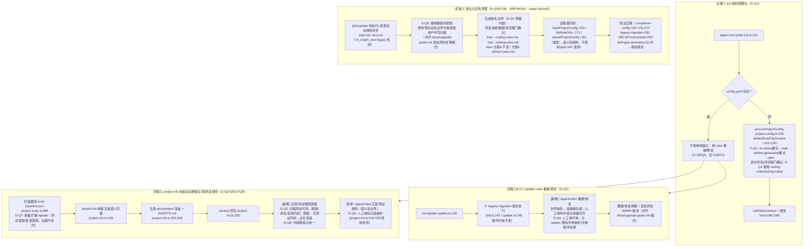

# 探索：openspec/rules 整合进 init 与 .iagent/rules 自动更新（init-rules-integration）

> 探索产物（暂存区）。提案生成时**移动**为变更目录 `exploration.md`（见 CONTEXT.md「探索文件」条目）。
> delegated 模式：由编排器委派；全局护栏适用 `openspec/rules/ai-coding.md`；未定义项标 [待确认]，禁止猜测。

- 日期：2026-10-18
- 模式：delegated（宿主 opencode V2）
- 工作目录：D:\ai_workspace\MiAgentTools

## 提示词基线

### 用户原始提示词（逐字）

> 把 openspec\rules 规则文件内容，整合到当前项目，跟随 init 功能一起初始化生成到 .iagent\rules 目录下；同时优化 project-init 技能及扫描范围，在生成及更新完成项目信息后，自动更新项目 iagent\rules 实现、测试规则；同时调整 impl.md\test.md 文件名称，让名称更符合实际情况

### 复述基线

三层独立意图：

1. **规则源整合（integration）**：以 `openspec/rules/` 下已有规则文件内容为规则源，随 `iagent init` 初始化，生成到 `.iagent/rules/` 目录下。编排器注记：`openspec/rules/ai-coding.md` 为全局护栏。
2. **project-init 技能与扫描范围优化 + rules 自动更新**：优化 project-init 技能与项目扫描；在项目信息（docs/project 五类文档 + AGENTS.md + context）生成及更新完成后，自动更新目标项目 `.iagent/rules/` 的**实现类**与**测试类**规则。
3. **改名（rename）**：调整 `impl.md` / `test.md` 文件名称，使名称更贴合实际语义。

参数级歧义（全部列出为 [待确认]，见 Questions）：规则源映射（openspec/rules 无「测试」类源文件）、目标文件名（改成什么）、触发时机与落点（project-init 技能运行时 vs CLI update）、更新覆盖策略（覆盖/合并/人工域保护）、旧装机兼容与版本递增位。

## Background（代码库发现，file:line 证据）

### B1. 现状：.iagent/rules 如何生成（意图①的挂点）

- **唯一生成点**：`ensureProjectConfig`（`src/core/project-config.ts:239-261`）——仅当 `config.yaml` 不存在时整体创建 `config.yaml` + 规则文件；**硬编码类型数组 `['impl', 'test', 'spec']`**（project-config.ts:253）；已存在则**整体跳过**（project-config.ts:244-246），即 update 与重复 init **永不刷新**规则内容。
- **默认内容源**：`defaultRuleFileContent(type)`（`src/core/project-config.ts:102-125`）——impl 为「分层架构 +（待补充）注释」占位两行；test 为单行「（待补充）」占位。**没有「测试」类真实规则源**。
- **init 调用点**：`runInit` 步骤 4（`src/commands/init.ts:301-304`），结果进 `InitResult.ruleFilesCreated`（init.ts:96、init.ts:338）。
- **读取消费链**：`readProjectConfig` 按 `` `${type}.md` `` 拼路径读取（project-config.ts:222）、`parseProjectConfig` 对 rules 列表按 `isSkillType` 过滤（project-config.ts:161）、`listRuleFiles` 同样按类型过滤（project-config.ts:264-273）。**文件名 = 类型 id + `.md`，是类型体系的强耦合契约**。
- 生成时机前置约束：init/update 的 legacy 迁移（`runLegacyMigration`，init.ts:145 / update.ts:150）必须最先执行（AGENTS.md 项目约定 + init.ts:142-144 注释）。

### B2. 现状：update 与项目扫描（意图②的挂点）

- **update 完全不触 rules/扫描**：`src/commands/update.ts` 中 grep `rules|scanProject|context` 为 **0 命中**；`runUpdate`（update.ts:139）流程为：0 旧迁移 → 0.1 misplaced 清理 → 0.2 技能 id 迁移 → 读 config（162）→ --tools 回写（170-172）→ 技能/指令刷新 → reconcile。
- **scanProject**（`src/core/project-scan.ts:689-718`）：仅 init.ts 有 4 处调用，写基线 `.iagent/scan-baseline.json`（update 不跑）。扫描维度：`signals`（构建文件/骨架/配置**键名**/路由/文档）+ `candidates`（依赖候选），排除目录清单 `EXCLUDED_DIR_NAMES`，深度/文件上限 MAX_SCAN_DEPTH=8 / MAX_SCAN_FILES=2000。目前为**机械信号**探测，不含「实现/测试规则」生成逻辑。
- **「项目信息生成及更新」真实落点**：`iagent project-init` **技能运行时**（非 CLI）：五类 docs/project 文档（模板表见 `src/core/templates/workflows/project-init.ts:234-247`）、AGENTS.md（250-258）、context 段回写（260-266，逐行保留 + 段替换）。**现不写 rules**。

### B3. project-init 技能模板现状（意图②的改造对象）

- 存在：`getProjectInitSkillTemplate`（`src/core/templates/workflows/project-init.ts:146-299`）。frontmatter：name=`iagent_project_init`、type=`init`、allowedTools 含 `CODEGRAPH_MCP` + `skillDelegation(['feature_doc'])`。
- 正文 9 步：读基线（166）→ 框架语义扫描（174，四级版本回退链）→ 委派 feature_doc（187）→ 安全扫描（196，键名+禁令）→ 文档逐份确认（210）→ 增量对齐 `<!-- 人工域:开始/结束 -->`（219-233）→ 五类落盘（234）→ AGENTS.md（249）→ context 回写（260）。
- **人工域标记机制已存在**（219-233），是 rules 覆盖保护可复用的现成机制。
- 模板改动后必须 `pnpm build && pnpm generate:skills`（AGENTS.md 修改守则 1）。

### B4. openspec/rules 现状（意图①的规则源）

存在 2 个文件：

| 文件 | 体量 | 概要 | ↔ SKILL_TYPES 映射（主体已决：见 Decisions D-Q1） |
|---|---|---|---|
| `openspec/rules/ai-coding.md` | 43 行 | AI 编码规约：零猜测 / 设计先行+确认门 / 数据存储 / 架构分层 / 前端 UI 四状态 / 生成交付 | impl（实现域，D-Q1 已决）；review 类技能是否复用 → [待确认]（Phase 2/提案层决定） |
| `openspec/rules/artifact-generation.md` | 74 行 | OpenSpec Markdown 制品生成协议 G1-G7 | spec（规格工件域） |

- **关键缺口：openspec/rules 无「测试」类规则源文件**——已由 D-Q2 消解（测试规则由 project-init 扫描测试代码蒸馏，无则占位兜底）。
- 模板正文对 `openspec/rules/*` 的硬编码路径引用共 **14+ 处**（auto-workflow.ts:15,200、debug.ts:124,339、feature-doc.ts:14、migration.ts:14,62、migration-check.ts:21、proposal-review.ts:419,575、requirement-doc.ts:11、spec-apply.ts:18,74,132,356、spec-archive.ts:14、spec-explore.ts:1197、spec-bulk-archive.ts:14、spec-verify-proposal.ts:173、spec-propose.ts:27,151,284、spec-verify.ts:13、workflow.ts:138,293,330）——语义是**本模板库源仓路径**；生成到「无 openspec/ 目录」的目标项目时该路径失效（spec-apply.ts:74 已有降级语句）。整合方式→已由 D-Q1 决定蒸馏进模板常量；这 14+ 处引用是否改写指向 `.iagent/rules/`（或维持双源语义）仍 [待确认]，原列为 pending gate `template-reference-target`，**2026-10-18 流程门后转为 Phase 2 待查项**（非探索阻塞门）。

### B5. impl.md / test.md 引用面（意图③）

- **src 无对文件名字面的代码硬编码**：文件名一律由 `` `${type}.md` `` 派生；仅注释提及（project-config.ts:8-9 头注释、init.ts:96 注释）。
- **测试断言强依赖现名**：`test/completion-config.test.ts:134-135,175-176,217`；`test/legacy-migration.test.ts:281-285,457`（含旧 `tr_impl.md`→`impl.md` 迁移断言）；`test/commands.test.ts:292`；`test/skill-type-taxonomy.test.ts:10,42`（defaultRuleFileContent）。
- 旧类型映射 `LEGACY_TYPE_RENAME`（`src/core/legacy-migration.ts:104-106`）由 SKILL_TYPES 派生——改名（若类型 id 变更）会牵动映射表守卫测试 `test/legacy-migration.test.ts`。

## Questions（L1-L5 grill 清单，batch 模式，已通过编排器向用户提问并收到回答）

> 每问附建议与理由；**2026-10-18 用户已逐条回答**，回答结果以各问「用户回答」行与 Decisions 段为准。原始候选保留供审计。

### Q1 [L1] 意图①「整合」的确切形式与验收标准

规则内容如何进入 `.iagent/rules/`？候选：**a) 蒸馏合并进模板常量**（改 `defaultRuleFileContent`，把 ai-coding.md 要点蒸馏为 impl.md 默认行，随 init 离线生成，不依赖目标项目有 openspec/）；**b) 运行时读取项目根 `openspec/rules/`**（有则拷贝/合并，无则退化占位）；**c) 两者叠加**（模板默认 + openspec/rules 存在时以源文件扩充）。验收成功标准需用户定义（建议至少含：新装机 init 后 .iagent/rules/impl.md 含 ai-coding 护栏要点；skills-parity 与规则生成测试通过；`pnpm build && pnpm generate:skills` 全绿）。
- 建议：a 或 c；理由：模板常量随 iagent 版本演进可维护（`pnpm generate:skills` 同步快照），运行时读源文件在无 openspec 目标项目上会静默缺规则。
- 理由：用户语境「把 openspec\rules 内容整合到当前项目」更像内容移植，而非保持运行时依赖。
- **用户回答（2026-10-18）**：选 a——蒸馏进模板常量；ai-coding→impl 域、artifact-generation→spec 域；目标项目**无需** openspec 目录即得基线。验收含：新装机 init 后 .iagent/rules/impl.md 含 ai-coding 护栏要点；`pnpm build && pnpm generate:skills` 全绿。

### Q2 [L1] 规则源范围与「测试规则」的主体

openspec/rules 只有 ai-coding(→impl) 与 artifact-generation(→spec?)，**没有测试类源文件**。「自动更新实现、测试规则」中测试规则的源是？候选：a) test.md 仍为模板占位、仅实现由扫描蒸馏；b) 用户提供测试规则源（给出文件位置）；c) 由 project-init 扫描既有测试代码（框架/命名/目录约定）**蒸馏生成**测试规则行。
- 建议：c（扫描蒸馏）+ 保留占位兜底；与意图②的「扫描范围优化」衔接。
- 理由：意图②已要求 project-init 更新测试规则，纯占位行不变则该意图空转。
- **用户回答（2026-10-18）**：选 c——测试规则内容由 project-init 技能扫描既有测试代码（框架/命名/目录约定）蒸馏生成；无测试代码时占位行兜底。（硬待决门 A 已消解。）

### Q3 [L2] 意图③改名方案与兼容契约

`impl.md/test.md` 改成什么名？现状名由 `` `${type}.md` `` 派生（SKILL_TYPES 强耦合：isSkillType 过滤见 project-config.ts:161/271）。候选：**a) 改为语义英文名**（如 `impl.md`→`coding-rules.md`、`test.md`→`testing-rules.md`，类型 id 不动、只改文件名生成映射层）；**b) 改为中文语义名**（如 `实现规则.md`/`测试规则.md`）；**c) 不改文件名**，仅调整展示与注释措辞（用户看到的「名称」其实是输出文案）。改名一定牵动 readProjectConfig/listRuleFiles/legacy 映射（tr_impl.md→新名）与 4 个测试文件。
- 建议：a（映射层 `<type>→<新文件名>`，旧名 legacy 兼容读取窗口），或 c（若用户所指是展示名）。
- 理由：先澄清用户对「名称更符合实际」的所指（真实文件名 vs 报告文案），避免 BREAKING 扩大。
- **用户回答（2026-10-18）**：改语义英文名，且**不再兼容旧名**（弃"仅改展示文案"）。命名映射提案（proposal，待流程门确认）：`impl.md`→`coding-rules.md`、`test.md`→`testing-rules.md`；`spec.md` 是否同步改名（方案 a 仅改 impl/test / 方案 b 全部规则文件统一语义名如 `artifact-rules.md`）留待流程门。**derived：BREAKING → 版本递增 major**。

### Q4 [L3] rules 更新的覆盖策略与手改保护

目标项目 `.iagent/rules/` 是用户可编辑文件；「自动更新」如何保护手改？候选：**a) 人工域标记段**（复用 docs/project 的 `<!-- 人工域:开始/结束 -->` 增量对齐机制，project-init.ts:219-233 同构）；**b) generatedFingerprint 前置元数据**（技能不适用；rules 文件无 frontmatter，需引入新检测机制）；**c) 整体覆盖 + WARN**（手改丢失风险）。
- 建议：a；理由：机制零新增、语义清晰、与五类文档行为一致；fingerprint 机制是为无 frontmatter 检测文件另造的第二套判定（与 update 手改保护体系耦合较深）。
- **用户回答（2026-10-18）**：选 a——人工域标记段：复用 project-init.ts:219-233 现成机制，自动更新不抹用户手写段落。

### Q5 [L4] 自动更新的触发时机与挂点

「项目信息生成及更新完成后」的挂点在哪？证据：CLI `update` 零涉及 rules/扫描；项目信息生成在 project-init **技能运行时**（step 7-9）。候选：**a) 仅改 project-init 技能正文**（step 9 后追加「实现/测试规则刷新」步骤，模板内声明 + references 说明）；**b) a + CLI 扩展**：`iagent update` 也增加 rules 刷新（但 update 无扫描信息，蒸馏能力弱）；**c) 扫描侧**：project-scan 增加「规则蒸馏建议」输出字段，技能消费。
- 建议：a（最小闭环；[待确认] 是否同时要 CLI 入口）。
- 理由：意图②以技能为主语；CLI update 无蒸馏上下文，b 会把 AI 判断强塞进确定性 CLI。
- **用户回答（2026-10-18）**：选「技能正文 + CLI update」组合——除 project-init 技能正文新增规则蒸馏/刷新步骤外，`iagent update` 也要**重建/修复** .iagent/rules（确定性 CLI 挂点；须与 update 既有手改保护/迁移顺序协调：legacy-migration 仍最先执行）。

### Q6 [L4] 旧装机已存在的 impl.md/test.md 处理与版本递增位

存量目标项目的 impl.md/test.md 可能已被用户手写改写（占位行已替换）。整合后 init/update 需合并（保留旧规则行 + 接入新默认行）还是覆盖？改名（Q3 若选 a/b）是否 BREAKING（major）？
- 建议：合并 + 人工域保护（老文件整体视为用户域，新默认行追加并 WARN 提示）；若 Q3 走文件名变更则 major，否则 minor（行为新增）。
- 理由：AGENTS.md 版本递增表——BREAKING（改 CLI 行为/产物契约）major；行为新增 minor。
- **用户回答（2026-10-18）**：**删除旧名文件**——init/update 检测到旧名规则文件（impl.md/test.md）即**整体删除并报告**，新名文件重新生成（与旧装机「旧产物一律删除」边界一致）。旧名文件可能承载用户手写内容，删除前报告须在文档中明示（对齐 docs/upgrade-guide.md 丢失风险告警模式）。

### Q7 [L4] project-init 扫描范围优化的形态

「优化 project-init 技能及扫描范围」具体要什么？候选：**a) 技能正文新增「规则蒸馏」步骤**：输入 = scan-baseline signals/candidates + docs/project 五类文档 + AGENTS.md/构建文件，产出 impl/test 规则行（分层映射、UI 由框架语言化、测试框架/目录命名约定），并走 Q4 保护策略落盘；**b) 扩展 project-scan 数据结构**（新增 signals 维度，如测试框架探测），扫描侧 SKILL 消费；**c) 仅依赖上下文回写，不做新步骤**。
- 建议：a 为主 + 视用户需要轻量加 b（如 test.md 蒸馏需要测试框架信号时补充 candidates 维度，并以零猜测规则冒烟探 [待确认] 标注）。
- 理由：规则蒸馏需要测试框架/分层证据，单靠现有机械 signals 的维度对测试类规则略显不足。[待确认] 用户是否允许扫描面向「测试/实现规则素材」倾斜。
- **用户回答（2026-10-18）**：选 a + 轻量 b——主走技能蒸馏步骤；测试类证据不足时轻量扩展 project-scan signals（测试框架/目录探测）。

### Q8 [L2] 多宿主差异化

`.iagent/rules/` 内容在 claude / pi / opencode 多宿主下是否差异化？现状：rules 是项目面配置（在 `.iagent/` 下，与宿主目录无关），读取链（generate 注入 proposal-review 等模板）不分宿主。
- 建议：不差异化——rules 是项目约束语义而非宿主语义，宿主差异由适配层（rewriteCommandRefs / adaptSkillContentForHost）承担。
- 理由：对 rules 引入宿主区分会让每宿主三套语义重复；未见用户/场景证据需要。
- **用户回答（2026-10-18）**：选「不差异化」——.iagent/rules 内容跨宿主统一，宿主差异由适配层承担。

## Decisions（仅记录用户已确认项，2026-10-18 经编排器转达）

**D-Q1（意图①整合形式）**：openspec/rules 要点**蒸馏进模板常量**——改 `defaultRuleFileContent`（src/core/project-config.ts:102-125）：`ai-coding.md` → impl 域（coding-rules 蒸馏为默认规则行）、`artifact-generation.md` → spec 域；目标项目**无需** openspec 目录即得基线。验收：新装机 init 后 `.iagent/rules/coding-rules.md`（新名）含 ai-coding 护栏要点；`pnpm build && pnpm generate:skills` 全绿。

**D-Q2（测试规则主体，硬待决门 A 已消解）**：测试规则内容由 project-init 技能**扫描既有测试代码**（测试框架 / 命名 / 目录约定）蒸馏生成；无测试代码时**占位行兜底**。

**D-Q3（改名，BREAKING → major，derived）**：`impl.md` / `test.md` 改**语义英文名**，**不做旧名兼容映射**。命名映射提案（proposal，**[待流程门确认]**）：

| 类型 | 现名 | 提案新名 |
|---|---|---|
| impl | `.iagent/rules/impl.md` | `coding-rules.md` |
| test | `.iagent/rules/test.md` | `testing-rules.md` |
| spec | `.iagent/rules/spec.md` | **方案 a**：不改（仅改 impl/test）；**方案 b**：`artifact-rules.md`（全部规则文件统一语义名）——二选一待流程门 |

**D-Q4（覆盖保护）**：复用**人工域标记段**机制（`<!-- 人工域:开始/结束 -->`，project-init.ts:219-233 同构）——自动更新**不抹**用户手写段落。

**D-Q5（触发挂点 = 技能正文 + CLI update）**：project-init 技能正文新增「实现/测试规则蒸馏/刷新」步骤；同时 `iagent update` 也要**重建/修复** .iagent/rules（确定性 CLI 挂点）。协调约束：update 内 **legacy-migration 仍必须最先执行**（init.ts:142-144 / update.ts:148-150 现状顺序不变），rules 重建/修复插在其后。

**D-Q6（旧名文件处理）**：init/update 检测到旧名规则文件即**整体删除并报告**，新名文件重新生成——与旧装机「旧产物一律删除」边界一致；旧名文件可能承载用户手写内容，**删除前报告须在文档中明示**（对齐 docs/upgrade-guide.md 丢失风险告警模式）。

**D-Q7（扫描范围）**：主走技能**蒸馏步骤**；测试类证据不足时**轻量扩展** project-scan signals（测试框架 / 目录探测）。

**D-Q8（多宿主）**：`.iagent/rules` 内容**跨宿主统一**，宿主差异由适配层承担。

**D-Q9（流程最终确认门转正，2026-10-18，来源：用户按推荐确认进入提案，无修改）**：
- **命名提案转正采纳**：`impl.md`→`coding-rules.md`、`test.md`→`testing-rules.md`——不再兼容旧名（BREAKING→major derived 维持）。
- **spec 改名选方案 a**：`.iagent/rules/spec.md` **不变**（仅改 impl/test 两个文件；artifact-rules.md 统一语义名方案弃用）。
- 流程功能图与节点清单同批次确认（无修改，见图段尾部确认注记）。

- 编排器注记（可采信）：全局护栏适用 `openspec/rules/ai-coding.md`；未定义项一律标 [待确认]。

## Pending

### For Phase 2 Impact Analysis（影响面符号清单）

**改动疑似直接命中：**
- `ensureProjectConfig` — src/core/project-config.ts:239：唯一 .iagent/rules 生成点；「已存在即跳过」逻辑是自动更新的最大行为变更点
- `defaultRuleFileContent` — src/core/project-config.ts:102-125：默认内容源（意图①的蒸馏落点）
- `readProjectConfig` — src/core/project-config.ts:213-233；`parseProjectConfig` :141-165；`listRuleFiles` :264-273：类型名/文件名契约消费方（意图③）
- `runInit` — src/commands/init.ts:141-352（step 4 :301，init 报告 ruleFilesCreated :96/:338；cli/index.ts:123 输出文案）
- `getProjectInitSkillTemplate` — src/core/templates/workflows/project-init.ts:146-299（新增规则蒸馏步骤——D-Q5 已决；references 五文件可能增删）
- `scanProject` / `ProjectScanReport` — src/core/project-scan.ts:689 / :181（D-Q7 已决：轻量扩展 signals——测试框架/目录探测）
- `runUpdate` — src/commands/update.ts:139（D-Q5 已决：新增 .iagent/rules 重建/修复挂点，须插在 legacy-migration 之后）

**为意图③牵动（D-Q3 已决：语义英文名 + 不兼容旧名，BREAKING→major derived；D-Q6 已决：旧名文件删除并报告）：**
- `LEGACY_TYPE_RENAME` / `legacyTypeId` — src/core/legacy-migration.ts:104-106 / :100（类型 id 不变更则其映射目标不变——但 tr_impl.md 的**迁移落点文件名**需按新名处理；test/legacy-migration.test.ts:281-285 断言锁须改写为新名 + 删除报告断言）
- 读/列契约：`readProjectConfig` :222 / `listRuleFiles` :271 的 `` `${type}.md` `` 派生改为类型→语义名映射（D-Q3 提案表）；新增**旧名文件检测与删除**逻辑（D-Q6，init/update 双入口）
- 测试：test/completion-config.test.ts:134-176,217、test/commands.test.ts:292、test/skill-type-taxonomy.test.ts:10,42（均需改断言到新名）

**为模板正文引用路径生效性：**
- 技能正文中 14+ 处 `openspec/rules/ai-coding.md`、`artifact-generation.md` 引用（模板清单见 Background B4）——若整合目标是让目标项目脱离源仓路径，需权衡是改写引用目标为 `.iagent/rules/`，或保持双源语义：[待确认]（Phase 2 待查项，非探索阻塞门）；牵动 `rewriteCommandRefs` / `deriveCommandContent` 派生与 `pnpm generate:skills` 快照（skills/）同步、test/skills-parity.test.ts、test/command-reference-refs.test.ts

**D-Q9 转正引入的新符号（Phase 2 提案落点，命名 [Phase 2 提案]）：**
- **类型→语义名文件映射**（单一源候选：src/core/project-config.ts，与 IAGENT_DIR_NAME/CONFIG_FILE_NAME/RULES_DIR_NAME 常量同区）：常量表 + 派生函数，映射 impl→`coding-rules.md`、test→`testing-rules.md`、spec→`spec.md`（D-Q9 方案 a 不变）；`ensureProjectConfig` :253-258 / `readProjectConfig` :222 / `listRuleFiles` :271 全部改走该映射，不再 `` `${type}.md` `` 直拼
- **旧名规则文件检测与删除**（D-Q6，init/update 双入口共用；候选落点 src/core/project-config.ts 或与 legacy-migration 清理逻辑并列 src/core/legacy-migration.ts）：检测 `impl.md` / `test.md`（含 tr_impl/tr_test legacy 形态语义落点）→ 整体删除 → 报告 + 丢失风险 WARN
- **runUpdate 的 rules 重建/修复步骤**（D-Q5/Q4；src/commands/update.ts 内新增步骤，插点在 0.2 技能 id 迁移之后、读 config（:162）前后 [Phase 2 定序]）：缺失→常量重生成；人工域外内容与常量对齐；人工域内逐字保留

**IMG（手改保护 / 本机产物边界）：**
- `.iagent/` 不入库（AGENTS.md 项目约定）；rules 产物当前**无** generatedFingerprint——动态更新的手改保护已决走人工域标记段（D-Q4），不走指纹机制；skills/ 侧既有指纹机制不动
- `test/markdown-first-regression.test.ts` 不直接影响（rules 非 spec 制品），但新模板段不得引入 JSON 主产物

### 尚未扫描确认 / 排查待做（列给 Phase 2）

- init.ts 首段 options（--rules 之类旗标）与 InitResult 全字段：[待确认]（Phase 2 可直接读 init.ts:96-137）
- skills/ 静态快照中 rules 相关行量：pnpm generate:skills 后观察 diff 面
- openspec/config.yaml 的 STRUCTURED_DOC_PATHS 引用（project-scan.ts:154）与 rules 是否有联动：未发现，[待确认]

## 功能流程图（2026-10-18 按 D-Q1~D-Q8 收敛）

**节点清单（Q 编号已改为 D-决策号标注）：**

| 节点 | 对应决策 | 依赖说明 |
|---|---|---|
| I3（init 生成蒸馏规则） | D-Q1、D-Q3 | 蒸馏落点=模板常量（defaultRuleFileContent）；新名 [待流程门确认] |
| I4（已存在不再跳过） | D-Q5、D-Q6 | 现状「整体跳过」改为转 rules 重建/修复 |
| I5（init 报告） | D-Q1、D-Q6 | ruleFilesCreated / 删除报告与丢失风险 WARN |
| U2（legacy 迁移先行） | D-Q5 | 顺序约束：legacy-migration 最先，rules 修复在其后 |
| U3（update rules 重建/修复） | D-Q5、D-Q4 | 确定性 CLI 挂点：缺失重建、人工域外对齐常量 |
| U4（update 报告） | D-Q6 | 丢失风险告警模式对齐 docs/upgrade-guide.md |
| P1（扫描素材） | D-Q2、D-Q7 | 轻量 signals 扩展（测试框架/目录探测） |
| P3/P4（项目信息完成时点） | D-Q5 | 触发顺序：文档→AGENTS→context→rules |
| P5（蒸馏） | D-Q2、D-Q8 | 测试规则由扫描蒸馏、占位兜底；内容跨宿主统一 |
| P6（技能侧覆盖） | D-Q4 | 人工域标记段保护 |
| N1→N2（旧名检测/删除/报告） | D-Q6 | init/update 双入口；删除前报告明示手写内容风险 |
| N3（新名生成，命名提案） | D-Q3 | [待流程门确认：spec.md 方案 a/b 二选一] |
| N4（读取链同步） | D-Q3 | 类型→语义名映射替代 `${type}.md` 直拼 |
| N5（测试迁移） | D-Q3、D-Q6 | 4 个测试文件断言改新名 + 删除报告断言 |
| BREAKING/major | D-Q3 derived | 已决：major |

**流程确认注记（2026-10-18）**：流程功能图与节点清单已由用户在**流程最终确认门确认，无修改**（按推荐确认进入提案）；命名提案转正与 spec 方案 a 见 Decisions **D-Q9**。图中残留的「[待流程门确认]」标注自本注记起由 D-Q9 取代（图身保存原样以固化用户确认时点的形态）。

### 聚合一致性门（第二次自检，2026-10-18 决策回填后）

- 术语一致：**rules 文件**（现 `.iagent/rules/<type>.md`；新名 `coding-rules.md`/`testing-rules.md` 已由 **D-Q9 转正**，正文统一称「新名/语义名文件」，仅流程图图身保留用户确认时点的「[待流程门确认]」标注并由图段尾部注记取代）、「五类文档」（docs/project）、「人工域标记」（`<!-- 人工域:开始/结束 -->`）、「规则蒸馏」（D-Q2/D-Q7 落定的新行为术语）、「旧产物一律删除」（legacy-migration 既有边界）均与 Decisions/AGENTS/CONTEXT 一致。**CONTEXT.md 候选新术语：「规则蒸馏」「语义名文件」「rules 重建/修复」——留待提案/归档阶段增订**（本文件不写入）。
- Decisions ↔ Background 冲突核对：B1「update 与重复 init 永不刷新」为**现状事实**，与 D-Q5「引入重建/修复」无冲突（决策改变的就是这一行为）；B4 映射关系已由 D-Q1 定案（B4 缺口行与引用行均已加注指向决策）；B5「测试断言依赖现名」与 D-Q3/D-Q6 一致（断言须迁移）。无残留冲突。
- 流程 ↔ 决策核对：F1/I3=D-Q1+D-Q3 提案标注；F1B/U2/U3=D-Q5 顺序协调 + D-Q4；F2/P5=D-Q2+D-Q8、P6=D-Q4；F3/N1-N5=D-Q6 删除报告（无兼容映射路径）；`I4 --> F1B/F2` 衔接与 D-Q5/Q6 一致。交叉引用逐一对上。
- Questions 段：八问均已补「用户回答（2026-10-18）」行，与 Decisions 逐条对应，候选选项保留供审计。
- 决策冲突：D-Q3 与 D-Q6 组合自洽（不兼容旧名 → 必须删除旧名文件并由报告告警对冲丢失风险，与编排器注入的 D-Q6 用户表述一致）；D-Q5 技能 + CLI 双挂点与 D-Q4 保护机制在两个挂点均适用（同一套蒸馏/修复策略）。
- 派生声明：**BREAKING → major** 为 D-Q3 与 D-Q6 的 derived 结论（产物契约变更 + 旧名整体删除），依据 AGENTS.md 版本递增表，非用户逐字表述，已在 Decisions 标注 derived。
- **第三次自检（2026-10-18，流程门确认 + D-Q9 转正后）**：① spec 改名 → 已决方案 a（D-Q9）；② naming proposal → 已转正（D-Q9）；③ `template-reference-target` → 确认为 Phase 2 待查项（非探索阻塞门，见 Pending）。术语、交叉引用、决策-流程-Background 三方对齐复验通过，**探索期硬冲突为空**。

## 完成检测

- 底摸（openspec/ 目录、rules/ 全部 *.md、explorations、changes、specs）完成 ✅
- 探索文件落盘且可读 ✅（本文件）
- 提示词校验：三类意图清晰，直通；参数级歧义已全部列入 Questions ✅
- CodeGraph 扫描 + grep 引用面完成，file:line 证据齐 ✅
- L1-L5 grill（Q1-Q8）已由编排器向用户提问并收到全部回答 ✅
- Decisions 回填（D-Q1~D-Q8，含 D-Q3 derived major）✅；Questions 段逐问补记用户回答 ✅
- 流程图与节点清单按决策收敛（去兼容映射路径、增 F1B CLI update 挂点、BREAKING→major 落图）✅
- 流程最终确认门：**已过**（2026-10-18 用户按推荐确认，无修改；确认注记入图段尾）✅
- 命名提案转正与 spec 方案 a 落 Decisions（**D-Q9**）✅；Pending 段补充 D-Q9 引入的新符号（类型→语义名映射、旧名检测删除、update rules 修复步骤）✅
- 聚合一致性门第三次自检完成（术语/Background/流程-决策/交叉引用/派生声明），**无硬冲突，探索无 pending 门** ✅
- **状态：探索完成——全部门已消解，无 pending；仅余 Phase 2 待查项（template-reference-target 等已转入 Pending 段，非探索阻塞门）。** 文件已落盘且可读 ✅
