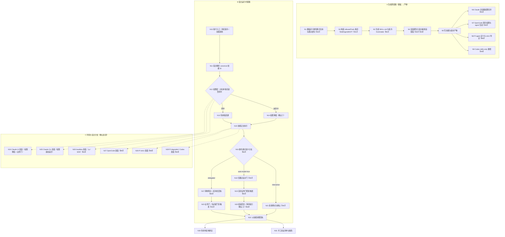

## Context

### 现状链路（探索结论）

```
skills/ 模板真源（src/core/templates/workflows/*.ts）
  ├─ allowedTools（Skill(...) / Agent,Task / MCP）──► SKILL.md frontmatter（Claude only）
  │                                               └─► 指令 frontmatter（配对技能回填）
  ├─ instructions ──► rewriteCommandRefs ──► adaptSkillContentForHost（宿主适配段）──► 宿主技能
  └─ deriveCommandContent ──► 指令正文
init / update
  ├─ mergePermissions(.claude/settings.json permissions.allow)      ← Claude 会话级
  ├─ writeOpenCodeProjectArtifacts(.opencode/agents/* + opencode.jsonc permissions)
  ├─ writePiNativeAgents(.pi/agents/* : tools + allowed_subagents)
  └─ detectPiRuntime(.iagent/pi-runtime.json : strict|degraded)
```

关键事实：`mode=delegated` / `auto-mode=true` **只作为提示词文本存在于技能正文**，链路中没有任何代码读取、校验或转换为宿主权限/模式；而用户观察到的「仍需确认」主要来自**宿主工具权限层**（`Skill(<裸名>)` 与 canonical `iagent-<workflowId>` 不匹配），与 mode 语义无关。

### 影响分析（CodeGraph，Phase 2.0 合并结果）

| 区域 | 符号 / 常量 | 位置 | 调用方（含测试） |
| :--- | :--- | :--- | :--- |
| 白名单与模板构造（M1/M2） | `skillDelegation` | `src/core/templates/tool-whitelist.ts:60` | 19 处模板调用（`project-init` / `spec-archive` / `workflow` / `debug` +5）；`test/tool-whitelist-constants.test.ts` |
| 同上 | `SUBAGENT_DISPATCH` | `tool-whitelist.ts:46` | 8 处（`auto-workflow` / `debug` / `migration` / `spec-apply` +3）；同上 |
| 同上 | `getProjectInitSkillTemplate` / `getProjectInitCommandTemplate` / `getSpecApplyChangeSkillTemplate` / `getAutoWorkflowCommandTemplate` | `src/core/templates/registry.ts` | 注册表；`test/template-derivation.test.ts`、`test/project-init-scan.test.ts` |
| 宿主编排渲染（M2/M3） | `adaptSkillContentForHost` | `src/core/host-orchestration/render.ts:160` | 6 处（`init` / `update` / `index`）；`test/host-orchestration.test.ts` |
| 同上 | `renderDelegate` | `actions.ts:46` | 4 处；`test/claude-host-adapter.test.ts`、`test/host-orchestration.test.ts` |
| 同上 | `renderDelegationList` | `actions.ts:83` | 4 处；`test/host-orchestration.test.ts` |
| 同上 | `ORCHESTRATING_WORKFLOW_IDS` / `ORCHESTRATION_DELEGATIONS` / `CONDITIONAL_DELEGATIONS` | `render.ts:14,22,62` | `render.ts` 内部消费；`pi-native.ts` |
| 能力协商（M3/M4） | `negotiationForHost` | `hosts.ts:139` | 5 处（`init` / `update` / `index`） |
| 同上 | `negotiateCapabilities` | `hosts.ts:105` | 3 处（`hosts.ts` / `index`） |
| 同上 | `HOST_PROFILES` / `HostCapabilityProfile` / `CapabilityNegotiation` | `hosts.ts:41,30,85` | 2 / 3 / 9 处（`index` / `render` / `transition` / `hosts`） |
| 同上 | `WORKFLOW_PROTOCOLS` | `workflows.ts:141` | 4 处（`index` / `workflows`）；`test/host-orchestration.test.ts` |
| 同上 | `evaluatePhaseTransition`（消费 `CapabilityNegotiation`） | `transition.ts:59` | 测试路径 |
| 权限载体（M1） | `buildPermissionEntries` / `mergePermissions` | `permissions.ts:56,90` | 各 5 处（`init` / `update`）；`test/permissions.test.ts` |
| OpenCode（M5） | `writeOpenCodeProjectArtifacts` | `opencode-v2.ts:264` | 4 处（`init` / `update`） |
| 同上 | `mergeOpenCodeProjectConfig`（2）、`renderOrchestratorAgent` / `renderWorkerAgent` / `iagentPermissionRules` / `isIagentRule` / `openCodeAgentId` | `opencode-v2.ts` | 模块内部；`test/opencode-v2.test.ts` |
| Pi（M6） | `writePiNativeAgents` | `pi-native.ts:244` | 7 处（`init` / `update`） |
| 同上 | `PI_AGENT_TOOLS`（3）/ `renderPiStageAgent`（2）/ `PiNativeStage` / `resolvePiNestingDelegations`（2）/ `detectPiRuntime` | `pi-native.ts` / `pi-runtime.ts:276` | `test/pi-native.test.ts`、`test/pi-runtime.test.ts` |
| 模板 mode 语义（M2） | `spec-apply` / `spec-propose` / `spec-explore` / `auto-workflow` / `workflow` 正文；`DelegateAction`（2 调用方） | `templates/workflows/*.ts`、`actions.ts:12` | `test/template-derivation.test.ts` |

## 功能流程图（流程基准引用）

以下为 explore 阶段**经用户确认**的流程基准（`exploration.md` 的 `## 功能流程图`，`flow_baseline=confirmed`）。本设计**引用而非重建**；节点粒度与改动点（`【M#】`）标记一致，后续实现 MUST NOT 静默补节点。



节点 → 改动点映射（完整「关键操作节点清单」见 `exploration.md`，本表只列本次改动落点）：

| 节点 | 本次改动 | 落点 |
| :--- | :--- | :--- |
| N1 | 双轴词汇由常量源插值；更正 `auto-mode` 别名声明 | `templates/workflows/*.ts`、`delegation-contract.ts` |
| N2 / N3 | `skillDelegation()` 改 canonical 派生 | `tool-whitelist.ts` |
| N4 | 注入面改为按模板 `Skill(...)` 派生；surface 策略声明 | `render.ts` |
| N6 | 会话级条目随 canonical 白名单自动跟随（无需改合并逻辑，仅断言） | `permissions.ts`（不改）+ 测试 |
| N7 / N27 | OpenCode `bash` 与 worker 委派面补齐 | `opencode-v2.ts` |
| N8 / N28 | Pi `gate` 声明收窄为阻塞回执形态（`tools` 不变） | `hosts.ts` / `pi-native.ts` |
| N9 / N29 | Codex 显式 degraded 档案 + 协商返回 + 诊断 | `hosts.ts` / `init.ts` / `update.ts` |
| N16–N20 | 两轴词汇与映射落地；`auto-mode` 只作用门承载轴 | `delegation-contract.ts` + 模板正文 |
| N19 / N23 | 协议门与白名单锚点对齐（含 `requirement-doc-bridge`） | `workflows.ts` / `protocol.ts` |
| N26 | headless 显式 degraded 或门兜底 | `hosts.ts` / `transition.ts` |
| N30 | 回归锁改为 canonical 断言 | `test/*` |
| N31 | 手工验证清单 | `docs/host-permission-verification.md`（新建） |

## Goals / Non-Goals

**Goals**:

- 消除「技能间委派必弹权限窗」的权限层缺陷（canonical 白名单 + 会话级同步）。
- 让委托语义可判定、可校验、不可混用（`mode` 与 `gate-skip` 两轴，单一常量源）。
- 四宿主全覆盖：Codex 由「静默内联」变为「显式 degraded + 诊断」；OpenCode 权限翻译完整；Pi 不再「名义 strict」。
- 引入 `surface` 维度，headless 不再伪装可交互 strict，且不可豁免门以 `blocked` 回执中止。
- 协议表与模板正文一致（门清单单一真源）。
- 版本按 **minor** 递增，既有 `auto-mode` 语义与用户管线行为保持不变。

**Non-Goals**:

- **不**修改 `src/commands/generate.ts` 骨架技能的全量 `Bash` 授权（历史遗留，另行评估）。
- **不**手工编辑 `skills/` 快照（只经 `pnpm build && pnpm generate:skills` 重生成）。
- **不**把真实宿主 E2E 自动化纳入仓库测试（宿主弹窗不可自动化断言，改用手工清单）。
- **不**实现「权限诊断」CLI 子命令（D6 可选项，本期延后）：由手工验证清单覆盖。
- **不**改变门白名单的 5 类结构、`GateSpec` 形状与条件门语义。
- **不**在 OpenCode 侧生成猜测性的 MCP 权限规则，或改写用户根目录配置。

## Architecture Impact

### 新增单一源模块

`src/core/host-orchestration/delegation-contract.ts`（叶模块：不导入 templates / registry，避免循环）：

```ts
export type DelegationMode = 'interactive' | 'delegated';
export type GateSkipId = 'design-confirmation';
export const DELEGATION_MODES: readonly DelegationMode[];
export const GATE_SKIP_IDS: readonly GateSkipId[];
/** 兼容别名：auto-mode=true ≡ gate-skip=design-confirmation（仅门承载轴） */
export const LEGACY_AUTO_MODE_PARAM: 'auto-mode';
export interface DelegationContract {
  mode: DelegationMode;          // 执行归属（调用方原值）
  gateSkips: GateSkipId[];       // 门承载
  legacyAutoMode: boolean;       // 来源是否为旧写法
}
export function resolveDelegationContract(options?: Record<string, string>): DelegationContract;
export function renderDelegationModeContract(): string;  // 模板正文插入段（两轴说明 + 不可互换声明）
export function renderGateSkipOption(gates: readonly GateSkipId[]): string; // `gate-skip=a,b`
```

- 模板侧：`spec-propose` / `spec-apply` / `spec-explore` / `workflow` / `auto-workflow` 以 `${renderDelegationModeContract()}` 或 `LEGACY_AUTO_MODE_PARAM` 插值引用；MUST NOT 出现第二份取值文本。
- 宿主侧：`actions.ts` 的 `DelegateAction.options` 由 `resolveDelegationContract` 归一化后渲染，未知 gate id 记 WARN。
- **轴名与参数名区分**：`gate-policy` 仅作门承载轴的**概念轴名**（沿用探索基线的词汇），MUST NOT 作为参数键被解析或渲染；唯一传参形式为 `gate-skip=<gate-id>`。`resolveDelegationContract` 只接受 `mode` 与 `gate-skip` 两个键，未知键（含 `gate-policy=`）一律忽略并记 WARN，MUST NOT 映射为「门已跳过」。

### 能力协商与表面

```ts
export type SurfaceId = 'interactive-ui' | 'interactive-cli' | 'headless';
export const SURFACE_IDS: readonly SurfaceId[];
negotiateCapabilities(host, mode, capabilitySet?: readonly CapabilityId[] | NegotiationOptions): CapabilityNegotiation
negotiationForHost(toolValue: string, piMode?: OrchestrationMode, surface?: SurfaceId): CapabilityNegotiation | null
```

（`NegotiationOptions = { capabilitySet?: readonly CapabilityId[]; surface?: SurfaceId }`）

`surface='headless'` 时从 `available` 移除 `gate` 并写入 notes；`negotiationForHost` 对 `codex` 返回 `negotiateCapabilities('codex','degraded')`（不再返回 `null`）。

- **签名兼容**：`negotiateCapabilities` 的第三形参由位置化 `capabilitySet` 扩展为 `capabilitySet | { capabilitySet?, surface? }` 联合（既有 18 处位置化调用保持可用），MUST NOT 直接改为纯对象形参而破坏调用方与库用法。
- **surface 传播（见 D13）**：`surface` 仅经协议层入参提供；生成期 `init` / `update` 以缺省 `interactive-cli` 协商（本期不新增 CLI 标志），headless 的判定由运行期调用方（编排器 / 宿主运行时）传入；产物正文 SHALL 声明「headless 表面按门兜底矩阵执行」，生成期 MUST NOT 猜测宿主表面。

门兜底矩阵（`conditional` 取自 `GATE_WHITELIST`）：

| 表面 | 条件门（`conditional: true`） | 不可豁免门 |
| :--- | :--- | :--- |
| `interactive-ui` / `interactive-cli` | 未确认即阻塞 | 未确认即阻塞 |
| `headless` | 记录决策 + WARN 并继续 | `status='blocked'` 回执中止 |

### 派生注入面（替换硬编码清单）

```ts
export interface OrchestrationTemplateInput { commandId: string; allowedTools: string }
export function deriveOrchestrationDelegations(templates: readonly OrchestrationTemplateInput[]): {
  workflowIds: string[];
  delegations: Record<string, string[]>;
}
```

- 规则：`allowedTools` 含 `Skill(iagent-<id>)` 的技能即编排技能，委派目标取该技能的 `Skill(...)` 目标集合（保序去重）。
- `CONDITIONAL_DELEGATIONS` 保持显式（语义声明，不可从白名单推导）。
- `render.ts` 的 `ORCHESTRATING_WORKFLOW_IDS` / `ORCHESTRATION_DELEGATIONS` 由该函数结果替代；`pi-native.ts` / `opencode-v2.ts` / `init.ts` / `update.ts` 传同一模板列表。
- **委派参数来源（目标之外的第二类信息）**：`allowedTools` 只承载「委派目标」，不承载参数。委派清单需要渲染的 `mode` / `gate-skip` MUST 来自显式参数表 `DELEGATION_PARAMETERS: Readonly<Record<workflowId, Record<targetId, Record<string, string>>>>`，**当前三条声明**：`workflow` 与 `auto-workflow` → `spec-explore` / `spec-propose` 的 `{ mode: 'delegated' }`、以及两者 → `spec-apply` 的 `{ 'gate-skip': 'design-confirmation' }`；取值 MUST 来自模板正文的委派语句（`mode=delegated` 与 `gate-skip=design-confirmation` 分别见各模板 Phase 1/2 与 Phase 4），MUST NOT 由白名单推断；参数表取值 MUST 与模板正文同源同值（测试断言两者一致，MUST NOT 出现第三处取值），未声明时 `renderDelegationList` MUST NOT 凭空填充参数。
- **接口透传**：派生结果与参数表经 `adaptSkillContentForHost(content, negotiation, workflowId, orchestration?)` 与 `renderHostOrchestrationSection(negotiation, workflowId, orchestration?)` 的可选形参注入（缺省回落到既有模块级清单，向后兼容）；`init` / `update` 传入同一派生结果，MUST NOT 各建第二份清单。
- **条件委派补齐**：派生后 `project-init` 亦成为编排技能（委派 `feature-doc`），而 `feature-doc` 不在 `DEPS` 内、正文已声明「不可得时自行扫描」的降级路径 → `CONDITIONAL_DELEGATIONS` SHALL 增列 `project-init: ['feature-doc']`；否则 Pi strict 会把可降级委派误报为「无条件必需缺口」并按能力阻断默认安装（`DEFAULT_WORKFLOWS` 含 `project-init` 但不含 `feature-doc`）。

### 协议与白名单

- `workflows.ts`：新增 `AUTO_APPLY_PHASE` / `AUTO_ARCHIVE_PHASE`（无 `gate`）与 `DOC_BRIDGE_GATE = { id: 'requirement-doc-bridge', blocking: true }`，`auto-workflow` 使用 `[EXPLORE, PROPOSE, VERIFY_WITH_BRIDGE, AUTO_APPLY, AUTO_ARCHIVE]`；`workflow` 的 VERIFY 复用 `VERIFY_WITH_BRIDGE`。
- `protocol.ts`：`GATE_WHITELIST` 的 `requirement-clarification.anchors` 追加 `requirement-doc-bridge`（类别数仍为 5）。
- `workflows.ts` 的 `PHASE_GATE_CATEGORY`：SHALL 为每个 `PhaseSpec.gate.id` 登记白名单类别映射，新增 `'requirement-doc-bridge': 'requirement-clarification'`。漏登记会使 `auditGateWhitelistAlignment()` 返回「缺少白名单类别映射」违规（现网测试已断言其返回空数组）。
- `debug` 的 `verify-close`：SHALL 声明 `requirement-doc-bridge` 阻塞门。`debug` 模板 7.3 已有「需求文档桥（⛔ GATE 业务门，强制）」而协议当前无门，属同一类「协议与模板漂移」；加入后该阶段门预算仍为 1。
- 阶段能力声明：新增文档桥门的阶段 MUST NOT 因此把 `gate` 加入 `requiredCapabilities` —— 该门属可条件豁免类别（`requirement-clarification`），headless 下按 D7「记录并继续」；若声明为必需能力，`surface=headless` 会以 `missing-capabilities` 阻断，与 D7 冲突。缺失 `gate` 由 `evaluatePhaseTransition` 兜底判定（不可豁免门才 blocked）。

### 宿主产物

- **Claude**：`skillDelegation()` → `Skill(iagent-<workflowId>)`；`buildPermissionEntries` 聚合结果自动跟随（不新增条目类别）。
- **OpenCode**：`iagentPermissionRules` 扩展为三类（`skill` / `subagent` / `shell`），并按阶段模板派生 worker 的 `skill` 面与条件 `subagent`；`shell` 资源语法已核实（OpenCode V2 Permissions：动作名 `shell`，resource 为命令串，前缀按「命令 + 空格」匹配）——`Bash(<cmd>:*)` 映射为 `<cmd> `，MUST NOT 生成 `bash *` 全量放行；若未来版本语法变更，核实失败时 MUST NOT 生成猜测规则并记 WARN。`isIagentRule` 的归属识别 SHALL 扩展到 `shell` 规则（可判别前缀 + `effect: allow`），否则增量合并只保留用户规则、iagent shell 规则会在每次 `update` 累积而破坏幂等；未覆盖项的诊断 SHALL 进入 `init` / `update` 用户可见输出（既有 CLI 已打印 `openCodeProject.warnings`）。
- **Pi**：`PI_AGENT_TOOLS` 不变；`PI_STRICT_PROFILE.native.gate` 文本限定为「阻塞回执形态」，notes 同步；`resolvePiNestingDelegations` 改用派生清单（新增可选第三形参接收派生结果，缺省由 `pi-native.ts` 按 `getSkillTemplates()` 派生，保持既有 2 参单元调用可用）。
- **Codex**：`HOST_PROFILES.codex`（`skill-load` / `argument-passing`，degraded）；`renderDelegate` 对 codex 输出「（degraded）由当前 agent 本地执行 … **不构成委派**」；`init` / `update` 输出 codex 诊断。

## Decisions

### D1: 权限层与业务层分开修，验收可区分（Q1 → D1）

- **选择**: 先修权限层（canonical 白名单），再修语义层（双轴词汇）；验收 MUST 能区分「权限弹窗」与「业务门」，MUST NOT 把业务门被跳过当作权限问题已解决。
- **理由**: 探索证据显示权限层是主因（`settings.local.json` 记录完整技能名），业务门是放大因素；混在一起修无法定位回归。
- **备选**: 只改 mode 文本（无法消除权限弹窗，否决）；只改权限（`auto-mode` 语义仍会被误用，否决）。

### D2: 技能委派条目改用 canonical 全名（Q2 → D2）

- **选择**: `skillDelegation()` 输出 `Skill(iagent-<workflowId>)`，入参仍为裸名（`spec_apply` / `spec-apply` 等价），内部统一归一化；**不双写**裸名。
- **理由**: 与技能目录名 / frontmatter `name`（`deriveSkillId`）逐字一致，宿主按完整技能名匹配授权；双写会放大授权面并残留死条目。
- **备选**: 双写（否决：授权面翻倍、难审计）；保持裸名（否决：与实证冲突，缺陷延续）。
- **验收**: 仓库内结构断言 + Claude Code 手动批准一次后读取 `settings.local.json` 新增规则形态。

### D3: 委托模式拆为两个正交轴（Q3 → D3）

- **选择**: 轴一 `mode=interactive|delegated`（执行归属）；轴二 `gate-skip=<gate-id>`（门承载，当前仅 `design-confirmation`）。`auto-mode=true` 仅映射轴二。
- **理由**: 「停点/回执/自验证」与「某门已由父级确认」是两件事；混为一谈正是「auto-mode 仍要确认」的语义根因。`auto-mode` 不并入 `mode=delegated` 是为守住 Q5 的向后兼容（并入会额外抑制停点）。
- **备选**: 单一枚举 + 门跳过参数（可接受折中，但词汇仍易混）；全部改名（破坏性，超范围）。
- **轴名约定**: `gate-policy` 保留为轴的概念名（与探索基线词汇一致），**参数键**只允许 `gate-skip`；`resolveDelegationContract` MUST NOT 解析 `gate-policy=`，避免同一轴出现第二种可传参形态。

### D4: 四宿主全覆盖，Codex 显式 degraded（Q4 → D4）

- **选择**: `HostId` 增 `codex`；`negotiationForHost('codex')` 返回 degraded 协商结果并注入显式降级段；OpenCode 补 `bash` 与 worker 委派面；Pi 收窄 `gate` 声明而非改 `tools`。
- **理由**: Codex 在默认安装集内却静默内联，违反「MUST NOT 把本地执行伪装为委派完成」；Pi 的 `tools` 语义 `[待确认]`，改声明比改产物风险低且可逆。
- **备选**: 仅修 Claude（把同类缺陷留在默认路径，否决）；Pi 注入扩展工具名（未验证上游规则，风险高，否决）。

### D5: 向后兼容（Q5 → D5）

- **选择**: 版本 **minor**；`auto-mode` 名称与「只跳设计门」语义不变；`mode=delegated` 与 `gate-skip` 为增量能力；两轴组合形式作为新编排能力提供但本次只用于必要处。
- **理由**: 不打断用户既有自动化管线；语义澄清通过新增参数完成。
- **备选**: 收紧 `auto-mode` ≡ `delegated`（BREAKING，否决）。

### D6: 验收方式（Q6 → D6）

- **选择**: 仓库内结构断言（白名单形态、宿主产物、模板词汇、协议一致性、transition 兜底）+ `docs/host-permission-verification.md` 手工清单（Claude UI 与 CLI 各跑一次）。
- **理由**: 宿主弹窗不可在仓库内自动化；结构断言能锁住生成侧回归。
- **备选**: 权限诊断子命令（本期延后，属可选项）。

### D7: 运行表面维度与门兜底（Q7 → D7）

- **选择**: `surface` 三维；headless 移除 `gate` 能力；条件门「记录并继续」，不可豁免门 `blocked` 回执中止。
- **理由**: 避免 headless 下的「strict 假象」；同时不放开不可豁免门（否决「headless 下全部继续」的宽解）。
- **备选**: 仅文档记录风险（会导致缺陷继续被声称 strict，否决）。

### D8: 协议与模板对齐，文档桥门锚定到既有类别（F8 → D8）

- **选择**: auto-workflow 用专用 APPLY/ARCHIVE 阶段（无阻塞门）+ VERIFY 声明 `requirement-doc-bridge`；该门锚定在 `requirement-clarification` 类别内（白名单仍 5 类）。
- **理由**: 保持「5 类固定」契约与 Q1「除必留门外不再打断」；文档桥是既有的交付范围业务选择，属澄清类锚点扩展，不新增门类别。
- **备选**: 新增第 6 类（违反 5 类契约）；协议维持现状仅改模板（双源漂移延续，否决）。
- **范围补充**: `workflow` 的 VERIFY 与 `debug` 的 `verify-close` 一并声明该门 —— 两者的模板正文本就有「文档桥（强制）」用户门，只因协议缺门而形成同类漂移；只修 auto-workflow 会留下第三条不一致链。
- **[待确认]**: 若下游验证认为文档桥不应归入 `requirement-clarification`，需回到探索阶段裁决；本提案按上述锚定生成。

### D9: 注入面按模板委派派生（F9/F10 → D9）

- **选择**: `allowedTools` 含 `Skill(...)` 即注入；委派清单取模板委派目标；渲染透传 `options`；条件委派表保持显式。
- **理由**: 消除「硬编码 4 项」与「正文参数第二处口径」两个漂移源；派生函数入参化避免循环导入。
- **风险与回退**: 注入面由 4 项扩至既有 9 个委派技能，产物体积与 Pi `allowed_subagents` 授权面增大；若 `skill-size-budget` 或产物体积评估不通过，**回退方案**为「保留 4 项清单 + 在协议与文档声明边界与替代机制」，并在 `design.md` 记录回退理由（与 explore 的 D9 收敛一致）。
- **参数与条件委派**: 目标由 `allowedTools` 派生，**参数**由显式 `DELEGATION_PARAMETERS` 声明（白名单不承载参数，MUST NOT 推断）；派生后须为 `project-init → feature-doc` 补 `CONDITIONAL_DELEGATIONS`，否则默认安装（含 `project-init`、不含 `feature-doc`）在 Pi strict 下产生伪缺口告警。

### D10: 被委派技能契约对齐（F12 → D10）

- **选择**: `spec-explore` 的 `**Input**` 增 `mode` 与回执字段契约，与 `spec-propose` 同粒度。
- **理由**: 同一委托链上契约粒度不一致会导致模型按 interactive 行为执行。

### D11: 测试与文档同步（D11）

- **选择**: 同步 `allowed-tools` / `command-reference-refs` / `template-consistency` / `tool-whitelist-constants` / `host-orchestration` / `opencode-v2` / `pi-native` / `pi-runtime` / `permissions` / `template-derivation` 断言；新增 Codex degraded 与 OpenCode 权限断言；同步 `AGENTS.md`、`openspec/CONTEXT.md`、`docs/skills-manual.md`、`docs/migration-guide.md`，并把旧裸名结论标注「已过时」。
- **理由**: 现有回归锁以裸名为前提，不改会反向固化缺陷。

### D12: 明确不做（D12）

- **不**改 `generate.ts` 骨架技能全量 `Bash` 授权；**不**手编 `skills/` 快照；**不**引入真实宿主 E2E 自动化。

### D13: surface 的传播与签名兼容（M3 落地约束）

- **选择**: `surface` 只在协议层入参：生成期 `init` / `update` 以缺省 `interactive-cli` 协商（本期不新增 CLI 标志），headless 由运行期调用方传入；`negotiateCapabilities` 第三形参接受「能力数组 **或** 选项对象」联合，保持既有 18 处位置化调用可用。
- **理由**: 生成期无法可靠判定运行表面（同一产物可能被 UI / CLI / `-p` 复用），把猜测写进产物会制造新的伪 strict；直接改对象形参会破坏既有调用与库用法，属非必要破坏。
- **备选**: 新增 `--surface` 标志（超范围且仍无法覆盖运行期，否决）；按宿主硬编码 surface（猜测入产物，否决）。

## Risks / Trade-offs

| 风险 | 缓解 |
| :--- | :--- |
| 某些 Claude Code 版本可能按裸名/前缀模糊匹配，canonical 条目失效 | 保留手动验证清单为发布门；如实测不符，回退为「canonical 为主 + 记录宿主差异」并在诊断中显式告警（不双写） |
| 注入面由 4 项扩至 9 项，SKILL.md 体积与 Pi 授权面增大 | 保持注入段紧凑；`skill-size-budget` 测试守门；不满足则按 D9 回退方案执行 |
| OpenCode `shell` 资源语法若未来版本变更，按旧语法生成的规则可能失效或过宽 | 已按 OpenCode V2 Permissions 文档核实（动作 `shell` + `<cmd> ` 前缀）；语法变更导致核实失败即不生成（WARN + 诊断），MUST NOT 猜测；用户项目级配置可覆盖 |
| Pi 的 `tools` 上游语义未实测，收窄 `gate` 声明可能低估实际能力 | 仅改声明不改产物，可逆；实测列入手工清单后再定是否扩展 |
| 白名单形态变化使存量项目产物成为过期条目 | `iagent update` 刷新；旧条目为死条目（无副作用），不影响运行；文档说明刷新方式 |
| headless 下不可豁免门阻断可能使已有无界面脚本失败 | 这是**正确的显式失败**（原先为静默越门）；错误信息给出恢复路径（改为交互式执行或显式 degraded） |
| 文档桥门归入澄清类别的语义争议 | 已在 D8 记录备选与 [待确认]；验证阶段若质疑需回探索阶段裁决 |
| 派生后 `project-init` 成为编排技能，`feature-doc` 未随装 → 伪 strict 缺口告警 | `CONDITIONAL_DELEGATIONS` 增列 `project-init: ['feature-doc']`；`test/pi-native.test.ts` 断言默认安装集下不产生该缺口 |
| 委派参数表成为「第二处口径」 | 参数表只允许声明参数（目标仍由白名单派生）；`test/template-derivation.test.ts` 断言正文参数与参数表一致且无重复取值 |
| `negotiateCapabilities` 形参改动波及 18 处既有调用 | 采用「数组或选项对象」联合形参；`test/host-orchestration.test.ts` 既有位置化用例保持原样通过 |
