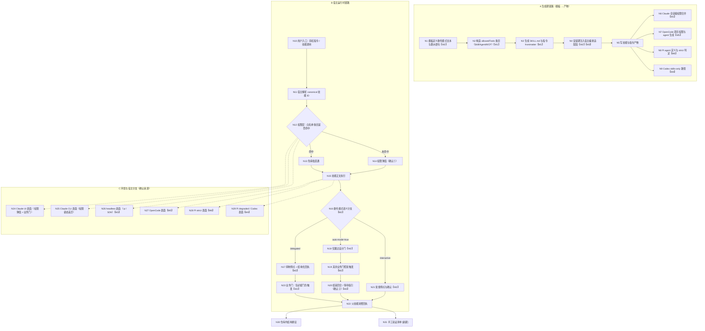

# 探索：指令委托 mode（auto-mode / delegated）× 宿主 × 运行环境的确认行为一致性

- **探索文件**：`openspec/explorations/mode-delegation-host-parity-explore-001.md`
- **创建时间**：2026-11-01
- **关键词**：`mode-delegation-host-parity`
- **当前状态**：**已完成（flow_baseline=confirmed）** —— 流程图经用户确认成为流程基准；聚合一致性门通过，探索完成检测通过

---

## Background

### 用户原始输入（逐字保留）

> 探索分析指令技中，workflow/auto-workflow/debug以及其他指令技能中，指令委托mode模式，claude code中使用时，mode=auto-mode在UI插件模式下，还是需要人工二次确认，mode=delegated可以跳过；在cli命令行模式下可以，重新检查不同agent下（claude\pi\codex\opencode），针对不同环境UI模式、cli模式下，指令调用逻辑，并对不合理设计进行优化

### 补充上下文（仓库事实）

- 工作目录：`D:\ai_workspace\MiAgentTools`（TypeScript + Commander + ESM 的 AI Agent 技能生成 CLI）。
- 技能模板真源：`src/core/templates/workflows/*.ts`（20 个内置配对）；生成快照 `skills/`。
- 宿主编排层：`src/core/host-orchestration/`（共享协议 + 宿主适配），项目产物生成：`opencode-v2.ts` / `pi-native.ts` / `permissions.ts`。
- 目标宿主：Claude Code、Pi、Codex（默认集）；OpenCode（opt-in，`AI_TOOLS` 中 `optIn: true`）。

---

## 提示词基线 (Prompt Baseline)

**原始提示词**：

> 探索分析指令技中，workflow/auto-workflow/debug以及其他指令技能中，指令委托mode模式，claude code中使用时，mode=auto-mode在UI插件模式下，还是需要人工二次确认，mode=delegated可以跳过；在cli命令行模式下可以，重新检查不同agent下（claude\pi\codex\opencode），针对不同环境UI模式、cli模式下，指令调用逻辑，并对不合理设计进行优化

**校验结论**：**清晰（直通）** —— 目标（检查并优化委托 mode 的调用逻辑）、对象（workflow / auto-workflow / debug 及其他指令技能的 mode 委托 + 四宿主 + UI/CLI 两环境）、范围（指令与技能模板、宿主适配、权限产物）均明确；无实质歧义。

**确认后的提示词基线**（一句话复述 + 语义边界，不增删用户意图）：

> 在本仓库中系统审计「技能间委托的 `mode` 参数」（`mode=delegated`、`auto-mode=true` 及其他取值）在 **Claude / Pi / Codex / OpenCode 四类宿主** 与 **UI（插件/IDE 等交互式界面）vs CLI（命令行）** 两类运行环境下的实际调用与确认行为，定位「为什么 `auto-mode` 在 Claude Code 的 UI 模式下仍需人工二次确认、而 `delegated` 可跳过、CLI 又表现不同」的根因，并识别同类不合理设计，给出可落地的优化方向（本次仅探索与优化方案，不实现）。

**记录的口径说明**：

- 「UI 插件模式」按用户的字面表述保留，**具体指哪个宿主界面 / 哪种插件形态在 Q1 中确认**；在确认前本文涉及处标 `[假设]`（暂按「Claude Code 的 IDE 扩展 / 桌面 UI 表面」理解）。
- 本文对宿主运行时行为（是否弹窗、弹什么窗）一律标注证据等级：`实证`（仓库内产物可证）/ `推断`（由代码与产物推理）/ `[待确认]`（需宿主实测）。

---

## 功能流程图

> **基准状态：已确认（flow_baseline=confirmed）** —— 确认来源：用户，本会话（2026-11-01）；D3 精确化一并确认。本段为 propose / verify 的**流程基准**。
> 节点粒度 = 可独立验证的操作单元；`【M#】` 标记本次拟改动点（见「改动点映射」）。后续发现遗漏节点 MUST 回到本段更新并重新确认，MUST NOT 在 tasks 中静默补节点。



### 关键操作节点清单

| 节点 | 操作 | 触发条件 | 证据位置 | 异常路径 |
| :--- | :--- | :--- | :--- | :--- |
| N1 | 【M2】模板定义委托模式文本与委派语句（`mode=delegated` / `auto-mode=true`） | 开发者修改技能模板 | `src/core/templates/workflows/auto-workflow.ts:35,60,114-116`；`workflow.ts:185,361`；`spec-propose.ts:31,231`；`spec-apply.ts:221` | 词汇漂移/语义混用 → N16 误判（F2/F12） |
| N2 | 【M1】构造 allowedTools 条目（`Skill(...)` / `Agent, Task` / MCP） | 模板工厂构造时 | `src/core/templates/tool-whitelist.ts:22-62` | 裸名与 canonical 不符 → N14 必弹（F1） |
| N3 | 【M1】生成技能 SKILL.md 与指令 frontmatter（`name: iagent-<id>`） | `init` / `update` / `generate:skills` | `src/core/command-generation/generator.ts:86-107`；`src/core/templates/registry.ts:167-171` | 白名单与技能名不一致 → N12 未命中 |
| N4 | 【M2】【M3】安装期注入宿主编排适配段（委派清单 / 阶段能力声明 / strict-degraded） | 目标宿主产物生成 | `src/core/host-orchestration/render.ts:160-177`；`actions.ts:46-65,83-95` | codex 返回 `null` 无适配段（F5）；`options` 未透传（F10） |
| N5 | 写技能与指令产物 | 同上 | `src/commands/init.ts:281-305,326-360` | 已存在且无 `--force` → 跳过，旧产物残留 |
| N6 | 【M1】Claude 会话级权限合并（`permissions.allow`） | `sessionPermissions !== false` | `src/core/permissions.ts:56-161`；`init.ts:309-321` | 非法 JSON → 保留原文件（`preserved-invalid`） |
| N7 | 【M5】OpenCode 项目权限与 agent 生成（`skill`/`subagent`/`read`/`edit`/`question`） | OpenCode 显式纳入 `tools` | `src/core/opencode-v2.ts:174-183,264-310` | `bash`/MCP 未覆盖 → N27 弹窗或失败（F6） |
| N8 | 【M6】Pi agent 定义（`tools` / `allowed_subagents`）与 strict 判定 | Pi 纳入 | `src/core/pi-native.ts:27,160-222,244-310`；`pi-runtime.ts:276-365` | `tools` 不含 gate 工具 → N28 门不可交互（F7） |
| N9 | 【M4】Codex skills-only 路径（无指令、无适配段） | Codex 纳入（默认集） | `src/core/config.ts:117-122`；`hosts.ts:139-155` | 未声明 degraded → N29 静默内联（F5） |
| N10 | 用户入口：斜杠指令或直接技能调用 | 用户发起流程 | `src/core/command-artifacts.ts:54-67`；`adapters/claude.ts:15-18` / `pi.ts:43-46` / `opencode.ts:48-51` | Codex 无指令产物 → 只能直接调用技能 |
| N11 | 宿主按 canonical 技能 ID 解析技能 | 技能加载时 | `src/core/skill-id.ts`（`deriveSkillId`）；`generator.ts:86` | 旧 `iagent_` 目录残留 → 解析失败（迁移兜底） |
| N12 | 【M1】权限层：白名单条目是否命中本次技能调用 | 每次 Skill / Agent 调用 | `src/core/permissions.ts:1-16`（授权仅当轮）；`.claude/settings.local.json:29-30`（实证按全名落盘） | 未命中 → N14（权限弹窗） |
| N13 | 命中 → 免审批直通 | N12 命中 | 同 N12 | — |
| N14 | 权限弹窗（确认①：宿主工具审批） | N12 未命中 | 同 N12 | 用户拒绝 → 技能调用失败 → N22 返回 failed 回执 |
| N15 | 技能正文执行（读 SKILL.md / 指令正文） | N13 或 N14 放行后 | `src/commands/init.ts:291-293`（注入适配段后的产物） | `spec-explore` 无 mode 契约 → 误按 interactive（F12） |
| N16 | 【M2】委托模式语义分支 | 技能被父级委派或独立调用 | `spec-propose.ts:31,41,231`；`spec-apply.ts:266-267`；`spec-explore.ts:1270-1274` | 两参数被当作等价 → N20 仍停（F2） |
| N17 | 【M2】`delegated`：抑制停点、抑制自验证、输出结构化回执 | `mode=delegated` | `spec-propose.ts:220,231` | 缺回执字段 → N22 阻塞（`transition.ts:78-81`） |
| N18 | 【M2】`auto-mode=true`：仅跳过设计确认门 | 父级已承载设计确认 | `spec-apply.ts:143,221,266-267` | 其余门/停点仍触发 → N19 |
| N19 | 【M2】其余业务门照常触发（验证 / 测试 / 编译 / 范围蔓延） | N18 之后继续执行 | `spec-apply.ts:282,365,521-522` | 门缺失 → 违反门白名单（`protocol.ts:94-130`） |
| N20 | 【M2】结束回合 / 等待指引（确认②：业务停点） | N19 命中暂停或完成分支 | `spec-apply.ts:282`；`auto-workflow.ts:104`（声称无门） | 与模板声明冲突（F8） |
| N21 | 【M2】interactive 常规停点（选择提示 / 设计门 / 结尾停点） | 默认模式 | `spec-explore.ts:26`；`spec-propose.ts:41` | — |
| N22 | 父技能消费阶段回执并决定推进/回退/停止 | 子技能返回 | `src/core/host-orchestration/protocol.ts:231-256,273-295`；`transition.ts:59-88` | 回执缺失/非法 → 禁止推进（`TRANSITION_BLOCKERS`） |
| N23 | 【M2】delegated 下必留门仍触发（提示词 / grill / 流程图 / 实现桥 / 归档桥） | 流程抵达门 | `protocol.ts:94-130`；`auto-workflow.ts:191-197` | 门被误跳 → 流程安全缺陷 |
| N24 | Claude UI 表面：权限弹窗可见 + 业务门对话框 | 宿主=claude，surface=UI | `hosts.ts:42-50`；`.claude/settings.local.json:29-30` | 权限弹窗与业务门叠加（H1+H2）`[待实测]` |
| N25 | Claude CLI 表面：权限姿态（default / acceptEdits / plan / bypass）决定是否弹窗 | 宿主=claude，surface=CLI | `permissions.ts:4-6`；`init.ts:309-321` | bypass 掩盖 F1（H3） |
| N26 | 【M3】headless 表面（`-p` / SDK）：无交互确认 | 宿主=claude，surface=headless | `hosts.ts:143-145`（恒 strict，无 surface 维度） | 业务门无法执行 → 伪 strict（F4） |
| N27 | 【M5】OpenCode 表面：permissions 未覆盖的动作走 ask/deny | 宿主=opencode | `opencode-v2.ts:49-64,82-92,174-183` | worker 无 `subagent` / `bash` → 批调度退化（F6） |
| N28 | 【M6】Pi strict 表面：Extension `Agent` 委派，但 agent `tools` 不含 gate 工具 | 宿主=pi，strict | `pi-native.ts:27,166-171`；`hosts.ts:73-82` | 门只能以阻塞回执上报（F7）`[待确认]` |
| N29 | 【M4】Pi degraded / Codex 表面：本地执行（不构成委派） | pi degraded 或 codex | `hosts.ts:60-69,149-153`；`config.ts:117-122` | Codex 未声明 → 静默内联（F5） |
| N30 | 【M1】仓库内结构断言（白名单形态、产物、模板文本） | CI / `pnpm test` | `test/allowed-tools.test.ts:283-318`；`test/command-reference-refs.test.ts:82-94`；`test/host-smoke.test.ts` | 测试锁死裸名 → 改动需同步（F1） |
| N31 | 【M1】手工验证清单（Claude UI / CLI 各跑一次，核对落盘规则名与弹窗来源） | 发布前人工执行 | `[新建]` 预期产物 `docs/host-permission-verification.md` | 未执行 → 权限层结论不可证 |

### 改动点映射（M1-M6）

| 改动点 | 内容 | 落点节点 | 预期产物 | 优先级 |
| :--- | :--- | :--- | :--- | :--- |
| **M1** | Skill 白名单 canonical 全名 | N2、N3、N6、N12、N14、N30、N31 | `skillDelegation()` 改 `Skill(iagent-<id>)`；测试正则放宽；手工验证清单 | P0 |
| **M2** | 委托模式双正交参数（`mode` + `gate-policy`） | N1、N4、N16-N21、N23 | 共享常量（单一源）+ 模板正文 + 宿主适配段渲染 | P0 |
| **M3** | surface 维度（UI / CLI / headless） | N4、N24、N25、N26 | `HOST_PROFILES` / `negotiateCapabilities` 增 surface；headless 显式 degraded 或门兜底 | P1 |
| **M4** | Codex 显式 degraded 档案 + 诊断 | N9、N29 | `HostId` 增 `codex`、degraded profile、`negotiationForHost` 返回协商结果、诊断输出 | P0 |
| **M5** | OpenCode 权限补齐（bash / MCP / 按需 subagent） | N7、N27 | `opencode-v2.ts` 规则与 worker agent 权限 | P1 |
| **M6** | Pi 工具与门能力对齐 | N8、N28 | `PI_AGENT_TOOLS` / agent frontmatter 与 strict 声明一致，或改声明 | P1 |

---

## 1.1.5 CONTEXT.md 启动检查（已完成）

- `openspec/CONTEXT.md` **存在**（366 行），已读取并沿用既有术语，不重新定义。
- 本次直接相关的既有术语：**提示词校验门 / 提示词基线 / 功能流程图 / 流程基准 / 门预算 / grill 批量确认 / 聚合一致性门直通 / 严格编排（strict）/ degraded 单 agent 模式 / 宿主能力协商 / 阶段回执 / 工具调用白名单 / 会话级权限载体 / OpenCode V2 项目权限 / Pi 原生委派入口 / 已授权技能直接推进 / SKILL 调用桥接 / 门白名单 / 直通句**。
- 本次拟新增术语见「术语表」段（待 grill 裁决后写入 CONTEXT.md，探索阶段不擅自改写）。

---

## 1.2.0.5 能力探索记忆注入（已完成）

**涉及能力**：`host-orchestration`、`workflow-suite-skills`、`tool-call-whitelist`、`spec-workflow-skills`、`opencode-tool-adapter`。

### Capability Exploration Memory (injected)

| 来源 | 记忆要点 | 对本次的影响 |
| :--- | :--- | :--- |
| `host-orchestration/explorations.md` | 阶段回执、条件门、Pi 嵌套委派 `allowed_subagents`、「已授权技能直接推进」；OpenCode 用 `permissions` 动作 `skill`/`subagent`；strict 缺能 MUST 阻断 | 本次的「模式语义」应与既有回执/门协议对齐，不新造第二套 |
| `workflow-suite-skills/explorations.md` | 提示词门 / 流程图门「auto 语义不得跳过」；「已授权技能直接调用」；白名单齐备性是委派的**可执行前提**（纸面成立而运行时失效） | 本次须区分「业务门」与「工具权限门」两层，auto 语义只作用于前者 |
| `tool-call-whitelist/explorations.md` | **D5 声称** `skillDelegation()` 产出「去 `iagent_` 前缀的裸名」→ 真实条目为 `Skill(tr_docs_requirement_doc)`；T5：frontmatter 授权仅覆盖当轮 | **该记忆与仓库内实证产物冲突**（见 F1），本次须复核该决策是否自始错误 |
| `spec-workflow-skills/explorations.md` | `spec-apply` 的 `auto-mode=true` 只跳过 Step 5.5；共享资源协议不豁免 | `auto-mode` 是「单门跳过」语义，不是「委派执行」语义 |
| `opencode-tool-adapter` | OpenCode 指令扁平 `iagent-<id>.md`；V2 `permissions` | 权限翻译完整性属于本次范围 |

> 未标注「已过时」的记忆按当前有效处理；`tool-call-whitelist` 的裸名结论在本次标为**待复核**（F1）。

---

## Codebase Findings

### Discovered Files

| 文件 | 相关性 |
| :--- | :--- |
| `src/core/host-orchestration/protocol.ts` | 共享协议：能力 / 阶段 / 门 / 回执 / 白名单锚点 |
| `src/core/host-orchestration/hosts.ts` | 宿主档案与能力协商（`HostId` 仅 claude/opencode/pi；codex 返回 `null`） |
| `src/core/host-orchestration/actions.ts` | `renderDelegate` / `renderLoadSkill` / 委派清单渲染 |
| `src/core/host-orchestration/render.ts` | 安装期注入「宿主编排适配」段；`ORCHESTRATING_WORKFLOW_IDS` 仅 4 项 |
| `src/core/host-orchestration/workflows.ts` | `WORKFLOW_PROTOCOLS` 阶段/门/重试；auto-workflow 复用含门阶段 |
| `src/core/host-orchestration/transition.ts` | `evaluatePhaseTransition`（能力 → 门 → 回执） |
| `src/core/templates/tool-whitelist.ts` | `skillDelegation()` 裸名条目单一源；MCP / Agent 条目 |
| `src/core/templates/registry.ts` | 指令白名单由配对技能单点回填 |
| `src/core/templates/workflows/auto-workflow.ts` | Phase 1/2 委派 `delegated`；Phase 4 `auto-mode=true` |
| `src/core/templates/workflows/workflow.ts` | 同构委派；Phase 4 `auto-mode`；Phase 3.7 实现桥 |
| `src/core/templates/workflows/debug.ts` | 委派 `spec-verify-proposal` / `proposal-review` / `requirement-doc` / `test` |
| `src/core/templates/workflows/spec-explore.ts` | 仅有 `delegated` 的检查点体系段（无 Input 模式契约） |
| `src/core/templates/workflows/spec-propose.ts` | `mode=interactive|delegated` + `exploration-file`；称 `auto-mode` 为等价别名 |
| `src/core/templates/workflows/spec-apply.ts` | `auto-mode=true` 仅跳 Step 5.5；其余停点照旧 |
| `src/commands/init.ts` / `update.ts` | 安装期按宿主注入适配段；写技能/指令/权限产物 |
| `src/core/permissions.ts` | `.claude/settings.json` 的 `permissions.allow` 非破坏合并 |
| `src/core/opencode-v2.ts` | OpenCode orchestrator / worker agent 与 `opencode.jsonc` 权限 |
| `src/core/pi-native.ts` / `pi-runtime.ts` | Pi agent 定义（`tools` / `allowed_subagents`）与 strict 判定 |
| `test/allowed-tools.test.ts` / `test/command-reference-refs.test.ts` | 白名单回归锁（含裸名假设） |
| `test/host-orchestration.test.ts` / `test/host-smoke.test.ts` | 协议与跨宿主产物断言 |
| `.claude/settings.local.json` | **实证**：Claude Code 记录的 Skill 权限条目形态 |
| `.claude/settings.json` | 会话级权限载体现状（裸名 `Skill(...)` 条目） |

### Identified Symbols

| 符号 | 位置 | 说明 |
| :--- | :--- | :--- |
| `skillDelegation` | `src/core/templates/tool-whitelist.ts:60` | 产出 `Skill(<裸名>)`，19 处模板调用 |
| `deriveCommandId` | `src/core/templates/registry.ts:75` | `iagent_spec_apply` → `spec-apply` |
| `deriveSkillId` | `src/core/skill-id.ts` | canonical 宿主技能 ID `iagent-<workflowId>`（目录名 + frontmatter `name`） |
| `negotiationForHost` | `src/core/host-orchestration/hosts.ts:139` | claude/opencode → strict；pi → strict/degraded；**codex → `null`** |
| `negotiateCapabilities` | `src/core/host-orchestration/hosts.ts:105` | 能力集合与缺失项 |
| `renderDelegate` | `src/core/host-orchestration/actions.ts:46` | Claude「经 Skill 工具委派」/ OpenCode「V2 subagent」/ Pi strict `Agent({subagent_type})` |
| `adaptSkillContentForHost` | `src/core/host-orchestration/render.ts:160` | 配置段注入；`iagent_` → `iagent-` 归一化 |
| `renderHostOrchestrationSection` | `src/core/host-orchestration/render.ts:89` | strict/degraded 说明 + 委派清单 + 阶段能力声明 |
| `ORCHESTRATING_WORKFLOW_IDS` | `src/core/host-orchestration/render.ts:14` | 仅 `workflow` / `auto-workflow` / `debug` / `migration` |
| `ORCHESTRATION_DELEGATIONS` | `src/core/host-orchestration/render.ts:22` | 各编排技能的委派目标 |
| `WORKFLOW_PROTOCOLS` | `src/core/host-orchestration/workflows.ts:141` | `auto-workflow` 复用带 `implementation-bridge` / `archive-confirmation` 的 APPLY/ARCHIVE 阶段 |
| `renderOrchestratorAgent` / `renderWorkerAgent` | `src/core/opencode-v2.ts:45` / `:78` | OpenCode 权限面：orchestrator 有 `subagent`，worker 无 |
| `PI_AGENT_TOOLS` | `src/core/pi-native.ts:27` | 仅 `read/write/edit/bash/grep/find/ls`（无 gate/question 工具） |
| `iagentPermissionRules` | `src/core/opencode-v2.ts:174` | 仅产出 `skill` / `subagent` 两类规则 |
| `buildPermissionEntries` / `mergePermissions` | `src/core/permissions.ts:56` / `:90` | 会话级 allow 合并 |
| `evaluatePhaseTransition` | `src/core/host-orchestration/transition.ts:59` | strict 缺能 / 门未确认 / 回执非法 → 阻断 |

### Pattern Matches

- **单点真源 + 生成期注入**：模板唯一源 → 宿主适配段 → 各宿主产物；权限条目共享常量（`tool-whitelist.ts`）。
- **能力协商 strict/degraded**：`HOST_PROFILES` + `negotiateCapabilities` + `renderHostOrchestrationSection`。
- **渐进披露**：主 SKILL.md 保留骨架，长协议下沉 `references/*.md`（`explore` 的 `exploration-protocol.md` 即本次执行的协议）。

---

## Analysis

### Deep Analysis Trigger

- **Triggered**：Yes —— 输入含「重新检查 / 优化 / 不合理设计」，属修改既有代码；基础扫描命中大量相关符号。
- **Scope**：`src/core/templates/workflows/*`（mode 文本与白名单）、`src/core/templates/tool-whitelist.ts`、`src/core/host-orchestration/*`、`src/core/permissions.ts`、`src/core/opencode-v2.ts`、`src/core/pi-native.ts`、`src/commands/init.ts` / `update.ts`、相关测试与文档。

### Architecture Flow（当前真实链路）

```
skills/ 模板真源 (workflows/*.ts)
  ├─ allowedTools (Skill(...) / Agent,Task / MCP) ──► SKILL.md frontmatter (Claude only)
  │                                                └─► 指令 frontmatter（配对技能回填）
  ├─ instructions ──► rewriteCommandRefs ──► adaptSkillContentForHost(宿主适配段) ──► 宿主技能
  └─ deriveCommandContent ──► 指令正文
init/update
  ├─ mergePermissions(.claude/settings.json permissions.allow)   ← Claude 会话级
  ├─ writeOpenCodeProjectArtifacts(.opencode/agents/* + opencode.jsonc permissions)
  ├─ writePiNativeAgents(.pi/agents/* : tools + allowed_subagents)
  └─ detectPiRuntime(.iagent/pi-runtime.json : strict|degraded)
```

**关键事实**：`mode` 参数（`delegated` / `auto-mode`）**只作为提示词文本存在于技能正文**，链路中没有任何代码读取、校验或转换为宿主权限/模式。

### Business Flow（用户视角的委托调用）

```
用户入口 (/iagent:auto-workflow)
  → Phase 1 委派 spec-explore (mode=delegated)
      → 宿主 Skill/Agent 调用 → 权限层（弹窗?）→ 技能正文执行 → 业务门（grill/流程图）
  → Phase 2 委派 spec-propose (mode=delegated)
  → Phase 3 验证 + 需求文档桥（业务门）
  → Phase 4 委派 spec-apply (auto-mode=true) → 设计门被跳过（业务门）
  → Phase 5 委派 spec-archive（无业务门）
```

---

## 核心发现（Findings）

> 证据等级：`实证` = 仓库产物/代码可直接证明；`推断` = 由代码与产物推理；`[待确认]` = 需宿主实测确认。

### F1｜Skill 委派白名单与 canonical 技能 ID 漂移（Claude 权限层）— 严重度 **P0**｜证据 **实证 + 推断**

- 生成侧：`skillDelegation()` 产出 `Skill(spec_apply)` 形态的**裸名**（`tool-whitelist.ts:51-62`），19 处模板引用。
- 宿主实际技能 ID：canonical kebab `iagent-spec-apply`（`skill-id.ts`；`generator.ts:86-99` 写入 frontmatter `name`；目录名同为 `iagent-<workflowId>`）。本地 `.claude/skills/` 亦为 `iagent-*`。
- **实证冲突**：`.claude/settings.local.json:29-30` 记录了 Claude Code 用户在「始终允许」后落盘的规则 —— `Skill(venus_tr_impl_review_proposal)` 与 `Skill(venus_tr_impl_review_proposal:*)`，即宿主记录的是**完整技能名**（当时的 frontmatter `name`），而非去前缀裸名。
- 结论（推断，置信度高）：`Skill(spec_apply)` **不匹配** 实际技能 `iagent-spec-apply` → 每次技能间委派都会触发宿主权限审批；这**与 `auto-mode` / `delegated` 无关**，是权限层问题。
- 回归锁反向固化：`test/command-reference-refs.test.ts:86` 的正则 `Skill\(([a-z_]+)\)` **无法匹配 kebab 名**；`test/allowed-tools.test.ts:307-309` 断言 `Skill(X)` ↔ 注册技能 `iagent_X`。两处都会阻止改为 `Skill(iagent-spec-apply)`，必须在本次一并调整。
- 历史记忆冲突：`tool-call-whitelist/explorations.md` 的 D5 断言「裸名才是真实条目」——该断言缺少实证，且与本机 `settings.local.json` 相反，需在本次复核并标注。

### F2｜`mode` 词汇双轨且语义不等价 — 严重度 **P0**｜证据 **实证**

- `mode=delegated`（explore / propose）：抑制用户选择提示、抑制自身 Phase 3 验证、**禁止输出「等待用户确认」停点**、输出结构化回执（`spec-propose.ts:31,41,220,231`）。
- `auto-mode=true`（apply）：**只跳 Step 5.5 设计确认门**（`spec-apply.ts:143,221,266-267`）；Step 7「若暂停：说明原因并等待指引」等停点照旧。
- `spec-propose.ts:31` 却把 `auto-mode=true` 声明为 `mode=delegated` 的「等价别名」——**语义不等价**：一个关停所有停点，一个只关一道门。
- 无共享常量、无默认值、无校验；`host-orchestration/actions.ts:15` 仅把 options 当作自由字符串。

### F3｜`mode` 只作用于「业务门」，无法影响「宿主权限门」 — 严重度 **P0**｜证据 **实证**

- 宿主权限弹窗由 `allowed-tools` / `permissions.allow` / OpenCode `permissions` / Pi `tools` 决定（`permissions.ts:1-16` 注释即明示「授权仅覆盖调用该轮」）。
- 业务门由技能正文的门段落决定。
- 现有设计把两者混在 `mode` 一个词里，导致用户观察到的「auto-mode 仍需确认」被误归因为模式语义。

### F4｜未建模「UI vs CLI vs headless」运行环境轴 — 严重度 **P1**｜证据 **推断 + [待确认]**

- `HOST_PROFILES.claude` 恒为 strict、含 `gate` 能力（`hosts.ts:42-50`），`negotiationForHost('claude')` 恒 `strict`（`:143-145`）。
- 但 headless（`claude -p` / SDK）无交互式确认；IDE/桌面 UI 有权限对话框；终端 CLI 视权限姿态（default / acceptEdits / plan / bypassPermissions）而不同。
- 现档案无法表达「同一宿主、不同表面 → 门可用性不同」，strict 断言可能失真。

### F5｜Codex 默认安装却无编排适配（静默降级为「无机制」）— 严重度 **P0**｜证据 **实证**

- `AI_TOOLS` 默认集含 codex（`config.ts:117-122`，`project-config.ts:108`）。
- `negotiationForHost` 对 codex 返回 `null`（`hosts.ts:139-155`）→ **不注入宿主编排段、不声明 degraded**。
- 但编排技能正文仍写「SHALL 委派阶段 `iagent-spec-explore`，MUST NOT 内联执行」——在 Codex 中既无 Skill 也无子代理机制，模型只能违规内联或不执行，且**没有任何告警**。违反「MUST NOT 把本地执行伪装为委派完成」。
- `HOST_PROFILES` 的 `HostId` 甚至不含 `codex`。

### F6｜OpenCode 权限翻译不完整（bash / MCP / 嵌套委派缺失）— 严重度 **P1**｜证据 **实证（产物生成逻辑）**

- orchestrator agent：`read *` / `edit *` / `question *` / `skill iagent-*` / `subagent iagent-*`（`opencode-v2.ts:49-64`）——**无 `bash`、无 MCP**；而技能正文大量依赖 `Bash(iagent:*)`、`codegraph` CLI/MCP。
- worker agent：仅 `read *` / `edit *` / `skill iagent-<self>`（`:82-92`）——**无 `subagent`**。而 `spec-apply` 自身委派 `test`（`Skill(test)`）并派发子代理执行批次；作为 worker 运行时既不能加载 `iagent-test` 也不能派发子代理。
- Claude 的 `allowedTools` 有完整 `Bash(...)` / MCP / Agent 面，OpenCode 侧只映射了 skill/subagent/read/edit/question → **同一技能在不同宿主产生不同确认/失败行为**。

### F7｜Pi strict 声称 `gate` / `receipt` / `state` 能力，但生成物未接线 — 严重度 **P1**｜证据 **推断 + [待确认]**

- `PI_STRICT_PROFILE` 声称具备六项能力（`hosts.ts:73-82`），`pi-runtime.ts` 仅在「包已装 + 版本兼容 + agent 可解析」时判 strict。
- 但 `.pi/agents/*.md` 的 `tools:` 固定为 `PI_AGENT_TOOLS` 七个内置名（`pi-native.ts:27,166,197`），**不含扩展提供的 workflow / gate 工具**；若上游 `tools` 是白名单（按 `prompt_mode`/`allowed_subagents` 的既有约定推断），则 strict 声称的门控能力在 agent 内不可用。
- 阶段 worker 与 orchestrator 同一工具集，均无提问/门控工具 → 门只能以「阻塞回执」形式上报，而非交互式确认。`[待确认]`：`@tintinweb/pi-subagents` 的 `tools` 语义与扩展工具注入规则。

### F8｜协议模型与模板文本互相矛盾（auto-workflow 的门）— 严重度 **P1**｜证据 **实证**

- `WORKFLOW_PROTOCOLS['auto-workflow']` 复用 `APPLY_PHASE`（`implementation-bridge` 阻塞门）与 `ARCHIVE_PHASE`（`archive-confirmation` 阻塞门），且 `VERIFY_PHASE` 无文档桥门（`workflows.ts:63-82,146-149`）。
- 但 `auto-workflow.ts:104` 明写「Phase 4 无其他用户确认」、`:158` 明写「Phase 5 无额外用户确认」，Phase 3 唯一阻塞门是**需求文档桥**（`:88`）。
- 即：协议表会要求 auto-workflow 在两个模板明确「无门」的阶段等门确认 —— 属模型/实现与文本的双源漂移（当前 `evaluatePhaseTransition` 仅测试使用，尚未暴露为运行时缺陷，但会误导后续实现与验证）。

### F9｜`ORCHESTRATING_WORKFLOW_IDS` 只覆盖 4 个技能，而实际委派者更多 — 严重度 **P2**｜证据 **实证**

- 仅 `workflow` / `auto-workflow` / `debug` / `migration` 注入宿主编排段（`render.ts:14-19`）。
- 实际还有：`spec-apply → test`、`spec-archive → requirement-doc`、`spec-propose → verify-proposal`、`spec-bulk-archive → verify`、`project-init → feature-doc` 等（`allowed-tools.test.ts:288-298` 的委派技能清单）。
- 这些技能的产物没有宿主原生委派说明，正文仍用「经 Skill 工具」以外的中性表述 → 各宿主行为不一致。

### F10｜`renderDelegate` 丢弃 `options`（mode 不下传到宿主委派清单）— 严重度 **P2**｜证据 **实证**

- `DelegateAction.options` 存在（`actions.ts:15`），但 `renderDelegationList` 只传 `{ workflowId }`（`:93`），生成的「阶段委派（宿主原生）」清单**不含 `mode=delegated` / `auto-mode=true`**。
- 与正文里的「传 mode=...」形成第二处口径，模型可能漏传。

### F11｜`mode` 词汇与宿主原生 `mode` 字段冲突 — 严重度 **P2**｜证据 **实证**

- OpenCode agent frontmatter 的 `mode: primary|subagent`（`opencode-v2.ts:48,81`）是真实字段；Claude Code 有 permission mode（default/plan/acceptEdits/bypassPermissions）。
- 技能正文的 `mode=delegated` 与二者同形不同义 → 跨宿主易被误解析/误执行；`auto-mode` 更易被理解为「宿主的自动接受模式」。

### F12｜`spec-explore` 缺少 `mode` 输入契约 — 严重度 **P2**｜证据 **实证**

- `spec-explore` 的 `**Input**`（`spec-explore.ts:26`）未声明 `mode`；仅在 `:1272-1274` 的 delegated 段提到「编排器传入 `mode=delegated`」。
- 而 `spec-propose` 在 Input 中完整声明 `mode=interactive|delegated` + `exploration-file`。
- 同一条委托链上两个被委派技能的模式契约粒度不一致。

---

## 现状矩阵：委托模式 × 宿主 × 运行环境

### 宿主机制

| 维度 | Claude Code | OpenCode（V2） | Pi strict | Pi degraded | Codex |
| :--- | :--- | :--- | :--- | :--- | :--- |
| 指令入口 | `/iagent:<id>`（`.claude/commands/iagent/`） | `/iagent-<id>`（扁平） | `/iagent-<id>`（`.pi/prompts/`） | 同左 | **无指令**（skills-only） |
| 技能加载 | Skill 工具（`iagent-<id>`） | `skill` 工具 | `/skill:` 或读 SKILL.md | 读 SKILL.md | 读 SKILL.md `[推断]` |
| 阶段委派 | Skill / Agent 子代理（`renderDelegate` 选 Skill） | `subagent` 启动项目 agent | `Agent({subagent_type})` | 本地执行（不构成委派） | **无** |
| 权限载体 | `allowed-tools` + `.claude/settings.json` allow | `.opencode/opencode.jsonc` `permissions` | `.pi/settings.json` defaultTools / agent `tools` | 同左 | 无 |
| `mode` 参数传递 | 提示词文本 | 提示词文本（与 `mode:` 字段同形） | 提示词文本 | 提示词文本 | 提示词文本 |
| 门能否交互 | 能（AskUserQuestion / 权限对话） | 能（question 动作） | **不确定**（`tools` 未含 gate 工具） | 否 | 否 |
| 实际「二次确认」来源 | ① 宿主工具权限弹窗 ② 业务门 | ① permissions 未覆盖的动作 ② 业务门 | ① 工具白名单 ② 回执 | 业务门（本地串行） | 业务门（本地串行） |

### 模式语义（模板层）

| 参数 | 出现处 | 已声明的效果 | 未声明的效果（实际仍发生） |
| :--- | :--- | :--- | :--- |
| `mode=delegated` | `workflow.ts:185,322`、`auto-workflow.ts:35,60`、`spec-propose.ts:31,41,220,231`、`spec-explore.ts:1272` | 跳过 Step 0 选择、抑制自身 Phase 3、抑制结尾停点、结构化回执、强制检查点体系 | `spec-explore` 无 Input 契约；无宿主权限效果 |
| `auto-mode=true` | `workflow.ts:361`、`auto-workflow.ts:104,114,116,122`、`spec-apply.ts:143,221,266-267` | 仅跳过 Step 5.5 设计门 | 不抑制结尾停点；不抑制暂停等待；不产生回执；无宿主权限效果 |

---

## 症状归因（分层假设）

> 用户观察：Claude Code「UI 插件模式」下 `auto-mode` 仍需人工二次确认；`delegated` 可跳过；CLI 下可以。

| 假设 | 内容 | 证据 | 置信度 | 判决性验证 |
| :--- | :--- | :--- | :--- | :--- |
| **H1（主因）** | 现象不是模式语义造成，而是 **Skill 工具权限条目名漂移**：`Skill(spec_apply)` ≠ `iagent-spec-apply` → 任何技能委派都弹权限窗；delegated 路径可能因走子代理（Agent 已放行）而不弹 | `settings.local.json:29-30` + `tool-whitelist.ts:51-62` + `skill-id.ts` | 高（实证 + 推断） | 在 Claude Code 中手动批准一次 Skill 调用，检查 `settings.local.json` 新写入的规则名；或直接改为 `Skill(iagent-spec-apply)` 后复测 |
| **H2** | `auto-mode` 只关一道业务门、不关「结束回合/等待继续」，UI 下表现为仍需点一次；`delegated` 明文禁止停点 | `spec-apply.ts:266-267` vs `spec-propose.ts:231` | 中高 | 观察弹窗文案：权限对话框 vs 「是否继续/确认」业务提问 |
| **H3** | CLI 与 UI 的**权限姿态**不同（CLI 可能 bypass/acceptEdits 或已累积 allow），与 mode 无关 | 无仓库证据 | 中 | 在两环境分别执行同一入口，记录是否出现「工具权限」弹窗 |
| **H4** | 其他宿主（OpenCode/Pi/Codex）另有独立的权限翻译缺口（F5/F6/F7），本次一并纳入 | 见 F5-F7 | 高（代码） | 生成产物审阅 + 宿主实测 |

**结论方向**：`mode` 的语义缺陷（F2/F3）与权限层缺陷（F1/F5/F6/F7）是**两个正交问题**；用户的现象很可能由 H1 主导、H2 放大。优化必须分层修复，不能只改 mode 文本。

---

## Questions（grill L1-L5 批量门 —— 已确认，门已关闭）

> 用户已于本轮对 L1-L5 全部问题给出裁决（**全部按 AI 推荐**）。以下选项保留作审计痕迹；**裁决以下表为准**，具体落地见「Decisions」段的 D1-D12。

| # | 层级 | 裁决 | 要点 |
| :-- | :-- | :-- | :-- |
| Q1 | L1 症状定位 | **C** | 权限弹窗 + 业务门并存；**优先消除权限弹窗**，业务门只保留必留 5 类 |
| Q2 | L2 白名单命名 | **A** | `skillDelegation()` 改 canonical 全名 `Skill(iagent-<workflowId>)`；同步测试正则与文档；附宿主实测验收 |
| Q3 | L2 mode 语义 | **B** | 双正交参数：`mode`（执行归属）+ `gate-policy`（门承载）；映射细节见 D3 精确化 |
| Q4 | L3 宿主覆盖 | **A** | 四宿主全覆盖；Codex 至少显式 degraded + 诊断 |
| Q5 | L4 兼容性 | **A** | 保留 `auto-mode` 原名与原语义；新增 `delegated` 语义；文档明确不可互换；**minor** |
| Q6 | L5 验收 | **A** | 结构断言 + Claude UI/CLI 手工清单（可选叠加权限诊断子命令） |
| Q7 | L5 headless | **A** | 能力协商增加 `surface` 维度；无交互表面显式 degraded 或门兜底 |

### Q1（L1 意图 / 症状定位）

你说的「UI 插件模式下仍需人工二次确认」中的确认，具体是哪种？

- **A. 宿主工具权限弹窗**（如「是否允许使用 Skill / 运行命令」的批准框）
- **B. 业务确认门**（如设计蓝图确认、`WAIT for user`、阶段间「是否继续」）
- **C. 两者都有，希望除「业务必留门」外都不再打断**
- **D. 不确定 / 需要我给出区分方法**

**AI 推荐：C**（并把「区分方法 + 两环境对照验证清单」写入提案验收项）。若只能选一个，选 A（与 F1 实证最吻合）。

### Q2（L2 方案 / Skill 白名单命名）

是否将 `skillDelegation()` 从 `Skill(<裸名>)` 改为 **canonical 全名** `Skill(iagent-<workflowId>)`，并同步调整测试与文档？

- **A. 直接改**（含测试正则、AGENTS.md 与 CONTEXT 术语说明），并保留一次宿主实测作为验收
- **B. 先做一次宿主实验验证**（手动批准后读 `settings.local.json`）再决定，实验通过才改
- **C. 不改**（认为宿主实际按裸名/前缀模糊匹配）
- **D. 双写**（同时写 `Skill(iagent-<id>)` 与 `Skill(<裸名>)`，任一生效）

**AI 推荐：A（附 B 的验证作为验收步骤）**。理由：`settings.local.json:29-30` 是唯一实证，且双写会扩大授权面并保留死条目。

### Q3（L2 方案 / mode 契约）

如何统一 `mode` 语义（当前 `delegated` 与 `auto-mode` 不等价）？

- **A. 单一枚举 `mode=interactive|delegated`**，`auto-mode=true` 仅作**兼容别名**且语义完全并入 delegated（全部停点抑制 + 结构化回执）；门跳过改由父级显式 `gates-covered=<id>` 声明
- **B. 两个正交参数**：`mode=interactive|delegated`（执行归属）+ `gate-policy`（哪些门已由父级承载，如 `gate-skip=design-confirmation`）；`auto-mode` 映射为 `mode=delegated & gate-skip=design-confirmation`
- **C. 保持现状，仅文档澄清「两者不等价」**
- **D. 全部改名**（`delegated` → `phase-worker`，`auto-mode` → `skip-design-gate`），彻底避开宿主 `mode` 字段

**AI 推荐：B**（语义最清晰、彻底解决混用；改动面中等）；若希望控制改动面，**A** 是可接受的折中。

### Q4（L3 范围 / 宿主覆盖）

本轮优化范围：

- **A. 四宿主全覆盖**（Claude / Pi / OpenCode / Codex）—— 含 Codex 显式 degraded 档案、OpenCode 权限补齐、Pi 工具白名单核对
- **B. 仅 Claude（痛点宿主）+ 文档记录其余差异**
- **C. Claude + OpenCode**（两者已有原生适配代码）
- **D. Claude + 代码层最小修复，其余仅出审计报告**

**AI 推荐：A**（用户原文明确点名四宿主；且 Codex 默认安装却无适配属必修缺陷）。

### Q5（L4 一致性 / 兼容与破坏性）

`auto-mode` 语义若收紧为「等同 delegated」，会改变既有行为。是否接受？

- **A. 保持向后兼容**：保留 `auto-mode` 名称与「只跳设计门」语义，另加 `mode=delegated` 的新语义；文档明确两者不可互换（minor）
- **B. 收紧并统一**（`auto-mode` ≡ delegated），记为 BREAKING（major），`update` 升级既有产物
- **C. 新增显式参数，旧参数仅告警不改变行为（minor）**

**AI 推荐：A**（避免把用户的既有自动化管线打断；语义澄清通过新增参数完成）。

### Q6（L5 边界 / 验收方式）

如何验收「不再出现非必要二次确认」？

- **A. 仓库内结构断言 + 手工验证清单**（白名单/权限产物/模板文本可断言；Claude UI 与 CLI 各跑一次作为人工验收步骤）
- **B. 仅仓库内结构断言**（承认无法自动验证宿主弹窗）
- **C. 要求真实宿主 E2E 自动化**（本仓库无法提供）
- **D. 增加「权限诊断」CLI 子命令**（输出当前项目产物的权限条目与匹配预期）

**AI 推荐：A（+ 可选 D 作为低成本的长期诊断手段）**。

### Q7（L5 边界 / headless 与降级）

是否为 headless（`claude -p` / SDK）等无交互表面增加显式 degraded 或门策略兜底？

- **A. 是**：能力协商增加 `surface` 维度（interactive / headless），headless 下业务门改为「记录决策并继续/中止」的显式策略
- **B. 否**：本次只处理 UI 与 CLI 交互式表面
- **C. 仅在文档记录风险，不改模型**

**AI 推荐：A**（成本低、可避免「strict 假象」；若担心范围膨胀可选 C）。

---

## 术语表

| 术语 | 定义 | 避免使用 |
| :--- | :--- | :--- |
| **委托模式（delegation mode）** | 父技能向子技能传递的执行语义参数；D3 起拆为两个正交轴：`mode`（执行归属）与 `gate-policy`（门承载） | 工作模式（与宿主 permission mode 混） |
| **执行归属轴（`mode`）** | `interactive` / `delegated`：`delegated` = 抑制结尾停点、抑制被委派技能自身验证、输出结构化回执 | 审批模式、权限模式 |
| **门承载轴（`gate-policy` / `gate-skip`）** | 声明哪些业务门已由父级确认（当前唯一取值 `design-confirmation`）；`auto-mode=true` 是其兼容写法 | 跳过所有确认、auto 模式 |
| **宿主权限层（host permission layer）** | 决定单次工具调用是否需要用户批准的宿主机制：Claude `allowed-tools` / `permissions.allow`、OpenCode `permissions`、Pi `tools`、Codex 无 | 业务门、白名单（泛指） |
| **业务确认门（business gate）** | 技能正文定义的语义门（提示词门 / grill / 流程图门 / 设计门 / 实现桥 / 归档桥 / 文档桥） | 确认弹窗（混淆载体） |
| **运行表面（surface）** | 宿主暴露给用户或调用方的交互形态：交互式终端 CLI / IDE·桌面 UI / headless（`-p`、SDK） | 模式（与 mode 混） |
| **权限姿态（permission posture）** | 宿主的全局审批策略（default / acceptEdits / plan / bypassPermissions；OpenCode allow/ask） | 权限模式（与委托模式混） |
| **canonical 技能 ID** | `iagent-<workflowId>`，宿主技能目录名与 frontmatter `name` | 裸名（易与遗留别名混） |

---

## 架构决策（ADR）

_本次探索未新建独立 ADR；关键决策统一记录于 `## Decisions`（D1-D12），其中 D2 / D3 / D4 具备 ADR 级影响。_

## 边界场景

- [ ] Claude UI 中「始终允许」落盘的规则名与生成条目名不一致 → 每次都弹窗（F1）
- [ ] Claude CLI 处于 bypassPermissions → 即使条目名错误也不弹窗，掩盖缺陷（H3）
- [ ] headless `claude -p` 无 AskUserQuestion → 业务门无法执行，strict 假象（F4）
- [ ] OpenCode worker 执行 `spec-apply` → 无 `subagent` 权限，批调度退化为串行或失败（F6）
- [ ] Codex 用户安装编排技能 → 正文要求委派但无机制，静默内联（F5）
- [ ] Pi strict 但 `tools` 不含扩展 gate 工具 → 门无法交互，仅能回执阻塞（F7）
- [ ] `auto-mode=true` 但用户期望「全程无停点」→ 仍出现 Step 7 等待指引（F2）
- [ ] 父子技能都定义同名 `mode` 且含义不同 → 参数被误传/误读（F11/F12）
- [ ] `auto-workflow` 协议表要求归档桥，但模板声明自动归档 → 验证阶段误判「门未确认」（F8）

## Decision Process

### Decision: Skill 白名单条目形态（Q2）

**Options Considered**：

- Option A：`Skill(iagent-<workflowId>)` 全名
- Option B：`Skill(<裸名>)`（现状）
- Option C：双写

**Pros/Cons**：

- A：与宿主实际技能名对齐（`settings.local.json` 实证）；可维护单一真源；测试需改正则。风险：若某些宿主版本按裸名匹配则失效（未证实）。
- B：与历史记忆一致；但无实证支持，且与 canonical 重命名后的产物不符 → 高概率为死条目。
- C：容错；但授权面翻倍、保留死条目、难以审计。

**Chosen（已确认，Q2=A）**：Option A + 宿主实测验收。

### Decision: mode 语义建模（Q3）

- Option A：单一 `mode` + 门跳过参数（推荐折中）
- Option B：`mode`（执行归属）+ `gate-policy`（门承载）双正交参数（推荐）
- Option C：仅文档澄清
- Option D：全部改名

**推荐理由**：`delegated` 解决「停点/回执/自验证」，`auto-mode` 解决「某门已由父级确认」；两者正交，混为一谈正是当前缺陷根因。

**Chosen（已确认，Q3=B）**：Option B（双正交参数），并按 D3 精确化 `auto-mode` 仅映射到门承载轴。

### Decision: 宿主覆盖深度（Q4）

- Option A：四宿主全适配（含 Codex degraded 档案）
- Option B：仅 Claude
- Option C：Claude + OpenCode

**推荐理由**：Codex 在默认安装集内却完全没有编排适配，属「静默伪 strict」，与既有 spec 的硬约束冲突；只修 Claude 会把同类缺陷留在默认路径。

**Chosen（已确认，Q4=A）**：Option A（四宿主全适配，含 Codex degraded 档案）。

## Decisions

> 来源：2026-11-01 grill L1-L5 批量门（用户全部按 AI 推荐裁决）。以下为**已确认决策**，不再标 `[待确认]`。

**D1（症状分层，Q1=C）**：确认存在两类打断 —— ① 宿主工具权限弹窗（权限层）② 业务确认门（业务层）。优化目标为「除必留 5 类业务门外不再打断」，且**优先修复权限弹窗**。任何验收 MUST 能区分这两类确认（弹窗文案 / 触发来源），MUST NOT 把「业务门被跳过」当作权限问题已解决。

**D2（canonical 白名单，Q2=A）**：`skillDelegation()` 产出的条目由 `Skill(<裸名>)` 改为 `Skill(iagent-<workflowId>)`（与宿主技能目录名及 frontmatter `name` 一致）。同步调整：
- `test/command-reference-refs.test.ts:86` 的正则（现仅匹配 `[a-z_]+`，需容纳 kebab）；
- `test/allowed-tools.test.ts:283-318` 的注册校验（现按 `iagent_${name}` 拼名）；
- `AGENTS.md` 守则 2、`openspec/CONTEXT.md` 的「工具调用白名单」术语、相关能力记忆。
- **不双写**裸名条目（避免授权面翻倍与死条目残留）。
- 验收：在 Claude Code 中手动批准一次技能委派，读取 `.claude/settings.local.json` 新增规则的落盘形态，确认为 `Skill(iagent-<id>)`。
- **推翻** `openspec/specs/tool-call-whitelist/explorations.md` 的 D5「裸名才是真实条目」结论：标注「已过时（由本变更取代）」保留历史，不删除。

**D3（双正交参数，Q3=B；与 Q5=A 合并精确化）**：
- 轴一 `mode=interactive|delegated`：**执行归属**。`delegated` = 抑制结尾停点、抑制被委派技能自身验证、输出结构化回执、禁止输出「等待用户确认」。
- 轴二 `gate-policy` / `gate-skip=<gate-id>`：**门承载**。声明哪些业务门已由父级确认（当前唯一取值 `design-confirmation`）。
- **精确化（Q3×Q5 一致性裁决）**：`auto-mode=true` 仅映射到**轴二**（等价 `gate-skip=design-confirmation`），**不并入轴一**。理由：Q5 要求保留既有「只跳设计门」行为；若把 `auto-mode` 同时映射为 `mode=delegated`，会额外抑制停点、改变既有管线行为，与 Q5 的向后兼容裁决冲突。故：
  - `auto-mode=true` ≡ `gate-skip=design-confirmation`（`mode` 保持调用方原值）；
  - `mode=delegated` 与 `auto-mode=true` **不可互换**（文档明文）；
  - 组合形式 `mode=delegated + gate-skip=design-confirmation` 为**新增能力**，供新编排使用。
- `mode` 名称保留（Q5），但正文与文档 MUST 显式限定为「委托模式」，与宿主原生 `mode:` 字段（OpenCode `primary|subagent`）区分。

**D4（四宿主全覆盖，Q4=A）**：
- **Claude**：白名单 canonical 化（D2）+ 会话级权限同步 + surface 维度（D7）。
- **OpenCode**：补齐 `bash`（按技能实际命令前缀）与 MCP 权限；worker agent 按阶段实际需要授予 `subagent`（`spec-apply` 等派发型）或显式声明降级。
- **Pi**：核对 `tools` 与 strict 声称的 `gate` / `receipt` / `state` 是否一致；不一致则修正声明或修正产物，MUST NOT 保留「名义 strict」。
- **Codex**：新增 `HostId='codex'` 与显式 degraded 档案（仅 `skill-load` / `argument-passing`），`negotiationForHost('codex')` 返回协商结果而非 `null`，并在 `init` / `update` 输出诊断；编排技能正文在 Codex 下 MUST 显式声明「本地执行，不构成委派」。

**D5（向后兼容，Q5=A）**：版本按 **minor** 递增；`auto-mode` 原名与「只跳设计门」语义**不变**；`mode=delegated` 与 `gate-skip` 为增量能力；文档明确二者不可互换；既有自动化管线行为不因本次变更而改变。

**D6（验收，Q6=A）**：仓库内结构断言（白名单条目形态、宿主产物、模板 mode 段落、协议一致性）+ 手工验证清单（Claude UI 与 CLI 各跑一次，记录是否出现权限弹窗与业务门）。可选叠加「权限诊断」子命令（`[新建]`，本期可延后）。

**D7（surface 维度，Q7=A）**：能力协商增加 `surface` 维度（建议取值 `interactive-ui` / `interactive-cli` / `headless`，命名实现期定稿），`negotiateCapabilities` 依 surface 裁决 `gate` 能力可用性；headless 下 MUST NOT 声称可交互 gate，业务门按显式策略执行并记 WARN。**一致性约束（1.6.6 收窄）**：「记录决策并继续」仅适用于门白名单中 `conditional: true` 的澄清门（`requirement-clarification`）；不可豁免门（`flow-final-confirmation` / `implementation-bridge` / `archive-confirmation` / `destructive-change`）在 headless 下 MUST 以 `blocked` 回执中止并报告，MUST NOT 静默跳过。

**D8（协议与模板对齐，F8）**：`WORKFLOW_PROTOCOLS['auto-workflow']` 的 APPLY / ARCHIVE 阶段门改为「父级已承载 / 不适用」表达（条件门或 auto-workflow 专用阶段），并在 VERIFY 阶段显式声明文档桥门；MUST NOT 让协议表与模板正文互相矛盾。

**D9（委派清单一致性，F9/F10；1.6.6 收敛）**：`renderDelegationList` 透传 `options`（`mode` / `gate-skip`）。`ORCHESTRATING_WORKFLOW_IDS` 由硬编码清单改为**派生规则**：模板 `allowedTools` 含 `Skill(...)`（即存在委派动作）的技能即注入宿主适配段与委派清单；`ORCHESTRATION_DELEGATIONS` 以模板实际委派目标为单一源（当前另有 `spec-apply` / `spec-archive` / `spec-propose` / `spec-bulk-archive` / `project-init`）。扩展风险（产物增大、Pi `allowed_subagents` 授权面扩大）由提案阶段评估；若评估不通过，回退方案为「保留 4 项清单 + 在协议与文档声明边界与替代机制」，回退须在提案中显式记录理由。

**D10（被委派技能契约，F12）**：`spec-explore` 的 `**Input**` 增加 `mode=interactive|delegated` 与回执字段契约（与 `spec-propose` 对齐）；所有被委派技能统一使用同一套 mode 词汇（单一常量源）。

**D11（测试与文档同步）**：调整 `allowed-tools` / `command-reference-refs` / `host-orchestration` / `host-smoke` 断言；新增 Codex degraded 与 OpenCode 权限断言；同步 `AGENTS.md`、`openspec/CONTEXT.md`、`docs/skills-manual.md:77-92`、`docs/migration-guide.md:68,372,436`。

**D12（明确不做）**：不修改 `src/commands/generate.ts` 骨架技能的全量 `Bash` 授权（历史遗留，另行评估）；不改 `skills/` 快照的手工内容（仅经 `pnpm build && pnpm generate:skills` 重生成）；不把真实宿主 E2E 自动化纳入仓库测试。

---

## 一致性扫描（1.6.6 聚合一致性门 —— 已通过）

**扫描对象**：D1-D12 × 功能流程图 N1-N31 × Background × Pending × 能力记忆。
**结论**：**无硬冲突 → 一致性直通**（技术选型 / 依赖方向 / 约束互斥三类硬冲突均未命中）。

| 检查对 | 结论 | 说明 |
| :--- | :--- | :--- |
| D2 × D5 | 一致 | canonical 白名单是生成物命名修正，不改用户可见语义；`auto-mode` 行为不变，minor 成立 |
| D3 × D5 | 一致 | `auto-mode` 仅映射门承载轴，避免改变既有停点行为（已精确化） |
| D3 × 门白名单 | 一致 | 执行归属轴不豁免任何业务门；必留门由 `GATE_WHITELIST`（`protocol.ts:94-130`）约束 |
| D4 × 模板「MUST NOT 内联执行」 | 一致（需条件化表述） | strict 下仍禁止内联委派；Codex / Pi degraded 按显式降级路径本地执行，并 MUST 声明「不构成委派」 |
| D7 × 门白名单 | **已收窄**（原表述有歧义） | headless 的「继续」仅适用 `conditional: true` 的澄清门；不可豁免门必须 `blocked`。约束已写入 D7 |
| D8 × D5 | 一致 | `WORKFLOW_PROTOCOLS` 目前仅供测试/文档；对齐不改变运行时行为 |
| D9 × D4 | **已收敛**（原为二选一） | 改为派生规则（有委派即注入）；扩展风险与回退方案已写入 D9 |
| D10 × D3 | 一致 | `spec-explore` 补 mode 契约与 D3 词汇同源 |
| F1 × 能力记忆（裸名 D5） | 决策取代（非硬冲突） | 旧结论标「已过时（由本变更取代）」保留历史，不删除 |
| 流程图 N12 / N14 × D2 | 一致 | 权限层「未命中」路径由 canonical 条目修复，不触碰业务门 |
| 流程图 N26 × D7 | 一致 | headless 分支与 surface 维度一一对应 |
| Background（用户观察）× D1 | 一致 | 症状拆为权限层 + 业务门两层，与用户描述吻合 |
| Pending × Decisions | 一致 | 原 7 个 grill 阻塞项全部闭环；余项为宿主实测验收（非未决决策） |

**记录**：一致性直通（2 处表述收窄：D7 / D9），无需用户追加裁决。

## Scope Changes

_（无）_

## Pending

### 已解决（grill L1-L5，本轮）

- [x] Q1 症状定位 → **C**（D1）
- [x] Q2 Skill 白名单命名策略 → **A**（D2）
- [x] Q3 mode 语义建模 → **B**（D3，含 Q3×Q5 精确化）
- [x] Q4 宿主覆盖范围 → **A**（D4）
- [x] Q5 兼容性与破坏性 → **A**（D5）
- [x] Q6 验收方式 → **A**（D6）
- [x] Q7 headless / 降级策略 → **A**（D7）

### Phase 1 收尾（已完成）

- [x] `## 功能流程图`（Mermaid + 节点清单，N1-N31 + M1-M6）已产出
- [x] 1.5.5 流程最终确认门 —— 用户确认，`flow_baseline=confirmed`
- [x] 1.6.5 CONTEXT.md 收尾校验 —— 新术语已写入 `openspec/CONTEXT.md`
- [x] 1.6.6 聚合一致性门 —— 无硬冲突，一致性直通（2 处表述收窄：D7 / D9）
- [x] 1.6 探索完成检测 —— 全部强制检查点通过（见下表）

### 探索完成检测清单（1.6）

| # | 强制检查点 | 状态 | 证据 / 说明 |
| :-- | :--- | :--- | :--- |
| 1 | 探索文件创建（1.1） | ✅ | `openspec/explorations/mode-delegation-host-parity-explore-001.md` |
| 2 | 提示词校验门（1.1.2） | ✅ 直通 | 输入清晰；一句话复述基线已落盘（未触发阻塞门） |
| 3 | CONTEXT.md 启动检查（1.1.5） | ✅ | 既有术语表已加载并在收尾时同步新术语 |
| 4 | 能力记忆注入（1.2.0.5） | ✅ | `host-orchestration` / `workflow-suite-skills` / `tool-call-whitelist` / `spec-workflow-skills` / `opencode-tool-adapter` |
| 5 | CodeGraph 基础扫描（1.2.1） | ✅ | MCP `codegraph_explore` 正常返回；未降级 Glob/Grep |
| 6 | 多项目扫描（1.2.1.5） | N/A | 本次无仓库外项目路径 |
| 7 | 深度分析（1.2.2 / 1.2.3） | ✅ | 修改意图触发；架构流 / 业务流 / 影响符号已记录 |
| 8 | grill L1-L5（1.3） | ✅ | Q1-Q7 全部裁决（D1-D7） |
| 9 | 功能流程图 + 流程最终确认门（1.5.5） | ✅ | N1-N31 + M1-M6；用户确认 |
| 10 | 聚合一致性门（1.6.6） | ✅ | 无硬冲突，直通（D7 / D9 收窄） |
| 11 | 探索完成检测（1.6） | ✅ | Pending 无未决决策；余项为宿主实测验收 |

> 说明：协议编号 1.6.5 为 CONTEXT.md 检查点、1.6.6 为聚合一致性门；两项均已执行并记录。

### For Phase 2 Impact Analysis

- HIGH：`skillDelegation`（`src/core/templates/tool-whitelist.ts:60`）、`renderDelegate`（`src/core/host-orchestration/actions.ts:46`）、`negotiationForHost`（`src/core/host-orchestration/hosts.ts:139`）、`buildPermissionEntries` / `mergePermissions`（`src/core/permissions.ts:56,90`）
- HIGH：`renderOrchestratorAgent` / `renderWorkerAgent` / `iagentPermissionRules`（`src/core/opencode-v2.ts:45,78,174`）
- HIGH：`PI_AGENT_TOOLS` / `renderPiStageAgent`（`src/core/pi-native.ts:27,186`）
- MEDIUM：`WORKFLOW_PROTOCOLS`（`src/core/host-orchestration/workflows.ts:141`）、`ORCHESTRATING_WORKFLOW_IDS` / `ORCHESTRATION_DELEGATIONS`（`render.ts:14,22`）
- MEDIUM：`spec-explore.ts` / `spec-propose.ts` / `spec-apply.ts` / `auto-workflow.ts` / `workflow.ts` 的 mode 段落
- MEDIUM：`test/allowed-tools.test.ts` / `test/command-reference-refs.test.ts` / `test/host-orchestration.test.ts` / `test/host-smoke.test.ts` / `test/artifact-dataflow.test.ts`

### 验收项（宿主运行时实测，已纳入 D6 手工清单）

- [ ] Claude Code 对 `Skill(...)` 的匹配是否要求完整 `name`（`settings.local.json:29` 强烈提示是）
- [ ] Claude Code UI 扩展与 CLI 的 Skill 工具审批默认行为是否不同
- [ ] `@tintinweb/pi-subagents` 的 `tools:` 是否排除扩展注入的 gate/workflow 工具
- [ ] OpenCode `permissions` 中 `bash` / MCP 的缺省行为（ask 或 deny）
- [ ] Codex 是否支持任何形式的技能间委派

---

## 需求文档状态

- requirementDocStatus: generated
- docPath: `openspec/changes/fix-mode-delegation-host-parity/需求文档.md`
- 更新时间: 2026-11-01（Phase 3 需求文档桥，用户选择「生成」）
