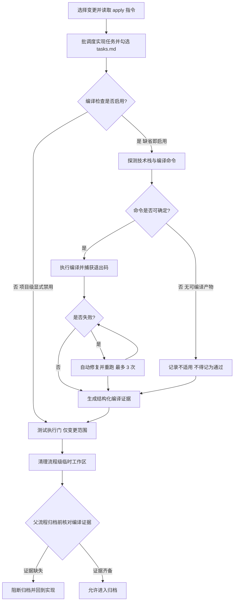
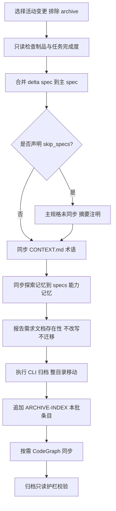

## Context

### 现状事实（已核实，非推测）

| 事实 | 证据 |
| :--- | :--- |
| Step 8 标「⚠️ 强制」但提供三条退出通道 | `src/core/templates/workflows/spec-apply.ts:292`（标强制）、`:304`（未探测到技术栈 → 告警并跳过）、`:342-346`（8.9 `[3] 跳过并记录警告`）、`:472`（Output「跳过检查并归档」） |
| 配置读的是 `openspec/config.yaml`，且该文件无 `compileCheck` 段 | `spec-apply.ts:297`；`openspec/config.yaml:1` 仅 `schema: spec-driven` |
| 缺省语义两处矛盾 | `spec-apply.ts:298` 隐含默认启用；`debug.ts:400`「未启用（默认禁用）」 |
| 8.3 依赖不存在的字段 | `spec-apply.ts:307` 解析 `allowedEditRoots`；`getApplyInstructions`（`src/commands/spec.ts:675-686`）返回 `changeName` / `changeRoot` / `contextFiles` / `progress` / `taskList` / `instruction`，**无该字段** |
| 8.4 固化本项目命令 | `spec-apply.ts:311-319`；本仓库实际构建为 `node build.js`（内部调 tsc） |
| `apply.incrementalCheck` 有配置无步骤 | `spec-apply.ts:46-50` 声明；Step 8 无任何批后检查子步骤 |
| 父流程就绪条件无可校验证据 | `workflow.ts:398`、`auto-workflow.ts:164-176`「编译检查通过」 |
| 归档侧写入 6 处 | `spec-archive.ts:166-212`（4.8 就地增量对齐 / 历史兼容生成）、`:228-240`（Step 6 迁出 `devdocs/`）；`spec-bulk-archive.ts:203-214`（a.6）、`:226-246`（b.5 需求文档迁移）、`:342-345`（10.g 全量重建） |
| 归档侧无「归档只读」护栏 | `debug.ts:328` / `debug.ts:546` 有；`spec-archive.ts` / `spec-bulk-archive.ts` 无 |
| 归档类注入 `requirement-doc` | `src/core/profiles.ts:53-54`；注释 `:30-34` 记录「默认安装 9 项」 |

### 架构影响

```text
模板层（唯一源）                                 生成层                      宿主
src/core/templates/workflows/spec-apply.ts ──┐
  ├ references/compile-check.md（新增）        │
src/core/templates/workflows/workflow.ts     ─┼─► registry.ts ─► generateSkillContent ─► .claude/skills/<id>/SKILL.md
src/core/templates/workflows/auto-workflow.ts ┤                                  └► .pi / .opencode 变体
src/core/templates/workflows/spec-archive.ts  ┤
src/core/templates/workflows/spec-bulk-archive.ts ┘   command 版由 derive-command.ts 派生（CMD:SKIP 裁剪）
                          │
配置层：src/core/project-config.ts（compileCheck 单一源）─► src/commands/config.ts（show）
依赖层：src/core/profiles.ts（DEPS）─► init/update 安装集
CLI 层：src/core/spec/archive.ts（不变：状态检查 + 目录移动）
```

三条不可动摇的项目约束（决定本次改法）：**模板单一源**（command 版派生，不得双写）、**白名单走 `tool-whitelist.ts` 共享常量**、**SKILL.md ≤500 行**（按 `test/skill-size-budget.test.ts` 的 `generateSkillContent(...).split('\n').length` 口径实测：spec-apply 446 / spec-archive 423 / spec-bulk-archive 491 / workflow 480 / debug 472 —— 其中 bulk 与 workflow 余量分别仅 9 / 20 行，任何净增内容都必须先等量削减或下沉 references）。

### 流程基准引用（不重建）

探索文件的两张流程图已经用户确认，本次**引用为生成锚点**，MUST NOT 重新发明流程。以下节点映射是本设计的可核对索引。

**流程 1 — 实现后编译检查链路**



| 节点 | 落点（设计决策 / 模板位置） |
| :--- | :--- |
| N1 | 不变（Step 1-2） |
| N2 | 不变；新增批后增量检查挂载见 D4（Step 6 批循环末尾） |
| N3 | D2（`.iagent/config.yaml` 的 `enabled`，缺省 true） |
| N4 | D3（描述符探测） |
| N5 | D3（三态判定：显式 / 描述符 / 不适用） |
| N6 | D3（执行与退出码捕获，含 monorepo 逐条） |
| N7 | D1（失败判定，含超时与缺依赖） |
| N8 | D1（自动修复 ≤`maxRetries`） |
| N9 | D5（证据契约） |
| N10 | D1（`not-applicable` 终态） |
| N11 | 不变（Step 9） |
| N12 | D5（Step 10 保留证据与 handoff 包） |
| N13 | D7（父流程就绪检查） |
| N14 | D7（阻断并回实现） |

**流程边语义澄清（不新增 / 不删除节点，不改变已确认的流程基准）**：流程图是简写，按 D1 的硬门语义补足两条边的落点 ——

- **N3 判否（项目级显式禁用）**：`disabled` 同样是证据终态，必须先经 N9 落证据再进入 N11；否则父流程 N13 读不到证据会把「合法禁用」误判为 `missing` 并永久阻断归档。
- **N7 判是 → N8 重试耗尽**：仍经 N9 写入 `fail` 证据，随后**暂停并报告**；MUST NOT 继续到 N11。N11（测试执行门）只由 `pass` / `not-applicable` / `disabled` 到达。
- **N13 判定**：除「证据缺失」外，`status=fail` 与证据文件不可解析同样归入 N14（阻断并回实现），见 D7。

**流程 2 — 归档写入面链路**



| 节点 | 落点（设计决策 / 模板位置） |
| :--- | :--- |
| M1 / M2 | 不变（Step 1-3；`previewArchive` 不动） |
| M3 / M4 / M5 | 不变（4.2 合并与 `skip_specs` 冲突态） |
| M6 | D12（CONTEXT.md 保留、失败非阻断） |
| M7 | D12（能力记忆保留） |
| M8 | D9（4.8/a.6 改为只读报告） |
| M9 | 不变（Step 5 / b，整目录移动） |
| M10 | D11（纯追加，禁止重建） |
| M11 | 不变（能力探测 + 锁阶梯） |
| M12 | D8（归档只读护栏，`debug.ts:546` 措辞对齐） |

## Goals / Non-Goals

### Goals

1. 使「编译检查是否真的执行过」成为**可机器校验**的事实（证据文件），从而让「未跑即归档」在结构上不可能。
2. 让编译配置有唯一权威载体、唯一默认值来源，并与目标项目的实际构建方式解耦（不固化本仓库命令）。
3. 把归档写入面收敛为「主 spec 侧 + 索引追加」，把「归档是历史事实」从散文约束升级为结构约束。
4. 删除归档侧与提案侧重复的需求文档写入职责，消除双职责带来的语义漂移。

### Non-Goals

- 不新增 `iagent compile` CLI 子命令或编译执行器。
- 不修改 `previewArchive` / `executeArchive`（保持「状态检查 + 目录移动」）。
- 不实现 debug 的编译检查实行为（仅统一载体与缺省语义）。
- 不迁移 `openspec/config.yaml` 的历史 `compileCheck` / `apply.*` 内容（只 WARN）。
- 不改 `iagent_requirement_doc` 技能本体与提案侧文档桥。
- 不为已归档历史回填 / 修复需求文档。
- 不引入索引 / SQLite / 跨变更检索。
- 不把编译证据写入 CLI JSON 契约（证据是文件，不是 `status --json` 字段）。

## Decisions

### D1 编译检查为硬门，终态四值（Q1 / B2 / B3 / B8）

- **Options**：A 仅加强措辞；B 硬门 + 证据契约。
- **Chosen**：B。终态 `pass` / `fail` / `not-applicable` / `disabled`。
- **Rationale**：现状根因不是措辞不够强，而是**没有外部校验点**（实测已出现跳过）。删除 8.9 的 `[3]` 与 Output「跳过检查并归档」；`not-applicable` 与 `disabled` 是**非通过**终态，摘要与证据必须显式区分措辞，不得表述为「通过」。
- **B8 的解释**：Q1 已删除会话级跳过通道，故「用户显式授权跳过」不再存在；`disabled` **只能**来自配置文件 `compileCheck.enabled: false`。若用户在流程中要求跳过，技能保持 `fail` 并暂停，MUST NOT 伪造 `disabled` / `not-applicable`。
- **失败分类**：命令超时（> `timeoutMs`）与依赖未安装（`command not found` / 缺 `node_modules`）一律计 `fail` 并进入修复循环（B2 / B3）。
- **`autoFix: false` 的分支（必须显式，不得「有配置无步骤」）**：首次编译失败即记 `fail` + 证据并暂停，不进入修复循环；`maxRetries` 只约束 `autoFix: true` 时的重试次数。原 `apply.incrementalCheck` 的教训是「配置声明了但正文没实现」，本项不得复现。
- **lint / 前端校验的归属**：现状 Step 8 还含 8.5 lint（eslint / checkstyle）与 8.6 前端校验。本次把 Step 8 定义为**编译门**，二者保留为**辅助检查**：可继续执行，但结果只记 WARN 与摘要，不参与 `compileCheck` 的四值终态、不计入证据的 `errorCount`（避免把「编译通过但 lint 有告警」误判为 fail）。MUST NOT 静默删除这两步（属既有能力收缩，须在本变更中显式声明）。

### D2 配置载体 = `.iagent/config.yaml`，默认值单一源（Q2）

- **Options**：A 保持 `openspec/config.yaml`（与 OpenSpec 上下文混居）；B 迁到 `.iagent/config.yaml`（本工具配置目录）。
- **Chosen**：B（用户裁决）。
- **Rationale**：`compileCheck` 是**本工具的技能行为配置**，与本工具配置目录职责一致；`openspec/config.yaml` 承载的是 OpenSpec 制品约束。两处并存必然产生第二个真源。
- **实现**：`src/core/project-config.ts` 单点提供 `CompileCheckConfig` 接口、`DEFAULT_COMPILE_CHECK`、`parseCompileCheck(raw)`（在既有极简 YAML 子集解析器中新增段解析）、`resolveCompileCheck`（回退默认 + 非法值 WARN）、`defaultConfigFileContent()` 注释示例；`ResolvedProjectConfig` 增 `compileCheck` 字段 + `compileCheckSource`（`config` / `default`）+ `compileCheckWarnings`（逐字段回退告警，供 `config show` 输出）。**MUST NOT** 新增 writer——该段由用户编辑，`init` 只在新建项目时写入默认内容。
- **原始解析与生效值分离（类型契约）**：`ProjectConfig.compileCheck` 只承载**原始解析结果**（字段可选，缺失即 `undefined`），不得提前填默认值；`ResolvedProjectConfig.compileCheck` 才是补全默认后的完整 `CompileCheckConfig`。`compileCheckSource` 描述**段级**来源（段存在 = `config`，段缺失 = `default`）；段内单字段回退不改变段级来源，但 MUST 在 `iagent config show` 的 WARN 行中逐字段列出回退项。这样「段存在但字段非法」不会被误标为「全部来自用户配置」。
- **WARN 的可见出口**：`resolveCompileCheck` 收集的 WARN SHALL 由 `iagent config show` 输出（每行 `compileCheck: <field> 非法，已回退默认值 <value>`）；`iagent init` / `update` 不新增段写入、也不得静默吞掉解析错误 —— 至少 `config show` 是用户可核对的唯一出口。
- **技能侧取值（避免第二套默认值）**：技能 SHALL 先读 `.iagent/config.yaml` 的 `compileCheck`；**段缺失或字段缺失时，SHALL 运行 `iagent config show` 读取生效默认值**（apply 已持 `Bash(iagent:*)`），CLI 不可用时才使用本节表格的默认值并记 WARN。模板正文 MUST NOT 发明与 `DEFAULT_COMPILE_CHECK` 不同的默认值，也 MUST NOT 新增第二个字段名。
- **契约**：`enabled`(bool,true) / `command`(string,'') / `timeoutMs`(int,600000) / `incremental`(bool,true) / `autoFix`(bool,true) / `maxRetries`(int,3)。

### D3 编译命令运行时判定（Q3）

- **Chosen**：三级判定 + monorepo 归组去重。
  1. `compileCheck.command` 非空 → 直接使用；
  2. 以**变更文件最近的祖先目录**向上查找构建描述符（`package.json` 的 `scripts.build`；无 `build` 脚本而有 `tsconfig.json` → `tsc --noEmit`；lockfile 决定 `pnpm run build` / `npm run build` / `yarn build`；`pom.xml` / `build.gradle(.kts)` / `build.xml` / `go.mod` / `Cargo.toml` / `build.js`）；
  3. 均未命中 → `not-applicable`。
- **Rationale**：模板面向任意目标项目；本仓库的 `node build.js` 只能作为**一个描述符命中结果**出现，绝不能写成唯一命令。
- **monorepo**：按最近祖先描述符归组 → 去重 → 逐条执行；每条命令独立记录 `command` / `exitCode` / `scope`；任一非零即整体 `fail`。
- **禁止**把 `npm run build` 当作万能回退（无描述符即不适用）。

### D4 增量检查收敛到 `compileCheck.incremental`（Q4）

- **Chosen**：`compileCheck.incremental`（默认 `true`）为唯一开关；批后检查在 Step 6 每批任务勾选后执行「本批改动范围的编译检查」，失败即进入与收尾全量相同的修复循环；Step 8 保留收尾全量检查。
- **增量检查的命令来源（补齐可实施性）**：不新增第二个命令字段。增量检查 SHALL **复用收尾全量所用的同一条命令**（`compileCheck.command` 或描述符探测结果），仅把报告口径限定为「本批变更范围内的文件」；命令本身不做「轻量/全量」二分。monorepo 下仍按描述符归组逐条执行，但只对与本批改动模块相关的条目执行。这样既满足「批后尽早发现编译错误」，又不引入第二套命令真源；`incremental=false` 时只做收尾全量。
- **中途耗尽的落点**：批后增量检查在 `maxRetries` 次修复后仍失败 → 立即记 `fail` 证据并暂停（MUST NOT 继续后续批次、MUST NOT 进入测试门），与收尾全量失败同语义。
- **Rationale**：现状 `apply.incrementalCheck` 是「有配置无步骤」的脱节项，且与 `compileCheck` 同属编译语义，必须并入同一段避免两处真源。`openspec/config.yaml` 的旧字段按 D13 仅 WARN。

### D5 编译证据契约与生命周期（Q5 / N12）

- **位置**：`.openspec-tmp/pipeline-<change-name>/compile-report.md`（`path.join()`）。
- **字段**（Markdown 表格，一行一次执行；多条命令多行）：
  `change` / `command` / `exitCode` / `errorCount` / `fixedCount` / `status` / `scope` / `timestamp` / `reason`；文件级汇总见下方「汇总优先级」。
- **阶段结论**：handoff 包 `## 阶段结论`（四列 `phase` / `status` / `artifact` / `nextAllowed`）追加 `compile | <status> | <证据路径> | <nextAllowed>`；包缺失（独立调用 apply）时按协议一次性产出六节包后再追加。
- **生命周期（N12 澄清）**：Step 10 清理**只**清理临时脚本与草稿；`compile-report.md` 与 `handoff-pack.md` MUST 保留到父流程归档收尾。独立调用 apply 时保留证据并报告路径。
- **清理责任（补齐既有协议缺口）**：`.openspec-tmp/pipeline-<change-name>/` 的最终清理落在**归档收尾**——`spec-archive`（单变更）在每个变更归档成功后、`spec-bulk-archive`（批量）在每个单元成功后，清理该变更的管道工作区（`pipeline-` 与旧 `apply-` 前缀同时识别）；清理失败记 WARN、MUST NOT 阻断归档。批量中失败/跳过的变更**保留**其工作区供诊断。该行为是主规格 `spec-workflow-skills / spec-apply 派发协议与共享资源协议` 既有「流程收尾统一清理」条款的落地，MUST NOT 变成无人清理的泄漏（本变更把 apply 从清理链上摘除后，归档侧是唯一清理点）。
- **清理的执行机制（避免「写了步骤但没有权限」）**：跨平台删除经 `node -e "fs.rmSync(<path>, { recursive: true, force: true })"` 执行（与 `spec-apply` 既有 `Bash(node:*)` 同机制）。两个归档技能的 `allowedTools` 因此 SHALL 增列 `Bash(node:*)`——该条目由清理步骤真实调用支撑，属必要授权而非虚增；MUST NOT 为此新增 `Bash(rm:*)` / `Bash(rmdir:*)`（更宽的破坏面）。
- **非执行行的占位约定（机器可解析）**：`not-applicable` / `disabled` 没有真正执行命令，`command` 记 `-`、`exitCode` 记 `-`、`errorCount=0`、`fixedCount=0`、`scope` 记 `-`；`reason` 必须分别写明「未探测到可编译产物」/「项目级显式禁用」。禁止留空，禁止用 `N/A` 等自由文本变体（父流程按固定标记解析）。
- **文件级汇总的优先级**：一次变更可能多条命令。汇总行 `**summary**: status=<...>` 的取值规则为：任一命令行 `fail` → `fail`；否则全部 `pass` → `pass`；零命令执行时只能是 `not-applicable` 或 `disabled`（二者互斥，由 N3/N5 决定）。父流程 SHALL 读取 **`**summary**:` 行**（或等价的汇总字段），MUST NOT 取表格最后一行当作文件级状态。
- **Rationale**：证据若被 Step 10 一并清理，N13 的核对将永远失败或永远放行——生命周期必须与消费点匹配。

### D6 变更范围来源降级链（修复 8.3）

- **Chosen**：`tasks.md` 声明的产出与 `Spec Ref` → `git diff`（含未跟踪）→ 状态 JSON 的 `contextFiles` / `changeRoot`。
- **Rationale**：`allowedEditRoots` 从不存在，是「静默跳过」的结构性成因之一。降级必须记 WARN（「范围来源降级为 X」），使"降级"与"未评估"可区分。若三者皆不可得，则以项目根为范围执行并在证据 `scope` 字段注明 `project-root`。

### D7 父流程只读证据，不执行编译（Q5 / B8 / B9；含 auto-workflow 权限发现）

- **Chosen**：`workflow` Phase 5.1 与 `auto-workflow` Phase 4.2 / 5.1 读取证据文件；`status ∈ {pass, not-applicable, disabled}` 放行（后两者 WARN），`fail` / `missing` 阻断并回实现。
- **B8 的处置（显式跳过）**：Q1 已删除会话级跳过通道，故「用户显式授权跳过编译检查」不再存在，B8 原「记录 WARN + 阻断自动归档」失去对应路径；项目级 `compileCheck.enabled: false`（`disabled`）是项目的显式决定，按本节**放行并记 WARN**，MUST NOT 据此阻断归档，也 MUST NOT 表述为「通过」。
- **`status` 词汇消歧**：handoff 包 `## 阶段结论` 的 `compile` 行使用**编译终态四值**（`pass` / `fail` / `not-applicable` / `disabled`），与结构化回执的 `ReceiptStatus`（`ok` / `failed` / `blocked` / `incomplete`）是两套词汇；该行 MUST 显式标注 `phase=compile`，父流程 MUST NOT 把 `compile` 行按回执状态校验，也 MUST NOT 把回执 `status=ok` 当作编译通过。
- **不可解析等同缺失**：证据文件存在但无法解析出 `**summary**:`（截断 / 手工损坏 / 字段缺失）时按 `missing` 处理并阻断归档；MUST NOT 因文件存在就放行。
- **auto-workflow 权限问题的处置**：探索阶段发现其 `allowedTools` 含 `Bash(npm:*)` / `Bash(pnpm:*)` 却缺 `Bash(tsc:*)`。本次**不补**该条目——因为父流程不再执行编译，"缺权限"不再是缺陷而是与「编译单点负责」一致的结果。补它反而会鼓励父流程二次执行编译（双跑、双份证据、语义冲突）。
- **Rationale**：把「是否跑过」的判定从会话记忆移到文件系统，才能被任何会话/子代理校验。

### D8 归档写入面 + 归档只读护栏（Q6-B / Q9）

- **Chosen**：写面 = `openspec/specs/**` + `openspec/CONTEXT.md` + `ARCHIVE-INDEX.md`（追加）；`openspec/changes/**` 仅整目录移动。
- **护栏措辞**（对齐 `debug.ts:546`）：「归档只读：MUST NOT 修改 `openspec/changes/archive/` 下的既有内容——已归档变更是历史事实；整目录移动不属于改写，`ARCHIVE-INDEX.md` 的追加是显式例外」。
- **Rationale**：Q6-B 的「已归档只读」把不可逆方向锁住；Q7 的删除把「本次归档仍可写变更目录」这条余量也收掉，最终没有任何路径会改写变更目录内文件内容。

### D9 归档侧需求文档降级为只读报告（Q7）

- **Chosen**：`spec-archive` 删除 4.8 与 Step 6；`spec-bulk-archive` 删除 a.6 的写入分支与 b.5 的需求文档迁移；两者保留「存在性 + `requirementDocStatus` 读取 → 摘要报告」。
- **`requirementDocStatus` 的保留语义**：字段与四值模型保留（避免破坏 `host-orchestration` 协议与跨会话追溯），父流程仍可传；但归档**只把它当报告输入**，MUST NOT 用它触发生成 / 对齐 / 迁移。`test/host-orchestration.test.ts` 的协议断言因字段仍在而无需删除，但 archive 语义描述需更新。
- **Rationale**：生成职责 2026-10-10 已前移到提案验证后的文档桥，归档侧的写入分支成为重叠兜底；删除后「需求文档在归档阶段被改写」不再可能，`devdocs/` 也不再被归档流程写入。

### D10 DEPS 收敛 + workflow / auto-workflow 显式声明 requirement-doc（新发现）

- **Chosen**：`DEPS['spec-archive'] = ['spec-verify']`、`DEPS['spec-bulk-archive'] = ['spec-verify']`；`DEPS['workflow']` 与 `DEPS['auto-workflow']` 显式加入 `'requirement-doc'`。
- **Why 必须显式补**：现状 `workflow` / `auto-workflow` 的 `requirement-doc` 依赖是**经 `spec-archive` 传递注入**的（`profiles.ts:37-43` 注释已写明）。移除归档边的同时不补显式声明，会使两者的验证后文档桥指向未安装技能——形成死引用，违反「无条件委派 ⇒ 被委派技能必须可得」的既有原则。
- **净效果**：选择 `workflow` / `auto-workflow` / `debug` 的项目安装集**不变**；仅「选了 `spec-archive` / `spec-bulk-archive`」与「未配置（默认集）」两类项目的安装集缩小（默认 9 → 8）。这是 Q7 预期的用户可见副作用，须在 CHANGELOG 明示。

### D11 ARCHIVE-INDEX 纯追加，禁止重建（Q8 / B7）

- **Chosen**：单变更与批量归档均只追加本批条目；结构损坏 → 保留原文 + 追加最小条目 + WARN 提示人工修复。
- **Rationale**：索引是历史元数据，全量重建会丢失既有条目（10.g 的现有行为），与「归档只读」精神冲突。`ARCHIVE-INDEX.md` 的追加是对「`openspec/changes/**` 不改写」的**显式**例外（探索 L4 一致性扫描已识别该路径冲突）。

### D12 CONTEXT.md 与能力记忆保留（Q10）

- **Chosen**：`openspec/CONTEXT.md`（全局术语）与 `openspec/specs/<cap>/explorations.md`（能力记忆）仍由归档维护，失败非阻断。
- **Rationale**：两者都在「主 spec 侧」语义范围内，不属于"历史变更提案内容"；移除会切断记忆闭环（`workflow` Phase 5.3 依赖该闭环）。

### D13 旧配置来源的弃用策略

- **Chosen**：`openspec/config.yaml` 的 `compileCheck` / `apply.incrementalCheck` 只读一次并 WARN（含迁移目标字段名），不采用取值、不合并、不回退。
- **Rationale**：静默忽略会让用户以为「已禁用却仍在跑」；自动搬运会让 `openspec/config.yaml` 继续保有第二份真源。WARN + 单次提示是唯一不产生双源又能被用户看见的路径。

### D14 Step 8 细则下沉 `references/compile-check.md`（预算与渐进披露）

- **Chosen**：主 SKILL 的 Step 8 保留「门 → 判定 → 证据 → 失败处置」骨架与指针；描述符探测矩阵、命令构造细则、证据模板、monorepo 归组算法下沉到 `references/compile-check.md`（`SkillTemplate.references` 机制，与 `references/batch-scheduling.md` 同构）。
- **Rationale**：spec-apply 主文件 446 行（`generateSkillContent` 口径），Step 8 重写若不拆分会逼近 500；下沉可确保主文件留出余量（≤500 行硬预算），且 `references` 只在执行 Step 8 前按需读取。workflow（480）与 spec-bulk-archive（491）余量更小，二者以删除为主并须在改后复测行数。

### D15 debug 最小改动（范围纪律）

- **Chosen**：仅把 `debug.ts:400` 的载体与缺省语义改为「`.iagent/config.yaml` 的 `compileCheck`，缺省启用」。
- **配置字段的作用域（必须写明，避免用户误以为全局）**：`compileCheck.command` / `timeoutMs` / `maxRetries` / `autoFix` / `incremental` 在本变更中仅约束 `spec-apply` 的编译门；debug 仅共享 `enabled` 与「缺省启用」语义，仍按自身 Phase 5 的技术栈探测执行（不扩大 debug 职责）。debug 正文 MUST 用一句话声明该作用域，防止用户以为设置了 `command` 就对 debug 生效。
- **Rationale**：用户点名范围为 apply / workflow / archive；debug 仅作为矛盾证据存在，扩大改动会引入未授权行为变化。

### D16 流程图节点核对与「不静默补节点」

- 两张流程图已覆盖本次全部改动（N1-N14 / M1-M12），逐节点落点见 Context 的两张映射表。
- 未发现需要在 `tasks.md` 中静默补节点的流程缺口；若实现期发现流程遗漏，MUST 回探索阶段更新并重新确认（MUST NOT 在 tasks 中就地补）。

## 配置 schema（详细）

```yaml
# .iagent/config.yaml（新增段；缺段即全部取默认值）
compileCheck:
  enabled: true          # false = 项目级显式禁用（唯一合法的非执行终态来源）
  command: ""            # 空 = 按变更文件最近的构建描述符自动探测
  timeoutMs: 600000      # 单条命令超时（毫秒），超时计为失败
  incremental: true      # 批调度每批结束后执行批后编译检查（复用同一命令）
  autoFix: true          # 编译失败后进入自动修复循环
  maxRetries: 3          # 自动修复重试上限
```

解析契约：

| 情形 | 行为 |
| :--- | :--- |
| 段缺失 / 字段缺失 | 该字段取默认值，来源标记 `default` |
| 布尔字段非 `true`/`false` | 回退默认 + WARN（含字段名与回退值） |
| `timeoutMs` / `maxRetries` 非正整数 | 回退默认 + WARN |
| `command` 非字符串或全空白 | 视为空（自动探测）+ WARN（若原值非空） |
| 未知字段 | 忽略 + WARN（不阻断） |

单一源落点：`src/core/project-config.ts` 的 `CompileCheckConfig` / `DEFAULT_COMPILE_CHECK` / `parseCompileCheck` / `resolveCompileCheck` / `defaultConfigFileContent`；`src/commands/config.ts` 的 `runConfigShow` 只消费，不另算默认值。

## 编译证据格式（模板）

`compile-report.md`：

```markdown
| change | command | exitCode | errorCount | fixedCount | status | scope | timestamp | reason |
| --- | --- | --- | --- | --- | --- | --- | --- | --- |
| add-x | pnpm run build | 0 | 0 | 2 | pass | packages/a | 2026-11-01T10:00:00Z | - |

**summary**: status=pass, commands=1, totalErrors=0, totalFixed=2
```

handoff 包追加行：

```markdown
| compile | pass | .openspec-tmp/pipeline-add-x/compile-report.md | archive |
```

## 归档写入面矩阵（before → after）

| 目标 | 现状 | 本次 |
| :--- | :--- | :--- |
| `openspec/specs/<cap>/spec.md` | 写入（合并） | 保留 |
| `openspec/CONTEXT.md` | 写入（术语同步） | 保留 |
| `openspec/specs/<cap>/explorations.md` | 写入（能力记忆） | 保留 |
| `openspec/changes/<name>/需求文档.md` | 写入（4.8 就地增量对齐 / a.6） | **删除**（仅报告存在性） |
| `openspec/devdocs/**` | 写入（Step 6 / b.5 迁出） | **删除**（不迁出） |
| `openspec/changes/archive/ARCHIVE-INDEX.md` | 追加 + 损坏时全量重建 | **仅追加**，禁止重建 |
| `openspec/changes/<name>/**` 其余内容 | 允许被 4.8 改写 | **MUST NOT 改写**（仅整目录移动） |
| `openspec/changes/archive/**` 既有内容 | 无护栏（理论上可被改写） | **只读**（护栏） |

## Caller Updates（上游调用面）

| 符号 / 模块 | 调用方 | 需同步的动作 |
| :--- | :--- | :--- |
| `getSpecApplyChangeSkillTemplate` / `getSpecArchiveChangeSkillTemplate` / `getSpecBulkArchiveSkillTemplate` / `getAutoWorkflowSkillTemplate` / `getWorkflowSkillTemplate` | `src/core/templates/registry.ts`（单一注册点） | 正文变更后无需改注册；核对 `references` 数组与 `allowedTools` |
| 上述模板的派生 command 版 | `derive-command.ts` → `getCommandTemplates()` | 确认 `<!-- CMD:SKIP -->` 标记未遮蔽安全语句 |
| `DEPS` / `resolveWorkflows` | `src/commands/init.ts` / `update.ts` / `config.ts` | 安装集断言与提示文案 |
| `deriveOrchestrationDelegations` / `ORCHESTRATING_WORKFLOW_IDS` / `ORCHESTRATION_DELEGATIONS` | `src/commands/init.ts` / `update.ts`；`render.ts` 模块级派生 | 归档技能移除 `Skill(...)` 条目后**退出编排面**（不再注入宿主编排适配段、不生成 `allowed_subagents`）；`host-orchestration` 规格的最小覆盖清单与 `test/host-orchestration.test.ts` / `test/allowed-tools.test.ts` 的集合断言须同步 |
| `resolveCompileCheck`（新增） | `spec-apply` 正文（技能侧读取）、`runConfigShow` | 保持单点默认值 |
| `previewArchive` / `executeArchive` | `spec-archive` 正文、`iagent spec archive` | 行为不变，无需改动 |
| `requirementDocStatus` 协议 | `workflow` / `auto-workflow` / `debug` → `spec-archive` | 语义收敛为「报告输入」，非写入触发器 |

## Risks / Trade-offs

### Risks

| 编号 | 风险 | 影响 | 缓解 |
| :--- | :--- | :--- | :--- |
| R1 | 硬门给全自动管线新增暂停点 | `auto-workflow` 的「验证后全自动」在编译失败时停下 | 与测试门同构（重试 3 次后暂停）；这是把既有「失败即暂停」语义落实到可校验层面，非新增门 |
| R2 | 描述符探测在 monorepo 误判（多描述符 / 无描述符根） | 误执行或误判不适用 | 以变更文件最近祖先为准 + 去重 + 逐条记录；证据 `scope` 字段可审计；`command` 显式配置为逃生口 |
| R3 | 归档能力收缩（需求文档不再进 `devdocs/`） | 检索面变小 | 文件仍在 `archive/` 内可被 Glob/Grep 检索；`CHANGELOG` 明示；提案侧文档桥照常生成 |
| R4 | 默认安装集 9 → 8 | 存量项目 `update` 后少装 `requirement-doc` | 仅影响「未配置 workflows」与「仅选归档类」两类；`workflow` / `auto-workflow` / `debug` 显式声明后安装集不变；CHANGELOG 逐条记录 |
| R5 | `not-applicable` 被读成「换个名字的跳过」 | 语义被稀释 | 证据与摘要固定措辞「未执行编译检查（无可编译产物）」；父流程对它记 WARN 且 MUST NOT 表述为「通过」；测试断言该措辞 |
| R6 | 旧配置静默失效（用户以为禁用了） | 行为与预期不符 | D13 单次 WARN + `iagent config show` 展示生效值；文档与 CHANGELOG 说明 |
| R7 | SKILL 行数超预算 | `test/skill-size-budget.test.ts` 失败 | D14 下沉 `references/compile-check.md`；spec-bulk-archive（491）/ workflow（480）余量仅 9 / 20 行 —— 改后 MUST 复测；workflow Phase 5.1 若净增，优先把细则并入既有 `references/verification-protocol.md` 而非扩主文件 |
| R8 | `allowedTools` 与正文不一致（归档侧残留 `Skill(iagent-requirement-doc)`） | 授权面虚增 / 测试失败 | 同步改 `spec-archive.ts:14`、`spec-bulk-archive.ts:14` 并移除未用导入；同时移除 `spec-archive` 因删 Step 6 而不再使用的 `Bash(ls:*)`、增列清理所需的 `Bash(node:*)`；`test/allowed-tools.test.ts` 断言 |
| R9 | 管道工作区无人清理（apply 不再清理，归档也未新增清理） | `.openspec-tmp/pipeline-*` 永久残留，违反既有「流程收尾统一清理」条款 | D5 明确归档收尾清理点；两个归档技能各增清理步骤，失败 WARN 不阻断；独立 apply 保留证据并报告路径 |
| R10 | 归档技能退出编排面导致既有断言失败 | `ORCHESTRATING_WORKFLOW_IDS` 派生集合缩小，host-orchestration / allowed-tools 的集合回归锁失败 | 新增 `host-orchestration` delta 规格（更新最小覆盖清单），并同步测试中的委派技能集合断言 |

### Trade-offs

- **证据文件 vs 会话记忆**：多一个产物（且必须活到归档收尾，与既有「临时工作区必须清理」的直觉冲突），换来父流程可校验。代价用「清理对象 = 临时脚本与草稿」的措辞切分。
- **硬门 vs 自动化流畅度**：编译失败会打断全自动管线。选择「暂停且不可跳过」是因为可跳过的门等于没有门（现状已验证）。
- **归档严格只读 vs 文档可检索性**：`devdocs/` 汇总面消失，但历史不可变性优先；需求文档仍可被 Glob/Grep 命中。
- **默认安装集缩小 vs 零死引用**：宁可少装，也不保留「技能正文不调用但被强制安装」的条目。

## Migration

1. **配置迁移**：`.iagent/config.yaml` 缺 `compileCheck` 段者无需动作（默认启用）。若项目曾把配置写在 `openspec/config.yaml`，升级后首次执行 apply 会 WARN 并指向迁移目标；手工把该段搬到 `.iagent/config.yaml` 即可（不自动搬运）。
2. **安装集迁移**：未配置 `workflows` 的项目执行 `iagent update` 后不再安装 `requirement-doc`（8 项）。若需要该技能（手工生成需求文档），在 `workflows` 中显式加入 `requirement-doc` 或运行 `iagent config --set ...`。
3. **归档语义迁移**：已归档变更不做任何回填；存量 `openspec/devdocs/**` 保持原样（本工具 MUST NOT 删除用户数据）。
4. **技能产物刷新**：`pnpm build && pnpm generate:skills` → `iagent update` 刷新 `.claude/` / `.pi/` / `.opencode/` 产物与 `permissions.allow`（内容指纹机制保证未手改产物可安全升级）。
5. **版本**：`2.1.0 → 3.0.0`（major）。四条不兼容行为（配置载体迁移、默认安装集 9→8、归档能力收缩、编译门收紧）中，归档能力收缩属用户可见能力移除、`iagent config show` 输出属 CLI 行为变更、两个归档技能的 `allowed-tools` frontmatter 取值变更属 frontmatter 契约面变更；AGENTS.md 的版本规则把「改 CLI 行为」与「改 frontmatter 契约」列为 BREAKING，并要求「判定有歧义时取较大的递增位」。CHANGELOG 的 `### BREAKING` 小节按项目既有惯例也只出现在 major 版本（2.0.0 / 3.0.0 / 4.0.0 …），故用 major 而非 minor。
6. **回滚**：模板与配置改动均可 `git revert`；已生成的 `compile-report.md` 属临时工作区产物（不入库），无数据回滚需求；`ARCHIVE-INDEX.md` 仅追加，回滚无需修复历史。
