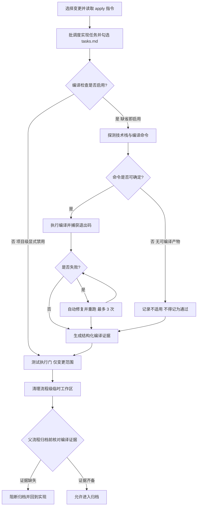
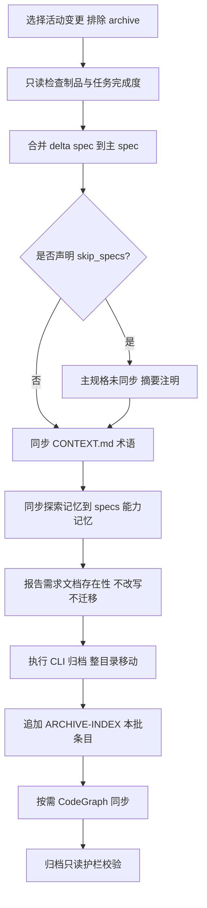

# spec-apply / auto-workflow / archive 两项优化 — 探索记录

> 主题：apply / auto-workflow / archive / bulk-archive 四条链路的「实现后编译检查强度」与「归档写入面边界」优化
> 创建时间：2026-11-01
> 模式：`mode=delegated`（由编排器 `iagent-workflow` 委派；本文件即结构化 handoff 的产物载体）
> 当前状态：**探索完成（2026-11-01 用户已确认提示词基线、功能流程图与 L1-L5 grill 裁决）**
> 退出守卫：本阶段未进入提案、未生成 `openspec/changes/**` 制品、未修改任何生产代码

---

## Background

用户原始诉求（逐字保留，见「提示词基线」）指向两条独立但同源的缺陷：

1. **实现后编译检查能力弱，或存在跳过编译检查的情况** —— 涉及 `spec-apply`（apply 指令）、`workflow`（引导式工作流）、`auto-workflow`（全自动管线）三条链路。
2. **归档时不应调整历史变更提案内容，只更新相关主 spec；已归档提案不处理** —— 涉及 `spec-archive`（归档指令）与 `spec-bulk-archive`（批量归档指令），以及底层 CLI `src/core/spec/archive.ts`。

项目背景：本仓库即 iagent 本身（TypeScript 5.9 + Commander 14 + ESM）。技能正文真源在 `src/core/templates/workflows/*.ts`，`skills/` 是生成快照（勿手编），改动后必须 `pnpm build && pnpm generate:skills`。

---

## 提示词基线 (Prompt Baseline)

**原始提示词**（逐字保留）：

```
分析项目中apply/auto-workflow/archive实现和归档指令，对功能进行一下优化；
1）apply/workflow指令功能需要优化实现后自动编译检查能力，当前存在实现后检查能力弱，或者跳过编译检查情况
2）archive归档、批量归档功能，优化调整归档时不调整历史变更提案内容，只对相关主spec提案进行更新，以归档提案不进行处理
```

**提示词校验结论**：**需要优化（轻量）** —— 目标（Goal）与对象（Object）清晰；**范围（Scope）与歧义（Ambiguity）存在实质缺口**，集中在第 2 项的「历史变更提案内容」边界与第 1 项的「编译检查强度/配置来源」。

**优化后提示词**（不篡改原意，未增加用户未提出的需求）：

```
优化四条技能链路的两个薄弱点：
1）apply / workflow / auto-workflow 的"实现后自动编译检查"：
   - 消除静默跳过（配置缺失、技术栈未探测、失败后人工选择"跳过"等路径）
   - 让编译检查产生可验证证据，供父流程在归档前核对
   [待确认] "跳过的合法情形"清单：仅项目级显式禁用 / 无可编译产物
   [待确认] 编译检查配置的权威文件与缺省值
2）archive / bulk-archive 的归档写入面：
   - 归档时不改写历史变更提案内容
   - 只更新相关主 spec（openspec/specs/**）
   - 已归档提案不进行处理
   [待确认] "历史变更提案内容"的确切边界（是否需要一并取消归档阶段的需求文档
            生成/对齐全/迁出 devdocs、以及 ARCHIVE-INDEX 的维护方式）
```

**确认后的提示词基线**：状态 `baseline-confirmed`（2026-11-01 用户确认）
—— 确认口径：以「优化后提示词」为唯一语义来源。两处 `[待确认]` 的裁决结果见「用户裁决记录」：
① 合法非通过终态 = 项目级显式禁用 / 无可编译产物（不适用）；② 配置权威文件 = `.iagent/config.yaml`（缺省启用）；
③ 编译命令按目标项目实际构建描述符运行时确定；④ 归档写入面 = Q6-B + Q7（已归档变更只读，需求文档不写入/不迁出）。

> 下游（提案 / 设计 / 规格 / 任务）以提示词基线为唯一语义来源；基线若变更 MUST 回到提示词校验门重新确认。

---

## 功能流程图

> **状态：已确认（流程最终确认门于 2026-11-01 通过）**。以下为目标流程图（含 `[新建]` 节点），覆盖两条优化链路，作为提案生成与后续验证的流程基准。
> 节点 id 全局唯一递增；图中与表中 MUST 一致。

### 流程 1 — 实现后编译检查链路（apply / workflow / auto-workflow）



### 流程 2 — 归档写入面链路（archive / bulk-archive）



### 节点清单（流程 1）

| 节点 | 操作 | 触发条件 | 证据位置 | 异常路径 |
| :--- | :--- | :--- | :--- | :--- |
| N1 | 选定变更并解析 apply 指令上下文 | 调用 apply / 父流程传入 change-name | `src/core/templates/workflows/spec-apply.ts:155`；`src/commands/spec.ts:621` `getApplyInstructions` | 变更不存在或 instruction=blocked → 停止 |
| N2 | 批调度实现任务并更新 tasks.md 勾选 | 设计确认门通过或被 `gate-skip` 跳过 | `spec-apply.ts:15` `BATCH_SCHEDULING_FULL`、`spec-apply.ts:284` | 子代理失败 → 串行重试一次 → 暂停 |
| N3 | 判定编译检查是否启用 | 全部任务完成进入 Step 8 | `spec-apply.ts:296-298`（8.1） | 配置缺失时**无缺省语义** → 当前易被跳过 |
| N4 | 探测技术栈与构建工具 | N3 判定启用 | `spec-apply.ts:300-304`（8.2） | 未探测到 → 「告警并跳过」= 静默通过风险 |
| N5 | 确定变更范围与可编译产物 | N4 完成 | `spec-apply.ts:306-309`（8.3） | 依赖**不存在的** `allowedEditRoots` 字段 |
| N6 | 执行后端编译并捕获退出码 | N5 得到可编译范围 | `spec-apply.ts:311-319`（8.4） | 失败 → N7 |
| N7 | 判定编译结果 | N6 返回 | `spec-apply.ts:319` | 失败 → N8；成功 → N9 |
| N8 | 自动修复循环（默认 ≤3 次） | N7 判失败且 `autoFix.enabled` | `spec-apply.ts:330-335`（8.7） | 3 次后仍失败 → N9 并进入 N10 分支 |
| N9 | 生成结构化编译证据（命令 / 退出码 / 错误数） | 编译结束（成功或失败） | `spec-apply.ts:337-340`（8.8）；当前**仅自由文本报告**，无机器可校验证据 | 报告缺字段 → 父流程无法核对 |
| N10 | 记录「不适用」而非「通过」 | 无可编译产物 | `[新建]` 预期产物：`spec-apply.ts` Step 8 新增「不适用」终态 + 报告字段 | — |
| N11 | 测试执行门（仅变更范围） | 编译检查结束后 | `spec-apply.ts:348-375`（Step 9） | 范围内失败 → 自动修复 ≤3 次 → 暂停 |
| N12 | 清理流程级临时工作区（**保留 `compile-report.md` 与 handoff 包**，交父流程归档收尾统一清理） | 编译门与测试门都结束（含跳过） | `spec-apply.ts:377-380`（Step 10） | 清理失败 → WARN 不阻断；证据被误删 → N13 阻断归档 |
| N13 | 父流程归档前核对编译证据 | 进入归档桥/自动归档 | `workflow.ts:395-400`（5.1 就绪检查）；`auto-workflow.ts:162-176`（Phase 5） | 证据缺失 → N14 |
| N14 | 阻断归档并回到实现 | N13 判定证据缺失 | `[新建]` 预期产物：父流程就绪检查新增「编译证据必须存在且退出码为 0 或不适用」 | — |

### 节点清单（流程 2）

| 节点 | 操作 | 触发条件 | 证据位置 | 异常路径 |
| :--- | :--- | :--- | :--- | :--- |
| M1 | 选择活动变更（排除 `archive/`） | 调用 archive / bulk-archive | `src/commands/spec.ts:439-442` `listActiveChanges` | 无活跃变更 → 停止 |
| M2 | 只读检查制品与任务完成度 | M1 完成 | `src/core/spec/archive.ts:38` `previewArchive`；`spec-archive.ts:39-64` | 制品未完成 → 仅告警不阻断 |
| M3 | 合并 delta spec 到主 spec（唯一内容性写入） | 存在 `specs/<cap>/spec.md` | `spec-archive.ts:66-91`；`spec-bulk-archive.ts:167-185` | 合并失败 → WARN 不阻断 |
| M4 | 判定 `skip_specs` 声明 | M3 前 | `spec-archive.ts:392`；`status.ts:63` | 冲突态 → 阻断 |
| M5 | 摘要注明「主规格未同步」 | M4 为是 | `spec-archive.ts:392` | — |
| M6 | 同步 CONTEXT.md 术语 | M3/M5 之后 | `spec-archive.ts:93-119`（4.5）；`spec-bulk-archive.ts:187-201`（a.5） | 失败 → WARN 不阻断 |
| M7 | 同步探索记忆到 `specs/<cap>/explorations.md` | 存在 `exploration.md` 与 delta spec | `spec-archive.ts:138-164`（4.7）；`spec-bulk-archive.ts:226-238`（b.5） | 失败 → WARN 不阻断 |
| M8 | 报告需求文档存在性（**不改写、不对齐、不迁移**） | 归档前 | `[新建]` 替代 `spec-archive.ts:166-212`（4.8）与 `spec-bulk-archive.ts:203-214`（a.6）的写入型分支 | 读取失败 → WARN 不阻断 |
| M9 | 执行 CLI 归档（整目录移动） | M8 完成 | `src/core/spec/archive.ts:63` `executeArchive`；`spec-archive.ts:215-226` | 目标已存在 → 拒绝覆盖 |
| M10 | 追加 ARCHIVE-INDEX 本批条目（**禁止全量重建**） | 归档成功 | `spec-archive.ts:262-316`；`spec-bulk-archive.ts:288-351` | 结构损坏 → 提示人工，不重建（替代 `spec-bulk-archive.ts:342-345`） |
| M11 | 按需 CodeGraph 同步（daemon 感知） | 探测可用且无 daemon | `spec-archive.ts:242-260`；`spec-bulk-archive.ts:353-373` | 失败 → WARN 不阻断 |
| M12 | 归档只读护栏校验 | 收尾 | `[新建]` 预期产物：两个归档技能新增「MUST NOT 改写 `openspec/changes/archive/**` 既有内容」护栏（对齐 `debug.ts:546`） | — |

> 确认后的流程图 = **流程基准**（独立于提案自身的交叉验证锚点）；未经用户确认的流程图 MUST NOT 作为提案的生成锚点。
> 提案 / 验证阶段发现遗漏节点 MUST 回到本步骤更新并重新确认，MUST NOT 在 tasks.md 中静默补节点。
>
> **生命周期澄清（不新增节点）**：N12 的「清理」仅指清理临时脚本与草稿；`compile-report.md` 与 `handoff-pack.md` MUST 保留到父流程归档收尾（否则 N13 无法核对证据）。独立调用 apply 时保留证据并报告路径，不做强制删除。

---

## 用户裁决记录（2026-11-01）

| 编号 | 裁决 | 对设计的影响 |
| :--- | :--- | :--- |
| 提示词基线 | 确认 | 优化后提示词作为提案唯一语义来源 |
| 流程图 | 确认 | N1-N14 / M1-M12 作为流程基准 |
| Q1 | 硬门·删除跳过项 | 删除 8.9 的 `[3]` 与 Output「跳过检查并归档」；仅「显式禁用」与「不适用」两种非通过终态 |
| Q2 | **`.iagent/config.yaml`** | 编译检查配置改为读 `.iagent/config.yaml`（缺省启用）；需扩展 `project-config.ts` 解析/默认内容；修正 debug「默认禁用」表述 |
| Q3 | **按实际项目确定** | 运行时读取目标项目构建描述符与配置，模板 MUST NOT 固化当前仓库命令；保留显式 `command` 覆盖 |
| Q4 | 默认采纳 | 补齐 `apply.incrementalCheck` 批次后轻量检查 |
| Q5 | 确认 | `compile-report.md` + handoff 包 `## 阶段结论` 的 `compile` 行 |
| Q6 | **B 折中** | 禁止改写已归档变更（`openspec/changes/archive/**` 只读）；当前变更的 4.8 对齐与 devdocs 迁出被 Q7 覆盖删除 |
| Q7 | **删除写入分支** | 归档不生成/不对齐/不迁出需求文档，仅检测存在性并报告；移除 `WORKFLOW_DEPS` 的 `spec-archive` / `spec-bulk-archive ⇒ requirement-doc`，更新 A5/A6 测试 |
| Q8-Q10 | 默认采纳 | ARCHIVE-INDEX 纯追加；补归档只读护栏；CONTEXT.md 与能力记忆仍由归档维护 |

**组合语义**：Q6-B 的「已归档变更只读」生效；B 中「本次归档变更仍允许 4.8 对齐 + 迁出 devdocs」由 Q7 的「删除写入分支」覆盖 —— 因此归档对 `需求文档.md` 不做任何写入或迁移，仅报告存在性。最终归档写入面 = `openspec/specs/**` + `openspec/CONTEXT.md` + `ARCHIVE-INDEX` 追加条目；`openspec/changes/**` 仅整目录移动。

---

## Analysis

### Security Findings

- Semgrep 不可用（未配置 MCP），本次跳过安全扫描并记录，不阻塞流程。
- 人工安全面复核：本次改动集中于技能模板正文与少量 CLI 只读路径，**不引入新的外部输入解析**；唯一涉及文件写入的收敛方向是「减少写入面」（归档侧），风险为负向（降低）。

### Architecture Flow

```text
模板层（单一源）                         生成层                    宿主
src/core/templates/workflows/spec-apply.ts ─┐
src/core/templates/workflows/workflow.ts   ─┼─► registry.ts ─► generateSkillContent ─► .claude/skills/<id>/SKILL.md
src/core/templates/workflows/auto-workflow.ts┤                                  └─► .pi / .opencode 变体
src/core/templates/workflows/spec-archive.ts┤
src/core/templates/workflows/spec-bulk-archive.ts┘
                        │ command 版 content 由 derive-command.ts 派生（CMD:SKIP 裁剪）
                        ▼
CLI 层：src/core/spec/archive.ts（previewArchive / executeArchive：只做状态检查 + 目录移动）
        src/core/spec/status.ts（getChangeStatus / parseTaskProgress）
        src/commands/spec.ts（status / archive / instructions apply）
```

### Business Flow

- **实现链路**：propose → verify →（父流程桥）→ apply（实现 + 编译检查 + 测试门）→ verify → archive。
- **编译检查的调用者有三个**：`spec-apply`（唯一正文源）、`workflow`（就绪检查引用）、`auto-workflow`（Phase 4 委派 + Phase 5 前置条件）；`debug` Phase 5 也引用同一约定。
- **归档链路**：archive 与 bulk-archive 各自持有一份「归档单元序列」；CLI 只移动目录，内容改写全部发生在技能正文描述的 AI 行为里。

### Identified Symbols

| 符号 | 位置 | 说明 |
| :--- | :--- | :--- |
| `getSpecApplyChangeSkillTemplate` | `src/core/templates/workflows/spec-apply.ts:137` | apply 正文唯一源（含 Step 8 编译检查） |
| `BATCH_SCHEDULING_FULL` | `spec-apply.ts:15` | 批调度协议（references/batch-scheduling.md） |
| `getSpecApplyChangeCommandTemplate` | `spec-apply.ts:562` | 由 instructions 派生，改正文即同步 |
| `getSpecArchiveChangeSkillTemplate` | `spec-archive.ts:10` | 单变更归档正文（4.5/4.6/4.7/4.8/5/6/6.5/7） |
| `getSpecBulkArchiveSkillTemplate` | `spec-bulk-archive.ts:10` | 批量归档正文（a/a.5/a.6/b/b.5/9/10/11） |
| `previewArchive` / `executeArchive` | `src/core/spec/archive.ts:38` / `:63` | CLI 只做状态检查 + 目录移动 |
| `getApplyInstructions` | `src/commands/spec.ts:621` | apply 上下文（contextFiles/progress/taskList/instruction） |
| `getChangeStatus` / `parseTaskProgress` | `src/core/spec/status.ts:101` / `:79` | 状态与任务进度 |
| `WORKFLOW_DEPS`（spec-archive 项） | `src/core/profiles.ts:53` | `['spec-verify', 'requirement-doc']` 注入 |

---

## Codebase Findings

### Discovered Files

- `src/core/templates/workflows/spec-apply.ts`：编译检查正文唯一源（Step 8/9），445 行快照（预算 500）。
- `src/core/templates/workflows/workflow.ts`：Phase 4.2 编译失败处理 + Phase 5.1 归档就绪检查（479 行快照，接近预算）。
- `src/core/templates/workflows/auto-workflow.ts`：Phase 4.2 编译失败处理 + Phase 5 自动归档前置（251 行）。**其 `allowedTools`（`:233`）含 `Bash(npm:*)` / `Bash(pnpm:*)` 却独缺 `Bash(tsc:*)`** —— 若它自行执行 `tsc --noEmit` 会被权限层拦截，是「编译检查被跳过」在自动管线侧的一个具体成因。
- `src/core/templates/workflows/debug.ts`：Phase 5 编译检查（**「默认禁用」的另一套缺省语义**）+ `归档只读` 护栏先例。
- `src/core/templates/workflows/spec-archive.ts`：单变更归档（含 4.8 需求文档检查点、Step 6 devdocs 迁移）。
- `src/core/templates/workflows/spec-bulk-archive.ts`：批量归档（**490 行，逼近 500 行预算**）。
- `src/core/spec/archive.ts`：归档 CLI（只做确定性操作）。
- `src/core/spec/status.ts` / `src/commands/spec.ts`：状态与 apply 指令输出的真实字段集。
- `src/core/profiles.ts`：DEPS 注入（archive ⇒ requirement-doc）。
- `openspec/config.yaml`：当前**仅** `schema: spec-driven`，无 `compileCheck` / `apply.*` 段。
- `openspec/changes/archive/ARCHIVE-INDEX.md`：单文件全局索引，含历史行（日期乱序、含空行、摘要超长）。
- `test/artifact-dataflow.test.ts`：A5/A6 锁定归档侧需求文档检查点与 DEPS 注入。
- `test/skill-size-budget.test.ts`：SKILL.md ≤ 500 行硬预算。

### Identified Symbols

- `getSpecApplyChangeSkillTemplate`（`spec-apply.ts:137`）：Step 8 的 8.1–8.9 全部跳过闸门都在此。
- `getSpecArchiveChangeSkillTemplate`（`spec-archive.ts:10`）：4.8 写入型检查点 + Step 6 迁出归档目录。
- `getSpecBulkArchiveSkillTemplate`（`spec-bulk-archive.ts:10`）：a.6 同上 + 10.g 索引重建。
- `getApplyInstructions`（`spec.ts:621`）：返回值**不含** `allowedEditRoots` / `actionContext` / `artifactPaths`。
- `getChangeStatus`（`status.ts:101`）：返回值**不含** `planningHome` / `artifactPaths` / `actionContext`。

### Pattern Matches

- **「能力探测 + 锁阶梯 + 非阻断 WARN」**：CodeGraph 段（`codegraph-protocol.ts`）—— 本次编译检查应改为相反的「硬门 + 证据」，说明同一项目内两种策略并存，需显式区分「辅助能力」与「质量门」。
- **「人工域 + 就地增量对齐」**：`requirement-doc.ts` / `debug.ts` / 归档 4.8 —— 本次若收敛归档写入面，需处理该模式的归属（挪到提案侧或保留）。
- **「归档只读」先例**：`debug.ts:328`「绝不可修改已归档目录 —— 归档是历史事实」、`debug.ts:546`「归档只读：MUST NOT 修改 `openspec/changes/archive/`」—— 两个归档技能**反而没有**这条护栏。

### Capability Exploration Memory (injected)

已注入（`openspec/specs/<capability>/explorations.md` 存在 24 份）：

- `spec-bulk-archive-skill`（87KB→8.7KB，2026-09-14 / 2026-09-30 / 2026-10-25 / 2026-10-26 四段）
  - **D5 归档单元序列**：a(合并) → a.5(CONTEXT) → b(CLI 归档) → b.5(探索记忆 + 需求文档迁移) → c。
  - **不变项（勿推翻）**：三阶段分层并行、≤3 并发、失败隔离（单变更失败不中止批次）、workspace-planning 不支持批量归档、归档目标已存在则 Failed 不覆盖。
  - **DEC-4**：CodeGraph 段为能力探测 + 锁阶梯，daemon 存活只读复用、不 sync、不 unlock。
  - **DEC-2**：批量归档不再重建索引（本次若要改 ARCHIVE-INDEX 重建，属**新增**收敛而非回退 DEC-2）。
- `spec-workflow-skills`（40KB，末两段 2026-10-26 / 2026-11-01）
  - **DEC-6**：apply 是 handoff 包协议唯一正文源；archive 只读并只追加 `## 阶段结论`。
  - **归档步骤序**：delta 合并 → CONTEXT.md → 探索记忆 → 需求文档检查点 → 目录移动 →（按需）CodeGraph；**无任何索引步骤**。
- `template-single-source` / `skill-template-language`：模板单一源 + 中文正文护栏（影响本次改法）。

---

## Questions

> 每问附 **AI 建议** 与 **默认判断**；标注「必须用户确认」的项不得由默认值直接推进。

### 批量 1 — L1 意图 / L2 方案 / L3 异常

**Q1【必须用户确认】编译检查的强制等级**
- 现状：Step 8 标 ⚠️ 强制，但 8.9 提供「[3] 跳过并记录警告」，Output 模板直接写「跳过检查并归档（记录警告）」；`auto-workflow.ts:133` 只规定「失败后暂停」，未规定「必须运行」。
- **AI 建议**：改为**硬门**——只有两种合法非通过终态：① 项目级 `compileCheck.enabled: false`（显式配置，写进摘要）；② 无可编译产物（记「不适用」，**不得**记为「通过」）。删除 8.9 的 [3] 跳过选项与 Output 的「跳过检查并归档」字样。
- **默认**：硬门 + 允许用户显式授权跳过（记录 WARN 且阻断自动归档）。

**Q2【必须用户确认】编译检查配置的权威文件与缺省值**
- 现状事实：模板读 `openspec/config.yaml` 的 `compileCheck`；该文件当前只有 `schema: spec-driven`（无该段）。`debug.ts:400` 写「未启用（默认禁用）」，而 `spec-apply.ts:298` 隐含「默认启用」——**两处缺省语义矛盾**。
- **AI 建议**：权威文件保持 `openspec/config.yaml`（OpenSpec 侧项目上下文，与 `.iagent/config.yaml` 的本工具配置职责分离），并**明写缺省 = 启用**；同步修正 debug 的「默认禁用」表述。
- **默认**：`openspec/config.yaml` + 缺省启用 + 给出最小配置样例。

**Q3【必须用户确认】编译命令的确定方式**
- 现状：8.4 硬编码命令表（TypeScript `tsc --noEmit` 或 `pnpm run build`），无「显式配置优先」入口；仓库实际构建是 `node build.js`（内部调 tsc）。
- **AI 建议**：三级回退——① `compileCheck.command`（显式）；② 构建描述符探测（`package.json` 的 `scripts.build` / `tsconfig.json` / `pom.xml` / `go.mod` / `Cargo.toml`）；③ 均无 → 「不适用」。**禁止**把 `npm run build` 当万能回退。
- **默认**：三级回退。

**Q4【可按默认推进】`apply.incrementalCheck`（批后增量检查）的去留**
- 现状：`spec-apply.ts:46-50` 声明「默认 true，每批结束后运行增量编译检查（详见 Step 8）」，但 Step 8 **没有任何增量检查子步骤** —— 配置说做了、正文没做。
- **AI 建议**：保留配置但落为真实步骤（Step 6 批后轻量类型检查，失败即进自动修复循环），并在 Step 8 保留收尾全量检查。
- **默认**：保留并补齐（用户诉求正是「检查弱」）。

**Q5【必须用户确认】父流程如何核验 apply 真的跑过编译检查**
- 现状：`workflow.ts:398` 与 `auto-workflow.ts:164` 的就绪条件写「编译检查通过」，但无任何可校验证据（只有自由文本报告）。
- **AI 建议**：定义**编译证据**单一形态——`.openspec-tmp/pipeline-<change-name>/compile-report.md`（命令 / 退出码 / 错误数 / 修复次数 / 终态）+ handoff 包 `## 阶段结论` 追加 `compile` 行；父流程就绪检查要求该证据存在，缺失视为未通过。
- **默认**：证据文件 + 阶段结论行。

**Q6【必须用户确认】归档写入面边界（核心歧义）**
- 现状：两个归档技能会写入 ①主 spec（预期）②`openspec/CONTEXT.md` ③`openspec/specs/<cap>/explorations.md` ④变更目录内 `需求文档.md`（4.8 就地增量对齐）⑤把 `需求文档.md` 从归档目录**迁出**到 `openspec/devdocs/`（Step 6 / b.5）⑥`openspec/changes/archive/ARCHIVE-INDEX.md`（含 bulk 10.g 的**全量重建**分支）。
- 选项：
  - **A（严格，贴合原文）**：只写 `openspec/specs/**`；`openspec/changes/**` 仅整目录移动，不改写任何文件内容；需求文档不生成 / 不对齐 / 不迁出；ARCHIVE-INDEX 仅追加本批条目。
  - **B（折中）**：禁止改写**已归档**变更；本次归档变更仍允许 4.8 就地对齐 + 迁出 devdocs。
  - **C（最小）**：仅禁止 ARCHIVE-INDEX 全量重建 + 补「归档只读」护栏，其余保持现状。
- **AI 建议 / 默认**：**A** —— 与用户原话「只对相关主 spec 提案进行更新，已归档提案不进行处理」一致，也与 `debug.ts:546` 既有「归档只读」原则一致。

**Q7【必须用户确认】归档阶段需求文档职责的去留（Q6 选 A 时必答）**
- 现状：4.8 / a.6 是 2026-09-30 新增、2026-10-25 改为四值状态；2026-10-10 已把「生成」前移到提案验证通过后（文档桥）→ 归档侧已成为**兜底且职责重叠**。
- **AI 建议**：删除归档侧的**生成与就地对齐**，仅保留「检测存在性 + 在摘要中报告」；同步移除 `WORKFLOW_DEPS` 中 `spec-archive ⇒ requirement-doc` 注入，并更新 `test/artifact-dataflow.test.ts` 的 A5/A6 断言。
- **默认**：删除写入型分支，保留报告；DEPS 相应收敛（**注意：会改变默认安装集，属用户可见副作用**）。

**Q8【可按默认推进】ARCHIVE-INDEX 的维护方式**
- **AI 建议**：保留索引，改为**纯追加**：仅追加本批成功归档条目；禁止 10.g 的「无法解析则重建」（改为 WARN + 提示人工）；跨平台路径用 `path.join()`。
- **默认**：纯追加、禁止重建。

**Q9【可按默认推进】是否为两个归档技能补「归档只读」护栏**
- **AI 建议**：补，措辞与 `debug.ts:546` 对齐；并明确「整目录移动」不属于「改写内容」。
- **默认**：补。

**Q10【可按默认推进】`CONTEXT.md` 与能力记忆是否仍由归档维护**
- **AI 建议**：`CONTEXT.md` 属全局术语表、`specs/<cap>/explorations.md` 属能力记忆，二者都在「主 spec 侧」语义范围内 → **保留**（若用户视其越界，Q6 选 A 时需再裁决）。
- **默认**：保留，且失败仍非阻断。

### 批量 2 — L4 一致性 / L5 边界

**L4 一致性扫描**（自动执行，无矛盾时直通）
- 已扫描 10 条决策，发现 **1 处需显式裁决的软冲突**：Q6-A「`openspec/changes/**` 不改写」与 Q8「ARCHIVE-INDEX 追加」在路径上冲突 —— 解法：将 ARCHIVE-INDEX 定性为「归档元数据索引，追加式例外」，并在护栏中显式排除该文件。其余决策与既有「不变项」（三阶段并行、≤3 并发、失败隔离、DEC-2 无索引重建）**无冲突**。

**L5 边界场景**（逐条附建议）

| # | 场景 | AI 建议 |
| :--- | :--- | :--- |
| B1 | `compileCheck` 段缺失 + 项目无任何构建文件（纯文档变更） | 记「不适用」终态，报告显式写「未执行编译检查（无可编译产物）」，**不得**记为 PASS |
| B2 | 编译命令存在但需要联网装依赖（如 `pnpm install` 未完成） | 视为**失败**并进入修复循环；MUST NOT 归类为「跳过」 |
| B3 | 编译超时 | 视为失败；给出超时上限配置项 `compileCheck.timeoutMs`（默认 10 分钟） |
| B4 | 归档时 delta spec 的 MODIFIED 在主 spec 找不到目标 | WARN + 追加为新需求并标注，或阻断？**建议**：WARN + 追加，报告列出（保持非阻断） |
| B5 | 批量归档中某变更合并主 spec 失败 | 失败隔离（既有不变项）：该变更记 Failed，其余继续 |
| B6 | 已归档变更被新变更引用（debug 3.3 场景） | 只读引用，MUST NOT 修改 |
| B7 | ARCHIVE-INDEX 结构损坏 | 不再重建：WARN + 提示人工修复 + 保留本批条目的最小追加 |
| B8 | 用户显式授权跳过编译检查 | 记录 WARN，阻断自动归档（`auto-workflow` Phase 5 不得自动进入） |
| B9 | `compile-report.md` 存在但退出码非 0 | 父流程就绪检查判失败，不得进入归档 |

---

## 术语表

| 术语 | 定义 | 避免使用 |
| :--- | :--- | :--- |
| 编译检查（compile check） | 实现完成后对变更范围执行的一次编译/类型检查，包含命令、退出码、错误数与终态 | build check、语法检查 |
| 编译证据（compile evidence） | 编译检查的可机器校验结果（`compile-report.md` + 阶段结论 `compile` 行），供父流程就绪检查消费 | 编译报告（既有自由文本 Output） |
| 不适用终态（not-applicable） | 无编译产物时的合法终态，**区别于「通过」** | 跳过、忽略 |
| 归档写入面（archive write surface） | 归档流程被允许修改的文件集合；本探索建议收敛为 `openspec/specs/**` | 归档范围 |
| 归档只读（archive read-only） | `openspec/changes/archive/**` 既有内容不得改写；整目录移动不属于改写 | 归档禁止 |
| 归档索引（ARCHIVE-INDEX） | `openspec/changes/archive/ARCHIVE-INDEX.md`，追加式元数据索引，**禁止全量重建** | 归档清单 |
| 增量编译检查（incremental check） | 批调度每批结束后执行的轻量类型检查，与收尾全量检查并列 | 批级检查 |
| 主 spec | （沿用既有术语）`openspec/specs/<capability>/spec.md`，delta spec 的合并目标 | 规格主文件 |

> 上述术语已于 2026-11-01 同步至 `openspec/CONTEXT.md` 的增补段（「主 spec」沿用既有条目，不重复定义）。

---

## 架构决策

- **ADR 提案（未创建文件）**：`ADR-0002 归档写入面收敛为「主 spec 单写入面」` — 难以逆转（改变归档语义）、脱离上下文会令人意外（需求文档迁出 devdocs 是既有功能）、是真实权衡（历史不可变性 vs 文档可检索性）。条件满足，待 Q6 裁决后创建于 `openspec/docs/adr/0002-archive-write-surface.md`。

---

## 边界场景

- [ ] B1 纯文档变更 + 无 `compileCheck` 配置 → 终态应为「不适用」
- [ ] B2 依赖未安装导致编译失败 → 计入失败而非跳过
- [ ] B3 编译超时 → 计入失败
- [ ] B6 已归档变更被引用 → 只读
- [ ] B7 ARCHIVE-INDEX 损坏 → 不重建
- [ ] B8 显式授权跳过编译 → 阻断自动归档
- [ ] B9 证据存在但退出码非 0 → 阻断归档

---

## Decision Process

### Decision: 编译检查应从「软门 + 自由文本」改为「硬门 + 结构化证据」

**Options Considered**:
- Option A：仅加强措辞（把「强制」写得更重）
- Option B：硬门 + 证据契约（阈值：存在证据文件且终态 ∈ {pass, not-applicable}）

**Pros/Cons**:
- Option A：改动最小，但无外部校验点 —— 与当前「措辞已强制却仍被跳过」的实测结果同构；**否决**。
- Option B：可被父流程机器校验，闭环；代价是新增产物（`compile-report.md`）与两处父流程就绪检查改动。

**Chosen**: Option B
**Rationale**: 现状缺陷的根因不是措辞不够强，而是**没有任何外部校验点** —— 只有把「是否执行过」变成可读证据，父流程才可能拒绝「未跑即归档」。

### Decision: 归档写入面收敛（草案，待 Q6 裁决）

**Options Considered**: A 严格 / B 折中 / C 最小（见 Q6）
**Chosen**: 暂定 A（默认），**必须用户确认**
**Rationale**: 与用户原话一致；与 `debug.ts:546` 既有原则一致；能把「归档是历史事实」从散文约束升级为结构约束。

---

## Decisions

> 以下为**已确认决策**（2026-11-01）；Q2/Q3/Q6 按用户裁决调整。

- D1（confirmed）编译检查为硬门；仅「显式禁用」与「不适用」两种非通过终态，后者不得记 PASS；删除 8.9 跳过项。—— Q1
- D2（confirmed，调整）配置权威文件 = `.iagent/config.yaml`，缺省启用；`project-config.ts` 增加 compileCheck 解析与默认内容；修正 debug 的「默认禁用」矛盾。—— Q2
- D3（confirmed，调整）编译命令按目标项目实际构建描述符运行时确定（配置 command 优先）；模板 MUST NOT 固化当前仓库命令；均无 → 不适用。—— Q3
- D4（confirmed）补齐 `apply.incrementalCheck` 的真实步骤（批后轻量类型检查）。（默认采纳）
- D5（confirmed）编译证据单一形态：`compile-report.md` + handoff 包 `## 阶段结论` 的 `compile` 行；父流程就绪检查消费之。**Step 10 清理 MUST 保留该证据与 handoff 包至父流程归档收尾**。—— Q5
- D6（confirmed，调整为 B）已归档变更只读（`openspec/changes/archive/**` 不改写）；当前变更的需求文档写入被 D7 覆盖删除。—— Q6
- D7（confirmed）归档侧删除需求文档生成/对齐/迁出；`WORKFLOW_DEPS` 移除 `spec-archive` / `spec-bulk-archive` 的 `requirement-doc` 注入；保留存在性报告；更新 A5/A6 测试。—— Q7
- D8（confirmed）ARCHIVE-INDEX 纯追加、禁止重建。（默认采纳）
- D9（confirmed）两个归档技能补「归档只读」护栏。（默认采纳）
- D10（confirmed）`CONTEXT.md` 与能力记忆保留由归档维护、失败非阻断。（默认采纳）

---

## Scope Changes

| 变更时间 | 变更类型 | 变更描述 | 原因 |
| :--- | :--- | :--- | :--- |
| 2026-11-01 | expand | 从「apply 编译检查 + 归档只读」扩展出「父流程证据闸门」（N13/N14、Q5） | 仅改 apply 正文无法阻止父流程在未跑检查时进入归档 |
| 2026-11-01 | shrink | 暂不处理 `debug` 的编译检查实行为，仅统一其缺省语义表述 | 用户点名范围为 apply / workflow / archive；debug 仅作为矛盾证据 |
| 2026-11-01 | adjust | Q2 配置载体改为 `.iagent/config.yaml`；Q6 由 A 调整为 B，并与 Q7 组合收敛需求文档写入 | 用户裁决 |

---

## Pending

### For Phase 2 Impact Analysis

- `getSpecApplyChangeSkillTemplate`（`src/core/templates/workflows/spec-apply.ts:137`）— Priority: **HIGH**（Step 8/9 全部跳过闸门所在）
- `BATCH_SCHEDULING_FULL`（`spec-apply.ts:15`）— Priority: MEDIUM（增量检查需插入批后步骤）
- `getSpecApplyChangeCommandTemplate`（`spec-apply.ts:562`）— Priority: HIGH（派生，随正文自动变化；须核对 `CMD:SKIP` 段落可见性）
- `getSpecArchiveChangeSkillTemplate`（`spec-archive.ts:10`）— Priority: **HIGH**（4.8 / Step 6 / Step 7）
- `getSpecBulkArchiveSkillTemplate`（`spec-bulk-archive.ts:10`）— Priority: **HIGH**（a.6 / b.5 / 10.g；**490 行逼近预算**）
- `getAutoWorkflowSkillTemplate`（`src/core/templates/workflows/auto-workflow.ts:16`）— Priority: HIGH（Phase 4.2 / Phase 5）
- `getWorkflowSkillTemplate`（`src/core/templates/workflows/workflow.ts:162`）— Priority: MEDIUM（Phase 4.2 / 5.1）
- `getDebugSkillTemplate`（`debug.ts:122`）— Priority: MEDIUM（仅缺省语义一行）
- `previewArchive` / `executeArchive`（`src/core/spec/archive.ts:38` / `:63`）— Priority: MEDIUM（是否需要 `--dry-run` / 只读校验）
- `getApplyInstructions`（`src/commands/spec.ts:621`）— Priority: MEDIUM（若要补编译证据字段，需改 CLI 输出契约）
- `getChangeStatus`（`src/core/spec/status.ts:101`）— Priority: LOW
- `WORKFLOW_DEPS`（`src/core/profiles.ts:53`）— Priority: HIGH（Q7 若成立会改变默认安装集）
- `test/artifact-dataflow.test.ts`（A5/A6）、`test/templates.test.ts`、`test/allowed-tools.test.ts`、`test/skill-size-budget.test.ts` — Priority: HIGH

### Security Concerns

- 无新增外部输入面；写入面收敛为负向风险。

### Business Validation

- 「不适用」终态是否会被用户理解为「换个名字的跳过」？需在报告与摘要中显式区分措辞。
- 移除归档侧需求文档生成后，未走文档桥的存量流程将不再产生需求文档 —— 属可接受的能力收缩还是必须保留？

### Unresolved Decisions

- 无业务裁决遗留。Q1-Q3 / Q5-Q7 已确认（见「用户裁决记录」）；Q4 / Q8-Q10 与 B1-B9 按默认采纳。
- 实现级细节（compileCheck 段解析、证据文件字段、模板行数预算）由 Phase 2 设计与任务拆分决定。

---

## Implementation Deep-Dive

### Design Rationale
- **归档职责切分**（HIGH，见代码注释）：`src/core/spec/archive.ts:3-5` 明确「CLI 只做确定性操作 —— 状态检查 + 目录移动；delta spec → 主 spec 的智能合并由 spec-archive 技能（AI）执行」。因此「归档改写历史」不是 CLI 行为，而是技能正文允许的 AI 行为面过宽。
- **为什么 4.8 会写入变更目录**（HIGH，见变更历史）：需求文档需要「人工域」保护，故刻意选择「就地增量对齐」而非「重新生成」，这必然写变更目录；随后 Step 6 又把它迁出归档目录 —— 两个步骤叠加使归档成为「会改写历史」的流程。

### Constraints
- **模板单一源**：command 版由 `derive-command.ts` 从 skill 正文派生；`<!-- CMD:SKIP -->` 标记决定 command 版可见性（fail-safe：未标记即进入 command 版）。
- **SKILL.md ≤ 500 行**（`test/skill-size-budget.test.ts`）：当前 `iagent-spec-bulk-archive` 490 行、`iagent-workflow` 479 行 → **任何净增内容必须先等量削减或下沉 references**。
- **改模板后必须** `pnpm build && pnpm generate:skills`（AGENTS.md 守则 1）；白名单变更须走 `tool-whitelist.ts`（守则 2）；版本号 + CHANGELOG 随功能提交（守则 8）。
- **CLI 输出契约**：`iagent spec status --json` 与 `instructions apply --json` 均**不含** `allowedEditRoots` / `actionContext` / `artifactPaths` / `planningHome`（`status.ts:33-42`、`spec.ts:621-687`）。

### Trade-offs
- 硬编译门 vs 全自动无人工：`auto-workflow` 的语义是「验证通过后全自动」，硬门会引入新的暂停点 —— 最终裁决为「失败即暂停，无会话级跳过」；仅项目级配置 `enabled:false` 可禁用（记 WARN），`disabled` 不等于通过。
- 归档严格只读 vs 需求文档可检索性：devdocs 是检索面，收敛后需求文档将留在归档目录内（可被 Glob 检索，但不在 `devdocs/` 汇总）。

### Pattern Usage
- 「非阻断辅助能力」（CodeGraph / CONTEXT.md / 探索记忆）与「阻断性质量门」（编译 / 测试）必须显式区分；当前编译门被错误地实现成了前者。

### Historical Context
- 2026-09-30 `improve-workflow-artifact-dataflow`：新增归档侧 4.8 / a.6 需求文档检查点，删除提案侧四处生成链路。
- 2026-10-10 `improve-templates-requirement-doc-timing`：又把生成前移到提案验证通过后 → 归档侧变为兜底，职责重叠。
- 2026-10-25 `improve-workflow-debug-bridges`：4.8/a.6 改为 `requirementDocStatus` 四值分流。
- 2026-10-26 `upgrade-workflow-efficiency`：DEC-2 归档不再重建 SQLite 索引；DEC-4 CodeGraph 改能力探测 + 锁阶梯。
- 2026-11-01 `fix-mode-delegation-host-parity`：`gate-skip=design-confirmation` 与 `auto-mode=true` 双轴语义 —— 本次新增门 MUST 复用该词汇（不得新造参数）。

### Implicit Assumptions
- ✗ 假定 `openspec/config.yaml` 必含 `compileCheck` 段（实际无）→ 缺省行为未定义。
- ✗ 假定 `iagent spec status --json` 提供 `allowedEditRoots`（实际无）→ 8.3 的变更范围识别会失败或被跳过。
- ✗ 假定「⚠️ 强制」措辞足以约束执行（实测出现跳过）→ 缺少外部校验点。
- ✗ 假定 `apply.incrementalCheck` 有对应实现步骤（实际 Step 8 无）→ 配置与正文脱节。
- ⚠ 假定两个归档技能与 debug 对「归档目录」的只读语义一致（实际 debug 有护栏、归档侧无）。
- ⚠ 假定 auto-workflow 具备执行编译命令的权限（实际 `allowedTools` 缺 `Bash(tsc:*)`，与 apply 不一致）。最终裁决：编译由 apply 单点执行，父流程只读证据，不补该权限（避免双跑）。

---

## 需求文档状态

- `requirementDocStatus`: `skipped-by-user`
- 记录时间：2026-11-01
- 说明：用户在 Phase 3.5 需求文档桥明确选择跳过；归档阶段 MUST NOT 生成 / 对齐 / 迁出需求文档，仅报告存在性（与 Q7 一致）。
