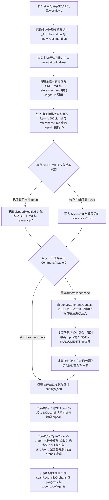

# Design: fix-multi-agent-skill-command-generation

## Context

### 现状架构链路与问题定位

MiAgentTools 通过一套统一的模板注册表（`src/core/templates/registry.ts`）与生成管线（`src/core/command-generation/` + `src/core/host-orchestration/`），向 `claude`、`pi`、`opencode`、`codex` 四个 Agent 宿主生成技能（`SKILL.md` + `references/*.md`）、斜杠指令（Commands/Prompts）以及宿主原生编排配置（`.claude/settings.json`、`.opencode/agents/` + `opencode.jsonc`、`.pi/agents/` + `.iagent/pi-runtime.json`）：

```text
[WORKFLOW_PAIRS (registry.ts)]
  ├─ getSkillTemplates() ──► init.ts / update.ts / generate.ts / generate-skills.mjs
  │    ├─ rewriteCommandRefs(instructions + references, tool.commandsLayout, knownIds) [command-references.ts]
  │    ├─ adaptSkillContentForHost(base, negotiation, workflowId, orchestration)       [host-orchestration/render.ts]
  │    ├─ generateSkillContent(template, version, { hostId })                          [command-generation/generator.ts]
  │    └─ writeSkillReferences(skillDir, generated.references)                         [utils/file-system.ts]
  │
  ├─ getCommandTemplates() ─► init.ts / update.ts
  │    ├─ deriveCommandContent(skill.instructions)                                     [templates/derive-command.ts]
  │    ├─ rewriteCommandRefs(content, tool.commandsLayout, knownIds)                   [command-references.ts]
  │    ├─ adaptSkillContentForHost(baseBody, negotiation, id, orchestration)           [host-orchestration/render.ts]
  │    └─ generateCommand(content, adapter)                                            [adapters/{claude,pi,opencode}.ts]
  │
  └─ 宿主原生编排产物
       ├─ Claude: .claude/settings.json (mergePermissions)
       ├─ OpenCode: .opencode/agents/iagent-*.md + .opencode/opencode.jsonc (writeOpenCodeProjectArtifacts)
       ├─ Pi: .pi/agents/iagent-*.md + .iagent/pi-runtime.json (writePiNativeAgents)
       └─ Codex: skills-only ($iagent-<id> 引用改写 + degraded 诊断)
```

探索阶段（`openspec/changes/fix-multi-agent-skill-command-generation/exploration.md`）定位出三类架构级断层（F1–F9）：
1. **跨宿主引用与参考文件归一化断层（D1）**：`codex` 作为 `skills-only` 宿主无 `commandsLayout` 配置，`rewriteCommandRefs` 未将 `/iagent:<id>` 改写为 Codex 原生技能调用语法 `$iagent-<id>`；`references/*.md` 绕过了 `rewriteCommandRefs` 与 `normalizeHostSkillRefs`；`generateSkillContent` 仅在传入 `hostId` 时归一化 `instructions`，未覆盖 `description`、`compatibility`、`references[].content`，导致 `skills/` 快照与 `iagent generate` 残留 `iagent_`；4 个模板残留废弃 `metadata.version: '1.0'`（`workflow` / `auto-workflow` / `spec-explore` / `spec-propose`）；`project-init.ts` 与 `test.ts` 含硬编码 `.claude/skills/...` 与 `经 Skill 工具委派`。
2. **单一源派生与参数占位符注入断层（D2）**：模板中文化后，`pi.ts` 与 `opencode.ts` 的参数注入仍只识别英文 `**Input**:` 与 `None required`，导致 12/20 个指令丢失 `$ARGUMENTS` 注入、`spec-bulk-archive`（`无需参数`）被误注入，且未隔离围栏代码块（` ``` `）内部的示例 `**输入**:`，亦未约束「仅首个顶层段」（`proposal-review` 的 `## 检查示例` 段含未围栏同形行）；`spec-archive`、`spec-propose` 两处 `CMD:SKIP` 裁剪边界有误（`spec-explore` 第 34 行的英文 `Input` 位于参考文件常量内，属参考文档冗余而非派生缺陷）。
3. **宿主原生编排、Agent 产物与权限/卸载断层（D3）**：`init.ts` / `update.ts` 调用 `adaptSkillContentForHost` 漏传生效 `orchestration`；`opencode-v2.ts` 的 `collectShellPrefixes` 漏掉含空格的 `Bash(git <subcmd>:*)`、`removeOpenCodeProjectArtifacts` 用正则破坏 `$schema` URL 导致卸载静默失败、`renderWorkerPermissions` 对只读技能误授 `edit` 且漏授 `question`、`renderWorkerAgent` 未转义 `description`；OpenCode 与 Pi 的阶段 worker 缺少加载对应 `SKILL.md` 的引导指令，且 OpenCode 缺少 `.opencode/agents/` orphan 清理与 `reconcile` 扫描。

### 影响分析（CodeGraph，Phase 2.0 合并结果）

| 区域 | 符号 / 常量 | 位置 | 调用方（含测试） |
| :--- | :--- | :--- | :--- |
| 指令引用改写（D1） | `rewriteCommandRefs` / `prefixedCommandRef` / `codexSkillRef` | `src/core/templates/command-references.ts:27,53` | `src/commands/init.ts`、`src/commands/update.ts`、`src/commands/generate.ts`、`src/core/templates/index.ts`；`test/command-reference-refs.test.ts` |
| 工具布局配置（D1） | `CommandLayout` / `AI_TOOLS` | `src/core/config.ts:65,99` | `src/core/templates/command-references.ts`、`src/core/command-artifacts.ts`；`test/command-reference-refs.test.ts`、`test/commands.test.ts` |
| 技能生成与归一化（D1） | `generateSkillContent` / `normalizeHostSkillRefs` | `src/core/command-generation/generator.ts:21,78` | 15 处调用方：`scripts/generate-skills.mjs`、`src/commands/generate.ts`、`src/commands/init.ts`、`src/commands/update.ts`；`test/generation.test.ts`、`test/skills-parity.test.ts`、`test/allowed-tools.test.ts` |
| Pi / OpenCode 参数注入（D2） | `injectPiArgs` / `piAdapter` & `injectOpenCodeArgs` / `opencodeAdapter` | `src/core/command-generation/adapters/pi.ts:32,40`、`opencode.ts:34,45` | `src/core/command-generation/adapters/registry.ts`；`test/generation.test.ts`、`test/opencode-v2.test.ts`、`test/template-language.test.ts` |
| 单一源派生与模板（D1/D2） | `deriveCommandContent` 及 11 个 `workflows/*.ts` | `src/core/templates/derive-command.ts:23`、`src/core/templates/workflows/*.ts` | `src/core/templates/registry.ts`；`test/template-derivation.test.ts`、`test/templates.test.ts` |
| 宿主编排适配注入（D3） | `adaptSkillContentForHost` | `src/core/host-orchestration/render.ts:272` | `src/commands/init.ts`、`src/commands/update.ts`；`test/host-orchestration.test.ts` |
| OpenCode V2 产物与权限（D3） | `collectShellPrefixes` / `renderWorkerPermissions` / `renderWorkerAgent` / `writeOpenCodeProjectArtifacts` / `removeOpenCodeProjectArtifacts` | `src/core/opencode-v2.ts:59,78,145,365,463` | `src/commands/init.ts`、`src/commands/update.ts`、`src/commands/uninstall.ts`；`test/opencode-v2.test.ts` |
| Pi 原生 Agent 生成（D3） | `renderPiStageAgent` / `writePiNativeAgents` | `src/core/pi-native.ts:194,254` | `src/commands/init.ts`、`src/commands/update.ts`；`test/pi-native.test.ts` |
| 孤立产物对账扫描（D3） | `scanReconcileOrphans` | `src/core/reconcile.ts:37` | `src/commands/init.ts`、`src/commands/update.ts`；`test/reconcile.test.ts` |
| Codex 引用语法与能力档案同源（D1） | `HOST_PROFILES.codex.native.skillLoading` / `renderLoadSkill` | `src/core/host-orchestration/hosts.ts:97`、`src/core/host-orchestration/actions.ts:89` | `negotiationForHost`、`renderHostOrchestrationSection`、`writePiNativeAgents`、`writeOpenCodeProjectArtifacts`；`test/host-orchestration.test.ts`、`test/host-smoke.test.ts` |

## 功能流程图（流程基准引用）

以下为 explore 阶段**经用户确认**的流程基准（`exploration.md` 的 `## 功能流程图`，`Flow Baseline Status: confirmed`）。本设计**引用而非重建**，实现任务（`tasks.md`）按节点标识 `N1`–`N14`（含 `N6F` / `N6W`）逐一映射，MUST NOT 静默补节点。



### 关键操作节点清单与本次改动映射

| 节点 | 操作 | 触发条件 | 证据位置 / 本次改动落点 | 异常路径 |
| :--- | :--- | :--- | :--- | :--- |
| N1 | 读取 `.iagent/config.yaml` 解析生效工具集（`claude`/`pi`/`codex`/`opencode`）与生效 `workflows` 列表（含依赖注入），`codex` 配置 `commandsLayout: 'skills-only'` | 执行 `iagent init` 或 `iagent update` | `src/commands/init.ts:232-241`、`src/commands/update.ts:171-177`、`src/core/config.ts:65,99-136` | 配置文件缺失时使用默认集 → N2 |
| N2 | 获取生效技能模板 `activeSkillTemplates`，派生生效集 `orchestration` 委派图谱与 `knownCommandIds` | N1 完成 | `src/commands/init.ts:243-264`、`src/commands/update.ts:179-205`、`src/core/host-orchestration/render.ts:67-81` | — |
| N3 | 按目标工具执行宿主编排能力协商 `negotiationForHost`（Claude/OpenCode `strict`，Pi 按运行时与入口探测，Codex 显式 `degraded`） | 遍历生效工具集 | `src/core/host-orchestration/hosts.ts:199-222`、`src/commands/init.ts:252-257, 303` | Pi 运行时或入口缺失时降级 `degraded` 并记录诊断 → N4 |
| N4 | 按宿主 `commandsLayout` 改写 `SKILL.md` 正文与 `references/*.md` 中的已知 `/iagent:<id>` 引用（`namespace-dir` 保持 `/iagent:<id>`，`prefixed-file` 改写为 `/iagent-<id>`，`skills-only` Codex 改写为 `$iagent-<id>`） | N3 完成 | `src/core/templates/command-references.ts:53-64`、`src/commands/init.ts:305`、`src/commands/update.ts:243`、`src/commands/generate.ts` | 未知指令 id 保持原样并由单测拦截 → N5 |
| N5 | 调用 `adaptSkillContentForHost`（传入生效 `orchestration`）追加宿主编排段，并在 `generateSkillContent` 中对 `description`、`compatibility`、`instructions`、`references[].content` 统一执行 `normalizeHostSkillRefs`（`iagent_<id>` → `iagent-<id>`） | N4 完成 | `src/core/host-orchestration/render.ts:272-290`、`src/core/command-generation/generator.ts:21-25, 78-116` | 非编排技能仅归一化技能 ID 不追加编排段 → N6 |
| N6 | 校验目标路径下既有 `SKILL.md` 的内容指纹 `isUnmodified` 与 `force` 选项 | N5 生成 `GeneratedSkill` | `src/commands/init.ts:314-318`、`src/commands/update.ts:253-280`、`src/core/command-generation/fingerprint.ts:45-68` | 已手改且未带 `--force` → N6F |
| N6F | 手改保护生效：记录 `skipped` / `skippedModified`，跳过覆盖该技能的 `SKILL.md` 与 `references/` | N6 判定用户已手改 | `src/commands/init.ts:315-318`、`src/commands/update.ts:278-280` | — |
| N6W | 写入 `SKILL.md` 并同步写出已完成引用改写与技能 ID 归一化的 `references/*.md` | N6 判定可写入 | `src/commands/init.ts:319-323`、`src/commands/update.ts:238-277`、`src/utils/file-system.ts:52-64` | — |
| N7 | 检查当前工具是否在 `CommandAdapterRegistry` 注册了指令适配器 | N6F 或 N6W 完成 | `src/core/command-generation/adapters/registry.ts:13-41`、`src/commands/init.ts:345-349` | 无适配器（如 `codex`）跳过指令生成 → N11 |
| N8 | 从唯一源经 `deriveCommandContent`（按修复后的 `CMD:SKIP` 边界）派生指令正文，并执行 `rewriteCommandRefs` 与 `adaptSkillContentForHost`（传入生效 `orchestration`） | N7 命中 `claude` / `pi` / `opencode` | `src/core/templates/derive-command.ts:23-85`、`src/commands/init.ts:351-363`、`src/commands/update.ts:308-320` | 未闭合 `CMD:SKIP` 按 fail-safe 保留正文 → N9 |
| N9 | 调用适配器 `formatFile`，在 Pi 与 OpenCode 中识别围栏代码块外的顶层 `**Input**:` / `**输入**：` 段落注入 `**Provided arguments**: $ARGUMENTS`（匹配 `None required` / `无需参数` 或已含占位符时跳过） | N8 完成 | `src/core/command-generation/adapters/pi.ts:21-59`、`src/core/command-generation/adapters/opencode.ts:23-71`、`src/core/command-generation/adapters/claude.ts:19-35` | 无参或已有占位符幂等跳过 → N10 |
| N10 | 计算指令文件 `generatedFingerprint` 并按手改保护写入目标指令目录 | N9 完成 | `src/core/command-generation/generator.ts:36-53`、`src/commands/init.ts:371-379`、`src/commands/update.ts:327-356` | 已手改且无 `--force` 时记入 `commandsSkippedModified` → N11 |
| N11 | 对 `sessionPermissions !== false` 的工具非破坏合并会话级权限载体 `settings.json` | N7 或 N10 完成 | `src/core/permissions.ts:90-162`、`src/commands/init.ts:328-341` | 既有 JSON 非法时返回 `preserved-invalid` 保留原文件 → N12 |
| N12 | 当生效工具含 `pi` 时，生成 `.pi/agents/iagent-*.md`（含归一化 `description` 与读取 `.pi/skills/iagent-<id>/SKILL.md` 的协议引导）并清理 orphan agent | 工具集含 `pi` | `src/core/pi-native.ts:194-231, 254-321`、`src/commands/init.ts:270-297` | 写入或清理单文件失败记入 `warnings` 不阻断 → N13 |
| N13 | 当生效工具含 `opencode` 时，生成 `.opencode/agents/iagent-*.md`（含 `skill` 加载引导、按需 `edit` + `question` 最小权限、含空格 `Bash(git <subcmd>:*)` 的 `shell` 前缀、转义归一化 `description`）、清理 orphan agent，并经状态机 `stripJsonc` 合并/卸载 `.opencode/opencode.jsonc` | 工具集含 `opencode` 或执行 `uninstall` | `src/core/opencode-v2.ts:59-109, 145-228, 365-511`、`src/commands/init.ts:383-391` | `opencode.jsonc` 非法时保留原文件并记入 `warnings` → N14 |
| N14 | 执行 `scanReconcileOrphans` 扫描跨工具孤立技能、指令及 `.pi/agents/`、`.opencode/agents/` 下的 orphan agent 定义 | N13 完成 | `src/core/reconcile.ts:37-87`、`src/commands/init.ts:401`、`src/commands/update.ts:372` | — |

## Goals / Non-Goals

**Goals**:
- 实现四宿主（`claude` / `pi` / `opencode` / `codex`）在 `SKILL.md`、`references/*.md` 与指令产物上的引用改写与技能 ID 归一化 100% 完整一致（Codex 改写为 `$iagent-<id>`）。
- 修复 Pi 与 OpenCode 指令适配器的中英 `Input`/`输入` 参数占位符注入与代码块隔离，修复 3 处 `CMD:SKIP` 裁剪边界。
- 修复 `init` / `update` 的生效 `orchestration` 透传、OpenCode V2 多词 `shell` 前缀提取、`removeOpenCodeProjectArtifacts` 的 `stripJsonc` 解析、Worker 最小权限（只读不授 `edit`、补 `question`）、Worker 加载 `SKILL.md` 引导，以及 `.opencode/agents/` orphan 清理与 `reconcile` 扫描。

**Non-Goals**:
- 不改变四工具的目录结构契约（`.claude/`、`.pi/prompts/` + `.pi/agents/`、`.opencode/commands/` + `.opencode/agents/`、`.codex/skills/`）。
- 不为 `codex` 生成斜杠指令文件（`codex` 保持 `commandsDir: ''` 的 skills-only 模式）。
- 不修改 `src/commands/generate.ts` 骨架技能的 `allowedTools` 授权范围。

## Architecture Impact

### 1. 跨宿主指令引用改写与技能/参考文件统一归一化（D1）

- **`src/core/config.ts`**：
  ```ts
  export type CommandLayout = 'namespace-dir' | 'prefixed-file' | 'skills-only';
  ```
  在 `AI_TOOLS` 的 `codex` 条目设置 `commandsLayout: 'skills-only'`（`commandsDir` 仍为 `''`，`command-artifacts.ts` 首行 `if (!tool.commandsDir) return null;` 短路保持不变）。
- **`src/core/templates/command-references.ts`**：
  - 新增导出 `codexSkillRef(id: string): string`，返回 `` `$${SKILL_ID_PREFIX}${id}` ``（即 `$iagent-<id>`）。
  - `rewriteCommandRefs(text, layout, knownIds)`：
    - `if (!layout || layout === 'namespace-dir') return text;`（满足 B1：`layout === undefined` 仍返回 `/iagent:<id>`）；
    - `layout === 'prefixed-file'` 时将已知 id 改写为 `prefixedCommandRef(id)`（`/iagent-<id>`）；
    - `layout === 'skills-only'` 时将已知 id 改写为 `codexSkillRef(id)`（`$iagent-<id>`）；
    - 未知 id 保持原样。
- **`src/core/command-generation/generator.ts`**：
  - `generateSkillContent(template, generatedByVersion, _options)` 无条件对 `template.description`、`template.compatibility`、`template.instructions` 以及 `template.references` 的每一项 `ref.content` 执行 `normalizeHostSkillRefs(...)`（不再以 `options?.hostId` 为前提，因为所有四宿主及 `skills/` 快照均使用 canonical `iagent-<id>` 技能 ID）。
- **`src/commands/init.ts`、`src/commands/update.ts`、`src/commands/generate.ts`**：
  - 在构造传入 `generateSkillContent` 的模板对象时，对 `template.references`（若存在）映射执行 `rewriteCommandRefs(ref.content, tool.commandsLayout, knownCommandIds)`；
  - 在 `update.ts` 中，仅在 `shouldWrite` 为 `true`（未手改或带 `--force`）时才调用 `writeSkillReferences(skillDir, generated.references)`（满足 B3）。
- **清理废弃字段与硬编码宿主表述**：
  - 从 `workflow.ts`、`auto-workflow.ts`、`spec-explore.ts`、`spec-propose.ts` 移除实际残留的 `version: '1.0'`（经代码取证：`generateSkillContent` 从不渲染 `metadata.version`，故产物字节不变，本项仅消除源码中的废弃字段并加回归断言；`iagent generate` 骨架已无该字段）；
  - 将 `project-init.ts`（第 304 行）与 `test.ts`（第 753 行）中的 `.claude/skills/iagent-.../references/...` 改为本技能目录下的 `references/...`；将 `project-init.ts` 第 71、194 行的 `经 \`Skill\` 工具委派 \`iagent_feature_doc\`` 改为宿主中立委派表述。

### 2. Command 单一源派生与参数占位符注入修复（D2）

- **共享参数注入辅助函数（供 `pi.ts` 与 `opencode.ts` 共用）**：
  - 在 `src/core/command-generation/adapters/pi.ts`（或共享辅助函数）中实现围栏代码块感知的顶层输入段落匹配：
    1. 若 `body` 已包含 `/\$ARGUMENTS\b|\$[1-9]\b/`，直接返回 `body`；
    2. 按行扫描 `body`，维护 `inFence` 布尔状态（遇到 `/^\s*(`{3,}|~{3,})/` 翻转 `inFence`）；
    3. 在 `!inFence` 状态下寻找**首个**匹配 `/^\*\*(?:Input\*\*:\s*|输入\*\*\s*[：:]\s*)(.*)$/` 的顶层输入行（「首个」是硬约束：`proposal-review` 的 `## 检查示例` 段亦含 `**输入**:` 示例行且**未围栏**，故只能由「顶层 + 首个」语义排除；围栏隔离拦截的则是代码块内的同形示例）；
    4. 向后收集该段落的连续非空行（直到遇到空行、标题或围栏开始）；
    5. 若该段落文本匹配 `/^(?:None required\b|无需参数)/i`，跳过注入并原样返回；
    6. 否则在该段落末尾插入一行 `**Provided arguments**: $ARGUMENTS`。
  - 幂等占位符判定以 `pi.ts` 现有的 `/\$(?:ARGUMENTS\b|@\b|[1-9]\d*\b)/` 为基准统一两个适配器（`opencode.ts` 现缺 `$@` 分支），避免同一正文在两个宿主上产生不同注入结果。
- **补齐 3 个有参模板的顶层 `**输入**：` 声明行**（MUST 置于标题下方、任何示例段与围栏代码块之前，保证「首个顶层段」命中）：
  - `src/core/templates/workflows/migration.ts`：在标题下方增加 `**输入**：源项目路径与待迁移的目标模块描述（可选）。`；
  - `src/core/templates/workflows/proposal-review.ts`：在标题下方增加 `**输入**：待审查的变更名称（kebab-case，可选；未指定时自动扫描活跃变更）。`；
  - `src/core/templates/workflows/spec-verify-proposal.ts`：在标题下方增加 `**输入**：待验证评分的变更名称（kebab-case，可选）。`。
- **`CMD:SKIP` 裁剪边界修正**：
  - `src/core/templates/workflows/spec-explore.ts`：**删除**常量 `EXPLORATION_PROTOCOL_FULL` 内第 34 行的冗余英文 `**Input**:` 行（该常量唯一落点是 `references/exploration-protocol.md`，不经 `deriveCommandContent`；用 `CMD:SKIP` 包裹无效且会把标记字面量原样写进参考文件）。派生 Command 的输入段来自主正文第 1219 行，无需裁剪；
  - `src/core/templates/workflows/spec-archive.ts`：目标是把 `ARCHIVE-INDEX.md` 补充标注的**标签白名单规则句**（现位于 `CMD:SKIP` 区块内「a. 提取条目信息 → **补充标注**」条目）保留进指令版，而仅裁掉 a/b/c/d 的逐步操作细节。实现方式：将该白名单规则句（含 `[测试]` / `[DB脚本]` / `[使用说明]` 白名单与「不得收集所有方括号内容」反例说明）整段移出 `CMD:SKIP` 区块，作为 `<!-- /CMD:SKIP -->` 之后的独立段落；MUST NOT 仅平移起止标记（平移会把需要保留的白名单句一起裁掉）；
  - `src/core/templates/workflows/spec-propose.ts`：移除包裹 Step 0.2~0.7 的 `<!-- CMD:SKIP -->` 与 `<!-- /CMD:SKIP -->`，使指令版同样包含探索文件扫描与迁移步骤；至此 `spec-propose.ts` 正文不再含 `CMD:SKIP` 标记。

### 3. 宿主原生编排、Agent 产物与权限/卸载完整性修复（D3）

- **`src/commands/init.ts` & `src/commands/update.ts`**：
  - 将 `adaptSkillContentForHost(rewrittenInstructions, hostNegotiation, workflowId, orchestration)` 与 `adaptSkillContentForHost(baseBody, hostNegotiation, cmdTemplate.id, orchestration)` 的第 4 参数 `orchestration` 补齐。
- **`src/core/opencode-v2.ts`**：
  - `collectShellPrefixes(allowedTools: readonly string[])`（**签名保持不变**：入参是 `allowedTools` 字符串列表，**不是** stage 对象列表）：将现有的全局匹配 `/Bash\(([a-zA-Z0-9._-]+):\*\)/g` 放宽为 `/Bash\(([a-zA-Z0-9._-]+(?:\s+[a-zA-Z0-9._-]+)*):\*\)/g`，使 `Bash(git status:*)` 等含空格子命令提取为 `"git status "`。MUST NOT 改用带 `^`/`$` 锚定的整串正则（`allowedTools` 是逗号拼接串，锚定会全不匹配）；`isIagentRule` 的归属判定沿用现实现的 `managedShellPrefixes.includes(resource)`（**代码中不存在** `KNOWN_SHELL_RESOURCES` 常量，MUST NOT 新增第二份前缀白名单）。
  - `removeOpenCodeProjectArtifacts`：移除 `raw.replace(/\/\/.*$/gm, '')`，统一调用模块内已有的 `stripJsonc(raw)` 解析 JSONC，修复含 `"$schema": "https://opencode.ai/config.json"` 时的卸载异常。
  - `renderWorkerPermissions(options)`（签名为对象参数 `{ workflowId, skillIds, grantSubagent, shellPrefixes }`，**不是** `stage`）：新增 `grantEdit: boolean` 入参，仅当为 `true` 时生成 `action: edit, resource: "*", effect: allow`；所有阶段 worker 均生成 `action: question, resource: "*", effect: allow`。`writeOpenCodeProjectArtifacts` 侧以 `hasDispatchEntry` 同构的方式新增 `hasWriteEntry(stage.allowedTools)`（`/Write|Edit/` token 判定）并透传，`read resource: "*"` 条目维持现状。
  - `renderWorkerAgent(workflowId, description, options)`：对 `description` 先调用 `normalizeHostSkillRefs` 再调用 `escapeYamlValue`；在正文中增加启动引导：`执行本阶段前，先使用 \`skill\` 工具加载 \`iagent-${workflowId}\`（\`.opencode/skills/iagent-${workflowId}/SKILL.md\`）获取完整阶段规程。`。
  - `writeOpenCodeProjectArtifacts`：扫描 `.opencode/agents/` 目录，删除以 `iagent-` 开头、`.md` 结尾且不在本次生成的 `expectedFiles`（`iagent-orchestrator.md` ∪ 生效集 `iagent-<id>.md`）中的 orphan 文件，保留用户自建非 `iagent-` 文件。
- **`src/core/pi-native.ts`**：
  - `renderPiStageAgent(workflowId, description, allowedSubagents?, orchestration?)`：对 `description` 先执行 `normalizeHostSkillRefs` 再调用 `escapeYamlValue`；在正文中增加启动引导：`执行本阶段前，先使用 \`read\` 工具读取 \`.pi/skills/iagent-${workflowId}/SKILL.md\` 获取完整阶段规程。`。
- **Codex 引用语法与能力档案同源（与 D1 配套，避免同一变更内两处口径冲突）**：
  - `src/core/host-orchestration/hosts.ts` 的 `HOST_PROFILES.codex.native.skillLoading` 由「读取 SKILL.md（skills-only，无宿主级技能调用工具）」改为与 `$iagent-<id>` 引用语法一致的表述（技能以 `$iagent-<id>` 形式被引用/加载），`capabilities` 仍只含 `skill-load` 与 `argument-passing`（MUST NOT 增加 `delegate` / `gate`）；
  - `src/core/host-orchestration/actions.ts` 的 `renderLoadSkill('codex', ...)` 同步该口径；
  - `README.md` 四工具对照表中 Codex 的技能触发形式由 `$iagent_spec_apply` 更正为 `$iagent-spec-apply`（canonical），「斜杠指令」列维持「—（skills-only）」。
- **`src/core/reconcile.ts`**：
  - `scanReconcileOrphans`：在扫描 `pi` 的 `.pi/agents/` 之外，当配置工具含 `opencode`（或 `.opencode/agents/` 存在）时，同步扫描 `.opencode/agents/` 下不在生效集的 `iagent-*.md`（排除 `iagent-orchestrator.md` 与用户自建非 `iagent-` 文件），记入 `ReconcileOrphans.agents`；该字段语义由「Pi agent 定义」扩展为「宿主原生 agent 定义（Pi + OpenCode）」，`ReconcileOrphans.agents` 的 JSDoc 与 `reconcileOrphanCount` 注释 MUST 同步更新（条目路径仍为项目相对 posix）。

## Decisions

### D1: 跨宿主指令引用改写、路径去耦合与 `SKILL.md` / `references/*.md` 统一归一化
- **选择**: 为 `codex` 配置 `commandsLayout: 'skills-only'` 并在 `rewriteCommandRefs` 中改写已知 `/iagent:<id>` 为 `$iagent-<id>`（`layout === undefined` 保持返回原样）；在 `generateSkillContent` 中无条件对 `description`、`compatibility`、`instructions`、`references[].content` 执行 `normalizeHostSkillRefs`；在 `init` / `update` / `generate` 中对 `references` 同步执行 `rewriteCommandRefs`；清理 4 个实际残留 `metadata.version` 的模板（`workflow` / `auto-workflow` / `spec-explore` / `spec-propose`，源码卫生项）与硬编码 `.claude/skills/` 路径；同步 Codex 能力档案口径（`hosts.ts` / `actions.ts` / `README.md`）。
- **理由**: Codex CLI 原生以 `$<skill-name>` 激活技能，无自定义斜杠命令；将技能 ID 归一化收敛到 `generateSkillContent` 单一出口可一次性消除四宿主产物与 `skills/` 快照中的 `iagent_` 残留。
- **备选**: 在每个模板和 `references` 中手工替换（无法应对不同宿主的命令语法差异，且易回潮，否决）。

### D2: Command 派生（`deriveCommandContent`）与 Pi / OpenCode 参数占位符注入修复
- **选择**: 统一 `pi.ts` 与 `opencode.ts` 的参数注入函数，在围栏代码块外匹配**首个**顶层 `**Input**:` 与 `**输入**：` / `**输入**:` 段落、识别 `None required` 与 `无需参数` 跳过注入，并为 `migration` / `proposal-review` / `spec-verify-proposal` 补齐顶层 `**输入**：` 声明行；修正 `spec-archive`、`spec-propose` 两处 `CMD:SKIP` 边界，并删除 `spec-explore` 参考文件中的冗余英文 `Input` 行。
- **理由**: 模板中文化后顶层输入段以中文 `**输入**：` 为主；`proposal-review` 的 `## 检查示例` 段（未围栏）含同形 `**输入**:` 示例行，故必须同时使用「仅首个顶层段」与「围栏代码块隔离」两条语义才能保证幂等与准确注入。
- **备选**: 将所有模板的输入段改回英文 `**Input**:`（破坏 `template-language.test.ts` 语言一致性方向，否决）。

### D3: 宿主原生编排（OpenCode V2 / Pi / Claude）与权限/Agent 产物完整性修复
- **选择**: `init` / `update` 透传生效 `orchestration`；`opencode-v2.ts` 支持含空格 `Bash(git <subcmd>:*)`、卸载复用 `stripJsonc`、Worker 按需授 `edit` 并补 `question`、`description` 转义与归一化；为 OpenCode / Pi 阶段 worker 注入加载对应 `SKILL.md` 的引导指令；补齐 `.opencode/agents/` orphan 清理与 `reconcile` 扫描。
- **理由**: 解决 `opencode.jsonc` 含 `$schema` URL 时无法卸载的严重缺陷，落实只读技能最小权限，并填补 subagent 启动时缺少主技能完整规程上下文的断层。
- **备选**: 将完整 `SKILL.md` 正文复制内联进每个 `.opencode/agents/iagent-*.md` 与 `.pi/agents/iagent-*.md`（导致产物体积膨胀一倍且单文件超过 500 行预算，否决）。

## Risks / Trade-offs

| 风险 | 缓解 |
| :--- | :--- |
| `rewriteCommandRefs(text, undefined, ids)` 行为变化导致既有单测失败（B1） | 显式保持 `!layout \|\| layout === 'namespace-dir'` 返回原字符串，仅在 `layout === 'skills-only'` 时改写为 `$iagent-<id>` |
| 围栏代码块内的 `**输入**:` 触发错误的参数占位符注入（B2） | 按行追踪围栏代码块状态（` ``` ` / `~~~`），仅在代码块外匹配首个顶层输入段落 |
| `update` 在 `SKILL.md` 被用户手改时仍覆盖 `references/`（B3） | 将 `writeSkillReferences` 严格置于 `shouldWrite === true` 分支内，手改跳过时保留原 `references/` |
| `opencode.jsonc` 含 `"$schema": "https://..."` 或尾逗号时卸载抛错（B4） | `removeOpenCodeProjectArtifacts` 统一调用状态机 `stripJsonc(raw)`，禁止使用行注释正则替换 |
| 只读阶段 worker 获得 `edit` 权限或交互阶段 worker 缺少 `question` 权限（B5） | `renderWorkerPermissions` 精确解析 `allowedTools` 中的 `Write`/`Edit` 按需授予 `edit`，并为全部阶段 worker 授予 `question` |
| 模板改动后 `skills/` 静态快照或语言/引用回归测试不一致 | 实现后强制运行 `pnpm build && pnpm generate:skills && pnpm test`，由 `skills-parity`、`template-language`、`command-reference-refs` 守门 |
| `CMD:SKIP` 标记被误写进 `references[].content`（参考文件不过 `deriveCommandContent`，标记会原样发布） | 明确「`CMD:SKIP` 仅作用于 `SkillTemplate.instructions`」；`spec-explore` 改为直接删除英文行而非加标记；新增回归断言：全部 `references[].content` MUST NOT 含 `CMD:SKIP` 字面量 |
| `metadata.version` 清理项的文件清单与实际残留不一致，导致任务验收断言必然失败 | 以代码取证清单为准（`workflow` / `auto-workflow` / `spec-explore` / `spec-propose`），并明确该项是源码卫生（`generateSkillContent` 从不渲染该字段，产物字节不变） |
| Codex `$iagent-<id>` 改写与 `hosts.ts` / `actions.ts` 的既有「无宿主级技能调用工具」表述冲突 | 同一变更内同步三处口径（`hosts.ts` 档案、`renderLoadSkill('codex')`、README 对照表），且 MUST NOT 虚增 `delegate` / `gate` 能力 |
