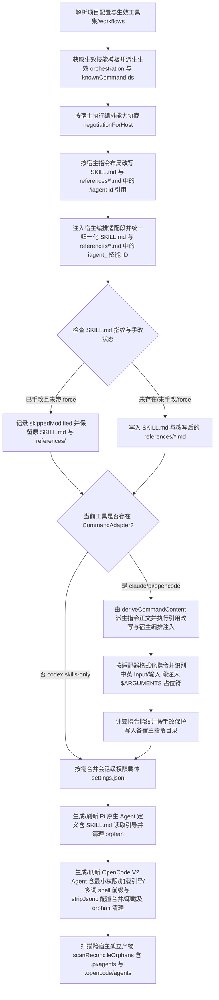

## Background

探索分析项目指令技能整体框架和逻辑设计，针对claude\pi\opencode\codex不同agent提示词和SKILL技能生成设计、和引用方式是否存在问题，哪里还需要就行优化

## 提示词基线 (Prompt Baseline)

**原始提示词**: 探索分析项目指令技能整体框架和逻辑设计，针对claude\pi\opencode\codex不同agent提示词和SKILL技能生成设计、和引用方式是否存在问题，哪里还需要就行优化

**确认后的提示词基线**:
- **目标（Goal）**：全面排查并优化 MiAgentTools 中指令（Commands/Prompts）与技能（SKILL）的整体框架设计，解决 `claude`、`pi`、`opencode`、`codex` 四个 Agent 工具在提示词生成、SKILL 派生、跨技能/指令引用及宿主编排适配中的缺陷、不一致与冗余设计。
- **对象（Object）**：
  1. 模板注册与单一源派生（`registry.ts`、`derive-command.ts`、`command-references.ts`、`tool-whitelist.ts`、`workflows/*.ts`）
  2. 多工具生成与适配器（`generator.ts`、`adapters/{claude,pi,opencode}.ts`、`command-artifacts.ts`、`codex` 生成分支）
  3. 宿主原生编排与委派渲染（`host-orchestration/`、`opencode-v2.ts`、`pi-native.ts`、`pi-runtime.ts`、`permissions.ts`）
  4. 安装与更新管线（`init.ts`、`update.ts`、`reconcile.ts`、`generate.ts`、`scripts/generate-skills.mjs`）
- **范围（Scope）**：
  - 全面覆盖 4 个核心子域：① 指令引用改写（`/iagent:<id>` 与 `iagent_<id>` 在四工具及 `references/*.md` 下的改写完整性，重点含无 command adapter 的 `codex`）；② 技能委派与宿主原生编排适配（`claude` / `pi` / `opencode` / `codex` 的委派语法、subagent 生成与降级契约）；③ Skill 与 Command 派生机制（`deriveCommandContent`、参数占位符注入、frontmatter 字段与指纹一致性）；④ 权限与工具白名单映射（`allowedTools`、`.claude/settings.json`、`.opencode/opencode.jsonc`、`.pi/agents/`）。
  - Codex 定位：重点解决其 SKILL 内部引用 `/iagent:<id>` 与委派渲染的适配问题（按 Codex Agent 实际 `$iagent-<id>` 技能调用语法调整）。
  - 落地方式：探索完成后生成变更提案，确认后进行代码实现改造。
- **约束（Constraints）**：保持现有四工具的目录结构契约与 `AGENTS.md` 修改守则（模板改动同步 `pnpm build && pnpm generate:skills`、测试全绿）。
- **验收（Acceptance）**：产出针对 `claude` / `pi` / `opencode` / `codex` 的完整问题诊断矩阵与架构优化方案，经确认后生成 OpenSpec 变更提案并完成代码修复与测试验证。

> 下游（提案 / 设计 / 规格 / 任务）以提示词基线为唯一语义来源；基线若变更 MUST 回到 1.1.2 重新确认。

## 功能流程图

**确认状态 (Flow Baseline Status)**: `confirmed`（已由用户确认作为提案与验证的流程基准）



### 节点清单

| 节点 | 操作 | 触发条件 | 证据位置 | 异常路径 |
| :--- | :--- | :--- | :--- | :--- |
| N1 | 读取 `.iagent/config.yaml` 解析生效工具集（`claude`/`pi`/`codex`/`opencode`）与生效 `workflows` 列表（含依赖注入） | 执行 `iagent init` 或 `iagent update` | `src/commands/init.ts:232-241`、`src/commands/update.ts:171-177`、`src/core/config.ts:99-136` | 配置文件缺失时使用默认集 → N2 |
| N2 | 获取生效技能模板 `activeSkillTemplates`，派生生效集 `orchestration` 委派图谱与 `knownCommandIds` | N1 完成 | `src/commands/init.ts:243-264`、`src/commands/update.ts:179-205`、`src/core/host-orchestration/render.ts:67-81` | — |
| N3 | 按目标工具执行宿主编排能力协商 `negotiationForHost`（Claude/OpenCode `strict`，Pi 按运行时与入口探测，Codex 显式 `degraded`） | 遍历生效工具集 | `src/core/host-orchestration/hosts.ts:199-222`、`src/commands/init.ts:252-257, 303` | Pi 运行时或入口缺失时降级 `degraded` 并记录诊断 → N4 |
| N4 | 按宿主 `commandsLayout` 改写 `SKILL.md` 正文与 `references/*.md` 中的已知 `/iagent:<id>` 引用（`namespace-dir` 保持 `/iagent:<id>`，`prefixed-file` 改写为 `/iagent-<id>`，`skills-only` Codex 改写为 `$iagent-<id>`） | N3 完成 | `src/core/templates/command-references.ts:53-64`、`src/commands/init.ts:305`、`src/commands/update.ts:243` | 未知指令 id 保持原样并由单测拦截 → N5 |
| N5 | 调用 `adaptSkillContentForHost`（传入生效 `orchestration`）追加宿主编排段，并在 `generateSkillContent` 中对 `description`、`compatibility`、`instructions`、`references[].content` 统一执行 `normalizeHostSkillRefs`（`iagent_<id>` → `iagent-<id>`） | N4 完成 | `src/core/host-orchestration/render.ts:272-290`、`src/core/command-generation/generator.ts:21-25, 78-116` | 非编排技能仅归一化技能 ID 不追加编排段 → N6 |
| N6 | 校验目标路径下既有 `SKILL.md` 的内容指纹 `isUnmodified` 与 `force` 选项 | N5 生成 `GeneratedSkill` | `src/commands/init.ts:314-318`、`src/commands/update.ts:253-280`、`src/core/command-generation/fingerprint.ts:45-68` | 已手改且未带 `--force` → N6F |
| N6F | 手改保护生效：记录 `skipped` / `skippedModified`，跳过覆盖该技能的 `SKILL.md` 与 `references/` | N6 判定用户已手改 | `src/commands/init.ts:315-318`、`src/commands/update.ts:278-280` | — |
| N6W | 写入 `SKILL.md` 并同步写出已完成引用改写与技能 ID 归一化的 `references/*.md` | N6 判定可写入 | `src/commands/init.ts:319-323`、`src/commands/update.ts:238-277`、`src/utils/file-system.ts:52-64` | — |
| N7 | 检查当前工具是否在 `CommandAdapterRegistry` 注册了指令适配器 | N6F 或 N6W 完成 | `src/core/command-generation/adapters/registry.ts:13-41`、`src/commands/init.ts:345-349` | 无适配器（如 `codex`）跳过指令生成 → N11 |
| N8 | 从唯一源经 `deriveCommandContent`（按修复后的 `CMD:SKIP` 边界）派生指令正文，并执行 `rewriteCommandRefs` 与 `adaptSkillContentForHost`（传入生效 `orchestration`） | N7 命中 `claude` / `pi` / `opencode` | `src/core/templates/derive-command.ts:23-85`、`src/commands/init.ts:351-363`、`src/commands/update.ts:308-320` | 未闭合 `CMD:SKIP` 按 fail-safe 保留正文 → N9 |
| N9 | 调用适配器 `formatFile`，在 Pi 与 OpenCode 中识别代码块外的顶层 `**Input**:` / `**输入**：` 段落注入 `**Provided arguments**: $ARGUMENTS`（匹配 `None required` / `无需参数` 或已含占位符时跳过） | N8 完成 | `src/core/command-generation/adapters/pi.ts:21-59`、`src/core/command-generation/adapters/opencode.ts:23-71`、`src/core/command-generation/adapters/claude.ts:19-35` | 无参或已有占位符幂等跳过 → N10 |
| N10 | 计算指令文件 `generatedFingerprint` 并按手改保护写入目标指令目录 | N9 完成 | `src/core/command-generation/generator.ts:36-53`、`src/commands/init.ts:371-379`、`src/commands/update.ts:327-356` | 已手改且无 `--force` 时记入 `commandsSkippedModified` → N11 |
| N11 | 对 `sessionPermissions !== false` 的工具非破坏合并会话级权限载体 `settings.json` | N7 或 N10 完成 | `src/core/permissions.ts:90-162`、`src/commands/init.ts:328-341` | 既有 JSON 非法时返回 `preserved-invalid` 保留原文件 → N12 |
| N12 | 当生效工具含 `pi` 时，生成 `.pi/agents/iagent-*.md`（含归一化 `description` 与读取 `.pi/skills/iagent-<id>/SKILL.md` 的协议引导）并清理 orphan agent | 工具集含 `pi` | `src/core/pi-native.ts:194-231, 254-321`、`src/commands/init.ts:270-297` | 写入或清理单文件失败记入 `warnings` 不阻断 → N13 |
| N13 | 当生效工具含 `opencode` 时，生成 `.opencode/agents/iagent-*.md`（含 `skill` 加载引导、按需 `edit` + `question` 最小权限、含空格 `Bash(git <subcmd>:*)` 的 `shell` 前缀、转义归一化 `description`）、清理 orphan agent，并经状态机 `stripJsonc` 合并/卸载 `.opencode/opencode.jsonc` | 工具集含 `opencode` 或执行 `uninstall` | `src/core/opencode-v2.ts:59-109, 145-228, 365-511`、`src/commands/init.ts:383-391` | `opencode.jsonc` 非法时保留原文件并记入 `warnings` → N14 |
| N14 | 执行 `scanReconcileOrphans` 扫描跨工具孤立技能、指令及 `.pi/agents/`、`.opencode/agents/` 下的 orphan agent 定义 | N13 完成 | `src/core/reconcile.ts:37-87`、`src/commands/init.ts:401`、`src/commands/update.ts:372` | — |

> 确认后的流程图 = **流程基准**（独立于提案自身的交叉验证锚点）；未经用户确认的流程图 MUST NOT 作为提案的生成锚点。
> 提案 / 验证阶段发现遗漏节点 MUST 回到 1.5.5 更新并重新确认，MUST NOT 在 tasks.md 中静默补节点。

## Analysis (optional - if analysis run)

### Deep Analysis Trigger
- Triggered: Yes
- Reason: 检测到修改/优化（Scope.Modify + Architecture + Business）关键词，且基础扫描命中全部核心既有模块符号
- Scope: `src/core/templates/**`, `src/core/command-generation/**`, `src/core/host-orchestration/**`, `src/core/opencode-v2.ts`, `src/core/pi-native.ts`, `src/commands/{init,update,generate}.ts`

### Security Findings
- **JSONC 注释剥离正则破坏 URL 致卸载残留权限规则**：`src/core/opencode-v2.ts:487` 在 `removeOpenCodeProjectArtifacts` 中使用 `raw.replace(/\/\/.*$/gm, '')` 而非状态机 `stripJsonc(raw)`，会将 `"$schema": "https://opencode.ai/config.json"` 中的 `//opencode.ai/...` 当作行注释截断，导致 `JSON.parse` 恒抛错并走 `catch` 静默吞掉异常，`iagent uninstall` 无法移除 `.opencode/opencode.jsonc` 中的 `iagent` 权限规则。
- **OpenCode Worker Agent 权限过宽与缺失并存**：`src/core/opencode-v2.ts:85-108` 的 `renderWorkerPermissions` 无条件为所有阶段 worker 授予 `action: edit, resource: "*"`（违反只读技能 `review` / `proposal-review` / `spec-verify` / `spec-verify-proposal` 的最小权限原则），同时未向含交互门的阶段 worker 授予 `action: question`；且 `renderWorkerAgent`（`opencode-v2.ts:164`）未对 `description` 调用 `escapeYamlValue`，存在 YAML frontmatter 注入/破坏风险。

### Architecture Flow
```text
[WORKFLOW_PAIRS (registry.ts)]
  ├─ getSkillTemplates() ──► init.ts / update.ts / generate-skills.mjs
  │    ├─ rewriteCommandRefs(instructions + references, tool.commandsLayout, knownIds) [command-references.ts]
  │    ├─ adaptSkillContentForHost(base, negotiation, workflowId, orchestration)       [host-orchestration/render.ts]
  │    ├─ generateSkillContent(template, version, { hostId })                          [command-generation/generator.ts]
  │    └─ writeSkillReferences(skillDir, generated.references)                         [utils/file-system.ts]
  │
  ├─ getCommandTemplates() ─► init.ts / update.ts
  │    ├─ deriveCommandContent(skill.instructions)                                     [templates/derive-command.ts]
  │    ├─ rewriteCommandRefs(content, tool.commandsLayout, knownIds)                   [command-references.ts]
  │    ├─ adaptSkillContentForHost(baseBody, negotiation, id, orchestration)           [host-orchestration/render.ts]
  │    └─ generateCommand(content, adapter)                                            [adapters/{claude,pi,opencode}.ts]
  │
  └─ 宿主原生编排产物
       ├─ Claude: .claude/settings.json (mergePermissions)
       ├─ OpenCode: .opencode/agents/iagent-*.md + .opencode/opencode.jsonc (writeOpenCodeProjectArtifacts)
       ├─ Pi: .pi/agents/iagent-*.md + .iagent/pi-runtime.json (writePiNativeAgents)
       └─ Codex: skills-only ($iagent-<id> 引用改写 + degraded 诊断)
```

### Business Flow
```text
模板定义 (workflows/*.ts)
  → 注册表聚合与白名单回填 (registry.ts)
  → 目标宿主能力协商 (negotiationForHost: claude / pi / opencode / codex)
  → 指令引用按宿主改写 (rewriteCommandRefs: /iagent:<id> | /iagent-<id> | $iagent-<id>)
  → 宿主编排适配段注入与技能 ID 统一归一化 (adaptSkillContentForHost + generateSkillContent)
  → SKILL.md & references/*.md & Command 格式化与指纹计算 (generator.ts + adapters)
  → 宿主原生 Agent 与权限配置落盘及孤立产物对账 (permissions.ts / opencode-v2.ts / pi-native.ts / reconcile.ts)
```

### Identified Symbols
- `rewriteCommandRefs` (`src/core/templates/command-references.ts:53`) - Priority: HIGH
- `generateSkillContent` / `generateCommand` / `normalizeHostSkillRefs` (`src/core/command-generation/generator.ts:21,36,78`) - Priority: HIGH
- `injectPiArgs` (`src/core/command-generation/adapters/pi.ts:32`) / `injectOpenCodeArgs` (`src/core/command-generation/adapters/opencode.ts:34`) - Priority: HIGH
- `adaptSkillContentForHost` / `renderHostOrchestrationSection` (`src/core/host-orchestration/render.ts:171,272`) - Priority: HIGH
- `collectShellPrefixes` / `renderWorkerPermissions` / `renderWorkerAgent` / `writeOpenCodeProjectArtifacts` / `removeOpenCodeProjectArtifacts` (`src/core/opencode-v2.ts:59,78,145,365,463`) - Priority: HIGH
- `renderPiStageAgent` / `writePiNativeAgents` (`src/core/pi-native.ts:194,254`) - Priority: HIGH
- `deriveCommandContent` (`src/core/templates/derive-command.ts:23`) - Priority: MEDIUM
- `runInit` (`src/commands/init.ts:216`) / `runUpdate` (`src/commands/update.ts:143`) / `runGenerate` (`src/commands/generate.ts:101`) - Priority: HIGH
- `scanReconcileOrphans` (`src/core/reconcile.ts:37`) - Priority: MEDIUM

## Codebase Findings (NEW)

### Capability Exploration Memory (injected)
- `host-orchestration`（`openspec/specs/host-orchestration/explorations.md`）：
  - Codex 为显式 `degraded` 档案（仅 `skill-load` / `argument-passing`），产物显式声明「本地执行，不构成委派」，不得出现「经 Skill 工具委派」一类不可执行指令。
  - 编排注入面由模板 `allowedTools` 中的 `Skill(...)` 条目自动派生（7 个编排技能：`workflow`、`auto-workflow`、`debug`、`migration`、`project-init`、`spec-propose`、`spec-apply`）；归档类（`spec-archive` / `spec-bulk-archive`）已退出编排面。
  - `DELEGATION_PARAMETERS` 为显式参数表，与模板正文委派语句同源同值（仅承载 `mode` 与 `gate-skip` 两轴契约参数）。
- `opencode-tool-adapter`（`openspec/specs/opencode-tool-adapter/explorations.md`）：
  - OpenCode V2 权限模型要求将技能 `allowedTools` 的实际调用面完整翻译为 `permissions`（`skill` / `subagent` / `shell` / `read` / `edit` / `question`），遵循最小权限原则。
- `template-single-source`（`openspec/specs/template-single-source/explorations.md`）：
  - 全部 20 个内置配对的 `CommandTemplate.content` 均由 `deriveCommandContent(skill.instructions)` 派生；`<!-- CMD:SKIP -->` 仅裁剪纯 skill 版段落，Guardrails 与关键防护语句不得被裁剪。

### Discovered Files
- `src/core/templates/command-references.ts`: 指令引用 `/iagent:<id>` 单一源与 `rewriteCommandRefs` 改写逻辑
- `src/core/templates/derive-command.ts`: `<!-- CMD:SKIP -->` 段落裁剪派生函数
- `src/core/templates/registry.ts`: 20 个内置技能/指令配对注册表与 `allowedTools` 单点回填
- `src/core/templates/tool-whitelist.ts`: `CODEGRAPH_MCP`、`CODEGRAPH_CLI`、`SUBAGENT_DISPATCH`、`skillDelegation`
- `src/core/templates/workflows/*.ts`: 20 个内置工作流技能与指令模板
- `src/core/command-generation/generator.ts`: `generateSkillContent`、`generateCommand`、`normalizeHostSkillRefs`
- `src/core/command-generation/adapters/{claude,pi,opencode,registry}.ts`: 三类指令适配器及参数占位符注入
- `src/core/host-orchestration/{hosts,protocol,actions,render,delegation-contract}.ts`: 宿主能力协商、委派动作渲染与宿主编排适配段生成
- `src/core/opencode-v2.ts`: OpenCode V2 orchestrator/worker agent 生成与 `.opencode/opencode.jsonc` 权限合并/卸载
- `src/core/pi-native.ts` & `src/core/pi-runtime.ts`: Pi 原生 agent 生成（`.pi/agents/`）与运行时探测
- `src/commands/{init,update,generate,uninstall,validate}.ts` & `src/core/reconcile.ts`: CLI 生命周期与孤立产物扫描

### Pattern Matches & 9 项核心缺陷清单（Codebase Audit Findings）

1. **[F1 - 严重 Bug] Pi 与 OpenCode 指令适配器的 `$ARGUMENTS` 参数注入在 12/20 个指令中失效，且在 `spec-bulk-archive` 中误注入**（`src/core/command-generation/adapters/pi.ts:22-38`、`opencode.ts:24-43`）
2. **[F2 - 严重 Bug] OpenCode V2 的 `collectShellPrefixes` 漏掉含空格的 `Bash(git <subcmd>:*)`，且 `removeOpenCodeProjectArtifacts` 因正则破坏 `$schema` URL 导致卸载清理恒失败**（`src/core/opencode-v2.ts:59-70, 84-109, 164, 485-489`）
3. **[F3 - 高危缺陷] Codex（skills-only 宿主）下 `/iagent:<id>` 斜杠指令引用未适配，残留 Claude 专有斜杠指令语法**（`src/core/templates/command-references.ts:53-64`、`src/core/config.ts:118-123`）
4. **[F4 - 高危缺陷] `references/*.md` 附加参考文件绕过了指令引用改写（`rewriteCommandRefs`）与宿主技能 ID 规范化（`normalizeHostSkillRefs`）**（`src/core/command-generation/generator.ts:114`、`src/commands/init.ts:305-322`、`src/commands/update.ts:243-277`）
5. **[F5 - 高危缺陷] `init.ts` / `update.ts` 调用 `adaptSkillContentForHost` 时漏传已计算的生效 `orchestration` 对象**（`src/commands/init.ts:244, 309, 362`、`src/commands/update.ts:180, 247, 319`）
6. **[F6 - 中危缺陷] OpenCode 与 Pi 的阶段 Worker Agent（`.opencode/agents/iagent-*.md`、`.pi/agents/iagent-*.md`）缺少加载对应 SKILL.md 的引导指令，且 OpenCode 缺少 orphan agent 清理与 reconcile 扫描**（`src/core/opencode-v2.ts:145-174, 402-428`、`src/core/pi-native.ts:194-231`、`src/core/reconcile.ts:69-84`）
7. **[F7 - 中危缺陷] 模板正文与 references 中残留硬编码 `.claude/skills/...` 路径及 Claude 专属工具名（`经 Skill 工具`）**（`src/core/templates/workflows/project-init.ts:71, 194, 304`、`src/core/templates/workflows/test.ts:753`）
8. **[F8 - 中危缺陷] `generateSkillContent` 的技能 ID 规范化职责割裂，`skills/` 快照与 `iagent generate` 产物残留 `iagent_` 下划线引用及废弃 `metadata.version`**（`src/core/command-generation/generator.ts:87-93`、`src/commands/generate.ts:114, 132-135`、8 个 `workflows/*.ts`）
9. **[F9 - 中危缺陷] `deriveCommandContent`（`CMD:SKIP`）在 `spec-explore` / `spec-archive` / `spec-propose` 中的裁剪边界存在缺陷**（`src/core/templates/workflows/spec-explore.ts:34, 1219`、`src/core/templates/workflows/spec-archive.ts:257-274`、`src/core/templates/workflows/spec-propose.ts:61-105`）

## Implementation Deep-Dive

### Design Rationale
- **[HIGH]** 单一源设计（`src/core/templates/derive-command.ts`、`command-references.ts`、`tool-whitelist.ts`）：项目通过「Skill 正文唯一源 + `CMD:SKIP` 裁剪派生 Command + `/iagent:<id>` 规范形生成期按工具布局改写 + `allowedTools` 派生编排与权限」消除多份手工维护的漂移。
- **[HIGH]** 宿主原生编排与能力协商（`src/core/host-orchestration/`）：将共享工作流协议与宿主机制（Claude Skill/Agent、OpenCode V2 primary/subagent + permissions、Pi `@tintinweb/pi-subagents`、Codex degraded skills-only）解耦。

### Constraints
- **[HIGH]** `AGENTS.md` 修改守则：改模板必须执行 `pnpm build && pnpm generate:skills` 并通过 `test/skills-parity.test.ts`、`test/template-language.test.ts`、`test/command-reference-refs.test.ts`、`test/allowed-tools.test.ts`。
- **[HIGH]** 既有单测兼容：
  - `test/command-reference-refs.test.ts:148` 断言 `rewriteCommandRefs('/iagent:spec-apply', undefined, ids)` 返回 `'/iagent:spec-apply'`；
  - `test/commands.test.ts:652` 断言 `runInit` 默认工具集下 `permissionSettings.length === 2`；
  - `test/host-orchestration.test.ts:954-967` 断言 `DELEGATION_PARAMETERS` 与模板正文 `mode` / `gate-skip` 契约参数同源同值（`renderOptions` 仅渲染 `mode` 与 `gate-skip`）。

### Trade-offs & Implicit Assumptions
- **[HIGH] 隐含假设 1（参数注入）**：`pi.ts` 与 `opencode.ts` 假设所有指令模板都包含英文 `**Input**:` 块且无参模板写 `None required`；但 `improve-template-language-consistency` 将大半模板中文化为 `**输入**：` 与 `无需参数`，打破了该隐含假设。
- **[HIGH] 隐含假设 2（Codex 的指令引用）**：Codex CLI 采用 Agent Skills 标准（`.codex/skills/iagent-<id>/SKILL.md`），无自定义斜杠命令，用户/Agent 以 `$iagent-<id>` 语法引用技能；但 `rewriteCommandRefs` 此前未区分 `codex`（skills-only），导致残留 `/iagent:<id>`。
- **[HIGH] 隐含假设 3（`references/*.md` 静态透传）**：`writeSkillReferences` 假设参考文件不含宿主相关的命令引用或技能 ID，直接原样写出。

## Questions

### Q1 (Prompt Gate 1.1.2)
- **Question**: 确认 4 个核心子域分析范围、Codex 适配目标及落地方式。
- **Answer**: 按优化后提示词的 4 个核心子域继续；Codex 重点解决 SKILL 内部引用 `/iagent:<id>` 与委派渲染适配；探索完成后生成变更提案，确认后实现代码改造。

### Q2 (Grill 批量 1 — L1-L3：D1 / D2 / D3)
- **Question**: 确认 D1（跨宿主指令引用改写、路径去耦合与 `SKILL.md` / `references/*.md` 统一归一化）、D2（Command 派生与 Pi/OpenCode `$ARGUMENTS` 参数注入修复）、D3（OpenCode V2 / Pi / Claude 宿主编排与权限/Agent 产物修复）的 L1-L3 方案。
- **Answer**: 确认。关于 D1 中 Codex 的 `/iagent:<id>` 改写根据 Codex Agent 实际情况调整（采用 Codex CLI 原生技能引用语法 `$iagent-<id>`）。

### Q3 (Grill 批量 2 — L5：边界场景 B1–B6)
- **Question**: 确认 B1–B6 六项边界场景处理规则。
- **Answer**: 确认。

### Q4 (1.5.5 功能流程图最终确认门 flow-final-confirmation)
- **Question**: 确认功能流程图与节点清单（N1–N14 含 N6F/N6W）作为流程基准。
- **Answer**: 确认（`status: confirmed`）。

## 术语表 (NEW)

| 术语 | 定义 | 避免使用 |
|------|------|---------|
| canonical workflowId | 工作流的稳定标识，取既有指令 id（commandId）的 kebab-case 形式（如 `spec-explore`） | 技能名、workflow 编号 |
| 宿主技能 ID | 由 canonical workflowId 派生的宿主可见技能标识 `iagent-<workflowId>`（如 `iagent-spec-explore`） | 内部技能名 `iagent_<name>` |
| 单一 prompt 源 | 模板正文仅维护 skill 版一份作为唯一源，command 压缩版由 `deriveCommandContent` 派生 | 双模板手写 |
| 权限翻译完整性 | 把技能 `allowedTools` 的实际调用面完整翻译为目标宿主权限配置（如 OpenCode V2 `permissions`） | 只翻 skill/subagent |

## 架构决策 (NEW)

<!-- 本次修复属既有架构契约的缺陷收敛与对齐，无需新建独立 ADR 文件 -->

## 边界场景 (NEW)

- [x] **B1（Codex 引用改写与 `undefined` 布局向后兼容）**：当目标工具为 `codex`（`commandsLayout: 'skills-only'`）时，已知 id 的 `/iagent:<id>` 在 `SKILL.md` 与 `references/*.md` 中一律改写为 Codex CLI 原生技能引用 `$iagent-<id>`，未知 `/iagent:<unknown>` 保持原样；而当 `rewriteCommandRefs(text, undefined, knownIds)` 被无布局调用时，仍保持返回 `/iagent:<id>`（兼容既有单测 `test/command-reference-refs.test.ts:148`）。
- [x] **B2（Pi / OpenCode `$ARGUMENTS` 注入的幂等与代码块隔离）**：当模板顶层使用 `**Input**:` 或 `**输入**：` / `**输入**:` 时，在其段落末尾紧接注入一行 `**Provided arguments**: $ARGUMENTS`；若围栏代码块（` ``` `）内部示例含有 `**输入**:`（如 `proposal-review.ts:714`），MUST NOT 在代码块内部误注入；若模板顶层声明 `None required` 或 `无需参数`（如 `spec-bulk-archive.ts`），或已含 `$ARGUMENTS` / `$1`，则跳过注入。
- [x] **B3（`references/*.md` 改写与手改保护同步）**：`init` / `update` / `generate` / `generate-skills.mjs` 生成技能时，`references/*.md` 同步经过 `rewriteCommandRefs` 与 `normalizeHostSkillRefs`（`iagent_<id>` → `iagent-<id>`）；当 `update` 检测到主 `SKILL.md` 被用户手改而跳过时，MUST NOT 覆盖该技能目录下的 `references/`（保持现有 `skippedModified` 保护边界）。
- [x] **B4（OpenCode V2 `opencode.jsonc` 含 `$schema` URL 与注释时的卸载/合并）**：当 `.opencode/opencode.jsonc` 含有 `"$schema": "https://opencode.ai/config.json"`、行内 `//` 注释、块注释 `/* */` 或尾逗号时，`removeOpenCodeProjectArtifacts` 与 `mergeOpenCodeProjectConfig` 均使用 `stripJsonc` 正确解析，卸载时精确移除 `iagent` 管理的 `skill` / `subagent` / `shell`（含带空格的 `"git status "` 等前缀）规则；若无剩余用户规则与自定义键则删除文件，有用户规则则保留用户规则。
- [x] **B5（OpenCode V2 只读技能与交互技能的 Worker 权限边界）**：当阶段模板 `allowedTools` 不含 `Write` 和 `Edit`（如 `review`、`proposal-review`、`spec-verify`、`spec-verify-proposal`）时，其 `.opencode/agents/iagent-<id>.md` 的 `permissions` MUST NOT 包含 `action: edit`；所有阶段 worker 均包含 `action: question` 以支持门控与澄清交互；`description` 含冒号或引号时经 `escapeYamlValue` 安全转义。
- [x] **B6（生效 `workflows` 裁剪下的编排注入与 OpenCode/Pi orphan agent 处理）**：当 `.iagent/config.yaml` 的 `workflows` 裁剪了部分技能时，`init` / `update` 向 `adaptSkillContentForHost` 传入基于生效集计算的 `orchestration`，且 `writeOpenCodeProjectArtifacts` 自动清理 `.opencode/agents/` 下不再属于生效集的 `iagent-<id>.md`（保留 `iagent-orchestrator.md` 与用户自建非 `iagent-` agent），`scanReconcileOrphans` 同步覆盖 `.opencode/agents/`。

## Decision Process (NEW)

### Decision D1: 跨宿主指令引用改写、路径去耦合与 `SKILL.md` / `references/*.md` 统一归一化（L1–L5 已完成）
**Chosen**:
1. Codex（skills-only）下将已知 id 的 `/iagent:<id>` 改写为 Codex CLI 原生技能引用 `$iagent-<id>`（扩展 `CommandLayout` 支持 `'skills-only'` 并配置到 `AI_TOOLS` 的 `codex` 项，同时保持 `layout === undefined` 返回原样以兼容旧单测 B1）。
2. `generateSkillContent` 统一对 `description`、`compatibility`、`instructions` 及 `references[].content` 执行 `normalizeHostSkillRefs`（`iagent_<id>` → `iagent-<id>`）；`init` / `update` / `generate` 对 `references[].content` 同步执行 `rewriteCommandRefs`（B3）。
3. 清理 8 个模板中废弃的 `metadata.version: '1.0'`；将 `project-init.ts` 与 `test.ts` 中硬编码的 `.claude/skills/iagent-.../references/...` 改为宿主无关的相对路径表述；将 `project-init.ts` 中硬编码的 `经 Skill 工具委派` 改为宿主中立的 `委派 iagent_feature_doc`。

### Decision D2: Command 派生（`deriveCommandContent`）与 Pi / OpenCode 参数占位符注入修复（L1–L5 已完成）
**Chosen**:
1. 提取共享参数注入逻辑（供 `pi.ts` 与 `opencode.ts` 复用），仅在围栏代码块外识别英文 `**Input**:` 与中文 `**输入**：` / `**输入**:`（B2），并为缺少顶层输入行的 3 个模板（`migration`、`proposal-review`、`spec-verify-proposal`）补齐标准 `**输入**：` 声明行；无参匹配同时识别 `None required` 与 `无需参数`（修复 `spec-bulk-archive` 误注入）。
2. 调整 `spec-explore.ts`（用 `CMD:SKIP` 裁剪第 34 行重复 `Input`）、`spec-archive.ts`（保留 `ARCHIVE-INDEX.md` 标签白名单防护规则进入 Command 版）、`spec-propose.ts`（保留 Step 0.2~0.7 探索文件扫描与迁移进入 Command 版）。

### Decision D3: 宿主原生编排（OpenCode V2 / Pi / Claude）与权限/Agent 产物完整性修复（L1–L5 已完成）
**Chosen**:
1. `init.ts` 与 `update.ts` 调用 `adaptSkillContentForHost` 时传入已按生效集计算的 `orchestration`（B6）。
2. `src/core/opencode-v2.ts`：`collectShellPrefixes` 支持含空格子命令（如 `Bash(git status:*)` → `"git status "`）；`removeOpenCodeProjectArtifacts` 复用 `stripJsonc(raw)` 修复 `$schema` URL 截断导致卸载失败的 Bug（B4）；`renderWorkerPermissions` 按 `allowedTools` 是否含 `Write`/`Edit` 按需授予 `edit`，并补充 `question` 权限（B5）；`renderWorkerAgent` 与 `renderPiStageAgent` 对 `description` 执行 `normalizeHostSkillRefs` 与 `escapeYamlValue`，并在 worker 正文中增加启动时加载对应 `SKILL.md` 的明确指引。
3. `writeOpenCodeProjectArtifacts` 增加清理已移出 `workflows` 的 orphan `.opencode/agents/iagent-*.md`（保留 `iagent-orchestrator.md` 与用户自建文件），`scanReconcileOrphans` 同步扫描 `.opencode/agents/`（B6）。

## Decisions

1. **D1（跨宿主指令引用改写、路径去耦合与统一归一化，含边界 B1/B3）**：`codex` 配置 `commandsLayout: 'skills-only'`，在 `rewriteCommandRefs` 中将已知 `/iagent:<id>` 改写为 Codex 原生 `$iagent-<id>`（`layout === undefined` 保持原样）；`generateSkillContent` 对 `description`、`compatibility`、`instructions`、`references[].content` 统一做 `iagent_<id>` → `iagent-<id>` 归一化；`init`/`update`/`generate` 对 `references[].content` 同步执行 `rewriteCommandRefs`；移除模板冗余 `metadata.version`、硬编码 `.claude/skills/` 路径与 `经 Skill 工具` 措辞。（已确认）
2. **D2（Command 派生与 Pi / OpenCode 参数占位符注入修复，含边界 B2）**：统一 `pi` / `opencode` 参数注入规则，在围栏代码块外支持 `**Input**:` 与 `**输入**：`、支持 `None required` 与 `无需参数`、为 `migration` / `proposal-review` / `spec-verify-proposal` 补齐顶层 `**输入**：` 声明；修正 `spec-explore`、`spec-archive`、`spec-propose` 的 `CMD:SKIP` 裁剪边界。（已确认）
3. **D3（宿主原生编排与权限/Agent 产物完整性修复，含边界 B4/B5/B6）**：`init`/`update` 向 `adaptSkillContentForHost` 传入生效 `orchestration`；修复 OpenCode V2 `collectShellPrefixes` 含空格子命令提取、`removeOpenCodeProjectArtifacts` 复用 `stripJsonc`、Worker 最小权限（只读不授 `edit`、补 `question`）、`description` 转义与归一化；为 OpenCode / Pi 阶段 worker 补充加载对应 `SKILL.md` 的引导指令；为 OpenCode 补齐 orphan agent 清理与 `reconcile` 扫描。（已确认）

## Scope Changes (NEW)

| 变更时间 | 变更类型 | 变更描述 | 原因 |
|---------|---------|---------|------|

## Pending (enhanced)

### For Phase 2 Impact Analysis
- `rewriteCommandRefs` / `prefixedCommandRef` (`src/core/templates/command-references.ts:27,53`) - Priority: HIGH
- `CommandLayout` / `AI_TOOLS` (`src/core/config.ts:65,99`) - Priority: HIGH
- `generateSkillContent` / `normalizeHostSkillRefs` (`src/core/command-generation/generator.ts:21,78`) - Priority: HIGH
- `injectPiArgs` / `piAdapter` (`src/core/command-generation/adapters/pi.ts:32,40`) - Priority: HIGH
- `injectOpenCodeArgs` / `opencodeAdapter` (`src/core/command-generation/adapters/opencode.ts:34,45`) - Priority: HIGH
- `adaptSkillContentForHost` (`src/core/host-orchestration/render.ts:272`) - Priority: HIGH
- `collectShellPrefixes` / `renderWorkerPermissions` / `renderWorkerAgent` / `writeOpenCodeProjectArtifacts` / `removeOpenCodeProjectArtifacts` (`src/core/opencode-v2.ts:59,78,145,365,463`) - Priority: HIGH
- `renderPiStageAgent` (`src/core/pi-native.ts:194`) - Priority: HIGH
- `runInit` (`src/commands/init.ts:216`) / `runUpdate` (`src/commands/update.ts:143`) / `runGenerate` (`src/commands/generate.ts:101`) - Priority: HIGH
- `scanReconcileOrphans` (`src/core/reconcile.ts:37`) - Priority: MEDIUM
- `deriveCommandContent` 调用方模板 (`src/core/templates/workflows/{spec-explore,spec-archive,spec-propose,migration,proposal-review,spec-verify-proposal,project-init,test}.ts`) - Priority: MEDIUM

### Security Concerns
- 已全部合入 D3 决策与边界场景 B4/B5（无未决安全项）

### Business Validation
- 提示词校验门（1.1.2）：已确认
- Grill 批量 1（L1-L3：D1 / D2 / D3）：已确认
- Grill 批量 2（L4 一致性自动直通 + L5 边界场景 B1–B6）：已确认
- 功能流程图最终确认门（1.5.5 `flow-final-confirmation`）：`confirmed`（N1–N14 含 N6F/N6W）
- CONTEXT.md 检查点（1.6.5）：CONTEXT.md 已校验 — 同步 0 个新增术语（4 个领域术语均已存在于 CONTEXT.md）
- 聚合一致性门（1.6.6）：聚合一致性门通过 — 扫描 3 个决策（D1 / D2 / D3）与 6 个边界场景（B1–B6），0 个硬冲突

### Unresolved Decisions
- 无（全部歧义与确认门均已消解）

## 需求文档状态

- requirementDocStatus: skipped-by-user

> 由 `iagent-workflow` Phase 3.5 需求文档桥写入：用户在验证 PASS（100%）与深度复查（95% PASS）收束后选择「确认实现」，即跳过需求文档生成。
> archive 阶段不得因文档缺失而自动补生成（兼容分支仅适用于无显式状态的历史变更）。
