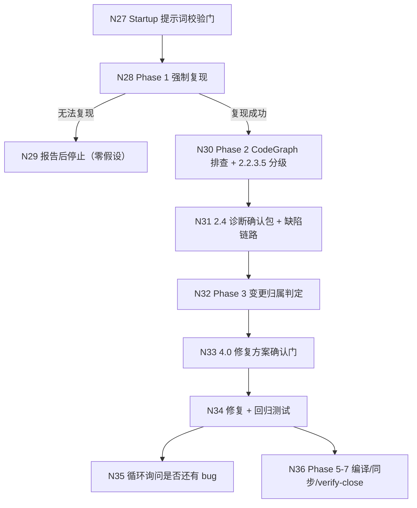

## Context

本变更来自探索 `openspec/changes/feat-debug-dual-track-entry/exploration.md`（子探索 003，流程基准 `status: confirmed` 继承主探索 2026-11-03 流程最终确认门，节点范围 N1–N38）的**链路 C：debug 双轨入口与门合并**，按决策 D8（三条诉求拆为三个变更）拆出的**变更 ③**（①提案校验 / Spec Ref；②委派门与门账本；③debug 双轨入口与门合并）。本变更只承接 ③，实现顺序在 ② 之后（`improve-proposal-validation-and-spec-ref`、`improve-delegation-gate-ledger` 已提案）。

本设计 MUST NOT 触及链路 A（校验器 / 依赖图 / Spec Ref 契约，属变更 ①）与链路 B（门账本 / 交付桥合并，属变更 ②）；也不实现代码 —— 规划边界为提案完成。

### 现状（CodeGraph 实测影响面）

| 符号 | 位置 | 影响面 |
| :--- | :--- | :--- |
| `getDebugSkillTemplate` | `src/core/templates/workflows/debug.ts:122-570` | 注册表 `registry.ts` 消费；`getDebugCommandTemplate`（`:572-583`）经 `deriveCommandContent` 派生指令版（单一源） |
| Phase 1 复现 | `debug.ts:203-226` | 强制复现、失败测试优先、显式步骤确认、不可复现即停止（`:225-226`） |
| 2.4 诊断确认包 | `debug.ts:278-307` | 根因 + 缺陷链路单次确认；三出口（确认 / 修改 / 拒绝） |
| Phase 3 关联变更判定 | `debug.ts:310-343` | 3.1 进行中变更 / 3.2 独立 bug 自动新建 / 3.3 归档来源 / 3.5 非缺陷退出 / 3.6 收束 |
| 4.0 方案数量判定 | `debug.ts:350-356` | 条件门（`multiple-fix-options`）：多方案阻塞、唯一方案直通、DB/schema 确认保留 |
| 4.2 回归测试 | `debug.ts:377-393` | 委派 `iagent_test`，修复前 FAIL / 修复后 PASS，覆盖异常 + 根因节点 |
| 概览第 5 条 | `debug.ts:136` | 「每次修复后询问用户是否还有相关 bug」—— 正文无对应步骤（N35 落差） |
| `DEBUG_INVESTIGATE` | `src/core/host-orchestration/workflows.ts:128-136` | handoff `rootCause` / `defectChain` / `changeName` / `affectedSymbols`；门 `diagnostic-confirmation` |
| `DEBUG_FIX` | `workflows.ts:139-147` | 输入含 `fixDecision`；门 `fix-option-confirmation` + `condition: multiple-fix-options` |
| `GATE_WHITELIST` / `PHASE_GATE_CATEGORY` | `src/core/host-orchestration/protocol.ts:94-131`（白名单）/ `:134-136`（锚点并集）/ `workflows.ts:219-226` | 5 类白名单与 3 个 debug 相关锚点映射；10 / 4 个调用方；测试 `test/host-orchestration.test.ts:626-630` |
| `auditGateWhitelistAlignment` | `workflows.ts:233-257` | 2 调用方（`index.ts`）；测试 `test/host-orchestration.test.ts` |

关键现状事实（供实现核对）：

- `debug.ts:225-226` 的强制检查点写作「无法建立复现时，向用户报告并说明已尝试的动作 —— MUST NOT 在假设下修复一个不可复现的 bug（零猜测原则）」，规范 `openspec/specs/workflow-suite-skills/spec.md:35` / `:56-59` 与之同义 —— 双轨入口必须先 MODIFY 规范，否则正文与规范互斥。
- 2.4 已是「只一个确认包」的实现（`debug.ts:280-283`），但与 4.0 的方案门仍是两次停点；Phase 3 位于两者之间（`:310`），因此「诊断 + 方案」合并必须同时把 Phase 3 前移，否则合并包无法携带 `changeName`。
- `DEBUG_INVESTIGATE.handoff`（`workflows.ts:132`）**不含** `fixDecision`，而 `DEBUG_FIX.input.required`（`:141`）已含 —— 合并包把方案决策前移后，该 handoff 必须补齐，否则 `fix` 会按回执校验规则报不完整。
- `test/templates.test.ts:323-329` 断言 `debugMain` 含「在修改任何代码之前必须复现该 bug」「MUST NOT 在假设下修复一个不可复现的 bug」；`:343-348` 断言 2.4 单包一次确认；`:356-363` 断言 4.0 的存在 —— 三项都需按双轨 / 门合并语义同步。
- `test/templates.test.ts:127-153` 的流程图断言为：debug 正文**必须含** `功能流程图`（中文）与 `🟠根因`，**不得含** `| 异常路径 |`；`test/template-language.test.ts:87-104` 的 `BANNED_PHRASES` 禁止英文形 `Functional Flowchart`。探索文件里的「功能流程图（Functional Flowchart）」是旧表述，落地口径 MUST 用中文形（本变更不新增英文形）。

### 流程基准引用（链路 C，MUST NOT 重新发明）

流程图与节点清单逐字取自 `exploration.md` 的「功能流程图」（`status: confirmed`，节点编号与主探索全局一致），本设计只引用、不重画：

| 节点 | 操作 | 证据位置 | 本变更的处理 |
| :--- | :--- | :--- | :--- |
| N27 | Startup 提示词校验门（缺陷五维） | `debug.ts:155-178` | 不改门本身；「复现步骤 Repro」维的判定结果作为默认轨道输入（U3） |
| N28 | Phase 1 复现（失败测试优先 / 显式步骤） | `debug.ts:203-226` | **改为双轨入口**：写入 `reproductionStatus` / `evidenceType`，默认复现优先、证据优先为条件轨道 |
| N29 | 无法复现时报告并停止 | `debug.ts:225-226`；规范 `spec.md:56-59` | **改写**：无证据 → 只报告候选并停止；有硬证据 → 允许进入 2.2（不再一律停止） |
| N30 | Phase 2 CodeGraph 排查 + 2.2.3.5 分级 | `debug.ts:55-92`、`references/investigation-protocol.md` | 不改（两轨共用） |
| N31 | 2.4 诊断确认包 + 缺陷链路 | `debug.ts:278-307` | **扩为「诊断 + 方案」包**；`changeName` / `affectedSymbols` 已在前置判定中产生 |
| N32 | Phase 3 变更归属判定 | `debug.ts:310-343` | **前移到 2.4 之前**；判断依赖根因外上下文时不前移（回退两次停点） |
| N33 | 4.0 修复方案确认门（条件门） | `debug.ts:350-356` | **降级为回退路径条件门**：合并包已含方案时不再触发；仅多方案时阻塞 |
| N34 | 修复 + 回归测试（委派 `iagent_test`） | `debug.ts:369-393` | 口径扩展：证据优先轨道的回归测试为 characterization test |
| N35 | 循环询问「是否还有相关 bug」 | `debug.ts:136`（仅概览声明） | **自造门删除**：降级为非阻塞提示，正文显式声明不构成确认门 |
| N36 | verify-close：验证 → 深度复查 → 文档桥 | `debug.ts:460-475` | 不改（需求文档桥为 debug 唯一文档确认面，变更 ② 已确认保留） |

## Goals / Non-Goals

**Goals**:

- 让 debug 对「无复现条件但有硬证据」的缺陷有出口，同时不削弱可验证性（复现优先仍是默认轨道）。
- 把同一次逻辑诊断收敛为一次确认，并让变更归属与诊断同批交付（U7）。
- 删除概览与正文不一致的自造门，使确认门集合与门白名单一致（N35）。
- 规范、协议声明与模板正文三处语义一致（U9），门白名单 5 类与锚点集合逐字不变。

**Non-Goals**:

- 不删除任何门白名单条目，不改变 `GateSpec` 形状、`condition` 语义与 `evaluatePhaseTransition` 判定逻辑。
- 不把复现降级为可选装饰：无可建立回归测试的证据时仍然不修复（零假设不变）。
- 不触碰链路 A（校验器 / Spec Ref）与链路 B（门账本 / 交付桥）。
- 不实现代码：本变更只提案，落地由用户后续 `/iagent:spec-apply` 触发。

## Decisions

### D1: 复现契约与默认轨道判定（消解 U3）

- **选择**:
  - Phase 1 增加 `reproductionStatus`（`reproduced` / `not-reproduced` / `intermittent` / `static-only`）与 `evidenceType`（`failing-test` / `manual-steps` / `log-trace` / `static-proof` / `review-finding`），写入诊断记录并在 Phase 6 持久化到变更 `exploration.md`。
  - **默认轨道 = 复现优先**：`复现步骤 Repro` 维可判定触发方式 **且** `reproductionStatus = reproduced` → 复现优先。
  - **证据优先**：仅在「无可执行复现条件」且存在硬证据（`文件:行` / 日志 / 测试）时启用。
  - **无法判定 → 复现优先**（fail-safe 方向与 2.2.3.5「阈值边界取深度」同构：误走复现优先的代价是多一次复现尝试，误走证据优先的代价是降低验收判据）。
- **理由**: 用户问「debug 是基于复现还是基于问题发现」——现状是强制复现；完全转向问题发现会削弱验收判据。联合判定避免两个信号互相覆盖（U3 的原缺口正是「只看 status、不看提示词质量」导致的轨道误判）。
- **备选**: ① 仅按 `reproductionStatus` 判定（简单但 U3 未解：含糊描述会被判成 `not-reproduced` 而直入证据轨道）；② 引入独立评分卡（新增用户可见维度，与缺陷五维重复）。

### D2: 证据门槛（`not-reproduced` / `static-only` / `intermittent`）

- **选择**:
  - `not-reproduced` / `static-only` MUST 具备 `文件:行` 静态证据，或日志 / 测试证据，否则不得进入修复。
  - `intermittent` MUST 取得**至少一条可重复证据**（日志 / 测试 / 静态证明）并记录复现条件。
  - 证据类型记录在 `evidenceType`，使「凭什么修」可审计。
- **理由**: 「时好时坏」是最容易被主观放行的类别；用「可重复」而非「出现过」作门槛，把偶发现象挡在修复之外。三类状态的证据要求一致化，避免出现「换成 static-only 就绕过门槛」的空档。
- **备选**: 为 `intermittent` 允许「用户口头确认」单独放行 —— 拒绝，这与零假设原则冲突，且不可追溯。

### D3: 无证据时只报告候选（零假设保留）

- **选择**: 证据不足时输出「候选根因 / 候选缺陷 + 已尝试的调查动作」，不修改代码、不新建变更、不标记可归档；与 3.5 非缺陷退出并列但语义不同（前者是证据不足，后者是行为符合预期）。
- **理由**: 原 N29 出口是「一律停止」，把「调查过了但证据不够」和「什么都没做」混为一谈；报告候选使一次调查仍有产出，同时不越过修复门槛。
- **备选**: 保持「一律停止」（无法处理真实缺陷类别）；或放宽到「按最佳猜测修复」（违反零猜测与 coding-rules）。

### D4: 「诊断 + 方案」合并包与 Phase 3 前移（消解 U7）

- **选择**:
  - Phase 3 的变更归属判定**前移**到 2.4 之前，产出 `changeName` 与 `affectedSymbols`。
  - 2.4 的确认包内容扩为「根因证据 + 缺陷链路图 + 修复方案」：唯一方案给出唯一性证据后随包确认；多方案在包内逐项给出做法 / 影响 / 建议并一次选定。
  - **回退路径**：变更归属依赖根因之外的上下文（多变更候选 / 归档来源追溯 / 范围待定）→ 退回「2.4 诊断门 + 4.0 方案门」两次停点，`4.0` **仅在多方案时**触发。
  - 三出口（确认 / 修改后重呈 / 拒绝终止修复并输出诊断报告）逐个保留。
- **理由**: 合并的前提是「方案可由根因直接推导」——一旦归属需要额外上下文，方案就可能在归属确定后改变，此时合并会让用户在信息不全时确认方案。回退路径保留安全边界，同时用「仅多方案触发」避免回退变成常态化二次停点。
- **备选**: ① 直接删除 4.0（唯一方案场景失去 DB/schema 之外的方案展示面，且回退路径无门可用）；② 合并但取消回退（在归属不明时仍单包确认，属于把不安全场景说成安全）。

### D5: 自造门删除（N35）

- **选择**: 概览第 5 条（`debug.ts:136`）改为「每次修复后可继续报告相关 bug（非阻塞提示；用户主动提出时才追加循环）」，并在正文与 Guardrails 显式声明「不构成确认门、MUST NOT 作为停点」。
- **理由**: 概览声明与正文落差的直接后果是模型自行补门（N35）；补门与门白名单（5 类正向枚举）冲突，且用户无法预期停顿点。删除与降级的差别只在于是否保留「多 bug 连续调试」的能力 —— 保留能力但明确非阻塞，既不丢功能也不留自造门。
- **备选**: 彻底删除循环语义 —— 会让「同一区域还有第二个 bug」的场景退化到重新发起调试，成本高于收益。

### D6: 规范同步与协议声明（消解 U9）

- **选择**:
  - `specs/workflow-suite-skills/spec.md` 以 MODIFY 更新两条 Requirement：
    - 「debug 强制复现与根因确认门」（主规范 `:35`）：**Requirement 名称逐字保留**（保证归档同步按名匹配，不产生孤儿需求），正文扩为双轨 + 合并包；场景「无法复现时不修复」名称保留但 `WHEN` 收紧为「无法建立复现**且**无硬证据」。
    - 「debug 修复方案确认与回归测试职责」（主规范 `:736`）：该需求原文把方案评估写在「根因/缺陷链路确认及变更归属判定后」，与合并包直接冲突；改写为「归属判定后于同一包内一并评估方案」，并补 characterization test 口径。既有 9 条场景随包重发。
  - 场景编号口径统一到模板正文：既有规范写作「2.5 缺陷链路图」，而正文自始没有 2.5 章节（缺陷链路在 2.4 内），本次 MODIFY 一并改为 2.4（纯口径对齐，无行为变更）。
  - `specs/host-orchestration/spec.md` 以 MODIFY 更新「debug host protocol 拆分 fix 与 verify-close」：`investigate.handoff` 增补 `fixDecision`，并写入「合并确认面不改变 5 类白名单 / 锚点集合 / 每阶段 1 个阻塞门」。
  - 代码侧只改 `workflows.ts` 的 `DEBUG_INVESTIGATE.handoff` 与注释；`protocol.ts` 零改动（作为不变量由测试守护）。
- **理由**: 规范是 debug 正文的验收依据，双轨落地却不改规范会立刻产生「实现与规范互斥」；先改规范再改正文，才能让 `test/templates.test.ts` 的断言改动有据可依。`fixDecision` 若不进 handoff，`fix` 的必需输入在协议上永远缺失。
- **备选**: 新增一条并列 Requirement 而不 MODIFY 旧的 —— 违背任务要求（U9 明确要求 MODIFY），且会让「无法复现一律不修复」继续有效。

### D7: 证据优先轨道的回归测试口径

- **选择**: 证据优先轨道的回归测试为 characterization test：先以断言固化当前可观察行为（含缺陷表现），再断言修正后的行为；仍须「修复前 FAIL、修复后 PASS」并覆盖异常 + 根因节点；无法建立可执行断言 → 回到 D3（只报告候选）。
- **理由**: 无复现条件时，「修复前 FAIL」无法用原始复现建立；characterization test 是可执行的替代判据，且能防止修复顺手改动无关行为。
- **备选**: 豁免回归测试（违反 4.2 的强制回归测试护栏）；或以手工步骤验收（不可回归、不可审计）。

### U3 / U7 / U9 消解对照

| 项 | 原缺口 | 落点 |
| :--- | :--- | :--- |
| U3 | 默认轨道判定规则缺失，含糊描述会被误判为证据轨道 | D1（`复现步骤 Repro` 维 + `reproductionStatus` 联合判定，无法判定默认复现优先）→ `workflow-suite-skills / 双轨默认判定取复现优先` |
| U7 | 合并 2.4 / 4.0 与 Phase 3 顺序未定，可能丢失安全边界 | D4（Phase 3 前移 + 回退两次停点 + 4.0 仅多方案）→ `host-orchestration / 回退路径下多方案仍阻塞 fix` |
| U9 | 规范仍要求「无法复现一律不修复」，且「修复方案确认与回归测试职责」把方案评估写在诊断确认之后 | D6（MODIFY 两条 Requirement，名称逐字保留）→ `workflow-suite-skills / 无法复现时不修复`（改写）+ `证据优先轨道允许修复无复现缺陷`（新增）+ `debug 修复方案确认与回归测试职责 / 多个可行修复方案须等待选择`（补「只确认一次」） |

## Risks / Trade-offs

| 风险 | 缓解 |
| :--- | :--- |
| 「证据优先」被当成「免复现通道」，实际放行弱证据 | 证据门槛写死为 `文件:行` / 日志 / 测试三类，且 `evidenceType` 必填、随 Phase 6 持久化；`intermittent` 另加「可重复」要求；测试断言正文含门槛原句 |
| 合并包让用户在信息不全时确认方案（归属后变） | D4 回退路径显式：归属依赖根因外上下文即退回两次停点；4.0 仅多方案触发，唯一方案仍有唯一性证据要求 |
| 门合并被误读为「少一道门」 | 门预算与白名单作为不变量：`GATE_WHITELIST` 5 类 / 锚点集合逐字不变、`auditGateWhitelistAlignment()` 返回空数组、每阶段 ≤ 1 阻塞门，均由测试守护；正文保留「合并只合并确认面，不删除门」原句 |
| MODIFY 规范导致归档同步产生孤儿需求或丢失场景 | Requirement 名称逐字保留、既有场景全部随包重发（12 条既有 + 新增），仅在「无法复现时不修复」收紧 `WHEN`；tasks 中列专门的规范对齐核对任务 |
| `fixDecision` 进入 `investigate` handoff 后，旧调用方按「超集即不匹配」校验会失败 | `PhaseSpec.handoff` 的消费侧为 `toContain` 语义（`test/host-orchestration.test.ts:322-330`）；只追加字段，不重排、不删字段，回归确认既有断言仍通过 |
| `test/templates.test.ts` 既有断言与双轨语义互斥（如「MUST NOT 在假设下修复一个不可复现的 bug」） | 断言随正文同步改写为「无证据不修复」原句；保留 `| 异常路径 |` 禁止、`功能流程图` 与 `🟠根因` 必须出现的流程图契约（注意 `Functional Flowchart` 英文形被 `template-language.test.ts` 禁止） |
| 模板单一源被绕过（手工改 `skills/` 或指令版） | 只改 `src/core/templates/workflows/debug.ts`，随后 `pnpm build && pnpm generate:skills`；`test/skills-parity.test.ts` 逐字节守护 |
| 与变更 ② 的同文件冲突 | 本变更只动 `debug.ts`、`workflows.ts` 的 debug 段、两份规范与 debug 相关测试；不触碰 `spec-apply.ts` / handoff 包 / 门账本（属 ②），实施顺序在 ② 之后。`protocol.ts` 的处理口径为**符号级**：② 修改同文件的 `Receipt` / `validateReceipt`（账本字段）属预期前置改动，本变更只保证 `GATE_WHITELIST` / `GATE_WHITELIST_ANCHORS` / `PHASE_GATE_CATEGORY` 三个符号不变，MUST NOT 以整文件 diff 为空作为通过条件（否则在 ② 落地后产生假失败，或误删 ② 的账本字段） |
