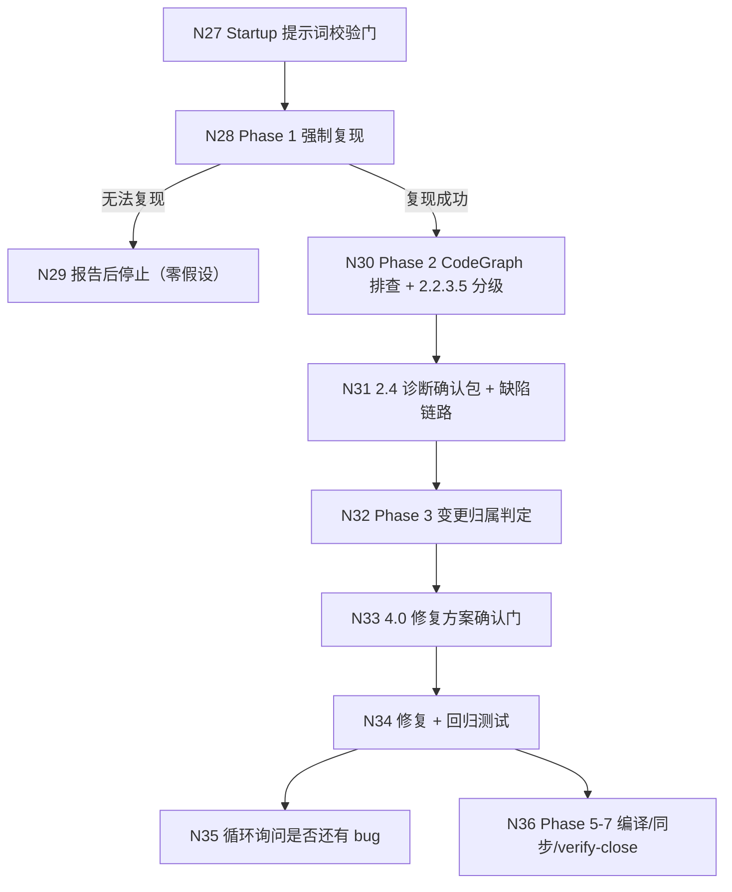

# debug 双轨入口与门合并优化探索（子探索 003）

> 探索文件 — Phase 1（mode=delegated）派生子探索
> 创建时间：2026-11-03
> 状态：Phase 1 完成（流程基准已确认）
> 派生说明：本文件由已确认的主探索 `skill-instruction-optimize-explore-001.md` 按决策 D8（三条诉求拆为三个变更）派生，承接**链路 C（N27–N36）**与决策 D6（debug 部分）、D7；内容逐字取自主探索，流程基准确认状态继承主探索（2026-11-03 用户在流程最终确认门回复「确认」，节点范围 N1–N38）。

## Background

用户诉求 3（逐字取自主探索 Background）：

**debug 模式探索逻辑**：当前 debug 是基于复现，还是基于问题发现？需分析现有探索逻辑并重新设计优化。

辅助诉求（诉求 2 的 debug 部分）：debug 的委托门存在多次确认（诊断门 + 方案门两次停点；概览声明的「每次修复后询问」自造门），需减少用户介入。
- 规划边界：到此停止 —— 等待用户发起新请求（如 `/iagent:spec-apply`）开始实现。

## 提示词基线 (Prompt Baseline)

- **原始诉求**：debug 模式处理问题逻辑，是基于复现，还是基于问题发现，分析当前 debug 技能探索逻辑，重新设计优化。
- **确认后的基线**：现状为强制复现（无法复现不修复，零假设）；重新设计为**双轨入口**——保留「复现优先」为默认轨道，新增「证据优先」轨道（无复现条件时以静态/日志/审查证据建立可证伪假设）；同时合并 debug 的 2.4 诊断门与 4.0 方案门为「诊断 + 方案」包，删除概览自造门。规划边界为提案完成后停止。
- 下游（提案 / 设计 / 规格 / 任务）以本基线为唯一语义来源。

## 功能流程图

**status: confirmed**（继承主探索 2026-11-03 流程最终确认门「确认」；本变更承接链路 C，节点编号与主探索全局一致）

### 节点清单（链路 C，逐字取自主探索）

| 节点 | 操作 | 触发条件 | 证据位置 | 异常路径 |
| :--- | :--- | :--- | :--- | :--- |
| N27 | Startup 提示词校验门（缺陷五维） | 记录 bug 描述后、Phase 1 之前 | `src/core/templates/workflows/debug.ts:155-178` | 不明确 → 优化后阻塞等待确认（`:163`） |
| N28 | Phase 1 强制复现（失败测试优先 / 显式步骤） | 提示词门通过 | `debug.ts:203-226` | 无法复现 → N29；显式步骤需用户确认（`:216-222`） |
| N29 | 无法复现时报告并停止 | 无失败测试且用户无法确认步骤 | `debug.ts:225-226`；规范 `openspec/specs/workflow-suite-skills/spec.md:56-59` | 零假设：不修复不可复现 bug |
| N30 | Phase 2 CodeGraph 排查 + 2.2.3.5 深度分级 | 复现成功 | `debug.ts:55-92`、`:84-105`；`references/investigation-protocol.md` | CodeGraph 不可用 → Grep 降级，分级仍生效（`:72-76`） |
| N31 | 2.4 诊断确认包 + 缺陷链路 | 根因收敛（单一或多候选选定后） | `debug.ts:278-307` | 拒绝 → 终止修复并输出诊断报告（`:286-292`） |
| N32 | Phase 3 变更归属判定 | 诊断确认 | `debug.ts:310-343` | 独立 bug → 自动新建变更，不询问（`:319-323`）；归档来源 → 新建变更（`:325-329`） |
| N33 | 4.0 修复方案确认门（条件门） | 变更归属明确后 | `debug.ts:350-356` | 多方案 → 阻塞；唯一且证据充分 → 直通（`:353-356`） |
| N34 | 修复 + 回归测试（委派 `iagent_test`） | 方案确认/直通 | `debug.ts:369-393` | 回归测试缺失/失败 → 不得报告验收通过（`:390-393`） |
| N35 | 循环询问「是否还有相关 bug」 | 每次修复后（**仅概览声明**） | `debug.ts:136`；正文无对应步骤（落差） | 模型自行补门 → 额外停顿 |
| N36 | verify-close：验证 → 深度复查 → 文档桥 | 循环结束 | `debug.ts:460-475` | 验证 FAIL → 自动修复循环；文档已存在 → 禁用生成分支（`:466-470`） |

> 确认后的流程图 = 流程基准；发现遗漏节点 MUST 回主探索 1.5.5 更新并重新确认，MUST NOT 在 tasks.md 中静默补节点。
> 本变更的期望态改造点：N28 增加双轨入口（复现优先 / 证据优先）；N29 改为「证据不足时只报告候选」而非一律停止；N31+N33 合并为「诊断 + 方案」包（N32 变更归属前移到 N31 之前）；N35 自造门删除或降级为非阻塞提示。

## Decisions

（逐字取自主探索 `## Decisions`，仅保留本变更承接项）

- **D6（debug 部分）**：debug 的 2.4 诊断门与 4.0 方案门合并为「诊断 + 方案」包；删除 debug 概览中的「每次修复后询问」自造门。
- **D7**：debug 新增双轨入口：`reproductionStatus`（reproduced / not-reproduced / intermittent / static-only）与 `evidenceType`（failing-test / manual-steps / log-trace / static-proof / review-finding）；证据优先轨道在无 `文件:行` 证据或无可建立回归测试时只报告候选、不修复。

### 决策过程（逐字取自主探索决策 3）

- **Chosen（建议）**: **B**——保留「行为缺陷复现优先」作为默认轨道；新增「证据优先」轨道，仅在无复现条件时启用，且必须有 `文件:行` 证据或日志/测试证据。两条轨道共用 2.2.3.5 分级、2.4 诊断包、缺陷链路与 4.2 回归测试；无证据不修复。
- **Rationale**: 用户问「是基于复现，还是基于问题发现」——现状是**强制复现**；但完全转向问题发现会削弱验收判据。双轨是保持「可验证」与「可处理不可复现缺陷」的平衡。

### 本变更内消解的 Unresolved 项（依据主探索建议落定）

- **U3（默认轨道判定）**：由 bug 五维中的「复现步骤」维与 `reproductionStatus` 联合判定；无法判定时默认复现优先。
- **U7（2.4/4.0 合并与 Phase 3 顺序）**：把 Phase 3 变更归属前移到 2.4 之前，再在同一确认包内呈现诊断 + 方案；若变更归属依赖根因之外的上下文，则退回「2.4 诊断门 + 4.0 条件门」两次停点，但 4.0 仅在多方案时触发。
- **U9（规范同步）**：以 MODIFY 更新 `openspec/specs/workflow-suite-skills/spec.md:35`「debug 强制复现与根因确认门」及 `:56-59`「无法复现时不修复」场景；保留复现优先为默认轨道，新增 `not-reproduced` / `static-only` 的证据门槛，不删除零假设原则。

## 边界场景

（逐字取自主探索 `## 边界场景`，仅保留本变更承接项）

- [ ] debug 问题发现：无复现但静态证据充分 → 允许修复，回归测试为 characterization test；证据不足 → 只报告候选，不修复。
- [ ] debug 间歇性 bug：复现状态 `intermittent` → 允许进入排查，但修复前必须有至少一条可重复的证据（日志/测试/静态证明）。

## Pending

### For Phase 2 Impact Analysis

| 符号 | 位置 | 优先级 | 影响面 |
| :--- | :--- | :--- | :--- |
| `debug.ts` Phase 1 / 2.4 / 4.0 / 概览 | `src/core/templates/workflows/debug.ts:203` / `:278` / `:350` / `:136` | HIGH | 双轨入口、门合并、自造门删除 |
| `GATE_WHITELIST` / `WORKFLOW_PROTOCOLS`（debug 门声明） | `src/core/host-orchestration/protocol.ts:94` / `workflows.ts:186` | HIGH | debug investigate/fix 阶段门合并声明 |
| `openspec/specs/workflow-suite-skills/spec.md` | `:35`、`:56-59` | HIGH | MODIFY「强制复现」Requirement 与场景 |
| `test/templates.test.ts` debug 断言 | — | MEDIUM | 正文不得含 `\| 异常路径 \|`、必须含 `功能流程图（Functional Flowchart）` 与 `🟠根因` |

### 约束（逐字取自主探索 Constraints）

- **门白名单不可删**：只能合并确认面，不能移除 5 类门（`protocol.ts:94-131`；`host-orchestration/spec.md:92-118`）。
- **模板单一源**：技能正文改 `src/core/templates/workflows/debug.ts`，再 `pnpm build && pnpm generate:skills`。
- **测试契约**：`test/templates.test.ts` 断言 debug 正文不得含 `| 异常路径 |`、必须含 `功能流程图（Functional Flowchart）` 与 `🟠根因`；改 debug 正文需同步这些断言。
- **规划边界**：本次探索/提案不实现；`spec-propose` 在验证 PASS 后停止。

## 术语表

| 术语 | 定义 | 避免使用 |
| :--- | :--- | :--- |
| 复现契约（reproduction contract） | debug 启动时声明的复现状态与证据类型：`reproduced` / `not-reproduced` / `intermittent` / `static-only` | 复现步骤 |
| 证据优先（evidence-first） | debug 的第二种入口：不强制复现，以日志/静态证据/审查发现建立可证伪假设 | 问题发现（口语） |
| 诊断 + 方案包 | 把根因、缺陷链路与修复方向合并为一次确认的包 | 诊断门 + 方案门 |

> 以上术语均已同步至 `openspec/CONTEXT.md`（2026-11-03 增补段）。

## 需求文档状态

- requirementDocStatus: skipped-by-user

> 由 `iagent-workflow` Phase 3.5 需求文档桥写入：用户选择跳过需求文档生成。
> archive 阶段不得因文档缺失而自动补生成（兼容分支仅适用于无显式状态的历史变更）。
