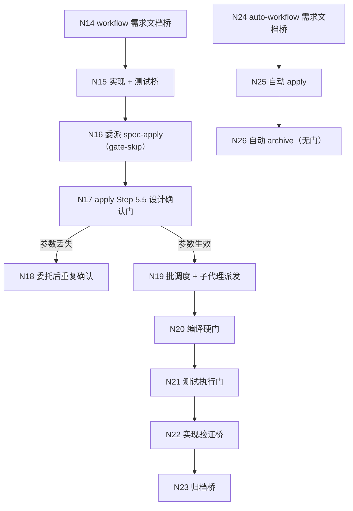

## Context

本变更来自探索 `openspec/changes/improve-delegation-gate-ledger/exploration.md`（子探索 002，流程基准 `status: confirmed` 继承主探索 2026-11-03 流程最终确认门，节点范围 N1–N38）的**链路 B：自动实现委派门与门账本**，按决策 D8（三条诉求拆为三个变更）拆出的**变更 ②**（①提案校验/Spec Ref；②委派门与门账本；③debug 双轨入口）。本变更只承接 ②，实现顺序在 ① 之后（`improve-proposal-validation-and-spec-ref` 已提案）。

本设计 MUST NOT 触及链路 A 的校验器 / 依赖图 / Spec Ref 契约（属变更 ①），也 MUST NOT 触及 debug 的双轨入口与「诊断 + 方案」合并（属变更 ③）。

### 现状（CodeGraph 实测影响面）

| 符号 | 位置 | 影响面 |
| :--- | :--- | :--- |
| `GATE_WHITELIST` | `src/core/host-orchestration/protocol.ts:94-131` | 5 类条目与锚点集合；消费方 `PHASE_GATE_CATEGORY` / `auditGateWhitelistAlignment` / `transition.ts`；测试 `test/host-orchestration.test.ts:845-851` |
| `WORKFLOW_PROTOCOLS` | `src/core/host-orchestration/workflows.ts:186-204` | 4 调用方（`index.ts` 导出、`getWorkflowProtocol`、`auditGateWhitelistAlignment`）；测试 `test/host-orchestration.test.ts:818-877` |
| `Receipt` / `validateReceipt` | `src/core/host-orchestration/protocol.ts:245-257` / `:274-296` | 4 调用方（`transition.ts:104`、`index.ts` 导出）；测试 `test/host-orchestration.test.ts:50-73`、`:490-495`、`test/spec-workflow-contract.test.ts` |
| `evaluatePhaseTransition` | `src/core/host-orchestration/transition.ts:68-115` | 4 调用方（`index.ts` 导出）；测试 `test/host-orchestration.test.ts`、`test/spec-workflow-contract.test.ts` |
| `renderOptions` | `src/core/host-orchestration/actions.ts:41-54` | 1 调用方（`renderDelegate` `:70`）；经 `renderDelegate` 被 `test/claude-host-adapter.test.ts`、`test/host-orchestration.test.ts:743-754` 覆盖 |
| `DELEGATION_PARAMETERS` | `src/core/host-orchestration/render.ts:113-126` | 3 调用方（`index.ts` 导出、`renderHostOrchestrationSection`）；测试 `test/host-orchestration.test.ts:1008-1020` |
| `spec-apply.ts` Step 5.5 | `src/core/templates/workflows/spec-apply.ts:364-414` | 门承载参数检查在 `:368`；临时工作区协议在 `:416-419` |
| `workflow.ts` 3.5 / 3.7 | `src/core/templates/workflows/workflow.ts:86-128` / `:352-359` | 文档桥与实现桥两次停点；Phase 4 委派在 `:362-370` |
| `auto-workflow.ts` 3.3 / 4.1 | `src/core/templates/workflows/auto-workflow.ts:89-100` / `:110-129` | 文档桥为唯一门；自动 apply 委派段 |

关键现状事实（供实现核对）：

- `Receipt` 只有 `phase` / `status` / `artifact` / `nextAllowed` / `failure` / `requirementDocStatus`（`protocol.ts:245-257`），**没有任何门字段** → 被委派技能无法证明父级已确认（N18 的根因）。
- `renderDelegate`（`actions.ts:64-86`）只是把 `gate-skip=...` 渲染进提示文本，**没有协议级参数传递**；`resolveDelegationContract`（`delegation-contract.ts:73-127`）只在解析期对未知 gate id 记 WARN。
- `workflow` 的 VERIFY 声明 `requirement-doc-bridge`（`workflows.ts:77-80`、`:189`），而规范同时要求该声明（`openspec/specs/host-orchestration/spec.md:484-488`）；`test/host-orchestration.test.ts:831-843` 断言 `workflow/verify` 的门 id 为 `requirement-doc-bridge` —— 合并交付桥必须同步改这三处。
- `DELEGATION_PARAMETERS` 只允许 `mode` / `gate-skip` 两个参数键（`render.ts:113-126`），测试 `:1008-1020` 断言其与模板正文同源同值。

### 流程基准引用（链路 B，MUST NOT 重新发明）

流程图与节点清单逐字取自 `exploration.md` 的「功能流程图」（`status: confirmed`，节点编号与主探索全局一致），本设计只引用、不重画：

| 节点 | 操作 | 证据位置 | 本变更的处理 |
| :--- | :--- | :--- | :--- |
| N14 | workflow 需求文档桥（生成 / 跳过） | `workflow.ts:100-107` | **并入交付桥**（不再单独停一次），状态持久化语义保留 |
| N15 | workflow 实现 + 测试桥（单次确认） | `workflow.ts:352-359` | 扩为「交付桥」：实现 + 测试计划 + 文档选项 |
| N16 | 委派 `iagent_spec_apply` 并传 `gate-skip=design-confirmation` | `workflow.ts:364-368`；参数表 `render.ts:113-126`；渲染 `actions.ts:41-53` | 保留主通道；**委派前写门账本并校验存在** |
| N17 | apply Step 5.5 设计确认门 | `spec-apply.ts:364-414` | 增加账本读取（兜底通道），两者皆缺时照常执行 |
| N18 | 委托后重复确认（同一次设计确认第二次出现） | `spec-apply.ts:368`；`delegation-contract.ts:73-127`；`protocol.ts:233-257` | **消解**：参数丢失时账本兜底；回执 `confirmedGates` 使「已确认」可交付、可审计 |
| N19 | 批调度 + 子代理派发 | `spec-apply.ts:421` | 不改（门通过后行为不变） |
| N20 | 编译检查硬门 | `spec-apply.ts:431-466` | 不改 |
| N21 | 测试执行门（仅变更范围） | `spec-apply.ts:472-499` | 不改 |
| N22 | 实现验证桥（`spec-verify`） | `workflow.ts:384-388` | 不改 |
| N23 | 归档桥 | `workflow.ts:395-401` | 不改 |
| N24 | auto-workflow 需求文档桥（本阶段唯一门） | `auto-workflow.ts:94-100` | **保留为唯一门**（不合并）；收束后写账本 |
| N25 | auto-workflow 自动 apply | `auto-workflow.ts:110-128` | 委派前校验账本存在；`gate-skip` 主通道 + 账本兜底 |
| N26 | auto-workflow 自动 archive（无门） | `auto-workflow.ts:164-182`；协议 `workflows.ts:104-125` | 不改 |

## Goals / Non-Goals

**Goals**:

- 委派参数丢失不再导致同一次设计确认重复出现：`gate-skip` 主通道 + 门账本兜底（N18 消解）。
- 「已确认门」成为机器可读、可跨阶段交付、可审计的事实：handoff 包 `## 已确认门` + 回执 `confirmedGates`。
- 账本缺失 / 伪造 / 过期一律 fail-safe 到「门照常执行」，绝不静默跳过。
- workflow 同一阶段内的两次相邻停点合并为一次交付桥，5 类必留门与门预算不变。
- 协议门清单与模板声明重新一致（U8），且白名单锚点集合一字不删。

**Non-Goals**:

- 不删除或新增 `GATE_WHITELIST` 类别，不改变锚点集合语义（`requirement-doc-bridge` 仍挂在 `requirement-clarification`）。
- 不改变 `GateSpec` 形状、条件门 `gateConditions` 语义与 `evaluatePhaseTransition` 的三要素判定逻辑（门 / 回执 / 能力）。
- 不新增委派参数键（不引入第三轴），不改 `mode` / `gate-skip` 双轴正交语义与 `auto-mode` 兼容映射。
- 不把 auto-workflow 的文档桥并入交付桥（该链保留文档桥为唯一门）。
- 不触及 debug 的双轨入口、「诊断 + 方案」合并与自造门删除（属变更 ③）。
- 不实现代码：本变更只提案，实施由用户后续发起 `/iagent:spec-apply`，且排在变更 ① 之后。

## Decisions

### D1: 门账本载体与写入门槛（U4 落定）

- **选择**: 账本载体固定为变更级 handoff 包 `.openspec-tmp/pipeline-<change-name>/handoff-pack.md` 的 `## 已确认门` 段（与六节并列，不计入六节）；条目 = 门 id + 确认阶段，门 id 取值收敛到 `GATE_SKIP_IDS`。写入契约：**门确认后立即写，委派前校验存在，写入或校验失败 → 停止不委派**。
- **理由**: handoff 包已是跨阶段只读复用的单一载体（`spec-propose` 一次产出、verify/apply/archive 只追加），账本放在这里无需新增文件与新的生命周期；`## 阶段结论` 的「只追加」语义与六节语义都不受影响。
- **U4 取舍**: 选「门确认后写 + 委派前校验 + 失败停止」。不选「委派后写」（账本晚于事实，参数丢失时无法兜底）、不选「写入失败降级继续」（会产生既无参数又无账本的静默跳过）。
- **备选**: ① 独立账本文件 `.openspec-tmp/pipeline-<change>/gates.json`（新增文件、新增清理面、Markdown-first 边界受挑战）；② 写进变更 `exploration.md`（跨阶段语义混淆，且探索文件属规划制品）。均否决。

### D2: `Receipt.confirmedGates` 与校验方向（fail-safe）

- **选择**:
  - `Receipt` 增加可选字段 `confirmedGates?: string[]`；**不进入** `DEFAULT_RECEIPT_FIELDS`。
  - `validateReceipt` 增加形状 / 取值校验：非数组、元素非字符串、空串、未知门 id → 校验失败（`missing`/`reason` 说明），由 `evaluatePhaseTransition` 以 `invalid-receipt` 阻断。
  - 值域单一源：`GATE_SKIP_IDS`（`delegation-contract.ts` 为叶模块，`protocol.ts` 导入不构成循环）。
- **理由**: 缺失即「无账本」→ 门照常触发，是安全方向；非法则说明写入方违约（伪造 / 版本不一致），必须阻断而非忽略。把字段设为可选，历史回执与历史变更不被判为无效。
- **不变量**: 回执是账本的**上游真源** —— 账本条目 MUST NOT 超出回执声明的已确认门；不一致时视为未确认并 WARN。

### D3: apply 的门承载降级链（主通道优先）

- **选择**: Step 5.5 判定顺序固定为：
  1. `gate-skip` / `auto-mode`（主通道，权威）→ 跳过整道门；
  2. 未传时只读 handoff 包 `## 已确认门`（兜底）→ 段内 `design-confirmation` 且与回执一致 → 跳过并记 WARN；
  3. 两者皆缺 → **照常执行** Step 5.5（fail-safe）。
  账本与回执不一致 / 条目过期 → WARN + 视为未确认（回到 3 的路径）。
- **理由**: 「主通道 + 兜底 + 缺省执行」是唯一能同时满足「减少重复确认」与「绝不静默跳过」的顺序；主通道优先避免账本被用来覆盖显式参数。
- **备选**: ① 账本与参数取并集（若账本多出未确认门将放大权限，危险）；② 账本优先（历史包可能陈旧，覆盖显式参数）；③ 只传参数、不读账本（N18 不解决）。均否决。
- **WARN 语义**: 走兜底通道必须留痕（「使用了门账本兜底通道」），否则无法从日志区分「参数生效」与「账本兜底」，也无法统计 N18 的实际发生率。

### D4: 交付桥合并与协议声明调整（U8 落定）

- **选择**: workflow 的 Phase 3.5 文档桥并入 Phase 3.7 实现桥，形成**一次「交付桥」**，出口为：确认（实现 + 生成文档）/ 确认（仅实现）/ **仅生成文档（停在规划边界，状态 `generated`）** / 修改 / 拒绝。同步：
  - `WORKFLOW_PROTOCOLS.workflow` 的 VERIFY 退回无门的 `VERIFY_PHASE`（`VERIFY_WITH_BRIDGE` 仅保留给 auto-workflow）；
  - `requirement-doc-bridge` 锚点与 `PHASE_GATE_CATEGORY` 映射**保留**（auto-workflow 的 VERIFY 与 debug 的 `verify-close` 继续声明）；
  - `GATE_WHITELIST` 5 类条目与锚点集合逐字不变；`APPLY_PHASE.handoff` 增加 `confirmedGates`。
- **理由**: 两次停点之间没有新的决策信息，合并只压确认面、不删门；U8 的协议调整是合并的必然结果 —— 若保留 `workflow/verify` 的 `requirement-doc-bridge` 声明，协议门清单将与模板（不再在验证阶段停）漂移，正是 `host-orchestration/spec.md:484-488` 已记录过的同类缺陷。
- **门预算**: workflow 验证阶段阻塞门 1 → 0，实现阶段仍为 1；auto-workflow 保持「验证阶段 1（文档桥）/ 实现 0 / 归档 0」。
- **术语与回归面保留（实测约束）**: 现有断言把 workflow 的桥文案钉成了可断言术语 —— `test/artifact-dataflow.test.ts`（`:141-147` 三父流程含 `需求文档桥`、`:259-267` 含 `单次业务桥`、`:320-327` 含 `实现 + 测试桥`、`:346` 派生版含 `FAIL 不出文档桥`）、`test/template-consistency.test.ts:172-175`（含 `实现 + 测试桥`）、`test/template-derivation.test.ts:159-204`（含 `FAIL 不出文档桥`）。合并因此 MUST 保留「实现 + 测试桥」桥名、`单次业务桥` 语义与 `FAIL 不出文档桥` 护栏句（可与「交付桥」并列），并要求三个测试文件在实现后通过（允许同步更新断言，MUST NOT 删断言）。这三者**不在**原任务清单内，属本设计补正的执行前提。
- **备选**: ① 保留两次停点、只加账本（用户诉求「减少介入」未解决）；② 删除 `requirement-doc-bridge` 锚点与类别映射（违反门白名单不可删约束，且 auto-workflow / debug 仍需要）；③ 把文档桥移到实现阶段作为第二个门（破坏门预算）。均否决。

### D5: auto-workflow 接账本但保留文档桥

- **选择**: auto-workflow 的 Phase 3.3 文档桥收束后写 `design-confirmation` 到账本、回执携带 `confirmedGates`，Phase 4.1 委派前校验账本存在；`gate-skip` 继续随委派传递（主通道），账本为兜底；两者皆缺 → 被委派 apply 的设计门照常触发。
- **理由**: auto-workflow 的文档桥是它**唯一的流程级阻塞门**（`auto-workflow.ts:94-100`、`workflow-suite-skills/spec.md:812-829`），合并没有收益主体；它真正需要的是「桥已确认」这件事能可靠传到 apply，正是账本的用途。
- **不变量**: auto-workflow MUST NOT 复用 workflow 的交付桥语义，MUST NOT 新增阻塞门。

### D6: 委派参数表不新增第三键

- **选择**: `DELEGATION_PARAMETERS` 的取值保持 `{ mode?, 'gate-skip'? }`；账本路径由 change-name 确定性派生（`gateLedgerPath(changeName)`），MUST NOT 作为参数键传入。参数表只在注释中声明账本通道的存在与派生规则。
- **理由**: `resolveDelegationContract` 的 `KNOWN_PARAMS` 只接受三个键，新增键会被「忽略并记 WARN」，既不可靠也会污染 WARN 语义；账本位置本来就是规范规定的唯一路径，无需参数化。两轴契约与 `test/host-orchestration.test.ts:1008-1020` 的同源同值断言因此继续成立。
- **备选**: 增加 `gate-ledger=<path>` 参数键（需扩 `KNOWN_PARAMS`、扩 `renderOptions`、改动双轴契约与多宿主渲染，收益为零）。

### U4 / U8 的消解结论

| 编号 | 结论 | 落点 |
| :--- | :--- | :--- |
| U4 | 门确认后立即写账本，委派前校验存在，写入失败 → 停止（fail-safe） | D1、`host-orchestration / 门账本（gate ledger）与阶段回执确认门字段`、`workflow-suite-skills / workflow 实现桥承载 apply 设计门` |
| U8 | `workflow` 的 VERIFY 不再声明 `requirement-doc-bridge`，由 APPLY 的 `implementation-bridge` 承载文档选项；锚点保留给 auto-workflow / debug；5 类与锚点集合不变 | D4、`host-orchestration / auto-workflow 协议阶段门与模板声明一致` |

## Risks / Trade-offs

| 风险 | 缓解 |
| :--- | :--- |
| 账本被当作「全部门已确认」的通行证，放大权限 | 账本条目值域收敛 `GATE_SKIP_IDS`，未知 id 忽略 + WARN；解析只认「段内是否含该门」，不做前缀 / 通配匹配；回执为上游真源、不一致即视为未确认 |
| 账本陈旧（用户手改制品导致 handoff 包重建） | 包重建沿用既有 `sourceFingerprint` 机制；重建时 MUST 保留 `## 已确认门`（父级写入门确认事实），不改写；不一致时 WARN + 视为未确认 |
| 新增跨阶段状态面带来复杂度 | 账本只记录门 id + 确认阶段，MUST NOT 记录业务决策正文（写进规范）；路径确定性派生，不新增参数键与文件 |
| 合并交付桥后用户误以为「文档一定生成」 | 桥内一次呈现五出口（含「仅生成文档」与「仅实现」），并在规范中锁定「仅生成文档停在规划边界、状态 `generated`」 |
| `workflow/verify` 去掉文档桥后被误判为「验证阶段无需任何确认」 | `host-orchestration` 规范明确「验证阶段阻塞门为 0，文档选项由 `implementation-bridge` 的模板呈现承载」；`test/host-orchestration.test.ts:831-843` 的反向断言同步改写 |
| `confirmedGates` 校验过严导致历史回执失效 | 字段可选且不入 `DEFAULT_RECEIPT_FIELDS`；只校验「出现时」的形状与取值，历史回执（无该字段）保持有效 |
| 交付桥改名导致既有回归面（三个测试文件的可断言术语）失效 | D4「术语与回归面保留」：桥名「实现 + 测试桥」、`单次业务桥` 语义、`FAIL 不出文档桥` 护栏句保留；任务 5.7 逐文件核对并声明断言同步口径 |
| 模板改动后快照漂移 | 技能正文唯一源为 `src/core/templates/workflows/*.ts`；改后必须 `pnpm build && pnpm generate:skills`，由 `test/skills-parity.test.ts` 守护 |
| 与变更 ① 并发改同一批文件（`spec-apply.ts` / 文档桥状态段） | 按 D8 顺序实施（① 先、② 后）；本变更对 ① 的依赖仅限 `spec-apply.ts` 的 Step 5.5 与 handoff 包章节列表，二者不冲突（① 不涉及门与账本） |
