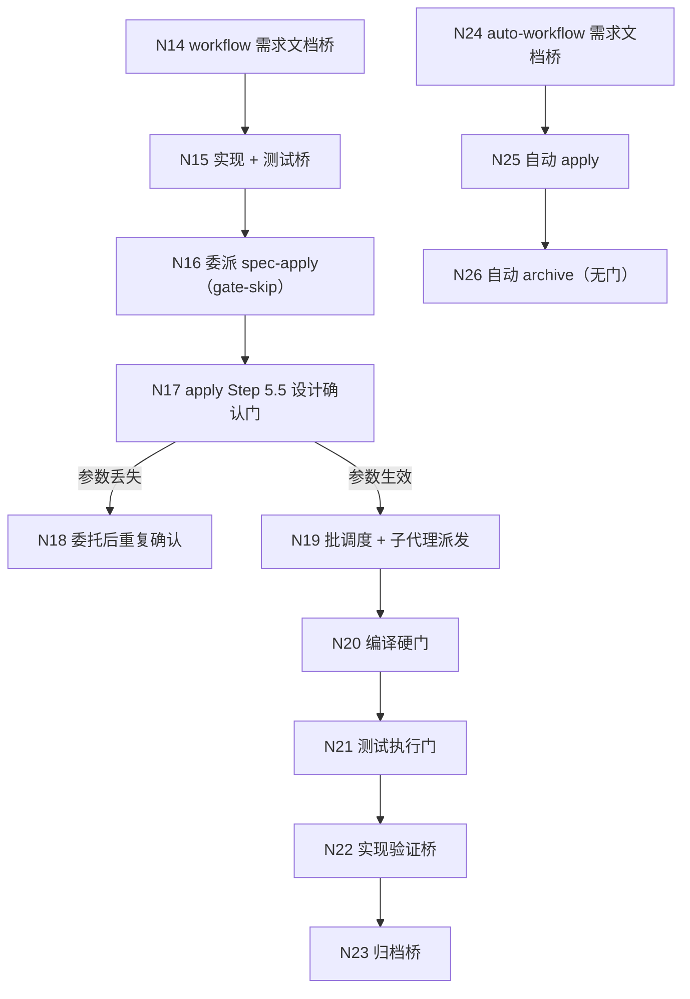

# 自动实现委派门与门账本优化探索（子探索 002）

> 探索文件 — Phase 1（mode=delegated）派生子探索
> 创建时间：2026-11-03
> 状态：Phase 1 完成（流程基准已确认）
> 派生说明：本文件由已确认的主探索 `skill-instruction-optimize-explore-001.md` 按决策 D8（三条诉求拆为三个变更）派生，承接**链路 B（N14–N26）**与决策 D5、D6（workflow 部分）；内容逐字取自主探索，流程基准确认状态继承主探索（2026-11-03 用户在流程最终确认门回复「确认」，节点范围 N1–N38）。

## Background

用户诉求 2（逐字取自主探索 Background）：

**自动实现委托门与重复确认**：debug / auto-workflow / apply 的委托门存在多次确认、委托后还需确认的问题，需减少用户介入流程。
- 规划边界：到此停止 —— 等待用户发起新请求（如 `/iagent:spec-apply`）开始实现。

## 提示词基线 (Prompt Baseline)

- **原始诉求**：优化 debug、auto-workflow、apply 自动实现逻辑的委托门问题，当前存在多次确认情况，以及委托后需要再确认，需要优化自动化流程逻辑，减少用户介入流程。
- **确认后的基线**：合并同一阶段内的相邻确认面（MUST NOT 删除 5 类必留门）；以「门账本」解决委派参数丢失导致的委托后重复确认。规划边界为提案完成后停止，实现由用户后续发起 `/iagent:spec-apply`。
- 下游（提案 / 设计 / 规格 / 任务）以本基线为唯一语义来源。

## 功能流程图

**status: confirmed**（继承主探索 2026-11-03 流程最终确认门「确认」；本变更承接链路 B，节点编号与主探索全局一致）

### 节点清单（链路 B，逐字取自主探索）

| 节点 | 操作 | 触发条件 | 证据位置 | 异常路径 |
| :--- | :--- | :--- | :--- | :--- |
| N14 | workflow 需求文档桥（生成 / 跳过） | 验证 PASS 且深度复查收束 | `src/core/templates/workflows/workflow.ts:100-107` | 状态写入失败 → 不委派、不进入下一阶段（`:123-127`） |
| N15 | workflow 实现 + 测试桥（单次确认） | 文档桥收束、apply instruction=ready | `workflow.ts:352-359` | 拒绝 → 停止；修改 → 回 Phase 2/1（`:358`） |
| N16 | 委派 `iagent_spec_apply` 并传 `gate-skip=design-confirmation` | 用户确认实现桥 | `workflow.ts:364-368`；参数表 `src/core/host-orchestration/render.ts:113-126`；渲染 `actions.ts:41-53,64-86` | 参数未传达 → N18 |
| N17 | apply Step 5.5 设计确认门 | 未传 gate-skip 或参数丢失 | `src/core/templates/workflows/spec-apply.ts:364-414` | 用户未回「确认」→ 不实现（`:411-414`） |
| N18 | 委托后重复确认（同一次设计确认第二次出现） | `gate-skip` 未被被委派技能读取 | `spec-apply.ts:368`；`delegation-contract.ts:73-127`（纯文本参数，无回执校验）；`protocol.ts:233-257`（回执无 gate 字段） | 用户被迫二次确认 → 与「减少介入」目标冲突 |
| N19 | 批调度 + 子代理派发 | 设计确认通过 / gate-skip 生效 | `spec-apply.ts:421`；`skills/iagent-spec-apply/references/batch-scheduling.md` | 子代理失败 → 重试一次后暂停 |
| N20 | 编译检查硬门 | 全部任务完成 | `spec-apply.ts:431-466` | `fail` → 暂停，不得进入测试/归档（`:463-466`） |
| N21 | 测试执行门（仅变更范围） | 编译放行 | `spec-apply.ts:472-499` | 范围内失败 → 自动修复 3 次后暂停（`:494-496`） |
| N22 | 实现验证桥（`spec-verify`） | 测试门通过 | `workflow.ts:384-388` | 失败 → 回 Phase 4；不可用 → 显式省略声明（`:388`） |
| N23 | 归档桥 | 实现验证通过/显式省略 | `workflow.ts:395-401` | 编译证据缺失/fail → 阻断归档（`:398`） |
| N24 | auto-workflow 需求文档桥（本阶段唯一门） | 验证 PASS + 深度复查收束 | `src/core/templates/workflows/auto-workflow.ts:94-100` | 写入失败 → 停止，不进入 Phase 4（`:97`） |
| N25 | auto-workflow 自动 apply | 文档桥收束 | `auto-workflow.ts:110-128` | 编译/测试失败 → 暂停（`:133-145`） |
| N26 | auto-workflow 自动 archive（无门） | 编译证据放行 + 实现验证通过/省略 | `auto-workflow.ts:164-182`；协议 `workflows.ts:104-125` | 编译证据缺失 → 阻断（`:168-172`） |

> 确认后的流程图 = 流程基准；发现遗漏节点 MUST 回主探索 1.5.5 更新并重新确认，MUST NOT 在 tasks.md 中静默补节点。

## Decisions

（逐字取自主探索 `## Decisions`，仅保留本变更承接项）

- **D5**：委派门增加「门账本」：handoff 包新增 `## 已确认门`，阶段回执新增 `confirmedGates`；`gate-skip` 仍是主通道，门账本是参数丢失时的兜底（fail-safe：账本缺失仍执行门）。
- **D6（workflow 部分）**：workflow 的文档桥并入实现桥（一次「交付桥」呈现：实现 + 是否生成文档）。

### 决策过程（逐字取自主探索决策 2）

- **Chosen（建议）**: **B**——合并同一阶段内的相邻确认面，保留门类别与不可豁免语义；加门账本解决参数丢失。具体：
  - workflow：`requirement-doc-bridge` 降为 `implementation-bridge` 内的一个选项（生成文档 / 跳过），不再单独停一次；`implementation-bridge` 仍是唯一实现门。
  - auto-workflow：保留文档桥（唯一门）；apply 通过门账本读取 `design-confirmation`。
- **Rationale**: 用户要「减少介入」，但门白名单与「不可豁免门」是既有安全契约；合并确认面（而不是删除门）是唯一同时满足两者的路径。

### 本变更内消解的 Unresolved 项（依据主探索建议落定）

- **U4（门账本写入门槛）**：父级在**门确认后立即写**，委派前校验存在；写入失败 → 停止（fail-safe）。
- **U8（协议声明调整）**：`workflow` 的 VERIFY 阶段不再声明 `requirement-doc-bridge`，由 APPLY 的 `implementation-bridge` 承载文档选项；`requirement-doc-bridge` 锚点保留给 auto-workflow / debug，5 类白名单不变（`GATE_WHITELIST` 条目与锚点集合不删）。

## 边界场景

（逐字取自主探索 `## 边界场景`，仅保留本变更承接项）

- [ ] 门账本缺失：被委派 apply 未收到 `confirmedGates` 且未收到 `gate-skip` → 仍执行 Step 5.5（fail-safe，不静默跳过）。
- [ ] 门账本伪造/过期：账本声明的门与父级实际确认不一致 → 以回执/账本为准并 WARN；不得把未确认门标记为已确认。
- [ ] workflow 合并桥：用户在「交付桥」选择「仅生成文档」→ 不进入实现，状态 `generated`，停在规划边界。
- [ ] auto-workflow：文档桥后自动 apply，若 `gate-skip` 丢失 → 门账本兜底；两者都缺失 → 设计门照常触发（不得静默跳过）。

## Pending

### For Phase 2 Impact Analysis

| 符号 | 位置 | 优先级 | 影响面 |
| :--- | :--- | :--- | :--- |
| `GATE_WHITELIST` / `WORKFLOW_PROTOCOLS` | `src/core/host-orchestration/protocol.ts:94` / `workflows.ts:186` | HIGH | 门合并、门账本、workflow 阶段门声明 |
| `Receipt` / `validateReceipt` | `src/core/host-orchestration/protocol.ts:245` | HIGH | `confirmedGates` 字段与校验 |
| `DELEGATION_PARAMETERS` | `src/core/host-orchestration/render.ts:113` | MEDIUM | 门账本参数 / 委派参数一致性 |
| `spec-apply.ts` Step 5.5 | `src/core/templates/workflows/spec-apply.ts:364` | HIGH | 门账本读取、gate-skip 兜底 |
| `workflow.ts` 3.5 / 3.7 | `src/core/templates/workflows/workflow.ts:100` / `:352` | HIGH | 交付桥合并 |
| `auto-workflow.ts` 3.3 / 4.1 | `src/core/templates/workflows/auto-workflow.ts:94` / `:110` | MEDIUM | 门账本、文档桥保留 |

### 约束（逐字取自主探索 Constraints）

- **门白名单不可删**：只能合并确认面，不能移除 5 类门（`protocol.ts:94-131`；`host-orchestration/spec.md:92-118`）。
- **两轴不可互换**：`mode=delegated` 不豁免业务门；`auto-mode=true` 只映射 `gate-skip=design-confirmation`（`delegation-contract.ts:1-35`）。
- **模板单一源**：技能正文改 `src/core/templates/workflows/*.ts`，再 `pnpm build && pnpm generate:skills`。
- **Markdown-first**：不得重新引入 `change.json` / `tasks.json` 作为真源。
- **规划边界**：本次探索/提案不实现；`spec-propose` 在验证 PASS 后停止。

## 术语表

| 术语 | 定义 | 避免使用 |
| :--- | :--- | :--- |
| 委托门（delegation gate） | 阶段间由调用方确认的阻塞式门（如实现桥 / 归档桥 / 设计确认门） | 确认点 |
| gate-skip | 门承载轴参数，声明父级已确认某门；当前唯一 `design-confirmation` | auto-mode |
| 门账本（gate ledger） | 父级在 handoff 包/回执中记录「已确认门」的机器可读清单，供被委派技能跳过重复确认 | 确认记录 |

> 以上术语均已同步至 `openspec/CONTEXT.md`（2026-11-03 增补段）。

## 需求文档状态

- requirementDocStatus: skipped-by-user

> 由 `iagent-workflow` Phase 3.5 需求文档桥写入：用户选择跳过需求文档生成。
> archive 阶段不得因文档缺失而自动补生成（兼容分支仅适用于无显式状态的历史变更）。
