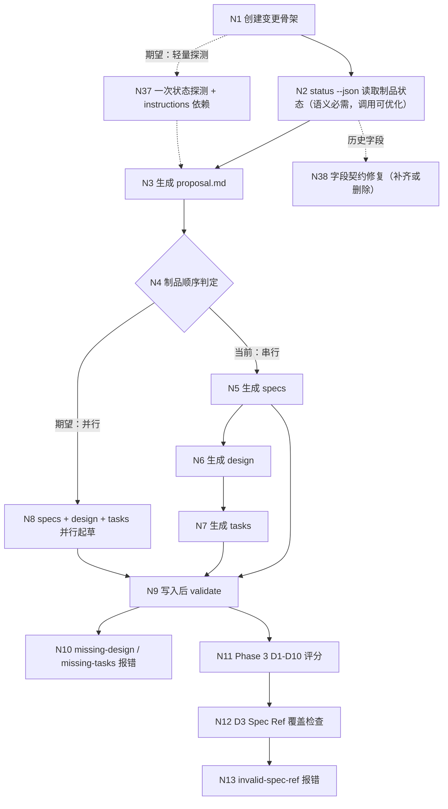

## Context

本变更来自探索 `openspec/changes/improve-proposal-validation-and-spec-ref/exploration.md`（流程基准 `status: confirmed`，2026-11-03，节点范围 N1–N38）的**链路 A：提案生成与 Spec Ref 追溯**，按决策 D8 拆为三个变更中的**变更 ①**（D8：①提案校验/Spec Ref；②委派门与门账本；③debug 双轨入口）。本变更只承接 ①，②③ 由 `improve-delegation-gate-ledger` / `feat-debug-dual-track-entry` 承载，本设计 MUST NOT 触及门白名单、回执 `confirmedGates` 与 debug 正文。

### 现状（CodeGraph 实测影响面）

| 符号 | 位置 | 影响面 |
| :--- | :--- | :--- |
| `runSpecValidate` | `src/commands/spec.ts:386` | CLI 注册点 `:174`；模板消费方 `spec-propose`（起草期）/`debug`（同步提案）/`spec-archive`（归档前）；测试 `test/markdown-spec-cli.test.ts` |
| `SPEC_DRIVEN_SCHEMA` | `src/core/spec/schema.ts:44` | 9 处消费点：`status.ts:53/115/147/161/163`、`instructions.ts:76/82/90`、`archive.ts:45`、`spec.ts:537` |
| `buildTraceability` | `src/core/spec/validation/traceability.ts:17` | 2 个调用方：`artifact-validator.ts:26`、同名文件导出；测试 `test/spec-artifact-parser.test.ts` |
| `parseTasks` / `parseTaskFields` | `src/core/spec/parser/task-parser.ts:13` / `:152` | 9 处调用，含 `status.ts:95/198`、`migration.ts`、`src/commands/spec.ts` |
| `getChangeStatus` | `src/core/spec/status.ts:101` | 3 个调用方（`spec.ts:344`/`:362`/新增 apply 初检）；测试 `test/spec-status.test.ts` |
| `getApplyInstructions` | `src/commands/spec.ts:621` | 测试 `test/markdown-spec-cli.test.ts`、`test/spec-instructions-apply.test.ts` |
| `TASKS_TEMPLATE` | `src/core/spec/templates/index.ts:76` | 1 个调用方（`instructions.ts` 的 `TEMPLATES` 映射） |
| `previewArchive` | `src/core/spec/archive.ts:38` | `src/commands/spec.ts:228` 归档预览 |

### 流程基准引用（链路 A，MUST NOT 重新发明）

流程图与节点清单逐字取自 `exploration.md` 的「功能流程图 → A. 提案生成与 Spec Ref 追溯」，本设计只引用、不重画：

| 节点 | 操作 | 触发条件 | 证据位置 | 本变更的处理 |
| :--- | :--- | :--- | :--- | :--- |
| N1 | `iagent spec new` 创建变更骨架 | 用户请求创建提案 | `src/core/spec/new-change.ts:32-50` | 不改（骨架逻辑与路径无关） |
| N2 | `status --json` 读取制品状态（语义必需、调用可优化） | 变更目录已存在 | `status.ts:101-166`；`spec-propose.ts:160-167`、`:193` | 语义保留，调用形态改为 `instructions apply`（D9a Option 1） |
| N37 | 期望态：一次轻量状态探测 + 依赖 + 终检 `instructions apply` | proposal 完成后进入起草循环 | `[新建]` | 新增（本变更实现） |
| N38 | 期望态：status JSON 字段契约修复 | 模板引用路径字段时 | `status.ts:33-42`；7 个模板 | 新增（补齐 `planningHome`/`artifactPaths`，删除 `actionContext`） |
| N3 | 生成 `proposal.md` | proposal 为 ready | `spec-propose.ts:169-188` | 不改生成内容，仅改其前后状态读取 |
| N4 | 制品顺序判定 | proposal 完成 | `schema.ts:44-84` | `tasks.requires` 改 `['specs','design?']`（D2） |
| N5 | 生成 specs | specs 为 ready | `spec-propose.ts:201-205` | 纳入并行起草（N8） |
| N6 | 生成 design | design 为 ready | `schema.ts:64-70` | 改为可选：缺失不报错、不阻塞（D2） |
| N7 | 生成 tasks | 当前需 specs + design 均 done | `schema.ts:71-77` | 只等 specs（design 可选） |
| N8 | specs/design/tasks 并行起草（期望能力） | proposal 完成且能力清单稳定 | `[新建]` | 新增（模板 + `--partial` 支撑） |
| N9 | 每次写入后 `validate` | 任一制品写入完成 | `spec-propose.ts:187`；`spec.ts:386-425` | 起草期 `--partial`，终检 strict（D1） |
| N10 | `missing-design` / `missing-tasks` 误报 | design/tasks 尚未创建（正常中间态） | `spec.ts:419-423` | `missing-design` 删除；`missing-tasks` 仅 strict 为 error（D1/D2） |
| N11 | Phase 3 评分 | applyRequires 闭包全部 done | `spec-propose.ts:224-232` | 闭包改为必需依赖闭包（design 不计入） |
| N12 | D3 Spec Ref 覆盖检查 | 评分执行 | `spec-verify-proposal.ts:315-324` | 按规范形态匹配 + capability-only 不计覆盖（D3） |
| N13 | Spec Ref / Scenario Ref 无法匹配 | 引用不存在或格式不符 | `traceability.ts:26-47`、`:77-100` | 新增专用诊断与 `pending-ref` 降级（D3） |

## Goals / Non-Goals

**Goals**:

- 起草期的「还没写」不再被当作错误：`validate --partial` 记 `incomplete`，strict 保留终检语义。
- `design` 真正可选：`tasks` 不再因缺 design 阻塞，`isPlanningComplete` 不要求 design。
- 三种 Spec Ref 写法（行式 / HTML 注释式 / 箭头标签式）解析一致，capability-only 有明确诊断。
- `spec-propose` 不再重复调用 `status --json`，状态来源统一为 `instructions apply`。
- CLI 返回模板所需的路径字段，模板不再猜路径、不再引用不存在的 `actionContext`。
- 文本校验报告按行输出。

**Non-Goals**:

- 不引入 `outline` 制品或新的 schema artifact（探索决策 1 的 Option C 明确排除）。
- 不取消 Scenario → Task 追溯终检，不降低 apply-ready 门槛（`apply.requires` 仍为 `tasks`，specs 仍必需）。
- 不修改门白名单、回执协议、`gate-skip` 语义（属变更 ②）。
- 不改 debug 的双轨入口与诊断/方案门合并（属变更 ③）。
- 不重新引入 `change.json` / `tasks.json` 真源或跨变更索引。

## Decisions

### D1: 校验模式（`--partial` / `--artifact`）与 `incomplete` 严重度

- **选择**: `runSpecValidate` 签名扩展为 `runSpecValidate(projectRoot, changeName, options?: { partial?: boolean; artifact?: string })`；`SpecValidationOutput` 增加 `mode` / `artifactId`；`DiagnosticSeverity` 增加 `incomplete`。缺失诊断按模式选择 `error` / `incomplete`；未知 `--artifact` id 走 `isValidArtifactId` 校验并以非零退出码报错。
- **理由**: 缺失与结构错误是两类事实，只有后者需要阻断。`incomplete` 不参与 `valid`，使 `--partial` 退出码为 0，起草循环可以「写完即校验」而不被正常中间态打断。
- **备选**: ① 新增 `--allow-missing` 布尔项（语义等价但无法表达单制品）；② 独立 `iagent spec validate-partial` 子命令（新增命令面，收益不足）。均否决。
- **单制品语义**: `--artifact` 只解析该制品；跨制品追溯（tasks+specs）不可用时记 `traceability-skipped`（`incomplete`），避免「单制品校验」被误读为「全局通过」。

### D2: `design` 改为可选依赖（`design?`）的单一表示

- **选择**: 依赖字符串保留 `?` 后缀（`tasks.requires = ['specs', 'design?']`），由 `schema.ts` 新增 helper 统一解析：
  - `depIdOf(raw)`（去 `?`）、`isOptionalDep(raw)`；
  - `requiredDeps(artifact)` / `optionalDeps(artifact)`；
  - `requiredClosure(ids)`（必需依赖传递闭包，供 `isPlanningComplete` / apply-ready 共用）。
  `getBuildOrder`、`getChangeStatus` 的 `missingDeps`、`instructions` 的 `dependencies` / `unlocks`、`adjustStatusForSkipSpecs`、`previewArchive` 全部改走 helper，MUST NOT 各自判断后缀。
- **理由**: 依赖图只有一份真源；可选性是 schema 属性，不是各消费点的局部判断。`?` 标记在 JSON 中也可见，消费方一眼能看出 `design` 可选。
- **状态映射**: 可选制品缺失 → `ArtifactStatus.status = 'optional'`（新增）。不选 `ready`：`ready` 在现有语义是「现在该生成它」，会让 propose 反复生成可选制品；不选 `skipped`：`skipped` 已由 `skip_specs` 占用，语义是「声明跳过」。
- **`isPlanningComplete`**: 定义为 `requiredClosure(applyRequires)` 全部完成（`skip_specs` 下 `specs` 视为满足）。`adjustStatusForSkipSpecs` 的 `planningComplete` 用同一集合与 `satisfied` 比对，消除两处实现。
- **备选**: ① 新增 `optionalRequires: string[]` 字段（schema 结构更显式，但需要二次遍历与迁移，且 `requires` 与 `optionalRequires` 易不一致）；② 保留 design 硬依赖、仅放宽 validate（tasks 仍 blocked，无法并行）。均否决，采用 `?` 后缀 + helper。

### D3: Spec Ref / Scenario Ref 的解析与诊断分层

- **选择**: 分两层，**语法层**在 `task-parser`，**语义层**在 `traceability`：
  - 语法层 `readRefField(line)`：先剥离 `<!-- ... -->` 包裹，再去 `- `/`* `/缩进，匹配 `Spec Ref` / `规范引用` / `Scenario Ref` / `场景引用` 标签（`: `或 `：`），随后按 `→` 切段：带 `Requirement:` / `Scenario:` 标签的段分别落入 requirement / scenario，首个无标签段为 capability 路径。一行同时给出两者时同时产出 `specRefs` 与 `scenarioRefs`。
  - 语义层：`buildTraceability` 在匹配失败时先判断「该值是否等于某个已存在的 capability」→ `spec-ref-missing-requirement`（消息含「缺少 Requirement」与期望形态）；「该值是否等于某个 `capability / Requirement`」→ `scenario-ref-missing-scenario`；其余 → `invalid-spec-ref` / `invalid-scenario-ref`。`--partial` 且 specs 未完成时，上述四类未匹配问题降级为 `pending-ref` warning。
- **理由**: capability-only 只有在拿到 specs 上下文后才能判定（裸 requirement 名是合法的历史形态），因此该诊断必须在语义层。分层也使 `--artifact specs` 能只跑语法层而不误报语义层。
- **canonical**: 两行 `- Spec Ref：capability / Requirement` + `- Scenario Ref：capability / Requirement / Scenario`；一行式与 HTML 注释式是兼容形态，模板示例以两行为主、附注释式样例。
- **备选**: ① 只在 traceability 里做正则（解析逻辑重复、`parseTaskFields` 仍需改）；② 只支持 HTML 注释式并废弃行式（破坏既有 tasks.md 与历史归档）。均否决。

### D4: `instructions apply --json` 承载起草期状态（D9a Option 1）

- **选择**: `getApplyInstructions` 内部先 `getChangeStatus` + `adjustStatusForSkipSpecs` 得到与 `status --json` 完全一致的状态集，再据此计算 `contextFiles` / `missingDeps` / `instruction.state`；返回新增 `artifacts` / `applyRequires` / `isPlanningComplete` / `planningHome` / `artifactPaths`。`spec-propose` 起草循环改为「`instructions apply` 初检 → 每制品 `instructions <id>` → strict `validate` + `instructions apply` 终检」，删除 `status --json` 调用与每制品重复调用。
- **理由**: 状态语义只有一处实现（`getChangeStatus` + skip 调整），避免 apply 与 status 两套判定漂移（现有 `getApplyInstructions` 已独立实现了一份 satisfied/missingDeps 逻辑，属重复源）。
- **备选**: ① Option 2（保留一次初始 `status --json`，只删每制品重复调用）——作为回退形态，但需要技能同时理解两个 JSON 契约；② 让 `instructions <id>` 返回全量状态——语义过载。均不选。
- **`isPlanningComplete` 纳入 apply 输出的理由**: 提供 fail-safe 的停止信号，使技能即使拿不到闭包算法也能判断「可否进入验证门」；它由同一 helper 计算，不新增语义。

### D5: 路径字段契约（D9b）与 `actionContext` 删除映射

- **选择**: `status --json` 与 `instructions apply --json` 都返回：
  - `planningHome = path.join(projectRoot, 'openspec')`（规划根，含 `changes/`）；
  - `artifactPaths[artifactId] = { outputPath, resolvedOutputPath, existingOutputPaths }`；`specs` 的 `resolvedOutputPath` 为 `<changeRoot>/specs` 目录，`existingOutputPaths` 为 `findMarkdownFiles` 的实际结果，其余为单文件。
  `actionContext` 经查证无规划范围语义（无 workspace 分支实现、无消费方），**从 6 个实际引用它的模板整体删除**引用与配套 workspace 护栏句（实测命中行，逐条核对过 `grep -n actionContext src/core/templates/workflows/*.ts`）：`spec-propose.ts:167`（只保留 `planningHome`/`artifactPaths`）、`spec-explore.ts:1031`（改 `changeRoot` + `artifactPaths`，`:1032` 为同段续行）、`spec-verify.ts:46`、`spec-archive.ts:45,48`（删 `actionContext` 与 workspace STOP 段）**及 `:224` 的「workspace 范围的变更跳过本步骤」IMPORTANT 句**、`spec-bulk-archive.ts:69,72`（同上）**及 `:289` 的同款 IMPORTANT 句**、`spec-apply.ts:309,313`（删 workspace 护栏段，保留 `planningHome`）。
  `spec-verify-proposal.ts:549` **不在**删除面：该行只引用 `artifactPaths`（`使用 status 的 artifactPaths 在变更目录中查找 exploration.md`），从未出现 `actionContext` —— 它属于「路径来源改为 CLI 字段」的对齐对象（任务 5.3），不构成删除项。因此「7 个模板」指**需要路径字段的模板数**，`actionContext` 的实际删除面是其中 6 个。
  本机 `.iagent/rules/spec.md` 的「按依赖序生成」与生成该行的 `project-config.ts:405` 同步改为「允许并行起草、终检按依赖序」。
- **理由**: 补齐字段比删除引用更保真（模型确实需要路径上下文），而 `actionContext` 没有对应实现语义，保留只会诱导模型猜测不存在的 workspace 模式。
- **备选**: ① 只补字段、保留 `actionContext` 并实现 workspace 分支（超出本变更范围，且属新能力）；② 删除全部路径字段、只留 `changeRoot`（信息不足，模型仍要拼 `specs/`）。均否决。

### D6: `formatValidationResult` 换行修正

- **选择**: `src/commands/spec.ts:436` 的 `lines.join('\\n')` 改为 `lines.join('\n')`。
- **理由**: 现实现输出字面 `\` + `n`，多诊断挤成一行，使「路径:行号」定位失效；属纯缺陷修正，无 API 变化。
- **备选**: 用 `console.log` 逐条打印——会改变返回结构（`runSpecValidate` 返回字符串的契约）。

### U1 / U2 / U5 / U6 的消解结论

| 编号 | 结论 | 落点 |
| :--- | :--- | :--- |
| U1 | `isPlanningComplete` 不再要求 design；design 不参与 planning complete，存在时校验 | D2、`spec-workflow-cli / Markdown paths drive the built-in dependency graph` |
| U2 | 支持一行同时含 Spec + Scenario；canonical 仍推荐两行 | D3、`artifact-markdown-source / Tasks maintain explicit traceability to requirements` |
| U5 | 采 Option 1（扩展 `instructions apply`，去除独立 `status --json`）；Option 2 仅作回退描述 | D4 |
| U6 | 补齐 `planningHome` / `artifactPaths`（含 `existingOutputPaths`）；`actionContext` 从 6 个实际引用的模板删除（第 7 个模板 `spec-verify-proposal` 只缺路径字段、无 `actionContext`） | D5 |

## Risks / Trade-offs

| 风险 | 缓解 |
| :--- | :--- |
| `incomplete` 严重度被误当「通过」，起草期跳过终检 | strict 默认不变；`spec-propose` 明确「终检 MUST 用 strict validate + `instructions apply`」；模板与规范各写一次 |
| 可选依赖 `?` 后缀散落到未更新的消费点（如 `previewArchive` 漏改，仍把 design 计入未完成） | 依赖判定收敛到 `schema.ts` helper，Caller Updates 任务逐个核对 9 处消费点；`test/spec-status.test.ts` 补 design 缺失断言 |
| 并行起草导致 Requirement 命名漂移，Spec Ref 大面积失效 | 以 proposal 的 Capabilities + Requirement 命名为锚；起草期 `--partial` 只降级「未匹配」不降级「结构错误」；终检 strict 兜底 |
| capability-only 降级判断依赖「specs 是否完成」，边界模糊导致该报 error 的被降级 | 只有 `--partial` + specs 未完成（缺文件或 invalid）才降级；specs 一旦 done，未匹配一律 error；测试覆盖两态 |
| `actionContext` 删除后，其它宿主/文档仍在引用 | `grep -r actionContext` 纳入验证步骤；`skills/` 快照由 `pnpm generate:skills` 重建，`test/skills-parity.test.ts` 守护 |
| `instructions apply` 增加状态计算导致重复解析 Markdown（性能） | 单次调用内复用 `getChangeStatus` 结果；起草期调用次数从「每制品一次 status」降为「初检 1 次 + 终检 1 次」 |
| 既有测试断言旧行为（design 必填、tasks missingDeps 含 design、build order） | Caller Updates 任务显式列出 `test/spec-status.test.ts:108-110`、`test/markdown-spec-cli.test.ts:67-74`、`test/spec-instructions-apply.test.ts` 需同步 |
