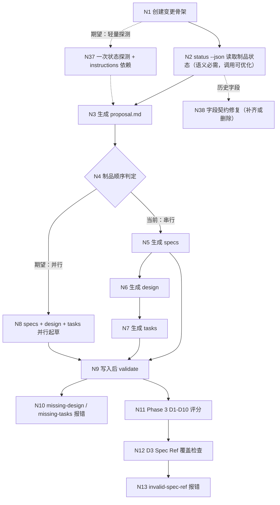
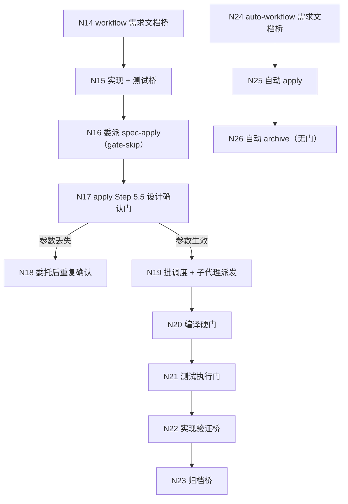
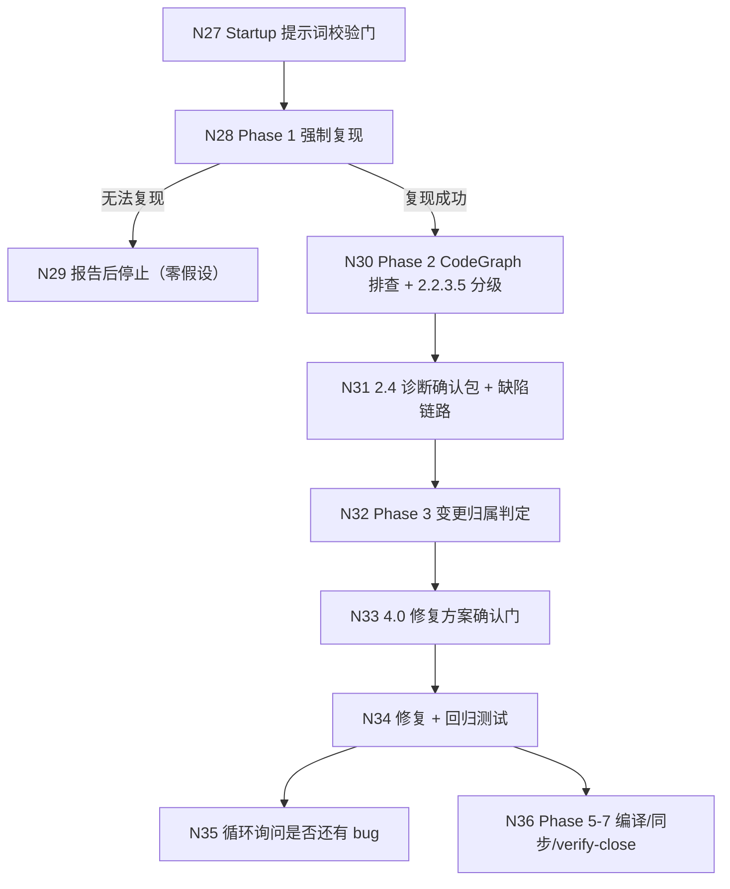

# 技能指令体系优化探索（提案校验 / 委派门 / debug 探索逻辑）

> 探索文件 — Phase 1（mode=delegated）
> 创建时间：2026-11-03
> 状态：Phase 1 完成（流程基准已确认；等待编排器进入提案阶段）

## Background

用户要求「探索分析项目技能内容，针对不同指令技能进行相关优化」，包含三条诉求与一条规划边界：

1. **proposal 提案生成链路**：json 校验与提案生成优化、Spec Ref 格式引用问题优化
   - 校验报错仅因 design/tasks 尚不存在（用户判断为正常现象）
   - 期望 specs、design、tasks 并行生成
   - Spec Ref 格式需要包含 Requirement 名称（例：`<!-- Spec Ref: portal-workorderno-validation → Requirement: "工单号前端格式校验" → Scenario: "空工单号" -->`）
2. **自动实现委托门与重复确认**：debug / auto-workflow / apply 的委托门存在多次确认、委托后还需确认的问题，需减少用户介入
   - 规划边界：到此停止 —— 等待用户发起新请求（如 `/iagent:spec-apply`）开始实现
3. **debug 模式探索逻辑**：当前 debug 是基于复现，还是基于问题发现？需分析现有探索逻辑并重新设计优化

## 提示词基线 (Prompt Baseline)

### 校验结论

**清晰（直通）**：目标（优化三类技能指令）、对象（proposal/spec-apply/debug/auto-workflow/workflow）、范围（三条诉求 + 一条规划边界）均明确；歧义维度无实质阻断。按 `iagent-spec-explore` 1.1.2，不输出六维表格、不要求确认，仅做一句话复述：

> 本次要优化的是「提案生成与 Spec Ref 追溯契约」「自动实现链路的委派门与重复确认」「debug 的复现优先探索逻辑」三块，且实现动作不在本次范围（规划边界停在提案完成）。

### 原始提示词

保留于 Background 段（原文未改写）。

### 确认后的提示词基线

与原始提示词一致。方案层面的取舍（如并行生成的具体形态、门合并的粒度、debug 双轨入口）由本探索给出选项与建议，经流程最终确认门裁决；不改变用户已声明的 WHAT。

### 假设与待确认

| 编号 | 类型 | 内容 | 处理 |
| :--- | :--- | :--- | :--- |
| A1 | [假设] | 「json 校验」指 `iagent spec status --json` / `validate --json` / `instructions --json` 的**返回契约**与技能正文的消费方式，而非 JSON 语法本身 | 已按此展开分析；若仅指 JSON 语法，请在流程门指出 |
| A2 | [假设] | 「并行生成 specs、design、tasks」允许**并行起草 + 最终统一严格校验**，不要求放弃 Scenario→Task 追溯终检 | 作为方案 1 的前提 |
| A3 | [假设] | Spec Ref 的「包含 Requirement 名称」以 `capability / Requirement / Scenario` 三元链为完整形态；既有 `- Spec Ref：` 行写法保持兼容 | 方案同时支持行式与 HTML 注释式 |
| A4 | [假设] | debug 的「基于复现还是基于问题发现」是**开放设计问题**，不预设用户已选边；探索给出双轨方案 | 见决策 3 |

## 功能流程图

**status: confirmed**（2026-11-03，用户在流程最终确认门回复「确认」）

| 项 | 值 |
| :--- | :--- |
| 确认状态 | `confirmed` |
| 节点范围 | N1–N38（N1–N36 原有节点编号稳定；N37/N38 为 N2 追问后保留的期望态节点） |
| 新增节点 | N37 轻量状态探测；N38 字段契约修复 |
| 确认方式 | 流程最终确认门四出口中的「确认」 |
| 流程基准用途 | 作为 propose / verify 的独立交叉验证锚点；MUST NOT 静默增删节点 |

> 三条链路共享全局节点编号（N1–N38；N37/N38 为 2026-11-03 N2 追问后新增的期望态节点）。节点粒度 = 可独立验证的操作/判定单元；证据位置为当前代码的 `文件:行`；`[新建]` 表示本次要新增的能力。

### A. 提案生成与 Spec Ref 追溯

### B. 自动实现委派与确认门

### C. debug 排查与修复

### 关键操作节点清单

| 节点 | 操作 | 触发条件 | 证据位置 | 异常路径 |
| :--- | :--- | :--- | :--- | :--- |
| N1 | `iagent spec new` 创建变更骨架与 `.openspec.yaml` | 用户请求创建提案 | `src/core/spec/new-change.ts:32-50` | 名称非 kebab-case / 目录已存在 → 抛错（`:33-39`） |
| N2 | `iagent spec status --json` 读取制品状态（**语义必需、调用可优化**：artifacts 状态 + applyRequires 闭包 + skip_specs/invalid） | 变更目录已存在 | `src/core/spec/status.ts:101-166`；JSON 输出 `src/commands/spec.ts:362-365`；propose 调用点 `spec-propose.ts:160-167`、`:193` | 变更不存在 / schema 非 spec-driven → 错误或 WARN（`status.ts:105-113`）；`planningHome`/`artifactPaths`/`actionContext` 未返回 → 路径降级（见 N38） |
| N37 | 期望态：**一次轻量状态探测**（初始 status + `instructions` 的 `dependencies[].done` + 终检 `instructions apply`），删除每制品重复 status | proposal 完成后进入起草循环 | `[新建]`；`status.ts:101-166` / `instructions.ts:63-105` / `spec.ts:621-687` | 终检 `state=blocked` → 按 `missingDeps` 补制品；`instructions` 不应用 skip_specs → 终检必须用 `instructions apply` |
| N38 | 期望态：**status JSON 字段契约修复**（补齐 `planningHome`/`artifactPaths`/`actionContext`，或从 7 个模板删除） | 模板引用这些字段时 | `status.ts:33-42`；`spec.ts:78-91`；`spec-propose.ts:167`；`git show eaef011`（初始迁移即无这些字段） | 不修复 → 模型猜路径 / 降级；修复 → 保持机器可消费契约一致 |
| N3 | 生成 `proposal.md` | proposal 为 ready | `src/core/templates/workflows/spec-propose.ts:169-188`；模板 `src/core/spec/templates/index.ts:8-35` | 章节缺失 → `proposal-parser.ts:44` 诊断 |
| N4 | 判定制品构建顺序（当前 proposal→specs/design→tasks） | proposal 完成 | `src/core/spec/schema.ts:44-84`；`.iagent/rules/spec.md:3`；`spec-propose.ts:173-195` | 依赖未满足 → tasks `blocked`（`schema.ts:75`） |
| N5 | 生成 `specs/<capability>/spec.md` | specs 为 ready | `src/core/spec/schema.ts:56-62`；`spec-propose.ts:201-205` | 缺 Requirement/Scenario → `spec-parser.ts:89-108` |
| N6 | 生成 `design.md` | design 为 ready | `src/core/spec/schema.ts:64-70` | 章节缺失 → `design-parser.ts:46` 诊断 |
| N7 | 生成 `tasks.md` | **当前需 specs + design 均 done** | `src/core/spec/schema.ts:71-77`；`spec-propose.ts:190-195` | design 缺失 → tasks 永远 blocked（`schema.ts:75`） |
| N8 | specs / design / tasks 并行起草（期望能力） | proposal 完成且能力清单已稳定 | `[新建]`；当前阻塞点 `schema.ts:75` 与 `spec-propose.ts:173` | 并行结果不一致 → 需最终统一严格校验（`[新建]`） |
| N9 | 每次写入后 `iagent spec validate` | 任一制品写入完成 | `spec-propose.ts:187`；`src/commands/spec.ts:386-425` | 结构性错误 → error；缺失制品 → error（见 N10） |
| N10 | `missing-design` / `missing-tasks` 误报 | design/tasks 尚未创建（正常中间态） | `src/commands/spec.ts:419-423` | 校验与「未完成」混淆 → 生成循环被迫提前收敛（`spec-propose.ts:187`） |
| N11 | Phase 3 D1-D10 量化评分 | applyRequires 闭包全部 done | `spec-propose.ts:224-232`；`spec-verify-proposal.ts:313-324` | <90% → 自动修复后重跑；仍失败 → 用户裁决（`spec-propose.ts:230`） |
| N12 | D3 检查每条 Requirement 是否有 Spec Ref 匹配的任务 | D1-D10 评分执行 | `spec-verify-proposal.ts:315-324` | Requirement 无任务 → D3 扣分 / FAIL |
| N13 | Spec Ref / Scenario Ref 无法匹配 | tasks.md 引用不存在或格式不符 | `src/core/spec/validation/traceability.ts:26-47`、`:77-100` | `invalid-spec-ref` / `invalid-scenario-ref` → **error**（`:65-73`）；未覆盖 Scenario 仅 warning |
| N14 | workflow 需求文档桥（生成 / 跳过） | 验证 PASS 且深度复查收束 | `src/core/templates/workflows/workflow.ts:100-107` | 状态写入失败 → 不委派、不进入下一阶段（`:123-127`） |
| N15 | workflow 实现 + 测试桥（单次确认） | 文档桥收束、apply instruction=ready | `workflow.ts:352-359` | 拒绝 → 停止；修改 → 回 Phase 2/1（`:358`） |
| N16 | 委派 `iagent_spec_apply` 并传 `gate-skip=design-confirmation` | 用户确认实现桥 | `workflow.ts:364-368`；参数表 `src/core/host-orchestration/render.ts:113-126`；渲染 `actions.ts:41-53,64-86` | 参数未传达 → N18 |
| N17 | apply Step 5.5 设计确认门 | 未传 gate-skip 或参数丢失 | `src/core/templates/workflows/spec-apply.ts:364-414` | 用户未回「确认」→ 不实现（`:411-414`） |
| N18 | 委托后重复确认（同一次设计确认第二次出现） | `gate-skip` 未被被委派技能读取 | `spec-apply.ts:368`；`delegation-contract.ts:73-127`（纯文本参数，无回执校验）；`protocol.ts:233-257`（回执无 gate 字段） | 用户被迫二次确认 → 与「减少介入」目标冲突 |
| N19 | 批调度 + 子代理派发 | 设计确认通过 / gate-skip 生效 | `spec-apply.ts:421`；`skills/iagent-spec-apply/references/batch-scheduling.md` | 子代理失败 → 重试一次后暂停（`batch-scheduling.md` 失败处理段） |
| N20 | 编译检查硬门 | 全部任务完成 | `spec-apply.ts:431-466` | `fail` → 暂停，不得进入测试/归档（`:463-466`） |
| N21 | 测试执行门（仅变更范围） | 编译放行 | `spec-apply.ts:472-499` | 范围内失败 → 自动修复 3 次后暂停（`:494-496`） |
| N22 | 实现验证桥（`spec-verify`） | 测试门通过 | `workflow.ts:384-388` | 失败 → 回 Phase 4；不可用 → 显式省略声明（`:388`） |
| N23 | 归档桥 | 实现验证通过/显式省略 | `workflow.ts:395-401` | 编译证据缺失/fail → 阻断归档（`:398`） |
| N24 | auto-workflow 需求文档桥（本阶段唯一门） | 验证 PASS + 深度复查收束 | `src/core/templates/workflows/auto-workflow.ts:94-100` | 写入失败 → 停止，不进入 Phase 4（`:97`） |
| N25 | auto-workflow 自动 apply | 文档桥收束 | `auto-workflow.ts:110-128` | 编译/测试失败 → 暂停（`:133-145`） |
| N26 | auto-workflow 自动 archive（无门） | 编译证据放行 + 实现验证通过/省略 | `auto-workflow.ts:164-182`；协议 `workflows.ts:104-125` | 编译证据缺失 → 阻断（`:168-172`） |
| N27 | Startup 提示词校验门（缺陷五维） | 记录 bug 描述后、Phase 1 之前 | `src/core/templates/workflows/debug.ts:155-178` | 不明确 → 优化后阻塞等待确认（`:163`） |
| N28 | Phase 1 强制复现（失败测试优先 / 显式步骤） | 提示词门通过 | `debug.ts:203-226` | 无法复现 → N29；显式步骤需用户确认（`:216-222`） |
| N29 | 无法复现时报告并停止 | 无失败测试且用户无法确认步骤 | `debug.ts:225-226`；规范 `openspec/specs/workflow-suite-skills/spec.md:56-59` | 零假设：不修复不可复现 bug |
| N30 | Phase 2 CodeGraph 排查 + 2.2.3.5 深度分级 | 复现成功 | `debug.ts:55-92`、`:84-105`；`references/investigation-protocol.md` | CodeGraph 不可用 → Grep 降级，分级仍生效（`:72-76`） |
| N31 | 2.4 诊断确认包 + 缺陷链路 | 根因收敛（单一或多候选选定后） | `debug.ts:278-307` | 拒绝 → 终止修复并输出诊断报告（`:286-292`） |
| N32 | Phase 3 变更归属判定 | 诊断确认 | `debug.ts:310-343` | 独立 bug → 自动新建变更，不询问（`:319-323`）；归档来源 → 新建变更（`:325-329`） |
| N33 | 4.0 修复方案确认门（条件门） | 变更归属明确后 | `debug.ts:350-356` | 多方案 → 阻塞；唯一且证据充分 → 直通（`:353-356`） |
| N34 | 修复 + 回归测试（委派 `iagent_test`） | 方案确认/直通 | `debug.ts:369-393` | 回归测试缺失/失败 → 不得报告验收通过（`:390-393`） |
| N35 | 循环询问「是否还有相关 bug」 | 每次修复后（**仅概览声明**） | `debug.ts:136`；正文无对应步骤（落差） | 模型自行补门 → 额外停顿 |
| N36 | verify-close：验证 → 深度复查 → 文档桥 | 循环结束 | `debug.ts:460-475` | 验证 FAIL → 自动修复循环；文档已存在 → 禁用生成分支（`:466-470`） |

## Analysis

### Deep Analysis Trigger

- **Triggered**: Yes
- **Reason**: 用户输入含「优化 / 重新设计 / 修正」等修改意图，涉及既有技能正文、模板、CLI 校验与宿主编排协议；属于修改既有代码，不是纯新增。
- **Scope**:
  - `src/commands/spec.ts`、`src/core/spec/{schema,status,instructions}.ts`、`src/core/spec/{parser,validation,model}/*`
  - `src/core/host-orchestration/{protocol,workflows,transition,delegation-contract,actions,render}.ts`
  - `src/core/templates/workflows/{spec-propose,spec-apply,debug,auto-workflow,workflow,spec-verify-proposal,proposal-review}.ts`
  - 生成快照 `skills/iagent-{spec-propose,spec-verify-proposal,proposal-review,spec-apply,debug,auto-workflow,workflow}/**`
  - 能力规范 `openspec/specs/{spec-workflow-cli,spec-workflow-skills,workflow-suite-skills,host-orchestration}/spec.md`

### Architecture Flow

CodeGraph 调用链（实测）：

1. `runSpecValidate`（`src/commands/spec.ts:386`）
   → `validateParsedChange`（`src/core/spec/validation/artifact-validator.ts:15`）
   → `buildTraceability`（`src/core/spec/validation/traceability.ts:17`）
   → `findRequirement` / `findScenario` / `normalizeRef`（`traceability.ts:77-104`）
2. `getArtifactInstructions`（`src/core/spec/instructions.ts:63`）
   → `detectCompleted`（`src/core/spec/status.ts:51`）
   → `isValidArtifactId`（`src/core/spec/schema.ts:109`）
3. `renderDelegate`（`src/core/host-orchestration/actions.ts:64`）
   → `renderOptions`（`actions.ts:41`）
   → `resolveDelegationContract`（`src/core/host-orchestration/delegation-contract.ts:73`）
4. `evaluatePhaseTransition`（`src/core/host-orchestration/transition.ts:68`）
   → `phaseCapabilitiesSatisfied`（`hosts.ts`）
   → `validateReceipt`（`protocol.ts:274`）
   → `GATE_WHITELIST` + `PHASE_GATE_CATEGORY`（`protocol.ts:94` / `workflows.ts:219`）
5. `parseTasks`（`src/core/spec/parser/task-parser.ts:13`）
   → `parseTaskBlock` / `parseTaskFields` / `findCyclicDependencies`
   → 被 `status.ts`、`migration.ts`、`src/commands/spec.ts` 共 9 处调用（CodeGraph blast radius）

### Business Flow

- **提案生成**：`spec new` → `status --json` → proposal →（当前串行）specs → design → tasks → 每次写入 validate → Phase 3 验证 → 深度复查 → 规划边界停止。
- **实现委派**：workflow：文档桥 → 实现桥 → 委派 apply（gate-skip）→ 设计确认门（应跳过）→ 批调度 → 编译门 → 测试门 → 实现验证 → 归档桥；auto-workflow：文档桥 → 自动 apply → 自动 archive（无门）。
- **debug**：提示词门 → 强制复现 → CodeGraph 排查/分级 → 诊断确认包 → 变更归属 → 修复方案门 → 修复+回归 → 循环询问 → 编译/同步/verify-close/文档桥。

### N2 追问：`status --json` 的必要性（2026-11-03）

**结论：`status --json` 不是历史残留，其「状态语义」必须保留；但 propose 的调用形态与字段契约可优化（属于“可优化”，不是“整体可去除”）。**

**消费场景 ①：提案起草期的循环判定**

- **调用点（源模板）**：`src/core/templates/workflows/spec-propose.ts:160-167` 初始调用 `iagent spec status --change "<name>" --json`；`:193` 每创建一个制品后**重复调用**；`:214` 终态展示（文本，非 JSON）。生成快照同位置：`skills/iagent-spec-propose/SKILL.md:184` / `:215` / `:236`。
- **用途**：
  - `artifacts[].status`（`done` / `ready` / `blocked` / `invalid`）决定下一个可生成的制品（`status.ts:115-140`）；
  - `applyRequires`（`status.ts:161`）与 `requires` 的传递闭包决定停止条件（模板 `:165-166`、`:190-195`；防止 tasks done 而 specs 未写时提前结束，模板 `:192`）；
  - `skip_specs` 调整（`spec.ts:344-345`、`:492-554`）决定 specs 为 `skipped` 时 tasks 是否 ready（模板 `:207-210`）；
  - `invalid` 诊断（`status.ts:118-126`）区分「缺失」与「存在但结构无效」。
- **替代性**：`iagent spec instructions <artifact-id> --json` 返回 `dependencies[].done`（`instructions.ts:80-89`），但：
  - 不返回 `applyRequires` / `isPlanningComplete`；
  - 不返回全量 `invalid` 诊断（只通过 `detectCompleted` 把 invalid 记为 not done）；
  - `detectCompleted` **不应用** `skip_specs`（`status.ts:51-60`），因此 `instructions tasks` 在 `skip_specs` 变更上仍会把 specs 视为未完成；只有 `status`（`adjustStatusForSkipSpecs`）与 `instructions apply`（`spec.ts:627-635`）处理了该语义。
  - 所以 `instructions` 不能单独替代 `status` 的 skip_specs / invalid / 闭包语义；`instructions apply` 可作为**终检**（返回 `state` / `missingDeps` / `progress`，`spec.ts:621-687`），但不能告诉「下一个生成哪个制品」。
- **历史性判定**：`status.ts` 是 Markdown-first 实现（`status.ts:1-5`），仅在对应 Markdown 缺失时只读兼容历史 JSON（`:82-84`、`:176-201`）；`--json` 只是机器响应格式，**不是**旧 `change.json` / sidecar / 索引真源。Markdown-first（`b1b3466`）与索引退役（DEC-2）没有改变 `status` 的必要性，反而把 `status` 重写为 Markdown 解析器。**因此 `status` 命令本身不是历史问题。**

**消费场景 ②：`iagent spec validate` 的结构校验**

- `runSpecValidate` 直接解析 Markdown 并调用 `validateParsedChange`（`spec.ts:386-425`），**不调用** `getChangeStatus` / `status --json`；`validate` 与 status 无依赖。N2 只属于起草循环，不属于校验本身；删除 N2 不会让 `validate` 失效，但会让起草循环失去状态语义。

**真正的历史遗留：字段契约，而不是调用**

- 模板要求解析 `planningHome` / `artifactPaths` / `actionContext`（`spec-propose.ts:167`；同类消费见 `spec-explore.ts:1031-1032`、`spec-verify.ts:46`、`spec-verify-proposal.ts:549`、`spec-archive.ts:45,48`、`spec-bulk-archive.ts:69,72,74,78`、`spec-apply.ts:309-313`）。
- 但 `ChangeStatusResult`（`status.ts:33-42`）与 `ApplyInstructionsResult`（`spec.ts:78-91`）**从未包含**这些字段；`git show eaef011`（功能迁移初始完成）显示初始 `getChangeStatus` 就没有它们。它们来自上游 OpenSpec/旧 CLI 的 status JSON 契约，是**模板侧的历史遗留**；iagent 的 `status --json` 只提供 `changeName` / `changeRoot` / `schemaName` / `artifacts` / `applyRequires` / `progress` / `isPlanningComplete` / `warnings`。
- 结果：模型被要求「使用这些字段，不得臆断路径」，但字段不存在 → 只能降级/猜路径。这才是应该修复或删除的部分。

**推荐替代方案（可优化路径）**：

- **Option 1（推荐，彻底去除独立 status 调用）**：扩展 `iagent spec instructions apply --json`，让它在现有 `state` / `missingDeps` / `progress` / `taskList` / `contextFiles` 之外返回 `artifacts`（含 status / requires）与 `applyRequires`，内部复用 `getChangeStatus` + `adjustStatusForSkipSpecs`。propose 起草循环改为：`instructions apply --json`（初检）→ 每制品 `instructions <artifact-id> --json` → `instructions apply --json`（终检）。**独立 `status --json` 调用可去除，语义不丢失。**
- **Option 2（最小改动）**：保留初始 `status --json`，删除 `:193` 的每制品重复调用；终检用 `instructions apply --json`。这是 N37 的形态。
- **Option 3（不推荐）**：技能侧轻量读盘探测（`fs.existsSync` + 读 `.openspec.yaml`）替代 status。会重复实现 skip_specs / invalid / applyRequires 逻辑，且模型驱动易漂移。

> 结论：**「可去除」的是独立 `status --json` 调用（Option 1）与每制品重复调用（Option 2）；「不可去除」的是状态语义本身（artifacts 状态 / applyRequires 闭包 / skip_specs / invalid）。**

**裁决**：

| 对象 | 裁决 | 理由 |
| :--- | :--- | :--- |
| N2 的 `status` 调用 | **可优化（语义必须保留）** | artifacts 状态、applyRequires 闭包、skip_specs、invalid 四处语义无法由 `instructions` 单独替代；Option 1 可把语义内联到 `instructions apply` 并去除独立调用，Option 2 至少删除 `:193` 的每制品重复调用 |
| N2 的 `--json` 形式 | **不是历史问题** | Markdown-first 的机器响应；旧 JSON 真源已退役，`status` 已重写为 Markdown 解析 |
| `planningHome` / `artifactPaths` / `actionContext` 字段 | **历史遗留（补齐或删除）** | 初始迁移即未实现；继续消费会让模型猜路径 |
| 整体删除 N2（含语义） | **不可行** | 会丢失 skip_specs / invalid / applyRequires 闭包语义；且 `status` 被 7+ 技能共用，删除影响面远超 propose |

### Identified Symbols

| 符号 | 位置 | 作用 |
| :--- | :--- | :--- |
| `SPEC_DRIVEN_SCHEMA` | `src/core/spec/schema.ts:44` | 内置依赖图（proposal→specs/design→tasks） |
| `getChangeStatus` | `src/core/spec/status.ts:101` | artifact 状态与进度 |
| `runSpecValidate` | `src/commands/spec.ts:386` | Markdown 统一校验入口 |
| `validateParsedChange` | `src/core/spec/validation/artifact-validator.ts:15` | 结构 + 追溯校验聚合 |
| `buildTraceability` | `src/core/spec/validation/traceability.ts:17` | Spec Ref / Scenario Ref 匹配 |
| `parseTasks` / `parseTaskFields` | `src/core/spec/parser/task-parser.ts:13`、`:152` | tasks.md 字段解析 |
| `getArtifactInstructions` | `src/core/spec/instructions.ts:63` | 模板分发 + 未注册 id 拦截 |
| `GATE_WHITELIST` | `src/core/host-orchestration/protocol.ts:94` | 5 类必留门白名单 |
| `WORKFLOW_PROTOCOLS` | `src/core/host-orchestration/workflows.ts:186` | 各工作流阶段与门声明 |
| `evaluatePhaseTransition` | `src/core/host-orchestration/transition.ts:68` | 阶段推进判定 |
| `resolveDelegationContract` | `src/core/host-orchestration/delegation-contract.ts:73` | `mode` / `gate-skip` 双轴解析 |
| `DELEGATION_PARAMETERS` | `src/core/host-orchestration/render.ts:113` | 委派参数表（workflow/auto-workflow） |
| `renderDelegate` | `src/core/host-orchestration/actions.ts:64` | 宿主原生委派渲染 |
| `getSpecProposeSkillTemplate` | `src/core/templates/workflows/spec-propose.ts:16` | 提案技能正文单一源 |
| `getSpecApplyChangeSkillTemplate` | `src/core/templates/workflows/spec-apply.ts:276` | 实现技能正文单一源 |
| `getDebugSkillTemplate` | `src/core/templates/workflows/debug.ts:122` | debug 技能正文单一源 |
| `getAutoWorkflowSkillTemplate` | `src/core/templates/workflows/auto-workflow.ts:16` | 自动管线正文单一源 |
| `getWorkflowSkillTemplate` | `src/core/templates/workflows/workflow.ts:162` | 引导式管线正文单一源 |

## Codebase Findings

### Discovered Files

- `src/commands/spec.ts`：`status` / `validate` / `instructions` 三个关键子命令与 JSON 输出。
- `src/core/spec/schema.ts`：依赖图常量；`design` 描述为「跨切面时才创建」，但 `tasks.requires` 仍包含它。
- `src/core/spec/status.ts`：artifact 状态；`isPlanningComplete` 要求全部 done。
- `src/core/spec/instructions.ts`：模板分发；非法 artifact id 抛错。
- `src/core/spec/parser/task-parser.ts`：`Spec Ref` / `Scenario Ref` 行解析与依赖校验。
- `src/core/spec/validation/traceability.ts`：引用匹配；`invalid-spec-ref` 为 error，`untested-scenario` 为 warning。
- `src/core/spec/validation/artifact-validator.ts`：结构校验聚合。
- `src/core/spec/templates/index.ts`：`TASKS_TEMPLATE` 无 Spec Ref 示例。
- `.iagent/rules/spec.md`：第 3 条强制串行顺序。
- `src/core/host-orchestration/{protocol,workflows,transition,delegation-contract,actions,render}.ts`：门白名单、阶段协议、推进判定、双轴参数、宿主渲染。
- `src/core/templates/workflows/{spec-propose,spec-apply,debug,auto-workflow,workflow,spec-verify-proposal,proposal-review}.ts`：技能正文单一源。
- `skills/iagent-{spec-propose,spec-verify-proposal,proposal-review,spec-apply,debug,auto-workflow,workflow}/**`：生成快照（与源模板一致；`skills-parity` 守护）。
- `openspec/specs/{spec-workflow-cli,spec-workflow-skills,workflow-suite-skills,host-orchestration}/spec.md`：需要同步修改的能力规范。

### Identified Symbols

- `runSpecValidate`（`src/commands/spec.ts:386`）：缺失 design/tasks 一律 error（`:419-423`）。
- `formatValidationResult`（`src/commands/spec.ts:428-437`）：`:436` 用 `lines.join('\\n')`（字面反斜杠+n），文本输出不换行。
- `ChangeStatusResult`（`src/core/spec/status.ts:33-42`）：无 `planningHome` / `artifactPaths` / `actionContext` 字段。
- `ApplyInstructionsResult`（`src/commands/spec.ts:78-91`）：同样无上述字段。
- `Spec Ref` 解析（`task-parser.ts:169-176`）：标签为 `Spec Ref` / `规格引用`，`Scenario Ref` / `场景引用`。
- `readField`（`task-parser.ts:189-196`）：正则 `^\s*(?:[-*]\s*)?<label>\s*[：:]\s*(.*?)\s*$`；**不识别 `<!-- ... -->` 包裹**。
- `findRequirement`（`traceability.ts:77-86`）：只接受 `capability / requirement` 或裸 requirement 名。
- `matchesScenarioRef`（`traceability.ts:97-100`）：接受 `capability / requirement / scenario` 或裸 scenario 名。
- `TASKS_TEMPLATE`（`src/core/spec/templates/index.ts:76-92`）：只示例 `文件` / `验证`，无 `Spec Ref` / `Scenario Ref`。
- `Step 5.5`（`spec-apply.ts:364-414`）：唯一的实现前用户门；`gate-skip` 分支在 `:368` / `:413`。
- `Step 8` 编译硬门（`spec-apply.ts:431-466`）：失败即暂停，无跳过出口（`:463-466`）。
- `Step 9` 测试门（`spec-apply.ts:472-499`）：范围内失败 3 次后暂停（`:494-496`）。
- `debug Phase 1`（`debug.ts:203-226`）：强制复现，无法复现不修复（`:225`）。
- `debug 2.2.3.5`（`debug.ts:55-92`）：路径 A/B 分级；信号缺失取深度路径（`:70`）。
- `debug 2.4`（`debug.ts:278-307`）：诊断确认包 + 缺陷链路；三出口（确认/修改/拒绝）。
- `debug 4.0`（`debug.ts:350-356`）：修复方案条件门；多方案阻塞、唯一证据充分直通。
- `debug 概览循环`（`debug.ts:136`）：声明「每次修复后询问是否还有相关 bug」，正文无实现步骤。
- `WORKFLOW_PROTOCOLS`（`workflows.ts:186-204`）：workflow 的 VERIFY 文档桥 + APPLY 实现桥；auto-workflow 的 APPLY/ARCHIVE 无门；debug 的 investigate 诊断门 + fix 条件门 + verify-close 文档桥。
- `DELEGATION_PARAMETERS`（`render.ts:113-126`）：workflow/auto-workflow 委派 explore/propose 用 `mode=delegated`，委派 apply 用 `gate-skip=design-confirmation`。

### Pattern Matches

- **单一源模板**：所有技能正文由 `src/core/templates/workflows/*.ts` 维护，command 版由 `deriveCommandContent` 派生（`src/core/templates/derive-command.ts`）；改正文必须 `pnpm build && pnpm generate:skills`。
- **门白名单正向枚举**：5 类必留门 + 「MUST NOT 请求确认」清单（`protocol.ts:94-131`、`host-orchestration/spec.md:92-118`）。
- **双轴委派契约**：`mode`（执行归属）与 `gate-skip`（门承载）正交，`auto-mode=true` 仅映射门承载轴（`delegation-contract.ts:1-35`）。
- **阶段回执**：`phase/status/artifact/nextAllowed` + 失败原因；非 ok 必须带 failure（`protocol.ts:233-295`）。
- **Markdown-first + 追溯**：specs 的 Requirement/Scenario 与 tasks 的 Spec Ref/Scenario Ref 是唯一追溯面；JSON 不是真源。
- **技能正文消费状态 JSON**：多个模板要求 `planningHome` / `artifactPaths` / `actionContext`，但 CLI 未返回（见下）。

### Capability Exploration Memory (injected)

- **spec-workflow-cli**：内置硬编码依赖图，不读外部 schema；`skip_specs` 语义；`status` 的 `invalid` 与 `done` 区分；Markdown 唯一真源。
- **spec-workflow-skills**：DEC-5 门白名单化（5 类必留门）；DEC-6 handoff 包；`fix-mode-delegation-host-parity` 的双轴契约与 `gate-skip=design-confirmation`；`improve-compile-gate-and-archive-readonly` 的编译四值/证据就绪；`upgrade-workflow-efficiency` 的直通句与自造门消除。
- **host-orchestration**：`requirement-doc-bridge` 挂 `requirement-clarification` 类别；不可豁免门在 headless 下必须 `status=blocked`；「已授权技能直接推进」不追加业务确认。
- **workflow-suite-skills**：debug 强制复现与根因确认门；2.2.3.5 分级；缺陷链路图强制；改进史显示「诊断确认包」已从两次确认合并为一次。
- **template-single-source**：技能正文唯一维护源；20 个配对全量派生；`CMD:SKIP` 仅 skill 版可见。

## Questions（Grill L1-L5）

> **批量 1（L1-L3）**：用户三条诉求已给出明确的意图（L1）、方案方向（L2）与失败现象（L3），以提示词基线替代本轮提问，不额外阻塞；下列为代码库无法回答、需要用户裁决的点。
> **批量 2（L4-L5）**：L4 跨决策一致性扫描结果见「聚合一致性」；L5 边界场景见「边界场景」段。

| 层 | 问题 | 我的建议 |
| :--- | :--- | :--- |
| L1 | 「并行生成」是**起草并行 + 最终统一严格校验**，还是要求 `status` 在任意时刻都允许 tasks 为 ready？ | 前者：保留最终 apply-ready 语义，只放宽起草期校验 |
| L2 | Spec Ref 的「包含 Requirement」是**新增一种格式**，还是**替换**现有 `- Spec Ref：` 行格式？ | 新增并兼容；HTML 注释式与行式都可解析 |
| L2 | design 是否应改为**真正可选**（无 design 也能 tasks ready / validate 通过）？ | 是；`schema.ts:64-69` 已声明「跨切面才创建」，当前强制与描述矛盾 |
| L2 | 委托门合并的粒度：workflow 的「文档桥 + 实现桥」是否合并为一次「交付桥」？ | 合并；两个决策保留为同一桥的选项 |
| L2 | debug 的「诊断确认」与「修复方案确认」是否合并为一次「诊断 + 方案」包？ | 合并；多候选时先选根因再在同一包内确认方案 |
| L3 | 若 `gate-skip` 参数在宿主间丢失，是否接受「门账本（handoff pack 的已确认门）」作为第二通道？ | 接受；文本参数 + 门账本双通道，回执记录已确认门 |
| L3 | debug 新增「问题发现」入口后，无法复现的 bug 是否允许修复？ | 仅当有静态证据（`文件:行`）且回归测试可建立时允许；否则只报告候选 |
| L4 | 与既有「5 类必留门」「两轴不可互换」「不可豁免门」是否冲突？ | 不冲突：只合并同一阶段内的确认面，不删除门类别；`design-confirmation` 仍只能由 `gate-skip` 承载 |
| L5 | 并行生成时 specs/design/tasks 对同一 Requirement 命名不一致怎么办？ | 以 proposal 的 Capability 清单 + 统一 Requirement 命名为锚，最终 strict validate 拦截 |

## 术语表

| 术语 | 定义 | 避免使用 |
| :--- | :--- | :--- |
| 提示词基线 | 经 1.1.2 校验门确认的用户需求原文，下游唯一语义来源 | 需求原文 |
| 流程基准 | 经 1.5.5 流程最终确认门确认的功能流程图 + 节点清单 | 流程图 |
| 委托门（delegation gate） | 阶段间由调用方确认的阻塞式门（如实现桥 / 归档桥 / 设计确认门） | 确认点 |
| gate-skip | 门承载轴参数，声明父级已确认某门；当前唯一 `design-confirmation` | auto-mode |
| 门账本（gate ledger） | 父级在 handoff 包/回执中记录「已确认门」的机器可读清单，供被委派技能跳过重复确认 | 确认记录 |
| Spec Ref | tasks.md 中指向 `capability / Requirement` 的追溯引用 | 需求引用 |
| Scenario Ref | tasks.md 中指向 `capability / Requirement / Scenario` 的追溯引用 | 场景引用 |
| 部分校验（partial validate） | 只校验已存在的制品，把缺失制品记为 incomplete 而非 error 的校验模式 | 宽松校验 |
| 复现契约（reproduction contract） | debug 启动时声明的复现状态与证据类型：`reproduced` / `not-reproduced` / `intermittent` / `static-only` | 复现步骤 |
| 证据优先（evidence-first） | debug 的第二种入口：不强制复现，以日志/静态证据/审查发现建立可证伪假设 | 问题发现（口语） |
| 诊断 + 方案包 | 把根因、缺陷链路与修复方向合并为一次确认的包 | 诊断门 + 方案门 |

> **1.6.5 同步记录（2026-11-03）**：本表术语已核对 `openspec/CONTEXT.md`；缺失的「委托门 / 门账本 / Spec Ref / Scenario Ref / 部分校验 / 复现契约 / 证据优先 / 诊断 + 方案包」已补写到 CONTEXT.md 的「2026-11-03 增补」段；「提示词基线 / 流程基准 / gate-skip」沿用既有条目。

## 架构决策（候选 ADR）

- **ADR-候选 1：部分校验与并行起草分离** — 校验的 `error` 只表示「已存在制品结构无效」，缺失制品在起草期记为 `incomplete`；最终 apply-ready 仍要求全部 done。
- **ADR-候选 2：门账本作为委派门的第二通道** — 在 handoff 包新增 `## 已确认门`，并在阶段回执新增 `confirmedGates`；不替代 `gate-skip`，但使重复确认可被机器检测。
- **ADR-候选 3：debug 双轨入口** — 保留「行为缺陷复现优先」，新增「证据优先（静态/日志/审查发现）」入口；两者共用 2.2.3.5 分级、2.4 诊断包与缺陷链路。

## 边界场景

- [ ] 并行起草：specs 写完但 tasks 未写时，`validate --partial` 通过；`validate`（strict）仍报 `missing-tasks`——两者语义必须可区分。
- [ ] 并行起草：tasks 先于 specs 完成，Spec Ref 指向尚不存在的 Requirement——`--partial` 记 `pending-ref` warning，strict 记 error。
- [ ] design 可选：纯配置/文档变更不创建 design，`tasks` 仍能 ready，`validate` 不报 `missing-design`。
- [ ] Spec Ref HTML 注释式：`<!-- Spec Ref: cap → Requirement: "R" → Scenario: "S" -->` 被解析为 specRef=`cap/ R` 与 scenarioRef=`cap/ R/ S`，不产生 `invalid-spec-ref`。
- [ ] Spec Ref 仅 capability：`- Spec Ref：cap` 当前为 error；新增格式后应给出「缺少 Requirement」的明确诊断，而非泛化「无法匹配」。
- [ ] 旧 tasks.md 兼容：既有 `- Spec Ref：cap / requirement` 与裸 requirement 仍通过。
- [ ] `status --json` 不可用 / 历史 JSON-only 变更 → status 只读兼容旧 JSON（`status.ts:82-84,176-201`）；propose 应继续并 WARN，不得因 status 缺失而跳过 `validate`。
- [ ] `skip_specs` 变更 → 仅用 `instructions` 的 `dependencies[].done` 会把 specs 视为未完成（`detectCompleted` 不应用 skip_specs）；起草循环必须使用 `status` 或 `instructions apply` 终检。
- [ ] 已存在但结构无效的制品 → `status` 标 `invalid` 并带诊断（`status.ts:118-126`）；propose 应修复而非直接覆盖，且写入后 `validate` 必须报出该诊断。
- [ ] 删除每制品重复 `status`（D9a）→ 最终 `instructions apply` 必须能捕获缺失制品：`state=blocked` 且 `missingDeps` 非空时继续生成，不得直接进入 Phase 3。
- [ ] `planningHome` / `artifactPaths` / `actionContext` 缺失（D9b）→ 模板不得猜路径；以 `changeRoot` + `instructions` 的 `resolvedOutputPath` 为准，或在补齐字段前从模板删除引用。
- [ ] 门账本缺失：被委派 apply 未收到 `confirmedGates` 且未收到 `gate-skip` → 仍执行 Step 5.5（fail-safe，不静默跳过）。
- [ ] 门账本伪造/过期：账本声明的门与父级实际确认不一致 → 以回执/账本为准并 WARN；不得把未确认门标记为已确认。
- [ ] workflow 合并桥：用户在「交付桥」选择「仅生成文档」→ 不进入实现，状态 `generated`，停在规划边界。
- [ ] debug 问题发现：无复现但静态证据充分 → 允许修复，回归测试为 characterization test；证据不足 → 只报告候选，不修复。
- [ ] debug 间歇性 bug：复现状态 `intermittent` → 允许进入排查，但修复前必须有至少一条可重复的证据（日志/测试/静态证明）。
- [ ] auto-workflow：文档桥后自动 apply，若 `gate-skip` 丢失 → 门账本兜底；两者都缺失 → 设计门照常触发（不得静默跳过）。

## Decision Process

### 决策 1：提案生成与 Spec Ref 契约

**Options Considered**:

- **Option A（最小改动）**：只修正 `validate` 的缺失制品语义（partial），补 `TASKS_TEMPLATE` 示例与解析器对新格式的支持；不改依赖图。
- **Option B（结构改动）**：把 `tasks.requires` 改为 `['proposal']`，design 改为真正可选；并行起草，最终 strict 校验。
- **Option C（两阶段）**：新增 `outline` 制品（capability + Requirement/Scenario 清单），specs/design/tasks 都依赖 outline 后并行；最终 strict 校验。

**Pros/Cons**:

- A：改动小、兼容性好；但不能让 `status` 在并行期显示 tasks ready，技能仍可能被 `blocked` 吓退。
- B：直接解决 design 强制与 tasks 阻塞；但削弱依赖图的确定性，需用最终 strict 校验兜底。
- C：语义最干净、并行最安全；但新增制品与 schema 变更，成本最高。

**Chosen（建议）**: **A + B 的组合**——保留 `tasks.requires` 的最终语义（apply-ready 仍需 specs/design），但在**起草期**允许 `--partial` 与显式 `--allow-missing`；同时把 `design` 的「可选」落到 `tasks.requires` 的可选依赖（`design?`），最终 strict 校验仍要求 specs + tasks，design 仅在存在时校验。C 作为后续演进，不在本次范围。

**Rationale**: 用户要的是「不要因为正常中间态报错」+「能并行起草」，不是放弃追溯终检。A+B 用最小语义改动满足两者；C 会引入新制品，超出本次三条诉求。

### 决策 2：自动实现委托门与重复确认

**Options Considered**:

- **Option A（只加门账本）**：保留现有门数量，增加 `confirmedGates` / `## 已确认门`，解决「委托后重复确认」。
- **Option B（合并相邻门）**：workflow 的文档桥 + 实现桥合并为「交付桥」；debug 的诊断门 + 修复方案门合并为「诊断 + 方案」包；同时加门账本。
- **Option C（全自动无门）**：auto-workflow 完全无门；workflow 仅保留归档桥。**否决**：违反 5 类必留门与用户对关键决策的控制。

**Pros/Cons**:

- A：风险最低；但用户仍会感觉「多次确认」。
- B：直接减少停点（workflow 3→2，debug 2→1）；但需要改协议门声明与模板，测试面较大。
- C：体验最好；但破坏不可豁免门，安全风险高。

**Chosen（建议）**: **B**——合并同一阶段内的相邻确认面，保留门类别与不可豁免语义；加门账本解决参数丢失。具体：
- workflow：`requirement-doc-bridge` 降为 `implementation-bridge` 内的一个选项（生成文档 / 跳过），不再单独停一次；`implementation-bridge` 仍是唯一实现门。
- debug：2.4 诊断包与 4.0 修复方案合并；多候选时先选根因，再在同一包内确认方案；唯一方案直通。
- auto-workflow：保留文档桥（唯一门）；apply 通过门账本读取 `design-confirmation`。
- 删除 `debug.ts:136` 的「每次修复后询问」概览句或把它降级为「仅在用户主动表示还有 bug 时继续」的非阻塞提示。

**Rationale**: 用户要「减少介入」，但门白名单与「不可豁免门」是既有安全契约；合并确认面（而不是删除门）是唯一同时满足两者的路径。

### 决策 3：debug 探索逻辑

**Options Considered**:

- **Option A（保持复现优先）**：只优化文案与门合并，不新增入口。
- **Option B（双轨：复现优先 + 证据优先）**：新增 `reproductionStatus` / `evidenceType`，无复现时按静态证据排查。
- **Option C（改为问题发现优先）**：取消强制复现，先静态分析再尝试复现。

**Pros/Cons**:

- A：风险最低；但无法处理生产日志、代码审查发现、间歇性 bug，用户问题依旧。
- B：覆盖两类缺陷；需要新增契约、调整 Phase 1 与规范；风险中等。
- C：静态分析更快；但容易在没有可验证证据时误修，违反零猜测原则。

**Chosen（建议）**: **B**——保留「行为缺陷复现优先」作为默认轨道；新增「证据优先」轨道，仅在无复现条件时启用，且必须有 `文件:行` 证据或日志/测试证据。两条轨道共用 2.2.3.5 分级、2.4 诊断包、缺陷链路与 4.2 回归测试；无证据不修复。

**Rationale**: 用户问「是基于复现，还是基于问题发现」——现状是**强制复现**；但完全转向问题发现会削弱验收判据。双轨是保持「可验证」与「可处理不可复现缺陷」的平衡。

## Decisions

> 暂定决策，待流程最终确认门裁决后转为正式 Decisions。

- **D1**：`iagent spec validate` 增加 `--partial`（缺失制品记 `incomplete`，不记 error）与 `--artifact <id>`（单制品校验）；strict 模式保留全量校验语义（specs/tasks 缺失仍为 error；design 缺失按 D2 的可选规则处理），作为 apply-ready/归档前终检。
- **D2**：`design` 从 `tasks.requires` 的硬依赖改为可选依赖；`validate` 仅在 `design.md` 存在时校验，不再因缺失报 error（`skip_specs` 不再是唯一逃生口）。
- **D3**：Spec Ref 规范形态为 `capability / Requirement`，Scenario Ref 为 `capability / Requirement / Scenario`；解析器兼容 `- 字段：` 行式与 `<!-- 字段: ... -->` HTML 注释式，接受 `→` 与 `Requirement:` / `Scenario:` 标签；`TASKS_TEMPLATE`、`spec-propose`、`spec-verify-proposal` D3 同步。
- **D4**：`iagent spec status --json` / `instructions apply --json` 的路径字段按 D9b 裁决（补齐 `planningHome` / `artifactPaths` / `actionContext`，或从模板删除）；另修正 `formatValidationResult` 的字面 `\n`。
- **D5**：委派门增加「门账本」：handoff 包新增 `## 已确认门`，阶段回执新增 `confirmedGates`；`gate-skip` 仍是主通道，门账本是参数丢失时的兜底（fail-safe：账本缺失仍执行门）。
- **D6**：workflow 的文档桥并入实现桥（一次「交付桥」呈现：实现 + 是否生成文档）；debug 的 2.4 诊断门与 4.0 方案门合并为「诊断 + 方案」包；删除 debug 概览中的「每次修复后询问」自造门。
- **D7**：debug 新增双轨入口：`reproductionStatus`（reproduced / not-reproduced / intermittent / static-only）与 `evidenceType`（failing-test / manual-steps / log-trace / static-proof / review-finding）；证据优先轨道在无 `文件:行` 证据或无可建立回归测试时只报告候选、不修复。
- **D8**：分段实施，三条诉求可拆为三个变更：①提案校验/Spec Ref；②委派门与门账本；③debug 双轨入口。若同批实施，先做 ①（无协议破坏），再做 ②，最后 ③（规范变更最大）。
- **D9 [证据定论]**：`status --json` **不是历史残留**，起草期的状态语义必须保留——`artifacts[].status`（done/ready/blocked/invalid）、`applyRequires` 传递闭包、`skip_specs` 调整与 `invalid` 诊断无法由 `instructions` 单独替代；`iagent spec validate` 本身不依赖 status（直接解析 Markdown）。整体删除 N2 不可行。
- **D9a [待用户确认]**：调用形态二选一——**Option 1（推荐）**：扩展 `instructions apply --json` 返回 `artifacts` + `applyRequires`（内部复用 `getChangeStatus` / `adjustStatusForSkipSpecs`），propose 用「`instructions apply` 初检 → 每制品 `instructions` → `instructions apply` 终检」，**去除独立 `status --json` 调用**；**Option 2（最小改动）**：保留一次初始 `status --json`，删除 `spec-propose.ts:193` 的每制品重复调用，终检用 `instructions apply`。两选项都不改变 `artifacts` / `applyRequires` / `skip_specs` 语义。
- **D9b [待用户确认]**：字段契约二选一——按 D4 补齐 `planningHome` / `artifactPaths` / `actionContext`，或从 7 个模板删除这些引用（推荐补齐 `planningHome` / `artifactPaths`，`actionContext` 若无可直接删除；不得继续让模型猜路径）。

## Scope Changes

| 变更时间 | 变更类型 | 变更描述 | 原因 |
| :--- | :--- | :--- | :--- |
| 2026-11-03 | expand | 增加「JSON 返回契约与技能正文不一致」一项 | 代码审计发现 7 个模板引用 CLI 未返回的字段 |
| 2026-11-03 | expand | 增加「debug 概览自造门」一项 | 概览声明与实际正文不一致，是重复确认来源之一 |
| 2026-11-03 | shrink | 不把「all artifacts 全部并行」作为目标 | 最终 apply-ready 仍需 specs/tasks；只放宽起草期 |

## Pending

### For Phase 2 Impact Analysis

| 符号 | 位置 | 优先级 | 影响面 |
| :--- | :--- | :--- | :--- |
| `runSpecValidate` | `src/commands/spec.ts:386` | HIGH | `--partial` / `--artifact` 新参数；调用方 `spec-propose` / `debug` / `archive` |
| `SPEC_DRIVEN_SCHEMA` | `src/core/spec/schema.ts:44` | HIGH | design 可选依赖；`getBuildOrder` / `getChangeStatus` / `isPlanningComplete` |
| `buildTraceability` | `src/core/spec/validation/traceability.ts:17` | HIGH | 新格式解析；`invalid-spec-ref` 诊断语义 |
| `parseTaskFields` | `src/core/spec/parser/task-parser.ts:152` | HIGH | HTML 注释式 / 箭头式 / 标签式引用 |
| `TASKS_TEMPLATE` | `src/core/spec/templates/index.ts:76` | MEDIUM | 生成 tasks.md 的默认示例 |
| `ChangeStatusResult` | `src/core/spec/status.ts:33` | HIGH | `planningHome` / `artifactPaths` / `actionContext` |
| `GATE_WHITELIST` / `WORKFLOW_PROTOCOLS` | `src/core/host-orchestration/protocol.ts:94` / `workflows.ts:186` | HIGH | 门合并、门账本、auto/workflow 阶段门 |
| `Receipt` / `validateReceipt` | `src/core/host-orchestration/protocol.ts:245` | HIGH | `confirmedGates` 字段与校验 |
| `DELEGATION_PARAMETERS` | `src/core/host-orchestration/render.ts:113` | MEDIUM | 门账本参数 / 委派参数一致性 |
| `spec-apply.ts` Step 5.5 | `src/core/templates/workflows/spec-apply.ts:364` | HIGH | 门账本读取、gate-skip 兜底 |
| `debug.ts` Phase 1 / 2.4 / 4.0 | `src/core/templates/workflows/debug.ts:203` / `:278` / `:350` | HIGH | 双轨入口、门合并、自造门删除 |
| `workflow.ts` 3.5 / 3.7 | `src/core/templates/workflows/workflow.ts:100` / `:352` | HIGH | 交付桥合并 |
| `auto-workflow.ts` 3.3 / 4.1 | `src/core/templates/workflows/auto-workflow.ts:94` / `:110` | MEDIUM | 门账本、文档桥保留 |

### Unresolved Decisions

- **U1**：`design` 改为可选后，`isPlanningComplete` 是否仍要求 design？建议：`design` 不参与 planning complete，但在存在时校验。
- **U2**：Spec Ref HTML 注释式是否需要「一行同时包含 Spec + Scenario」？建议：支持，但 canonical 仍推荐两行（Spec Ref + Scenario Ref）。
- **U3**：debug 双轨入口的默认轨道如何判定？建议：由 bug 五维中的「复现步骤」维与 `reproductionStatus` 联合判定；无法判定时默认复现优先。
- **U4**：门账本的写入门槛：父级在**门确认后**写，还是**委派前**写？建议：门确认后立即写，委派前校验存在；写入失败 → 停止（fail-safe）。
- **U5**：N2 调用形态选 Option 1（扩展 `instructions apply` 返回 `artifacts`/`applyRequires`，去除独立 `status --json`）还是 Option 2（保留一次初始 status，删每制品重复调用）？建议：Option 1 作为目标态，Option 2 作为最小可行回退。
- **U6**：`planningHome` / `artifactPaths` / `actionContext` 是**补齐到 CLI** 还是**从模板删除**？建议：补齐 `planningHome` / `artifactPaths`（含 `existingOutputPaths`），`actionContext` 若确无规划范围语义则从模板删除，避免模型猜路径。
- **U7**：D6 的 debug「2.4 诊断 + 4.0 方案」合并需要处理与 Phase 3 变更归属的顺序——建议把 Phase 3 变更归属前移到 2.4 之前，再在同一确认包内呈现诊断 + 方案；若变更归属依赖根因之外的上下文，则退回「2.4 诊断门 + 4.0 条件门」两次停点，但 4.0 仅在多方案时触发。
- **U8**：D6 的 workflow「文档桥并入实现桥」会改变 `WORKFLOW_PROTOCOLS` / `PHASE_GATE_CATEGORY`——建议 `workflow` 的 VERIFY 阶段不再声明 `requirement-doc-bridge`，由 APPLY 的 `implementation-bridge` 承载文档选项；`requirement-doc-bridge` 锚点保留给 auto-workflow / debug，5 类白名单不变。
- **U9**：D7 的「证据优先」需在提案中以 MODIFY 更新 `openspec/specs/workflow-suite-skills/spec.md:35`「debug 强制复现与根因确认门」及 `:56-59` 的「无法复现时不修复」场景；保留复现优先为默认轨道，新增 `not-reproduced` / `static-only` 的证据门槛，不删除零假设原则。

### Business Validation

- 现有 `openspec/changes/archive/**/tasks.md` 的 Spec Ref 写法是否全部能被新解析器兼容？（已抽样：`- Spec Ref：capability / requirement` 与裸 Scenario 名均存在）
- `iagent spec validate` 的文本输出在修复 `\n` 后是否会影响既有测试断言？（`test/markdown-spec-cli.test.ts` 仅断言 JSON 场景，风险低）

## 聚合一致性门（1.6.6）

**扫描范围**：`## Decisions` 全部 D1–D9b + `## 边界场景` 全部条目。**结论：0 个硬冲突，3 个顺序/规范注意项（均不阻断）。**

| 冲突类别 | 结果 | 说明 |
| :--- | :--- | :--- |
| 技术选型冲突 | 无 | 全部为 CLI 校验、模板与协议调整，无相互竞争的技术选型 |
| 依赖方向冲突 | 无循环 | 发现 2 个顺序注意项：① D6 的 debug「2.4 诊断 + 4.0 方案」合并依赖 Phase 3 变更归属的输出；② D2 的 design 可选与 `status.isPlanningComplete` 的既有语义需同步调整。二者均已在 U1/U7 记录 |
| 约束互斥 | 无 | D7 的「证据优先」与现行 `workflow-suite-skills/spec.md:35` 的「强制复现」不互斥——D7 保留复现优先为默认轨道，证据优先仅在无复现条件时启用，提案需以 MODIFY 更新该 Requirement（U9）；D6 的门合并只合并确认面，不删除 5 类必留门；D1 与 D2 的 strict 语义已改为「design 按 D2 可选规则处理」，不再含「保持现状」的歧义 |

**记录**：聚合一致性门通过 — 扫描 11 组决策 + 17 条边界场景，0 个硬冲突；U1/U7/U9 作为提案期必须显式处理的依赖项。

## Implementation Deep-Dive

### Design Rationale

- `design` 被描述为「跨切面变更时创建」（`schema.ts:64-69`），但 `tasks.requires` 与 `runSpecValidate` 把它当硬依赖（`schema.ts:75`、`spec.ts:419-420`）。这大概率是 Markdown-first 迁移时把「推荐」误写成「必需」的遗留，而非有意设计。
- `Spec Ref` 的匹配器只接受 `capability / requirement` 或裸 requirement（`traceability.ts:82-85`），说明设计意图是「至少到 Requirement」；但 `TASKS_TEMPLATE` 没有示例，导致生成物经常只写 capability 或只写 Scenario，触发 `invalid-spec-ref`。
- 门账本的必要性来自「Skill 委派参数是自然语言」这一现实：`renderDelegate` 只是把 `gate-skip=...` 渲染进提示（`actions.ts:41-53`），没有协议级参数传递；`Receipt` 也没有门字段（`protocol.ts:245-257`），所以被委派技能无法证明父级已确认。
- debug 的「强制复现」是明确的规范要求（`workflow-suite-skills/spec.md:35-59`），不是实现遗漏；因此 item 3 不是「修 bug」，而是「扩展设计」。

### Constraints

- **门白名单不可删**：只能合并确认面，不能移除 5 类门（`protocol.ts:94-131`；`host-orchestration/spec.md:92-118`）。
- **两轴不可互换**：`mode=delegated` 不豁免业务门；`auto-mode=true` 只映射 `gate-skip=design-confirmation`（`delegation-contract.ts:1-35`）。
- **模板单一源**：所有技能正文改 `src/core/templates/workflows/*.ts`，再 `pnpm build && pnpm generate:skills`；`skills/` 是快照，不是手改面。
- **Markdown-first**：不得重新引入 `change.json` / `tasks.json` 作为真源。
- **规划边界**：本次探索/提案不实现；`spec-propose` 在验证 PASS 后停止（`spec-propose.ts:24`、`:229`、`:293`）。
- **测试契约**：`test/templates.test.ts` 断言 debug 正文不得含 `| 异常路径 |`、必须含 `功能流程图（Functional Flowchart）` 与 `🟠根因`；改 debug 正文需同步这些断言。

### Trade-offs

- **并行起草 vs 追溯终检**：并行提高速度，但容易出现 Requirement 命名不一致；用最终 strict validate + 统一命名锚兜底，代价是一次可能的返工。
- **门合并 vs 用户控制**：合并减少停点，但把两个决策压在一次呈现；用「一个桥多选项」保留用户对两个决策的控制，代价是桥的呈现更长。
- **门账本 vs 复杂度**：账本解决重复确认与可审计性，但新增一个跨阶段状态面；用「只记录已确认门、不记录业务决策」限制复杂度。
- **debug 双轨 vs 零猜测**：证据优先能处理不可复现缺陷，但误修风险更高；用「证据门槛 + 回归测试门槛 + 置信不足只报告」限制风险。

### Pattern Usage

- `GateSpec.condition` 条件门（`protocol.ts:44-58`）可复用于 debug 的「诊断 + 方案」合并：`multiple-fix-options=false` 时方案门不适用。
- `handoff` 包六节（`spec-propose.ts:217-222`）是门账本的天然载体；新增 `## 已确认门` 不改变六节语义。
- `resolveDelegationContract` 的 warn/ignore 模式（`delegation-contract.ts:73-127`）可复用于门账本解析：未知 gate id 忽略并 WARN，不静默跳过。

### Historical Context

- 2026-09-24 `add-prompt-validation-gate`：提示词门分级（清晰直通 / 不明确阻塞）。
- 2026-09-28 `improve-tr-impl-debug-orchestration`：新增 2.2.3.5 分级，明确「兜底是触发条件不是独立步骤」。
- 2026-10-25 `improve-workflow-debug-bridges`：debug 根因与缺陷链路合并为一次确认包；文档桥归父编排。
- 2026-10-26 `upgrade-workflow-efficiency`：门白名单化 + 直通句，消除「自造门」；handoff 包泛化。
- 2026-11-01 `fix-mode-delegation-host-parity`：`mode` / `gate-skip` 双轴，明确 `auto-mode` 只能是门承载轴。
- 2026-11-01 `improve-compile-gate-and-archive-readonly`：编译硬门 + 证据；archive 只读化。

### Implicit Assumptions

- 假设宿主会原样传递委派提示中的 `gate-skip=design-confirmation`；实际取决于宿主的 Skill/Agent 参数传递能力。
- 假设 `tasks.md` 的 Spec Ref 由模型按模板生成；但模板没有示例，模型自由发挥 → 格式漂移。
- 假设 `design.md` 总是会被创建；但 schema 描述说它是条件性的 → 简单变更永远无法 apply-ready。
- 假设 `iagent spec validate` 的文本输出可读；但 `formatValidationResult` 的 `\\n` 使多诊断挤在一行。
- 假设 debug 的「每次修复后询问」只存在于概览；正文没有实现，模型可能自行补门或忽略。

---

## 1.5.5 流程最终确认门（已确认）

**确认结果：`confirmed`（2026-11-03）** — 用户选择「确认」；A/B/C 三链路（N1–N38，含 N37 轻量状态探测与 N38 字段契约修复）正式成为流程基准。

**若后续需要变更流程基准**，仍走同一门，四出口不变：

- **确认** → 该流程图成为流程基准，进入 Phase 1 收尾与提案阶段（propose 以流程基准为锚点）。
- **修改** → 指出需要增/删/改的节点或证据，我回改后重新确认。
- **拒绝** → 记录「未确认」状态；后续 propose 降级为仅凭本探索文件生成，verify 的节点覆盖度维度 SKIP。
- **显式授权按推断继续** → 未确认节点标 `[推断]`，按上述建议进入提案。

**本次探索的关键结论（供确认时参考）：**

1. **提案校验**：`design` 被 schema 描述为条件性，却被 `tasks.requires` 与 `validate` 当硬依赖；`missing-design` / `missing-tasks` 在起草期一律 error，导致正常中间态被误报。Spec Ref 匹配器只接受 `capability / requirement` 或裸 requirement，模板又无示例；HTML 注释式（用户示例）当前**完全不会被解析**（`readField` 不识别 `<!--`）。
2. **JSON 契约**：`spec-propose` / `spec-explore` / `spec-verify` / `spec-verify-proposal` / `spec-archive` / `spec-bulk-archive` / `spec-apply` 共 7 个模板引用 `planningHome` / `artifactPaths` / `actionContext`，但 `getChangeStatus` 与 `apply instructions` 均未返回；`formatValidationResult` 还有字面 `\n` 的文本输出缺陷。
3. **委托门**：`gate-skip` 是纯文本参数，`Receipt` 无门字段；参数丢失时 apply 会再次触发 Step 5.5 设计确认。workflow 的文档桥 + 实现桥是相邻两次停点；debug 有「诊断包 + 方案门」两次停点，且概览声明了正文不存在的「每次修复后询问」。
4. **debug 逻辑**：现状是**强制复现优先**（失败测试优先 / 显式步骤），无法复现即停止；没有「问题发现/证据优先」入口。2.2.3.5 的路径 A/B 只决定是否做 6 维深度分析，不改变复现前置。
5. **N2 裁决（2026-11-03 追问）**：`status --json` **不是历史残留**——`status.ts` 已是 Markdown-first 实现，`--json` 只是机器响应；起草期的 `artifacts` 状态、`applyRequires` 闭包、`skip_specs` 与 `invalid` 语义无法由 `instructions` 单独替代，且 `validate` 本身不依赖 status。因此 N2 **不可整体删除**；可优化的是 `:193` 的每制品重复调用（改为一次初始 status + instructions 依赖 + 一次 `instructions apply` 终检，N37），以及 `planningHome` / `artifactPaths` / `actionContext` 的历史字段契约（补齐或删除，N38）。

## 需求文档状态

- requirementDocStatus: skipped-by-user

> 由 `iagent-workflow` Phase 3.5 需求文档桥写入：用户选择跳过需求文档生成。
> archive 阶段不得因文档缺失而自动补生成（兼容分支仅适用于无显式状态的历史变更）。
