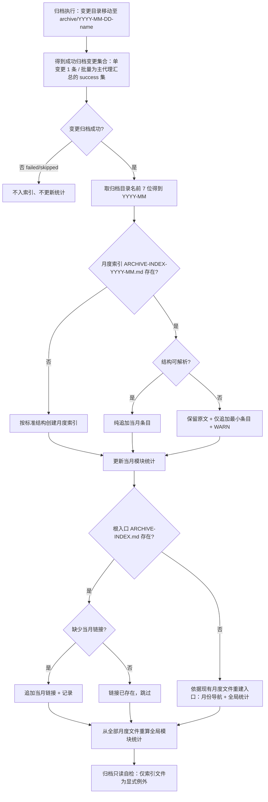

## Context

归档索引当前为单一 `openspec/changes/archive/ARCHIVE-INDEX.md`（78 行 / 42 KB / 45 条，2026-09:17、2026-10:18、2026-11:10）。索引维护完全由技能正文（AI 执行）承担，CLI 的 `executeArchive()` 只做「状态检查 + 目录移动」，不写索引，因此本变更是**模板 / 规格文本改造 + 一次性历史迁移**，不改 CLI 行为。

## Goals / Non-Goals

**Goals**

- 单文件内容有界：每月一个索引文件，条目只追加到当月文件 (D1/D2)。
- 保留统一入口：根文件继续承担月份导航与全局模块统计 (D1)。
- 保持既有安全约束：纯追加 / 禁全量重建 / 主代理单点写 / 失败不入索引 (D5/D8)。

**Non-Goals**

- 不修改 `executeArchive` / `previewArchive` 的行为（目录名日期前缀语义不变）。
- 不修改 `docs/openspec-comparison.md`（历史比较语境）(D7)。
- 不修改 debug 的归档逻辑（debug 不写索引）(D6)。
- 不引入 JSON 制品或任何代码侧索引消费方。

## 流程基准（已确认 2026-11-08，N1-N18）

本设计**引用**探索文件的功能流程图与节点清单，不重新发明流程：



| 节点 | 操作 | 触发条件 | 异常路径 |
| :--- | :--- | :--- | :--- |
| N1 | 归档执行：移动变更目录至 `archive/YYYY-MM-DD-<name>/` | 归档确认通过 | 目标已存在 → 报错，不写索引 |
| N2 | 汇总成功归档变更集合 | 单变更 / 批量汇总完成 | 无成功变更 → N4 |
| N3 | 判定每个变更是否成功归档 | 汇总后逐条判定 | failed/skipped → N4 |
| N4 | 失败/跳过不入索引、不更新统计 | N3 为否 | — |
| N5 | 从归档目录名 `YYYY-MM-DD-` 取前 7 位得到月份 | N3 为是 | 无日期前缀 → 回退当前归档日期所在月 + WARN |
| N6 | 判定月度索引是否存在 | 已得月份 | 读取失败 → WARN + 按不存在处理 |
| N7 | 按标准结构创建月度索引 | 月度文件不存在 | 创建失败 → WARN，不阻断归档 |
| N8 | 判定月度索引结构是否可解析 | 月度文件存在 | 不可解析 → N9 |
| N9 | 保留原文 + 仅追加最小条目 + WARN | N8 为否 | 追加失败 → WARN，不阻断归档 |
| N10 | 向月度索引纯追加当月条目 | N8 为是 | 追加失败 → WARN，不阻断归档 |
| N11 | 更新当月模块统计 | 条目写入后 | 统计解析失败 → 保留原文 + WARN |
| N12 | 判定根入口是否存在 | 月度索引更新完成 | 读取失败 → WARN + 按不存在处理 |
| N13 | 依据现有月度文件重建根入口 | N12 为否 | 重建失败 → WARN，月度索引仍有效 |
| N14 | 判定根入口是否缺少当月链接 | N12 为是 | 入口损坏 → 只补链接 + WARN |
| N15 | 追加当月链接并记录 | N14 为是 | 写入失败 → WARN |
| N16 | 月份链接已存在，跳过 | N14 为否 | — |
| N17 | 从全部月度文件确定性重算全局模块统计 | 根入口就绪 | 月度文件不可解析 → 跳过该月 + WARN |
| N18 | 归档只读自检（索引文件为显式例外） | 索引更新完成 | 越界 → WARN + 人工复核，不回滚 |

## Decisions

### D1 索引布局

根 `ARCHIVE-INDEX.md` = 入口（月份导航 + 全局模块统计）；月度 `ARCHIVE-INDEX-YYYY-MM.md` = 当月条目 + 当月统计。根入口更新仅限月份链接与全局统计，既有条目不改写。

### D2 命名与落点

月度索引位于 `openspec/changes/archive/ARCHIVE-INDEX-YYYY-MM.md`（同目录扁平）。

### D3 历史迁移

现有 45 条按归档日期拆为 `2026-09`(17) / `2026-10`(18) / `2026-11`(10)，条目文本逐字保留；根文件改写为入口 + 全局统计。一次性仓库维护，非归档流程写入。

### D4 月份判定

月份 = 归档目录名 `YYYY-MM-DD-` 前缀前 7 位；批量按每个成功变更各自目录名分组；不读本地时间、不做时区换算。

### D5 异常处置

月度文件缺失→标准结构创建；损坏→保留原文 + 最小追加 + WARN；根入口损坏→只补缺失月份链接 + WARN；任何索引文件 MUST NOT 全量重建。

### D6 debug 范围

debug 不直接写索引，不改归档逻辑。

### D7 文档范围

更新 `spec-workflow-skills` 与 `spec-bulk-archive-skill` 及 `workflow-suite-skills`；`docs/openspec-comparison.md` 不改。

### D8 既有不变项

主代理单点写索引、子代理禁写；失败/跳过不入索引；模块统计确定性重算。

## 数据模型（Markdown 结构）

**月度索引 `ARCHIVE-INDEX-YYYY-MM.md`**（新建时）：

```markdown
# 归档变更索引 YYYY-MM

> 本文件记录 YYYY-MM 的归档变更，由归档流程纯追加。

---

## 归档变更列表

| 归档日期 | 变更名称 | 模块 | 摘要 |
|---------|---------|------|------|

---

## 模块统计

| 模块 | 归档数 | 变更列表 |
|------|-------|---------|

---

*更新时间: YYYY-MM-DD*
```

**根入口 `ARCHIVE-INDEX.md`**（入口形态）：

```markdown
# 归档变更索引（ARCHIVE-INDEX.md）

> 索引入口。月度条目见 ARCHIVE-INDEX-YYYY-MM.md；本文件仅维护月份导航与全局模块统计。

---

## 月份导航

| 月份 | 月度索引 | 条目数 |
|------|---------|-------|
| YYYY-MM | [ARCHIVE-INDEX-YYYY-MM.md](ARCHIVE-INDEX-YYYY-MM.md) | N |

---

## 全局模块统计

| 模块 | 归档数 | 变更列表 |
|------|-------|---------|

---

*更新时间: YYYY-MM-DD*
```

- 条目字段沿用既有：归档日期 / 变更名称 / 模块 / 摘要（含 `[含<type1>/<type2>]` 注记）。
- 月度文件与根入口的「更新时间」均为本次写入日期；根入口统计口径为全部月度文件之和 (D8)。

## 算法

1. **月份解析 (D4)**：`month = /^(\d{4}-\d{2})-\d{2}-/.exec(basename(archiveDir))?.[1] ?? YYYY-MM(当前归档日期)`。不匹配时回退 + WARN。
2. **月度追加 (D5)**：读取当月文件 → 若不存在按模板创建 → 若存在但结构不可解析，保留原文 + 追加一行最小条目 + WARN → 否则在「归档变更列表」表末追加一行，更新当月统计与页脚。
3. **根入口链接 (D1)**：读取根入口 → 缺失则按模板重建（N13）→ 存在且缺当月链接则追加一行 → 已存在跳过（N16）。
4. **全局统计 (D8)**：枚举 `ARCHIVE-INDEX-*.md`（排除根入口）→ 逐月解析条目 → 按模块聚合计数与变更列表；不可解析的月份跳过并记 WARN。MUST NOT 使用增量累加。
5. **只读自检 (D5/D8)**：本次写入仅限根入口的月份链接/统计与当月月度文件的追加；发现越界记 WARN，不回滚。

## 文件归属

| 文件 | 归属 | 变更性质 |
|------|------|---------|
| `src/core/templates/workflows/spec-archive.ts` | 单变更归档协议单一源 | Step 7 改为月度分片 + 根入口；Guardrails 同步 |
| `src/core/templates/workflows/spec-bulk-archive.ts` | 批量归档协议单一源 | Step 10 改为按月份分组；写入面/只读护栏同步 |
| `src/core/templates/workflows/workflow.ts` | 父编排引用 | 归档阶段索引措辞 |
| `src/core/templates/workflows/auto-workflow.ts` | 父编排引用 | 自动归档阶段索引措辞 |
| `src/core/templates/workflows/debug.ts` | debug | 不改（D6） |
| `openspec/changes/archive/ARCHIVE-INDEX.md` | 历史索引 | 改写为入口 |
| `openspec/changes/archive/ARCHIVE-INDEX-2026-09.md` 等 | 历史索引 | 新建（一次性迁移） |
| `test/templates.test.ts` | 回归锁 | 更新既有断言 + 月度规则断言 |
| `test/template-derivation.test.ts` | 派生锁 | 更新指令版断言 |

`skills/**` 为生成快照，由 `pnpm build && pnpm generate:skills` 产出，不手编。

## 历史迁移方案（D3，一次性）

- 来源：`openspec/changes/archive/ARCHIVE-INDEX.md` 的「归档变更列表」表（45 条）。
- 目标：按「归档日期」列的前 7 位分组，逐行原样写入对应月度文件的「归档变更列表」；条目文本 MUST 逐字保留（含摘要与 `[含xxx]` 注记）。
- 根文件：改写为入口形态；月份导航 3 行（2026-09 / 2026-10 / 2026-11，条目数 17 / 18 / 10），全局模块统计从 3 个月度文件确定性聚合。
- 校验：以 `git diff` 与拆分脚本输出核对条目数与逐字内容；日期无法解析的历史条目（B10）保留在根入口「历史未归类」区 + WARN，MUST NOT 丢弃。当前 45 条日期均可解析，预期不触发 B10。
- 该迁移是仓库维护动作，不属于归档流程写入面；实现桥确认后再执行。

## 测试策略

- `test/templates.test.ts`：锁定 spec-archive Step 7 的月度创建/纯追加/根入口边界句、spec-bulk-archive Step 10 的跨月分组/单点更新/禁重建句；保留既有只读护栏断言。
- `test/template-derivation.test.ts`：确认指令版保留强制规则句（标签白名单、纯追加、月度落点），逐步操作细节仍被 `CMD:SKIP` 裁剪。
- 结构断言以文本片段 + 相对位置为主，避免脆弱全文匹配；新增断言覆盖 B1/B2/B3/B4/B5/B6/B7/B8/B9/B11 中的模板可验证项。
- 历史迁移的逐字保真以一次性脚本输出 + `git diff` 人工核对承担（不进自动化测试，避免依赖仓库历史状态）。

## Risks / Trade-offs

- **根入口原地更新 vs 纯追加字面冲突**：折中为「根入口只更新月份链接与统计」，并在写入面与只读护栏显式列为例外 (D1/D5)。
- **跨文件聚合成本**：全局统计需读取全部月度文件；以确定性重算换取无漂移，月度文件数量增长时成本线性上升但可接受。
- **模板快照漂移**：改模板后必须 `pnpm build && pnpm generate:skills`，否则 `test/skills-parity.test.ts` 失败。
- **无代码消费方**：全仓无程序读取 `ARCHIVE-INDEX.md`，格式变更无二进制兼容负担。

## 追溯

- 需求 / 场景见 delta specs：`specs/spec-workflow-skills/spec.md`、`specs/spec-bulk-archive-skill/spec.md`、`specs/workflow-suite-skills/spec.md`。
- 任务节点映射见 `tasks.md` 的 `[N<n>]` 标注。
