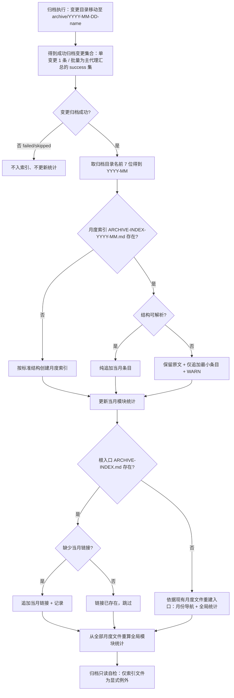

## Background

用户需求原文：优化 workflow\auto-workflow\debug\archive\bulk-archive 及其他涉及归档功能指令技能逻辑调整，归档文件索引不止写在 ARCHIVE-INDEX 文件中，按月份生成对应的索引文件，防止单个文件内容过多情况。

初步理解：当前归档流程把每次归档记录写入单一的 `ARCHIVE-INDEX.md`（实测 78 行、42 KB，45 条历史条目，单行摘要很长），长期累积后单文件内容过多；需要改为按月份生成索引文件，并同步调整所有涉及归档的技能模板与规格。

## 提示词基线 (Prompt Baseline)

**原始提示词**: 优化 workflow\auto-workflow\debug\archive\bulk-archive 及其他涉及归档功能指令技能逻辑调整，归档文件索引不止写在 ARCHIVE-INDEX 文件中，按月份生成对应的索引文件，防止单个文件内容过多情况。

**确认后的提示词基线**: 优化所有涉及归档的技能/指令（workflow / auto-workflow / debug / spec-archive / spec-bulk-archive 及其他引用归档索引的位置）：归档索引不再只写入单一 `ARCHIVE-INDEX.md`，改为按月份生成对应索引文件，防止单文件内容过多。

> 下游（提案 / 设计 / 规格 / 任务）以提示词基线为唯一语义来源；基线若变更 MUST 回到 1.1.2 重新确认。

## 功能流程图

| 节点 | 操作 | 触发条件 | 证据位置 | 异常路径 |
| :--- | :--- | :--- | :--- | :--- |
| N1 | 归档执行：移动变更目录至 `openspec/changes/archive/YYYY-MM-DD-<name>/` | 归档确认通过 | `executeArchive`（`src/core/spec/archive.ts:66`）；目录名 `resolveTargetPath`（`archive.ts:77`） | 目标已存在 → 报错，不写索引（`archive.ts:68`） |
| N2 | 汇总成功归档变更集合 | 单变更归档 / 批量归档主代理汇总完成 | `spec-archive.ts:205`；`spec-bulk-archive.ts:229-270` | 无成功变更 → 跳到 N4 |
| N3 | 判定每个变更是否成功归档 | 汇总后逐条判定 | `spec-bulk-archive.ts:224-227`（a/b/c/d 结果记录） | failed/skipped → N4 |
| N4 | 失败/跳过变更不入索引、不更新统计 | N3 为否 | `spec-bulk-archive.ts:330-332`（10.h） | — |
| N5 | 从归档目录名 `YYYY-MM-DD-` 取前 7 位得到月份 | N3 为是 | [新建] `spec-archive.ts` Step 7 / `spec-bulk-archive.ts` Step 10 的月份解析规则 | 无日期前缀 → 回退当前归档日期所在月 + WARN（B2） |
| N6 | 判定 `ARCHIVE-INDEX-YYYY-MM.md` 是否存在 | 已得月份 | [新建] 路径 `openspec/changes/archive/ARCHIVE-INDEX-YYYY-MM.md` | 读取失败 → WARN + 按不存在处理 → N7 |
| N7 | 按标准结构创建月度索引 | 月度文件不存在 | [新建] 月度索引模板（标题/说明/当月列表/当月统计/页脚时间戳） | 创建失败 → WARN，不阻断归档；根入口仍更新 |
| N8 | 判定月度索引结构是否可解析 | 月度文件存在 | 沿用既有损坏判定（`spec-bulk-archive.ts:324`、`spec-archive.ts:258`） | 不可解析 → N9 |
| N9 | 保留原文 + 仅追加最小条目 + WARN | N8 为否 | 沿用纯追加/禁重建（`spec-bulk-archive.ts:324-328`、`spec-archive.ts:258-261`） | 追加失败 → WARN，不阻断归档 |
| N10 | 向月度索引纯追加当月条目 | N8 为是 | [新建] 由既有 Step 7 追加逻辑（`spec-archive.ts:237-254`）迁入月度文件 | 追加失败 → WARN，不阻断归档 |
| N11 | 更新当月模块统计 | 条目写入后 | [新建] 由既有模块统计逻辑（`spec-archive.ts:249-251`、`spec-bulk-archive.ts:317-320`）限定为当月 | 统计解析失败 → 保留原文 + WARN |
| N12 | 判定根入口 `ARCHIVE-INDEX.md` 是否存在 | 月度索引更新完成 | [新建] 根入口路径 `openspec/changes/archive/ARCHIVE-INDEX.md` | 读取失败 → WARN + 按不存在处理 → N13 |
| N13 | 依据现有月度文件重建根入口（月份导航 + 全局统计） | N12 为否 | [新建] 入口模板 + 月度文件只读聚合 | 重建失败 → WARN，月度索引仍有效 |
| N14 | 判定根入口是否缺少当月链接 | N12 为是 | [新建] 月份导航去重规则 | 入口损坏 → 只补链接 + WARN（B6） |
| N15 | 追加当月链接并记录 | N14 为是 | [新建] 月份导航条目 | 写入失败 → WARN，不阻断归档 |
| N16 | 月份链接已存在，跳过 | N14 为否 | [新建] 链接去重 | — |
| N17 | 从全部月度文件确定性重算全局模块统计 | 根入口就绪 | [新建] 只读全部 `ARCHIVE-INDEX-*.md` 聚合 | 月度文件不可解析 → 跳过该月 + WARN（B11） |
| N18 | 归档只读自检（索引文件为显式例外） | 索引更新完成 | `spec-archive.ts:287-292`（Step 10）；`spec-bulk-archive.ts:220-221`（单元 c 步） | 越界 → WARN + 人工复核，不回滚 |

> **流程基准确认**：已确认（2026-11-08，用户确认 N1-N18）。该流程图 = 流程基准，作为 propose / verify 的交叉验证锚点。

## Analysis

### Deep Analysis Trigger
- Triggered: Yes（输入含「优化」，且 CodeGraph 基础扫描命中既有归档模板与规格）
- Reason: 修改既有技能模板与主规格，非纯新增
- Scope: `src/core/templates/workflows/spec-archive.ts`、`spec-bulk-archive.ts`、`workflow.ts`、`auto-workflow.ts`、`debug.ts`；`openspec/specs/spec-workflow-skills/spec.md`、`openspec/specs/spec-bulk-archive-skill/spec.md`；测试 `test/templates.test.ts`、`test/template-derivation.test.ts`；索引实体 `openspec/changes/archive/ARCHIVE-INDEX.md`

### Architecture Flow
- CLI 侧 `executeArchive()` 只做「状态检查 + 目录移动」（`src/core/spec/archive.ts:66`），**不写索引**；索引维护完全由技能正文（AI 执行）承担，因此本需求是**模板/规格文本改造**，不改 CLI 行为。
- 单变更归档协议：`iagent-spec-archive` 技能 Step 7「更新或创建 ARCHIVE-INDEX.md（纯追加）」（`spec-archive.ts:205-263`）。
- 批量归档协议：`iagent-spec-bulk-archive` 技能 Step 10「批量索引更新」（`spec-bulk-archive.ts:272-334`），主代理单点写、子代理禁写。
- 父编排只引用归档协议，不重复实现：`workflow.ts:395`、`auto-workflow.ts:198`；`debug.ts` 只保留「归档只读」护栏（`debug.ts:584`），归档动作提示用户运行 `/iagent:spec-archive`（`debug.ts:512`），**不直接写索引**。

### Business Flow
1. 变更实现完成 → 归档技能执行 delta spec 合并 / CONTEXT.md 同步 / 探索记忆同步 → 目录移动 → 写索引 → CodeGraph 检查 → 只读自检。
2. 批量归档：子代理并行/串行归档各变更（不写索引）→ 主代理汇总成功/失败/跳过 → 主代理单点更新索引 → 项目级单次 CodeGraph 同步。

### Identified Symbols
- `getSpecArchiveChangeSkillTemplate`（`src/core/templates/workflows/spec-archive.ts:10`）
- `getSpecBulkArchiveSkillTemplate`（`src/core/templates/workflows/spec-bulk-archive.ts:10`）
- `executeArchive` / `previewArchive`（`src/core/spec/archive.ts:66` / `:38`，无索引职责，预计不改）
- README / docs 对比文档中的 ARCHIVE-INDEX 提法（`docs/openspec-comparison.md:204,320`）为历史比较语境，预计不改

## Codebase Findings

### Discovered Files
- `src/core/templates/workflows/spec-archive.ts`：单变更归档技能/指令模板，Step 7 承担索引创建与追加（205-263 行），Guardrails 356-357 行锁定「纯追加/禁重建」。
- `src/core/templates/workflows/spec-bulk-archive.ts`：批量归档模板，Step 10（272-334 行）主代理单点更新；写入面/只读护栏 441-447 行；子代理禁写 159 行。
- `src/core/templates/workflows/workflow.ts`：父流程归档阶段说明（395 行）引用 `ARCHIVE-INDEX.md 纯追加`。
- `src/core/templates/workflows/auto-workflow.ts`：全自动归档阶段说明（198 行）相同引用。
- `src/core/templates/workflows/debug.ts`：仅「归档只读」护栏（584 行）与「运行 /iagent:spec-archive」提示（512 行），无索引写入逻辑。
- `openspec/specs/spec-workflow-skills/spec.md`：402/404/406/410/432/436 行含归档写入面、只读与索引要求。
- `openspec/specs/spec-bulk-archive-skill/spec.md`：140/200/202/207/212/216 行含 bulk 索引要求。
- `test/templates.test.ts`（581-593、1281-1315 行）、`test/template-derivation.test.ts`（220 行）锁定既有索引文本断言。
- `openspec/changes/archive/ARCHIVE-INDEX.md`：当前唯一索引实体，78 行 / 42 KB / 45 条（2026-09:17、2026-10:18、2026-11:10），已纳入 git 跟踪。
- `skills/iagent-spec-archive/SKILL.md`、`skills/iagent-spec-bulk-archive/SKILL.md` 等为生成快照（改模板后须 `pnpm generate:skills`）。

### Identified Symbols
- `getSpecArchiveChangeSkillTemplate`（`spec-archive.ts:10`）：单变更索引协议单一源。
- `getSpecBulkArchiveSkillTemplate`（`spec-bulk-archive.ts:10`）：批量索引协议单一源。
- `executeArchive`（`src/core/spec/archive.ts:66`）：目录名日期前缀来源（`resolveTargetPath` 使用 `new Date().toISOString().slice(0,10)`，UTC 日期）。

### Pattern Matches
- 「纯追加、禁止全量重建」模式：`spec-archive.ts:258-261`、`spec-bulk-archive.ts:324-328`；历史决策 D8（improve-compile-gate-and-archive-readonly）。
- 「主代理单点写、子代理禁写」模式：`spec-bulk-archive.ts:159`。
- 「单一源模板 + CMD:SKIP 派生」：索引操作细节位于 `CMD:SKIP` 区块，指令版只保留强制规则句（`spec-archive.ts:210-254`）。

### Capability Exploration Memory (injected)
- `openspec/specs/spec-workflow-skills/explorations.md:363`：归档写入面 = `openspec/specs/**` + `CONTEXT.md` + `ARCHIVE-INDEX`（追加）；`openspec/changes/**` 仅整目录移动；索引纯追加、结构损坏不重建。
- `openspec/specs/spec-bulk-archive-skill/explorations.md:111,122,147`：bulk 归档写入面收敛、归档只读、子代理禁写 ARCHIVE-INDEX、单元成功后清理工作区等既有不变项继续有效。
- 结论：本变更是在既有「纯追加/禁重建/主代理单点」约束上扩展**分片存储**，不得回退上述不变项。

## Questions

### 批量 1（L1-L3）— 已由用户确认（全部采纳）

- **Q1 索引布局（采纳 A）**：根 `ARCHIVE-INDEX.md` = 索引入口 + 月份导航 + 全局模块统计；`ARCHIVE-INDEX-YYYY-MM.md` = 当月归档列表 + 当月模块统计。
- **Q2 命名与落点（采纳）**：`openspec/changes/archive/ARCHIVE-INDEX-YYYY-MM.md`（同目录扁平）。
- **Q3 历史迁移（采纳）**：现有 45 条按归档日期拆为 `2026-09`(17) / `2026-10`(18) / `2026-11`(10) 三文件，条目文本逐字保留；根文件改写为入口 + 全局统计；该改写涉及 git 跟踪文件，实现桥再确认。
- **Q4 月份判定（采纳）**：取归档目录名 `YYYY-MM-DD-` 前 7 位；批量按每个变更各自目录名分组；不读本地时间。
- **Q5 异常处置（采纳）**：月度文件缺失→标准结构创建；月度文件损坏→保留原文 + 最小追加 + WARN；根入口损坏→只补缺失月份链接 + WARN；一律禁全量重建。
- **Q6 debug（采纳）**：debug 不写索引，**不改归档逻辑**，记录「无需改动」。
- **Q7 文档范围（采纳）**：更新主规格 `spec-workflow-skills` / `spec-bulk-archive-skill`；`docs/openspec-comparison.md` 不改。

### 批量 2（L4-L5，待用户确认）

**L4 一致性扫描（自动，无矛盾）**：读取已记录 D1-D7，结论 —— 0 个硬冲突。1 处软冲突已裁决：D1 根入口原地更新（链接/统计）与既有「纯追加」约束字面冲突 → 将根入口更新限定为「月份链接 + 全局模块统计重算、既有条目不改写」，并在归档写入面显式列为例外；月度文件仍纯追加。D3 历史迁移属一次性仓库维护（非归档流程写入），用户已确认。

**L5 边界场景（请确认）**：

| # | 边界场景 | 我的建议 |
|---|---------|---------|
| B1 | 同批批量归档的成功变更分属两个月份 | 分别写入各自月度文件，根入口补两个月份链接 |
| B2 | 归档目录名无 `YYYY-MM-DD-` 前缀 | 回退为当前归档日期所在月 + WARN |
| B3 | 月度文件首次创建 | 按标准结构（标题 / 说明 / 当月列表 / 当月模块统计 / 页脚时间戳） |
| B4 | 月度文件结构损坏 | 保留原文 + 仅追加最小条目 + WARN，不重建 |
| B5 | 根入口缺失但存在月度文件 | 依据现有月度文件重建入口（TOC + 全局统计），一次性且需在摘要报告 |
| B6 | 根入口损坏 | 保留原文 + 只补缺失月份链接 + WARN，不重建、不改既有条目 |
| B7 | 失败 / 跳过变更 | 不入任何月度索引、不更新统计 |
| B8 | 同月多次归档 | 月度文件纯追加；根入口月份链接去重 |
| B9 | 本地时间与 UTC 跨月 | 一律以归档目录名日期为准，不做时区换算 |
| B10 | 历史条目日期无法解析 | 迁移时保留在根入口「历史未归类」区 + WARN，MUST NOT 丢弃 |
| B11 | 全局模块统计口径 | 统计值从全部月度文件确定性重算（只读月度文件），不使用增量累加漂移 |

## 术语表

| 术语 | 定义 | 避免使用 |
|------|------|---------|
| 归档索引（archive index） | 归档变更的元数据索引，记录归档日期 / 变更名 / 模块 / 摘要及模块统计 | 归档清单 |
| 索引入口（index entry） | 根 `openspec/changes/archive/ARCHIVE-INDEX.md`，承担月份导航与全局模块统计 | 总索引 |
| 月度索引（monthly index） | `openspec/changes/archive/ARCHIVE-INDEX-YYYY-MM.md`，承载该月归档条目与当月模块统计 | 分片索引 |

## 架构决策

无 ADR（已复核三条件：月度分片可逆、无跨会话意外性、权衡已由 D1 记录，不满足 ADR 门槛）

## 边界场景

- [ ] B1 跨月批量归档：同批成功变更分属两个月 → 分别写各自月度文件；根入口补两月链接。
- [ ] B2 目录名无日期前缀 → 回退当前归档日期所在月 + WARN。
- [ ] B3 月度文件首次创建 → 标准结构（标题、说明、归档变更列表、当月模块统计、页脚时间戳）。
- [ ] B4 月度文件结构损坏 → 保留原文 + 仅追加最小条目 + WARN，不重建、不丢历史条目。
- [ ] B5 根入口缺失但存在月度文件 → 依据月度文件重建入口（TOC + 全局统计），摘要报告该重建。
- [ ] B6 根入口损坏 → 保留原文 + 只补缺失月份链接 + WARN，不重建、不改既有条目。
- [ ] B7 失败/跳过变更 → 不入任何月度索引，也不更新统计。
- [ ] B8 同月多次归档 → 月度文件纯追加，根入口月份链接不重复添加。
- [ ] B9 本地时间与 UTC 跨月 → 一律以归档目录名日期为准，不做时区换算。
- [ ] B10 历史条目日期无法解析 → 保留在根入口「历史未归类」区 + WARN，MUST NOT 丢弃。
- [ ] B11 全局模块统计口径 → 从全部月度文件确定性重算（只读），不使用增量累加。

## Decision Process

### Decision: 索引布局（根入口 vs 月度分片）
**Options Considered**:
- Option A: 根入口（导航 + 全局统计）+ 月度分片（条目 + 当月统计）
- Option B: 根文件仅 TOC + 月度分片
- Option C: 仅月度文件

**Pros/Cons**:
- A: 保持既有入口心智、根文件有界；代价是根文件需少量原地更新（统计/链接）
- B: 根文件更小；代价是丢失全局统计视图
- C: 文件最小；代价是失去统一入口、与用户「不止写在」表述不符

**Chosen**: Option A（用户确认，D1）
**Rationale**: 避免单文件无限增长，同时保留可发现的统一入口。

## Decisions

- **D1 索引布局**：根 `openspec/changes/archive/ARCHIVE-INDEX.md` 保留为索引入口（月份导航 + 全局模块统计）；每月条目写入 `ARCHIVE-INDEX-YYYY-MM.md`（当月归档列表 + 当月模块统计）。根入口更新仅限月份链接与全局统计，既有条目不改写。
- **D2 命名与落点**：月度索引位于 `openspec/changes/archive/ARCHIVE-INDEX-YYYY-MM.md`（同目录扁平命名）。
- **D3 历史迁移**：本次将现有 45 条按归档日期月份拆入 `2026-09` / `2026-10` / `2026-11` 三个月度文件，条目文本逐字保留；根文件改写为入口 + 全局统计。一次性仓库维护，非归档流程写入；实现桥再确认。
- **D4 月份判定**：月份 = 归档目录名 `YYYY-MM-DD-` 前缀前 7 位；批量归档按每个成功变更各自归档目录名分组；不读取本地时间、不做时区换算。
- **D5 异常处置**：月度文件缺失→按标准结构创建；月度文件损坏→保留原文 + 仅追加最小条目 + WARN；根入口损坏→保留原文 + 只补缺失月份链接 + WARN；任何索引文件 MUST NOT 全量重建。
- **D6 debug 范围**：debug 不直接写索引，不改归档逻辑；记录「无需改动」。
- **D7 文档范围**：更新主规格 `spec-workflow-skills` 与 `spec-bulk-archive-skill`；`docs/openspec-comparison.md` 不改。
- **D8 既有不变项沿用**（L4 裁决）：主代理单点写索引、子代理禁写；失败/跳过不入索引；模块统计确定性重算。

## 硬约束

- 根索引入口 MUST 保留在 `openspec/changes/archive/ARCHIVE-INDEX.md` — source: D1
- 月度索引路径 MUST 为 `openspec/changes/archive/ARCHIVE-INDEX-YYYY-MM.md` — source: D2
- 月份 MUST 取归档目录名 `YYYY-MM-DD-` 前缀前 7 位 — source: D4
- 月度索引 MUST 纯追加，索引文件 MUST NOT 全量重建 — source: D5
- 根入口 MUST 只更新月份链接与全局模块统计，MUST NOT 改写既有条目 — source: D1
- 归档索引写入 MUST 由主代理单点执行，子代理 MUST NOT 写入 — source: D8
- 失败 / 跳过变更 MUST NOT 入索引 — source: D8

## Scope Changes

| 变更时间 | 变更类型 | 变更描述 | 原因 |
|---------|---------|---------|------|
| — | — | — | — |

## Pending

### For Phase 2 Impact Analysis
- `getSpecArchiveChangeSkillTemplate`（`src/core/templates/workflows/spec-archive.ts:10`）— Priority: HIGH
- `getSpecBulkArchiveSkillTemplate`（`src/core/templates/workflows/spec-bulk-archive.ts:10`）— Priority: HIGH
- `executeArchive`（`src/core/spec/archive.ts:66`）— Priority: LOW（预计不改，仅确认日期前缀语义）
- `spec-workflow-skills/spec.md` 归档写入面 / 只读 / 索引要求 — Priority: HIGH
- `spec-bulk-archive-skill/spec.md` 批量索引要求 — Priority: HIGH

### Business Validation
- 历史 45 条条目拆分后是否逐字保留：以 `git diff` 与拆分脚本输出核对。
- 根入口全局模块统计与月度统计的一致性：以一次性重建脚本与人工抽检核对。

### Unresolved Decisions
- 无（L5 已确认；功能流程图已确认）。

### Phase 1 收尾校验
- CONTEXT.md 已校验：更新现有术语 2 条（归档写入面、归档索引）、新增术语 2 条（索引入口、月度索引）。
- 聚合一致性门通过 —— 扫描 D1-D8 共 8 个决策，0 个硬冲突；软冲突（根入口原地更新 vs 纯追加）已由 D1/D5 的写入边界裁决。
- 流程基准：已确认（N1-N18），`flowBaselineConfirmed=true`。
- `paperTrailStatus=complete`。

## Implementation Deep-Dive

### Design Rationale
- 索引保持「纯追加、禁止全量重建」的设计意图：索引是历史元数据，重建会丢失人工增补与既有条目（历史决策 D8，`spec-archive.ts:258-261`、`spec-bulk-archive.ts:324-328`）。
- 主代理单点写入的设计意图：避免 ≤3 并行归档子代理并发写同一文件（`spec-bulk-archive.ts:159`、能力记忆 2026-11-08 a.5 串行化裁决）。
- 根文件名 `ARCHIVE-INDEX.md` 曾被 README / 规格引用，保留根入口可减少断链。

### Constraints
- 归档写入面仅允许 `openspec/specs/**`、`openspec/CONTEXT.md` 与归档索引文件；`openspec/changes/**` 仅整目录移动（`openspec/specs/spec-workflow-skills/spec.md:404`）。
- Windows 路径需 `path.join()`；文件名大小写敏感性差异（模板既有说明）。
- 改模板后必须 `pnpm build && pnpm generate:skills`（AGENTS.md 修改守则第 1 条）。

### Trade-offs
- 根入口若保留全局统计，每次归档需原地更新（违反「纯追加」字面）；折中方案是把根入口更新限定为「新增月份链接 / 统计数字重算」，并作为归档只读护栏的显式例外。
- 月度分片使单文件有界，但总览需跨文件聚合；根入口的导航与全局统计承担该职责。

### Pattern Usage
- `CMD:SKIP` 派生：索引操作细节可继续留在 skill 版，指令版保留强制规则句。
- 单一源：spec-archive 与 spec-bulk-archive 各自维护自身协议；父编排只引用，不重复声明。

### Historical Context
- 2026-11-01 `improve-compile-gate-and-archive-readonly`：索引改为纯追加、禁重建，并收敛归档写入面。
- 2026-11-08 `improve-grill-with-docs-paper-trail`：bulk a.5 术语表写入串行化（并发写风险先例）。
- CHANGELOG 记录过 `ARCHIVE-INDEX.md` 两条归档记录错位问题（2026-10-10）。

### Implicit Assumptions
- 归档索引仅由 AI 技能维护，无 CLI/程序读取该文件（全仓 grep 未发现代码消费方）。
- 月份以归档目录名日期为准，时区差异由 CLI 生成目录名时已确定（`toISOString()` UTC）。
