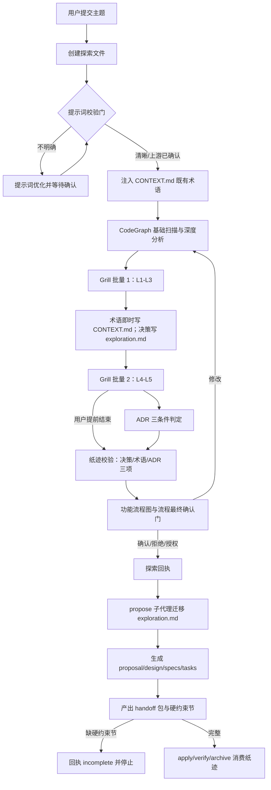

## Context

iagent 对 grill-with-docs 的集成不是调用上游技能，而是把纪律**自持实现**在模板正文中：`spec-explore.ts` 的 `GRILL_PLAYBOOK_FULL` 是唯一实现源（1.3 追问 / 1.3.3 领域建模 / 1.3.4 L1-L5），`debug.ts` §2.3 是缩减版，`auto-workflow.ts` / `workflow.ts` 负责编排口径，`spec-propose.ts` 负责下游制品与 handoff 包，`spec-archive.ts` / `spec-bulk-archive.ts` 负责归档期术语同步。

现状缺口（详见 `exploration.md` 的 R1-R7）：

- 纸迹校验只有 CONTEXT.md 一项；`Decisions` 为空时 1.6.6 记 WARN 后按空集通过，ADR 无任何校验 —— 上游点名的「访谈照跑、纸迹静默缺失」在本仓库同型成立。
- handoff 包六节无承载硬约束的位置，精确回答（顺序保证 / 否定式需求 / 数值默认值）可能被下游软化成散文。
- 1.3.2「深度不限」与 1.3.4「≤2 批量轮次」在同一技能内互相矛盾，且已被规格与测试锁死。
- `debug` §2.3 缺术语冲突检测、ADR 三条件、边界场景构造。
- 六个 CONTEXT.md 写入者中只有 explore 做冲突检测；archive 还从制品正文反向抽取术语。

### Architecture Impact

| 组件 | 落点 | 影响类型 |
| :--- | :--- | :--- |
| 模板层（探索） | `src/core/templates/workflows/spec-explore.ts`：`GRILL_PLAYBOOK_FULL`（:608）、`getSpecExploreSkillTemplate`（:1205） | 正文口径 + 校验步骤 + 回执字段 |
| 模板层（调试） | `src/core/templates/workflows/debug.ts:126` / §2.3 | 纪律补齐 |
| 模板层（编排） | `auto-workflow.ts:16` / `workflow.ts:136` | 纸迹衔接口径 |
| 模板层（提案 / 归档） | `spec-propose.ts`（handoff 包 / 制品生成）、`spec-archive.ts` 4.5、`spec-bulk-archive.ts` a.5 | 硬约束载体 + 取词口径 + 并发写入串行化 |
| 模板层（只读消费） | `spec-verify.ts` / `spec-apply.ts`：只读复用 `## 硬约束`；verify 无 `Write`，阶段结论由 apply / archive 追加 | 只读消费，无 grill 逻辑 |
| 编排协议字段 | `src/core/host-orchestration/workflows.ts:33`（`EXPLORE_PHASE.handoff`） | 登记 `paperTrailStatus` |
| 生成层 | `command-generation/generator.ts` / `derive-command.ts` / `skills/` 快照 | 重新生成，无结构性改动 |
| 规格层 | `openspec/specs/workflow-suite-skills/spec.md:650-663`、`openspec/specs/skill-stage-continuation/spec.md:144-166` | 需求口径同步 / 新增并列节契约 |
| 测试层 | `test/template-consistency.test.ts:167-180`、`test/stage-continuation.test.ts`、`test/skill-size-budget.test.ts:65-74` | 口径同步（MUST NOT 删断言）+ 新增回归锁 |
| 编排协议 | `openspec/specs/host-orchestration/spec.md:525` | 仅确认：handoff 六节语义不变，`## 硬约束` 为并列节 |

**门预算（D2 / 约束）**：本变更不新增阻塞确认门，不改 `GATE_WHITELIST`，不改各阶段门数量；纸迹校验并入既有流程最终确认门呈现 (D2.1)。

**单一源（AGENTS.md 守则 7）**：spec 模板只维护 skill 版正文，command 版由 `deriveCommandContent()` 派生；本变更的模板改动 MUST NOT 直接编辑派生产物或另立手工字符串。

**快照（AGENTS.md 守则 1）**：模板改动后 MUST 依次 `pnpm build && pnpm generate:skills`，否则 `test/skills-parity.test.ts` 失败。

### 流程基准（已确认 N1-N16，引用而非重建）

来源：`openspec/changes/improve-grill-with-docs-paper-trail/exploration.md` 的 `## 功能流程图` 段（用户已确认 `flowBaselineConfirmed=true`）。本设计**不重新发明流程**，只在其上落实现规则。

| 节点 | 操作 | 触发条件 | 证据位置 | 异常路径 |
| :--- | :--- | :--- | :--- | :--- |
| N1 | 接收主题并进入探索 | 用户调用 explore / workflow / auto-workflow | `spec-explore.ts:20` | 无输入 → 交互收集后再进入 N2 |
| N2 | 创建 `openspec/explorations/<kw>-explore-NNN.md` | N1 完成 | `spec-explore.ts:32`（1.1） | 创建失败 → 停止并报告 |
| N3 | 六维提示词校验门 | N2 完成 | `spec-explore.ts:20`（1.1.2） | 不明确 → N3a；拒绝/授权 → 记录基线后继续 |
| N4 | 载入 CONTEXT.md 既有术语 | N3 通过 | `spec-explore.ts:109`（1.1.5） | 文件缺失 → 记录「将在探索中创建」 |
| N5 | CodeGraph 基础扫描 + 修改意图深度分析 | N4 完成 | `spec-explore.ts:32`（1.2.1/1.2.3） | 三通道不可用 → Glob/Grep + WARN |
| N6 | Grill 批量 1（L1-L3，逐条 + AI 建议） | N5 完成 | `spec-explore.ts:665-674` | 用户逐条修改后重呈 |
| N7 | 术语**即时**写 CONTEXT.md；决策写 exploration Decisions | 每条决策确认后 | `spec-explore.ts:640-646`、`415-432` | 术语与既有条目冲突 → 先指出再接受 |
| N8 | Grill 批量 2（L4 一致性 + L5 边界） | N7 完成 | `spec-explore.ts:676-680` | L4 无矛盾自动直通；用户「够了」→ 记 user-shortened |
| N9 | ADR 三条件判定，满足则写 `openspec/docs/adr/` | N8 完成 | `spec-explore.ts:653` | 不满足 → 不产出（正常态） |
| N10 | **纸迹校验**：Decisions / 术语表 / ADR 三项存在性或显式「无」 | N9 完成 | `[新建]` —— 落点 `spec-explore.ts` 1.5.5 前置 | 缺纸迹 → 记入 N11 门内容（不新增阻断门） |
| N11 | 产出功能流程图并执行流程最终确认门 | N10 完成 | `spec-explore.ts:437-472`（1.5.5） | 修改 → 回 N5；拒绝 → 记未确认 + 降级 |
| N12 | 输出结构化回执（含 `flowBaselineConfirmed` / `paperTrailStatus`） | N11 出口 | `spec-explore.ts:32`（1.8） | 回执缺字段 → 父级不推进 |
| N13 | propose 子代理迁移探索文件为 `exploration.md` | 编排器委派 | `spec-propose.ts:88` | 迁移失败 → 保留源文件并报错 |
| N14 | 生成 proposal / design / specs / tasks | N13 完成 | `spec-propose.ts:100` | 校验失败 → 修正后重跑 |
| N15 | 产出六节 handoff 包 + `## 硬约束` 并列节 | N14 完成 | `[新建]` —— 扩展 `spec-propose.ts:214` | 缺节 → N15a（`incomplete`，MUST NOT 猜测） |
| N16 | apply / verify / archive 消费纸迹 | 各阶段入口 | `spec-archive.ts:95-120`、`spec-apply.ts`（编译门） | 术语表污染 → P1 纯净度规则 |

## Goals / Non-Goals

**Goals**:

- 让 grill 访谈的纸迹从「访谈照跑、产出静默缺失」变为「产出状态显式声明并可核对」(D2.1)。
- 让精确回答（顺序保证 / 否定式需求 / 数值默认值）以逐字形式跨阶段传递，并可从 `D<n>` 追溯到 spec / design / 测试 (D2.2, D5)。
- 消除同一技能内「深度不限」与「≤2 批」的口径矛盾，并同步规格与测试锁 (D2.3, D3)。
- 统一六处 CONTEXT.md 写入者的漂移防护与归档取词口径 (D4)。
- 补齐 `debug` 排查期的三项 grill 纸迹纪律 (D6)。
- 全程不新增确认门、不改门白名单与门预算 (D2)。

**Non-Goals**:

- 不全面对齐上游：不做「轮数不限」、不拆分 `grilling` / `domain-modeling`、不引入 `GLOSSARY-MAP`。
- 不重写术语表内容规范（只收窄归档取词口径这一最小规则）。
- 不在 `apply` 中新增 grill 纸迹逻辑（经核实未集成 grill）；`apply` / `verify` 仅作为 handoff `## 硬约束` 的**只读消费方**，且 `verify` 无 `Write` 权限、不追加阶段结论。
- 不改 handoff 包六节语义，不把 `## 硬约束` 计入六节。
- 不改 `src/` 以外的运行时行为，不新增 CLI 命令。

## Decisions

### D1: 优化范围为定点修补「纸迹保真」

- **选择**: Option B —— 定点修补纸迹缺口（校验 + 硬约束载体 + 矛盾消解 + 漂移防护 + 可追溯）(D1)。
- **理由**: 命中上游点名的两类最严重问题，且不触碰已归档的门预算决策与门白名单。
- **备选**: A（只报告，已知缺陷继续存在）；C（全面对齐上游，与门预算 / 单一源 / 快照体系冲突面大）。

### D2: 三个 P0 修复点

- **选择**:
  1. **纸迹校验**：在 1.5.5 前置校验 Decisions / 术语表 / ADR 三项，结果记入回执 `paperTrailStatus`，**并入已存在的流程最终确认门呈现，不新增阻塞门** (D2.1)。
  2. **硬约束载体**：handoff 包新增并列节 `## 硬约束`，逐字保留顺序保证 / 否定式需求 / 数值默认值，每行带 `source: D<n>` (D2.2)。
  3. **矛盾消解**：1.3.2「深度不限」改写为「收敛深度不限，批量轮数受 ≤2 批规则约束（澄清门不计入流程级门预算）」，并同步规格与测试口径 (D2.3)。
- **理由**: 三者分别覆盖「纸迹缺失」「纸迹失真」「纸迹规则自相矛盾」，且都不改变门结构。
- **备选**: 把纸迹校验做成独立阻塞门（与门预算冲突，否决）；把硬约束放进六节之一（改变六节语义，否决）。

### D3: 规格与测试断言同步口径

- **选择**: 同步修改 `openspec/specs/workflow-suite-skills/spec.md` 与 `test/template-consistency.test.ts` 的口径；**MUST NOT 删除断言**；版本递增按 `minor` (D3)。
- **理由**: 断言是回归锁，删除会使同类偏差重新引入；同步口径保留保护强度。
- **备选**: 删除互斥断言（否决，失去回归锁）；提升为 major（无破坏性行为，否决）。

### D4: 多写入者漂移防护与归档取词口径

- **选择**: `spec-explore` / `debug` / `spec-archive` / `spec-bulk-archive` 统一「先读 CONTEXT.md 再写、同名冲突显式裁决」；归档只同步变更 `exploration.md` 术语表 (D4)。
- **理由**: 直接消除上游点名的 drift 成因，并顺带收口 archive 从制品正文反向抽取术语的污染路径。
- **备选**: 只修 explore（其余三处仍会漂移，否决）；建立独立术语服务（超出定点修补范围，否决）。

### D6: debug 排查期 grill 纪律补齐

- **选择**: `debug.ts` §2.3 补术语冲突检测、ADR 三条件、边界场景构造三项，与 `spec-explore` 1.3.3 对齐 (D6)。
- **理由**: 上游指出「部分加载 = 好访谈、无纸迹」是最常见问题；缩减版纪律是同一失败模式的本仓库形态。
- **备选**: 保持缩减版（与上游已证伪的失败模式同型，否决）。

### D5: 决策可追溯链路

- **选择**: 探索 Decisions 带稳定 `D<n>`；handoff `## 硬约束` 行带 `source: D<n>`；proposal / spec / design 在约束处标 `(D<n>)`；tasks 的 `[测试]` 覆盖相关硬约束 (D5)。
- **理由**: 把「答案 → 规格 → 测试」变成可核对记录，对齐上游第 7 条最严重开放抱怨。
- **备选**: 仅靠重读散文（上游已证伪，否决）；引入外部工单系统 ID（超出范围，否决）。

## Risks / Trade-offs

| 风险 | 缓解 |
| :--- | :--- |
| 纸迹校验被误做成第二个阻塞门，突破门预算 | 规格明写「并入既有流程最终确认门」+ 测试断言阶段阻塞门 ≤ 1 (D2.1) |
| 硬约束节膨胀，突破 handoff 每节 ≤ 120 行预算 | 一行一条、只收不可改写片段、不整段复制；新增预算断言 |
| 改写口径时误删既有断言，失去回归锁 | D3 明确 MUST NOT 删除断言；测试任务逐条核对原文 |
| 模板正文增长触发 `skill-size-budget` / 主文件 ≤500 行（`skills/iagent-debug/SKILL.md` 与 `skills/iagent-workflow/SKILL.md` 已 499 行） | 新增纪律**优先下沉** `references/grill-discipline.md` 并在主文件保留 Read 指引；6.x 编排段落做等行数压缩；快照刷新前先跑 `test/skill-size-budget.test.ts` |
| 批量归档并行单元并发写同一 `CONTEXT.md` 导致丢失更新 | D4 要求 a.5 写入步串行化（同一批次锁 / 串行执行），并发只允许发生在不写 `CONTEXT.md` 的步骤 |
| `skills/` 快照与模板不一致 | 实现阶段 MUST `pnpm build && pnpm generate:skills`，并在测试组验证 parity |
| 六处写入者的规则被各自表述成不同版本 | 统一措辞以本变更规格为源，测试断言关键字（先读后写 / 显式裁决 / 仅 exploration 术语表） |
| 存量探索文件 / handoff 包无新字段导致误判 | B2 / B3 显式降级：跳过并记 WARN，只对新产出强制 |
| 上游行为演进后再次偏离 | 本次范围明确不在范围内；偏离点记录在 ADR-0001 与本设计 Non-Goals |
