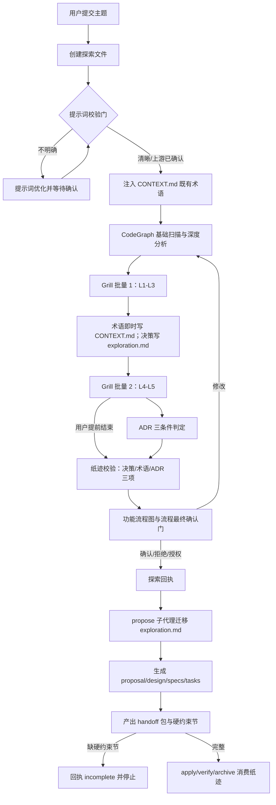

# Grill-With-Docs 集成风险探索

## Background

用户要求：分析 `D:\ai_workspace\mattpocock-skills\docs\engineering\grill-with-docs.md` 的**最新内容**，
评估 iagent 中已集成 grill-with-docs 的技能（apply / auto-workflow / debug 等）是否存在风险，
是否需要优化完善集成。

上游文档核心事实（2026-11 版）：

1. 该技能是 **stateful**：术语一旦收敛**立即**写入 `GLOSSARY.md`（不批量、不延后）；决策同时满足三道门
   （难以逆转 / 脱离上下文令人意外 / 真实权衡）时才写 ADR。
2. 三类产出**不等价**：术语 → GLOSSARY.md；满足三门的决策 → ADR；**其余决策只存在于对话中**。
   "The glossary is the main output" —— 术语表才是主产出，不是规格。
3. 已知缺陷（**未修复**）：当该技能运行在**另一层编排**中（spec-driven wrapper / 多代理框架 /
   被当作他人管线的步骤）时，"**写文件的那一半会静默不发生，而访谈照常运行**"。
4. 最常见问题：依赖技能（`grilling` + `domain-modeling`）**部分加载** —— 访谈正常但无纸迹。
5. 最严重的开放抱怨：**"我其他的决策去哪了？"** —— 后续步骤会把精确回答（顺序保证、否定式需求、
   数值型默认值）**稀释成更弱的散文**，看起来完整却丢了真正决定的东西。
6. 术语表只放词汇，不含实现细节、不含 spec 片段。
7. 单会话工具，结束时建议把同一对话直接交给 `to-spec`（不要清空上下文）。
8. 多上下文仓库用根目录 `GLOSSARY-MAP.md` 分流到各自的 `GLOSSARY.md`。

## 提示词基线 (Prompt Baseline)

**原始提示词**: 分析 `D:\ai_workspace\mattpocock-skills\docs\engineering\grill-with-docs.md` 最新内容，
对 apply / auto-workflow / debug 等集成 grill-with-docs 的指令技能进行风险分析，
判断是否需要对集成 grill-with-docs 进行优化完善。

**确认后的提示词基线**: 同原始提示词（六维自检：目标 / 对象 / 范围 / 歧义均无 ❌ 与实质 ⚠️，
范围中「等」按仓库实际集成点补全 —— spec-explore / workflow / auto-workflow / debug，apply 经核实未集成）。
输入清晰，一句话复述：**以上游 skill 文档为基准，审计 iagent 各技能中 grill-with-docs 纪律的实现偏差，
判定风险等级并给出是否优化、优化什么的建议。**

> 下游（提案 / 设计 / 规格 / 任务）以提示词基线为唯一语义来源；基线若变更 MUST 回到提示词门重新确认。

## 功能流程图

**范围**：grill-with-docs 纸迹在 iagent 各技能间的完整流转（目标态，含 `[新建]` 节点）。

| 节点 | 操作 | 触发条件 | 证据位置 | 异常路径 |
| :--- | :--- | :--- | :--- | :--- |
| N1 | 接收主题并进入探索 | 用户调用 explore / workflow / auto-workflow | `spec-explore.ts:20` | 无输入 → 交互收集后再进入 N2 |
| N2 | 创建 `openspec/explorations/<kw>-explore-NNN.md` | N1 完成 | `spec-explore.ts:32`（1.1） | 创建失败 → 停止并报告 |
| N3 | 六维提示词校验门 | N2 完成 | `spec-explore.ts:20`（1.1.2） | 不明确 → N3a；拒绝/授权 → 记录基线后继续 |
| N4 | 载入 CONTEXT.md 既有术语 | N3 通过 | `spec-explore.ts:109`（1.1.5） | 文件缺失 → 记录「将在探索中创建」 |
| N5 | CodeGraph 基础扫描 + 修改意图深度分析 | N4 完成 | `spec-explore.ts:32`（1.2.1/1.2.3） | 三通道不可用 → Glob/Grep + WARN |
| N6 | Grill 批量 1（L1-L3，逐条 + AI 建议） | N5 完成 | `spec-explore.ts:665-674` | 用户逐条修改后重呈 |
| N7 | 术语**即时**写 CONTEXT.md；决策写 Exploration Decisions | 每条决策确认后 | `spec-explore.ts:640-646`、`415-432` | 术语与既有条目冲突 → 先指出再接受 |
| N8 | Grill 批量 2（L4 一致性 + L5 边界） | N7 完成 | `spec-explore.ts:676-680` | L4 无矛盾自动直通；用户「够了」→ 记 user-shortened |
| N9 | ADR 三条件判定，满足则写 `openspec/docs/adr/` | N8 完成 | `spec-explore.ts:653` | 不满足 → 不产出（正常态） |
| N10 | **纸迹校验**：Decisions / 术语表 / ADR 三项存在性或显式「无」 | N9 完成 | `[新建]` —— 落点 `spec-explore.ts` 1.5.5 前置 | 缺纸迹 → 记入 N11 门内容（不新增阻断门） |
| N11 | 产出功能流程图并执行流程最终确认门 | N10 完成 | `spec-explore.ts:437-472`（1.5.5） | 修改 → 回 N5；拒绝 → 记未确认 + 降级 |
| N12 | 输出结构化回执（含 `flowBaselineConfirmed` / `paperTrailStatus`） | N11 出口 | `spec-explore.ts:32`（1.8） | 回执缺字段 → 父级不推进 |
| N13 | propose 子代理迁移探索文件为 `exploration.md` | 编排器委派 | `spec-propose.ts:88` | 迁移失败 → 保留源文件并报错 |
| N14 | 生成 proposal / design / specs / tasks | N13 完成 | `spec-propose.ts:100` | 校验失败 → 修正后重跑 |
| N15 | 产出六节 handoff 包 + **`## 硬约束` 并列节** | N14 完成 | `[新建]` —— 扩展 `spec-propose.ts:214` | 缺节 → N15a（`incomplete`，MUST NOT 猜测） |
| N16 | apply / verify / archive 消费纸迹 | 各阶段入口 | `spec-archive.ts:95-120`、`spec-apply.ts`（编译门） | 术语表污染 → P1 纯净度规则 |

> 本流程图 = **流程基准**（目标态）。未获用户确认前 MUST NOT 作为提案的生成锚点。

## 代码库扫描结果

### 代码库扫描判定

- **扫描通道**：CodeGraph MCP（`codegraph_explore` 返回源码与调用链，视为可用）；未使用 Glob/Grep 作为主通道
- **扫描结论**：已完成 —— 发现 6 个承载文件、约 20 个相关锚点

### Discovered Files

- `src/core/templates/workflows/spec-explore.ts` — grill-with-docs 纪律的**唯一实现源**（`GRILL_PLAYBOOK_FULL`，1.3 追问 / 1.3.3 领域建模 / 1.3.4 L1-L5）
- `src/core/templates/workflows/debug.ts` — 排查期 grill 纪律（缩减版，§2.3）
- `src/core/templates/workflows/auto-workflow.ts` — Phase 1 内联委派 spec-explore；Phase 2 起改子代理
- `src/core/templates/workflows/workflow.ts` — 引导式编排，同类委派结构
- `src/core/templates/workflows/spec-propose.ts` — 消费 exploration.md 生成制品 / handoff 包
- `src/core/templates/workflows/spec-archive.ts`、`spec-bulk-archive.ts` — 归档前 CONTEXT.md 术语同步
- `src/core/host-orchestration/protocol.ts` — 门白名单（`grill-batch-confirmation` 属需求澄清类）
- `openspec/specs/workflow-suite-skills/spec.md` — 已把「grill ≤2 批 + 最低深度 L3」写成硬需求（line 650-663）
- `test/template-consistency.test.ts` — 回归锁：`≤ 2 批量轮次` / `批量 1` / `批量 2` / `最低深度 L3`

### Identified Symbols

- `GRILL_PLAYBOOK_FULL`（`spec-explore.ts:608`）— 1.3 全文，写入 `references/grill-playbook.md`
- `getSpecExploreSkillTemplate`（`spec-explore.ts:1205`）— 主文件内联紧凑版 + references 分发
- `getDebugSkillTemplate`（`debug.ts:126`）— debug 主文件
- `getAutoWorkflowSkillTemplate`（`auto-workflow.ts:16`）— 全自动编排
- `GATE_WHITELIST`（`protocol.ts:98`）— 门预算与门类别的单一源

### Pattern Matches

- **单一源派生**：skill 版正文 → `deriveCommandContent()` 派生 command 版；`skills/` 快照由 `pnpm generate:skills` 生成
- **委派隔离**：Phase 2+ 一律子代理 + Stage Envelope（只传路径，不传正文）
- **纸迹载体**：`openspec/CONTEXT.md`（术语）+ `openspec/docs/adr/`（ADR）+ 探索文件（决策/边界场景）+ `.openspec-tmp/pipeline-*/handoff-pack.md`

### Capability Exploration Memory (injected)

来源：`openspec/specs/workflow-suite-skills/explorations.md`（503 行，节选相关决策）

- **门预算（gate budget）**：每个阶段至多 1 个流程级阻塞确认门；澄清门（提示词 / grill）与聚合一致性门不计入流程级预算。
  → 任何新增的「纸迹校验」若做成阻塞门，会直接撞上这条已归档决策。
- **grill 批量确认**：逐决策增量门合并为 ≤2 批次（L1-L3 / L4-L5），保留最低深度 L3；跳过的层级记 Pending。
- **debug 双轨入口 / 跨阶段 handoff 包**：debug 已改为 investigate / fix / verify-close 三阶段 + handoff 包。
- **`openspec/` 与 `.iagent/` 被 .gitignore 忽略**：规格 / 变更 / 探索产物 / CONTEXT.md **不在 git 中**，
  无法用 `git show` 回溯 —— 纸迹一旦未落盘，没有版本库副本兜底。
- **可断言术语保留**：模板正文的关键术语（如「实现 + 测试桥」）被测试断言锁住，改动须同步断言口径，
  MUST NOT 以删除断言代替同步。

## Analysis

### Deep Analysis Trigger

- **Triggered**: Yes
- **Reason**: 主题含「优化 / 完善」修改意图，且目标为既有模板（`spec-explore.ts` / `debug.ts` / `auto-workflow.ts`）
- **Scope**: `GRILL_PLAYBOOK_FULL` 及其上下游（`spec-propose` / `spec-archive` / `protocol.ts` 门白名单 / 规格与测试锁）

### 初步风险清单（待 grill 裁决）

| # | 风险 | 上游依据 | iagent 证据 | 初判 |
| :--- | :--- | :--- | :--- | :--- |
| R1 | **访谈照跑、纸迹静默缺失**：CONTEXT.md 有检查点，但 ADR 与 Decisions 无校验；`Decisions` 为空时 1.6.6 记 WARN 后按空集通过，管线继续 | 上游已知未修复缺陷：编排层内「写文件那一半」静默不发生 | `spec-explore.ts:474-501`（仅 CONTEXT.md）、`spec-explore.ts:512-518`（空 Decisions 直通）、`spec-explore.ts:653`（ADR 无校验） | 高 |
| R2 | **精确回答被下游稀释**：手交子代理后，proposal/spec 可能把顺序保证、否定式需求、数值默认值软化成散文 | 上游最严重开放抱怨 | `spec-propose.ts:100`（读 Decisions 生成制品）、`spec-propose.ts:214`（handoff 六节无「硬约束」节）、探索文件 Decisions 段无字段契约 | 高 |
| R3 | **「深度不限」与「≤2 批」自相矛盾**：同一技能内两条互斥规则 | 上游为「一轮提问 → 等待 → 下一轮」，不设轮数上限 | `spec-explore.ts:631` vs `spec-explore.ts:683`；且 `spec.md:650-663` 与 `test/template-consistency.test.ts:167-180` 已把 ≤2 批锁死 | 中高 |
| R4 | **debug 纪律缩水**：缺术语冲突检测、ADR 三条件、边界场景构造 | 上游：部分加载 = 好访谈、无纸迹（最常见问题） | `debug.ts:288-295` vs `spec-explore.ts:647-653` | 中 |
| R5 | **术语表被污染 / 无多上下文**：归档时从变更制品「扫描术语」补写 CONTEXT.md，可能把实现细节灌进词汇表；无 `GLOSSARY-MAP` 等价物 | 上游：glossary 只放词汇，不含实现细节与 spec | `spec-archive.ts:95-120`、`spec-bulk-archive.ts:185-196` | 中低 |
| R6 | **前提纠正：apply 并未集成 grill** | — | `spec-apply.ts` 全文无 grill / CONTEXT / ADR 引用；apply 只消费制品 | 信息项 |
| R7 | **全自动管线的上下文断点**：Phase 1 内联保留对话，Phase 2 起换子代理，`exploration.md` 是唯一过桥载体 | 上游：多数共识只存在于上下文窗口；结束时应**同一对话**交给 to-spec | `auto-workflow.ts:45`（内联）vs `auto-workflow.ts:72`（子代理 + Stage Envelope） | 中高（与 R2 同根） |

## 上游文档复核（用户要求：逐条对比后判定是否调整）

复核基准：`D:\ai_workspace\mattpocock-skills\docs\engineering\grill-with-docs.md` 全文（82 行）。

| # | 上游要点 | 本方案覆盖 | 结论 |
| :--- | :--- | :--- | :--- |
| 1 | stateful；术语**即时**写入，不批量 | N7 `spec-explore.ts:640-646` | 已覆盖 |
| 2 | ADR 需同时满足三道门 | N9 `spec-explore.ts:653` + N10 校验 | 已覆盖 |
| 3 | 产出「应有却缺失」与「多人写入漂移」 | N10 区分「缺失 vs 本就无」 | 缺失已覆盖；**漂移未覆盖 → 调整 A** |
| 4 | 编排层内「写文件那一半」静默不发生（已知未修复 bug） | N10 把「无产出」显式化为 `paperTrailStatus` | 已覆盖 |
| 5 | 依赖部分加载 → 好访谈、无纸迹（最常见问题） | iagent 自持实现不适用；debug 缩减版同型 → Q5 补齐 | 已覆盖 |
| 6 | 精确回答（顺序/否定式/数值）被下游稀释 | N15 `## 硬约束` 逐字保留 | 已覆盖 |
| 7 | **无记录把每个已定答案链接到 spec / 工单 / 测试**（最严重开放抱怨） | 无 | **未覆盖 → 调整 B** |
| 8 | 术语表只放词汇，不含实现细节 | R5 已识别；archive 从制品「扫描术语」有污染路径 | **调整 A 顺便收口**（原列范围外，改为最小规则） |
| 9 | 单会话交接，同一对话交给 to-spec | N13 迁移 + N15 硬约束 | 已覆盖 |
| 10 | 结束时不要清空上下文 | auto-workflow 同回合续跑 | 已覆盖 |
| 11 | 多上下文仓库用 `GLOSSARY-MAP.md` | 无 | 维持范围外（iagent 用单一 `openspec/CONTEXT.md`，有意适配） |

### 调整 A：CONTEXT.md 多写入者漂移防护（新增，纳入本次）

- **写入者清单**：`spec-explore`（1.3.3 / 1.6.5）、`debug`（§2.3）、`spec-archive`（4.5）、`spec-bulk-archive`（a.5）——
  当前**只有 explore 有术语冲突检测**，其余三处直接追加，正是上游点名的 drift 成因。
- **统一写入规则**：任何写入者 MUST 先读 CONTEXT.md；同名术语已存在 → 比对定义，不一致 MUST 显式裁决
  （保留旧定义并标「已过时（由 <change-name> 取代）」或更新），MUST NOT 静默追加第二条。
- **archive 取词口径**：只同步变更 `exploration.md` **术语表**中已确认的术语；
  MUST NOT 从 proposal / design / specs 正文反向抽取术语（同时收口污染路径）。

### 调整 B：决策可追溯（新增，纳入本次）

- `exploration.md` 的 `## Decisions` 每条带稳定 id `D<n>`（本次探索已是 D1-D3，追加 D4/D5）。
- handoff 包 `## 硬约束` 每行 MUST 带 `source: D<n>` 锚点。
- propose 生成的 spec / design 在对应约束处 MUST 标注来源 `(D<n>)`；tasks 的 `[测试]` 任务 MUST 覆盖相关硬约束。
- 对齐上游第 7 条：把「答案 → 规格 → 测试」的链路变成可核对记录，而不是只靠重读散文。

### 复核结论

- 新增两个调整，均为**规则级补充**，不新增技能、不新增确认门、不新增流程图节点（N7 / N15 内部规则）。
- 已确认的流程基准（N1-N16）**无需变更**。
- 不构成对既有已确认决策（D1-D3）的冲突，属同一主轴（纸迹保真）下的补齐。

## Questions

### 批量 1 — L1-L3（已确认）

- **Q1（L1 意图）**：优化范围选 A（只报告）/ B（定点修补纸迹缺口）/ C（全面对齐上游）？
  - **A**: 用户选择 **B**。C 的「轮数不限 / 技能拆分 / GLOSSARY-MAP」与已归档的门预算决策正面冲突，收益不抵回归成本；A 等于承认已知缺陷继续存在。
- **Q2（L2 方案）**：三个 P0 是否全做？校验是否新增阻塞门？
  - **A**: 全做，**不新增门**。纸迹校验并入已有的流程最终确认门呈现；硬约束由 handoff 包新增并列节承载；矛盾消解为改写「深度不限」口径。
- **Q3（L3 异常）**：撞 spec 与测试锁怎么办？
  - **A**: 同步改 spec 与测试**口径**（MUST NOT 删除断言），版本递增按 `minor`。

### 批量 2 — L4-L5（已确认）

- **L4 一致性**：D1/D2/D3 两两扫描，0 硬冲突。跨文档约束 1 处：`skill-stage-continuation/spec.md:146`
  「handoff 包是蒸馏视图，每节 ≤120 行」→ `## 硬约束` 节每行一条、只逐字保留不可改写片段，不整段复制。
- **Q4（L5 边界）**：B1-B7 七项边界是否按建议处理？
  - **A**: 全部采纳（见「边界场景」段）。
- **Q5（P1 可延后项）**：debug 是否本次补齐三项纪律？
  - **A**: 本次一并补齐（改动仅限 `debug.ts:288-295`）。

## 术语表

| 术语 | 定义 | 避免使用 |
|------|------|---------|
| 纸迹（paper trail） | grill 会话落盘的可核对产物：CONTEXT.md 术语、ADR、探索文件的 Decisions / 边界场景 | 记录、笔记 |
| 硬约束（hard constraint） | 顺序保证、否定式需求、数值型默认值等不可被散文稀释的精确回答 | 细节、要求 |
| 上游 skill | `mattpocock-skills` 中的 `grill-with-docs`（依赖 `grilling` + `domain-modeling`） | 原版、外部技能 |
| 集成点 | iagent 技能正文中实现或引用 grill-with-docs 纪律的位置 | 调用点 |

## 硬约束

- 纸迹校验 MUST 并入既有流程最终确认门，MUST NOT 新增阻塞门或改门白名单。source: D2.1
- handoff `## 硬约束` 每行一条、逐字保留不可改写片段、带 `source: D<n>`、不计入六节。source: D2.2
- 批量口径 MUST 表述为「收敛深度不限，批量轮数受 ≤2 批规则约束（澄清门不计入流程级门预算）」。source: D2.3
- spec / 测试断言 MUST 同步口径，MUST NOT 删除断言。source: D3
- 六处 CONTEXT.md 写入者 MUST 先读后写；同名冲突 MUST 显式裁决；归档类 MUST 只取 exploration 术语表。source: D4
- 探索 `## Decisions` 每条 MUST 带稳定 `D<n>`，MUST NOT 复用 / 重排 / 重编号。source: D5
- debug §2.3 MUST 补齐术语冲突检测 / ADR 三条件 / 边界场景构造。source: D6

## 架构决策

- ADR-0001: 以「纸迹保真」为 grill-with-docs 集成的优化主轴 — 不全面对齐上游（轮数不限 / 技能拆分 / GLOSSARY-MAP），
  因上游行为与已归档的门预算决策正面冲突；优化只落地在「访谈产出的可核对性与可传递性」上。

## 边界场景

- [x] B1 用户提前结束（未达 L4-L5）→ 记 `user-shortened` 为**合法终态**，不判失败；未覆盖层级在流程门内显式列出
- [x] B2 无探索文件的路径（旧变更 / 直接 apply）→ 校验**不执行**，沿用既有 WARN 跳过
- [x] B3 存量探索文件无新字段契约 → 记 WARN 视作「无硬约束」，只对新产出强制
- [x] B4 用户回答本身模糊（"越快越好"）→ **禁止伪造硬约束**，标 `[待确认]` 或在流程门提出
- [x] B5 硬约束与既有代码矛盾 → 代码交叉验证优先，矛盾在流程门呈现
- [x] B6 子代理无父级对话 → handoff 包缺 `## 硬约束` 节则回执 `incomplete`，MUST NOT 猜测
- [x] B7 全自动管线 → 校验必须在流程最终确认门之内完成，唯一用户停点不变

## Decision Process

### Decision: 优化主轴

**Options Considered**:
- Option A: 维持现状，仅输出风险报告
- Option B: 定点修补纸迹缺口（校验 + 硬约束载体 + 矛盾消解）
- Option C: 全面对齐上游行为（轮数不限、双技能拆分、GLOSSARY-MAP）

**Pros/Cons**:
- A: 零风险 / 但已知缺陷继续存在，与上游未修复 bug 同型
- B: 命中高优风险，不破门预算 / 需同步 spec + 测试
- C: 最贴近上游 / 与门预算、单一源、快照体系冲突面大

**Chosen**: Option B（定点修补纸迹缺口）
**Rationale**: 命中上游文档点名的两类最严重问题（编排层内写文件静默失效、精确回答被稀释），
且不触碰已归档的门预算决策与门白名单；C 的三个子项在本仓库均有对应的既有决策或缺失前提。

## Decisions

### D1 优化范围（L1 确认）
- 选 **B（定点修补纸迹缺口）**；不做全面对齐上游。
- 范围：`spec-explore`（纪律唯一源）+ `debug`（缩减版对齐）+ `auto-workflow`/`workflow`（编排口径）+ `propose`/`archive`（下游消费）。
- `apply` 明确排除（未集成 grill）。

### D2 三个 P0 修复点（L2 确认）
1. **纸迹校验（D2.1）**：`Decisions` 空 / 术语表空 / ADR 缺失这三类「访谈无产出」情形，不再按空集直通；
   **并入流程最终确认门呈现**，不新增阻塞门。
2. **硬约束载体（D2.2）**：handoff 包新增 `## 硬约束` 并列节（沿用 `## 制品清单` / `## 已确认门` 的「并列不计入六节」先例）；
   顺序保证 / 否定式需求 / 数值默认值 MUST 逐字保留。
3. **矛盾消解（D2.3）**：改写 1.3.2「深度不限」口径为「收敛深度不限，批量轮数受 ≤2 批规则约束（澄清门不计入流程级门预算）」，
   并同步 `openspec/specs/workflow-suite-skills/spec.md:650-663` 与 `test/template-consistency.test.ts:167-180`。

### D3 冲突处理（L3 确认）
- spec 与测试断言**同步口径**，MUST NOT 删除断言；版本递增按 `minor`。

### D4 多写入者漂移防护（复核新增）
- 写入者（六处）：`spec-explore` / `debug` / `spec-archive` / `spec-bulk-archive` / `workflow` Phase 2.0 / `spec-propose` 0.5，统一「先读后写、同名冲突显式裁决」。
- `spec-archive` / `spec-bulk-archive` 取词口径收窄为「只同步变更 `exploration.md` 术语表」，禁止从制品正文反向抽取。

### D6 debug 纪律补齐（批量 2 Q5 确认，补录稳定 id）
- `debug` §2.3 补三项：术语冲突检测、ADR 三条件、边界场景构造。
- 原以 grill 问题 id `Q5` 引用，现补录为决策 `D6` 以符合 D5 的 `D<n>` 可追溯契约；`Q5` 仅作历史别名。

### D5 决策可追溯（复核新增）
- 探索 `## Decisions` 条目带稳定 id `D<n>`；handoff 包 `## 硬约束` 每行带 `source: D<n>`。
- propose 产出的 spec / design 标注 `(D<n>)`；`tasks.md` 的 `[测试]` 任务覆盖相关硬约束。
- 目标：对齐上游第 7 条 —— 把「答案 → 规格 → 测试」变成可核对链路。

## Scope Changes

| 变更时间 | 变更类型 | 变更描述 | 原因 |
|---------|---------|---------|------|
| 2026-11-08 | shrink | 从「apply / auto-workflow / debug 等」收窄为「spec-explore（grill 唯一实现源）+ debug + auto-workflow/workflow（编排）+ propose/archive（下游消费）」 | 经代码核实 apply 未集成 grill，避免把非缺陷当缺陷 |
| 2026-11-08 | expand | 追加 D4（多写入者漂移防护）与 D5（决策可追溯） | 二次比对上游文档后发现两项未覆盖：doc 明确点名「多人写入导致漂移」与「无记录把答案链接到 spec / 工单 / 测试」 |

## Pending

### For Phase 2 Impact Analysis

- `GRILL_PLAYBOOK_FULL` (`src/core/templates/workflows/spec-explore.ts:608`) - Priority: HIGH
- `getDebugSkillTemplate` (`src/core/templates/workflows/debug.ts:126`) - Priority: HIGH
- `getAutoWorkflowSkillTemplate` (`src/core/templates/workflows/auto-workflow.ts:16`) - Priority: MEDIUM
- `getWorkflowSkillTemplate` (`src/core/templates/workflows/workflow.ts:136`) - Priority: MEDIUM

### Security Concerns

- 无

### Business Validation

- 优化范围是否止于「纸迹保真」，还是同时对齐上游的「轮数不限」与「技能拆分」？

### Unresolved Decisions

- 无（D1-D6 与边界 B1-B7 均已确认；剩余实现细节在提案阶段展开）
- **范围外**：术语表纯净度规则（R5）与多上下文 `GLOSSARY-MAP` 未纳入本次，记入提案的「不在范围内」

## Implementation Deep-Dive

### Design Rationale

- iagent 的集成方式不是「调用上游 skill」，而是**自持实现**纪律（正文 + references），
  因此上游第 4 类「依赖部分加载」缺陷**不适用**；但上游第 3 类「编排层内写文件静默失败」
  是**行为模式**，与本仓库实现方式无关，仍然命中。
- 批量门（≤2 轮）是为门预算服务的**有意偏离**，已被 spec 与测试锁死，不应在未评估回归的情况下直接撤销。

### Constraints

- 门预算：每阶段 ≤1 个流程级阻塞门（`openspec/CONTEXT.md` 已归档）
- 单一源：spec 模板正文只维护 skill 版，command 版派生（AGENTS.md 守则 7）
- 快照：改模板后必须 `pnpm build && pnpm generate:skills`（AGENTS.md 守则 1）
- 回归锁：`test/template-consistency.test.ts:167-180`、`test/stage-continuation.test.ts`、`test/skill-size-budget.test.ts:65-74`

### Trade-offs

- 纸迹校验若做成阻塞门 → 与门预算冲突；做成非阻断 → 又回到「静默通过」的老问题。
  候选折中：**不新增门，把校验并入已存在的流程最终确认门呈现**（该门本就强制、不可豁免）。

### Historical Context

- grill 批量确认是「门预算」改造的产物，取代了早期逐决策增量门。
- debug 的 grill 纪律从 spec-explore 拷贝时做了精简，未见同步机制。

### Implicit Assumptions

- 假设探索文件能完整承载对话中的决策（上游明确否认这一点）。
- 假设子代理只读 exploration.md 就足以复原意图（R2 / R7）。

## 实现细节覆盖检查（初稿）

- [x] 术语已精确定义
- [x] 与现有代码一致 —— 已交叉验证六处写入者（explore / debug / archive / bulk-archive / workflow / propose）与编排链（auto-workflow 经委派）
- [x] 边界场景已讨论 —— B1-B7 全部确认
- [x] 错误路径已覆盖 —— 写入失败 / 迁移失败 / 存量兼容 / 证据缺失
- [x] 状态转换完整 —— paperTrailStatus 三值 + user-shortened
- [x] 模块契约明确 —— handoff `## 硬约束` / `D<n>` / 回执字段
