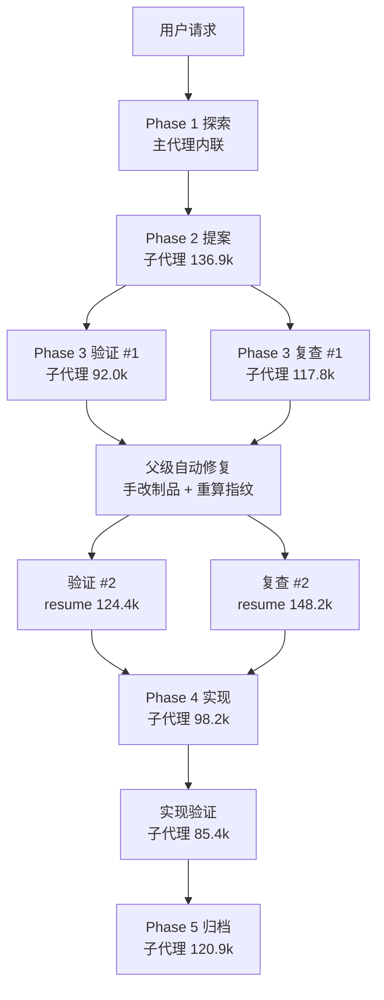

# 编排执行方式与数据共享优化 — 探索

## Background

用户要求：分析本次 auto-workflow 会话的整体流程、子代理调用与 token 消耗，判断 auto-workflow / debug 等自动化流程是否需要调整；主代理与子代理间的数据传递 / 共享逻辑是否需要优化；委托技能是否必须走子代理，还是可在主代理直接执行；并增加验证逻辑确认实际执行方式。

分析对象：`src/core/host-orchestration/`（协议 / 能力协商 / 阶段推进）、`src/core/templates/workflows/auto-workflow.ts` / `debug.ts` / `workflow.ts`、本次会话的 8 次子代理回执。

## 提示词基线 (Prompt Baseline)

**原始提示词**: 分析当前会话使用auto-workflow整体流程及子agent调用、token消耗等情况，来确认是否需要对auto-workflow\debug等自动化流程设计是否需要调整，主agent和子agent间数据传递、共享逻辑是否需要优化；以及委托技能是否需要必须走子agent，还是在主agent直接执行，需要增加验证逻辑，来确认最近执行方式

**确认后的提示词基线**: 基于本次 auto-workflow 实测数据，评估「阶段是否必须走子代理」「主/子代理数据传递与共享是否冗余」「如何验证实际执行方式」，并给出 auto-workflow / debug 的设计调整建议；用户已确认四项决策（分级执行、增量复验、数据共享四项优化、落探索文件并开变更提案）。

## 功能流程图

本次为**协议与执行策略调整**，不新增用户可见业务功能流程。现状流程图仅作分析（成本标注见下），不作为 propose 的流程基准；propose 以本文件的 Decisions 为语义来源。

## Analysis

### 实测消耗（子代理回执；主代理用量未暴露）

| 阶段 | 调用 | Tokens | 工具调用 | 占比 |
|---|---:|---:|---:|---:|
| 提案 | 1 | 136,915 | 43 | 14.8% |
| 验证 #1 / 复查 #1 | 2（并行） | 209,779 | 70 | 22.7% |
| 验证 #2 / 复查 #2 | 2（resume） | 272,621 | 20 | 29.5% |
| 实现 | 1 | 98,235 | 30 | 10.6% |
| 实现验证 | 1 | 85,401 | 31 | 9.2% |
| 归档 | 1 | 120,853 | 33 | 13.1% |
| 合计 | 8 | 923,804 | 227 | 100% |

### 发现

- **F1 验证占 52.2%，resume 复验比首轮更贵**：第二轮 20 次工具调用耗 272.6k（13.6k/次），首轮 70 次耗 209.8k（3.0k/次）。最可能为恢复代理时重放上一轮完整上下文（置信度中高）。
- **F2 执行方式不可验证**：`Receipt`（`protocol.ts:224`）无 `executionMode`；strict 只证明宿主有能力委派，不证明本阶段确实委派。
- **F3 只读验证被强制要求 delegate**：`VERIFY_PHASE.requiredCapabilities` 含 `delegate`（`workflows.ts:53`）；内联只是「技能不可用」降级。
- **F4 数据共享是「摘要包 + 全量重读」**：子代理仍全量读 4 个制品；指纹无 CLI，父级本次手写 3 次 Node 脚本；handoff 包被父级手改 3 次（指纹 2 次、门账本 1 次）。
- **F5 两个验证代理并行重复读同一批文件**：verify-proposal 与 proposal-review 输入高度重叠，但独立视角有价值，不能简单合并。

## Questions（已裁决）

| # | 问题 | 裁决 |
|---|------|------|
| Q1 | 执行方式策略 | **分级**：变更类必须子代理；只读验证允许内联（非作者（independent）+ 检查清单；self 仅作 WARN 例外）；探索内联 |
| Q2 | 修复后复验 | **增量新代理**：只传 fixDiff + 上轮报告路径，禁止 resume 重放 |
| Q3 | 数据共享优化 | **全选**：指纹 CLI、回执 executionMode/usage、制品清单 + 读取范围、串联两个验证代理 |
| Q4 | 产出 | **写探索文件 + 开变更提案** |

## 术语表

| 术语 | 定义 | 避免使用 |
|------|------|---------|
| executionMode | 阶段实际执行方式：`subagent` / `inline` / `local-degraded` | 执行类型 |
| independence | 验证者与被验证者的关系：`independent`（非作者）/ `self`（作者自证） | 独立性标记 |
| fixDiff | 修复后复验的增量输入：改动文件、章节、条目与行号范围 | 变更摘要 |
| 制品清单 | handoff 包中的确定性文件清单（路径 / 大小 / 指纹 / 章节锚点） | 文件列表 |
| 读取范围 | 子代理实际读取的文件与章节，写入回执 `readScope` | 阅读记录 |
| 增量复验 | 修复后新开只读代理，仅验证 fixDiff 覆盖的变更 | 二次验证 |

## 架构决策

- **ADR 候选（不单独建 ADR）**：执行方式是一等公民，而不是宿主能力的推断；理由是 strict 能力协商无法证明实际执行路径，审计必须落在回执。

## 边界场景

1. strict 宿主但子代理不可用 → 能力协商失败，**阻断**，MUST NOT 内联伪装。
2. 内联验证由制品作者执行 → `independence=self`；父级 MUST 接受 WARN 或改派独立子代理。
3. resume 仅用于阶段续跑，不用于复验；若使用，回执标 `contextReplay=true` 并 WARN。
4. 指纹 CLI 不可用（旧版本）→ 回退 handoff 包 `sourceFingerprint`，记 WARN。
5. 制品清单与磁盘不一致（文件已改）→ 重建清单并 WARN，MUST NOT 沿用陈旧清单。
6. proposal-review 串联模式但 verify 报告缺失 → 退化为独立复查并 WARN。
7. degraded 宿主（Codex / Pi degraded）→ `executionMode=local-degraded`，MUST NOT 声称子代理。
8. 回执缺新字段（旧产物）→ 变更类阶段按 `invalid-receipt` 阻断；只读验证阶段记 WARN 并按 unknown 处理（fail-safe）。
9. 宿主不暴露 token 用量 → `usage` 字段省略，MUST NOT 编造。
10. 新增 CLI 命令须同步 `IAGENT_COMMANDS` 补全表与技能/指令数量断言。

## Decisions

- D1（分级执行）：explore / debug investigate / debug verify-close 内联；propose / apply / archive / debug fix 在 strict 宿主必须子代理；`iagent_test` 为 apply/fix 子阶段；verify-proposal / proposal-review / spec-verify 默认子代理，允许内联但须「非作者（independent）+ 检查清单」；self 仅作 WARN 例外。degraded 宿主统一 `local-degraded`。
- D2（增量复验）：修复后新开只读代理，传 `fixDiff` + 上轮 `reportPath`，要求只验证增量；禁止以 resume 代替复验。
- D3（回执扩展）：`Receipt` 增 `executionMode` / `independence` / `usage?` / `readScope?` / `dependsOn?`；`validateReceipt` 校验取值域；`PhaseSpec.execution = { allowed, independence? }`，`independence` 按 `required` / `self-allowed` / 缺省三态映射。
- D4（阶段推进校验）：`evaluatePhaseTransition` 依据 `PhaseSpec.execution.allowed` 校验；变更类要求 `subagent`（strict）；inline 阶段不要求 `delegate`；`independence` 按 `required` / `self-allowed` 映射，`self` 记 WARN。
- D5（指纹 CLI）：新增 `iagent spec fingerprint --change <name> [--json]`，算法与 handoff 包一致（末尾无换行）；模板与 requirement-doc 规则改为「优先 CLI，缺失回退 handoff 包」。
- D6（制品清单 + 读取范围）：handoff 包新增 `## 制品清单`（路径 / 大小 / sha256 / 章节锚点）；子代理先读清单，按需增量读取；回执写 `readScope`。
- D7（串联验证）：proposal-review 默认读取 verify-proposal 的 `reportPath` 作为输入并在回执标 `dependsOn`；报告缺失时独立复查并 WARN。
- D8（用量记录）：回执可选 `usage`（tokens / toolCalls / durationMs）；父级在 `## 阶段结论` 追加 `tokens=`（宿主可用时），MUST NOT 编造。
- D9（范围）：修改 host-orchestration 协议 / 阶段推进 / 工作流协议、auto-workflow / debug / workflow 模板、spec CLI 与补全、测试与技能快照；不改门白名单与业务确认语义。

## Scope Changes

| 变更时间 | 变更类型 | 变更说明 | 原因 |
|---------|---------|---------|------|
| 2026-11-08 | expand | 从「分析是否需要调整」扩展为「开变更提案」 | 用户确认 Q4 |

## Pending

- 无未决项（四项决策已确认）；版本等级在提交阶段按 `feat` 判定。
