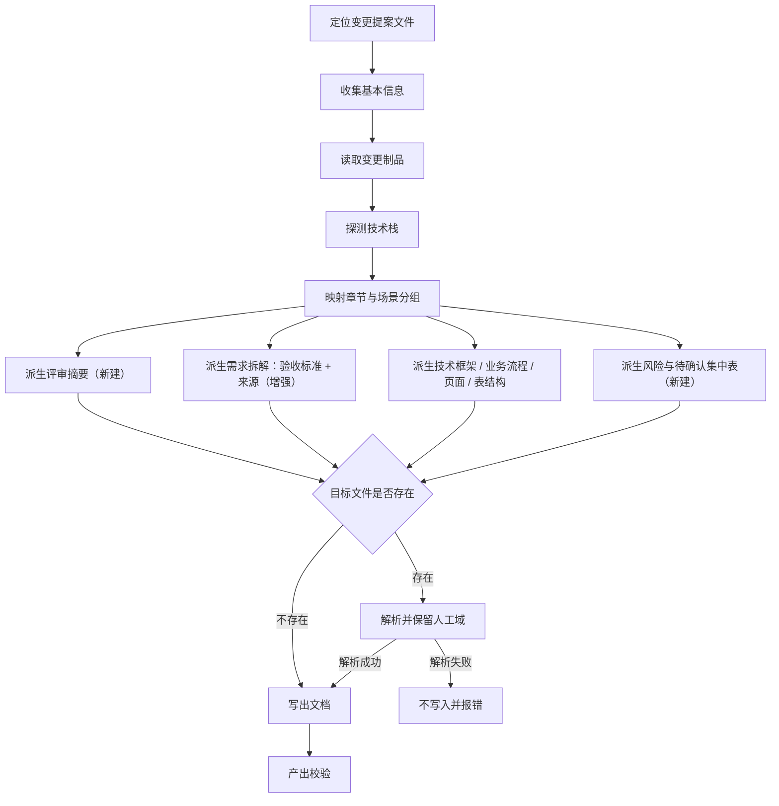

# 设计：需求文档评审可用性优化

## Context

`iagent-requirement-doc` 是 docs 类型技能，模板唯一源为 `src/core/templates/workflows/requirement-doc.ts`：`getRequirementDocSkillTemplate()` 维护 skill 版正文，`getRequirementDocCommandTemplate()` 经 `deriveCommandContent()` 派生 command 版（不另立手工正文）。技能已由 `skill-bridge-optimize` 收敛为**仅手工调用、无自动调用方**，输出路径按归档状态路由，技术栈无关。

本变更不改注册结构、不改输出路径路由、不新增技能，只在模板正文与产出校验规则上做评审导向改造，并以 delta spec 修改承载该技能的能力规格。

### 流程基准（已确认）

流程基准来自 `exploration.md` 的 `## 功能流程图` 段（2026-11-08 用户回复「确认」，N1–N12 已确认）。design 只引用该基准，不重建流程：

| 节点 | 操作 | 触发条件 | 证据位置 | 异常路径 |
| :--- | :--- | :--- | :--- | :--- |
| N1 | 定位变更提案文件（活跃 / 归档 / 指定路径） | 传入或可推断变更名 | `requirement-doc.ts:19-29` | 变更名未知 → 询问；目录不存在 → 报错 |
| N2 | 收集基本信息（编号 / 名称 / 交付时间 / 原始需求） | 独立调用 | `requirement-doc.ts:33-39` | 跳过字段 → 占位符 |
| N3 | 读取 proposal / design / specs / tasks | 定位成功 | `requirement-doc.ts:47-55` | Markdown 缺失 → 历史 JSON 降级（WARN） |
| N4 | 探测技术栈（config context + 项目文件） | 制品就绪 | `requirement-doc.ts:79-86` | 均不可得 → 对应章节标 [待确认] |
| N5 | 章节映射与场景分组 | 制品就绪 | `requirement-doc.ts:57-77, 88-104` | 无匹配场景类型 → 按业务语义归类并注明 |
| N6 | 派生「评审摘要」（结论 / 范围 / Top3 风险 / 待拍板问题 / 评审要点 / 待确认计数） | 制品就绪 | `requirement-doc.ts`（新建规则与输出骨架） | 缺 Risks / 待确认 → 标 [待确认]，不编造 |
| N7 | 派生需求拆解，新增「验收标准」「来源」列 | specs / proposal / tasks 就绪 | `requirement-doc.ts:65, 161-162`（增强） | 无 specs → 验收标准 [待确认]；场景未覆盖 → 待确认表 |
| N8 | 派生技术框架 / 业务流程 / 页面设计 / 表结构 | design / tasks 就绪 | `requirement-doc.ts:66-69, 172-203` | 无内容 → 「本变更不涉及」，不出空表 |
| N9 | 派生「风险与待确认」集中表（7.6 / 7.7） | 全篇映射完成 | `requirement-doc.ts`（新建 7.x 小节与汇总规则） | design 无 Risks → 「制品未声明风险」 |
| N10 | 判定目标文件是否存在 | 内容生成完成 | `requirement-doc.ts:212-226` | — |
| N10A | 解析并保留人工域（基本信息已填值 + 八、评审记录全文） | 目标已存在 | `requirement-doc.ts`（新建人工域保护规则，替代静默覆盖） | 表格破损 / 章节缺失 → 走 N10B |
| N10B | 不写入，保留原文件并报错 | 人工域解析失败 | `requirement-doc.ts`（新建失败分支） | 报告期望路径与解析失败原因 |
| N11 | 写出文档（重建一~七 + 回填人工域） | 目标不存在或人工域解析成功 | `requirement-doc.ts:212-226` | 写入失败（只读 / IO）→ 保留原文件并报错 |
| N12 | 产出校验（结构 / 摘要 / 验收 / 追溯 / 风险 / 伪代码上限 / 人工域） | 写出成功 | `requirement-doc.ts:228-242`（增强） | 校验失败 → 修正后重写，不丢弃人工域 |

### Architecture Impact

CodeGraph 影响分析（Phase 2.0，CLI）结论：

- `getRequirementDocSkillTemplate`（`src/core/templates/workflows/requirement-doc.ts:7`）→ 11 个受影响符号：`src/core/templates/registry.ts` 的 `WORKFLOW_PAIRS` / `countSkillsByType` / `getSkillTemplates` / `getCommandTemplates` / `getKnownCommandIds`；`src/commands/generate.ts`；`test/stage-continuation.test.ts`；`test/template-derivation.test.ts`。
- `getRequirementDocCommandTemplate`（同文件 `:258`）→ 9 个受影响符号（同上，去掉 `test/stage-continuation.test.ts`）。

结论：注册与派生链只消费模板对象，**不改注册结构**；`test/stage-continuation.test.ts` 的 `standalone-only` 断言与 `test/template-derivation.test.ts` 的派生一致性断言须在改造后保持通过。快照 `skills/iagent-requirement-doc/SKILL.md`（当前 252 行）由 `pnpm build && pnpm generate:skills` 重建。

## Goals / Non-Goals

**Goals**:

- 评审者可快速定位结论、风险与需拍板问题（评审摘要，N6）。
- 每条需求可验证、可追溯到 proposal / spec 场景 / tasks（验收标准 + 来源列，N7）。
- 制品缺口（`[待确认]`）集中呈现并标注阻塞性（7.7，N9）。
- 重生成不破坏已填写的人工评审内容（N10A）；解析失败不写入（N10B）。
- 保持技能的手工调用定位、输出路径路由与跨技术栈通用性不变。

**Non-Goals**:

- 不新增自动调用方（workflow / auto-workflow / debug / spec-propose / archive / bulk-archive 仍 MUST NOT 调用）。
- 不改输出路径路由（活跃 / 归档 / 用户指定路径表）。
- 不改八章节编号与顺序，不扩为十章。
- 不新增 `references/` 目录；主 SKILL.md 超预算时优先压缩伪代码与场景分组规则。
- 不修改注册结构、技能总数、`deriveCommandContent()` 派生机制。

## Decisions

### D1: 评审摘要的位置与内容

- **选择**: 无编号「评审摘要」块放在「基本信息」之后、一、原始需求之前；内容为结论、范围、风险等级（Top3 风险）、待拍板问题、评审要点建议、待确认计数。
- **理由**: 评审先看结论，八章节编号不变以兼容既有模板；内容全部从制品派生，不编造。
- **备选**: 独立编号章节（扩为十章，破坏既有模板）；放在八、评审记录之前（编号不变但「先看结论」失效）。

### D2: 内容增强与集中表

- **选择**: 需求拆解表新增「验收标准」「来源」两列；新增 7.6 风险与 7.7 待确认集中表；八、评审记录结构化。
- **理由**: 验收标准回答「怎样算做完」，来源回答「有没有漏」，集中表把散落的 `[待确认]` 收敛为可逐条关闭的清单；评审记录结构化便于归档后检索。
- **备选**: 待确认项放二、需求分析子节（会在需求章节内扩散）；放独立章节（破坏编号）。

### D3: 文档元数据

- **选择**: 标题下生成元信息块（生成时间 / 来源变更 / 制品指纹 / 文档版本），**不入人工域**。制品指纹取自 `.openspec-tmp/pipeline-<change-name>/handoff-pack.md` 的 `sourceFingerprint`（存在且 `change:` 匹配时），否则写「未提供」。
- **理由**: 评审者需要判断评审的是哪一版；元信息由生成器独占，人工域保留会使其过旧。白名单仅 `Bash(iagent:*)`，无确定性指纹命令，故复用流水线已产出的指纹，避免自造算法破坏幂等。
- **备选**: 放入基本信息表（会把机器字段与人工字段混在一起，重生成时与已填值冲突）；自行计算制品哈希（超出白名单能力，且无 CLI 支持）。

### D4: 伪代码降噪

- **选择**: 仅当表格 / 流程图无法表达判定逻辑时使用，≤2 块/文档、≤12 行/块；删除伪代码专项强制校验项，保留 1 条按需校验。
- **理由**: 伪代码占用篇幅与校验项，评审价值低于验收 / 风险 / 追溯；按需保留仍能表达表格无法承载的判定分支。
- **备选**: 完全删除（会丢失复杂规则的表达手段）；保留原上限（15 行/块、3 块/章节，与降噪目标冲突）。

### D5: 目标存在时的重生成

- **选择**: 目标存在 → 解析并保留人工域（`## 基本信息` 已填值 + `## 八、评审记录` 全文），按当前制品重建一~七章并回填；解析失败（表格破损 / 章节缺失）→ 不写入、保留原文件并报错。
- **理由**: 静默覆盖会抹掉人工评审内容（debug 曾因此禁用生成分支）；「失败不写入」把数据丢失风险转为显式错误。
- **备选**: 保持静默覆盖（现状缺陷）；要求调用方先备份（把安全责任外推给用户）。

### D6: 验收标准的来源

- **选择**: 优先 specs 的 Requirement / Scenario（WHEN/THEN）；无 specs 时标 `[待确认]`；`tasks.md` 的 `[测试]` 任务作补充。
- **理由**: Scenario 本身就是可验证的验收语义，避免另造第二套判定标准；无 specs 时明确标注缺口而非编造。
- **备选**: 只从 tasks 派生（tasks 描述实现动作，不是验收语义）；让用户手工填写（违背派生目标）。

### D7: 来源追溯形式

- **选择**: 短 ID（`proposal:WC2` / `spec:<cap>:S1` / `task:T3.2`）。
- **理由**: 表格已有 5 列，完整路径会使表宽膨胀且难读；短 ID 可人工对照制品定位。
- **备选**: 完整相对路径（表宽爆炸）；章节名称（无法唯一定位）。

### D8: 风险映射

- **选择**: 映射 `design.md` 的 Risks「风险 | 缓解」写入 7.6；**等级仅在 design 明示时填写，否则标「未分级」，不自行评级**；摘要只放 Top3（无等级时按制品顺序取前 3）。
- **理由**: 当前 Risks 完全丢失，是评审最关键的缺口；design 标准 Risks 表不含等级列，强行评级会违背「不编造」；摘要限制 Top3 避免头部信息过载。
- **备选**: 全量风险进摘要（头部过载）；只放 7.6 不进摘要（评审者仍需翻页）；由 AI 自行评级（编造风险，拒绝）。

### D9: 评审要点建议的归属

- **选择**: 放入评审摘要，由风险、待确认项与决策权衡派生，不编造。
- **理由**: 八、评审记录是人工域须逐字保留；评审要点属派生内容，放摘要可随制品刷新，且评审开始前即可见。
- **备选**: 放入八、评审记录（重生成不覆盖，会迅速过期）。

### D10: 能力规格的修改方式

- **选择**: delta spec——`## MODIFIED Requirements` 修改既有「需求文档技能的手工调用保留与自动调用方变更」（保留「仅手工调用、无自动调用方」；**章节内容规则与伪代码规则**改为按新契约，**DDL 提取规则保持不变**，避免契约悬空引用）；`## ADDED Requirements` 新增「需求文档面向人工评审的结构与内容契约」。
- **理由**: 能力规格是行为契约的单一真源，若不同步，「规则保持不变」会与实现直接冲突；delta spec 保留变更可追溯性。
- **备选**: 只改代码不改规格（规格立即失真）；直接改主规格（绕过 OpenSpec 归档流程）。

## Risks / Trade-offs

| 风险 | 缓解 |
|------|------|
| 主 SKILL.md 接近 500 行预算（当前 252 行，新增摘要 / 集中表 / 人工域规则后可能逼近） | 按边界场景 9：优先压缩伪代码规则与场景分组规则；`test/skill-size-budget.test.ts` 守卫 |
| 人工域解析依赖标题与表格结构，格式破损时会误判 | 解析失败一律走 N10B「不写入并报错」，MUST NOT 静默丢弃；不做多级模糊匹配 |
| command 版派生后丢失新增关键词（评审摘要 / 验收标准 / 人工域保护） | 正文只维护 skill 版，command 版由 `deriveCommandContent()` 派生；派生一致性测试守护（边界场景 10） |
| 摘要信息密度高，可能与「需求理解」重复 | 摘要只放结论 / 决策请求，细节留在二~七章；评审要点限制为派生项，不复制章节正文 |
| 重生成非幂等导致评审者困惑 | 边界场景 7：除生成时间外内容一致；生成时间变化不视为内容漂移 |
| 既有测试断言与新行为冲突（standalone-only / 派生一致性） | 改造后先跑 `pnpm test` 受影响用例；断言口径同步而非删除断言 |
| 验收标准无 specs 时整列 `[待确认]` 显得空洞 | 同时把缺口写入 7.7 集中表并计入摘要待确认计数，使缺口可追踪而非静默 |
| `design.md` 标准 Risks 表无等级列，强制评级会编造 | 7.6 仅在 design 明示等级时填写，否则「未分级」；摘要风险等级同理，MUST NOT 自行评级 |
| 制品指纹在 `Bash(iagent:*)` 白名单内无法确定性计算 | 复用 handoff 包 `sourceFingerprint`（存在且 `change:` 匹配时），否则「未提供」；不自行计算 |
| 人工域「保留至下一个 `## `」会把自定义 `##` 子节截断 | 改为保留至**文件末尾**（`八、评审记录` 为最后一章），边界唯一且可判定 |
| 场景分组硬编码 4 类的归类可疑（现状缺陷 D6） | 保留既有分组规则（非本变更目标），但允许「按业务语义归类并注明」的异常路径；不新增第 5 类 |
