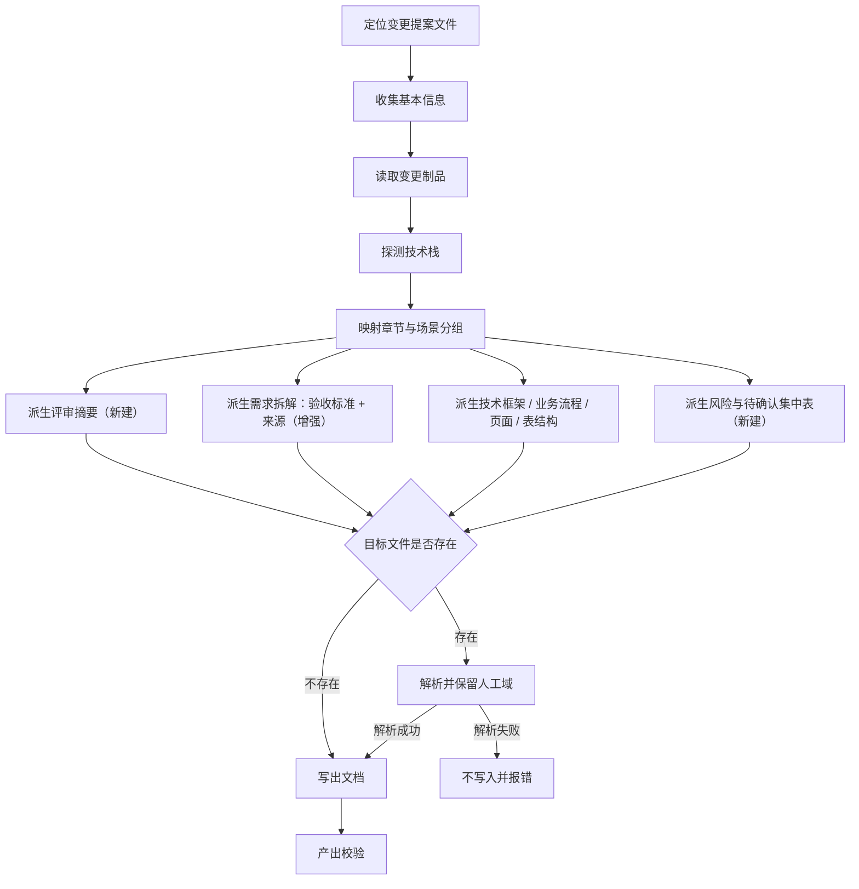

# requirement-doc 技能评审可用性优化 — 探索

## Background

用户主题：检查分析需求文档生成技能 `iagent-requirement-doc`，优化需求文档生成内容、文档设计逻辑，使文档更符合「用于评审」的使用需求。

当前实现：`src/core/templates/workflows/requirement-doc.ts`（docs 类型技能，八章节映射转换，无 references，正文 ~240 行）。
实际产出样例：`openspec/changes/archive/2026-09-24-add-release-package/需求文档.md`。

## 提示词基线 (Prompt Baseline)

**原始提示词**: 检查分析需求文档生成技能iagent-requirement-doc ，优化需求文档生成内容、文档设计逻辑，使文档更符合用于评审使用需求

**确认后的提示词基线**: 检查并优化 `iagent-requirement-doc` 技能模板（`src/core/templates/workflows/requirement-doc.ts`），以「人工评审可直接使用」为目标优化生成内容与文档设计逻辑：① 评审者可快速定位结论、风险与需拍板问题；② 每条需求可验证、可追溯到 proposal / spec 场景 / tasks；③ 制品缺口（`[待确认]`）集中呈现；④ 重生成不破坏已填写的人工评审内容。保持技能的手工调用定位、输出路径路由与跨技术栈通用性不变。（2026-11-08 用户确认）

> 下游（提案 / 设计 / 规格 / 任务）以提示词基线为唯一语义来源；基线若变更 MUST 回到提示词校验门重新确认。

## 功能流程图

> **流程基准确认**: 已确认（2026-11-08，用户回复「确认」）。N1–N12 作为 propose / verify 的流程基准。

| 节点 | 操作 | 触发条件 | 证据位置 | 异常路径 |
| :--- | :--- | :--- | :--- | :--- |
| N1 | 定位变更提案文件（活跃 / 归档 / 指定路径） | 传入或可推断变更名 | `requirement-doc.ts:19-29` | 变更名未知 → 询问；目录不存在 → 报错 |
| N2 | 收集基本信息（编号 / 名称 / 交付时间 / 原始需求） | 独立调用 | `requirement-doc.ts:33-39` | 跳过字段 → 占位符 |
| N3 | 读取 proposal / design / specs / tasks | 定位成功 | `requirement-doc.ts:47-55` | Markdown 缺失 → 历史 JSON 降级（WARN） |
| N4 | 探测技术栈（config context + 项目文件） | 制品就绪 | `requirement-doc.ts:79-86` | 均不可得 → 对应章节标 [待确认] |
| N5 | 章节映射与场景分组 | 制品就绪 | `requirement-doc.ts:57-77, 88-104` | 无匹配场景类型 → 按业务语义归类并注明 |
| N6 | 派生「评审摘要」（结论 / 范围 / Top3 风险 / 待拍板问题 / 评审要点 / 待确认计数） | 制品就绪 | **[新建]** 模板新增生成规则与输出骨架 | 缺 Risks / 待确认 → 标 [待确认]，不编造 |
| N7 | 派生需求拆解，新增「验收标准」「来源」列 | specs / proposal / tasks 就绪 | `requirement-doc.ts:65, 161-162` **增强** | 无 specs → 验收标准 [待确认]；场景未覆盖 → 待确认表 |
| N8 | 派生技术框架 / 业务流程 / 页面设计 / 表结构 | design / tasks 就绪 | `requirement-doc.ts:66-69, 172-203` | 无内容 → 「本变更不涉及」，不出空表 |
| N9 | 派生「风险与待确认」集中表（7.6 / 7.7） | 全篇映射完成 | **[新建]** 模板新增 7.x 小节与汇总规则 | design 无 Risks → 「制品未声明风险」 |
| N10 | 判定目标文件是否存在 | 内容生成完成 | `requirement-doc.ts:212-226` | — |
| N10A | 解析并保留人工域（基本信息已填值 + 八、评审记录全文） | 目标已存在 | **[新建]** 人工域保护规则（替代静默覆盖） | 表格破损 / 章节缺失 → 走 N10B |
| N10B | 不写入，保留原文件并报错 | 人工域解析失败 | **[新建]** 失败分支 | 报告期望路径与解析失败原因 |
| N11 | 写出文档（重建一~七 + 回填人工域） | 目标不存在或人工域解析成功 | `requirement-doc.ts:212-226` | 写入失败（只读 / IO）→ 保留原文件并报错 |
| N12 | 产出校验（结构 / 摘要 / 验收 / 追溯 / 风险 / 伪代码上限 / 人工域） | 写出成功 | `requirement-doc.ts:228-242` **增强** | 校验失败 → 修正后重写，不丢弃人工域 |

## Analysis

### Deep Analysis Trigger

- Triggered: Yes（修改既有技能模板，非新建）
- Reason: 输入含「优化」，对象为既有 `iagent_requirement_doc` 技能模板；CodeGraph 显示 `getRequirementDocSkillTemplate` 有 4 个调用方（registry + 自身派生指令）
- Scope: `src/core/templates/workflows/requirement-doc.ts`、`src/core/templates/registry.ts`（注册，不改）、`skills/` 快照（生成）、相关测试

### 现状缺陷清单（评审用途视角，均带证据）

| # | 缺陷 | 证据 |
|---|------|------|
| D1 | `design.md` 的 Risks 完全没有映射到需求文档任何章节 | `requirement-doc.ts:59-71` 章节映射表无 Risks 行 |
| D2 | 需求拆解无「验收标准」，评审无法判定"怎样算做完" | `requirement-doc.ts:162` 列集仅 需求项/功能描述/优先级/类型 |
| D3 | 需求项无「来源追溯」，无法核对 proposal/spec/tasks 覆盖与遗漏 | 同上，无来源列 |
| D4 | `[待确认]` 只散落在伪代码/DDL 内部，无集中清单与阻塞性标记 | `requirement-doc.ts:122,130` |
| D5 | 八、评审记录为空模板；真实文档需人工补「评审要点建议」6 条 | `requirement-doc.ts:208-209` vs 样例 `需求文档.md:268-274` |
| D6 | 场景分组硬编码 4 类（管理配置/业务使用/后台任务/AI智能）；样例中「升级信息归集」被归为 AI/智能场景，归类可疑 | `requirement-doc.ts:90-97` |
| D7 | 无文档元数据（版本/生成时间/来源变更/生成指纹），无法判断评审的是哪一版 | `requirement-doc.ts:137-145` 基本信息仅 3 字段 |
| D8 | 影响分析无兼容性/破坏性变更/数据迁移/回滚方案 | `requirement-doc.ts:205-206` |
| D9 | 目标已存在时静默覆盖，会抹掉「八、评审记录」与人工填写的基本信息 | `requirement-doc.ts:225-226`；能力记忆中 debug 曾因此禁用生成分支 |
| D10 | 伪代码规则占用大量篇幅与校验项，评审价值低于验收/风险/追溯 | `requirement-doc.ts:115-124,164-197,238-241` |
| D11 | 无「评审摘要 / 决策请求」，评审者需读完八章才能找到要拍板什么 | 全文无该结构 |

## Codebase Findings

### Discovered Files

- `src/core/templates/workflows/requirement-doc.ts`: 技能模板唯一源（skill instructions + command 派生）
- `src/core/templates/registry.ts`: 注册（`getRequirementDocSkillTemplate` 调用方）
- `test/template-consistency.test.ts`: 断言「无自动调用方 / 仅手工调用」口径
- `test/skill-size-budget.test.ts`: 主 SKILL.md ≤500 行；references 必须声明
- `test/template-derivation.test.ts`: command 版由 skill 版派生，禁止第二份手工正文
- `test/description-format.test.ts` / `test/allowed-tools.test.ts`: description 结构与白名单
- `openspec/specs/workflow-suite-skills/spec.md`: 承载 Requirement「需求文档技能的手工调用保留与自动调用方变更」（八章节/伪代码/DDL 规则"保持不变"）
- `openspec/specs/workflow-suite-skills/explorations.md`: 历史决策（静默覆盖幂等、双模板漂移等）
- `openspec/changes/archive/2026-09-24-add-release-package/需求文档.md`: 真实产出样例

### Identified Symbols

- `getRequirementDocSkillTemplate` (`src/core/templates/workflows/requirement-doc.ts:7`)
- `getRequirementDocCommandTemplate` (`src/core/templates/workflows/requirement-doc.ts:258`)
- `deriveCommandContent` (`src/core/templates/derive-command.ts`) — command 版派生

### Pattern Matches

- 渐进披露：其它技能用 `references/*.md` 下沉明细；requirement-doc 目前无 references
- 单一源：模板正文只维护 skill 版，command 版派生

### Capability Exploration Memory (injected)

- 能力 `workflow-suite-skills`：requirement-doc 的历史决策包括「输出路径按归档状态路由」「目标存在静默覆盖（幂等）」「八章节/伪代码/DDL 规则保持不变」
- 已过时条目：归档步骤 4.8 的人工域就地增量对齐已随 `improve-compile-gate-and-archive-readonly` 移除；debug 已有文档时改为禁用生成分支（因静默覆盖会抹人工内容）
- 术语漂移：`CONTEXT.md` 仍保留「人工域」「就地增量对齐」定义（指向已移除的 archive 4.8），本次可考虑一并校正

## Questions

### 批量 1（L1-L3，已确认）

| # | 层级 | 问题 | 用户裁决 | AI 建议 |
|---|------|------|---------|---------|
| Q1 | L1 意图/结构 | 评审导向的章节结构 | 八章节 + 前置「评审摘要」无编号块（保持 1-8 编号与顺序） | 同左 |
| Q2 | L2 方案/内容 | 新增哪些评审内容块 | 验收标准 + 来源追溯 + 风险与待确认集中表 + 结构化评审记录（全选） | 同左 |
| Q3 | L2 方案/伪代码 | 伪代码规则取舍 | 降噪保留：≤2 块/文档、≤12 行/块，仅表格/流程图无法表达判定逻辑时使用 | 同左 |
| Q4 | L3 异常/重生成 | 目标存在时的处理 | 保护人工域 + 增量对齐（保留「基本信息」已填值与「八、评审记录」） | 同左 |

## 术语表

| 术语 | 定义 | 避免使用 |
|------|------|---------|
| 评审摘要 | 文档头部面向评审者的决策请求块：结论、范围、风险等级、待拍板问题、评审要点建议 | 摘要、概述 |
| 验收标准 | 需求项的可验证判定条件，优先来自 spec 的 WHEN/THEN 场景 | 测试点 |
| 来源追溯 | 需求项到 proposal / spec 场景 / tasks 任务的引用，用短 ID 形式 | 出处 |
| 待确认清单 | 集中列出制品缺口及阻塞性，替代散落标注 | 问题列表 |
| 人工域 | 重生成时不得覆盖的段落：`## 基本信息` 已填值、`## 八、评审记录` 全文 | 手工区、保留区 |
| 增量对齐 | 目标已存在时保留人工域、按当前制品重建一~七章 | 增量更新、局部覆盖 |

## 架构决策

（无需 ADR：变更可逆、无跨上下文意外性，属单模板规则调整）

## 边界场景

1. 目标文件存在且「八、评审记录」被人工改成非标准结构（含自定义子小节）→ 保留至**文件末尾**全文（八为最后一章）
2. 目标文件存在但「基本信息」缺行或值仍为占位符 → 占位符不保留，缺行按占位符处理（不误保留旧值）
3. 目标文件表格破损、无法解析人工域 → 不写入，保留原文件并报错
4. `specs/` 缺失（skip_specs 或纯文档变更）→ 验收标准列全标 [待确认]；覆盖自检 SKIP 并记 WARN
5. `design.md` 无 Risks → 风险表写「制品未声明风险」，不编造；摘要风险等级标 [待确认]
6. `[待确认]` 多于 10 条 → 表格完整列出，摘要只显示计数与阻塞数，不截断表格
7. 重复运行（幂等）→ 除生成时间外内容一致；生成时间变化不视为内容漂移
8. 目标文件只读 / 写入失败 → 报错并保留原文件
9. 主 SKILL.md 接近 500 行预算 → 优先压缩伪代码与场景分组规则，不超预算
10. 命令版派生后仍含评审摘要 / 验收标准 / 人工域保护关键词 → 派生一致性测试守护

## Decision Process

### Decision: 评审摘要的位置与内容

**Options Considered**:
- A: 基本信息之后、一、原始需求之前，作为无编号块
- B: 独立编号章节（扩为十章）
- C: 放在八、评审记录之前

**Pros/Cons**:
- A: 评审先看结论，编号不变，模板兼容；缺点是文档头部信息密度高
- B: 结构最清晰；破坏既有八章节模板
- C: 编号不变但"先看结论"失效

**Chosen**: A
**Rationale**: 用户裁决 + 兼顾评审效率与模板兼容

### Decision: 评审要点建议的归属

**Options Considered**:
- A: 放入评审摘要（每次重生成）
- B: 放入八、评审记录（人工域，重生成不覆盖）

**Chosen**: A
**Rationale**: 八、评审记录是人工域须逐字保留；评审要点属派生内容，放摘要可随制品刷新，且评审开始前即可见

### Decision: 待确认事项的归属

**Options Considered**:
- A: 七、影响分析的子节（7.7）
- B: 二、需求分析的子节
- C: 独立章节

**Chosen**: A
**Rationale**: 缺口横跨需求/技术/数据，防在需求分析内扩散；编号保持不变

## Decisions

- D1（结构）：保持八章节编号与顺序；新增无编号「评审摘要」块（位于基本信息之后）— 已确认
- D2（内容）：需求拆解表新增「验收标准」「来源」列；新增集中「风险与待确认」表；评审记录结构化
- D3（元数据）：标题下新增生成元信息块（生成时间 / 来源变更 / 制品指纹 / 文档版本），不入人工域
- D4（伪代码）：降噪保留 — 仅表格/流程图无法表达判定逻辑时使用，≤2 块/文档、≤12 行/块；删除伪代码专项强制校验项，保留 1 条按需校验
- D5（重生成）：目标存在 → 解析并保留人工域（基本信息已填值 + 八、评审记录全文），重建其余；解析失败不写入
- D6（验收标准来源）：优先 specs 的 Requirement/Scenario（WHEN/THEN）；无 specs 时标 [待确认]；tasks 的 [测试] 任务作补充
- D7（来源追溯）：短 ID 形式（`proposal:WC2` / `spec:<cap>:S1` / `task:T3.2`），避免表宽膨胀
- D8（风险）：映射 design.md Risks「风险 | 缓解」；等级仅在 design 明示时使用，否则「未分级」，不自行评级；摘要只放 Top3
- D9（评审要点）：由风险、待确认项、决策权衡派生，放评审摘要，不编造
- D10（能力规格）：以 delta spec 显式修改 `workflow-suite-skills` 的「八章节/伪代码/DDL 保持不变」表述，新增评审内容契约 Requirement

## Scope Changes

| 变更时间 | 变更类型 | 变更说明 | 原因 |
|---------|---------|---------|------|
| 2026-11-08 | expand | 原仅"优化生成内容"，扩展为同时修正重生成覆盖人工内容的行为 | 能力记忆与样例证据表明静默覆盖会抹掉评审记录 |

## Pending

### Unresolved Decisions

- 边界场景 1-10 的处置：已全部按建议确认（2026-11-08 L5 批量，用户选择「全部按建议」）— 已消解

### Business Validation

- 「评审摘要」中的"需拍板问题"只能从制品已有内容派生（待确认项 / 决策权衡 / 风险），MUST NOT 编造
