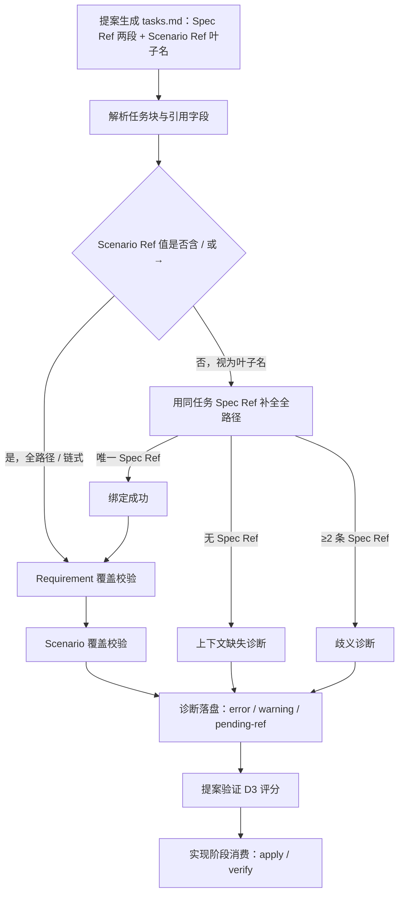

## Context

用户诉求是消除 `tasks.md` 追溯引用的重复路径前缀。代码现状（探索阶段核实）：

- `TASKS_TEMPLATE`（`src/core/spec/templates/index.ts:76`）在 3 处重复声明规范形态：模板本身、`spec-propose`
  正文、`spec-verify-proposal` 的 D3 说明，三处均为 `Spec Ref = cap / Req`、`Scenario Ref = cap / Req / Scenario`。
- `parseTasks`（`src/core/spec/parser/task-parser.ts:23`）通过 `readRefFields` / `interpretRefValue` 已支持行式、
  HTML 注释式、`→` 链式与裸名多形态，`scenarioRefs` **原样保留**叶子名，不做补全。
- `buildTraceability`（`src/core/spec/validation/traceability.ts:32`）是唯一消费 `specRefs` / `scenarioRefs` 的
  校验点。`matchesScenarioRef` 当前接受「全路径相等」或「裸场景名全局相等」两种匹配 —— 后者会跨 Requirement /
  capability 误匹配（违反 B2 / B8）。
- 诊断分级（`spec-ref-missing-requirement` / `scenario-ref-missing-scenario` / `invalid-*` / `pending-ref`）已在
  `buildTraceability` 统一落盘，`--partial` 通过 `degradeUnmatchedRefs` 降级。

## Goals / Non-Goals

**Goals**:

- `Scenario Ref` 规范写为场景叶子名，由同一任务的 `Spec Ref` 补全全路径（D2）。
- Requirement 覆盖与 Scenario 覆盖判定语义不变，仅书写形态去重（D1）。
- 叶子名无法消歧时 fail-safe 报诊断，MUST NOT 猜测（D3）。
- 历史写法与历史 tasks.md 无新增 error（D3）。
- 格式真源单点：`workflow` / `auto-workflow` / `debug` 不新增第二份声明（D4）。

**Non-Goals**:

- 不修改 `Spec Ref` 的两段语义，也不合并 `Spec Ref` / `Scenario Ref` 为单行。
- 不修改 `parseTasks` 的 `ParsedTask` 字段产出（保持叶子名原样），避免影响下游消费者。
- 不新增 CLI 命令 / 技能类型 / 包契约字段。
- 不追溯改写历史归档变更的 tasks.md。

## Decisions

### D1: 只改书写形态，覆盖判定语义不变

- **选择**: Requirement 覆盖仍以 `Spec Ref` 的 `capability / Requirement` 精确匹配；Scenario 覆盖仍以全路径匹配。
- **理由**: 用户诉求是去重，不是改变校验语义；语义漂移会让历史判定结果不可比。
- **备选**: 同时引入模糊匹配或权重 —— 否决，扩大行为面且偏离诉求。

### D2: 场景叶子名 + 同任务 Spec Ref 上下文补全

- **选择**: `Scenario Ref = <Scenario>`；校验层用**同一任务**的 `Spec Ref` 补全为
  `capability / Requirement / Scenario` 后参与覆盖匹配。补全置于新增的 `reference-resolver.ts`，由
  `buildTraceability` 调用。
- **理由**: 直接消除重复前缀；解析层已能产出叶子名与 Spec Ref，补全 + 消歧是增量改造；`parseTasks` 字段语义
  不变，`spec-apply` / `spec-verify` 等文本消费者无需改读取逻辑。
- **备选**: 合并单行（标签名不副实、多场景需重复 Requirement）；省略号继承（新语法、兼容性差）—— 均否决。

### D3: 兼容与 fail-safe

- **选择**: 全路径 / HTML 注释式 / 一行双引用 / 裸名继续有效；「有 Scenario Ref 无 Spec Ref」报
  `scenario-ref-missing-context`；「≥2 条 Spec Ref + 叶子名」报 `ambiguous-scenario-ref`；`--partial` 起草期
  按既有规则降级为 `pending-ref` warning。补全只使用同一任务的 Spec Ref，MUST NOT 跨任务 / 跨 capability 推断。
- **理由**: 失败时要求写全路径是唯一不猜测的确定行为；与既有诊断分级机制一致。
- **备选**: 任选第一条 Spec Ref 或全局唯一同名场景 —— 否决，正是跨 Requirement 误匹配的来源。

### D4: 改动面收敛与格式真源单点

- **选择**: 只改 `spec-propose` / `TASKS_TEMPLATE` / `spec-verify-proposal` / `reference-resolver` /
  `traceability` + 测试 + CONTEXT 术语；`workflow` / `auto-workflow` / `debug` 正文不改。
- **理由**: 格式正文只存在于 propose 链路；另两个编排技能经委派继承，debug 只继承既有引用。
- **备选**: 在全部技能正文各写一份 —— 否决，制造第二份格式真源。

## 流程基准（来自 exploration.md `## 功能流程图`，已确认）

> 上图即流程基准，本设计引用而非重建；节点证据位置见 exploration.md 的节点清单表。

| 节点 | 对应实现 | 关键改动 |
| :--- | :--- | :--- |
| N1 | `TASKS_TEMPLATE` / `spec-propose` / `spec-verify-proposal` | 规范形态改为叶子名 |
| N2 | `parseTasks` / `readRefFields` | 不改字段产出 |
| N3 | `reference-resolver.ts`（新增） | 判定全路径 vs 叶子名 |
| N4 | `reference-resolver.ts` | 同任务 Spec Ref 补全 |
| N5 | `traceability.ts` | 用补全结果匹配 |
| N6 / N7 | `traceability.ts` | 覆盖判定语义不变 |
| N8 | `traceability.ts` + `runSpecValidate` | 新增两类诊断 + partial 降级 |
| N9 | `spec-verify-proposal.ts` | D3 口径同步 |
| N10 | `spec-apply` / `spec-verify` 正文 | 不改读取逻辑 |

## Architecture Impact

- **解析层**：新增 `src/core/spec/parser/reference-resolver.ts`，纯函数、无 I/O、无新依赖；由校验层调用。
- **校验层**：`buildTraceability` 增加每任务补全步骤，`matchesScenarioRef` 移除「裸场景名全局相等」兜底；
  新增 `scenario-ref-missing-context` / `ambiguous-scenario-ref` 诊断码。
- **模板层**：`TASKS_TEMPLATE` 与两个技能正文的规范形态说明更新；`derive-command.ts` 自动派生命令版，不手编。
- **生成产物**：`pnpm build && pnpm generate:skills` 刷新 `skills/` 快照。
- **无 CLI / schema / 包契约变化**：`iagent spec` 命令集与 `spec-driven` 依赖图不变。

## Risks / Trade-offs

| 风险 | 缓解 |
|------|------|
| 叶子名跨 Requirement 同名场景被误匹配 | 补全只使用同一任务 Spec Ref；移除全局裸名兜底；B2 / B8 用例锁定 |
| 历史 tasks.md 因新诊断产生新 error | 只在叶子名无法消歧时报错；全路径 / 裸名写法保持兼容；兼容用例锁定 |
| 补全逻辑散落在多处形成第二真源 | 全部收敛到 `reference-resolver.ts`，`traceability` 单点调用 |
| 模板与解析器口径漂移 | 模板测试 + D3 正文断言 + `pnpm generate:skills` 一致性测试 |
| `parseTasks` 字段语义变更影响下游 | 明确不修改字段产出，补全仅在消费侧进行 |
