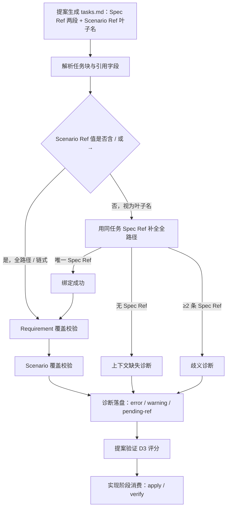

# 探索：tasks.md 追溯引用（Spec Ref / Scenario Ref）去重

## Background

用户原始诉求：优化 propose、workflow、auto-workflow、debug 等技能，在生成提案时 tasks.md 任务列表的
`Spec Ref` 与 `Scenario Ref` 存在明显重复 —— `Scenario Ref` 把 `Spec Ref` 的完整路径再写一遍，再追加
场景名：

```text
- Spec Ref：workflow-suite-skills / 编排技能的委派与派发白名单齐备性
- Scenario Ref：workflow-suite-skills / 编排技能的委派与派发白名单齐备性 / workflow 无子代理条目
```

期望：去掉重复路径前缀，同时保留可机器校验的追溯能力（Requirement 覆盖 + Scenario 覆盖）。

## 提示词基线 (Prompt Baseline)

**原始提示词**：优化propose、workflow、auto-workflow、debug指令等技能，在生成提案时，task任务列表的
Spec Ref、Scenario Ref 问题，当前两个引用存在明显重复情况，需要调整有数：示例如下
`- Spec Ref：workflow-suite-skills / 编排技能的委派与派发白名单齐备性`
`- Scenario Ref：workflow-suite-skills / 编排技能的委派与派发白名单齐备性 / workflow 无子代理条目`

**确认后的提示词基线**：同原始提示词（提示词校验门判定为清晰输入；「有数」按笔误理解，以示例为准）。

**门结论**：
- 目标 Goal：消除 tasks.md 两行引用的重复路径前缀 —— 清晰
- 对象 Object：提案生成技能的 tasks 引用规范形态 + 校验消费链 —— 清晰
- 范围 Scope：propose / workflow / auto-workflow / debug「等」；经代码核实，格式正文集中在
  `spec-propose` 与 `TASKS_TEMPLATE`，其余为委派或消费方 —— [假设] 范围含解析器/校验器（否则新形态不可校验）
- 歧义 Ambiguity：**替换形态未指定**（场景叶子名 / 单行合并 / 其他）—— 属细节级方案歧义，记 [假设] 候选，
  由 grill 批量 1 与用户裁决，不单独构成提示词门阻塞
- 约束 Constraints：向后兼容历史 tasks.md（不得让归档/存量变更产生新 error）—— [假设]
- 验收 Acceptance：示例不再重复；Requirement / Scenario 覆盖校验仍然有效 —— [推断]

> 下游以本基线为唯一语义来源；基线变更 MUST 回到提示词校验门重新确认。

## 功能流程图



| 节点 | 操作 | 触发条件 | 证据位置 | 异常路径 |
| :--- | :--- | :--- | :--- | :--- |
| N1 | 按模板生成 tasks.md 任务块与追溯引用 | Phase 2 提案生成 | `src/core/templates/workflows/spec-propose.ts:325-327`；`src/core/spec/templates/index.ts:83-104` | 模板不可用 → 回退项目规范（WARN） |
| N2 | 解析任务块、标签切分与 `→` 链式解释 | 任何命令读取 tasks.md | `src/core/spec/parser/task-parser.ts:23-87`、`206-230`、`233-258` | 任务行缺少编号 → `invalid-task-line` |
| N3 | 判定引用值是叶子名还是全路径/链式 | 解析出 Scenario Ref 时 | `src/core/spec/parser/task-parser.ts:233-258` | 含 `/` 或 `→` → 按全路径处理（不做补全） |
| N4 | 用同任务 Spec Ref 补全 `cap / Req / Scenario` | N3 判定为叶子名 | `src/core/spec/validation/traceability.ts:158-161`（裸名匹配现状）；补全逻辑 `[新建]` `src/core/spec/parser/reference-resolver.ts` | 无 Spec Ref / ≥2 条 → D1 / D2 |
| N5 | 绑定成功，形成完整 Scenario 引用 | N4 找到唯一 Spec Ref | `src/core/spec/validation/traceability.ts:158-161` | 目标 Scenario 不存在 → `invalid-scenario-ref` |
| N6 | 逐 Requirement 校验 Spec Ref 覆盖 | 解析出 Spec Ref 后 | `src/core/spec/validation/traceability.ts:138-147` | 只到 capability → `spec-ref-missing-requirement` |
| N7 | 逐 Scenario 校验覆盖并报告未关联 | N6 完成后 | `src/core/spec/validation/traceability.ts:85-99`、`149-156` | 未覆盖 → `untested-scenario`（warning） |
| N8 | 诊断分级落盘与返回 | 校验完成 | `src/core/spec/validation/traceability.ts:101-120`；`src/commands/spec.ts:447-521` | 起草期未匹配 → `pending-ref` warning |
| N9 | 提案验证 D3 评分（规范形态覆盖） | 提案生成后验证 | `src/core/templates/workflows/spec-verify-proposal.ts:322-347` | 覆盖不足 → 评分扣分 |
| N10 | 实现阶段消费引用（测试映射 / 覆盖对比） | apply / verify 阶段 | `src/core/templates/workflows/spec-apply.ts:101`；`src/core/templates/workflows/spec-verify.ts:87-105` | 引用不可解析 → 回退按文件 / 需求名匹配 |

> 确认后的流程图 = **流程基准**（独立于提案自身的交叉验证锚点）；未经用户确认的流程图 MUST NOT 作为提案的生成锚点。
> 提案 / 验证阶段发现遗漏节点 MUST 回到本段更新并重新确认，MUST NOT 在 tasks.md 中静默补节点。

## Analysis

### Deep Analysis Trigger
- Triggered: Yes
- Reason: 用户输入含「优化 / 调整」，且变更对象为既有代码（模板 + 解析器 + 校验器）
- Scope: `TASKS_TEMPLATE`、`parseTasks`、`buildTraceability`、`spec-propose` / `spec-verify-proposal` 模板正文、测试

## Codebase Findings

### Discovered Files
- `src/core/spec/templates/index.ts`：`TASKS_TEMPLATE` 定义两行规范形态与示例（第 83-104 行）
- `src/core/spec/parser/task-parser.ts`：`parseTasks` / `readRefFields` / `interpretRefValue` 解析多形态引用
- `src/core/spec/validation/traceability.ts`：`buildTraceability` / `findRequirement` / `findScenario` /
  `matchesScenarioRef` 做覆盖与诊断
- `src/core/templates/workflows/spec-propose.ts`：追溯规范形态正文（第 325-327 行）
- `src/core/templates/workflows/spec-verify-proposal.ts`：D3 规范引用形态（第 322-347 行）
- `src/core/templates/workflows/spec-apply.ts`：消费 `Spec Ref` 产出测试覆盖（第 101、203、453、493 行）
- `src/core/templates/workflows/spec-verify.ts`：按 `specRef` 与需求名匹配（第 87-105 行）
- `src/core/templates/workflows/debug.ts`：仅要求「保留 Spec Ref/Scenario Ref」（第 415、457 行）
- `src/core/templates/workflows/workflow.ts` / `auto-workflow.ts`：仅委派 `spec-propose`，未自定义引用形态
- `test/spec-artifact-parser.test.ts`：多形态解析与诊断分层断言（第 117-265 行）
- `test/spec-commands.test.ts`：`TASKS_TEMPLATE` 形态断言与占位填充校验（第 215-247 行）
- `test/templates.test.ts`：D3 / propose 规范形态断言（第 1461-1476 行）
- `openspec/CONTEXT.md`：`Spec Ref` / `Scenario Ref` 术语条目（第 470-474 行）
- `openspec/specs/artifact-markdown-source/explorations.md`：D3 能力记忆（规范形态 + 多形态解析）

### Identified Symbols
- `TASKS_TEMPLATE`（`src/core/spec/templates/index.ts:76`）：两行规范形态的唯一模板真源
- `parseTasks`（`src/core/spec/parser/task-parser.ts:23`）：任务块与引用解析入口
- `readRefFields`（`src/core/spec/parser/task-parser.ts:206`）：标签切分与等价形态归一
- `interpretRefValue`（`src/core/spec/parser/task-parser.ts:233`）：`→` 链式解释为 requirement / scenario
- `buildTraceability`（`src/core/spec/validation/traceability.ts:32`）：引用 → 覆盖诊断
- `matchesScenarioRef`（`src/core/spec/validation/traceability.ts:158`）：已接受「裸场景名」等价匹配

### Pattern Matches
- 规范形态在 3 处重复声明：`TASKS_TEMPLATE`、`spec-propose`、`spec-verify-proposal`（单一真源未收敛）
- 等价形态解析：HTML 注释式 / 一行双引用 / 历史裸名 / `→` 链式
- 引用标签别名：`Spec Ref` / `规格引用` / `Scenario Ref` / `场景引用`

### CodeGraph 扫描结果（1.2.1）
- CodeGraph 可用（MCP 具名工具 `codegraph_explore` 返回结果）
- 扫描到 3 个文件、38 个符号；影响面：`parseTasks` 有 10 个调用方（`src/commands/spec.ts`），
  测试覆盖 `test/spec-artifact-parser.test.ts` / `test/markdown-spec-cli.test.ts` / `test/spec-instructions-apply.test.ts`
- 关键确认：`matchesScenarioRef` **已接受裸场景名**（`normalizeRef(ref) === normalizeRef(scenario)`），
  说明解析/校验层对「场景叶子名」已有基础兼容，缺口在「补全上下文」与「歧义处置」

## Codebase Findings（补充）

### Capability Exploration Memory (injected)

来自 `openspec/specs/artifact-markdown-source/explorations.md`：
- D3（2026-11-03）确立 canonical：`Spec Ref = cap / Req`、`Scenario Ref = cap / Req / Scenario`；
  书写形态差异 MUST NOT 导致引用失效判定，canonical 仍推荐拆成两行。
- 诊断分层：`spec-ref-missing-requirement` / `scenario-ref-missing-scenario` / `invalid-*` / `pending-ref`。
- 历史 tasks.md（行式 + 裸 requirement / scenario 名）保持可解析，不得产生新 error。

## Questions

### 批量 1（L1-L3，待确认）

**决策树**：
- Q1（L1 意图）是否只消除重复前缀、保留 Requirement/Scenario 两级覆盖校验？
  - Q2（L2 方案）采用哪种替换形态：A 场景叶子名 / B 合并单行 / C 省略号继承？
    - Q3（L3 异常）歧义与历史兼容如何处置？
  - Q4（L1 范围）是否只改 `spec-propose` / `TASKS_TEMPLATE` / `spec-verify-proposal` / 解析器 / 校验器，
    `workflow` / `auto-workflow` / `debug` 不改正文？

**我的建议**：
- Q1 = 是（只改书写形态，不改语义）
- Q2 = A（Scenario Ref 只写场景名，由同一任务的 Spec Ref 补全上下文）
- Q3 = 历史全路径写法继续有效；「有 Scenario Ref 但无 Spec Ref」与「多条 Spec Ref + 叶子场景名」
  两种情况报独立诊断要求写全路径（fail-safe，不静默猜测）
- Q4 = 是（格式正文只存在于 propose 链路；另两个编排技能与 debug 通过委派/继承自动生效）

## 术语表

| 术语 | 定义 | 避免使用 |
|------|------|---------|
| 追溯引用 | tasks.md 中把任务关联到 spec 的 Requirement / Scenario 的标注字段 | 引用注释 |
| 场景叶子名（scenario leaf） | `Scenario Ref` 只写 `#### Scenario:` 名称，由同任务 `Spec Ref` 补全上下文 | 裸场景名 |
| 引用上下文补全 | 解析期把叶子名与同任务 `Spec Ref` 绑定为全路径的归一化动作 | 引用补全 |

## 架构决策

<!-- 确无 ADR 时写固定字面量：无 ADR -->

## 边界场景

### 批量 2（L5，待确认）

| # | 场景 | 预期行为（建议） |
|---|------|------------------|
| B1 | 同一任务覆盖同一 Requirement 下两个场景 | 两行 `Scenario Ref：<场景A>` / `Scenario Ref：<场景B>`，各自用同一 Spec Ref 补全；不合并、不丢失 |
| B2 | 任务有 1 条 Spec Ref，叶子场景名在该 Requirement 下不存在，但全局另一 Requirement 有同名场景 | **不得跨 Requirement 匹配** → 报 `invalid-scenario-ref`（绑定失败） |
| B3 | 任务无 Spec Ref、只有叶子场景名 | 报「缺少上下文」诊断，要求写全路径；`--partial` 下降级为 `pending-ref` warning |
| B4 | 任务有 ≥2 条 Spec Ref，场景为叶子名 | 报「歧义」诊断，要求写全路径；MUST NOT 任选其一 |
| B5 | 历史全路径写法与新叶子写法混写 | 两者都有效；同一 Scenario 被多行引用时覆盖计数只算一次（不得重复计） |
| B6 | 引用值本身含 `/` 或 `→` | 视为全路径 / 链式形态，不做叶子补全（避免场景名含分隔符时误判） |
| B7 | HTML 注释式 `<!-- Spec Ref: cap → Requirement: "R" → Scenario: "S" -->` | 保持等价有效，不计入新形态强制 |
| B8 | 跨 capability 同名场景 + 叶子名 + 单 Spec Ref | 按 Spec Ref 的 capability 绑定，不得匹配到另一 capability 的同名场景 |

## Decision Process

### Decision: 追溯引用书写形态
**Options Considered**:
- Option A: Scenario Ref 只写场景叶子名，由任务级 Spec Ref 补全上下文
- Option B: 合并单行（Spec Ref 三段落）
- Option C: 省略号继承

**Pros/Cons**:
- A: 改动最小、可读性最好、保留两字段语义分工 vs 解析器需补全与歧义处置
- B: 一行最短 vs 标签名不副实、多场景需重复 requirement、与现有诊断/测试冲突大
- C: 显式表达继承 vs 新语法、工具兼容性最差

**Chosen**: Option A
**Rationale**: 直接对应用户「重复前缀」诉求；解析层已接受裸场景名，补全与消歧是增量改造；
spec-apply / spec-verify 等消费方无需改读取逻辑。

### Decision: 改动范围
**Chosen**: 只改 `spec-propose` / `TASKS_TEMPLATE` / `spec-verify-proposal` / 解析器 / 校验器 +
测试与 CONTEXT 术语；`workflow` / `auto-workflow` / `debug` 正文不改。
**Rationale**: 格式正文只存在于 propose 链路，另两编排经委派继承；debug 只继承既有引用。

## Decisions

> 聚合一致性门（1.6.6）：扫描 4 个决策，0 个硬冲突 —— 自动直通（非阻断）。
- **D1**：只消除重复前缀，保留 Requirement / Scenario 两级覆盖校验语义（不改判定逻辑）。
- **D2**：采用 Option A —— `Scenario Ref` 只写场景叶子名，解析器用同一任务的 `Spec Ref` 补全
  `capability / Requirement / Scenario` 全路径。
- **D3**：兼容与 fail-safe —— 历史全路径写法继续有效；「有 Scenario Ref 无 Spec Ref」与
  「≥2 条 Spec Ref + 叶子名」两种歧义 MUST 报独立诊断并要求写全路径，MUST NOT 静默猜测。
- **D4**：改动面收敛在 propose 链路 + 解析/校验/测试 + CONTEXT 术语；`workflow` / `auto-workflow` /
  `debug` 正文不改（委派或继承自动生效）。

## 硬约束

- 历史 tasks.md 的全路径 `Scenario Ref` MUST 继续有效，MUST NOT 因新形态产生新的 error — source: D3
- 存在 Scenario Ref 但任务无 Spec Ref 时 MUST 报诊断，MUST NOT 猜测归属 — source: D3
- 任务有 ≥2 条 Spec Ref 且场景为叶子名时 MUST 报歧义诊断，MUST NOT 任选其一 — source: D3
- 补全 MUST 只使用**同一任务**的 Spec Ref，MUST NOT 跨任务或跨 capability 推断 — source: D2
- `workflow` / `auto-workflow` / `debug` 正文 MUST NOT 新增第二份格式真源 — source: D4

## Scope Changes

| 变更时间 | 变更类型 | 变更描述 | 原因 |
|---------|---------|---------|------|

## Pending (enhanced)

### For Phase 2 Impact Analysis
- `buildTraceability` (`src/core/spec/validation/traceability.ts:32`) - Priority: HIGH
- `parseTasks` (`src/core/spec/parser/task-parser.ts:23`) - Priority: HIGH
- `TASKS_TEMPLATE` (`src/core/spec/templates/index.ts:76`) - Priority: HIGH

### Security Concerns
- 无

### Business Validation
- 新形态是否仍需跨 capability 唯一性？跨 capability 同名 Scenario 如何消歧？

### Unresolved Decisions
- 替换形态（场景叶子名 / 单行合并 / 其他）
- 是否需要解析器归一化扩展，还是仅改文档推荐形态

## Implementation Deep-Dive

### Design Rationale
<!-- 来自代码注释/ADR：D3 引入 canonical 是为了精确匹配，避免裸名跨 capability 误匹配 -->

### Constraints
<!-- 历史 tasks.md 兼容；测试断言锁定了现有规范形态 -->

### Trade-offs
<!-- 去重程度 vs 消歧精度 vs 改动面 -->

### Pattern Usage
<!-- 解析器已具备多形态等价能力，可作为渐进扩展点 -->

### Historical Context
<!-- 2026-11-03 improve-proposal-validation-and-spec-ref 确立 D3 -->

### Implicit Assumptions
<!-- 每个任务通常对应单一 Requirement，因此可从 Spec Ref 继承 capability/requirement -->
