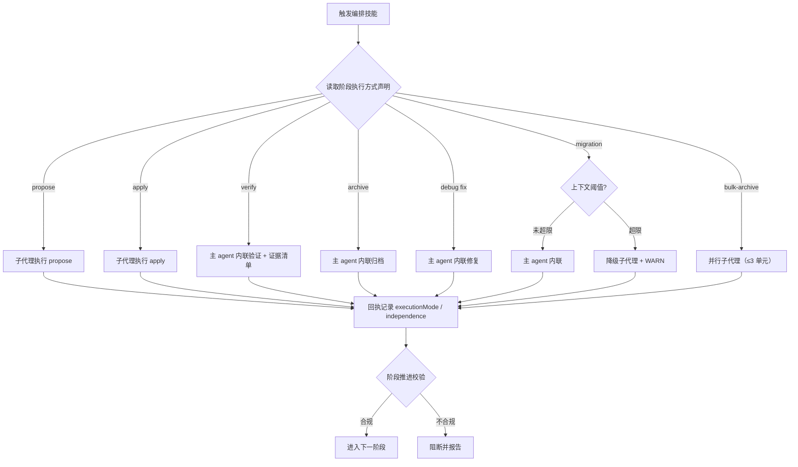

## Context

编排协议（`src/core/host-orchestration/`）已把「阶段实际执行方式」建模为一等契约：`PhaseSpec.execution.allowed`
声明允许的执行方式，`evaluatePhaseTransition` 校验回执的 `executionMode` / `independence`。归档变更
`improve-orchestration-execution-mode` 基于一次实测（8 次子代理 923,804 tokens）建立了该契约，并明确否决
「全部内联」。本次实测成本结构发生变化：验证 / 复查占子代理 token 的 69.3%，且每轮修复都新开验证代理全量重读；
写阶段单次成本可控。故需要**分级反转**，而非推翻整个契约。

### Architecture Impact

| 组件 | 落点 | 影响类型 |
| :--- | :--- | :--- |
| 阶段声明 | `src/core/host-orchestration/workflows.ts:27-200` | `execution.allowed` / `independence` / `requiredCapabilities` |
| 阶段推进 | `src/core/host-orchestration/transition.ts` | `independence` 映射、deprecation WARN |
| 渲染 | `src/core/host-orchestration/render.ts:195` | 分级执行契约文本 |
| 编排模板 | `workflow.ts` / `auto-workflow.ts` / `debug.ts` / `migration.ts` | 内联 / 子代理分工、验证报告、阈值 |
| 被委派技能 | `spec-verify.ts` / `spec-verify-proposal.ts` / `proposal-review.ts` / `spec-archive.ts` / `spec-bulk-archive.ts` | 内联契约 / 证据 / 并行保留确认 |
| 规格 | `host-orchestration` / `workflow-suite-skills` / `migration-skills` | 需求口径与 supersede |
| 测试 | `host-orchestration` / `stage-continuation` / `template-consistency` / `allowed-tools` | 断言同步 |
| 生成物 | `skills/`、`AGENTS.md` | 快照与文档同步 |

**门预算（约束）**：本变更不新增确认门、不改 `GATE_WHITELIST`、不改门预算。

**单一源（AGENTS.md 守则 7）**：模板只维护 skill 版正文，command 版派生；本变更 MUST NOT 另立手工字符串。

**快照（AGENTS.md 守则 1）**：模板改动后 MUST 依次 `pnpm build && pnpm generate:skills`。

### 流程基准（已确认 N1-N13）

来源：`exploration.md` 的 `## 功能流程图`（用户已确认 `flowBaselineConfirmed=true`）。本设计不重新发明流程。

| 节点 | 操作 | 触发条件 | 证据位置 | 异常路径 |
| :--- | :--- | :--- | :--- | :--- |
| N1 | 触发编排 | 调用 workflow / auto-workflow / debug / migration | 各模板入口 | 无输入 → 交互收集 |
| N2 | 读取阶段执行方式 | 进入阶段 | `workflows.ts:27-178` | 未声明 → 不校验 |
| N3 | propose 子代理 | 阶段 propose | `workflows.ts:40-50` | 委派失败 → ≤2 重试 |
| N4 | apply 子代理 | 阶段 apply | `workflows.ts:65-75` / `93-101` | 编译 / 测试失败 → ≤3 |
| N5 | verify 内联 | 阶段 verify | `workflows.ts:53-62`、`spec-verify.ts` | 无证据不计分；FAIL → 同上下文 ≤3 |
| N6 | archive 内联 | 阶段 archive | `workflows.ts:78-87` / `104-112`、`spec-archive.ts` | 冲突合并；同步失败 WARN |
| N7 | debug fix 内联 | 阶段 fix | `workflows.ts:133-142`、`debug.ts` | 编译 / 测试失败 → ≤3 |
| N8 | migration 阈值判定 | 阶段 migration | `[新建]` — `migration.ts` | 超限 → N8b |
| N8a | migration 内联 | 未超限 | `[新建]` — `migration.ts` | 失败 → WARN / 暂停 |
| N8b | migration 降级 | 超限 | `[新建]` — `migration.ts` | 子代理失败 → 暂停报告 |
| N9 | bulk-archive 并行子代理 | 批量归档 | `spec-bulk-archive.ts` | 单元失败隔离 |
| N10 | 回执记录执行方式 | 阶段收尾 | `protocol.ts:286-296` | 缺失 → 按阶段规格校验 |
| N11 | 阶段推进校验 | 收到回执 | `transition.ts` | 不合规 → N13 |
| N12 | 进入下一阶段 | 校验通过 | `transition.ts` | — |
| N13 | 阻断并报告 | 校验失败 | `transition.ts` | — |

## Goals / Non-Goals

**Goals**:

- 把验证 / 复查的子代理成本降为 0（本次会话该部分占 69.3%），并消除「每轮新代理全量重读」。
- 用固定清单 + 证据 + 报告落盘，替代「独立子代理」作为验证可信度的来源。
- 保留写阶段（propose / apply）与并行归档的隔离与并行收益。
- 为迁移保留可测的上下文降级逃生口。

**Non-Goals**:

- 不改门白名单、门预算与业务确认语义。
- 不改 `propose` / `apply` / `spec-bulk-archive` 的执行方式。
- 不新增顶层阶段、不改产物布局与 CLI 契约。

## Decisions

### D1: 执行方式重分配

- **选择**: 子代理保留 `propose` / `apply` / `spec-bulk-archive`；`verify` / `archive` / `debug fix` /
  `migration source-scan` 与迁移 Phase 4 复查改为主 agent 内联 (D1)。
- **理由**: 实测验证 / 复查占 69.3%；写阶段内联会把大量文件正文灌入主上下文（本次 apply 252k tokens / 101 次调用）。
- **备选**: 全内联（主上下文膨胀、写副作用无隔离，否决）；维持现状（69.3% 成本持续，否决）。

### D2: 验证内联契约

- **选择**: 单轮内联；固定清单 = D1-D10 + B1-B7；每条结论 MUST 带 `文件:行` 或章节锚点，无证据不计分；
  FAIL 后同上下文修复并重跑清单（≤3），禁止新开代理或从头全量重读；报告落盘与回执字段 (D2)。
- **理由**: 主 agent 拥有决策与修复历史，减少「新代理重新推导」的失真；证据约束防止自证放水。
- **备选**: 保留一次独立复核（保留独立性但仍有子代理成本，否决）；纯自证无清单（不可核对，否决）。

### D3: 迁移内部划分与阈值

- **选择**: source-scan 内联；Phase 3 实现保留子代理（apply 语义）；Phase 4 复查内联；
  阈值 = 计划读取文件数 > 300 或制品总行数 > 15k → 降级子代理 + WARN (D3)。
- **理由**: 迁移 Phase 3 本质是 apply，与「apply 保留子代理」一致；Phase 4 是检查，按 D2 内联；
  阈值用扫描期可测的工作量代理，避免依赖不可得的上下文用量。
- **备选**: 迁移全内联（Phase 3 与 apply 决策不一致，否决）；迁移全子代理（与用户方向相反，否决）。

### D4: 覆盖归档 D1

- **选择**: 显式 supersede `improve-orchestration-execution-mode` 的 D1；保留其「写阶段隔离」部分 (D4)。
- **理由**: 归档 D1 的适用范围基于当时成本结构；本次实测改变了成本结论，但隔离理由对写阶段仍成立。
- **备选**: 静默覆盖（不可追溯，否决）。

### D5: 协议与兼容窗

- **选择**: `VERIFY_PHASE.independence` 改 `self-allowed`；`archive` / `fix` / `migration` 的
  `allowed` 为 `['inline', 'subagent']`，`subagent` 记 deprecation WARN；inline 阶段移除 `delegate`；
  同步 render 文本与 allowedTools (D5)。
- **理由**: 避免旧 in-flight 回执在升级期被判非法；下个 major 再收紧。
- **备选**: 立即严格只允许 inline（升级期回归风险，否决）。

## Risks / Trade-offs

| 风险 | 缓解 |
| :--- | :--- |
| 内联验证 = 作者自证，放水风险 | 固定清单 + 每条结论带 `文件:行` 证据 + 报告落盘 + `independence=self` WARN；无证据结论不计分 |
| 主上下文膨胀导致摘要 / 失准 | 内联面限定只读验证与收尾；验证按 handoff 制品清单锚点增量读取；migration 阈值降级 |
| archive 内联写副作用扩大 | 沿用既有非阻断语义与只读校验；门与归档确认不变 |
| 兼容窗让旧 subagent 路径长期存在 | deprecation WARN + 规格写明下个 major 收紧 |
| migration Phase 3 与 apply 决策不一致 | 明确 Phase 3 采用 apply 语义（子代理），Phase 4 才内联 |
| 阈值数字过硬或过软 | 300 文件 / 15k 行作为初始值，记录为可调常量并有 WARN 可观测 |
| 测试与生成快照漂移 | 同步断言口径、`pnpm build && pnpm generate:skills` |
