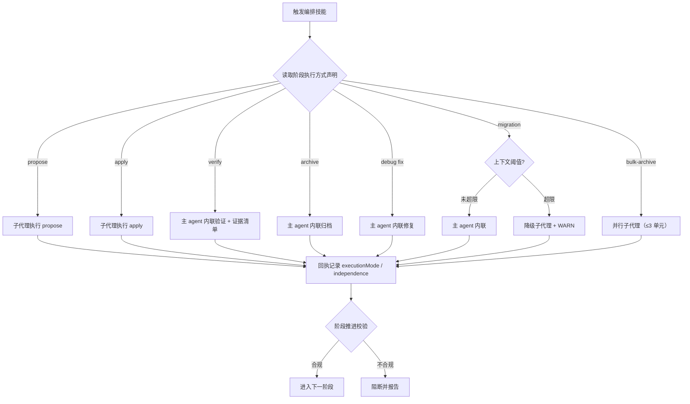

# 编排执行方式重分配（内联优先）探索

## Background

用户要求：分析当前会话的执行不合理与 token 浪费，重新设计 workflow / auto-workflow / debug 及其他委托技能的
子代理逻辑；**委托不再走代理子代理，直接在主 agent 执行**，以消除验证失真与共享数据重复读取。

本次会话实测（同一 auto-workflow 全流程）：

| 阶段 | 子代理次数 | tokens | 占比 |
| :--- | ---: | ---: | ---: |
| propose | 1 | 119,949 | 7.4% |
| verify-proposal | 7（1 次被用户终止） | 755,292 | 46.6% |
| proposal-review | 2 | 367,541 | 22.7% |
| apply | 1 | 252,585 | 15.6% |
| archive | 1 | 125,148 | 7.7% |
| **合计（已知）** | **12** | **≈1,620,515** | 100% |

验证 / 复查占 **69.3%**，且成本集中在「每轮修复 → 新开验证代理 → 重新全量读取」。
写阶段（propose / apply / archive）各只执行一次，成本可控。

## 提示词基线 (Prompt Baseline)

**原始提示词**：`improve-orchestration-execution-mode 分析当前会话执行不合理和token浪费情况，分析当前会话重新设计workflow/auto-workflow/debug及其他委托代理技能，对委托代理子agent逻辑重新处理，委托不再走代理子agent，直接在主agent执行，防止数据验证不准确，共享数据token浪费，数据不准确`

**确认后的基线**：以「验证内联 + 写阶段保留子代理」为主轴（方案 B），范围经两轮确认收敛为：
**propose / apply / spec-bulk-archive 保留子代理；verify / archive / debug fix / migration source-scan 由主 agent 内联。**
变更名 `inline-orchestration-delegation`（替代已归档的 `improve-orchestration-execution-mode`）。

## 代码库扫描结果

### Discovered Files

- `src/core/host-orchestration/workflows.ts` —— 全部 `PhaseSpec.execution` 声明（执行方式单一源）
- `src/core/host-orchestration/transition.ts` —— `evaluatePhaseTransition` 的执行方式 / 独立性校验
- `src/core/host-orchestration/render.ts:195` —— 生成的「分级执行」契约文本
- `src/core/host-orchestration/protocol.ts` —— `ExecutionMode` / `Independence` / `PhaseExecutionSpec`
- `src/core/host-orchestration/delegation-contract.ts` —— 双轴委派参数
- `src/core/templates/workflows/workflow.ts` / `auto-workflow.ts` / `debug.ts` / `migration.ts` —— 编排正文
- `src/core/templates/workflows/spec-verify.ts` / `spec-archive.ts` / `spec-bulk-archive.ts` —— 被委派技能
- `test/host-orchestration.test.ts` / `test/stage-continuation.test.ts` / `test/template-consistency.test.ts` —— 回归锁
- `openspec/changes/archive/2026-11-08-improve-orchestration-execution-mode/` —— 被本变更取代的归档决策

### Identified Symbols

- `WORKFLOW_PROTOCOLS`（`workflows.ts`）— 阶段执行方式声明
- `evaluatePhaseTransition`（`transition.ts`）— 执行方式 / 独立性阻断与 WARN
- `renderExecutionGrading` 等渲染段（`render.ts:195`）
- `getWorkflowSkillTemplate` / `getAutoWorkflowSkillTemplate` / `getDebugSkillTemplate` / `getMigrationSkillTemplate`

### Capability Exploration Memory (injected)

来源 `openspec/specs/host-orchestration/explorations.md` 与归档变更 `improve-orchestration-execution-mode`：

- **D1（归档）**：分级执行 —— explore inline；propose / apply / archive 必须 subagent；verify 默认 subagent，
  内联要求**非作者**（`independence=required`）；**「全部内联」被明确否决**（失去隔离与独立视角）。
- **D2（归档）**：增量复验 —— 新开只读代理 + `fixDiff` + 上轮 `reportPath`，禁止 resume。
- **D3/D4（归档）**：回执 `executionMode` / `independence` 可选字段；`PhaseSpec.execution` 校验。
- **D5/D6（归档）**：`iagent spec fingerprint` CLI 与 handoff `## 制品清单`。
- 本次实测表明：**D2 的增量复验仍在每轮重读**，且 6 轮修复各触发一次新验证，成本未收敛。

## Analysis

### Deep Analysis Trigger

- **Triggered**: Yes（修改既有协议与编排模板）
- **Scope**: `host-orchestration` 协议 / 阶段推进 / 渲染；四个编排技能模板；被委派技能模板；测试与快照

### 关键张力

1. **决策反转**：归档 D1 否决「全部内联」；本变更在其基础上做**分级反转**（验证与收尾内联，写阶段保留子代理），
   必须显式记录 supersede，不能静默覆盖。
2. **独立性**：主 agent 自证 → `independence=self`；当前 `VERIFY_PHASE` 为 `required`，会判不合规。
   需改为 `self-allowed`，以「固定清单 + 每条结论带 `文件:行` 证据 + 报告落盘」补足可信度。
3. **上下文成本**：内联 apply 会把大量文件正文灌入主上下文（本次 apply 252k tokens / 101 次调用），
   故 apply / propose 保留子代理；内联面限定在只读验证与收尾类阶段。

## Questions

### 批量 1 — L1-L3（已确认）

- **Q1 目标**：A 全内联 / B 验证内联 + 写阶段保留 / C 收敛验证循环？
  - **A**: 选 **B**；随后用户进一步明确「propose / apply 仍子代理，其他全部主 agent」。
- **Q2 验证方案**：单轮内联 + 固定清单 + 证据，不再区分两个验证子代理 —— 接受。
- **Q3 异常**：变更名与归档同名 —— 采用 `inline-orchestration-delegation`。

### 批量 2 — L4/L5（已确认）

- **L4 一致性**：与归档 D1 的三处冲突（原则 / `independence=required` / `delegate` 能力）按 supersede +
  `self-allowed` + 移除 inline 阶段 `delegate` 处理。
- **L5 边界**：B1-B7 采纳；用户追加：**spec-bulk-archive 保留并行子代理**。
- **设计完备性核验（G1-G5）**：全部确认 —— migration 内部划分、可测阈值、兼容窗、render/allowedTools 同步、验证报告落盘。

## 术语表

| 术语 | 定义 | 避免使用 |
|------|------|---------|
| 内联（inline） | 阶段由当前主 agent 直接执行，不产生子代理上下文 | 本地执行（degraded 专用） |
| 子代理（subagent） | 宿主 Agent 工具派生的隔离子上下文 | 代理、委派（过宽） |
| 上下文阈值 | 以计划读取文件数 / 制品行数判定的降级触发条件 | 上下文用量（不可测） |
| 验证报告 | 内联验证落盘的 `verify-report.md`，含维度分数与证据 | 验证结果（口头） |
| 兼容窗 | 协议允许旧 `subagent` 回执但记 deprecation WARN 的过渡期 | 过渡期（歧义） |

## 架构决策

- ADR-0001: 以「验证与收尾内联、写阶段隔离」取代归档 D1 的「全部内联否决」；理由是本会话实测验证占 69.3%，
  而写阶段单次成本可控且内联会撑大主上下文。

## 边界场景

- [x] B1 主 agent 验证自写制品 → `independence=self` + WARN；结论必须带 `文件:行`
- [x] B2 验证 FAIL 修复 → 同上下文，禁止新开代理 / 全量重读；循环 ≤3
- [x] B3 归档内联失败 → 沿用非阻断语义
- [x] B4 debug fix 内联 → 编译 / 测试共用预算 ≤3
- [x] B5 migration 上下文超限 → 降级子代理 + WARN（阈值：计划读取文件 > 300 或制品行数 > 15k）
- [x] B6 spec-bulk-archive → **保留并行子代理**（≤3）
- [x] B7 无 `delegate` 能力宿主 → propose/apply 阻断，其余内联阶段可执行
- [x] G1 migration Phase 3 保留子代理（apply 语义），Phase 4 复查内联
- [x] G2 阈值用可测代理指标
- [x] G3 兼容窗：`allowed` 同时接受 inline / subagent，subagent 记 deprecation WARN
- [x] G4 render 文本与 allowedTools 同步
- [x] G5 内联验证报告落盘 + `readScope` 回执

## Decisions

### D1 执行方式版图
- **子代理**：`propose`、`apply`（含 auto-workflow 的 apply）、`spec-bulk-archive`（并行 ≤3）。
- **主 agent 内联**：`verify`、`archive`、`debug fix`、`migration source-scan`、`migration Phase 4 复查`。
- **不变**：`explore`、`debug investigate`、`debug verify-close` 维持内联；`migration Phase 3 实现` 维持子代理（apply 语义）。
- 依据：本会话验证 / 复查占子代理 token 69.3%；写阶段内联会撑大主上下文。

### D2 验证内联契约
- 单轮内联，固定清单 = D1-D10 核心维度 + B1-B7 边界；每条结论 MUST 带 `文件:行` 或制品章节锚点，无证据不计分。
- 回执记 `executionMode=inline` / `independence=self` / `readScope`；验证报告落盘 `.openspec-tmp/pipeline-<change>/verify-report.md`。
- FAIL 后在同一主上下文修复并重跑清单，禁止新开代理或从头全量重读；循环 ≤3，超出暂停报告。

### D3 migration 内部划分与阈值
- source-scan 内联；Phase 3 实现按 apply 语义保留子代理；Phase 4 复查改内联 + 证据清单。
- 内联阶段在扫描后判定：计划读取文件数 > 300 或制品总行数 > 15k → 降级子代理并记 WARN。

### D4 覆盖归档 D1
- 显式 supersede `improve-orchestration-execution-mode` 的 D1；在 design 写入理由与保留项（写阶段隔离）。

### D5 协议与兼容窗
- `VERIFY_PHASE.independence` 改 `self-allowed`。
- archive / fix / migration 的 `execution.allowed` 为 `['inline', 'subagent']`（兼容窗），模板只指示 inline；
  `subagent` 回执记 deprecation WARN，下个 major 收紧为 `['inline']`。
- inline 阶段 `requiredCapabilities` 移除 `delegate`；render 段与各技能 allowedTools 同步。

## Scope Changes

| 变更时间 | 变更类型 | 变更描述 | 原因 |
|---------|---------|---------|------|
| 2026-11-08 | shrink | 从「全部内联」收敛为「验证内联 + 写阶段保留」 | 实测写阶段内联会撑大主上下文，且隔离有价值 |
| 2026-11-08 | expand | 追加设计完备性核验 G1-G5 | 避免迁移阈值 / 兼容窗 / 审计面在实现期歧义 |
| 2026-11-08 | adjust | spec-bulk-archive 保留并行子代理 | 用户确认，保留并行收益 |

## Pending

### For Phase 2 Impact Analysis

- `WORKFLOW_PROTOCOLS` / `PhaseSpec.execution`（`src/core/host-orchestration/workflows.ts`）- Priority: HIGH
- `evaluatePhaseTransition`（`src/core/host-orchestration/transition.ts`）- Priority: HIGH
- 执行方式渲染段（`src/core/host-orchestration/render.ts:195`）- Priority: HIGH
- `getWorkflowSkillTemplate` / `getAutoWorkflowSkillTemplate`（`workflow.ts` / `auto-workflow.ts`）- Priority: HIGH
- `getDebugSkillTemplate`（`debug.ts`）- Priority: HIGH
- `getMigrationSkillTemplate`（`migration.ts`）- Priority: MEDIUM
- `spec-verify.ts` / `spec-archive.ts` 模板 - Priority: MEDIUM
- allowedTools 共享常量与 `test/allowed-tools.test.ts` - Priority: MEDIUM

### Business Validation

- 无（执行方式契约，验证维度见 D2）

### Unresolved Decisions

- 无（D1-D5 与 B1-B7 / G1-G5 全部确认）

## 功能流程图

| 节点 | 操作 | 触发条件 | 证据位置 | 异常路径 |
| :--- | :--- | :--- | :--- | :--- |
| N1 | 触发编排 | 调用 workflow / auto-workflow / debug / migration | 各模板入口 | 无输入 → 交互收集 |
| N2 | 读取阶段执行方式 | 进入阶段 | `workflows.ts:27-178` | 未声明 → 不校验 |
| N3 | propose 子代理 | 阶段 propose | `workflows.ts:40-50` | 委派失败 → ≤2 重试 |
| N4 | apply 子代理 | 阶段 apply | `workflows.ts:65-75` / `93-101` | 编译 / 测试失败 → ≤3 |
| N5 | verify 内联 | 阶段 verify | `workflows.ts:53-62`、`spec-verify.ts` | 无证据不计分；FAIL → 同上下文 ≤3 |
| N6 | archive 内联 | 阶段 archive | `workflows.ts:78-87` / `104-112`、`spec-archive.ts` | 冲突合并；同步失败 WARN |
| N7 | debug fix 内联 | 阶段 fix | `workflows.ts:133-142`、`debug.ts` | 编译 / 测试失败 → ≤3 |
| N8 | migration 阈值判定 | 阶段 migration | `[新建]` — `migration.ts` | 超限 → N8b |
| N8a | migration 内联 | 未超限 | `[新建]` — `migration.ts` | 失败 → WARN / 暂停 |
| N8b | migration 降级 | 超限 | `[新建]` — `migration.ts` | 子代理失败 → 暂停报告 |
| N9 | bulk-archive 并行子代理 | 批量归档 | `spec-bulk-archive.ts` | 单元失败隔离 |
| N10 | 回执记录执行方式 | 阶段收尾 | `protocol.ts:286-296` | 缺失 → 按阶段规格校验 |
| N11 | 阶段推进校验 | 收到回执 | `transition.ts` | 不合规 → N13 |
| N12 | 进入下一阶段 | 校验通过 | `transition.ts` | — |
| N13 | 阻断并报告 | 校验失败 | `transition.ts` | — |

> 流程基准：用户已确认（`flowBaselineConfirmed=true`）。

## 实施深潜（条件性）

### Design Rationale

- 归档 D1 的「全部内联否决」以隔离与独立视角为主要理由；本次以**实测成本结构**反驳其适用范围：
  验证 / 复查占 69.3%，而写阶段单次成本可控。故做**分级反转**而非全面反转。

### Constraints

- 门白名单 / 门预算不变（`GATE_WHITELIST` 5 类）。
- `PhaseSpec.execution` 只约束阶段所有者；子阶段委派由模板声明。
- 单一源：模板正文只维护 skill 版，command 版派生；改模板后 `pnpm build && pnpm generate:skills`。
- 兼容窗内旧 `subagent` 回执 MUST 仍可用（WARN）。

### Trade-offs

- 验证独立性下降 → 以固定清单 + 证据 + 报告落盘弥补。
- migration 内联可能撑大上下文 → 阈值降级。
- 兼容窗延长旧行为 → 下个 major 收紧。

### Historical Context

- `improve-orchestration-execution-mode`（2026-11-08 归档）建立了执行方式契约与增量复验；
  本次沿用其协议机制，调整执行方式分配。
