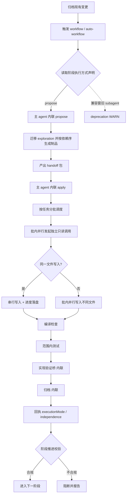

## Context

`inline-orchestration-delegation`（2026-11-08 归档）已把 verify / archive / fix / migration 改为内联优先，
但保留 `propose` / `apply` 为 `subagent`，理由是该阶段写副作用与上下文隔离。本次实测显示
`propose` 119,949 + `apply` 252,585 tokens（占子代理总消耗约 23%），用户要求进一步内联并以
「单 agent 分批 + 批内并行只读」替代子代理调度。

### Architecture Impact

| 组件 | 落点 | 影响类型 |
| :--- | :--- | :--- |
| 阶段声明 | `workflows.ts:40/66/95` | propose / apply / auto-apply 改 inline + 兼容窗；移除 `delegate` |
| 阶段推进 | `transition.ts:145` | 写阶段 inline 不再阻断；兼容窗覆盖 propose/apply |
| 渲染 | `render.ts` | 分级执行文本 |
| 提案 / 实现模板 | `spec-propose.ts` / `spec-apply.ts` | 内联契约 + 单 agent 分批调度 |
| 编排模板 | `workflow.ts` / `auto-workflow.ts` | 阶段说明与 allowedTools |
| 迁移模板 | `migration.ts` | Phase 3 内联 |
| 规格 | `host-orchestration` / `workflow-suite-skills` / `spec-workflow-skills` / `migration-skills` | 需求改写 |
| 测试 / 生成物 | `test/*` / `skills/` / `AGENTS.md` | 断言与快照同步 |

**门预算**：不新增确认门、不改 `GATE_WHITELIST`、不改门预算。

**单一源 / 快照**：模板只维护 skill 版；改动后 `pnpm build && pnpm generate:skills`。

### 流程基准（已确认 N0-N20）

| 节点 | 操作 | 触发条件 | 证据位置 | 异常路径 |
| :--- | :--- | :--- | :--- | :--- |
| N0 | 归档上一变更 | 前置（已完成） | `spec-archive.ts` | 冲突合并 / WARN |
| N1 | 触发编排 | 用户调用 | 技能入口 | 无输入 → 交互收集 |
| N2 | 读取执行方式 | 进入阶段 | `workflows.ts:40/66/95` | 未声明 → 不校验 |
| N3 | propose 内联 | 阶段 propose | `spec-propose.ts` | 迁移失败 → 保留源文件 |
| N4 | 迁移 + 依赖序生成 | N3 内 | `spec-propose.ts` | 校验失败 → 修正重跑 |
| N5 | 产出 handoff 包 | 制品定稿 | `spec-propose.ts` | 指纹不一致 → 重建 + WARN |
| N6 | apply 内联 | 阶段 apply | `spec-apply.ts` | 编译 / 测试失败 ≤3 |
| N7 | 分批调度 | N6 内 | `[新建]` `spec-apply.ts` | 批失败 → 记录并继续 / 暂停 |
| N8 | 批内并行只读 | 同批独立任务 | `[新建]` 同上 | 读取失败 → WARN 降级串行 |
| N9–N11 | 同文件串行 / 不同文件并行 | 写入前判定 | `[新建]` 同上 | 冲突 → 串行合并 |
| N12 | 编译检查 | 批次完成 | `spec-apply.ts` | ≤3 后暂停 |
| N13 | 范围内测试 | 编译通过 | `spec-apply.ts` | ≤3 后暂停 |
| N14 | 实现验证 | 测试通过 | `spec-verify.ts` | 失败 → 回 N6 |
| N15 | 归档 | 验证通过 | `spec-archive.ts` | 非阻断语义 |
| N16 | 回执 | 阶段收尾 | `protocol.ts` | 缺失 → 规格校验 |
| N17–N19 | 推进校验 | 收到回执 | `transition.ts:145` | 不合规 → 阻断 |
| N20 | 兼容窗 WARN | 旧 subagent 回执 | `transition.ts:175` | 下个 major 收紧 |

## Goals / Non-Goals

**Goals**: propose / apply 全内联；单 agent 分批 + 批内并行只读；token 成本下降；写阶段仍可核对（进度落盘）。
**Non-Goals**: 不承诺独立上下文并行；不改门与业务确认；`spec-bulk-archive` 并行保留；CLI 不变。

## Decisions

### D1: propose 内联
- **选择**: `PROPOSE_PHASE` 改 `allowed=['inline','subagent']`（兼容窗），移除 `delegate`；主 agent 完成迁移、依赖序生成与 handoff 包 (D1)。
- **理由**: 提案生成是只读分析 + 写 Markdown，无隔离必要性；本次子代理成本 120k。
- **备选**: 保留子代理（成本持续，否决）。

### D2: apply 内联 + 单 agent 分批
- **选择**: `APPLY_PHASE` / `AUTO_APPLY_PHASE` 同改；`spec-apply` 派发协议重写为「主 agent 分批循环」：
  同 `group` 聚为单元；批内独立**只读**调用并行；写同一文件串行；进度落盘
  `.openspec-tmp/pipeline-<change>/apply-progress.md`；`apply.concurrency` 改为每批单元数软上限；
  handoff 包仍为只读输入面 (D2)。
- **理由**: 消除 253k 子代理成本；进度落盘保留可核对性。
- **备选**: 保留子代理（成本持续，否决）；真并行（单 agent 不可行）。

### D3: 单 agent 并行定义
- **选择**: 并行 = 同一回合并行只读调用 + 批内交错；MUST NOT 承诺并行代码生成 (D3)。
- **理由**: 避免语义误导。

### D4: migration Phase 3 内联
- **选择**: apply 内联后，migration Phase 3 同步内联；阈值 300 文件 / 15k 行保留为降级逃生口 (D4)。
- **理由**: 与 apply 语义一致。

### D5: 白名单与编排口径
- **选择**: `workflow` / `auto-workflow` 移除 `Agent, Task`；`migration`（Phase 3）/ `spec-bulk-archive` 保留；
  auto-workflow Phase 4/5 改 Skill 内联 (D5)。
- **理由**: 授权面与正文一致，不保留幽灵条目。

## Risks / Trade-offs

| 风险 | 缓解 |
| :--- | :--- |
| 主上下文膨胀 | 分批执行 + 进度落盘；不设停止阈值（用户指示），按批推进 |
| 单 agent 并行被误解为真并行 | 规格写死定义与禁止项 |
| 写同一文件冲突 | 强制串行 + 文件归属表 |
| 旧 subagent 回执非法 | 兼容窗 + deprecation WARN |
| apply 内部协议改写遗漏 | 以 `spec-apply 派发协议与共享资源协议` 为单一改动点，测试断言覆盖 |
| 迁移 Phase 3 与 apply 不一致 | 同批改为内联 |
