# 探索：技能委派回执续跑与需求文档生成剥离

## Background

本项目（MiAgentTools）需要对部分指令技能进行优化设计：

1. **委派回执后流程停止**：`auto-workflow` / `debug` 技能输出 delegated 模式回执后，SKILL 进程停止，没有按流程继续往下走。需要重新优化 `auto-workflow` / `debug` 的自动执行逻辑，优化不同技能之间的桥接与集成逻辑，让不同阶段可以自动执行，减少用户干预。
2. **需求文档生成逻辑剥离**：调整 `workflow` / `auto-workflow` / `debug` / `proposal`（spec-propose）/ `archive`（spec-archive）及其他相关技能，把「生成需求文档」的逻辑全部移除；需求文档生成只在独立的 `iagent-requirement-doc` 技能中使用。

## 提示词基线 (Prompt Baseline)

**原始提示词**:

> 探索分析项目对部分指令技能进行优化设计
> 1）调整auto-workflow/debug 技能输出 delegated 模式回执逻辑，当前给出回执后，SKILL进程停止，没有按流程进行继续往下走；需要重新优化auto-workflow/debug自动执行逻辑，优化不同技能桥接和集成逻辑，让不同阶段可以自动执行，减少用户干预
> 2）调整workflow/auto-workflow/debug/propsal/archive及其他技能下，生成需求文档逻辑全部移除，需求文档生成直接在单独技能中使用

**确认后的提示词基线**: 与原始提示词一致（提示词校验门判定为清晰输入，一句话复述后直通）。

> 下游（提案 / 设计 / 规格 / 任务）以提示词基线为唯一语义来源；基线若变更 MUST 回到 1.1.2 重新确认。

## 功能流程图

```mermaid
flowchart TD
  subgraph O[编排续跑（workflow / auto-workflow）]
    N1[用户输入主题] --> N2[父编排内联加载]
    N2 --> N3[委派 spec-explore：Skill 内联，交互]
    N3 --> N4{提示词门 / 流程最终确认门}
    N4 -- 确认 --> N5[探索回执：inline，同一 agent]
    N4 -- 修改 --> N3
    N5 --> N6[委派 spec-propose：Agent 子代理]
    N6 --> N7{回执校验}
    N7 -- ok --> N8[委派 verify-proposal + proposal-review：Agent]
    N7 -- blocked/failed/incomplete --> N7E[按重试策略暂停/重试]
    N8 --> N9{workflow：实现桥}
    N9 -- 确认 --> N10[委派 spec-apply：Agent，gate-skip]
    N9 -- 修改/拒绝 --> N8
    N10 --> N11[编译与测试证据]
    N11 --> N12[委派 spec-verify：Agent]
    N12 --> N13{workflow：归档桥}
    N13 -- 确认 --> N14[委派 spec-archive：Agent]
    N13 -- 拒绝 --> N10
    N14 --> N15[完成摘要]
  end
  subgraph D[调试续跑（debug）]
    M1[用户 bug 描述] --> M2[提示词门]
    M2 --> M3[复现 / 证据轨]
    M3 --> M4[排查定位]
    M4 --> M5{诊断 + 方案包}
    M5 -- 确认 --> M6[修复 + 委派 test：Agent]
    M5 -- 修改 --> M4
    M6 --> M7[编译检查]
    M7 --> M8[同步提案]
    M8 --> M9[委派 verify-proposal：Agent]
    M9 --> M10[深度复查 proposal-review：Agent]
    M10 --> M11[verify-close 收束：无文档桥]
    M11 --> M12[清理工作区]
  end
  subgraph R[需求文档剥离]
    P1[三父流程不再展示文档桥] --> P2[不再委派 requirement-doc]
    P2 --> P3[archive / bulk 不再只读报告]
    P3 --> P4[独立技能手工调用]
    P4 --> P5[DEPS 与白名单移除]
  end
```



| 节点 | 操作 | 触发条件 | 证据位置 | 异常路径 |
| :--- | :--- | :--- | :--- | :--- |
| N1 | 用户输入主题，父编排内联加载 | 入口意图 | `auto-workflow.ts:25` / `workflow.ts`（入口段，既有） | 缺参数 → 交互收集 |
| N2 | 父编排保持 inline，不 fork | 始终 | `render.ts:177`（宿主编排段，改） | 误用 `context: fork` → 交互门不可用，视为缺陷 |
| N3 | 委派 `spec-explore`（Skill 内联，交互） | Phase 1 | `actions.ts:67` `renderDelegate`（改：交互阶段保留 Skill）；`spec-explore.ts:1224`（既有） | 技能不可用 → `status=blocked` |
| N4 | 提示词门 / 流程最终确认门 | 输入不明确 / 探索产出流程图 | `prompt-gate.ts` / `flowchart-gate.ts`（既有） | 修改 → 回 N3；拒绝 → 记录未确认并降级 |
| N5 | 探索回执（inline，同一 agent） | N4 确认 | 探索文件 `## 提示词基线` / `## 功能流程图`（既有）；`[新建]` 续跑契约段 | 回执缺失 → 不进入 N6 |
| N6 | 委派 `spec-propose`（Agent 前台子代理） | Phase 2 | `actions.ts:67`（改：自动阶段 A→Agent）；`spec-propose.ts:230,241`（既有 delegated 分支） | 子代理无法载入技能 → 降级 Read `SKILL.md`，仍失败 → `status=blocked` |
| N7 | 校验回执 `phase` / `status` / `artifact` / `nextAllowed` / `confirmedGates` | 子代理返回 | `protocol.ts:289` `validateReceipt`（既有）；`[新建]` 续跑契约段 | 字段缺失 / 非法 → `invalid-receipt`，不推进 |
| N8 | 委派 `spec-verify-proposal` + `proposal-review`（Agent） | N7 ok | `auto-workflow.ts:84-92`（改：改为 Agent）；`render.ts:148-169`（改：移除 requirement-doc） | 技能不可用 → 内联降级 + WARN（既有） |
| N9 | workflow 实现 + 测试桥（用户确认） | workflow 验证 + 深度复查收束 | `workflow.ts:350`（改：移除文档选项，五出口→三出口） | 修改 → 回 Phase 2/1；拒绝 → 停止 |
| N10 | 委派 `spec-apply`（Agent，`gate-skip=design-confirmation`） | 桥确认 / auto-workflow 自动 | `auto-workflow.ts:129`（改：Agent）；`spec-apply.ts:375`（既有门账本） | 编译/测试失败 → 子代理 `status=failed` → 父级暂停 |
| N11 | 编译与测试证据 | apply 收尾 | `compile-report.md`（既有）；`spec-apply.ts` §8/§9（既有） | 证据缺失 / fail → 不进入 N12/N13（既有） |
| N12 | 委派 `spec-verify`（Agent） | N11 放行 | `auto-workflow.ts:159`（改：Agent） | 失败 → 回 N10；不可用 → 显式省略 + WARN |
| N13 | workflow 归档桥（用户确认） | 实现验证通过 | `workflow.ts:399`（改：移除 `requirementDocStatus` 传递） | 拒绝 → 回 N10 |
| N14 | 委派 `spec-archive`（Agent） | 桥确认 / auto-workflow 自动 | `auto-workflow.ts:187`（改：Agent，移除文档状态） | sync 失败 → WARN 不阻断（既有） |
| N15 | 完成摘要 | N14 完成 | `auto-workflow.ts:200-204`（改：移除文档桥表述） | — |
| M1 | 用户 bug 描述 | 入口 | `debug.ts:154`（既有） | 缺描述 → 交互收集 |
| M2 | 提示词门（缺陷五维） | 输入不明确 | `debug.ts:159`（既有） | 修改 → 重述；拒绝 → 按原理解继续 |
| M3 | 复现 / 证据优先轨 | Phase 1 | `debug.ts:207-241`（既有） | 无证据 → 只报告候选，不修复（既有） |
| M4 | 排查定位与根因分级 | Phase 2 | `debug.ts:246+`（既有） | 未定位 → 深度路径 / 升级兜底（既有） |
| M5 | 诊断 + 方案合并包（用户确认） | 根因收束 | `debug.ts:343`（既有） | 修改 → 重呈；拒绝 → 终止修复 |
| M6 | 修复 + 委派 `iagent-test`（Agent） | M5 确认 | `debug.ts:401-419`（改：Agent + 续跑契约）；`actions.ts:67`（改） | 测试验收失败 → 不报告通过；子代理 blocked → 暂停 |
| M7 | 编译检查 | 所有修复完成 | `debug.ts:426`（既有） | 遗留失败 → 报告，不静默越过 |
| M8 | 同步提案制品 | M7 完成 | `debug.ts:437`（既有） | 校验失败 → 修正后重跑 |
| M9 | 委派 `spec-verify-proposal`（Agent） | M8 完成 | `debug.ts:473`（改：Agent） | 技能不可用 → 内联评分 + WARN（既有） |
| M10 | 深度复查 `proposal-review`（Agent） | M9 PASS | `debug.ts:494`（改：Agent） | 不可用 → 内联复查 + WARN（既有） |
| M11 | verify-close 收束（无文档桥） | M10 收束 | `debug.ts:490-505`（改：删除 7.3 文档桥） | 不自动归档；报告可归档（既有语义保留） |
| M12 | 清理流程级调试工作区 | 全部退出路径 | `debug.ts:507`（既有） | 清理失败 → WARN 不阻断（既有） |
| P1 | 三父流程不再展示文档桥 | workflow / auto-workflow / debug 验证收束 | `auto-workflow.ts:94-104`、`workflow.ts:100-128`、`debug.ts:496-504`（删） | 历史变更文档保留，不改写 |
| P2 | 不再委派 `requirement-doc` | 三父流程 | 三处 `allowedTools` 移除 `Skill(iagent-requirement-doc)`（改）；`render.ts:148-169`（改） | 旧装机由 update 重新生成 |
| P3 | archive / bulk 不再只读报告 | 归档前 | `spec-archive.ts:166-184`、`spec-bulk-archive.ts:201-204`（删） | 读取失败不再产生 WARN（逻辑已移除） |
| P4 | 独立技能手工调用 | 用户显式调用 | `requirement-doc.ts:15`（改：调用方说明改为无自动调用方） | 目标已存在 → 技能既有覆盖规则（保持） |
| P5 | DEPS 与白名单移除 | 安装 / 生成期 | `profiles.ts:55-64`（改）；`protocol.ts:98-135`（删 `requirement-doc-bridge` 锚点）；`workflows.ts:28-85,160-173`（删状态回执 / 门）；`index.ts` 导出（删） | 版本递增 major；`pnpm generate:skills` 重建快照 |

> **L4 一致性检查**：D1 混合机制与 D7 宿主一致性无冲突；D3 彻底移除与 D5 提交排除保留无硬冲突（提交排除是安全规则，不是生成逻辑）；D4 不再注入与 D3 移除 DEPS 一致；D2 同步 workflow 与 D3 移除 workflow 文档桥一致。**0 个硬冲突**。
>
> **L5 边界场景**：见 `## 边界场景` 段（12 条），其中「子代理回执非法」「子代理 blocked」「探索门是合法停点」「既有变更文档保留」「migration/feature-doc 不受影响」为必须确认项。

## Analysis

### Deep Analysis Trigger

- Triggered: Yes
- Reason: 用户输入含「优化」「调整」「移除」，属于修改既有技能模板（`src/core/templates/workflows/*.ts`）与宿主编排代码（`src/core/host-orchestration/*.ts`）
- Scope: 见下方 Discovered Files 与 Identified Symbols

### Architecture Flow（现状与断点）

```text
auto-workflow / debug（父编排，主 agent）
  └─ Skill 工具委派阶段子技能（同上下文注入 SKILL.md）
       ├─ spec-explore（delegated）：输出结构化回执 → 交回编排器
       ├─ spec-propose（delegated）：输出结构化回执 → 交回编排器
       ├─ spec-verify-proposal / proposal-review / test / spec-verify
       └─ spec-apply（gate-skip）/ spec-archive
            ↓
       子技能回执后，模型结束本轮响应（turn 结束）
            ↓
       父编排的下一阶段没有在同一响应内被触发 → 流程停住
```

### 根因假设（置信度：HIGH）

1. **Skill 工具是同上下文注入，不是独立子代理**：`Skill(iagent-spec-explore)` 把子技能正文注入当前 agent，模型随后以子技能身份工作；子技能的 delegated 契约写「输出结构化回执、交回编排器」，模型把「交回」理解为本轮结束。
2. **父编排缺少「回执后续跑」契约**：现有直通句只约束「阶段入口」（如 auto-workflow.ts:49「本阶段在 Phase 1 完成后立即开始」），没有约束**委派返回边界**；子技能回执后没有硬性指令要求父编排在同一响应内发起下一阶段首个工具调用。
3. **Claude 宿主渲染只使用 Skill 工具**：`renderDelegate`（actions.ts:67-89）对 Claude 固定输出「经 Skill 工具委派」，而 `HOST_PROFILES.claude.native.delegation` 已声明「Skill / Agent 子代理」；Agent 子代理通道未被使用 → 父级无法以「工具结果 → 继续编排」的方式自然续跑。
4. **debug 的多处委派同构**：`iagent_test`（4.2）、`iagent_spec_verify_proposal`（7.1）、`iagent_proposal_review`（7.3）返回后，debug 没有显式「继续 Phase 5/6/7」的续跑契约。

### 续跑机制事实核对（Claude Code 运行时语义）

来源：claude-code-guide 子代理（官方文档核对；`Skill` 工具结果标记为源码推断）。

- `Skill(...)` 是**同上下文注入**：子技能正文作为一条消息进入当前会话并保留；模型在同一 agentic loop 中继续，**没有"返回控制"API**。回合只在模型不再发起工具调用时结束 —— 因此"回执后停住"是**未被显式要求继续**的行为，不是返回边界。
- `Agent`（原名 `Task`）是**隔离上下文**：前台子代理阻塞执行，其最终消息作为 `tool_result` 返回父级，父级在同一用户回合继续；这是**真实的结果边界**。后台模式的结果在后续回合到达，不适合严格背靠背管线。
- 推荐模式：编排器保持 inline（不要 `context: fork`）；重/自动阶段用前台 `Agent` 承载；阶段之间用文件持久化状态（handoff 包 / 门账本）；确认门是**有意的回合边界**，不是续跑失败。
- 关键结论：用户选择的「交互 Skill + 自动阶段 Agent」混合方案与官方推荐一致；纯文本续跑契约只能"请求"模型继续，Agent 子代理才能让父级在拿到结果后**自然**继续。

### 需求文档逻辑分布（现状）

| 文件 | 现状 | 与「生成」的关系 |
| :--- | :--- | :--- |
| `workflow.ts` | Phase 3.5 文档桥并入 3.7 交付桥（五出口，含「仅生成文档」）；3.5.1 状态持久化；Phase 5 传 `requirementDocStatus` | 生成 + 状态 + 传递 |
| `auto-workflow.ts` | Phase 3 唯一阻塞门＝需求文档桥；状态持久化 + 回执字段；Phase 5 传状态 | 生成 + 状态 + 传递 |
| `debug.ts` | 7.3 需求文档桥（生成/跳过/手工编辑）；状态持久化；verify-close 回执字段 | 生成 + 状态 + 传递 |
| `spec-propose.ts` | 已不生成；正文多处说明「文档桥只属于三父流程」 | 仅引用/排歧说明 |
| `spec-archive.ts` | 4.8 需求文档存在性**只读报告**（读文件 + `requirementDocStatus`） | 不生成；报告 |
| `spec-bulk-archive.ts` | a.6 需求文档存在性**只读报告** | 不生成；报告 |
| `spec-apply.ts` | 门账本说明提及 `requirement-doc-bridge`；git add 排除 `需求文档.md` | 不生成；协议引用 + 提交排除 |
| `commit.ts` | 提交清单排除 `需求文档.md` | 不生成；提交排除 |
| `requirement-doc.ts` | 独立技能本体 | **唯一生成入口（保留）** |
| `migration.ts` / `feature-doc.ts` | 「源需求文档 / 迁移需求实现文档」 | **语义不同，保留** |

## Codebase Findings

### Discovered Files

- `src/core/templates/workflows/auto-workflow.ts`：全自动编排；Phase 1-5 委派与文档桥；`allowedTools` 含 `Skill(iagent-requirement-doc)`。
- `src/core/templates/workflows/debug.ts`：调试全流程；4.2 委派 test、7.1 委派 verify-proposal、7.3 委派 proposal-review + 文档桥。
- `src/core/templates/workflows/workflow.ts`：引导式编排；Phase 3.5/3.7 交付桥含文档出口；Phase 4/5 委派 apply/archive。
- `src/core/templates/workflows/spec-explore.ts`：delegated 模式契约与强制检查点体系；当前无独立的「回执后续跑」段。
- `src/core/templates/workflows/spec-propose.ts`：delegated 分支抑制自验证、输出回执；多处声明「文档桥只属于三父流程」。
- `src/core/templates/workflows/spec-apply.ts`：Step 5.5 门账本降级链；提及 `requirement-doc-bridge`；提交排除 `需求文档.md`。
- `src/core/templates/workflows/spec-archive.ts` / `spec-bulk-archive.ts`：4.8 / a.6 需求文档只读报告与 `requirementDocStatus` 读取。
- `src/core/templates/workflows/requirement-doc.ts`：独立需求文档技能；Step 2 说明三父流程自动调用方。
- `src/core/host-orchestration/actions.ts`：`renderDelegate`（Claude 固定 Skill 工具）、`renderLoadSkill`、`renderDelegationList`。
- `src/core/host-orchestration/hosts.ts`：Claude `native.delegation = 'Skill / Agent 子代理'`。
- `src/core/host-orchestration/render.ts`：`renderHostOrchestrationSection`、`DELEGATION_PARAMETERS`、`CONDITIONAL_DELEGATIONS`。
- `src/core/host-orchestration/workflows.ts`：`WORKFLOW_PROTOCOLS`、`VERIFY_WITH_BRIDGE`、`AUTO_APPLY_PHASE` / `AUTO_ARCHIVE_PHASE`、`DEBUG_VERIFY_CLOSE`。
- `src/core/host-orchestration/protocol.ts`：`GATE_WHITELIST`（含 `requirement-doc-bridge`）、`RequirementDocStatus`、`REQUIREMENT_DOC_STATUS_FIELD`、`Receipt.requirementDocStatus`。
- `src/core/host-orchestration/delegation-contract.ts`：`renderDelegationModeContract()`（delegated = 抑制结尾停点 / 输出回执 / 禁止等待用户确认）。
- `src/core/profiles.ts`：`DEPS.workflow` / `DEPS.auto-workflow` / `DEPS.debug` 显式注入 `requirement-doc`。
- `src/core/templates/tool-whitelist.ts`：`skillDelegation()`（canonical `Skill(iagent-<id>)`）。
- 测试回归锁（需同步）：`test/artifact-dataflow.test.ts`、`test/allowed-tools.test.ts`、`test/host-orchestration.test.ts`、`test/profiles.test.ts`、`test/spec-workflow-contract.test.ts`、`test/template-consistency.test.ts`、`test/template-derivation.test.ts`、`test/templates.test.ts`、`test/command-reference-refs.test.ts`、`test/claude-host-adapter.test.ts`、`test/opencode-v2.test.ts`、`test/pi-native.test.ts`、`test/legacy-migration.test.ts`、`test/commands.test.ts`、`test/gate-ledger.test.ts`、`test/tool-whitelist-constants.test.ts`。

### Identified Symbols

- `renderDelegate` (`src/core/host-orchestration/actions.ts:67`)：宿主原生委派渲染；Claude 仅 Skill 工具。
- `renderHostOrchestrationSection` (`src/core/host-orchestration/render.ts:177`)：生成期注入的回执契约段；当前只有「回执缺失不推进」，没有「回执后必须续跑」。
- `renderDelegationModeContract` (`src/core/host-orchestration/delegation-contract.ts:134`)：delegated 轴语义；当前「抑制结尾停点」表述未覆盖「回执后继续」。
- `WORKFLOW_PROTOCOLS` (`src/core/host-orchestration/workflows.ts:197`)：auto-workflow / debug 的阶段门与 handoff。
- `DOC_BRIDGE_GATE` / `VERIFY_WITH_BRIDGE` / `DEBUG_VERIFY_CLOSE.gate` (`src/core/host-orchestration/workflows.ts:69,82,171`)：需求文档桥门协议声明。
- `RequirementDocStatus` / `REQUIREMENT_DOC_STATUS_FIELD` (`src/core/host-orchestration/protocol.ts:154,157`)：需求文档状态类型与字段。
- `DEPS` (`src/core/profiles.ts:55`)：工作流依赖注入表。
- `getAutoWorkflowSkillTemplate` (`auto-workflow.ts:16`) / `getDebugSkillTemplate` (`debug.ts`) / `getWorkflowSkillTemplate` (`workflow.ts`)：三父流程正文。
- `EXPLORATION_PROTOCOL_FULL` (`spec-explore.ts:32`)：delegated 探索协议；无回执格式/续跑段。

### Pattern Matches

- 「交回编排器 / 推进主权归编排器」：`auto-workflow.ts:45,68`、`workflow.ts:191,326,611`、`spec-explore.ts:1224`、`spec-propose.ts:230,241,297`。
- 「抑制结尾停点」：`delegation-contract.ts:140`。
- 「直通句」：`auto-workflow.ts:49`、`workflow.ts` 各 Phase 首段（仅入口，不含返回边界）。
- 「需求文档桥」：`auto-workflow.ts:94-104,226-229`、`workflow.ts:100-128,350-357,607`、`debug.ts:496-504,571-573`。

### Capability Exploration Memory (injected)

- **host-orchestration**：`already-authorized skills direct advance`、阶段回执字段、门账本（`confirmedGates`）、`requirement-doc-bridge` 锚点、headless 门兜底矩阵；历史变更 `improve-workflow-debug-bridges`、`improve-compile-gate-and-archive-readonly`、`improve-delegation-gate-ledger`、`feat-debug-dual-track-entry`。
- **workflow-suite-skills**：文档桥归父编排器；2026-10-25 曾确立「文档桥是 auto-workflow 唯一流程级阻塞门」；`improve-delegation-gate-ledger` 确立 workflow 交付桥五出口。本次需求将**推翻**这些决策中的一个子集（文档桥整体移除）。
- **spec-workflow-skills**：delegated 双轴契约（执行归属轴 `mode` + 门承载轴 `gate-skip`）；`spec-propose` 非目标（不生成文档）；`spec-archive` 只读报告。

## Questions

| 问题 | 回答 |
| :--- | :--- |
| 续跑机制选文本契约还是 Agent 子代理？ | **混合：交互阶段 Skill + 自动阶段 Agent 子代理**（用户裁决） |
| 是否同步修复 `workflow` 的续跑？ | **同步修复 `workflow` + 统一被委派技能续跑契约**（用户裁决） |
| 需求文档逻辑移除到哪一层（是否含 archive 只读报告 / 状态字段）？ | **彻底移除所有相关逻辑**：生成桥 / 状态持久化 / archive 与 bulk 只读报告 / `requirementDocStatus` / `requirement-doc-bridge` 门 / 协议字段 / DEPS / 白名单（用户裁决） |
| `requirement-doc` 是否仍随 workflow / auto-workflow / debug 自动注入？ | **不再自动注入，按需显式安装**（用户裁决） |

## 术语表

| 术语 | 定义 | 避免使用 |
|------|------|---------|
| 阶段回执（receipt） | 阶段完成时返回的结构化结果，含 `phase` / `status` / 产物位置 / 下一步允许动作 / 失败原因 | 执行报告、日志 |
| delegated 模式 | 执行归属轴取值，抑制结尾停点、抑制被委派技能自验证、输出结构化回执、禁止等待用户确认 | auto 模式、interactive |
| 门承载轴（gate-skip） | 声明已由父级确认的业务门，当前唯一合法取值 `design-confirmation` | gate-policy 参数键、auto-mode 别名 |
| 需求文档桥（已退役） | 三父流程在验证 + 深度复查后提供的「生成 / 跳过」业务选择；本次变更整体移除 | 二次确认、自动生成 |
| `requirementDocStatus`（已退役） | 变更 `exploration.md` 的 `## 需求文档状态` 字段（四值：`absent` / `skipped-by-user` / `generation-failed` / `generated`）；本次变更整体移除 | 会话内状态 |
| 续跑契约（continuation contract） | 委派阶段回执是中间状态；父编排 MUST 在同一用户回合内继续下一阶段，只有确认门是合法停点 | 自动模式、完成回执 |
| 交互阶段 / 自动阶段 | 交互阶段 = 需用户门的阶段（`spec-explore`），用 Skill 内联；自动阶段 = 其余阶段，用前台 Agent 子代理 | 前端 / 后端阶段 |
| Agent 子代理阶段委派 | Claude 宿主用前台 `Agent` 执行自动阶段；子代理最终消息作为 `tool_result` 返回，父级在同一回合继续 | 后台子代理、Skill 委派 |
| handoff 包 | `.openspec-tmp/pipeline-<change>/handoff-pack.md`，跨阶段只读复用 | context-pack（旧名） |
| 门账本 | handoff 包 `## 已确认门` 段 + 回执 `confirmedGates` | 确认记录、会话内状态 |

## 架构决策

- **ADR 候选（本次不落盘，待提案阶段决定是否创建）**：Claude 委托机制分层 —— 交互阶段 Skill、自动阶段前台 Agent。该决策难以逆转（影响宿主渲染、阶段分类、回执契约与全部编排技能），且脱离本文档会令人意外（现有实现只用 Skill），属真实权衡（可靠性 vs 交互门可用性）。若提案阶段确认需要 ADR，建议编号 `openspec/docs/adr/NNNN-claude-stage-delegation-hybrid.md`。

## 边界场景

- **探索门是合法停点**：用户在提示词门 / 流程最终确认门确认后才进入自动阶段；该确认是新用户回合，不是续跑失败。确认后父编排 MUST 在同一回合内启动 Phase 2 的 Agent 委派。
- **子代理回执缺失 / 非法**：`phase` / `status` / `artifact` / `nextAllowed` 缺失，或 `confirmedGates` 形状/取值非法 → 父级 MUST NOT 推进；按 `invalid-receipt` 暂停并报告。
- **子代理 `status=blocked` / `failed` / `incomplete`**：父级 MUST NOT 继续下一阶段；按阶段重试策略处理（≤2/≤3 次），耗尽后暂停并报告失败原因。
- **子代理无法加载技能**：Agent prompt 先要求 `Skill(iagent-<id>)`；若子代理工具面不支持，降级为 `Read .claude/skills/iagent-<id>/SKILL.md`；仍不可用 → `status=blocked` + 原因，禁止伪造回执。
- **交互阶段误用 Agent**：`spec-explore` 必须保持内联；若被放入子代理，提示词门/流程图门无法与用户交互 → 视为编排缺陷，MUST NOT 以自动推断替代确认。
- **auto-workflow 移除文档桥后无阻塞门**：L1-L5 + 流程最终确认门之后，Phase 2-5 连续执行；测试门 / 编译失败 / 实现验证失败仍是暂停点（不是用户确认门，而是硬失败）。
- **debug 移除文档桥后 verify-close 无阻塞门**：深度复查后直接收束报告；debug 不自动归档；用户后续单独运行 `/iagent:spec-archive`。
- **既有变更含 `需求文档.md` / `requirementDocStatus`**：archive / bulk-archive 不再读取或报告；文件随变更目录原样保留，MUST NOT 删除或迁出；不提供迁移步骤。
- **既有装机含 `Skill(iagent-requirement-doc)`**：`iagent update` 重新生成后条目消失；若用户显式把 `requirement-doc` 放进 `workflows`，独立技能仍安装并可用。
- **workflow 交付桥出口收缩**：由五出口降为三出口（确认 / 修改 / 拒绝）；「仅生成文档」出口删除；需要文档时由用户单独调用独立技能。
- **提交排除保留**：`spec-apply` / `commit` 对 `需求文档.md` 的暂存排除保留 —— 独立技能仍可能产出该文件，排除是提交安全规则，不是生成逻辑。
- **migration / feature-doc 不受影响**：其「源需求文档」「迁移需求实现文档」是不同制品，MUST NOT 误删。
- **版本等级**：移除既有行为与默认注入属破坏性变更，提交信息应使用 `feat!:` 或 `BREAKING CHANGE:`（具体等级由 `node bin/iagent.js version` 判定，冲突取较大者）。
- **测试面**：`test/artifact-dataflow.test.ts` 的多组 A2/A3/A5/A6/A8/A10 断言、`test/host-orchestration.test.ts` 的文档状态与门断言、`test/profiles.test.ts` 的 DEPS 断言、`test/allowed-tools.test.ts` / `test/pi-native.test.ts` / `test/opencode-v2.test.ts` / `test/claude-host-adapter.test.ts` 的委派条目断言均须同步；`test/skills-parity.test.ts` 需 `pnpm generate:skills`。

## Decision Process

### Decision: 委派回执后的续跑机制

**Options Considered**:

- **Option A — 文本续跑契约（保留 Skill 工具）**：在 `delegation-contract.ts` 增加共享「续跑契约」段，注入所有编排技能与被委派技能；父编排在回执后 MUST 在同一响应内执行下一阶段首个工具调用，MUST NOT 以回执结束响应。
  - Pros：改动最小、无宿主机制变化、跨宿主一致；不影响现有门与白名单。
  - Cons：依赖模型遵从文本指令；用户实测「直通句」已存在仍停住，纯文本的可靠性存疑。
- **Option B — Agent 子代理阶段委派**：Claude 宿主把非交互阶段改为 Agent（Task）子代理执行；父级收到工具结果后继续编排。
  - Pros：父级与子技能上下文隔离，子技能正文不会「接管」父级回合；续跑是父级工具调用的自然结果；与 `HOST_PROFILES.claude.native.delegation` 已声明的能力一致。
  - Cons：子代理需要加载/执行技能正文（prompt 传递或读 SKILL.md）；交互式门（explore 的提示词门 / 流程图门）不能放进子代理；改动 `renderDelegate` 与阶段协议，测试面较大。
- **Option C — 混合**：交互/澄清阶段（explore、debug 的 investigate）保留主 agent + Skill；非交互阶段（propose / verify-proposal / proposal-review / test / apply / verify / archive）改为 Agent 子代理 + 续跑契约。
  - Pros：兼顾交互门可用性与自动阶段续跑可靠性；最符合「减少用户干预」的目标。
  - Cons：需要为每个阶段标注「交互/非交互」；实现与测试复杂度最高。
- **Option D — 先 A 后按需 B**：本次只落文本续跑契约，观察一轮；若仍停住，再引入 Agent 子代理。

**Chosen**: **Option C（混合）** —— 交互/澄清阶段（`spec-explore`，以及 debug 自身的 investigate/fix 阶段）保留主 agent 内联执行（Skill 工具加载技能，用户门可用）；非交互自动阶段（`spec-propose` / `spec-verify-proposal` / `proposal-review` / `test` / `spec-apply` / `spec-verify` / `spec-archive`）改为 Claude 前台 `Agent` 子代理执行，父级收到 `tool_result` 后在同一用户回合继续下一阶段。

**Rationale**：
1. 官方运行时语义表明，Skill 是同上下文注入、无返回边界；纯文本"回执后继续"只能请求模型遵从，不能把父级从子技能正文中解耦。Agent 子代理提供真实结果边界，父级拿到结果后自然续跑。
2. 探索阶段的提示词门与功能流程图门必须与用户交互，不能放进隔离子代理；因此不能统一用 Agent。
3. 用户已实测现有直通句存在仍停住，纯文本方案（Option A / D）风险不可接受。
4. 混合方案与 `HOST_PROFILES.claude.native.delegation = 'Skill / Agent 子代理'` 的既有声明一致，改动集中在 `renderDelegate` 与阶段分类，不推翻宿主抽象。

**Scope of Option C**：
- **交互阶段（Skill）**：`spec-explore` 仅此一项；debug 的 investigate / fix / verify-close 是其自身阶段，仍由单一 `iagent-debug` 技能内联承载。
- **自动阶段（Agent 子代理）**：`spec-propose`、`spec-verify-proposal`、`proposal-review`、`test`、`spec-apply`、`spec-verify`、`spec-archive`。
- **Subagent 载入方式**：父级在 Agent prompt 中要求子代理优先经 `Skill(iagent-<id>)` 加载并执行该阶段技能；若子代理工具面不含 Skill，降级为 `Read .claude/skills/iagent-<id>/SKILL.md` 后按其执行。子代理必须返回结构化回执并携带 EXIT GUARD。
- **门与失败**：子代理遇到需用户确认的门或不可自动处理的失败时，返回 `status=blocked` / `failed` + `failure`；父级据此暂停并呈现，不得静默继续。`status=ok` 且回执校验通过才允许推进。
- **上下文**：子代理与父级上下文隔离，必须从磁盘读取 handoff 包与变更制品；父级在 prompt 中传递 `change-name`、`exploration-file`、handoff 包路径与 `mode=delegated` / `gate-skip`。
- **跨宿主**：仅 Claude 使用 Agent 子代理；OpenCode 已有 `subagent` 机制、Pi strict 已有 Agent 机制、Codex 为显式 degraded 本地执行 —— 三者保持既有机制，但统一注入"回执后继续"契约，避免同一模板在不同宿主语义漂移。

## Decisions

- **D1 续跑机制**：Claude 采用混合机制 —— 交互阶段用 Skill（仅 `spec-explore`），自动阶段用前台 Agent 子代理；父级收到 `tool_result` 后在同一用户回合继续。
- **D2 修复范围**：同步修复 `workflow`、`auto-workflow`、`debug`；在 `delegation-contract.ts` / `render.ts` 共享层统一注入「回执后继续」契约，避免同构漂移。
- **D3 需求文档移除**：彻底移除所有需求文档相关逻辑 —— 三父流程的生成桥与状态持久化、`spec-propose` 的桥引用、`spec-archive` / `spec-bulk-archive` 的只读报告、`requirementDocStatus` 类型/字段/helper、`requirement-doc-bridge` 门与白名单锚点、协议 handoff/input 字段、DEPS 注入与 `Skill(...)` 条目。
- **D4 独立技能定位**：`iagent-requirement-doc` 仅保留独立/手工调用；不再随三父流程自动注入安装；调用方说明改为「无自动调用方」。
- **D5 提交排除保留**：`spec-apply` / `commit` 对 `需求文档.md` 的暂存排除保留。
- **D6 语义区分**：`migration` 的「源需求文档」与 `feature-doc` 的「迁移需求实现文档」不属本次移除范围。
- **D7 宿主一致性**：OpenCode / Pi / Codex 保持既有委派机制；统一注入续跑契约；Codex degraded 本地执行语义不变。
- **D8 回执校验**：父级仅在 `status=ok` 且回执字段校验通过时推进；`blocked` / `failed` / `incomplete` 按重试策略处理，耗尽后暂停。
- **D9 状态载体**：跨阶段状态仍以 handoff 包 / 门账本 / 变更制品文件为准；子代理不依赖父级会话上下文。

## Scope Changes

| 变更时间 | 变更类型 | 变更描述 | 原因 |
|---------|---------|---------|------|

## Pending

### For Phase 2 Impact Analysis

> 影响面分析（Phase 2.0 自动执行）：`codegraph_impact` 未在当前 MCP 工具面暴露（仅 `codegraph_explore`），已用其 **blast radius** 作为影响面；记 WARN，不阻断。

| 符号 | 位置 | 风险 | 直接调用方 | 受影响模块 / 测试 |
| :--- | :--- | :--- | :--- | :--- |
| `renderDelegate` | `src/core/host-orchestration/actions.ts:67` | HIGH | `actions.ts`（`renderDelegationList`）、`index.ts` | 宿主渲染段（所有编排技能产物）；`test/claude-host-adapter.test.ts`、`test/host-orchestration.test.ts` |
| `renderHostOrchestrationSection` | `src/core/host-orchestration/render.ts:177` | HIGH | `render.ts`（`adaptSkillContentForHost`） | 全部编排技能生成产物；续跑契约注入点 |
| `renderDelegationModeContract` | `src/core/host-orchestration/delegation-contract.ts:134` | MEDIUM | `spec-propose.ts`、`spec-apply.ts`、`spec-explore.ts`、`index.ts` | delegated 轴文本；`test/delegation-contract.test.ts` |
| `resolveDelegationContract` | `src/core/host-orchestration/delegation-contract.ts:73` | MEDIUM | `actions.ts`、`index.ts` | 委派参数解析；`test/delegation-contract.test.ts` |
| `WORKFLOW_PROTOCOLS` | `src/core/host-orchestration/workflows.ts:197` | HIGH | `render.ts`（`renderHostOrchestrationSection`）、`index.ts` | 阶段能力声明 / 门声明；`test/host-orchestration.test.ts`、`test/spec-workflow-contract.test.ts` |
| `RequirementDocStatus` / `REQUIREMENT_DOC_STATUS_FIELD` | `src/core/host-orchestration/protocol.ts:154,157` | MEDIUM | `index.ts`、`protocol.ts`（`validateReceipt` / `Receipt`） | 需彻底移除；`test/allowed-tools.test.ts`、`test/claude-host-adapter.test.ts` +4 |
| `DEPS` / `resolveWorkflows` | `src/core/profiles.ts:55,83` | HIGH | `commands/config.ts`、`commands/init.ts`、`commands/update.ts`（11 处） | 安装集与依赖注入；`test/artifact-dataflow.test.ts`、`test/command-reference-refs.test.ts`、`test/profiles.test.ts` |
| `getAutoWorkflowSkillTemplate` / `getDebugSkillTemplate` / `getWorkflowSkillTemplate` | `auto-workflow.ts:16` / `debug.ts` / `workflow.ts` | HIGH | `templates/registry.ts`、生成器 | 三父流程 SKILL 与 command 产物；全部模板/契约测试 |

**风险汇总**：HIGH（4）—— 宿主渲染、三父流程模板、阶段协议、依赖注入；MEDIUM（4）—— 双轴契约、状态类型。**建议在变更中拆分为可独立验证的任务批次**：① 共享续跑契约 + `renderDelegate`；② 三父流程续跑接入；③ 需求文档逻辑彻底移除；④ 协议 / DEPS / 测试同步；⑤ 版本与快照。

### Unresolved Decisions

- 无（grill 批量 1 + 流程最终确认门已收束；4 项核心决策均已确认）。

### Phase 1 收束记录

- 1.6 完成检测：Pending 已消解，用户确认流程基准。
- 1.6.5 CONTEXT.md：术语表校验并同步（新增「续跑契约」「交互阶段 / 自动阶段」「Agent 子代理阶段委派」；退役「需求文档桥」「requirementDocStatus」）。
- 1.6.6 聚合一致性门：扫描 9 个决策，0 个硬冲突（D1/D7、D3/D5、D4/D3、D2/D3 均无冲突）。

## Implementation Deep-Dive

### Design Rationale

- `render.ts:3-10` 注释明确：共享技能模板保持宿主无关，生成期按宿主把原生编排映射渲染为追加段 —— 因此续跑契约若存在，应落在 `render.ts` / `delegation-contract.ts` 的共享渲染层，而非逐模板手写。
- `actions.ts:59-66` 注释明确 Claude 的委派机制是「Skill / Agent 子代理」；当前 `renderDelegate` 只实现 Skill 分支，属**声明与实现不完整**，这是 Option B/C 的既有可扩展点。
- `delegation-contract.ts:12-13` 明确本模块是**叶依赖**（不得导入 templates / registry），因此新增续跑契约文本应放在此模块或 render 层，避免循环导入。

### Constraints

- 模板单一源：`spec-*.ts` 的 command 版由 `deriveCommandContent()` 派生；`auto-workflow.ts` / `debug.ts` / `workflow.ts` 的 command 版同样是派生（`deriveCommandContent(getXxxSkillTemplate().instructions)`）。
- 修改技能模板后必须 `pnpm build && pnpm generate:skills`，否则 `test/skills-parity.test.ts` 失败。
- 新增/删除 `Skill(...)` 条目必须同步 `allowedTools` 与 `tool-whitelist.ts` 共享常量；否则权限拦截或死条目测试失败。
- 门白名单 5 类不可删；`requirement-doc-bridge` 当前挂在 `requirement-clarification` 锚点下，移除时须同步 `GATE_WHITELIST`、`PHASE_GATE_CATEGORY`、协议门声明与测试。
- `DEPS` 移除 `requirement-doc` 会改变安装集与 `legacy-migration.test.ts` / `profiles.test.ts` / `commands.test.ts` 的断言。
- 技能主文件行数 ≤500（`test/skill-size-budget.test.ts`）；新增续跑契约若过长需下沉 `references/`。

### Trade-offs

- **文本续跑 vs 子代理委派**：前者改动小但可靠性受模型遵从度影响；后者可靠但需处理交互门与子代理工具面。
- **彻底移除需求文档逻辑 vs 保留 archive 只读报告**：彻底移除更符合「只在单独技能中使用」；保留报告可为历史变更提供追溯，但会留下 `requirementDocStatus` 与 `requirement-doc-bridge` 的死代码面。
- **同步 workflow vs 仅 auto-workflow/debug**：同步避免同构漂移；不同步则 workflow 仍可能在委派返回后停住（用户未点名但同机制）。

### Pattern Usage

- 共享契约段模式：`renderDelegationModeContract()` 已被 `spec-explore` / `spec-propose` 等模板插值引用；新增续跑契约应沿用同一模式。
- 直通句模式：`auto-workflow.ts:49` 的「本阶段立即开始 —— 不停顿、不宣告、不向用户提问」；续跑契约是其在**返回边界**的对应物。
- 派生委派清单：`parseDelegationTargets` / `deriveOrchestrationDelegations` 从 `allowedTools` 派生；改委派机制时须保持派生单一源。

### Historical Context

- `improve-workflow-debug-bridges`（2026-10-25）引入三父流程文档桥。
- `improve-compile-gate-and-archive-readonly`（2026-11-01）把 archive 收敛为只读报告。
- `improve-delegation-gate-ledger`（2026-11-03）合并 workflow 交付桥并新增门账本。
- `feat-debug-dual-track-entry`（2026-11-03）把 debug 方案确认并入诊断包。
- 本次需求将推翻「文档桥必须存在」的决策子集，同时修复委派返回的续跑。

### Implicit Assumptions

- 用户所说的「需求文档」指 `iagent-requirement-doc` 生成的八章节评审文档，**不包含** `migration` 的「源需求文档」与 `feature-doc` 的「迁移需求实现文档」。
- `debug` 的停止点发生在委派 `iagent_test` / `iagent_spec_verify_proposal` / `iagent_proposal_review` 返回后，而非诊断门（诊断门是合法停点）。
- 全自动管线在移除文档桥后，`auto-workflow` 的验证阶段不再有阻塞门；`debug` 的 verify-close 不再有阻塞门（debug 仍不自动归档）。
