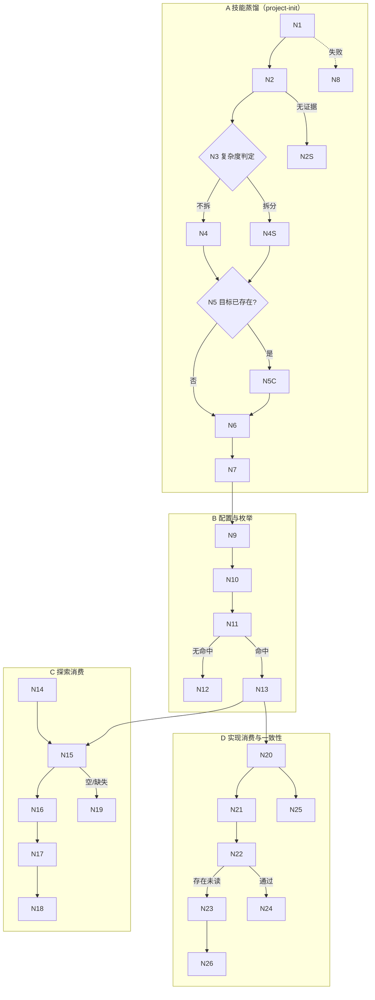

## Context

项目当前有两套「项目级约束」载体：`.iagent/rules/*.md`（规则行，由 `iagent rules --json` 枚举，探索 / 排查起点建立 `## 项目规则基线`，apply 回执记 `rulesRead`）与 `docs/project/`（五类项目知识文档）。两者都不承载「前端 / 后端框架专属的设计与实现规范技能」，也缺少配置声明与蒸馏机制。

既有可复用事实（CodeGraph / 代码证据）：

- 配置解析：`parseProjectConfig` / `readProjectConfig`（`src/core/project-config.ts:602` / `:694`），逐行解析、段替换、不重序列化。
- 枚举命令范式：`collectRuleSources`（`src/commands/rules.ts:39`，含 `sha256` / `lines` / `describeSource`）。
- 技能注册表为静态：`WORKFLOW_PAIRS`（`src/core/templates/registry.ts:97-123`），故项目技能不能注册为宿主技能，只能作为文件载体由消费者 `Read`。
- 模板双轨：impl 技能（project-init / workflow / auto-workflow / debug）为「skill 正文 + 手写 command 正文」两处，必须同步；spec-* 指令由 `deriveCommandContent` 派生。
- 蒸馏既有纪律：`project-init` 第 10 步（`project-init.ts:277-290`）——证据驱动、零猜测、非阻断、人工域保护。
- 技能大小预算：主 `SKILL.md` ≤ 500 行（`test/skill-size-budget.test.ts`），新增内容超限须下沉 `references/`。

流程基准（来自 `exploration.md` 的 `## 功能流程图`，经用户确认，2026-11-09）：

节点映射见 `exploration.md` 的节点清单表（N1-N26），design 不重定义流程语义。

## Goals / Non-Goals

**Goals**:

- 提供 `.iagent/config.yaml` 的 `skills:` 声明契约与项目技能文件载体（`.iagent/skills/<name>.md` + 宿主目录回退）。
- 提供 `iagent skills --json` 确定性枚举，使技能加载可审计（路径 / 存在性 / sha256 / frontmatter）。
- 在 `project-init` 中按框架证据蒸馏前端 / 后端技能，默认每侧一份、复杂时拆分。
- 在探索 / 实现阶段加载技能并落盘（`## 项目技能基线` / `skillsRead`），新增 `skills-not-read` 一致性诊断。
- 全部新增能力保持跨宿主一致、非破坏、可降级（无配置 / 缺失 / 失败均不阻断）。

**Non-Goals**:

- 不把项目技能注册为宿主原生技能（不做动态 `Skill(...)` 授权）。
- 不内置任何前端 / 后端框架预设或档案；框架判定必须来自项目证据。
- 不扩展 `migration` / `feature-doc` / `review` 的消费行为。
- 不为 `iagent config` 增加交互式技能勾选（首版只读配置 + 手工编辑 + 蒸馏自动注册）。
- 不修改既有 `rules` / `workflows` / `tools` / `compileCheck` / `testGate` 的解析语义。

## Decisions

### D1: 项目技能以文件为载体，`Read` 加载

- **选择**: 默认 `.iagent/skills/<name>.md`；缺失时按生效 `tools` 顺序回退宿主 `<skillsDir>/skills/<name>/SKILL.md`。`.iagent` 优先，不合并。
- **理由**: `allowed-tools` 在生成期固定，任意外部技能无法预写 `Skill(...)` 条目；文件载体与既有 rules 范式同构、跨宿主一致、可版本化审计。
- **备选**: 宿主动态 `Skill` 委派（白名单不可预授权）；两者皆可（解析与回执模型翻倍）。

### D2: 配置采用 `skills:` 分组段

- **选择**: `skills:` 下按 `frontend` / `backend` 分组，条目为裸名；技能文件 frontmatter 声明 `phases`（缺省 `both`）与可选 `scope` / `frameworks`。
- **理由**: 与现有极简逐行解析器兼容；裸名 + frontmatter 将阶段语义放在文件侧，避免 YAML 对象列表。
- **备选**: 扁平对象列表（需引入 YAML 对象解析）；复用 `rules:`（语义混淆）。

### D3/D7: 蒸馏产物形态与拆分判据

- **选择**: 默认每侧一份（`frontend-design.md` / `backend-design.md`，含设计与实现两段，`phases: both`）；满足任一判据时拆分为 `<side>-design.md` + `<side>-implement.md`：同侧 ≥2 框架 / 后端 ≥3 分层族 / 单段超约 150 行；判据与结论记入报告。
- **理由**: 兼顾文件数量与准确性；判据可在报告中复核。
- **备选**: 固定不拆（文档可能过长）；总是拆（文件与配置噪音）。

### D4: 蒸馏复用既有纪律

- **选择**: 证据驱动、零猜测（候选 ≠ 使用）、无证据不生成该侧、非阻断 WARN、已存在逐份确认 + 人工域保护；`iagent update` 不重建，仅检测缺失并提示。
- **理由**: 与 `project-init-rule-distill` / `docs/project` 增量对齐语义一致，降低用户认知负担。
- **备选**: 静默覆盖（丢失手写内容）；首次生成后不再更新（框架演进后过期）。

### D5/D11: 消费强度与失败边界

- **选择**: 探索写 `## 项目技能基线`；apply 回执 `skillsRead`；配置声明且 `exists=true` 但未读 → `skills-not-read` fail；配置为空 / 文件缺失 → WARN 不阻断；同名时 `.iagent` 优先（冲突 WARN，不合并）。
- **理由**: 与 `rules-not-read` 同构，口径可预期；把「配置漂移」与「读取失败」分开处置，避免误阻断。
- **备选**: 仅提示不做门（弱约束）；缺失也 fail（配置漂移卡死流程）；读取失败静默跳过。

### D8/D9/D10: 注册、基线与命令

- **选择**: 蒸馏成功自动注册 `skills:`（幂等、保留注释与未知段）；探索文件新增并列段 `## 项目技能基线`，handoff `## 规范要点` 追加「技能要点」子节；新增 `iagent skills --json`，同步 completion 表与 version 信号；范围限定为用户点名的 6 个技能 + 新命令。
- **理由**: 让「注册 → 枚举 → 加载 → 校验」形成闭环；并列段保持来源可区分。
- **备选**: 不自动注册（易遗忘）；扫描目录自动发现（绕过配置）；不做 CLI（重复解析、无 sha256）。

### D12: 内容完整性自检门（防「生成后技能不完整」）

- **选择**: 蒸馏写入前执行 C1-C6 自检——① frontmatter 必填（`name` / `description` / `phases` / `scope` / `source`）；② 7 个必需章节齐全（`框架与版本` / `目录与分层` / `设计规范` / `实现规范` / `约定与禁止项` / `证据索引` / `不适用项`，无内容须写「不适用 + 探测依据」）；③ 每条规则带证据锚点；④ 无占位符；⑤ 与 `.iagent/rules` 冲突显式标注；⑥ 超长（>约 300 行）拆分或下沉。写不完整则 MUST NOT 落盘，报告列出缺失项。`iagent skills --json` 同步输出 `validation`；探索基线记录状态，`incomplete` 记 WARN；apply 回执 `skillsIncomplete`；诊断 `skills-incomplete` 仅 WARN。
- **理由**: 「先写后补」会让不完整技能进入消费链且无信号；把完整性前移到写入前自检 + 枚举期校验 + 消费期告警三层，使缺失可见、可定位、可阻断写入。
- **备选**: 只靠 AI 自觉（不可审计）；写入后由用户手工检查（发现过晚）；`incomplete` 判 fail（配置漂移/证据不足场景会误阻断）。

### D13: 阶段感知加载与跨阶段透传

- **选择**: 探索 / 修复的**设计阶段**只加载 `phases` 含 `design|both` 的技能；**实现阶段**（apply 与 debug fix）只加载 `phases` 含 `implement|both` 的技能；`skills-not-read` 只统计 implement/both。`spec-propose` 读取 exploration 的 `## 项目技能基线` 生成 handoff 技能要点（不重新枚举；缺失时 WARN + 枚举一次）。`workflow` / `auto-workflow` 在 Phase 1 透传基线状态、Phase 4 核对 `skillsRead` / `skillsIncomplete`。
- **理由**: 拆分的 design/implement 文件按阶段归属；若不分阶段，`skills-not-read` 会误要求 apply 读取 design-only 技能，或让设计阶段依赖实现专有规范，导致调用链误判。
- **备选**: 所有阶段加载全部技能（误用阶段、门误判）；由各技能自行解释 `phases`（口径漂移）。

## Risks / Trade-offs

| 风险 | 缓解 |
|------|------|
| `spec-explore` 主 SKILL.md 接近 500 行预算，新增检查点可能超限 | 技能基线细则下沉 `references/skill-baseline.md`，主文件只保留检查点骨架与指针；`test/skill-size-budget.test.ts` 回归 |
| impl 技能为 skill + command 双轨手写，改一处易漏 | 改动清单逐文件覆盖两处正文；`test/templates.test.ts` / `test/template-consistency.test.ts` 断言 |
| 极简配置解析器不支持对象列表 / 嵌套 | `skills:` 只支持两级列表（组头 + 裸名条目），复用 `readListSection` 思路扩展；非法条目跳过 + WARN |
| frontmatter 解析引入新依赖或复杂度 | 复用现有 frontmatter 读取方式（仅取 `phases` / `scope` / `frameworks` 简单键）；非法即 WARN 计未读 |
| 宿主回退查找在无该宿主的项目产生噪音 | 仅在生效 `tools` 范围内查找；全部未命中只 WARN，不 fail |
| 蒸馏产物质量参差（AI 语义产物） | 证据引用 + 零猜测 + 人工域 + 逐份确认；C1-C6 自检门在写入前阻断不完整文档；报告记录判据与证据位置 |
| 完整性校验与蒸馏自检口径漂移（两处各写一套） | 必需章节名与占位符清单收敛为共享常量（`project-skills.ts` 单一源），蒸馏正文与 `iagent skills` 校验均引用同一常量 |
| 自检过严导致项目无法生成技能 | 「不适用 + 探测依据」为合法通过路径；证据不足时明确不生成该侧并在报告说明，MUST NOT 用占位内容凑数 |
| 新增 CLI 命令改变安装/补全契约 | 同步 `src/cli/index.ts`、`src/commands/completion.ts` 的 `IAGENT_COMMANDS`、`collectFileSignals` 版本信号与对应测试 |
| 既有 `references/exploration-protocol.md` 与源模板存在漂移（缺 1.1.1 规则基线节） | 本变更不改该节语义；生成快照时以源模板为准重建 references，并在验证报告中记录现状 |
