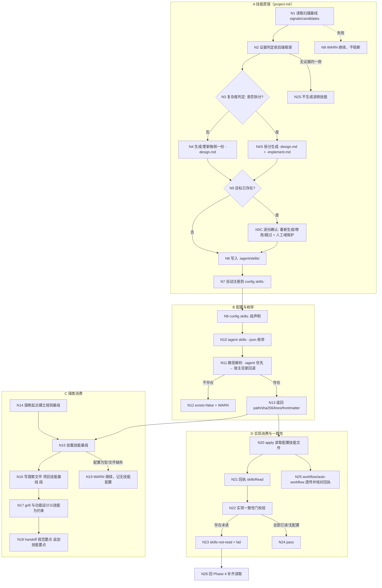

# 探索：前后端设计实现技能接入能力

## Background

用户原始需求（逐字）：

> 新增用于项目前端、后端设计实现的技能处理使用能力；在explore/workflow/auto-workflow/debug探索阶段，进行功能设计；在apply/workflow/auto-workflow/debug实现阶段按照技能设计和规范进行实现，确保功能实现与项目的一致性；
> 前端技能、后端技能接入方式：
> 1）在.iagent中增加技能配置，用于可以配置自定义前后端技能，在探索、实现功能时，根据配置自动加载对应技能
> 2）增加技能蒸馏实现能力，在project-init时，根据项目前后端框架，自动生成符合项目的前后端框架设计实现技能，用于项目功能探索发现、功能实现实现

参数：`/iagent:workflow`（引导式一站式工作流），本探索为 workflow Phase 1 委派（`mode=delegated`）。

## 提示词基线 (Prompt Baseline)

**原始提示词**: 见 Background 段逐字原文。

**确认后的提示词基线**: 原始提示词（清晰输入，一句话复述理解后直通，未做优化改写）。

> 下游（提案 / 设计 / 规格 / 任务）以提示词基线为唯一语义来源；基线若变更 MUST 回到 1.1.2 重新确认。

一句话复述：为 iagent 增加「项目级前端/后端设计实现技能」接入能力——① 在 `.iagent` 配置中声明自定义前后端技能，探索与实现阶段按配置自动加载使用；② 在 `project-init` 时按项目实际前后端框架「蒸馏」生成本项目的设计/实现技能，供后续 explore / workflow / auto-workflow / debug 的功能设计与实现阶段消费，保证实现与项目一致性。

## 功能流程图

| 节点 | 操作 | 触发条件 | 证据位置 | 异常路径 |
| :--- | :--- | :--- | :--- | :--- |
| N1 | 读取扫描基线 `signals` / `candidates` | project-init 执行第 1 步 | `project-init.ts:170-177` | 基线缺失 → Glob/Grep 降级（`:177`） |
| N2 | 证据判定前后端框架（候选 ≠ 使用） | 第 2 步语义扫描后 | `project-init.ts:179-190`；[新建] 步骤 11 复用判定 | 证据不足 → N2S 不生成 |
| N2S | 无证据的一侧不生成技能 | N2 判无证据 | [新建] `project-init.ts` 步骤 11 | — |
| N3 | 复杂度判定（拆分/不拆） | N2 有证据 | [新建] 步骤 11 判据（Q7） | 判定依据记入报告 |
| N4 | 生成/更新每侧一份 `<side>-design.md` | 判不拆 | [新建] `.iagent/skills/<side>-design.md` | 写入失败 → N8 |
| N4S | 拆分生成 `<side>-design.md` + `<side>-implement.md` | 判拆（≥2 框架 / ≥3 分层族 / 段落 >150 行） | [新建] 同目录两文件，`phases` 分别 design/implement | 同上 |
| N5 | 检测目标是否已存在 | 写入前 | 复用 `project-init.ts:219-241` 的逐份确认分支 | — |
| N5C | 逐份确认 + 人工域保护 | N5 已存在 | `project-init.ts:228-241`（人工域标记） | 用户全跳过 → 正常结束 |
| N6 | 落盘 `.iagent/skills/` | 用户确认生成 | [新建] `writeFile` | 目录不可写 → N8 |
| N7 | 自动注册 config `skills:` | N6 成功 | [新建] `project-config.ts` 段回写（保留注释/未知段） | 回写失败 → WARN |
| N8 | WARN 并继续 | 任一步失败 | `project-init.ts:166`（非阻断约束） | — |
| N9 | `skills:` 段声明（蒸馏注册或用户手写） | 配置存在 | [新建] `parseProjectConfig` 扩展（`project-config.ts:602`） | 非法条目 → 跳过 + WARN |
| N10 | `iagent skills --json` 枚举 | 消费者请求 | [新建] `src/commands/skills.ts`，范式 `rules.ts:39` | CLI 不可用 → 技能直接解析 config 降级 |
| N11 | 路径解析：`.iagent/skills/<name>.md` → 宿主 `<tool.skillsDir>/skills/<name>/SKILL.md` | 枚举条目 | [新建] 解析函数；回退顺序 = 生效 `tools` 顺序 | 全部不存在 → N12 |
| N12 | `exists=false` + WARN | 解析无命中 | [新建] | 不 fail（D11） |
| N13 | 返回 path / sha256 / lines / frontmatter | 解析命中 | [新建] 同 `rules.ts:71-96` 的 describeSource | frontmatter 非法 → WARN + 计未读（N23） |
| N14 | 探索起点建立规则基线 | delegated 探索 1.1.1 | `spec-explore.ts:87-105` | 无规则源 → 继续 |
| N15 | 加载技能基线 | N14 之后、grill 之前 | [新建] `spec-explore.ts` 1.1.2；`debug.ts` 排查起点 | 配置为空 → N19 |
| N16 | 写探索文件 `## 项目技能基线` | N15 完成 | [新建] 探索文件段落 | 写入失败 → WARN |
| N17 | grill / 功能设计以技能为约束 | 探索追问与设计 | [新建] `spec-explore.ts` grill 段消费 | 无技能 → 按既有规则继续 |
| N18 | handoff `## 规范要点` 追加技能要点 | propose 生成 handoff | [新建] `spec-propose.ts` 规范要点节 | 技能缺失 → 只列规则源 |
| N19 | WARN 并记「无技能配置」 | 配置为空 / 文件缺失 | [新建] | 不阻断 |
| N20 | apply 读取配置技能文件 | 实现起点 | [新建] `spec-apply.ts` 实现前步骤 | 读取失败 → 计未读 |
| N21 | 回执 `skillsRead` | 实现收尾 | [新建] `spec-apply.ts` 回执 | 缺字段 → `invalid-receipt` |
| N22 | 实现一致性门校验 `skillsRead` | 实现验证 / 归档前 | [新建] `spec-verify` 一致性诊断；对齐 `rules-not-read` | — |
| N23 | `skills-not-read` = fail | 配置声明且存在但未读 | [新建] 诊断码 | → N26 |
| N24 | pass | 全部已读或无配置 | [新建] | — |
| N25 | workflow / auto-workflow 透传并核对回执 | 实现阶段委派 | [新建] `workflow.ts` / `auto-workflow.ts` Phase 4 | 回执无 skillsRead → WARN |
| N26 | 回 Phase 4 补齐读取 | N23 判 fail | [新建] 修复路径 | 重试 ≤3 |

> 确认后的流程图 = **流程基准**（独立于提案自身的交叉验证锚点）；未经用户确认的流程图 MUST NOT 作为提案的生成锚点。
>
> **流程基准确认**：已确认（2026-11-09，用户回复「确认」；链路 A/B/C/D，N1-N26）。

## Analysis (optional - if analysis run)

### Deep Analysis Trigger
- Triggered: Yes
- Reason: 需求新增配置段 + 新增蒸馏产物 + 修改 6 个既有技能模板（project-init / spec-explore / spec-apply / workflow / auto-workflow / debug），属「修改既有代码」
- Scope: `.iagent/config.yaml` 解析链（project-config.ts）、技能模板（workflows/*.ts）、注册表与生成链、CLI 命令表

### Security Findings
<!-- 无 -->

### Architecture Flow
- 模板层（`src/core/templates/workflows/*.ts`）→ 注册表（`registry.ts` 静态 20 项）→ 生成层（`command-generation/`）→ 安装（init/update）→ 运行时技能读取 `.iagent/` 配置与文件
- 确定性 CLI（`iagent rules`）与 AI 技能（project-init 蒸馏）分工：机械事实走 CLI，语义判定走技能

### Business Flow
- 配置声明 → 消费者加载 → 设计/实现按技能执行
- project-init 扫描 → 蒸馏技能文档 → 写 `.iagent/skills/` → 注册到 config → 后续阶段消费

### Identified Symbols
- `parseProjectConfig` / `readProjectConfig`（src/core/project-config.ts:602 / 694）：配置解析唯一入口
- `collectRuleSources`（src/commands/rules.ts:39）：枚举命令范式（含 sha256 / lines）
- `getProjectInitSkillTemplate`（src/core/templates/workflows/project-init.ts:148）：蒸馏落点
- `getSpecExploreSkillTemplate`（src/core/templates/workflows/spec-explore.ts:1258）：探索消费点
- `getSpecApplyChangeSkillTemplate`（src/core/templates/workflows/spec-apply.ts:269）：实现消费点
- `getSkillTemplates` / `getCommandTemplates`（src/core/templates/registry.ts:131 / 155）：静态注册表
- `buildSkeletonTemplate`（src/commands/generate.ts:54）：现有唯一的「配置 → 技能正文」注入点（context + rules）

### Impact Analysis（Phase 2.0 预扫描）

- **风险等级**：MEDIUM —— 无数据迁移、无破坏性命令；改动集中在配置解析、模板正文与新 CLI 命令
- **配置链**：`readProjectConfig` 17 个调用方（`generate.ts` / `config.ts` / `init.ts` / `update.ts`）；`parseProjectConfig` 4 个内部调用方；`replaceConfigSection` 3 个内部调用方（含 `writeWorkflowsToConfig` 16 个调用方经 `config.ts`）
- **模板链**：`getSkillTemplates` 48 个调用方（`registry` / `init` / `update` / `opencode-v2` / `scripts/generate-skills.mjs` 等）；改动 6 个模板后必须 `pnpm build && pnpm generate:skills`
- **新增面**：`src/commands/skills.ts`（CLI 注册 + completion `IAGENT_COMMANDS` 表 + version `collectFileSignals` 信号）；`iagent skills --json` 输出契约
- **测试面**：`test/project-config-*.test.ts`、`test/rules-command.test.ts`（范式参照）、`test/templates.test.ts`、`test/allowed-tools.test.ts`、`test/skills-parity.test.ts`、`test/completion-config.test.ts`
- **跨阶段**：handoff 包 `## 规范要点` 新增「技能要点」子节；apply 回执新增 `skillsRead`；一致性诊断新增 `skills-not-read`（需与 `rules-not-read` 共存）

## Codebase Findings (NEW)

### Discovered Files

- `src/core/project-config.ts`：`config.yaml` 极简解析（context / rules / workflows / tools / compileCheck / testGate），逐行段替换、不重序列化 —— 新增 `skills` 段的落点
- `src/commands/rules.ts`：`iagent rules --json` 枚举规则源（config / rules/*.md / CLAUDE.md / AGENTS.md），含 exists / bytes / sha256 前 12 位 / lines —— 新增 `iagent skills` 的范式
- `src/core/templates/workflows/project-init.ts:148`：项目初始化技能，10 步流程；第 10 步为规则蒸馏（证据不足补扫、写人工域、非阻断）
- `src/core/templates/workflows/spec-explore.ts:87-105`：delegated 探索的 1.1.1 项目规则基线强制检查点（`iagent rules --json` + `## 项目规则基线` 段）
- `src/core/templates/registry.ts:97-123`：20 个内置技能的静态注册表（编译期固定，无运行时动态注册）
- `src/core/templates/types.ts:22-48`：`SkillTemplate`（name / instructions / allowedTools / type / references）
- `src/commands/generate.ts:54-95`：唯一「配置 → 技能正文」注入点（context + 该类型 rules）
- `src/core/profiles.ts:53-62`：`DEPS` 依赖注入表（静态）
- `openspec/specs/project-init-rule-distill/spec.md`：规则蒸馏既有契约（人工域保护、零猜测、候选≠使用、非阻断）
- `openspec/specs/rule-baseline/spec.md`：规则基线契约（枚举 → 探索段落 → handoff `## 规范要点` → apply `rulesRead` + `rules-not-read`）

### Identified Symbols

- `parseProjectConfig` / `readProjectConfig`（src/core/project-config.ts:602 / 694）：配置解析唯一入口
- `collectRuleSources`（src/commands/rules.ts:39）：枚举命令范式
- `getProjectInitSkillTemplate`（src/core/templates/workflows/project-init.ts:148）：蒸馏落点
- `getSpecExploreSkillTemplate`（src/core/templates/workflows/spec-explore.ts:1258）：探索消费点
- `getSpecApplyChangeSkillTemplate`（src/core/templates/workflows/spec-apply.ts:269）：实现消费点
- `getWorkflowSkillTemplate` / `getAutoWorkflowSkillTemplate` / `getDebugSkillTemplate`：编排消费点
- `getSkillTemplates` / `getCommandTemplates`（src/core/templates/registry.ts:131 / 155）：静态注册表
- `buildSkeletonTemplate`（src/commands/generate.ts:54）：现有唯一的配置注入范式

### Pattern Matches

- **规则基线范式**：确定性 CLI 枚举 + 探索文件落盘段 + handoff 摘要 + 回执读取清单 + 一致性诊断（可直接复用于「技能基线」）
- **人工域标记范式**：`<!-- 人工域:开始 -->` / `<!-- 人工域:结束 -->`（docs/project 与 rules 已落地）
- **蒸馏范式**：project-init 第 10 步（证据驱动、零猜测、非阻断、人工域）
- **配置注入范式**：generate.ts 注入 context + 类型 rules；运行时技能自行读 config
- **静态白名单约束**：`allowedTools` 在生成期固定，`Skill(...)` 条目只能枚举已知 canonical 技能 ID —— 任意外部技能的动态委派无法预授权

### Capability Exploration Memory (injected)

- **project-init-rule-distill**：蒸馏时点 = 文档 → AGENTS.md → context → rules；写人工域；候选依赖 ≠ 使用；非阻断
- **rule-baseline**：explore / debug 起点建 `## 项目规则基线`；propose handoff 多源 `## 规范要点`；apply 回执 `rulesRead`，未读 → `rules-not-read` fail
- **skill-profile**：静态注册表 + 默认集 + DEPS；动态技能不属注册表，须独立载体
- **workflow-suite-skills**：impl 技能模板为 skill + command 双轨，改正文须双处同步；白名单按实放行
- **inline-propose-apply-parallel**：workflow / auto-workflow / debug 已移除 `Agent` / `Task`，实现阶段主 agent 内联
- **improve-impl-conformance-and-test-gate**：归档前只读 compile / test / conformance 三类证据；规则基线在探索/排查起点建立并透传

## Questions

### 批量 1（L1-L3 需求澄清）

**Q1（技能载体）**：`.iagent` 配置里声明的「自定义前后端技能」指向什么？
- 选项 A（AI 建议）：项目内技能文档文件 —— 默认 `.iagent/skills/<name>.md`，也允许配置相对/绝对路径；消费者用 `Read` 加载。跨宿主机一致，不受静态 `allowed-tools` 限制。
- 选项 B：宿主已安装技能名（如 `.claude/skills/<name>`），经 `Skill` 工具委派。问题：`allowedTools` 生成期固定，任意外部技能无法预先写 `Skill(...)` 条目。
- 选项 C：两者皆可（配置项带 `type: file | skill`），复杂度上升。
- **用户裁决（2026-11-09）**：默认 `.iagent/skills/<name>.md`；若该文件不存在，按生效的 agent 工具类型在对应宿主技能目录中查找同名 skill（`.claude` / `.pi` / `.codex` / `.opencode` 等）。

**Q2（配置形态）**：`config.yaml` 新增段的结构？
- 选项 A（AI 建议）：`skills:` 下按角色分组（`frontend:` / `backend:`），每项 `- <name>`；技能文件 frontmatter 声明 `phases: design | implement | both`，消费者按阶段筛选。
- 选项 B：扁平列表，每项带 `scope` / `phases` 字段（YAML 对象列表，解析复杂度高，与现有极简解析器不匹配）。
- 选项 C：复用 `rules:` 段扩展（语义混淆，不建议）。
- **用户裁决（2026-11-09）**：确认 —— 采纳 A。

**Q3（蒸馏产物形态）**：project-init 蒸馏出的技能是什么、生成几份？
- 选项 A（AI 建议）：每侧一份技能文档 `.iagent/skills/frontend-design.md` 与 `backend-design.md`；每份内含「设计要点」与「实现规范」两段，frontmatter `phases: both`；多框架项目（如 JSP + Vue）在同一文档内按框架分节并在 frontmatter 列 `frameworks`。
- 选项 B：每侧拆两份（`frontend-design.md` + `frontend-implement.md`），阶段隔离更彻底、文件更多。
- 选项 C：按框架各一份（`vue-design.md`、`spring-design.md`…），最细粒度、消费者匹配最复杂。
- **用户裁决（2026-11-09）**：默认 A（每侧一份）；项目内容/设计较复杂时允许拆分为设计与实现两份，以保证技能准确性（拆分判据见批量 2 Q7）。

**Q4（蒸馏纪律）**：生成/重生成的保护与幂等？
- 选项 A（AI 建议）：完全复用 project-init 既有纪律 —— 证据驱动、零猜测（候选依赖 ≠ 使用）、无证据不生成该类、非阻断 WARN、已存在文件走「确认重新生成 / 修改 / 跳过」、人工域标记保护；`iagent update` 不做确定性重建（AI 语义产物），仅检测缺失并提示。
- 选项 B：每次 project-init 静默覆盖（简单但会丢用户手写内容）。
- 选项 C：首次生成后永不再生成（避免覆盖，但框架演进后技能过期）。
- **用户裁决（2026-11-09）**：确认 —— 采纳 A。

**Q5（消费强度与一致性）**：探索 / 实现阶段如何加载与校验？
- 选项 A（AI 建议）：探索起点在规则基线之后加载配置技能，写探索文件 `## 项目技能基线`（源 / 存在 / 已读 / 关键约束），grill 与设计以其为约束；实现起点读取并写入回执 `skillsRead`；配置声明且文件存在的未读 → 一致性诊断 `skills-not-read` fail（对齐 `rules-not-read`）；配置为空 / 文件缺失 → WARN 继续，不阻断。
- 选项 B：仅提示加载，不做回执与门（弱约束，形同虚设）。
- 选项 C：未读直接阻断（配置漂移会导致流程卡死）。
- **用户裁决（2026-11-09）**：确认 —— 采纳 A。

### 批量 2（L4-L5 边界 / 冲突）

**Q6（单侧缺失与多框架）**：纯后端项无前端内容、或同仓多前端框架时如何处理？
- A（AI 建议）：无对应侧证据 → 不生成该侧技能（不生成空壳）；多框架 → 同侧一份文档内按框架分节，frontmatter 列 `frameworks`；不做「每框架一文件」。
- B：总是两侧都生成占位技能。
- C：多框架拆成每框架一份。
- 结论：[待确认]

**Q7（拆分判据）**：Q3 的「复杂时拆分」以什么为准？
- A（AI 建议）：由 project-init 依证据判定 —— 同侧 ≥2 个框架，或后端 ≥3 个分层/模块族，或设计要点与实现规范任一超约 150 行 → 拆为 `<side>-design.md` / `<side>-implement.md`（frontmatter `phases: design` / `implement`），并在报告中记录判据与结论。
- B：固定不拆（简单，可能过长）。
- C：总是拆（文件多）。
- 结论：[待确认]

**Q8（注册与发现）**：蒸馏产物是否自动写入 `config.yaml` 的 `skills:`？消费者是否发现未注册文件？
- A（AI 建议）：project-init 自动追加注册（段替换、保留注释与未知段，幂等）；消费者只认 `skills:` 配置（显式）；未注册的 `.iagent/skills/*.md` 不自动加载。
- B：不自动注册，由用户手填（易遗忘）。
- C：消费者扫描目录自动发现（绕过配置，与「配置接入」意图冲突）。
- 结论：[待确认]

**Q9（与规则基线 / handoff 的关系）**：技能基线放哪、如何跨阶段传递？
- A（AI 建议）：探索文件新增并列段 `## 项目技能基线`（不并入规则基线段）；propose 的 handoff `## 规范要点` 追加「技能要点」子节并标来源路径；apply 读取原技能文件并记 `skillsRead`。
- B：并入 `## 项目规则基线` / handoff `## 规范要点`（来源不可区分）。
- C：不跨阶段传递，各阶段自行读取（重复加载、无一致性校验）。
- 结论：[待确认]

**Q10（CLI 与范围）**：是否新增枚举命令、变更范围到哪？
- A（AI 建议）：新增 `iagent skills --json`（配置条目 + 解析路径 + exists / sha256 / lines + frontmatter scope/phases/frameworks）；同步 completion 命令表与 version 信号；范围只含用户点名的 explore / apply / workflow / auto-workflow / debug + project-init；不扩到 migration / feature-doc / review；首版不加入 `iagent config` 交互。
- B：不做 CLI，技能直接解析 config（无 sha256、各技能重复实现解析）。
- C：扩到全部工作流并加交互配置（范围膨胀）。
- 结论：[待确认]

**Q11（冲突与失败处置）**：同名 / 缺失 / 读取失败如何判定？
- A（AI 建议）：同名时 `.iagent/skills/<name>.md` 优先于宿主目录回退，不合并内容（发现冲突记 WARN）；配置声明但文件缺失 → `exists=false` + WARN（不计入未读，不 fail）；文件存在但读取失败 / frontmatter 非法 → WARN 且计入未读 → `skills-not-read` fail；配置为空 → 「无技能配置」合法终态，不阻断。
- B：缺失也 fail（配置漂移即卡死）。
- C：读取失败静默跳过。
- 结论：[待确认]

## 术语表 (NEW)

| 术语 | 定义 | 避免使用 |
|------|------|---------|
| 项目技能配置（project skill config） | `.iagent/config.yaml` 的 `skills:` 段：按 `frontend` / `backend` 分组的技能条目列表，是运行时加载的唯一声明真源 | 技能清单、skills 配置项（口语） |
| 项目技能（project skill） | 以 Markdown 文档承载的设计/实现规范；默认 `.iagent/skills/<name>.md`，缺失时回退宿主技能目录同名 skill | 技能文件（未区分载体）、外部技能 |
| 技能基线（skill baseline） | 探索 / 排查起点加载的配置技能集合及其存在性、读取状态与关键约束摘要，落探索文件 `## 项目技能基线` | 技能清单（未含读取状态）、技能索引 |
| 技能蒸馏（skill distillation） | project-init 依项目前后端框架证据生成项目技能文档的语义产出过程；确定性 CLI 不承担 | 技能生成（歧义，泛指模板生成）、技能拷贝 |
| 技能回退查找（skill fallback lookup） | 路径解析顺序：`.iagent/skills/<name>.md` 优先，未命中则按生效 `tools` 顺序在宿主 `<skillsDir>/skills/<name>/SKILL.md` 查找 | 自动发现（指无配置扫描目录） |
| 技能拆分（skill split） | 项目复杂时把单侧技能拆为 `<side>-design.md`（`phases: design`）与 `<side>-implement.md`（`phases: implement`） | 技能分层、分文件（口语） |

## 架构决策 (NEW)

无 ADR —— 已复核 ADR 三条件（难以逆转 / 缺乏上下文会令人意外 / 存在真实权衡）：D1 的技能载体选择虽有真实权衡，但载体可替换（配置与解析层独立），且已有同构先例（`.iagent/rules/*.md` 的规则基线），不满足「难以逆转」与「令人意外」门槛；决策过程保留在 `## Decision Process`。

## 边界场景 (NEW)

- [ ] 纯后端项目无前端内容 → 不生成前端技能，不造空壳
- [ ] 同仓多前端框架（如 JSP + Vue）→ 同侧文档内分框架分节，frontmatter 列 `frameworks`
- [ ] 项目复杂 → 拆分为 design / implement 两份，判据与结论记入报告
- [ ] 配置声明但文件不存在 → `exists=false` + WARN，不阻断
- [ ] 文件存在但读取失败 / frontmatter 非法 → 计入未读 → `skills-not-read` fail
- [ ] `.iagent` 与宿主目录同名 → `.iagent` 优先，发现内容冲突记 WARN，不合并
- [ ] 蒸馏写入失败 / 目录不可写 → WARN 继续，不中断 project-init
- [ ] 用户对已存在技能全部选择「跳过」→ 流程正常结束
- [ ] 配置为空 / 无 `.iagent/skills/` → 「无技能配置」合法终态
- [ ] 非 Claude 宿主（Pi / Codex / OpenCode）→ 同一套文件载体与回退顺序，不写宿主专属语义

## Decision Process (NEW)

### Decision: 项目技能载体（文件 vs 宿主动态技能）

**Options Considered**:
- Option A: 项目内 Markdown 技能文档（`.iagent/skills/<name>.md`），消费者 `Read` 加载
- Option B: 宿主已安装技能名，经 `Skill` 工具委派
- Option C: 两者皆可（`type: file | skill`）

**Pros/Cons**:
- Option A: 跨宿主一致、不受静态 `allowed-tools` 限制、可版本化与审计；缺点：不是宿主的可发现技能，需显式加载
- Option B: 复用宿主技能机制；缺点：生成期白名单固定，任意外部技能无法预授权，且各宿主安装状态不一致
- Option C: 覆盖最广；缺点：解析与回执模型翻倍

**Chosen**: Option A
**Rationale**: 静态 `allowed-tools` 无法为任意用户技能预写 `Skill(...)` 条目；文件载体与既有 `rules` 范式同构，且用户明确要求「缺失时回退宿主目录查找」作为补充通道。

## Decisions

- **D1 技能载体**：默认 `.iagent/skills/<name>.md`；该文件不存在时按生效 agent 工具类型在对应宿主技能目录查找同名 skill（`.claude` / `.pi` / `.codex` / `.opencode`）。`.iagent` 优先于宿主回退。
- **D2 配置形态**：`config.yaml` 新增 `skills:` 段，按 `frontend` / `backend` 分组，条目为裸名；技能文件 frontmatter 声明 `phases: design | implement | both`（及可选 `scope` / `frameworks`）。
- **D3 蒸馏产物形态**：默认每侧一份 `frontend-design.md` / `backend-design.md`（内含设计要点 + 实现规范，`phases: both`）；项目复杂时允许拆分为设计与实现两份。
- **D4 蒸馏纪律**：证据驱动、零猜测（候选依赖 ≠ 使用）、无证据不生成该侧、失败非阻断 WARN、已存在走「确认重新生成 / 修改 / 跳过」、人工域标记保护；`iagent update` 不做确定性重建，仅检测缺失并提示。
- **D5 消费强度**：探索起点加载并写 `## 项目技能基线`；apply 读取并写回执 `skillsRead`；配置声明且存在但未读 → `skills-not-read` fail；配置为空 / 文件缺失 → WARN 继续。
- **D6 单侧缺失与多框架**：无证据的一侧不生成；多框架在同侧文档内分节，frontmatter 列 `frameworks`；不做每框架一文件。
- **D7 拆分判据**：同侧 ≥2 个框架，或后端 ≥3 个分层/模块族，或设计/实现任一段超约 150 行 → 拆为 `<side>-design.md` / `<side>-implement.md`；报告记录判据。
- **D8 注册与发现**：project-init 自动追加注册到 `skills:`（段替换、保留注释与未知段、幂等）；消费者只认配置，未注册的 `.iagent/skills/*.md` 不自动加载。
- **D9 基线与 handoff**：探索文件新增并列段 `## 项目技能基线`；handoff `## 规范要点` 追加「技能要点」子节并标来源；apply 读原文件并记 `skillsRead`。
- **D10 CLI 与范围**：新增 `iagent skills --json`；同步 completion 命令表与 version 信号；范围仅 project-init + explore / apply / workflow / auto-workflow / debug；不扩 migration / feature-doc / review；首版不加 `iagent config` 交互。
- **D11 冲突与失败处置**：同名时 `.iagent` 优先、不合并（冲突 WARN）；配置声明但文件缺失 → `exists=false` + WARN（不 fail）；存在但读取失败 / frontmatter 非法 → WARN + 计入未读 → `skills-not-read` fail；配置为空 → 合法终态。
- **D12 内容完整性自检门**（2026-11-09 修改周期补充）：蒸馏写入前执行 C1-C6 自检——frontmatter 必填、7 个必需章节齐全（无内容须写「不适用 + 探测依据」）、每条规则带证据锚点、无占位符、与既有规则冲突显式标注、超长拆分；自检不通过且无法补齐时 MUST NOT 写入该侧文档。`iagent skills --json` 输出 `validation`；探索基线记录完整性状态（`incomplete` WARN）；apply 回执新增 `skillsIncomplete`；诊断 `skills-incomplete` 仅 WARN。
- **D13 阶段感知加载与跨阶段透传**（2026-11-09 二次核验补充）：探索 / 排查设计阶段只加载 `phases` 含 `design|both`；实现阶段（apply 与 debug fix）只加载 `implement|both`；`skills-not-read` 只统计 implement|both，design-only 不要求读取。`spec-propose` 读取 exploration 的 `## 项目技能基线` 生成 handoff 技能要点（不重新枚举，缺失时 WARN + 枚举一次）；`workflow` / `auto-workflow` Phase 1 透传基线状态、Phase 4 核对回执。

## 硬约束 (NEW)

- 默认 `.iagent/skills/<name>.md`；文件不存在时按生效 agent 工具类型在对应宿主技能目录查找同名 skill — source: D1
- 消费者只认 `skills:` 配置；未注册的 `.iagent/skills/*.md` MUST NOT 自动加载 — source: D8
- 配置声明但文件缺失 MUST NOT 判 fail（`exists=false` + WARN）；存在但未读 MUST 判 `skills-not-read` fail — source: D11 / D5
- project-init 蒸馏任一步失败 MUST 记 WARN 并继续，MUST NOT 中断流程 — source: D4
- 无证据的一侧 MUST NOT 生成技能（禁止占位空壳） — source: D6
- 同名技能 MUST 以 `.iagent` 版本为准，MUST NOT 合并两份内容 — source: D11
- 自检不通过且无法补齐的一侧 MUST NOT 写入技能文档（禁止生成不完整技能） — source: D12
- 每条规则行 MUST 带证据锚点；无证据的规则 MUST NOT 写入 — source: D12
- 设计阶段只加载 `design|both`；实现阶段只加载 `implement|both`；`skills-not-read` MUST NOT 要求读取 design-only 技能 — source: D13

## Scope Changes (NEW)

| 变更时间 | 变更类型 | 变更描述 | 原因 |
|---------|---------|---------|------|
| 2026-11-09 | expand | 由「配置接入 + 蒸馏」扩展出 `iagent skills --json` 枚举命令与 `## 项目技能基线` / `skillsRead` / `skills-not-read` 一致性诊断 | 与既有 rule-baseline 范式对齐，使「加载」可审计、可校验 |

## Pending (enhanced)

### For Phase 2 Impact Analysis
- `parseProjectConfig` / `readProjectConfig`（`src/core/project-config.ts:602` / `:694`） - Priority: HIGH
- `getProjectInitSkillTemplate`（`src/core/templates/workflows/project-init.ts:148`） - Priority: HIGH
- `getSpecExploreSkillTemplate`（`src/core/templates/workflows/spec-explore.ts:1258`） - Priority: HIGH
- `getSpecApplyChangeSkillTemplate`（`src/core/templates/workflows/spec-apply.ts:269`） - Priority: HIGH
- `getWorkflowSkillTemplate` / `getAutoWorkflowSkillTemplate` / `getDebugSkillTemplate` - Priority: MEDIUM
- `collectRuleSources`（`src/commands/rules.ts:39`） - Priority: MEDIUM（枚举命令范式）
- `getSkillTemplates` / `getCommandTemplates`（`src/core/templates/registry.ts:131` / `:155`） - Priority: MEDIUM（模板白名单与快照）

### Security Concerns
<!-- 无 -->

### Business Validation
- 技能文档由蒸馏生成，内容可能含项目内路径与约定 —— MUST NOT 复制凭据值或绕过细节（沿用 project-init 安全扫描禁令）
- 宿主目录回退查找仅读 `SKILL.md`，不执行其中任何命令

### Unresolved Decisions
<!-- 无（批量 1 / 批量 2 均已裁决） -->

## Implementation Deep-Dive (条件性显示 — 深度分析触发时出现)

### Design Rationale
<!-- No findings -->

### Constraints
<!-- No findings -->

### Trade-offs
<!-- No findings -->

### Pattern Usage
<!-- No findings -->

### Historical Context
<!-- No historical data available -->

### Implicit Assumptions
<!-- No findings -->
