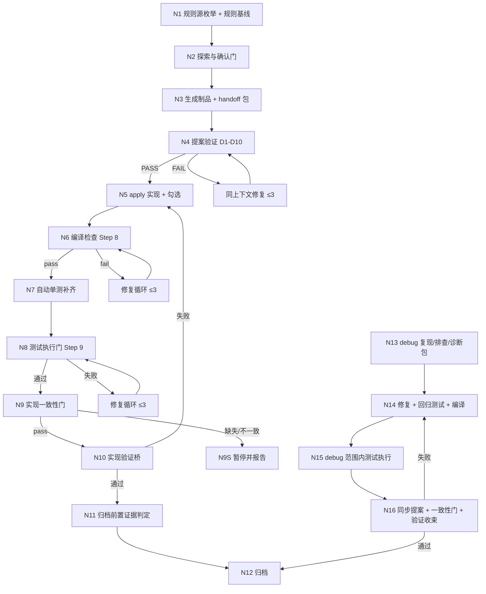

## Context

### 现状与问题

实现阶段的三个门（编译 / 测试 / 验证）中，只有编译门有可机器复核的证据（`compile-report.md`）。测试门只运行既有测试，验证门是 report-only 且以语义启发式为主：

- specs ↔ tasks 追溯：`buildTraceability` 只检查任务引用能否匹配 specs，且未覆盖 Scenario 仅 warning（`src/core/spec/validation/traceability.ts:121-150`、`src/core/spec/validation/artifact-validator.ts:48`）。
- 自动单测：仅在 tasks.md 预置 `[测试]` 任务时触发 `iagent_test`（`src/core/templates/workflows/spec-apply.ts:98-106`）；无任务时测试门无测试可跑。
- 规则读取：各技能只声明读 `coding-rules.md`，没有读取集合与完整性证据（`spec-apply.ts:275`、`spec-verify.ts:14`、`debug.ts:143`）。

### Architecture Impact（CodeGraph 影响面）

- `runSpecValidate` (`src/commands/spec.ts:447`) — 3 callers，测试 `test/markdown-spec-cli.test.ts` / `test/spec-commands.test.ts`；新增 `--conformance` 选项与 `conformance` 子命令均在此扩展。
- `validateParsedChange` (`src/core/spec/validation/artifact-validator.ts:21`) — 3 callers in `spec.ts`；由它透传一致性选项。
- `buildTraceability` (`src/core/spec/validation/traceability.ts:39`) — 2 callers；扩展 Requirement 级与测试任务覆盖判定，默认 severity 不变。
- `getSpecApplyChangeSkillTemplate` (`src/core/templates/workflows/spec-apply.ts:269`) — 4 callers；Step 8.11 / 9 / 9.5 / 10 扩展。
- `getSpecVerifyChangeSkillTemplate` (`spec-verify.ts:8`)、`getAutoWorkflowSkillTemplate` (`auto-workflow.ts:16`)、`getDebugSkillTemplate` (`debug.ts:138`)、`getSpecProposeSkillTemplate` (`spec-propose.ts:16`) — 各 4-5 callers（registry + 自身 command 派生）；均为正文扩展。
- `listRuleFiles` (`src/core/project-config.ts:864`) — 复用为规则源枚举的底层，不改变签名。
- `runConfigShow` (`src/commands/config.ts:89`) — 不修改；规则枚举走独立命令。

### 流程基准（引用探索文件 `## 功能流程图`，不重建）

| 节点 | 操作 | 证据位置 | 异常路径 |
| :--- | :--- | :--- | :--- |
| N1 | 规则源枚举 + 规则基线 | `src/commands/rules.ts`（新建）+ `spec-explore.ts` / `debug.ts` 正文 | 源缺失记「不存在」 |
| N2 | 探索与确认门 | `spec-explore.ts:56-544` | 拒绝流程图 → 提案降级 |
| N3 | 制品 + handoff 包（多源规范要点） | `spec-propose.ts:213-222` | 校验失败 → 修正重跑 |
| N4 | 提案验证 D1-D10 + B1-B7 | `auto-workflow.ts:82-118` | <90% → 修复 ≤3 |
| N5 | apply 实现 + 勾选 | `spec-apply.ts:54-131`、`683` | 任务失败 → 暂停 |
| N6 | 编译检查 | `spec-apply.ts:440-479` | fail → 修复 ≤3 |
| N7 | 自动单测补齐 | `spec-apply.ts` 新增 Step 8.11 | 无框架 → WARN |
| N8 | 测试执行门 + `test-report.md` | `spec-apply.ts:481-508` | 范围内失败 → 修复 ≤3 |
| N9 | 实现一致性门 + `conformance-report.md` | `src/core/spec/validation/conformance.ts`（新建） | fail → 暂停 |
| N10 | 实现验证桥 | `auto-workflow.ts:168-174`、`spec-verify.ts:87-124` | 失败 → N5 |
| N11 | 归档前置证据判定 | `auto-workflow.ts:184-190` | 证据缺失 → 暂停 |
| N12 | 归档 | `spec-archive.ts` | 目标存在 → 失败 |
| N13 | debug 复现 / 排查 / 诊断包 | `debug.ts:223-376` | 无证据 → 只报告候选 |
| N14 | 修复 + 回归测试 + 编译 | `debug.ts:401-443` | 测试失败 → 循环 |
| N15 | debug 范围内测试执行 | `debug.ts` 新增 Phase 5.5 | 失败 → 修复 ≤3 |
| N16 | 同步提案 + 一致性门 + 验证收束 | `debug.ts:446-513` | 失败 → N14 |

## Goals / Non-Goals

### Goals

1. 实现后能确定性回答「每条 Requirement / Scenario 是否被任务与测试覆盖、实现证据是否存在」。
2. 未规划 `[测试]` 任务时仍能自动补齐并执行单元测试，且测试结果可机器复核。
3. 探索与实现共享同一规则源集合，并校验读取完整性。

### Non-Goals

- 不做全仓库一致性审计（只判变更范围）。
- 不替代 `iagent_test` 的测试规则，也不改变编译门四值语义。
- 不追溯重判存量变更（默认严格度不变）。

## Decisions

### D0 单变更三能力域

三个能力域共享 apply / verify / auto-workflow 路径，合并为一个变更；specs 拆为 `spec-conformance` / `test-evidence-gate` / `rule-baseline` 三个新能力，并修改三个既有能力。

### D1 一致性三层判定

- **规划层**：Requirement 至少一个任务覆盖；Scenario 至少一个任务 + 至少一个 `[测试]` 任务覆盖。确定性判定基于 `Spec Ref` / `Scenario Ref` 与任务类型标签。
- **实现层**：已勾选 `[代码]` 任务的产出证据来自三源——`tasks.md` 的 `产出:` 字段、`git diff --name-only`（含未跟踪文件）、handoff 包 `## 已产出`。三源均无 → `missing-implementation-evidence`。
- **测试层**：Scenario 的 `[测试]` 任务必须存在，且其测试文件出现在 `test-report.md` 的 `scope` 中。
- 语义匹配**不**参与判定：缺引用就报缺引用，不猜测任务描述与需求的语义等价。

### D2 严格度与兼容

- `iagent spec validate` 默认不变；新增 `--conformance` 把 `untested-scenario` 升级为 error，并新增 `requirement-without-task` / `scenario-without-test`。
- `iagent spec conformance` 默认报告（exit 0），`--strict` 非零退出。
- apply / auto-workflow / debug 使用 `--strict`；存量变更（历史 JSON-only）降级为只读 + WARN。

### D3 一致性证据

`conformance-report.md` 固定九列：`change` / `requirement` / `scenario` / `coveringTasks` / `taskStatus` / `implementationEvidence` / `testEvidence` / `status` / `reason`，汇总行 `**summary**: status=<pass|fail>, requirements=<n>, scenarios=<n>, findings=<n>`。apply 写一次；父流程只读。

### D4 自动单测补齐

- 位置：Step 8 编译后、Step 9 测试门前（Step 8.11）。
- 输入：变更范围（`[测试]` 任务产出 + git diff + contextFiles 降级链）、已覆盖 Scenario 清单。
- 判定：`iagent_test` 2.1 不测清单；落入清单的目标留痕「已评估、不生成」。
- 默认开启；`.iagent/config.yaml` 的 `testGate.autoGenerate`（默认 `true`）为 `false` 时关闭，并在测试证据中记录「自动补测已由项目配置关闭」。
- 配置读取复用 `project-config.ts` 的解析模式；段缺失按默认 `true`。

### D5 测试证据

`test-report.md` 九列：`change` / `command` / `exitCode` / `passCount` / `failCount` / `status` / `scope` / `timestamp` / `reason`，汇总行 `**summary**: status=<pass|fail|not-applicable|disabled>, commands=<n>, totalPass=<n>, totalFail=<n>`。apply 与 debug 均写；父流程归档前判定。

### D6 debug 补强

Phase 5 后新增 Phase 5.5：运行改动文件对应既有测试 + 4.2 回归测试，写 `test-report.md`；失败共享 ≤3 修复预算。debug 不额外生成单测。

### D7 测试计划门处置

`iagent_test` 增加自动管线分支：`mode=delegated` 或门承载参数生效时，自动采用推荐计划、写证据、记 WARN；独立调用保持阻塞。

### D8 规则源范围

枚举 `.iagent/config.yaml`（context + rules）、`.iagent/rules/*.md`、`CLAUDE.md`、`AGENTS.md`。不读 `openspec/rules/*.md`（蒸馏源，历史 D-Q1）。

### D9 读取完整性

- 新增 `iagent rules --json`：每项 `{path, kind, exists, bytes, sha256, lines}`。
- 探索文件 `## 项目规则基线`：源清单 + 存在性 + 读取状态 + 关键约束。
- handoff `## 规范要点` 多源并标注来源。
- 阶段回执 `rulesRead`。
- 一致性门校验 `rulesRead ⊇ {exists=true 的源}`。

### D10 失败处置

源不存在 = 合法终态；存在但未读 = 一致性门 `fail`（`rules-not-read`）；读取异常 = WARN + 不计入 `rulesRead`（按未读处理）。

## Risks / Trade-offs

| 风险 | 缓解 |
|---|---|
| 严格一致性会让大量存量变更失败 | 默认 validate 不变；apply 只判当前变更；历史 JSON-only 降级 WARN |
| 自动补测显著拉长实现阶段 | 只对「有行为」且未被覆盖的改动文件生成；不测清单过滤；测试任务已覆盖则不重复 |
| `iagent_test` 不可用导致自动补测不可达 | WARN + 记录省略决策，测试门仍运行既有测试；MUST NOT 伪装 |
| 规则源读取膨胀上下文 | 规则基线只存摘要与路径；handoff `## 规范要点` 每源 ≤120 行、整体受六节预算 |
| 证据文件与真实执行不符（伪造） | 证据由 CLI / 实际命令输出填充；父流程按汇总行判定并保留文件供审计；测试门失败仍以命令退出码为准 |
| 新增 CLI 命令遗漏 completion 同步 | 按 AGENTS.md 修改守则第 3 条同步 `IAGENT_COMMANDS`，并加测试 |

## Migration

- 无破坏性变更。新命令与新证据文件均为增量。
- 存量变更首次运行一致性门时，若 tasks.md 缺 `Spec Ref` / `Scenario Ref`，会得到 `fail` 并提示补引用；这是严格模式的预期行为，可在接受前先补引用。
- `openspec/rules/*.md` 不再是运行时规则源，已有项目无需迁移（`.iagent/rules/` 早已是运行载体）。

## Testing Strategy

- 单元：`conformance.ts` 三层判定的纯函数测试（Requirement/Scenario 覆盖、缺产出证据、skip_specs、strict/默认）。
- CLI：`iagent spec conformance` 的 JSON/退出码、`validate --conformance` 的 severity 升级、`iagent rules --json` 的枚举与排除 `openspec/rules`。
- 模板：断言新步骤与证据文件名出现在 skill 正文、`allowedTools` 覆盖、command 派生一致性、行数预算。
- 回归：既有 `spec-workflow-skills` / `workflow-suite-skills` 测试不得因新增正文而失败；`pnpm build && pnpm generate:skills` 后 `skills-parity` 通过。
