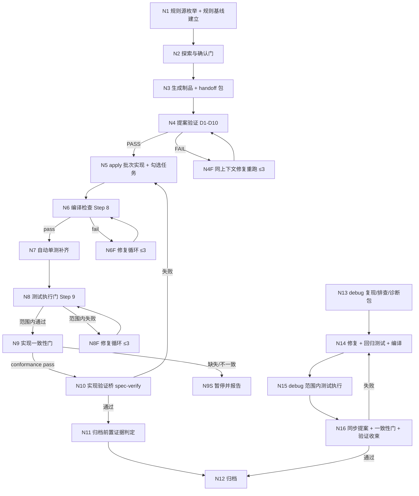

# 实现一致性 / 自动单测 / 项目规则读取完整性 — 探索记录

> 关键词：impl-conformance-test-gate（序号 001）
> 创建时间：2026-11-09

## Background

用户要求优化 `workflow` / `auto-workflow` / `debug` / `apply`（spec-apply）在功能实现阶段的能力：

1）功能实现后需要对提案中的 `specs` 与 `tasks` 做**完整对比**，验证实现一致性 —— 当前存在 tasks 已勾选完成、但实现与 specs 不一致的情况。
2）功能实现、debug 之后**单元测试能力薄弱**，缺少自动进行单元测试的能力。
3）功能探索、实现时检查对项目 `CLAUDE.md` / `AGENTS.md` / `.iagent` 等项目规则读取的**完整性**，防止实现功能时与项目约定出现偏移。

约束：本仓库模板改动须遵守 AGENTS.md 修改守则（模板单一源、白名单三层组合、`pnpm build && pnpm generate:skills`、版本号随功能提交）。

## 提示词基线 (Prompt Baseline)

**原始提示词**：优化 workflow\auto-workflow\debug\apply 功能实现时，功能时间完整性检查和单元测试能力优化：
1）功能实现后需要进行提案中 specs 与 tasks 任务完整对比，验证实现一致性，当前存在 tasks 实现与 specs 不一致情况；
2）功能实现、debug 后单元测试能力薄弱情况，缺少自动进行单元测试能力；
3）功能探索、实现时，检查对项目 claude、agents、iagent 等项目规则读取完整性检查，防止实现功能时对比项目出现偏移问题。

**确认后的提示词基线**：优化 `workflow` / `auto-workflow` / `debug` / `apply`（spec-apply）在功能实现阶段的三项能力：①实现后对 proposal 的 specs 与 tasks 做完整对比（规划层/实现层/测试层），验证实现一致性并阻断不一致；②实现与 debug 后具备自动补齐并执行单元测试的能力，产出可机器复核的测试证据；③探索与实现阶段枚举并校验项目规则源（CLAUDE.md / AGENTS.md / .iagent）的读取完整性，防止实现偏移。用户于 2026-11-09 整批确认 D0-D10。

> 下游（提案 / 设计 / 规格 / 任务）以提示词基线为唯一语义来源；基线若变更 MUST 回到提示词校验门重新确认。

**提示词校验结论**：目标 / 对象 / 范围明确（模板层 + 实现期门禁 + 测试能力 + 规则读取），细节级歧义（自动单测的触发边界、一致性判定的严格度）以 `[假设]` 记入 Questions 并纳入 grill 批量确认。

## 功能流程图



| 节点 | 操作 | 触发条件 | 证据位置 | 异常路径 |
| :--- | :--- | :--- | :--- | :--- |
| N1 | 枚举项目规则源（`.iagent/config.yaml`、`.iagent/rules/*.md`、`CLAUDE.md`、`AGENTS.md`）并在探索文件建立 `## 项目规则基线` | 探索起点 / debug Phase 1 起点 | [新建] `src/commands/rules.ts`（`iagent rules --json`）+ `spec-explore.ts:1236` 正文扩展 + `debug.ts:143` 正文扩展 | 源缺失 → 记「不存在」→ N2；读取失败 → WARN 并计入未读 |
| N2 | 提示词门 / grill 批量 / 功能流程图门 | Phase 1 | `spec-explore.ts:56-544` | 用户拒绝流程图 → 提案降级 → N3 记未确认 |
| N3 | 生成 proposal/specs/design/tasks + handoff 包（多源 `## 规范要点` + 制品清单） | Phase 2 | `spec-propose.ts:213-222` | 校验失败 → 修正重跑 |
| N4 | 提案验证 D1-D10 + B1-B7 | Phase 3 | `auto-workflow.ts:82-118`；`workflow.ts` 对应段 | <90% → N4F |
| N5 | apply 批次实现与任务勾选 | Phase 4 | `spec-apply.ts:54-131`、`spec-apply.ts:683` | 任务失败 → 串行重试 1 次 → 暂停 |
| N6 | 编译检查（证据 `compile-report.md`） | 全部任务完成 | `spec-apply.ts:440-479` | `fail` → N6F → 仍失败暂停 |
| N7 | 对变更范围内「有行为」生产文件补齐单测（先消费 tasks `[测试]` 任务，缺什么补什么） | 编译 pass 后 | [新建] `spec-apply.ts` Step 8.11 / `references/auto-test.md` + `test.ts` delegated 分支 | 无测试框架 → WARN 跳过；`iagent_test` 不可用 → WARN + 不伪装 |
| N8 | 测试执行门（仅变更范围） | N7 后 | `spec-apply.ts:481-508` | 范围内失败 → N8F；范围外存量失败仅 WARN |
| N9 | 实现一致性门：跑 `iagent spec conformance` + 校验 `rulesRead` 覆盖 + 写 `conformance-report.md` | N8 通过 | [新建] `src/core/spec/validation/conformance.ts`、`src/commands/spec.ts` 子命令、`conformance-report.md` | 缺失/不一致 → N9S 暂停；`skip_specs` → 跳过 specs 侧并标注 |
| N10 | 实现验证桥（只读 conformance/test 证据 + 制品） | N9 pass | `auto-workflow.ts:168-174`、`spec-verify.ts:87-124` | 失败 → N5 |
| N11 | 归档前置证据判定（compile + test + conformance 三证据） | N10 通过 | `auto-workflow.ts:184-190` + [新建] 证据读取扩展 | 证据缺失/`fail` → 暂停，MUST NOT 归档 |
| N12 | 归档 | N11 通过 | `spec-archive.ts:16-...` | 归档目标已存在 → 失败 |
| N13 | debug 复现 / 排查 / 诊断包 | `/iagent:debug` | `debug.ts:223-376` | 无证据 → 只报告候选 |
| N14 | 修复 + 回归测试（内联 `iagent_test`）+ 编译检查 | 诊断包确认 | `debug.ts:401-443` | 回归测试不通过 → 修复循环 |
| N15 | debug 范围内既有测试执行 + 产出 `test-report.md` | N14 编译 pass | [新建] `debug.ts` Phase 5.5 | 范围内失败 → 修复 ≤3 → 暂停 |
| N16 | 同步提案 + 一致性门 + 验证收束 | N15 通过 | `debug.ts:446-513` + [新建] conformance 消费 | 失败 → N14 |

> 确认后的流程图 = **流程基准**（独立于提案自身的交叉验证锚点）；未经用户确认的流程图 MUST NOT 作为提案的生成锚点。
> 提案 / 验证阶段发现遗漏节点 MUST 回到本段更新并重新确认，MUST NOT 在 tasks.md 中静默补节点。

## Analysis

### Deep Analysis Trigger

- Triggered: Yes
- Reason: 输入含「优化 / 修改」意图，且目标为既有 4 个技能模板 + 既有校验 / 测试链路（修改既有代码）
- Scope: `src/core/templates/workflows/{workflow,auto-workflow,debug,spec-apply,spec-explore,spec-verify,spec-propose,test}.ts`、`src/core/spec/validation/*`、可能的 CLI `iagent spec` 子命令扩展

### 现状链路（代码事实）

**实现期（apply）**
- `spec-apply.ts:275` 仅要求「实现前先阅读 `.iagent/rules/coding-rules.md`」，无读取完整性证据。
- `spec-apply.ts:481-508` Step 9 测试执行门：只**运行**变更范围内测试；无 `[测试]` 任务时不会生成测试。
- `spec-apply.ts:98-106` `[测试]` 任务才委派 `iagent_test`；测试产出依赖 tasks.md 是否预先规划。
- `spec-apply.ts:683-684` Guardrails 要求「仅当任务的 spec 行为**完整实现**后才勾选」，但无机器可核验的 spec↔实现对照，勾选是自证。

**提案期（propose）**
- `spec-propose.ts:215-222` handoff 包六节中 `## 规范要点` 只蒸馏 `coding-rules.md`，不含 `testing-rules.md` / `.iagent/rules/spec.md` / `CLAUDE.md` / `AGENTS.md`。
- `spec-propose.ts:283` 硬约束覆盖要求「至少一个 `[测试]` 任务覆盖」，但未要求每个代码任务配测试任务。

**规划校验（validate）**
- `traceability.ts:121-143` 每个 Scenario 未关联任务 → `untested-scenario`（`traceability.ts:148-150` **仅 warning**，不使 `valid=false`）。
- `artifact-validator.ts:48` `valid` 只看 `severity==='error'`；`spec.ts:537` 同。
- `traceability.ts:65-119` 只校验「任务引用的 Spec Ref / Scenario Ref 能否在 specs 中找到」，**不校验实现代码是否满足 Requirement/Scenario**。

**实现后验证（spec-verify）**
- `spec-verify.ts:14` 仅读 `.iagent/rules/coding-rules.md`。
- `spec-verify.ts:87-105` 需求→任务覆盖：语义匹配（specRef 精确 / 依赖链 / 描述语义），存在模糊判定空间。
- `spec-verify.ts:107-124` 需求→代码映射与场景覆盖：**启发式**（关键字检索 / 合理推断），`spec-verify.ts:220-226` 假阳性优先降级为 SUGGESTION/WARNING；**report-only**（`spec-verify.ts:24`），无 CRITICAL 时不阻断。
- auto-workflow Phase 4.4（`auto-workflow.ts:168-174`）调用该验证，「验证失败 → 回到 Phase 4」，但判定标准是 CRITICAL 计数，非量化覆盖率。

**debug**
- `debug.ts:409-428` 强制回归测试（内联 `iagent_test`），覆盖缺陷链路异常节点 + 根因节点 —— 单测能力相对最强。
- `debug.ts:437-443` Phase 5 仅编译检查，**无变更范围内测试执行门**；回归测试在 4.2 已跑，但未像 apply §9 一样汇总范围内既有测试。
- `debug.ts:143` 仅读 coding-rules.md。

**项目规则来源（现状盘点）**
- `.iagent/config.yaml`：`context` + `rules` 列表（当前 = impl/test）。
- `.iagent/rules/coding-rules.md`、`testing-rules.md`、`spec.md`（语义名映射见 `project-config.ts:315-317`）。
- 仓库根 `CLAUDE.md` / `AGENTS.md`：AI 代理导航与修改守则（`project-scan.ts:130` 仅作为文档探针存在，未进入技能读取契约）。
- `openspec/rules/*.md`（旧位置）与 `openspec/rules/artifact-generation.md`（历史制品生成协议）。
- 现状：没有任何技能记录「读了哪些规则源 / 是否存在 / 是否被遗漏」；`listRuleFiles()`（`project-config.ts:864`）已存在但没有 CLI/技能消费面。

### Identified Symbols

- `buildTraceability` (`src/core/spec/validation/traceability.ts:39`) — specs↔tasks 追溯校验唯一入口。
- `validateParsedChange` (`src/core/spec/validation/artifact-validator.ts:21`) — `iagent spec validate` 的判定核心。
- `runSpecValidate` (`src/commands/spec.ts:447`) — CLI 侧组装与退出码。
- `getSpecApplyChangeSkillTemplate` (`src/core/templates/workflows/spec-apply.ts:269`) — apply 协议单一源。
- `getSpecVerifyChangeSkillTemplate` (`src/core/templates/workflows/spec-verify.ts:8`) — 实现后验证协议。
- `getAutoWorkflowSkillTemplate` (`src/core/templates/workflows/auto-workflow.ts:16`) — 全自动编排。
- `getDebugSkillTemplate` (`src/core/templates/workflows/debug.ts:138`) — debug 编排。
- `getSpecProposeSkillTemplate` (`src/core/templates/workflows/spec-propose.ts`) — handoff 包与任务规划。
- `listRuleFiles` (`src/core/project-config.ts:864`) — 规则文件枚举能力（尚无消费面）。

## Codebase Findings

### Discovered Files
- `src/core/templates/workflows/spec-apply.ts`: 实现期协议（编译门 / 测试门 / 勾选规则）。
- `src/core/templates/workflows/spec-verify.ts`: 实现后一致性验证。
- `src/core/templates/workflows/auto-workflow.ts`: 全自动编排（Phase 3 验证 / Phase 4 实现 / Phase 5 归档）。
- `src/core/templates/workflows/debug.ts`: 调试闭环（回归测试 + 编译检查）。
- `src/core/templates/workflows/spec-propose.ts`: handoff 包六节 + 硬约束覆盖。
- `src/core/spec/validation/traceability.ts`: specs↔tasks 引用与场景覆盖。
- `src/core/spec/validation/artifact-validator.ts`: valid 判定。
- `src/core/project-config.ts`: 规则文件映射与 `listRuleFiles`。
- `.iagent/rules/{coding-rules,testing-rules,spec}.md`、`CLAUDE.md`、`AGENTS.md`: 规则源现状。

### Identified Symbols
- 见上节。

### Pattern Matches
- 编译门证据模式：`compile-report.md` + `**summary**:` 行 + 父流程只读判据（`spec-apply.ts:467-470`、`auto-workflow.ts:186-190`）—— 可作为「测试证据」与「一致性证据」的同构模板。
- 门账本模式：handoff 包 `## 已确认门` + `gate-skip`（`spec-apply.ts:371-377`）。
- 证据契约模式：每条结论带 `文件:行`，无证据不计通过（`spec-verify.ts:31`）。
- 降级模式：技能不可用 → WARN + 显式记录省略决策（`auto-workflow.ts:174`）。

### Capability Exploration Memory (injected)

- **test-generate / spec-workflow-skills（improve-tr-test-generate-case-rationalize）**：`iagent_test` 是测试能力唯一真源（D1）；测试关卡仅变更范围、存量红不阻塞（D5）；`[测试]` 任务带 `[单元]/[功能]` 与 `[P0-P2]`；不测清单须显式留痕（D9）。本次 D4/D6/D7 全部沿用，不新立测试规则。
- **compile-check-gate**：证据文件 + 四值终态 + 父流程只读；`debug` 只共享 `enabled` 语义。本次 D5 复用同一证据模式，不改变编译门。
- **iagent-rules-config（integrate-init-rules）**：`openspec/rules/*.md` 是**蒸馏源**，运行时以 `.iagent/rules/` 为准（D-Q1）；规则文件语义名映射与人工域保护不变。本次 D8 明确不运行时读 `openspec/rules`。
- **spec-workflow-skills（improve-proposal-validation-and-spec-ref）**：追溯引用规范形态只在 `TASKS_TEMPLATE` / `spec-propose` / `spec-verify-proposal` 维护；`workflow` / `auto-workflow` / `debug` 不新增第二份声明。本次 D1 的规划层判定复用既有追溯能力，MUST NOT 在编排技能中重写引用规则。
- **workflow-suite-skills**：门预算「每阶段至多 1 个流程级阻塞门」；debug 的 Phase 5 仅有编译检查；`iagent_test` 为 apply/fix 条件子阶段。本次新增一致性门与测试执行不引入额外**业务确认门**（均为自动化硬门，不是用户确认门），与门预算不冲突。

## Questions

| # | 问题 | 当前假设 / 建议 | 状态 |
|---|------|----------------|------|
| Q1 | 「specs↔tasks 完整对比」的判定面是什么？ | 三层：①规划层 ②实现层 ③测试层（D1） | 已确认 |
| Q2 | 一致性不通过时是否阻断？ | 是，实现后硬门；证据缺失视为不通过（D2/D3） | 已确认 |
| Q3 | 「自动单测」是生成还是只运行？ | 生成 + 运行，收尾补齐缺口（D4） | 已确认 |
| Q4 | 自动单测是否要改 tasks.md？ | 不静默改；登记到 handoff 与测试证据（D4 硬约束） | 已确认 |
| Q5 | 规则读取完整性的检查载体？ | `iagent rules --json` + `## 项目规则基线` + 回执 `rulesRead`（D9） | 已确认 |
| Q6 | 影响范围是否包含 `workflow` 与 `spec-propose` / `spec-verify`？ | 是，同步上游/下游（D0-D10 覆盖） | 已确认 |

## 决策树（1.3.1）

```
根系：本次改动的边界
├── D0 变更拆分（单变更 vs 三变更）
├── 一致性（用户诉求 1）
│   ├── D1 判定分层（规划 / 实现 / 测试）
│   ├── D2 严格度与存量兼容（默认 WARN vs 硬门）
│   └── D3 证据载体（conformance-report.md）
├── 自动单测（用户诉求 2）
│   ├── D4 触发边界（任务驱动 vs 收尾补齐）
│   ├── D5 测试证据载体（test-report.md）
│   ├── D6 debug 范围内测试执行
│   └── D7 iagent_test 计划确认门在自动管线的处置
└── 规则读取（用户诉求 3）
    ├── D8 规则源范围（.iagent + CLAUDE.md + AGENTS.md）
    ├── D9 枚举与读取完整性载体（规则基线 / rulesRead）
    └── D10 失败处置（缺失=WARN，未读=阻断？）
```

父子依赖：D0 先行；D1→D2→D3；D4→D5→D6，D7 是 D4 的前置约束；D8→D9→D10。

## 术语表 (NEW)

| 术语 | 定义 | 避免使用 |
|------|------|---------|
| 实现一致性（implementation conformance） | 实现代码、tasks 勾选状态与 specs 的 Requirement/Scenario 三者可核验地对齐 | 一致性检查（歧义） |
| 测试证据（test evidence） | 实现期测试门的可机器校验结果文件（`test-report.md`）+ handoff 包阶段结论行 | 测试报告（自由文本） |
| 规则基线（rule baseline） | 探索开始时枚举并读取的项目规则源集合（含存在性与摘要），供后续阶段核对读取完整性 | 规则清单（未含完整性） |

## 架构决策 (NEW)

无 ADR（三项条件未同时满足：可逆转、非意外、无重大权衡）。

## 边界场景 (NEW)

- [x] 变更声明 `skip_specs`（无 specs）：一致性门跳过 specs 侧判定并在报告显式标注「specs 侧不适用」，MUST NOT 报失败（source: D1/D3）。
- [x] 历史 JSON-only 变更：一致性门降级只读并记 WARN，说明判定边界；MUST NOT 把 JSON 当作新流程真源。
- [x] 项目无测试框架：自动单测补齐降级为 WARN，测试门按既有规则跳过并在证据写 `not-applicable`。
- [x] 规则源全部缺失（新项目未 init）：规则基线记「无规则源」，MUST NOT 阻断探索或实现。
- [x] 规则文件存在但不可读：记 WARN 并计入 `rulesRead` 缺口；一致性门按「未读」判定失败。
- [x] 大变更（任务数 > 50）：一致性矩阵分批落盘，避免上下文溢出；证据文件保留完整矩阵。
- [x] 自动生成的测试与既有测试重复：以 Scenario 为主键去重，已覆盖则不重复生成。
- [x] `iagent_test` 不可用（技能缺失 / degraded）：WARN + 记录省略决策，MUST NOT 伪装为已生成；测试门按范围内既有测试运行。
- [x] 任务语义上覆盖 Requirement 但无 `Spec Ref`：严格模式不猜测语义归属，报「缺少追溯引用」并要求补 Ref（fail-safe，不静默判通过）。
- [x] debug 的修复变更属于已归档变更来源：沿用 3.3 新建变更规则，一致性门针对新变更判定。

## Decision Process (NEW)

### Decision: 一致性判定放在哪一层
**Options Considered**:
- Option A: 只加强 `iagent spec validate`（规划层）
- Option B: 只加强 `iagent spec verify`（实现后语义验证）
- Option C: 规划层（validate 严格模式）+ 实现期证据（apply 产出）+ 验证门（auto-workflow/debug 消费）三层

**Pros/Cons**:
- A: 机器可判定、可回归测试；但无法发现「任务勾了、代码没写」。
- B: 能看代码；但纯语义启发式，不可量化、易漏。
- C: 可量化 + 有证据 + 可阻断；实现成本最高，需新增证据文件与 CLI 能力。

**Chosen**: C（建议）
**Rationale**: 用户痛点是「tasks 与 specs 不一致」在实现后才暴露，单层都覆盖不到。

### Decision: 自动单测的触发边界
**Options Considered**:
- Option A: 仅当 tasks 含 `[测试]` 任务（现状）
- Option B: 每个 `[代码]` 任务完成后自动生成单测
- Option C: 变更收尾时对变更范围内「有行为的改动文件」统一生成（批量）

**Pros/Cons**:
- A: 零额外成本；但默认不生成，用户痛点未解。
- B: 及时、与任务粒度对齐；但会显著增加批次时长与文件写冲突。
- C: 一次收尾、可去重、可统一证据；发现问题晚，但仍早于归档。

**Chosen**: C + 保留 A（建议）
**Rationale**: 收尾批量生成与既有测试门的时机一致，也能与 `iagent_test` 的计划确认门衔接。

## Decisions

> 2026-11-09 用户整批确认（「确认」），以下 D0-D10 为已确认决策。

- **D0 单变更三能力域**：本次以一个变更承载三个能力域（spec-conformance / test-evidence / rule-baseline），不拆分为三个变更；理由：三者共用 apply / verify / auto-workflow 路径，拆分会产生三次模板同步与门账本重复维护。
- **D1 一致性判定三层**：①规划层 specs↔tasks 确定性追溯；②实现层「已勾选任务 → 产出文件 / 代码证据」；③测试层每个 Scenario 至少一个 `[测试]` 任务覆盖。三层全部纳入同一「实现一致性门」。
- **D2 严格度与存量兼容**：`iagent spec validate` 默认行为不变（未覆盖场景仍为 warning，`valid` 不受影响）；新增 `--conformance` 严格模式把未覆盖升级为 error。严格模式仅对显式调用与新变更生效，MUST NOT 追溯改变存量变更的默认校验结果。
- **D3 一致性证据与 CLI**：新增 `iagent spec conformance --change <name> --json`，输出 Requirement/Scenario → 覆盖任务（kind/status）→ 缺失项矩阵；apply 产出 `.openspec-tmp/pipeline-<change>/conformance-report.md`，auto-workflow / debug 只读该证据判定，MUST NOT 各自另立判定逻辑。
- **D4 自动单测触发边界**：apply 收尾（编译通过后、测试门前）对变更范围内「有行为」的生产文件补齐单测；先消费 tasks.md 中已有 `[测试]` 任务，只补缺口。判定沿用 `iagent_test` 2.1 不测清单（纯 DTO/转发/私有方法/框架回调/生成代码跳过并留痕）。默认开启，可配置关闭。
- **D5 测试证据载体**：新增 `.openspec-tmp/pipeline-<change>/test-report.md`，复用 compile-report 的九列 + `**summary**:` 汇总行；apply 与 debug 均产出；auto-workflow 归档前置像编译证据一样只读判定（`status ∈ {pass, not-applicable, disabled}` 放行，`fail` / 缺失阻断）。
- **D6 debug 测试补强**：debug Phase 5 编译检查后新增「变更范围内既有测试执行」并产出测试证据；4.2 回归测试口径不变。debug 不因本变更额外生成新单测（新增测试由 4.2 回归测试承担），避免重复生成。
- **D7 `iagent_test` 计划确认门处置**：自动管线内联调用 `iagent_test` 时，测试计划门按 delegated/auto 语义自动采用推荐计划并将计划写入测试证据，不阻塞管线；MUST 记 WARN 说明「计划未经用户逐项确认」。
- **D8 规则源范围**：必需源 = `.iagent/config.yaml`（context + rules 列表）、`.iagent/rules/*.md`、`CLAUDE.md`、`AGENTS.md`；MUST NOT 在运行时读取 `openspec/rules/*.md` 作为规则源（遵守历史决策 D-Q1：openspec/rules 是蒸馏源而非运行时读取源）。
- **D9 读取完整性载体**：新增 `iagent rules --json` 枚举规则源（path / exists / sha256 / lines）；探索阶段在探索文件产出 `## 项目规则基线`；apply handoff `## 规范要点` 扩为多源并记录来源清单；阶段回执写 `rulesRead`，一致性门校验其覆盖规则源集合。
- **D10 规则失败处置**：规则源缺失 → 显式记「不存在」（合法终态，不阻断）；源存在但未出现在 `rulesRead` → 实现一致性门失败；读取失败 → WARN 且计入未读（不得伪装为已读）。

## 硬约束

- `iagent spec validate` 默认（不带 `--conformance`）时 `untested-scenario` 仍为 warning，`valid` 判定不变 — source: D2
- 运行时 MUST NOT 读取 `openspec/rules/*.md` 作为规则源 — source: D8
- 自动单测补齐 MUST NOT 静默增删 `tasks.md` 任务；缺口测试只登记到 handoff 包 `## 已产出` 与 `test-report.md` — source: D4
- 一致性门 `fail` 或证据缺失 MUST NOT 进入归档；缺失视为未通过 — source: D3 / D5
- `compile-report.md` / `test-report.md` / `conformance-report.md` / handoff 包 MUST 保留至归档收尾，Step 10 只清理临时脚本与草稿 — source: D5（沿用编译证据生命周期）
- `iagent_test` 仍是测试生成规则的唯一源；apply / debug MUST NOT 复制其框架检测与用例生成规则 — source: D4（沿用历史 D1 测试能力真源唯一化）

## Scope Changes

| 变更时间 | 变更类型 | 变更描述 | 原因 |
|---------|---------|---------|------|
| — | — | — | — |

## Pending (enhanced)

### For Phase 2 Impact Analysis
- `buildTraceability` (`src/core/spec/validation/traceability.ts:39`) - Priority: HIGH
- `validateParsedChange` (`src/core/spec/validation/artifact-validator.ts:21`) - Priority: HIGH
- `runSpecValidate` (`src/commands/spec.ts:447`) - Priority: HIGH
- `getSpecApplyChangeSkillTemplate` (`src/core/templates/workflows/spec-apply.ts:269`) - Priority: HIGH
- `getSpecVerifyChangeSkillTemplate` (`src/core/templates/workflows/spec-verify.ts:8`) - Priority: HIGH
- `getAutoWorkflowSkillTemplate` (`src/core/templates/workflows/auto-workflow.ts:16`) - Priority: HIGH
- `getDebugSkillTemplate` (`src/core/templates/workflows/debug.ts:138`) - Priority: MEDIUM
- `getSpecProposeSkillTemplate` (`src/core/templates/workflows/spec-propose.ts`) - Priority: MEDIUM
- `listRuleFiles` (`src/core/project-config.ts:864`) - Priority: MEDIUM

### Business Validation（已消解）
- Q：一致性严格模式下存量变更是否会大面积失败？ → A：会。故 `iagent spec validate` 默认保持 warning，严格判定只在 `--conformance` 与 apply 一致性门启用；历史 JSON-only 变更降级只读 + WARN（D2/D3）。
- Q：自动单测生成是否会让全自动管线频繁停在 `iagent_test` 的测试计划确认门？ → A：会。故自动管线内联调用时测试计划门自动采用推荐计划并记 WARN，独立调用保持阻塞（D7）。

### Unresolved Decisions
- 无（Q1-Q6 已于 2026-11-09 整批确认，见 `## Decisions` D0-D10）。

## Implementation Deep-Dive

### Design Rationale
- 编译门选择「证据文件 + 父流程只读判据」而非回执口头结论，是为了让门可机器复核（`auto-workflow.ts:186-190`）。测试与一致性证据应复用同一模式。
- 分层执行（内联）决定了不能靠子代理回执承担可信度，必须落盘证据（`auto-workflow.ts:41`）。

### Constraints
- 技能正文行数 ≤500（`test/skill-size-budget.test.ts`）；细则必须下沉 `references/*.md`。
- 模板改动后必须 `pnpm build && pnpm generate:skills`。
- `allowedTools` 三层组合，MCP 双写，委派逐技能枚举，不得手写字面量。
- 单一源：spec 模板 command 版由 `deriveCommandContent()` 派生。

### Trade-offs
- 严格一致性 vs 存量兼容：默认严格会破坏既有变更流程，需要「默认 WARN + 显式严格」或「仅新变更严格」。
- 自动单测 vs 上下文/时间成本：全量自动生成测试会显著膨胀实现阶段。

### Pattern Usage
- 门证据文件（compile-report.md）、handoff 包阶段结论、门账本、WARN 降级。

### Historical Context
- 2026-11-08 `improve-orchestration-execution-mode` 把编排改为内联；可信度由固定清单 + 证据承担。
- 历史探索 `test-generate-enhance-explore-001.md`、`test-cases-rationalize-explore-001.md` 定义过测试层级 / 用例分级 / 覆盖度度量。

### Implicit Assumptions
- 项目使用 iagent 生成的 `.iagent/rules/` 才谈得上规则读取；外部项目可能只有 `CLAUDE.md` / `AGENTS.md`。
- 一致性门只对「变更范围内」判定，不做全仓库审计。
