## Context

`iagent_commit` 与 `iagent_svn_commit` 均为**模板正文驱动**的技能：Claude 按 `SkillTemplate.instructions` 执行，仓库内不存在运行时分类/提交逻辑。因此本变更的落点是：

- `src/core/templates/workflows/svn-commit.ts`（唯一源，253 行）
- `src/core/templates/workflows/commit.ts`（唯一源，94 行）
- `openspec/specs/commit-push-skill/spec.md`（能力规格，归档时由 delta spec 同步）
- `skills/**` 快照与 `.claude/` / `.opencode/` / `.pi/` dogfood 产物均为生成物，由 `pnpm generate:skills` 重建，不手编

影响链（CodeGraph）：`getSvnCommitSkillTemplate` / `getCommitSkillTemplate` 仅被 `src/core/templates/registry.ts` 调用，command 版正文经 `deriveCommandContent` 派生；测试覆盖点为 `test/templates.test.ts`、`test/template-derivation.test.ts`、`test/skills-parity.test.ts`、`test/allowed-tools.test.ts`、`test/skill-size-budget.test.ts`。改动不会波及其他技能。

### 流程基准（用户已确认）

以下流程图与节点清单为用户确认的流程基准（完整版见 `exploration.md` 的 `## 功能流程图`）。本设计**引用**该基准，不重新定义流程，也不在 tasks 中静默补节点。

```mermaid
flowchart TD
  subgraph SVN["SVN 侧 iagent_svn_commit"]
    N1[触发 /iagent:svn-commit] --> N2{提案候选检测：活跃 + 归档未提交}
    N2 -->|有候选| N3[确定提交范围：changelist / 全部 / 点名文件 / 点名提案]
    N2 -->|无候选| N4[询问是否提交全部]
    N3 --> N5[提交范围排除过滤]
    N4 --> N5
    N5 --> N6[三类自动分类：功能代码 / 测试代码 / 文档]
    N6 --> N7[生成提交说明：对象 + 改动]
    N7 --> N8{环节 2 清单与描述确认}
    N8 -->|需修改| N7
    N8 -->|确认| N9{环节 3 最终确认}
    N9 -->|有疑问| N7
    N9 -->|确认| N10[提交执行：完整性 / UTF-8 注释 / 凭据 / 逐笔提交]
    N10 --> N11[提交后双验证]
    N11 --> N12[汇报]
  end
  subgraph GIT["Git 侧 iagent_commit"]
    G1[触发 /iagent:commit] --> G2[检查变更 git status / diff]
    G2 --> G3{提案候选检测：活跃 + 归档未提交}
    G3 --> G4[固定清单精确暂存]
    G4 --> G5[生成提交信息：对象 + 改动，docs 明确化]
    G5 --> G6{展示确认}
    G6 -->|修改| G5
    G6 -->|确认| G7[git commit]
    G7 --> G8[汇报]
  end
```

关键节点与变更点：

| 节点 | 操作 | 变更点 |
| :--- | :--- | :--- |
| N2 / G3 | 活跃 + 归档提案候选检测 | 新增 `openspec/changes/archive/**` 未提交制品扫描与「已归档」标注 |
| N5 / N6 | 排除过滤与三类分类 | 归档提案未纳管制品经环节 2 确认后纳入，归文档类 |
| N7 / G5 | 提交说明生成 | 统一「对象 + 改动」；文档类禁止泛化；归档溯源去日期前缀 |
| N9 | 环节 3 最终确认 | 原环节 4 上移；知识库环节删除 |
| N10-N12 | 执行 / 双验证 / 汇报 | 删除执行阶段第 6 步与汇报中的知识库结果 |

## Goals / Non-Goals

**Goals**:

- `iagent_svn_commit` 只执行代码、测试、文档提交，确认体系收敛为三环节（D1）
- 三类提交说明统一为「对象 + 改动」，文档类不得泛化（D2 / D7）
- 活跃与归档未提交提案均进入提交管理范围，归档溯源自洽（D3 / D4 / D5）
- 能力规格 `commit-push-skill` 与模板行为重新对齐（修正「点名已归档报错」的陈旧条款）

**Non-Goals**:

- 不新增 CLI 命令、包契约字段或技能类型
- 不改变技能名、指令 id、`allowedTools` 与安装布局
- 不替代/重建知识库推送能力（仅移除，不提供迁移实现）
- 不改变 Git 的 Conventional Commits 主体规范（仅补充 docs 类明确性）

## Decisions

### D1: 移除 svn-commit 知识库同步

- **选择**: 删除环节 3、执行阶段第 6 步、描述/强制约束/汇报中的知识库内容；四环节收敛为三环节。
- **理由**: 知识库推送不属于提交职责；llm-wiki MCP 未列入白名单，实际调用会触发权限弹窗（能力记忆 D11 遗留缺口）。
- **备选**: 保留但默认关闭（仍保留询问与失败面，否决）；改为本地导出清单（引入新产物，超出诉求）。

### D2: 三类提交说明统一「对象 + 改动」

- **选择**: 功能代码 / 测试代码沿用「前缀: 菜单: 业务描述」或「前缀: 接口/业务描述」；文档类必须点名具体文档、规格能力或变更制品及内容变化，禁止「更新文档 / 修改文档 / 更新提案」单独成句；无法定位对象时以文件路径或能力名兜底，仍无法确定则询问。
- **理由**: 代码/测试说明已具备两要素，问题集中在文档类缺对象；统一规范避免另立一套格式。
- **备选**: 文档类强制列文件名（说明冗长且与实际 diff 重复，否决）；仅补示例（约束力不足，否决）。

### D3: 归档未提交提案自动检测

- **选择**: Git 用 `git status --porcelain -- openspec/changes` 同时覆盖活跃与 `archive/`；SVN 用 `svn status` 过滤 `openspec/changes/archive/`；把「存在未提交制品」的归档目录转为候选并标注「已归档」。活跃与归档同名并存分别列出；部分已提交只纳入未提交部分；无 VCS 变更不列候选；多候选列出供选。
- **理由**: 复用既有 VCS 状态作为唯一事实源，不引入额外索引或缓存。
- **备选**: 仅点名时处理（无法修复「提交时未纳入」的遗漏，否决）；扫描全部 archive 目录（会把已全部提交的历史提案列为噪声，否决）。

### D4: SVN 归档提案未纳管制品纳入

- **选择**: 仅当归档提案被选中/点名时，其 `?` 状态制品经环节 2 清单确认后 auto `svn add` 并归文档类；其他未点名未纳管制品仍默认排除。
- **理由**: 以「提案被选中」为边界消解「未纳管默认排除」与「归档提案需正常提交」的冲突，保持排除规则对无关制品的作用。
- **备选**: 仍需点名文件名（交互成本高，且与「归档需正常处理」矛盾，否决）；全部未纳管 openspec 制品自动纳入（扩大提交面，否决）。

### D5: 溯源尾行去日期前缀

- **选择**: 归档目录 `YYYY-MM-DD-<name>` → 尾行 `提案: <name>`；不匹配日期前缀时原样使用目录名。
- **理由**: 与活跃变更追溯口径一致，避免同一提案在活跃/归档阶段出现两种名字。
- **备选**: 使用归档目录全名（与活跃阶段不一致，否决）；附带归档日期（尾行过长，否决）。

### D6: 边界处理

- **选择**: 接受探索确认的七项边界（同名并存、部分提交、无变更、对象无法定位、多归档候选、非日期前缀、残留引用）。
- **理由**: 覆盖归档检测引入的状态组合，均有确定处理方式。

### D7: Git 侧 docs 说明同步

- **选择**: `iagent_commit` 的 Conventional Commits 说明补充 docs 类要求；`allowedTools` 不扩张。
- **理由**: 两技能口径一致，避免 Git 提交继续产生泛化文档说明。

## Risks / Trade-offs

| 风险 | 缓解 |
|------|------|
| 移除知识库后，依赖该环节的使用者流程中断 | 规格 REMOVED 要求写明 Reason 与 Migration；汇报不再展示知识库结果，避免误导 |
| 归档扫描把已全部提交的历史提案误列候选 | 以「存在未提交制品」为唯一判据；无 VCS 变更的归档目录不列候选 |
| auto `svn add` 误纳入无关未纳管文件 | 仅限被选中归档提案目录前缀，且必须经环节 2 清单确认；MUST NOT 静默 add |
| 文档类说明变长、与 diff 重复 | 只要求「对象 + 改动」两要素，不要求逐文件清单；兜底允许文件路径 |
| 模板正文增补触碰 500 行预算 | 变更以替换/收敛为主（移除知识库约 10 行），净增有限；`test/skill-size-budget.test.ts` 守护 |
| 生成快照与源模板漂移 | 改模板后执行 `pnpm build && pnpm generate:skills`；`test/skills-parity.test.ts` 拦截 |
| 规格与模板再次不一致（历史上已发生） | 本变更 delta spec 覆盖全部改动点；归档时同步主规格，D3/D4/D7 均有对应 Scenario |
