# commit / svn-commit 提交技能优化 — 探索

## Background

用户要求优化 `iagent_commit`（Git）与 `iagent_svn_commit`（SVN）两个提交技能的逻辑：

1. 去除知识库同步逻辑，只进行代码、测试、文档提交
2. 优化代码、测试、文档提交说明一致性 —— 当前代码、测试说明正常，文档说明不明确
3. 已归档未提交提案在提交时没有算在提交管理范围内；归档提案如果没有提交也需要正常处理

## 提示词基线 (Prompt Baseline)

**原始提示词**: 优化 commit / svn-commit 提交技能逻辑：
1）去除知识库同步逻辑，只进行代码、测试、文档提交
2）优化代码、测试、文档提交说明一致性，当前存在代码、测试说明正常，文档说明不明确情况
3）已归档未提交提案，提交时没有算在提交管理范围内情况，归档提案如果没有提交也需要正常处理

**确认后的提示词基线**: 同原始提示词（目标 / 对象 / 范围 / 约束均明确，细节歧义在 grill 中收敛）。

> 下游（提案 / 设计 / 规格 / 任务）以提示词基线为唯一语义来源；基线若变更 MUST 回到 1.1.2 重新确认。

## 功能流程图

```mermaid
flowchart TD
  subgraph SVN["SVN 侧 iagent_svn_commit"]
    N1[触发 /iagent:svn-commit] --> N2{提案候选检测：活跃 + 归档未提交}
    N2 -->|有候选| N3[确定提交范围：changelist / 全部 / 点名文件 / 点名提案]
    N2 -->|无候选| N4[询问是否提交全部]
    N3 --> N5[提交范围排除过滤]
    N4 --> N5
    N5 --> N6[三类自动分类：功能代码 / 测试代码 / 文档]
    N6 --> N7[生成提交说明：对象 + 改动]
    N7 --> N8{环节 2 清单与描述确认}
    N8 -->|需修改| N7
    N8 -->|确认| N9{环节 3 最终确认}
    N9 -->|有疑问| N7
    N9 -->|确认| N10[提交执行：完整性检查 / UTF-8 注释 / 凭据 / 逐笔提交]
    N10 --> N11[提交后双验证]
    N11 --> N12[汇报]
  end
  subgraph GIT["Git 侧 iagent_commit"]
    G1[触发 /iagent:commit] --> G2[检查变更 git status / diff]
    G2 --> G3{提案候选检测：活跃 + 归档未提交}
    G3 --> G4[固定清单精确暂存]
    G4 --> G5[生成提交信息：对象 + 改动，docs 明确化]
    G5 --> G6{展示确认}
    G6 -->|修改| G5
    G6 -->|确认| G7[git commit]
    G7 --> G8[汇报]
  end
```

| 节点 | 操作 | 触发条件 | 证据位置 | 异常路径 |
| :--- | :--- | :--- | :--- | :--- |
| N1 | 解析显式调用与参数 | 用户执行 /iagent:svn-commit | `src/core/templates/workflows/svn-commit.ts:19` | 非显式调用 → 不触发 |
| N2 | 检测活跃变更 + 归档未提交提案，生成候选 | 进入提交流程 | `svn-commit.ts:54`；归档扫描 `[新建]`（检测 `openspec/changes/archive/**` 的 VCS 未提交制品） | 活跃/归档同名并存 → 都列出 → N3；无 VCS 变更 → 不列为候选 |
| N3 | 确定提交范围（四场景） | 存在提案候选或用户指定 | `svn-commit.ts:102-105` | 列表不存在 → 列出可用列表 → N3 |
| N4 | 无候选时询问是否提交全部 | 无活跃/归档候选 | `svn-commit.ts:103` | 用户不提交全部 → 请指定 → N3；仍无法确定 → 终止 |
| N5 | 提交范围排除过滤 | 候选集已确定 | `svn-commit.ts:137` | 全部被排除 → 不生成注释、不提交 |
| N6 | 三类自动分类 | 提案场景 | `svn-commit.ts:59-68`；归档未纳管制品 `[新建]`（经环节 2 确认后纳入，归文档类） | 某类为空 → 跳过该笔 |
| N7 | 生成提交说明（统一「对象 + 改动」） | 每笔分类确定后 | `svn-commit.ts:139-161`；统一规范与 docs 明确化 `[新建]` | 文档对象无法定位 → 文件/能力名兜底，仍无法确定 → 询问用户 |
| N8 | 环节 2 清单与描述确认 | 说明已生成 | `svn-commit.ts:109-114` | 用户要求修改 → 修订后重问 → N8 |
| N9 | 环节 3 最终确认（移除知识库后由原环节 4 上移） | 环节 2 已确认 | `svn-commit.ts:122-125`；门编号调整 `[新建]` | 有疑问 → 修订后重问 → N9 |
| N10 | 提交执行（完整性 / 编码 / 凭据 / 逐笔） | 最终确认通过 | `svn-commit.ts:184-220` | 任一笔失败 → 即停并汇报 |
| N11 | 提交后双验证 | 每笔提交完成 | `svn-commit.ts:222-225` | 有残留/乱码 → 汇报异常 |
| N12 | 汇报（移除知识库结果） | 全部提交完成 | `svn-commit.ts:235-238`；移除知识库汇报 `[新建]` | — |
| G1 | 解析提交参数 | 用户执行 /iagent:commit | `src/core/templates/workflows/commit.ts:15` | — |
| G2 | 检查变更与 diff | 触发后 | `commit.ts:19-35` | 无关变更 → 询问拆分还是一并提交 |
| G3 | 检测活跃 + 归档未提交提案 | 进入提案制品纳入步骤 | `commit.ts:37-43`；归档扫描 `[新建]` | 多个候选 → 列出供选；无候选 → 普通提交 |
| G4 | 固定清单精确暂存 | 提案已选定 | `commit.ts:45-51`；归档路径前缀 `[新建]` | 暂存失败 → WARN 不阻断 |
| G5 | 生成提交信息（docs 明确化） | 暂存完成 | `commit.ts:55-65`；docs 规范 `[新建]` | — |
| G6 | 展示清单与信息并确认 | 提交信息已生成 | `commit.ts:75` | 修改 → 回到 G5 |
| G7 | 执行 git commit | 用户确认 | `commit.ts:67-71` | 失败 → 汇报错误 |
| G8 | 汇报 commit hash 与文件数 | 提交完成 | `commit.ts:71` | — |

> 确认后的流程图 = **流程基准**（独立于提案自身的交叉验证锚点）；未经用户确认的流程图 MUST NOT 作为提案的生成锚点。

## Codebase Findings

### Discovered Files

- `src/core/templates/workflows/svn-commit.ts`: SVN 提交技能模板（唯一源，253 行）—— 四环节确认 + 提案分类提交 + 知识库推送（环节 3 / 执行阶段第 6 步）
- `src/core/templates/workflows/commit.ts`: Git 提交技能模板（94 行）—— 提案制品纳入 2.5 步，仅检测活跃变更（排除 archive/）
- `openspec/specs/commit-push-skill/spec.md`: 能力规格（知识库推送 Requirement、「点名已归档提案报错」Requirement 与模板现状不一致）
- `openspec/specs/commit-push-skill/explorations.md`: 能力探索记忆（D1-D11、D7 提案状态边界、知识库白名单遗留缺口）
- `skills/iagent-svn-commit/SKILL.md`: 生成快照（勿手编，`pnpm generate:skills` 重建）
- `test/templates.test.ts`: 模板注册与命令派生断言
- `src/core/templates/derive-command.ts`: command 版派生（`<!-- CMD:SKIP -->` 标记）

### Identified Symbols

- `getSvnCommitSkillTemplate()`（`src/core/templates/workflows/svn-commit.ts:7`）: SVN 技能正文唯一源
- `getCommitSkillTemplate()`（`src/core/templates/workflows/commit.ts:7`）: Git 技能正文唯一源
- `deriveCommandContent()`（`src/core/templates/derive-command.ts:23`）: 两模板 command 版均由该函数派生
- `getSvnCommitCommandTemplate()`（`svn-commit.ts:245`）/ `getCommitCommandTemplate()`（`commit.ts:86`）: 斜杠指令模板

### Pattern Matches

- 模板正文中文、代码注释中文；技能描述结构：中文一句话用途 + 触发词 + `NOT for` 排歧
- 提案溯源尾行 `提案: <change-name>` 在两技能中同格式（`svn-commit.ts:72`、`commit.ts:53`）
- 提交前人工确认闸门：`commit.ts:75` / `svn-commit.ts:96`（环节确认）
- 生成产物 `.claude/` / `.opencode/` / `skills/` 均为快照，改动源为 `src/core/templates/workflows/*.ts`

### Capability Exploration Memory (injected)

来源：`openspec/specs/commit-push-skill/explorations.md`

- D1：提案分类提交（功能代码/测试代码/文档三类分批 + 尾行溯源）为核心行为
- D4/D9/D10：路径优先分类；未纳管（?）openspec 制品默认不提交，用户点名时纳入并归文档类
- D7：**无活跃退化普通提交、点名已归档报错拒绝**（与当前模板 `svn-commit.ts:53`「归档提案同样读取并推进」已不一致；本次统一为「归档提案正常处理」）
- D11（已知遗留）：`mcp__llm-wiki__*` 未列入白名单，知识库推送会触发权限弹窗 —— 本次整体移除该环节
- DEC-3（Git 侧提案纳管）：范围含 exploration，排除 attachments/需求文档，精确暂存不自动 commit

## Questions

- Q1（知识库范围）→ A：仅移除 svn-commit 知识库逻辑；Git commit 不动。
- Q2（文档说明口径）→ A：三类统一「对象 + 改动」规范；文档类禁止「更新文档」泛化表述。
- Q3（归档检测范围）→ A：Git/SVN 都自动检测归档未提交提案。
- Q4（SVN 未纳管制品）→ A：选中提案后经环节 2 确认自动纳管并归文档类；其他未点名制品仍默认排除。
- Q5（溯源命名）→ A：尾行使用去掉日期前缀的变更名。
- Q6（边界处理）→ A：四个边界全部接受。
- Q7（Git 侧同步）→ A：docs 说明规范同步到 Git 侧 commit。

## 术语表

| 术语 | 定义 | 避免使用 |
|------|------|---------|
| 提交说明 | 一笔 VCS 提交的注释文本（主体单行 + 可选溯源尾行） | 提交信息、注释（混用） |
| 三类提交 | 提案分类提交中的功能代码 / 测试代码 / 文档三类分批提交 | 分类提交（未指明三类） |
| 对象 + 改动 | 提交说明必须同时写清「改动对象（菜单 / 文档 / 接口 / 文件）」与「改动内容」两要素 | 业务描述（未区分两要素） |
| 归档提案 | 已移入 `openspec/changes/archive/YYYY-MM-DD-<name>/` 的变更，包括其制品尚未提交的情形 | 历史提案（未限定路径） |

## 架构决策

无 ADR

## 边界场景

- [ ] 归档提案有未提交制品且同名活跃变更也存在 → 两者分别列出并标注「活跃 / 已归档」，不合并
- [ ] 归档提案部分制品已提交、部分未提交 → 只纳入未提交部分，已提交部分不重复提交
- [ ] 归档提案无任何 VCS 变更 → 不列为候选；用户点名时提示「无需提交」并终止
- [ ] 文档类说明无法定位具体文档/规格对象 → 用文件路径或能力名兜底，仍禁止泛化；无法确定时询问用户
- [ ] 多个归档提案同时存在未提交制品 → 全部列出供用户选择，不自行决定
- [ ] 归档目录名无日期前缀（历史目录）→ 尾行原样使用目录名，不做裁剪
- [ ] 移除知识库环节后仍存在残留引用（描述 / 约束 / 汇报 / 规格）→ 一致性检查拦截

## Decision Process

### Decision: 是否保留知识库推送环节

**Options Considered**:
- Option A: 整体移除（环节 3、执行阶段第 6 步、描述与汇报中的知识库内容）
- Option B: 保留但默认关闭
- Option C: 仅移除 MCP 依赖，改为本地导出清单

**Chosen**: Option A（用户确认：仅移除 svn-commit 知识库逻辑）

**Rationale**: 知识库推送依赖未列入白名单的 llm-wiki MCP，且不属于「代码、测试、文档提交」核心职责；保留会增加权限弹窗与失败面。

### Decision: 文档类提交说明的明确化方式

**Options Considered**:
- Option A: 三类统一「改动对象 + 改动内容」描述规范，文档类不得使用「更新文档」泛化表述
- Option B: 仅补充文档类示例
- Option C: 文档类强制列出具体文件名

**Chosen**: Option A（用户确认）

**Rationale**: 代码/测试说明已含业务描述，问题仅在于文档类缺少同一约束；统一规范可同时覆盖三类且不引入冗长文件清单。

### Decision: 归档未提交提案的纳入方式

**Options Considered**:
- Option A: 提交前检测同时扫描活跃变更与 `archive/` 下含未提交制品的变更，命中即纳入候选
- Option B: 仅当用户点名归档提案时纳入
- Option C: 归档制品一律按普通文档文件提交，不附加溯源

**Chosen**: Option A（用户确认：Git/SVN 都自动检测）

**Rationale**: 用户诉求明确为「归档但未提交的提案也要正常提交」；仅点名纳入无法解决「提交时没有算在范围内」的遗漏。

### Decision: 归档提案未纳管（?）制品的 SVN 处理

**Chosen**: Option A —— 选中/点名的归档提案，其未提交制品经环节 2 清单确认后 auto `svn add` 并归文档类；其他未点名未纳管 openspec 制品仍默认排除。

**Rationale**: 消解「未纳管制品默认排除」与「归档提案正常提交」的冲突；以「提案被选中」为边界，保留既有排除规则对无关制品的作用。

### Decision: 溯源尾行命名

**Chosen**: 使用去掉日期前缀的变更名（`提案: improve-orchestration-execution-mode`）。

**Rationale**: 与活跃变更的追溯口径一致；归档目录的日期前缀仅用于路径定位。

## Decisions

- **D1 知识库移除范围**：仅移除 `iagent_svn_commit` 的知识库推送逻辑（环节 3、执行阶段第 6 步、描述/强制约束/汇报中的知识库内容）；确认环节由四环节收敛为三环节（提交范围 → 清单与描述 → 最终确认）。`iagent_commit` 无知识库逻辑，不做改动。
- **D2 三类提交说明统一规范**：每一类提交说明 MUST 写清「改动对象 + 改动内容」；文档类 MUST NOT 单独使用「更新文档 / 修改文档 / 更新提案」等泛化表述，须点名具体文档、规格能力或变更制品及其内容变化；代码/测试类保持既有菜单归属格式并同受该规范约束。
- **D3 归档未提交提案自动检测**：Git 与 SVN 提交前同时扫描活跃变更与 `openspec/changes/archive/` 下存在未提交制品的归档变更；归档项标注「已归档」；活跃与归档同名并存时都列出不合并；部分已提交只纳入未提交部分；无 VCS 变更不列为候选（点名时提示无需提交）。
- **D4 SVN 归档提案未纳管制品**：当归档提案被选中/点名时，其未提交制品经环节 2 清单确认后 auto `svn add` 并归文档类；其他未点名未纳管 openspec 制品仍默认排除。
- **D5 溯源尾行命名**：`提案: <change-name>` 使用去掉日期前缀的变更名；归档目录名 `YYYY-MM-DD-<name>` 仅用于定位路径。
- **D6 边界处理**：接受探索列出的七项边界场景（同名并存 / 部分提交 / 无变更 / 对象无法定位 / 多归档候选 / 无日期前缀 / 残留引用）。
- **D7 Git 侧同步**：`iagent_commit` 的 Conventional Commits 说明补充 docs 类要求（写明文档对象与内容变化，禁止泛化）。

## 硬约束

- 确认环节 MUST 为三环节：提交范围 → 提交内容清单与功能描述 → 最终确认 — source: D1
- 提交说明 MUST 写清「改动对象 + 改动内容」 — source: D2
- 文档类 MUST NOT 单独使用「更新文档 / 修改文档 / 更新提案」等泛化表述 — source: D2
- 归档提案未纳管制品 MUST 经环节 2 清单确认后纳入，MUST NOT 静默 auto add — source: D4
- 溯源尾行 MUST 使用去掉日期前缀的变更名 — source: D5
- 活跃与归档同名提案 MUST 分别列出，MUST NOT 合并为单一候选 — source: D3

## Scope Changes

| 变更时间 | 变更类型 | 变更描述 | 原因 |
|---------|---------|---------|------|
| 2026-11-09 | expand | 归档提案未纳管（?）制品纳入 SVN 提交范围（原排除规则例外） | 用户诉求 3：归档未提交提案需正常处理 |
| 2026-11-09 | shrink | 移除 svn-commit 知识库推送环节 | 用户诉求 1：只进行代码、测试、文档提交 |

## Pending

### For Phase 2 Impact Analysis

- `getSvnCommitSkillTemplate` (`src/core/templates/workflows/svn-commit.ts:7`) - Priority: HIGH
- `getCommitSkillTemplate` (`src/core/templates/workflows/commit.ts:7`) - Priority: HIGH
- `commit-push-skill` 规格 (`openspec/specs/commit-push-skill/spec.md`) - Priority: MEDIUM

### Unresolved Decisions

- 无（批量 1 / 批量 2 已收敛）

## Implementation Deep-Dive

### Design Rationale

- 两技能均为模板正文驱动（Claude 按正文执行），不存在运行时分类代码；改动以正文契约为主，规格与快照同步为派生要求。
- 知识库推送不在 allowedTools 白名单（能力记忆 D11），实际执行会触发权限弹窗，移除后同时消除该遗留缺口。

### Constraints

- 改动模板后必须 `pnpm build && pnpm generate:skills`（`test/skills-parity.test.ts` 守护）。
- `skills/` 快照、`.claude/`、`.opencode/` 产物不入库或为生成物，不手编。
- 技能主 `SKILL.md` 行数 ≤500（当前 svn-commit 约 238 行正文，增补需注意预算）。

### Trade-offs

- 归档自动检测增加 `svn status` / `git status` 扫描面，换取「遗漏归档未提交提案」的修复；扫描为只读、无额外风险。
- 统一说明规范会略增每笔说明长度，换取文档类可读性与三类一致性。

### Pattern Usage

- 提案候选检测沿用既有「唯一采用 / 多个列出」模式，仅扩展扫描根目录。

### Historical Context

- 2026-09-22 `add-tr-commit-push` 迁移 svn-commit 并引入分类提交与溯源；D7 原定「点名已归档报错」，2026-10 后模板已改为「归档也读取推进」，规格未同步。
- 2026-10-26 `upgrade-workflow-efficiency` DEC-3 为 Git 侧引入提案制品纳管（仅活跃变更）。

### Implicit Assumptions

- `openspec/changes/archive/` 目录名遵循 `YYYY-MM-DD-<change-name>` 约定；不符合时不裁剪前缀。
- 归档提案的未提交制品默认归文档类（proposal/design/specs/tasks 均为 Markdown）。
