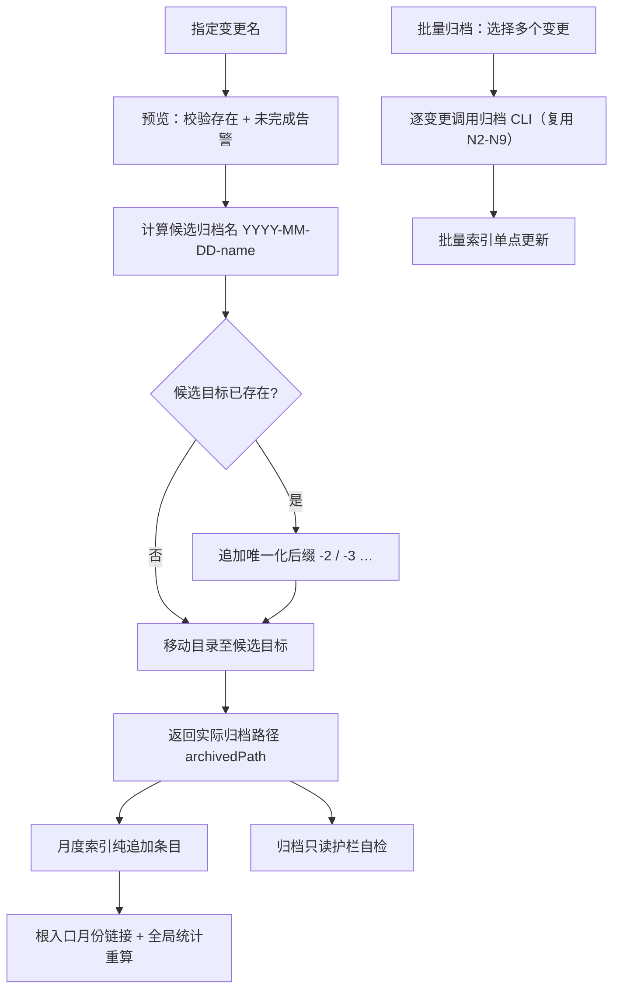

## Context

归档链路由三层构成：技能协议（`src/core/templates/workflows/spec-archive.ts` / `spec-bulk-archive.ts`）
→ 命令层（`src/commands/spec.ts` 的 `spec archive`）→ 领域层（`src/core/spec/archive.ts`）。

现状：`resolveTargetPath`（`src/core/spec/archive.ts:77-82`）只处理「日期前缀是否叠加」，不处理目标占用；
`executeArchive`（`archive.ts:66-74`）一旦发现目标存在即抛错「拒绝覆盖」。技能层面因此只能建议人工改名/删除
（`spec-archive.ts:191`）或把单元标 Failed（`spec-bulk-archive.ts:217`）。

索引侧以**归档目录名**为事实来源：月份取前 7 位、变更名称取日期前缀后的剩余段
（`spec-archive.ts:219-240`）。因此命名策略必须与索引解析同时对齐（D3）。

## 流程基准（引用，不重建）

| 节点 | 操作 | 证据位置 | 异常路径 |
| :--- | :--- | :--- | :--- |
| N0 | 批量选择并分组 | `spec-bulk-archive.ts:46-53, 162-175` | 无活动变更 → 停止 |
| N1 | 接收变更名 | `spec-archive.ts:30, 36-45` | 无法推断 → 提示选择 |
| N2 | 预览：校验存在 + 告警 | `archive.ts:38-58` | 不存在 → 抛错 |
| N3 | 候选名 `YYYY-MM-DD-<name>`（不叠日期） | `archive.ts:77-82` | — |
| N4 | 目标占用判定 | `archive.ts:68-70` | 现存行为：抛错 |
| N5 | 唯一化后缀 `-2`…（本变更新增） | `archive.ts:77`（改造） | 超上限 → 报错 |
| N6 | 移动目录（rename→复制回退） | `archive.ts:85-107` | 失败 → 源目录保留 |
| N7 | 返回实际归档路径 | `archive.ts:73`、`spec.ts:322-326` | — |
| N8 | 月度索引纯追加 | `spec-archive.ts:219-240` | 损坏 → 原文+最小条目+WARN |
| N9 | 根入口链接 + 统计重算 | `spec-archive.ts:271-297` | 损坏 → 只补链接+WARN |
| N10 | 逐变更调用 CLI | `spec-bulk-archive.ts:210-217` | 失败 → Failed 并继续 |
| N11 | 批量索引单点更新 | `spec-bulk-archive.ts:289-346` | 失败/跳过不入索引 |
| N12 | 归档只读护栏自检 | `spec-archive.ts:326-331`、`bulk:232-234` | 越界 → WARN |

## Goals / Non-Goals

**Goals**:
- 归档目标名被占用时仍能完成归档，且结果确定、可追溯（目录名即事实）
- 唯一化逻辑单点实现，预览与执行结果一致
- 已归档内容零风险：不覆盖、不删除、不改写
- 技能协议与索引口径同步，避免「目录名有后缀、索引名无后缀」的漂移

**Non-Goals**:
- 不新增 CLI 选项（不提供 `--strict` / `--suffix` 配置面）(D4)
- 不改变索引文件结构、不重建既有索引
- 不引入「同一变更历史合并」「归档去重」等语义 —— 重复归档各自保留为独立历史
- 不改归档只读护栏与写入面

## Decisions

### DT1: 唯一化在 `resolveTargetPath` 单点完成
- **选择**: 保留 `resolveTargetPath(projectRoot, changeName)` 签名，内部在候选名被占用时循环追加 `-2`…`-100`；`previewArchive` 与 `executeArchive` 均通过它取目标（D6）。
- **理由**: 目标名是唯一命名真源；放技能侧会导致预览/执行不一致与多处重复逻辑。CLI 只做确定性操作，符合 `archive.ts:1-6` 的职责边界。
- **备选**: 技能侧生成名字再传 `--target` —— 被否决：新增参数面且破坏单一真源。
- **上限**: 99 次尝试（`-2`…`-100`）后抛错并给出候选路径（D7，细节级 [假设]）。

### DT2: 占用探测只读，移动仍走既有回退
- **选择**: 唯一化循环只用 `fs.existsSync` 探测；实际移动继续复用 `moveDirectory`（rename → 复制删除回退）。
- **理由**: Windows `EPERM/EXDEV` 回退路径必须保留；探测与移动解耦后，唯一化不会改变移动语义（D2）。
- **备注**: 探测与移动之间存在极小的 TOCTOU 窗口 —— 单用户本地 CLI，接受该风险（不引入锁文件）。

### DT3: 索引「变更名称」取实际目录名去日期前缀（含后缀）
- **选择**: 技能从 CLI 返回的 `archivedPath` 基线名反解；「归档日期」= 前 10 位、月份 = 前 7 位、变更名称 = 去掉 `YYYY-MM-DD-` 后的全段（D3）。
- **理由**: 索引与目录名一一对应，重复归档可区分且可追溯；无需新增索引列。
- **备选**: 记录原始变更名 + `[重复归档]` 标记 —— 被否决：索引名与目录名不一致，需二次解析规则。

### DT4: 模块提取先剥离数字后缀
- **选择**: 技能正文写明「按 `{prefix}-{module}-{feature}` 提取模块前，先剥离尾部 `-<数字>`」。
- **理由**: 避免 `-2` 产生 `-2` 伪模块行，保持统计口径稳定（D3 的派生规则）。

### DT5: 批量归档复用同一 CLI 行为，冲突不再失败
- **选择**: `spec-bulk-archive` 单元 b) 删除「目标已存在 → Failed」分支，改为记录实际路径并继续（D5）。
- **理由**: 冲突消解已是 CLI 的确定性能力；技能侧重复判定会与 CLI 语义分叉。
- **保留**: 其余失败（子代理超时、目录不可写）仍 Failure + 失败隔离。

### DT6: 测试以行为替换而非叠加
- **选择**: 把 `test/spec-commands.test.ts:136-142`「归档目标已存在：拒绝覆盖」改写为「目标已存在 → `-2`」，新增「`-2` 已存在 → `-3`」「已带日期前缀 + 冲突 → `-2`」「超上限报错」用例（D1/D7）。
- **理由**: 旧用例断言的行为已被本变更替换；保留会导致相互矛盾的测试。

## Risks / Trade-offs

| 风险 | 缓解 |
|------|------|
| 技能文本与 CLI 行为漂移（技能仍宣称会失败） | 同步改 `spec-archive` Step 5 / Output / Guardrails 与 `spec-bulk-archive` 单元 b)；`pnpm generate:skills` 刷新快照，派生一致性测试守护 |
| 索引出现 `name-2` 被误读为新模块 | DT4 剥离后缀规则 + 批量索引新增场景测试 |
| 上限 99 次后仍冲突的用户体验 | 报错含最后候选路径，提示手工改名；实际场景远低于上限 |
| 预览后、执行前目标被其他进程占用 | 执行时再次解析（沿用现有顺序：`executeArchive` 内部调用 `previewArchive`），失败即抛错且源目录保留 |
| 旧测试断言与新行为冲突 | DT6 改写用例，不在同一套件保留两种期望 |
