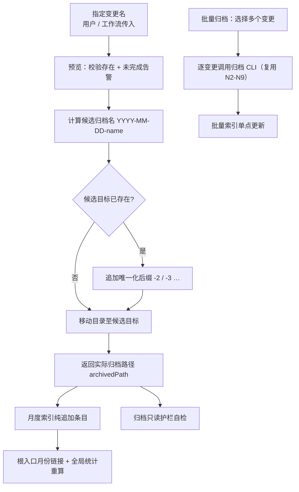

# 归档名冲突与批量归档能力优化 — 探索记录

## Background

用户诉求（原文）：优化 archive\bulk-archive 归档和批量归档能力，当前归档存在归档名称相同，无法归档情况。

即：`iagent spec archive` 把 `openspec/changes/<name>/` 移动到
`openspec/changes/archive/YYYY-MM-DD-<name>/` 时，若该目标目录已存在，命令抛错
「归档目标已存在，拒绝覆盖」，`spec-archive` 与 `spec-bulk-archive` 技能只能建议
改名既有归档 / 删除重复 / 换日期。用户希望归档动作在「归档名相同」时仍能完成。

## 项目规则基线

| 源 | 存在 | 读取 | 关键约束摘要 |
| :--- | :--- | :--- | :--- |
| `.iagent/config.yaml` | 是 | 已读 | TypeScript + Commander + Vitest；单一真源优先；技能模板改动后 `pnpm build && pnpm generate:skills` |
| `.iagent/rules/coding-rules.md` | 是 | 已读 | 零猜测（未明确项标 [待确认]）；设计先行、破坏性改动先确认；严格分层；技能模板为唯一源，指令版派生 |
| `.iagent/rules/spec.md` | 是 | 已读 | Markdown 为唯一真源；写入后 `iagent spec validate`；不引入 JSON 制品 |
| `.iagent/rules/testing-rules.md` | 是 | 已读 | Vitest 3.2.6，`test/**/*.test.ts`；CLI 端到端跑 `bin/iagent.js` → `dist/`，改 CLI 先 `pnpm build` |
| `CLAUDE.md` | 否 | 未读 | 不存在（合法终态） |
| `AGENTS.md` | 是 | 已读 | 归档只读护栏（MUST NOT 改写已归档内容）；月度索引纯追加；契约与单一源约束 |

## 项目技能基线

| 源 | 存在 | 读取 | 完整性 | 关键约束摘要 |
| :--- | :--- | :--- | :--- | :--- |
| `.iagent/skills/backend-design.md` | 是 | 已读 | ok | 单一真源优先、派生而非复制；CLI 只做确定性操作；破坏性改动先确认 |
| `.iagent/skills/backend-implement.md` | 是 | 未读（phases=implement，设计阶段不适用） | ok | 实现阶段再读 |

> 无 design 阶段缺失项；技能与代码未发现冲突。

## 提示词基线 (Prompt Baseline)

**原始提示词**: 优化archive\bulk-archive归档和批量归档能力，当前归档存在归档名称相同，无法归档情况

**确认后的提示词基线**: 修复 `iagent spec archive` / `spec-archive` / `spec-bulk-archive` 在归档目标名
（`YYYY-MM-DD-<change-name>`）已存在时无法完成归档的问题，同时不破坏「已归档内容只读」护栏。

> 一句话复述理解（提示词校验门直通结论）：目标 = 让同名归档可完成；对象 = 归档 CLI + 归档/批量归档技能；
> 歧义 = 冲突时的命名策略属**设计决策**，进入 grill 追问确认（不在入口门阻塞）。

## 功能流程图

| 节点 | 操作 | 触发条件 | 证据位置 | 异常路径 |
| :--- | :--- | :--- | :--- | :--- |
| N0 | 批量选择变更并分组 | 用户调用 bulk-archive 且选出 ≥1 个变更 | `spec-bulk-archive.ts:46-53`、`162-175` | 无活动变更 → 停止（`spec-bulk-archive.ts:38`） |
| N1 | 接收变更名 | 用户显式传入或工作流上下文传入 | `spec-archive.ts:30, 36-45` | 未提供且无法推断 → 提示选择（`spec-archive.ts:40`） |
| N2 | 预览归档：校验变更存在、收集未完成制品/任务告警 | 每次归档前 | `archive.ts:38-58` | 变更不存在 → 抛错（`archive.ts:40-42`） |
| N3 | 计算候选归档名 `YYYY-MM-DD-<name>`；已带日期前缀则不叠加 | 预览与执行共用 | `archive.ts:77-82` | — |
| N4 | 判定候选目标目录是否已存在 | 执行移动前 | `archive.ts:68-70` | 现存行为：已存在 → 抛错「拒绝覆盖」 |
| N5 | **[新建]** 冲突时追加唯一化后缀：`-2`、`-3`… 直至目标不存在 | N4 判定已存在 | 改造点 `archive.ts:77`（`resolveTargetPath` 唯一化分支）；新增测试 `test/spec-commands.test.ts` | 超过尝试上限（[假设] 99）→ 抛错并给出候选路径 |
| N6 | 移动目录（rename → 复制删除回退） | 目标名已唯一确定 | `archive.ts:85-107` | 移动失败 → 抛错，源目录保留（复制回退语义） |
| N7 | 返回实际归档路径（含后缀） | 移动成功 | `archive.ts:73`（`archivedPath`）、`spec.ts:322-326` | — |
| N8 | 月度索引纯追加条目（名称 = 目录名去日期前缀） | 归档成功后 | `spec-archive.ts:219-240, 244-269` | 结构损坏 → 保留原文 + 最小条目 + WARN |
| N9 | 根入口月份链接 + 全局统计确定性重算 | 月度索引写完后 | `spec-archive.ts:271-297` | 根入口损坏 → 只补月份链接 + WARN |
| N10 | 批量归档逐变更调用 CLI，单变更失败不影响其余 | 批量执行阶段 | `spec-bulk-archive.ts:210-217` | 单变更失败 → 标 Failed 并继续（失败隔离） |
| N11 | 批量索引单点更新（主代理） | 全部归档完成后 | `spec-bulk-archive.ts:289-346` | 失败/跳过不入索引 |
| N12 | 归档只读护栏自检 | 流程末尾 | `spec-archive.ts:326-331`、`spec-bulk-archive.ts:232-234` | 越界 → WARN（不中止） |

> 确认后的流程图 = **流程基准**；Phase 2 提案与 Phase 3 验证以本图为节点覆盖度锚点。

## Analysis

### Deep Analysis Trigger
- Triggered: Yes
- Reason: 输入含「优化」，且 CodeGraph 命中既有归档实现（修改既有代码）
- Scope: `src/core/spec/archive.ts`、`src/core/templates/workflows/spec-archive.ts`、
  `src/core/templates/workflows/spec-bulk-archive.ts`、`test/spec-commands.test.ts`

### Architecture Flow

1. `spec-archive` 技能 Step 5 → `iagent spec archive "<name>" --yes`
   （`src/core/templates/workflows/spec-archive.ts:182-191`）
2. 命令层 `src/commands/spec.ts:299-326` → `previewArchive` / `executeArchive`
3. `executeArchive` → `previewArchive`（校验存在 + 告警）→ 目标占用检查 → `moveDirectory`
   （`src/core/spec/archive.ts:66-94`）
4. 目标名由 `resolveTargetPath` 生成：变更名已含 `YYYY-MM-DD-` 前缀则不叠加
   （`src/core/spec/archive.ts:76-82`）
5. 技能 Step 7 从**归档目录名**反解「归档日期 / 变更名称」写月度索引与根入口
   （`src/core/templates/workflows/spec-archive.ts:219-240`）
6. 批量归档对每个变更独立调用同一 CLI，失败隔离并把该变更标 Failed
   （`src/core/templates/workflows/spec-bulk-archive.ts:210-217`）

### 影响半径（CodeGraph blast radius；`codegraph_impact` 在本宿主不可用 → 以 explore 依赖面替代，记 WARN）

- `executeArchive` / `previewArchive`：仅 `src/commands/spec.ts` 与 `test/spec-commands.test.ts` 直接引用
- `getSpecArchiveChangeSkillTemplate` / `getSpecBulkArchiveSkillTemplate`：模板注册表 + 派生一致性测试
  （`test/template-derivation.test.ts`）+ `test/stage-continuation.test.ts` + 快照 `skills/`
- 归档索引条目解析依赖目录名格式（日期前缀），命名策略连带影响索引「变更名称」列语义

## Codebase Findings

### Discovered Files
- `src/core/spec/archive.ts`: 归档预览/执行/目标名解析/目录移动的唯一实现（108 行）
- `src/commands/spec.ts`: `spec archive` 命令注册与输出（299-326）
- `src/core/templates/workflows/spec-archive.ts`: 单变更归档技能协议（409 行）
- `src/core/templates/workflows/spec-bulk-archive.ts`: 批量归档技能协议（478 行）
- `test/spec-commands.test.ts`: 归档 6 个用例，含「归档目标已存在：拒绝覆盖」（136-142）
- `openspec/changes/archive/ARCHIVE-INDEX.md` / `ARCHIVE-INDEX-YYYY-MM.md`: 索引当前结构（月份导航 + 模块统计 / 纯追加）

### Identified Symbols
- `previewArchive` (`src/core/spec/archive.ts:38`): 校验变更存在、收集未完成告警、返回 `targetPath`
- `executeArchive` (`src/core/spec/archive.ts:66`): 目标占用即抛错，无冲突消解
- `resolveTargetPath` (`src/core/spec/archive.ts:77`): 日期前缀叠加规则（唯一命名逻辑）
- `moveDirectory` (`src/core/spec/archive.ts:85`): rename → 复制删除回退（Windows 兼容）
- `getSpecArchiveChangeSkillTemplate` (`src/core/templates/workflows/spec-archive.ts:16`)
- `getSpecBulkArchiveSkillTemplate` (`src/core/templates/workflows/spec-bulk-archive.ts:16`)

### Pattern Matches
- 「失败即报错 + 人工改目录」：`spec-archive.ts:191` / `spec-bulk-archive.ts:217`
- 「索引条目从目录名反解」：`spec-archive.ts:237-240` / `spec-bulk-archive.ts:324-328`
- 「归档只读护栏」：`spec-archive.ts:394`、`spec-bulk-archive.ts:453`

### Capability Exploration Memory (injected)
- `openspec/specs/spec-workflow-cli/explorations.md`：归档 CLI 只做确定性操作（状态检查 + 目录移动），
  delta spec 合并属技能职责；归档索引改为月度分片（`improve-archive-index-monthly`）。
- `openspec/specs/spec-bulk-archive-skill/explorations.md`：批量归档失败隔离（单变更失败不中止整批）、
  ARCHIVE-INDEX 由主代理单点更新、CodeGraph 项目级单次同步。

## Questions

**Q1（已答）** 归档目标名已存在（同日同名）时如何唯一化？→ 自动数字后缀 `-2`（仍冲突则 `-3`…）
**Q2（已答）** 带后缀目录在月度索引「变更名称」列记录什么？→ 实际目录名去掉 `YYYY-MM-DD-` 前缀
**Q3（已答）** 是否保留「目标已存在即失败」的严格模式开关？→ 默认唯一化，无开关

## 术语表 (NEW)

| 术语 | 定义 | 避免使用 |
|------|------|---------|
| 归档基准名 | 活动区变更目录名 `openspec/changes/<name>/` 的 `<name>`（可能已含日期前缀） | 变更名（有歧义时）、原目录名 |
| 归档目标名 | `archive/` 下最终目录名，格式 `YYYY-MM-DD-<归档基准名>` 或 `YYYY-MM-DD-<归档基准名>-<N>` | 归档目录名（口语）、目标路径 |
| 归档名冲突 | 计算出的归档目标名在 `archive/` 下已存在（同日同名 / 已带日期前缀同名） | 重名（宽泛）、目录占用 |
| 唯一化后缀 | 冲突时追加的 `-2`、`-3`…（自 2 起递增，仅在冲突时出现，绝不覆盖既有目录） | 序号、重试后缀 |
| 重复归档 | 同一归档基准名在历史上被多次归档（归档目录名仅在后缀上不同） | 重复提交、二次归档 |

## 架构决策 (NEW)

无 ADR —— 本次决策为命名/行为契约的可逆调整（只影响后续归档目录名，不改写既有历史），
备选方案与取舍已在下方 `Decision Process` 完整记录，未达 ADR 的记录门槛。

## 边界场景 (NEW)

- [ ] 同一日内对同名变更连续归档两次（归档 → 复制/重建同名变更 → 再归档）→ 第二次应落到 `-2`
- [ ] 变更名本身已含 `YYYY-MM-DD-` 前缀（复制归档目录回工作区继续改）→ 不叠加日期，冲突时追加 `-2`
- [ ] 批量归档同批含「同名 + 同日」两个单元 → 后执行者拿到 `-2`，两者均成功
- [ ] 目标候选已存在但为空 / 只有 `.iagent` 残留 → 仍视为冲突并唯一化（不合并、不删除）
- [ ] `-2` 也存在时递增到 `-3`；超过尝试上限（[假设] 99）→ 报错并列出候选路径
- [ ] Windows `renameSync` EPERM/EXDEV 回退复制路径下，唯一化后的目标名保持一致
- [ ] 预览（`previewArchive`）展示的目标名应与最终执行结果一致（含后缀）

## Decision Process (NEW)

### Decision: 归档名冲突的处置策略
**Options Considered**:
- Option A: 自动数字后缀（`YYYY-MM-DD-<name>-2`，递增至不冲突）
- Option B: 秒级时间戳后缀（`YYYY-MM-DD-<name>-HHmmss`）
- Option C: 保持报错，仅改进提示与技能引导
- Option D: 覆盖既有归档（破坏只读护栏）

**Pros/Cons**:
- A: 可读性最好、最短、与历史目录风格一致；缺点：索引「变更名称」需定义取值口径
- B: 天然唯一、无需查重；缺点：目录名冗长、索引可读性下降
- C: 零风险；缺点：不解决用户诉求
- D: 简单；缺点：违反「已归档变更是历史事实」护栏

**Chosen**: Option A
**Rationale**: 唯一化只在冲突时出现，正常归档目录名保持既有风格；递增后缀可被索引与人工稳定解析，
且天然满足「绝不覆盖」。时间戳后缀收益（免查重）不足以抵消可读性代价。

### Decision: 索引「变更名称」列取值
**Options Considered**:
- Option A: 实际目录名去掉 `YYYY-MM-DD-` 前缀（`name-2`）
- Option B: 原始变更名 + 摘要追加 `[重复归档]`
- Option C: 原始变更名（无标记）

**Chosen**: Option A
**Rationale**: 索引与目录名一一对应、可追溯；避免同名多行无法区分；模块提取后缀噪声由 `[假设]` 规则兜底（见硬约束）。

### Decision: CLI 接口面
**Chosen**: 默认唯一化，不新增 `--strict` 开关
**Rationale**: 行为统一、单一真源；脚本与技能无需额外分支。

## Decisions

- **D1**：归档名冲突时采用自动数字后缀唯一化（`-2`、`-3`…，自 2 起递增），不采用时间戳后缀、不覆盖既有归档。
- **D2**：既有归档目录内容保持只读 —— 唯一化只改变**新**归档的目标名，MUST NOT 删除、合并或改写 `openspec/changes/archive/**` 既有内容。
- **D3**：月度索引「变更名称」列取**实际归档目录名去掉 `YYYY-MM-DD-` 前缀**（含后缀，如 `name-2`）；「归档日期」仍取目录名前 10 位。
- **D4**：不新增 CLI 严格模式开关；`iagent spec archive` 默认唯一化，行为单一。
- **D5**：批量归档复用同一 CLI 行为 —— 同名冲突不再标 Failed，其余失败隔离语义不变（单变更失败不中止整批）。
- **D6**：唯一化在 `resolveTargetPath` 单一真源内完成，`previewArchive` 与 `executeArchive` 共用同一结果（预览即最终目标）。
- **D7**（[假设]，细节级）：唯一化尝试上限 99 次（`-2`…`-100`），超出则抛错并列出候选路径，避免无限循环。

> 聚合一致性门（1.6.6）：扫描 D1-D7，0 个硬冲突（D1 后缀 ↔ D3 索引取值一致；D5 批量复用 ↔ D2 只读一致）→ 直通 Phase 2。
> CONTEXT.md（1.6.5）：已同步 5 个新术语（归档基准名 / 归档目标名 / 归档名冲突 / 唯一化后缀 / 重复归档）。
> 流程基准已确认（flowBaselineConfirmed = true）；纸迹 complete。

## 硬约束 (NEW)

- 唯一化后缀 MUST 从 `-2` 起递增，且 MUST NOT 覆盖既有归档目录 — source: D1
- MUST NOT 删除、合并或改写 `openspec/changes/archive/**` 既有内容 — source: D2
- 索引「变更名称」MUST 取实际目录名去掉 `YYYY-MM-DD-` 前缀 — source: D3
- MUST NOT 新增严格模式 CLI 开关 — source: D4
- 同名冲突 MUST NOT 使批量归档单元标记为 Failed — source: D5
- 目标名解析 MUST 单点（`resolveTargetPath`），预览与执行 MUST 一致 — source: D6

## Scope Changes (NEW)

| 变更时间 | 变更类型 | 变更说明 | 原因 |
|---------|---------|---------|------|
| 2026-11-11 | expand | 由「同名无法归档」扩展到「批量归档同名单元共用同一消解逻辑」 | 用户诉求同时点名 archive 与 bulk-archive |

## Pending (enhanced)

### For Phase 2 Impact Analysis
- `executeArchive` (`src/core/spec/archive.ts:66`) — Priority: HIGH
- `resolveTargetPath` (`src/core/spec/archive.ts:77`) — Priority: HIGH
- `previewArchive` (`src/core/spec/archive.ts:38`) — Priority: HIGH
- `getSpecArchiveChangeSkillTemplate` (`src/core/templates/workflows/spec-archive.ts:16`) — Priority: HIGH
- `getSpecBulkArchiveSkillTemplate` (`src/core/templates/workflows/spec-bulk-archive.ts:16`) — Priority: HIGH

### Security Concerns
- 无新增外部输入面；唯一化不得引入覆盖写入（D2）

### Business Validation
- 带后缀目录的模块提取：`{prefix}-{module}-{feature}` 规则遇 `-2` 后缀时先剥离后缀再提取模块（[假设]，实现期在技能正文写明）

### Unresolved Decisions
- 无（D1-D6 已确认；D7 为细节级 [假设]）

## Implementation Deep-Dive

### Design Rationale
`archive.ts` 头注释明确职责边界：CLI 只做确定性操作（状态检查 + 目录移动），智能合并留给技能
（`src/core/spec/archive.ts:1-6`）。冲突消解属于确定性操作，应留在 CLI 单点，而非各技能自行拼名。

### Constraints
- 已归档内容只读：任何策略 MUST NOT 覆盖既有 `archive/**` 内容
- 索引解析依赖目录名 `YYYY-MM-DD-` 前缀（月份判定取前 7 位）
- Windows 路径移动需保留 rename → 复制删除回退

### Trade-offs
唯一化后缀（A）与索引可读性、统计口径之间的取舍 —— 以「目录名即事实」为准，索引跟随目录名。

### Pattern Usage
失败隔离 + 单点索引写入（批量归档）；配置/命名规则单一真源。

### Historical Context
`improve-archive-index-monthly`（2026-11-08）把索引拆为根入口 + 月度；`improve-compile-gate-and-archive-readonly`
（2026-11-01）收紧归档只读护栏。

### Implicit Assumptions
- 归档目录名是历史事实载体，索引与统计从目录名反解（`spec-archive.ts:237-240`）
- 「同名变更」当前不可能同时存在于活动区（目录名唯一），冲突只来自历史归档
