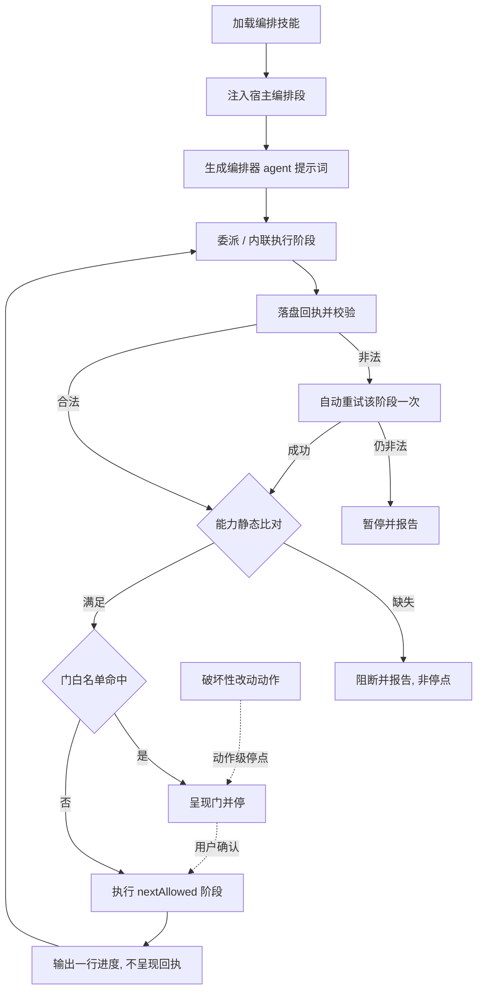
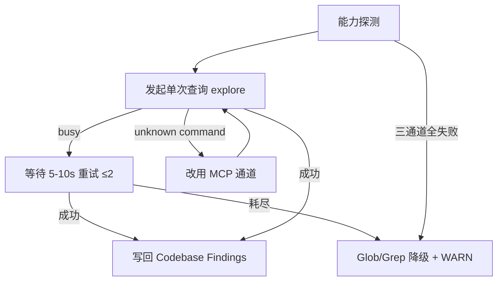

# Design: improve-continuation-and-codegraph-resilience

## Context

五条编排流程的续跑语义已在 `skill-stage-continuation` 规格中定义，但**执行侧**存在三处断点：

1. 编排器身份提示词授权「收到回执后停止」（`src/core/opencode-v2.ts:160`、`src/core/pi-native.ts:187`）；
2. 委派语句的续跑子句只在 Claude 分支存在（`src/core/host-orchestration/actions.ts:92`，OpenCode `:95` / Pi `:101-103` 缺失）；
3. 回执只存在于会话文本，`evaluatePhaseTransition` 在生产代码中无调用点 —— 推进判定缺少客观对象。

CodeGraph 侧现状：`codegraph-protocol.ts` 只覆盖「能力可用性 + 写锁争用」，不覆盖并发排队（busy）、调用串行与 CLI 子命令边界；模板硬绑定 `codegraph_files` / `codegraph_search` / `codegraph_context`（27 处引用），而宿主只保证 `codegraph_explore`。

## Goals / Non-Goals

**Goals**

- 把「续跑断言 / 回执内部化 / 门自检 / 回执落盘 / 可解析 nextAllowed」落为**单一源**，并让三类宿主产物一致携带。
- 把 CodeGraph 调用收敛为「主通道 + 可选通道 + busy 阶梯 + CLI 边界」四段单一源。
- 用生成期断言锁定上述文本与行为，防止再次漂移。

**Non-Goals**

- 不改变 5 类门白名单、`PhaseSpec` 形状与既有回执字段合法性。
- 不新增 / 删除 CLI 命令，不扩充 `allowedTools`。
- 不修正 `spec-apply` 的「新开只读代理」旧表述（登记 Pending，独立变更处理）。
- 不改变 debug 的排查语义（`2.2.1`-`2.2.3` 的调用链追踪仅改工具映射）。

## 流程基准（引用 exploration.md，不重建）

| 节点 | 操作 | 触发条件 | 证据位置 | 异常路径 |
| :--- | :--- | :--- | :--- | :--- |
| N1 | 加载编排技能正文 | 用户调用编排入口 | `src/core/templates/workflows/auto-workflow.ts:1` | 加载失败 → 报告缺件 |
| N2 | 生成期注入宿主编排段 | 技能含 `Skill(...)` 委派条目 | `src/core/host-orchestration/render.ts:174` | — |
| N3 | 生成编排器 agent 提示词 | init / update | `src/core/opencode-v2.ts:134`；`src/core/pi-native.ts:174` | — |
| N4 | 委派或内联执行阶段 | 阶段有 `nextAllowed` | `src/core/host-orchestration/actions.ts:80` | 子代理失败 → 重试一次 → N10 |
| N5 | 落盘回执并校验 | 阶段返回 | `src/core/host-orchestration/protocol.ts:324`；[新建] `receipt-store.ts` + `resolveNextPhase` | 非法 → N9 |
| N6 | 能力静态比对 | 回执合法 | `src/core/host-orchestration/hosts.ts:26`；`transition.ts:73` | 缺失 → N13 |
| N7 | 门白名单判定（类别或锚点 id） | 能力满足 | `src/core/host-orchestration/protocol.ts:98` | 未知门 → N13 |
| N8 | 呈现门并停 | 命中 5 类之一 | `protocol.ts:98-134`；`workflows.ts:227` | — |
| N9 | 自动重试该阶段一次 | `blockedBy == ['invalid-receipt']` | [新建] 续跑协议段 | 仍非法 → N10 |
| N10 | 暂停并报告 | 重试仍失败 | [新建] 续跑协议段 | — |
| N11 | 执行 `nextAllowed` 阶段 | 非门且 `status=ok` | [新建] `resolveNextPhase` + 续跑协议段 | 用户中断 → 「继续」直通 |
| N12 | 输出一行进度（不呈现回执） | 阶段收束 | [新建] 回执内部化条款 | — |
| N13 | 阻断并报告 | 能力缺失 / 未知门 | `transition.ts:74`、`:86-100` | — |
| N14 | 破坏性改动停点（动作级） | 删除 / 覆盖 / 改写 / 不可逆 | `protocol.ts:128-133` | — |
| N15 | CodeGraph 能力探测 | 探索 / 调试开始 | `src/core/templates/codegraph-protocol.ts:41` | 三通道失败 → N19 |
| N16 | 单次查询（主通道，串行、有界） | N15 可用 | [新建] 调用纪律段 | busy → N17；unknown command → N18 |
| N17 | busy 重试 ≤2 次 | 收到 busy | [新建] busy 阶梯段 | 耗尽 → N19 |
| N18 | 改用 MCP 通道 | CLI `unknown command` | [新建] CLI 边界段 | — |
| N19 | Glob / Grep 降级 + WARN | 重试耗尽 / 三通道失败 | `spec-explore.ts:373`；`debug.ts:29` | — |
| N20 | 写回 `Codebase Findings` | 查询成功 | `spec-explore.ts:388` | — |

> 完整节点证据与异常路径以 `exploration.md` 的 `## 功能流程图` 为唯一基准；本表不新增节点。

## Decisions

### D1 单一变更交付

A（续跑停点）与 B（CodeGraph 韧性）共享「单一源 + 生成期断言」模式，同一变更交付，回滚粒度一致。

### D2 三层齐改

模板 / 渲染层 + OpenCode/Pi 编排器身份提示词 + 生成期断言测试；仅改文案无法消除「停止授权」根因。

### D3 续跑断言 + 门自检

`renderContinuationContract()` 为唯一渲染源；`nextAllowed` 保持阶段 id 语义；停点自检接受类别 id 或锚点 id（`destructive-change` 只认类别 id）。

### D4 回执内部化

回执不作为面向用户的最终消息；用户可见输出至多一行进度。

### D5 主通道收敛

`CODEGRAPH_CALL_DISCIPLINE`：`codegraph_explore` 为唯一保证通道，其余为「宿主暴露时可选」。

### D6 CLI 边界

`CODEGRAPH_CLI_BOUNDARY`：仅 `status` / `unlock` / `sync`；`unknown command` 立即改 MCP。

### D7 busy 阶梯

`CODEGRAPH_BUSY_LADDER`：串行 + 间隔 5–10s 重试 ≤2 次 + 降级内置工具并 WARN；不判索引不可用、不 unlock/sync。

### D8 回执自动重试一次

`invalid-receipt` 同参数重试一次，不询问用户；仍失败暂停并报告。

### D9 参数与账本皆缺

`gate-skip` 与 handoff 账本皆缺 → `status=blocked` 回执中止，不询问用户。

### D10 回执落盘

`src/core/host-orchestration/receipt-store.ts`：编排器写 `.openspec-tmp/pipeline-<change>/receipts/<phase>.json`；阶段技能不新增 `Write` 权限，不新增 CLI 命令。

### D11 判定顺序拆分

能力（生成期协商 + `requiredCapabilities`）→ 门（白名单）→ 回执（`validateReceipt` + `resolveNextPhase`）；门优先；自动重试仅当 `blockedBy == ['invalid-receipt']`。

### D12 resolveNextPhase

`src/core/host-orchestration/transition.ts` 新增纯函数；命中返回目标阶段，未命中即 `invalid-receipt`；不修改入参。

## Architecture Impact

- **模板层 → 渲染层**：`codegraph-protocol.ts` 增加三段导出；`render.ts` 增加 `renderContinuationContract()` 并复用到 `renderHostOrchestrationSection`；`actions.ts` 补 OpenCode / Pi 续跑子句。
- **宿主产物层**：`opencode-v2.ts` / `pi-native.ts` 的身份提示词改为续跑语义。
- **协议层**：`transition.ts` 新增纯函数与注释；`protocol.ts` 不变（避免回执字段扩张）。
- **单一源约束**：三段 CodeGraph 文本与续跑断言 MUST 由导出常量/函数渲染，模板 MUST NOT 手写第二份。

## Error Handling

| 场景 | 处置 |
| :--- | :--- |
| 回执非法 / `nextAllowed` 不可解析 | 同参数重试一次；仍失败暂停报告（N9 → N10） |
| 门未确认 + 回执非法 | 门优先，不触发自动重试（N7 → N8） |
| 能力缺失 / 未知门 | 阻断并报告，非停点（N13） |
| CodeGraph busy 三次 | 本步骤降级内置工具 + WARN，流程继续（N17 → N19） |
| CLI `unknown command` | 立即改 MCP，不重试 CLI（N18） |
| 落盘失败（磁盘 / 权限） | WARN + 按会话回执自检，不判失败 |

## Testing Strategy

- 生成期断言（文本）：编排器提示词不含停止授权；三段 CodeGraph 文本存在且被目标模板引用；`renderDelegate` 三分支均含续跑子句。
- 单元测试（纯函数）：`receiptStorePath(change, phase)` 跨平台；`resolveNextPhase` 命中 / 未命中 / 不改原对象。
- 回归：`test/stage-continuation.test.ts` 扩展；`test/opencode-v2.test.ts` / `test/pi-native.test.ts` 断言新提示词。
- 既有测试不回归：`pnpm build && pnpm generate:skills` 后 `pnpm test`。

## Risks / Trade-offs

- **R1 文本约束强度有限**：提示词修正仍依赖模型执行；缓解——回执落盘提供客观对象 + 生成期断言防回退。
- **R2 回执落盘新增流程态文件**：位于 `.openspec-tmp/`（不入提交面），流程收尾清理既有逻辑覆盖。
- **R3 CodeGraph 收敛可能丢失细粒度工具**：`impact` 保留为可选增强；`files/search/context` 由一次 `explore` 查询替代，`maxFiles` 有界防止膨胀。
- **R4 文档体积**：续跑断言集中为一段，替换多处散文，净增有限。
