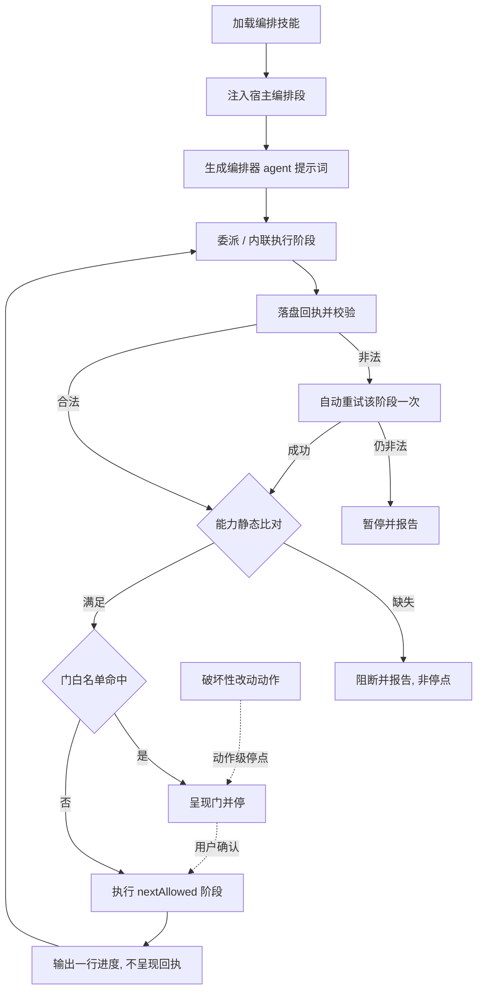
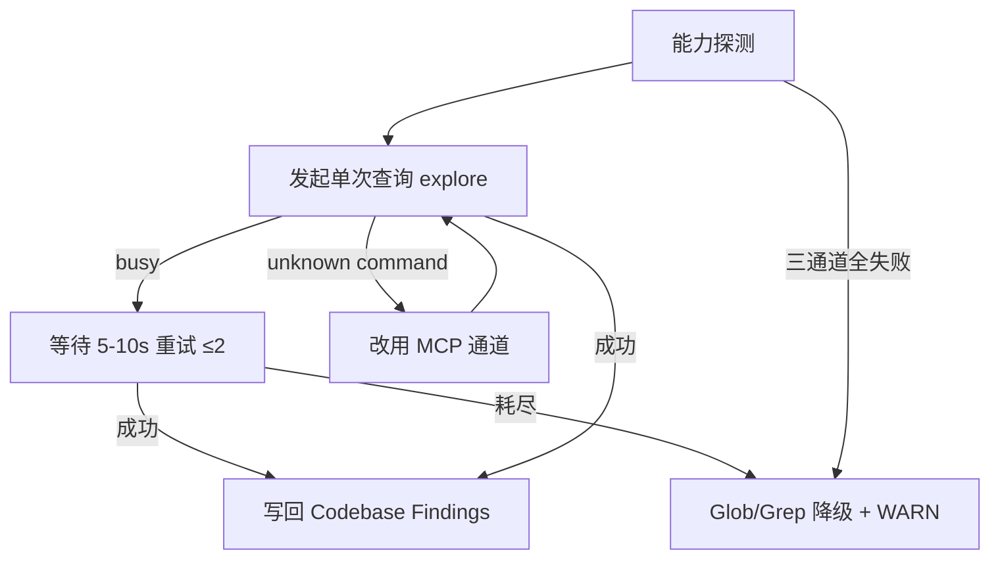

# 探索：指令技能流程停点与 CodeGraph 调用链路优化

> 创建时间：2026-11-11
> 模式：delegated（由 iagent-auto-workflow 编排）

## Background

用户反馈两个与 MiAgentTools 自身「指令技能（skill 模板）」相关的问题：

1. **非预期停点**：在 `workflow` / `auto-workflow` / `debug` / `explore` / `proposal` 流程中，偶发出现「结构化回执」后任务不再自动推进，需要人工确认才继续。
2. **CodeGraph 调用链路**：当前存在「状态忙」等问题。用户给出的实际输出：
   - `codegraph_explore`（"getDate function in resAccessTreasuryApp…"）返回 `CodeGraph is busy serving other concurrent requests right now (this call waited 45s in the queue)`；提示等待几秒后重试该调用。
   - `Bash(codegraph search --query "class" --kind class --limit 5)` 返回 `error: unknown command 'search'`。

目标是优化本项目技能模板（`src/core/templates/workflows/**`、`src/core/templates/codegraph-protocol.ts` 等单一源）中的相关指引与协议，使上述两类问题不再让管线卡在人工确认上。

## 项目规则基线

| 源 | 存在 | 读取 | 关键约束摘要 |
| :--- | :--- | :--- | :--- |
| `.iagent/config.yaml` | 是 | 已读 | 技术栈 TS5.9/Node≥20.19/Commander14/Vitest3；模板→生成→命令三层；单一真源（skill-id / command-references / command-artifacts / version-bump）；改模板后 `pnpm build && pnpm generate:skills` |
| `.iagent/rules/coding-rules.md` | 是 | 已读 | 零猜测（未明确项标 [待确认]）；设计先行 + 确认门；模板正文是唯一源，指令版由 derive-command.ts 派生；allowedTools 走 tool-whitelist.ts；禁止硬编码宿主机制词；路径断言归一化 |
| `.iagent/rules/spec.md` | 是 | 已读 | 变更真源是 openspec/changes/ 下 Markdown；写后 `iagent spec validate` 循环；禁止 JSON 制品；提案实现前过 90% 评分门；handoff 包一次性产出跨阶段只读复用 |
| `.iagent/rules/testing-rules.md` | 是 | 已读 | Vitest 3.2.6，用例 `test/**/*.test.ts`；主目录沙箱；改模板后须 `pnpm build && pnpm generate:skills` 否则 skills-parity 失败；单测超时 20s |
| `AGENTS.md` | 是 | 已读 | 模板/白名单/门白名单/分级执行/inline 阶段/回执契约等仓库级守则；技能正文 MUST NOT 硬编码 Claude 专属机制词 |

## 项目技能基线

| 源 | 存在 | 读取 | 完整性 | 关键约束摘要 |
| :--- | :--- | :--- | :--- | :--- |
| `.iagent/skills/backend-design.md` | 是 | 已读 | ok | 三层架构与单一真源优先；派生而非复制；宿主机制解耦（不硬编码宿主工具名）；失败非阻断（WARN/degraded）；MUST NOT 直接编辑派生产物 / 手写 allowedTools / 重新序列化 YAML |
| `.iagent/skills/backend-implement.md` | 是 | 未读 | ok | phases=implement，探索（design）阶段不加载；实现阶段再读 |

## 提示词基线 (Prompt Baseline)

**原始提示词**:

```
对当前项目指令技能进行相关问题优化：
1）workflow\auto-workflow\degbug\explore\proposal流程时存在偶发出现结构化回执，任务没有自动走情况，需要人工确认后才能进行
2）优化codegraph调用流程，当前存在状态忙等问题
Codegraph [codegraph_explore]getDate function in resAccessTreasuryApp…
OUT
CodeGraph is busy serving other concurrent requests right now (this call waited 45s in the queue). This is NOT an error and the index is fine — wait a few seconds and retry this exact call; it will return normally. If you can't wait, use your built-in tools for just this one step.
Bash(cd "E:\WorkSpaces_ahdx\ComponentMonitorServer" && codegraph search --query "class" --kind class --limit 5 2>&1)
  ⎿  Error: Exit code 1
     error: unknown command 'search'
```

**确认后的提示词基线**: 与原始提示词一致（清晰输入，四维无语义级歧义：目标=消除技能流程的非预期停点并优化 CodeGraph 调用指引；对象=本项目技能模板与其单一源；范围=workflow/auto-workflow/debug/explore/propose 五条流程 + CodeGraph 调用协议；约束=项目规则基线）。

> 下游（提案 / 设计 / 规格 / 任务）以提示词基线为唯一语义来源；基线若变更 MUST 回到提示词校验门重新确认。

## 功能流程图

### 流程 1：阶段推进与回执续跑（编排器视角，v2）



### 流程 2：CodeGraph 调用链路



| 节点 | 操作 | 触发条件 | 证据位置 | 异常路径 |
| :--- | :--- | :--- | :--- | :--- |
| N1 | 加载编排技能正文 | 用户调用 `/iagent-auto-workflow` 等入口 | `src/core/templates/workflows/auto-workflow.ts:1` | 加载失败 → 报告缺件 |
| N2 | 生成期注入宿主编排段（续跑契约） | 技能含 `Skill(...)` 委派条目 | `src/core/host-orchestration/render.ts:174` | — |
| N3 | 生成编排器 agent 提示词 | `iagent init` / `update` 生成宿主产物 | `src/core/opencode-v2.ts:134`；`src/core/pi-native.ts:174` | — |
| N4 | 委派或内联执行阶段 | 阶段有 `nextAllowed` | `src/core/host-orchestration/actions.ts:80` | 子代理失败 → 重试一次 → N10 |
| N5 | 编排器落盘回执并校验（`validateReceipt` + `resolveNextPhase`） | 阶段返回 | `src/core/host-orchestration/protocol.ts:324`；[新建] `receipt-store.ts` + `resolveNextPhase`（`transition.ts`） | 非法 / nextAllowed 不可解析（`blockedBy == ['invalid-receipt']`）→ N9 |
| N6 | 能力静态比对（生成期协商结果 + `requiredCapabilities`） | 回执合法 | `src/core/host-orchestration/hosts.ts:26`；`transition.ts:73` | 缺失 → N13（阻断，非停点） |
| N7 | 门白名单判定（类别 id **或** 锚点 id） | 能力满足 | `src/core/host-orchestration/protocol.ts:98` | 未知门 → N13（阻断，非停点） |
| N8 | 呈现门并停 | 命中 5 类之一（含 `destructive-change` 类别） | `protocol.ts:98-134`；`workflows.ts:227` | — |
| N9 | 自动重试该阶段一次 | `blockedBy` 恰为 `['invalid-receipt']`（门优先，不误重试） | [新建] 续跑协议段（重试条款） | 仍非法 → N10 |
| N10 | 暂停并报告缺失字段 / 失败原因 | 重试仍失败 | [新建] 续跑协议段（失败处置） | — |
| N11 | 执行 `nextAllowed` 对应阶段的委派 / 内联 | 非门且 `status=ok` 且阶段可解析 | `transition.ts:68`（新增 `resolveNextPhase`）；[新建] 续跑协议段 | 用户中断 → B3「继续」直通 |
| N12 | 输出一行进度（不呈现回执正文） | 阶段收束 | [新建] 回执内部化条款（render 段 + agent 提示词） | — |
| N13 | 阻断并报告（能力缺失 / 未知门 / 不可豁免门缺交互能力） | N6 缺失或 N7 未知 | `transition.ts:74`、`transition.ts:86-100` | — |
| N14 | 破坏性改动停点（动作级，无阶段锚点） | 删除目录 / 覆盖既有制品 / 改写版本库跟踪 / 不可逆命令 | `protocol.ts:128-133` | — |
| N15 | CodeGraph 能力探测 | 探索 / 调试开始 | `src/core/templates/codegraph-protocol.ts:41` | 三通道失败 → N19 |
| N16 | 发起单次查询（`codegraph_explore` 主通道，串行、`maxFiles` 有界） | N15 可用 | [新建] `codegraph-protocol.ts` 调用纪律段 | busy → N17；unknown command → N18 |
| N17 | 等待 5–10s 重试同一调用（≤2 次） | 收到 busy 文案 | [新建] `codegraph-protocol.ts` busy 阶梯段 | 耗尽 → N19 |
| N18 | 改用 MCP 通道（不重试同类 CLI） | CLI `unknown command` | [新建] `codegraph-protocol.ts` CLI 边界段 | — |
| N19 | Glob / Grep 降级并记 WARN | 重试耗尽或三通道失败 | `src/core/templates/workflows/spec-explore.ts:373`；`debug.ts:29` | — |
| N20 | 写回探索产物 `Codebase Findings` | 查询成功 | `src/core/templates/workflows/spec-explore.ts:388` | — |

> **⛔ GATE: 流程最终确认门** —— 用户已于 2026-11-11 确认 v2 流程（N1-N20），流程基准成立（`flowBaselineConfirmed=true`）。
>
> **聚合一致性门**：扫描 D1-D12 共 12 条决策，0 个硬冲突 —— 通过。

## Analysis (optional - if analysis run)

### Deep Analysis Trigger

- Triggered: Yes
- Reason: 输入含「优化」「问题」类修改意图，且基础扫描命中既有编排协议与 CodeGraph 协议符号（属修改既有代码）
- Scope: `src/core/host-orchestration/**`、`src/core/templates/codegraph-protocol.ts`、`src/core/templates/workflows/{auto-workflow,workflow,debug,spec-explore,spec-propose,spec-apply}.ts`、`src/core/opencode-v2.ts`、`src/core/pi-native.ts`

### Architecture Flow

CodeGraph 采样（`codegraph_explore`，1 次调用 / maxFiles=6）确认调用链：
`renderHostOrchestrationSection`（render.ts:174）→ `renderDelegationList`（actions.ts:132）→ `renderDelegate`（actions.ts:80）；
`evaluatePhaseTransition`（transition.ts:68）→ `validateReceipt`（protocol.ts:324）。
测试依赖：`test/stage-continuation.test.ts`、`test/host-orchestration.test.ts`、`test/pi-native.test.ts`、`test/claude-host-adapter.test.ts`。

### 能力探索记忆（已注入）

- `openspec/specs/skill-stage-continuation/explorations.md`：续跑契约已是既有决策（回执是中间状态、同一用户回合继续、门是唯一合法停点、`blockedGate`/`blockedReason` 区分）——本次不是重新决策，而是**执行侧落地与防漂移**。
- `openspec/specs/host-orchestration/explorations.md`：门白名单正向枚举（5 类）、handoff 包、门账本写入时机（确认后立即写、委派前校验）、条件门语义均不可改动。

## Codebase Findings

### Discovered Files

- `src/core/opencode-v2.ts`：生成 OpenCode V2 项目级 `agents/iagent-orchestrator.md`（primary）与阶段 worker（subagent）—— 运行期编排器的**第一人称身份提示词**来源。
- `src/core/pi-native.ts`：生成 `.pi/agents/iagent-orchestrator.md` 与阶段 agent —— Pi 侧同一职责。
- `src/core/host-orchestration/render.ts`：生成期注入「宿主编排适配」段（续跑契约 / 分级执行 / 执行方式回执）。
- `src/core/host-orchestration/actions.ts`：`renderDelegate` 按宿主渲染委派语句（Claude 分支含 EXIT GUARD，OpenCode/Pi 分支不含续跑子句）。
- `src/core/host-orchestration/protocol.ts` / `transition.ts`：回执字段、校验与阶段推进判定（运行期库，非宿主强行者）。
- `src/core/templates/codegraph-protocol.ts`：CodeGraph 能力探测顺序 + 锁阶梯的**唯一源**。
- `src/core/templates/tool-whitelist.ts`：`CODEGRAPH_MCP`（裸服务器 + 9 个具名工具）、`CODEGRAPH_CLI`（`Bash(codegraph:*)`）。
- `src/core/templates/workflows/{auto-workflow,workflow,debug,spec-explore,spec-propose,spec-apply}.ts`：五条流程正文。
- `test/stage-continuation.test.ts`：既有续跑/回执/门对齐回归锁（含「回执是**中间状态**」「同一用户回合内继续下一阶段」断言）。

### Identified Symbols

- `renderOrchestratorAgent`（`src/core/opencode-v2.ts:134`）：正文第 160 行「汇总 worker 回执后再决定推进、回退或停止」——**显式授权「收到回执后停止」**，与续跑契约冲突。
- `renderPiOrchestratorAgent`（`src/core/pi-native.ts:187`）：同一句式「汇总回执后再决定推进、回退或停止」。
- `renderDelegate`（`src/core/host-orchestration/actions.ts:80`）：Claude 自动阶段分支（:92）带「完成后返回结构化回执并遵守 EXIT GUARD」；OpenCode（:95）与 Pi（:101-103）分支**无续跑/退出守卫子句**。
- `renderHostOrchestrationSection`（`src/core/host-orchestration/render.ts:174`）：续跑契约仅两句（:191、:219），未覆盖「回执不作为面向用户输出」「无门停点自检」「非法回执自动重试」。
- `validateReceipt`（`src/core/host-orchestration/protocol.ts:324`）：字段/取值校验已完整；本次不改语义。
- `renderCodegraphProbeOrder`（`src/core/templates/codegraph-protocol.ts:41`）：仅覆盖「能力可用性」，**无 busy / 并发 / CLI 子命令边界**。
- `CODEGRAPH_LOCK_LADDER`（`src/core/templates/codegraph-protocol.ts:64`）：覆盖写锁争用，**未被 busy 场景引用**。
- `CODEGRAPH_MCP`（`src/core/templates/tool-whitelist.ts:28`）：列出 9 个具名工具；本宿主实际只暴露 `codegraph_explore`（会话实测）。

### Pattern Matches

- 「回执」续跑语句在 auto-workflow / workflow / debug 的 Guardrails 尾部重复出现（auto-workflow.ts:47/78/145/249、workflow.ts:165/356/590、spec-explore.ts:629、spec-propose.ts:242/253）——属散文复述，没有单一源，也**不在模型最先读到的位置**。
- CodeGraph 基础扫描硬绑定 `codegraph_files` / `codegraph_search`（spec-explore.ts:376/381/386 等共 10 处 `codegraph_search`、8 处 `codegraph_files`、9 处 `codegraph_context`），与「工具名缺失 ≠ 索引不可用」原则自相矛盾。
- CLI 边界缺失：`Bash(codegraph:*)` 放行任意子命令，正文未声明「CLI 只有 status / unlock / sync」；实测 `codegraph search` → `unknown command 'search'`（用户提供）。

### 决策树（grill 顺序）

```
根：两类问题是否同一变更交付？
├─ A. 续跑停点（父）
│   ├─ A1 修复层级：文案 / 渲染单一源 / 宿主 agent prompt / 测试断言
│   ├─ A2 停点判据：只有 5 类门；无门停点自检
│   ├─ A3 回执可见性：回执内部化，不作为面向用户输出
│   └─ A4 非法回执处置：自动重试一次而非询问用户
└─ B. CodeGraph 调用（子，与 A 并列）
    ├─ B1 主通道：codegraph_explore 统一（impact 可选；files/search/context 降级为可选）
    ├─ B2 busy：串行化 + 重试阶梯 + 降级兜底
    ├─ B3 CLI 边界：仅 status/unlock/sync，禁止把 MCP 工具名当子命令
    └─ B4 查询预算：一次广查询优先，maxFiles 有界
```

## Questions

### 批次 1（L1-L3，待用户确认）

- L1 意图：把「续跑停点」与「CodeGraph 调用韧性」作为**同一变更**交付（共享回执/探查单一源改造）。
- L2 方案 A1：三层齐改 —— 续跑协议收敛为单一源渲染段 + OpenCode/Pi 编排器 agent 提示词修正 + 生成期测试断言。
- L2 方案 A2：续跑语义强化为「`status=ok` 后 `nextAllowed` 即本回合下一动作：先执行工具调用，再输出文字；只有 5 类门可停」。
- L2 方案 A3：回执**内部化** —— 不作为面向用户的最终消息；用户可见输出至多一行进度。
- L2 方案 B1：CodeGraph 主通道收敛到 `codegraph_explore`（`codegraph_impact` 可选增强）；`files/search/context/node/callers/callees` 标记为「宿主暴露时可选」。
- L2 方案 B2：busy 阶梯 —— 同一时刻只发一个 CodeGraph 调用（串行）；同调用重试 2 次（间隔 5–10s）；仍忙则本步骤降级内置工具 + WARN，不判索引不可用。
- L3 异常：回执非法/缺字段 → 自动重试该阶段一次（同参数），**不询问用户**；仍失败 → 暂停并报告（保持 `invalid-receipt` 语义）。
- L3 异常：`gate-skip` 与 handoff 账本皆缺 → 以 `status=blocked` 回执中止（不询问用户）；三通道全失败 → Glob/Grep 降级 + WARN。

## 术语表

| 术语 | 定义 | 避免使用 |
|------|------|---------|
| 续跑断言 | `status=ok` 后回执 `nextAllowed` 即本回合下一动作的强制条款：先执行工具调用，再输出任何文字 | 自动续跑、完成回执 |
| 回执内部化 | 阶段回执仅作为父级消费的结构化中间状态，不作为面向用户的最终消息 | 回执展示、完成报告 |
| 阶段回执落盘（receipt store） | 编排器把阶段回执写入 `.openspec-tmp/pipeline-<change>/receipts/<phase>.json` 后再校验，使续跑可客观判定 | 会话内回执、内存回执 |
| CodeGraph busy 阶梯 | 固定处置序列：串行调用 → 同一调用间隔 5–10s 重试 ≤2 次 → 本步骤降级内置工具 + WARN | 忙等、立即降级 |
| 主通道（CodeGraph） | 跨宿主唯一保证的 `codegraph_explore`；其余具名工具为「宿主暴露时可选」 | 全工具并列、索引不可用 |

## 架构决策

无 ADR（D5/D6/D7 为可逆的协议口径收敛，不满足「难以逆转 + 脱离上下文令人意外 + 真实权衡」三条件同时成立）。

## 边界场景

<!-- 批次 2（L5）待确认：逐条附建议 -->

- [x] B1 宿主只暴露 `codegraph_explore`（无 `impact` / `files` / `search`）→ 扫描仍可完成；MUST NOT 记为「索引不可用」，MUST NOT 反复调用缺失工具。
- [x] B2 busy 重试：第 1 次 busy → 等待后重试；第 2 次仍 busy → 再重试一次；第 3 次仍 busy → 本步骤降级内置工具 + WARN，继续流程（不 unlock / 不 sync）。
- [x] B3 用户在阶段之间发来「继续」→ 直接执行回执 `nextAllowed`，MUST NOT 重新询问、MUST NOT 重跑已确认的门。
- [x] B4 阶段回执非法（缺 `artifact` / `status` 非法）→ 以相同参数自动重试该阶段一次；仍非法 → 暂停并报告缺失字段（不询问「是否继续」）。
- [x] B5 `gate-skip` 丢失但 handoff 账本存在 → 走账本兜底并记 WARN（既有语义）；两者皆缺 → `status=blocked` 回执中止。
- [x] B6 degraded 宿主（Codex / Pi degraded）→ 本地执行不声称委派，续跑与停点规则同样适用。
- [x] B7 多符号影响分析 → 合并为一次 `codegraph_explore`，或串行多次；MUST NOT 并行发起多个 CodeGraph 调用。

## Decision Process

## Decisions

- D1 单一变更交付「续跑停点」与「CodeGraph 调用韧性」两块（共享回执 / 探查单一源改造）。
- D2 停点修复三层齐改：单一源渲染段（`render.ts` / `actions.ts`）+ OpenCode/Pi 编排器 agent 提示词（`opencode-v2.ts` / `pi-native.ts`）+ 生成期回归断言测试。
- D3 续跑语义强化：`status=ok` 后回执 `nextAllowed`（阶段 id）即本回合下一动作——编排器 MUST 先解析该阶段并执行其委派 / 内联，再输出任何文字；只有门白名单 5 类门是合法停点；停点前 MUST 做「门自检」，**接受类别 id 或锚点 id**（`destructive-change` 无阶段锚点，只认类别 id）。
- D4 回执内部化：回执不作为面向用户的最终消息；用户可见输出至多一行进度（消除「偶发出现结构化回执」的观感与停点耦合）。
- D5 CodeGraph 主通道收敛到 `codegraph_explore`（`codegraph_impact` 为可选增强）；`codegraph_files` / `codegraph_search` / `codegraph_context` / `codegraph_node` / `codegraph_callers` / `codegraph_callees` 标记为「宿主暴露时可选」，缺失不构成「索引不可用」。
- D6 CodeGraph CLI 边界：仅 `status` / `unlock` / `sync`；MUST NOT 把 MCP 工具名当 CLI 子命令（`codegraph search` 等不存在），遇 `unknown command` 立即改用 MCP 通道。
- D7 busy 阶梯：同一时刻只发一个 CodeGraph 调用（串行）；同一调用间隔 5–10s 重试 ≤2 次；仍忙 → 本步骤降级内置工具 + WARN，不判索引不可用、不 unlock / 不 sync。
- D8 回执非法 / 缺字段 → 自动重试该阶段一次（同参数），不询问用户；仍失败 → 暂停并报告（保持 `invalid-receipt` 语义）。
- D9 `gate-skip` 与 handoff 账本皆缺 → `status=blocked` 回执中止（不询问用户）；三通道全失败 → Glob/Grep 降级 + WARN。
- D10 回执落盘：**编排器**在收到阶段回执后写入 `.openspec-tmp/pipeline-<change>/receipts/<phase>.json` 再读取校验；不要求 `spec-verify` 等无 `Write` 权限阶段新增写入权，不新增 CLI 命令（`evaluatePhaseTransition` 运行期零调用点的问题由此获得可校验对象）。
- D11 判定顺序拆分与重试条件：能力（生成期协商 + `requiredCapabilities` 静态比对）→ 门（白名单）→ 回执（`validateReceipt` + `resolveNextPhase`）；**门优先**；自动重试仅当 `blockedBy` 恰为 `['invalid-receipt']`；能力缺失与未知门一律**阻断**（非停点）。
- D12 `nextAllowed` 保留既有「阶段 id」语义（`protocol.ts:229-234`），新增纯函数 `resolveNextPhase(protocol, phaseId, nextAllowed)`；不可解析即 `invalid-receipt`（使续跑断言可校验，不把字段改成工具调用表达式）。

<!-- 每条决策 MUST 带稳定 id D<n>；确无决策时写固定字面量：无决策 -->

## 硬约束

- 只有门白名单内的 5 类门是合法停点 — source: D3
- 门自检 MUST 接受类别 id 或锚点 id（`destructive-change` 只认类别 id） — source: D3
- 阶段回执由编排器落盘至 `.openspec-tmp/pipeline-<change>/receipts/<phase>.json` — source: D10
- 自动重试仅当 `blockedBy` 恰为 `['invalid-receipt']`（门优先） — source: D11
- `nextAllowed` 保持阶段 id 语义，不可解析即 `invalid-receipt` — source: D12
- 回执 MUST NOT 作为面向用户的最终消息（用户可见至多一行进度） — source: D4
- 同一时刻只发一个 CodeGraph 调用 — source: D7
- busy 重试 ≤2 次，间隔 5–10s — source: D7
- CodeGraph CLI 仅允许 `status` / `unlock` / `sync` — source: D6
- busy 与「工具名缺失」MUST NOT 判为索引不可用 — source: D5
- 回执非法 → 自动重试一次；仍失败 → 暂停并报告 — source: D8
- `gate-skip` 与账本皆缺 → `status=blocked`，不询问用户 — source: D9

## Scope Changes

| 变更时间 | 变更类型 | 变更描述 | 原因 |
|---------|---------|---------|------|
| 2026-11-11 | shrink | 不修正 spec-apply「新开只读代理」旧表述 | 与本次两问题无关，避免范围蔓延；登记 Pending |

## Pending

### For Phase 2 Impact Analysis

- `renderOrchestratorAgent` (`src/core/opencode-v2.ts:134`) - Priority: HIGH
- `renderPiOrchestratorAgent` (`src/core/pi-native.ts:174`) - Priority: HIGH
- `renderDelegate` (`src/core/host-orchestration/actions.ts:80`) - Priority: HIGH
- `renderHostOrchestrationSection` (`src/core/host-orchestration/render.ts:174`) - Priority: HIGH
- `renderCodegraphProbeOrder` (`src/core/templates/codegraph-protocol.ts:41`) - Priority: HIGH
- `CODEGRAPH_LOCK_LADDER` (`src/core/templates/codegraph-protocol.ts:64`) - Priority: MEDIUM

### Unresolved Decisions

- 仅暴露 `codegraph_explore` 的宿主上，debug 2.2.3 的「调用链追踪（callers/callees）」如何用 explore 的返回调用路径替代 → 由提案的 CodeGraph 工具映射表明确（不改 debug 排查语义）。
- spec-apply 正文「新开只读代理」与 inline 化决策不一致（`src/core/templates/workflows/spec-apply.ts`，`test/stage-continuation.test.ts:396` 断言旧文案）→ 本次不修，后续独立变更处理。

## Implementation Deep-Dive
