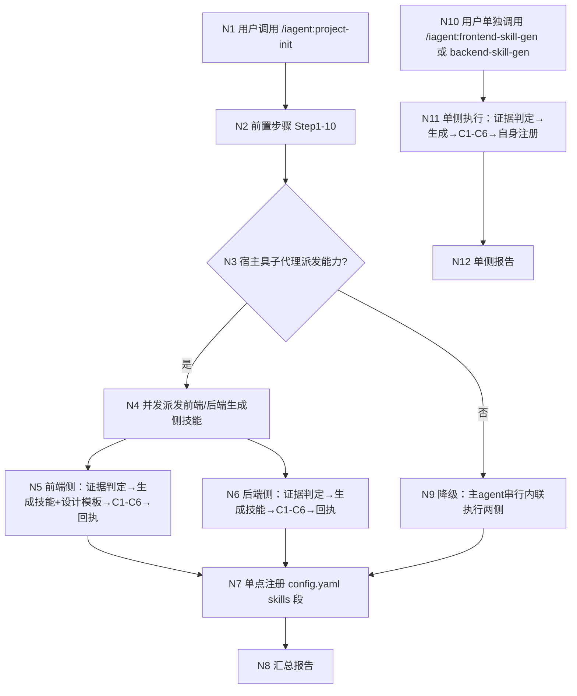

# 探索：拆分 project-init 前后端设计技能为独立可调用能力并细化生成范围

## Background

用户原始诉求（2026-11-12）：
1. 把生成前后端设计 skill 能力进行单独实现，skill 可以单独调用，在 project-init 集成进行调用
2. 执行 project-init 指令时，可以并发通过子 agent 进行前后端设计调用，生成项目对应的前后端设计 skill 技能
3. 生成前后端技能包含范围：
   - **前端**：前端框架、常用组件（选择框、下拉框、复选框、tree、单选框等）设计、分页、table 等前端设计、前后端交互逻辑、哪些是新能力、哪些是历史能力在实现时需要注意
   - **后端**：技术框架、数据库设计、MVC 架构设计、接口设计、前后端接口交互、网络安全等方面

## 项目规则基线

| 源 | 存在 | 读取 | 关键约束摘要 |
| :--- | :--- | :--- | :--- |
| `.iagent/config.yaml` | 是 | 已读 | 技术栈 TS5.9+Node20+Commander14+pnpm10+Vitest3；分层：模板层→生成层→命令层；单一真源清单；模板改动须 `pnpm build && pnpm generate:skills` |
| `.iagent/rules/coding-rules.md` | 是 | 已读 | 零猜测标 [待确认]；设计先行过确认门；严格分层禁跨层调用；按依赖层级顺序生成；破坏性改动先确认；模板正文/指令 ID/白名单/配置回写等人工域约束（单一源） |
| `.iagent/rules/spec.md` | 是 | 已读 | Markdown 真源；`iagent spec validate` 校验循环；不重建 JSON 制品；提案实现前 90% 评分门；handoff 包一次性产出跨阶段只读 |
| `.iagent/rules/testing-rules.md` | 是 | 已读 | Vitest 3.2.6，test/**/*.test.ts；主目录沙箱；CLI 端到端先 pnpm build；单测超时 20000ms |
| `AGENTS.md` | 是 | 已读 | 仓库地图、修改守则（白名单三层、模板单一源、版本判定信号）、项目约定（宿主编排、分级执行 inline 默认、项目技能基线） |
| `CLAUDE.md` | 否 | — | 不存在 |

## 项目技能基线

`iagent skills --json` 枚举结果：backend 分组 2 项；design|both 筛选后仅 1 项进入设计约束。

| 源 | 存在 | 读取 | 完整性 | 关键约束摘要 |
| :--- | :--- | :--- | :--- | :--- |
| `.iagent/skills/backend-design.md` | 是 | 已读 | ok | 三层架构与单一真源设计规范；MUST NOT 手编派生产物 / 手写白名单 / 重序列化 config.yaml；frontend/数据库/HTTP API 对本仓不适用（目标项目语境另计） |
| `.iagent/skills/backend-implement.md` | 是 | 未读 | ok | phases=implement，不进入设计约束（按 phases 筛选规则不读取） |

## 提示词基线 (Prompt Baseline)
**原始提示词**: 优化project-init初始化时自动生成前后端设计skill能力，进行生成skill能力拆分，并对生成前后端skill范围及规则进行细化 1）把生成前后端设计skill能力进行单独实现，skill可以单独调用，在project-init集成进行调用， 2) 执行project-init指令时，可以并发通过子agent进行前后端设计调用生成项目对应的skill技能 3) 生成前后端技能包含范围：前端需要包括前端框架、常用组件（选择框、下拉框、复选框、tree、单选框等）设计、分页、table等前端设计需要包括、前后端交互逻辑、哪些时新能力、哪些时历史能力在实现时需要注意；后台需要包括技术框架、数据库设计、MVC架构设计、接口设计、前后端接口交互、网络安全等方面

**校验结论**：清晰（软）——目标/对象/范围均明确；细节级歧义以 [假设] 记录并在 grill 中收束（不触发优化门）。
**确认后的提示词基线**：与原始提示词一致（本条即基线，未改写）。

> 下游（提案 / 设计 / 规格 / 任务）以提示词基线为唯一语义来源；基线若变更 MUST 回到提示词校验门重新确认。

## 功能流程图



| 节点 | 操作 | 触发条件 | 证据位置 | 异常路径 |
| :--- | :--- | :--- | :--- | :--- |
| N1 | 用户调用 `/iagent:project-init`（可跟项目类型/技术栈描述） | 用户发起初始化 | `src/core/templates/workflows/project-init.ts:169` | — |
| N2 | 前置步骤：读扫描基线 → 五类语义扫描 → feature_doc 委派 → 安全扫描 → 逐份确认落盘 → AGENTS.md → context 回写 → 实现与测试规则蒸馏 | N1 完成 | `src/core/templates/workflows/project-init.ts:175-301`（固定顺序 :290） | 任一步失败记 WARN 继续 → N2 |
| N3 | 判定宿主是否具子代理派发能力（能力探测） | N2 完成 | `[新建]` 派发判定段（预期产物：project-init 模板正文新增判定小节；降级同构 `project-init.ts:201-202`） | 否 → N9 |
| N4 | 经 `${SUBAGENT_DISPATCH}` 并发派发 `frontend-skill-gen` + `backend-skill-gen` 两个子代理（Stage Envelope 最小输入：基线路径 / 五类文档路径 / config 路径 / 输出路径） | N3 判定=是 | `[新建]` 派发指令段；条目构造 `src/core/templates/tool-whitelist.ts:52,93`；协议范本 spec-apply 派发单元 | 派发失败 → 自动重试一次 → 仍失败 → N9（该侧降级内联） |
| N5 | 前端侧：证据判定（前端框架 / 常用组件[选择框、下拉框、复选框、tree、单选框] / 分页 / table / 前后端交互逻辑 / 新能力 vs 历史能力 / 页面设计 / 弹窗设计）→ 生成 `.iagent/skills/frontend-*.md` + 设计模板 `.iagent/templates/frontend/`（页面骨架 / 弹窗骨架 / 数据交换约定）→ C1-C6 自检 → 回执 | N4 委派或 N9/N11 触达 | `[新建]` `frontend-skill-gen` 模板（预期产物：`src/core/templates/workflows/frontend-skill-gen.ts`；C1-C6 依据 `project-init.ts:309-316`） | 证据不足该侧不生成+原因；目标文件已存在 → 逐份确认+人工域标记（`project-init.ts:230-245`）；自检不通过补齐，无法补齐不写入 |
| N6 | 后端侧：证据判定（技术框架 / 数据库设计 / MVC 架构 / 接口设计 / 前后端接口交互 / 网络安全）→ 生成 `.iagent/skills/backend-*.md` → C1-C6 自检 → 回执 | N4 委派或 N9/N11 触达 | `[新建]` `backend-skill-gen` 模板（预期产物：`src/core/templates/workflows/backend-skill-gen.ts`） | 同 N5 |
| N7 | project-init 单点注册：汇总两侧回执，串行逐行段替换把成功侧条目幂等追加到 `.iagent/config.yaml` 的 `skills:` 段 | N5 与 N6 回执齐（或降级/独立路径完成） | `project-init.ts:318`（既有，收敛为单点）；逐行段替换 `src/core/project-config.ts:1032` | 注册失败记 WARN 不回滚已生成文件 → N8 |
| N8 | 汇总报告：逐侧生成文件 / C1-C6 结论 / 设计模板清单 / 不适用项依据 / 冲突项 / 降级与失败原因 | N7 完成 | `project-init.ts:320`（改写扩展） | — |
| N9 | 降级路径：宿主无子代理能力或派发不可得 → 主 agent 串行内联执行两侧（同 N5/N6 逻辑），报告标注「降级路径（非并发）」 | N3=否 或 N4 派发失败 | `[新建]` 降级段（同构降级模式 `project-init.ts:201-202`；degraded 语义见 CONTEXT.md「degraded 单 agent 模式」） | 仍失败 → 该侧不生成 + 原因 → N7 |
| N10 | 用户单独调用 `/iagent:frontend-skill-gen` 或 `/iagent:backend-skill-gen`（不经 project-init） | 用户直接发起单侧技能 | `[新建]` 技能 frontmatter 输入段（指令成对派生 `src/core/templates/registry.ts:75`） | — |
| N11 | 单侧执行：证据判定 → 生成（含设计模板，仅前端侧）→ C1-C6 自检 → **自身注册**（幂等追加 config skills 段） | N10 完成 | `[新建]` 生成侧技能注册段（独立调用语义 D1；被 project-init 委派时 MUST 跳过自身注册） | 注册失败 WARN；证据不足不生成 |
| N12 | 单侧报告：生成文件 / C1-C6 / 不适用依据 / 设计模板清单（前端侧） | N11 完成 | `[新建]` | — |

> 确认后的流程图 = **流程基准**（独立于提案自身的交叉验证锚点）；未经用户确认的流程图 MUST NOT 作为提案的生成锚点。
> 提案 / 验证阶段发现遗漏节点 MUST 回到 1.5.5 更新并重新确认，MUST NOT 在 tasks.md 中静默补节点。
>
> **状态**：已经流程最终确认门确认（2026-11-12）—— `flowBaselineConfirmed=true`；`paperTrailStatus=complete`；CONTEXT.md 检查点：术语已同步（新增 生成侧技能 / 设计模板）。聚合一致性门：扫描 8 条决策，0 个硬冲突，通过。

## Analysis

### Deep Analysis Trigger
- Triggered: Yes
- Reason: 用户关键词含「优化 / 拆分」（Scope.Modify）+ 基础扫描命中既有符号（project-init Step 11 技能蒸馏内嵌于模板正文）→ 修改既有代码
- Scope: `src/core/templates/workflows/project-init.ts`（Step 11）、`src/core/templates/tool-whitelist.ts`（派发/委派条目）、`src/core/templates/registry.ts`（注册表）、`src/core/project-skills.ts`（项目技能枚举与校验）、`src/core/command-generation/generator.ts`（技能生成）

### Architecture Flow
```
project-init 模板（init 域）
  └─ Step 11 项目前后端技能蒸馏（内联散文，project-init.ts:303-320）
       ├─ 证据判定（signals/candidates + 五类文档 + 补扫）
       ├─ 产物形态（默认 phases: both 单文件；拆分条件 → design/implement 两文件）
       ├─ C1-C6 完整性自检（C3 证据锚点 / C4 禁占位符 / C5 冲突标注 / C6 长度）
       ├─ 已存在处理（逐份确认 + 人工域标记）
       ├─ 自动注册（.iagent/config.yaml skills: 段幂等追加）
       └─ 报告（逐侧结论 / 不适用依据 / 未生成原因）
```

### Business Flow
```
用户执行 /iagent:project-init（目标项目）
  → Step 1-10（基线 → 五类扫描 → feature_doc 委派 → 安全 → 落盘 → AGENTS.md → context → rules）
  → Step 11 前后端技能蒸馏（当前：主 agent 内联串行）
  → 【目标形态】并发派发两个子代理（前端 / 后端各一）→ 各自生成 .iagent/skills/<side>-*.md
  → 主 agent 单点完成 config.yaml 注册 + 汇总报告
```

### Identified Symbols
- `getProjectInitSkillTemplate` (src/core/templates/workflows/project-init.ts:153) — Step 11 蒸馏协议唯一落点，拆分的主要修改对象
- `WORKFLOW_PAIRS` (src/core/templates/registry.ts:97) — 新技能模板注册处
- `deriveCommandId` (src/core/templates/registry.ts:75) — 新技能指令 id 派生规则（下划线转连字符去前缀）
- `skillDelegation` (src/core/templates/tool-whitelist.ts:93) — project-init 委派新技能的白名单条目构造
- `SUBAGENT_DISPATCH` (src/core/templates/tool-whitelist.ts:52) — 并发子代理派发的 `Agent, Task` 双写条目
- `requiredSectionsForPhases` / `validateProjectSkill` (src/core/project-skills.ts:208, :219) — 生成产物的完整性校验真源（C2 对应）
- `collectProjectSkills` (src/core/project-skills.ts:318) — `iagent skills --json` 枚举（设计/实现阶段技能加载依赖它）

## Codebase Findings

### Discovered Files
- `src/core/templates/workflows/project-init.ts`: Step 11「项目前后端技能蒸馏」内嵌于模板正文（:303-320），固定顺序在第 10 步规则蒸馏之后（:290）；`allowedTools` 含 CodeGraph + `Skill(iagent-feature-doc)` 委派（:157-163），**当前无** `${SUBAGENT_DISPATCH}`
- `src/core/templates/tool-whitelist.ts`: 三类调用类条目单一源（CodeGraph MCP/CLI、Skill 委派、`Agent, Task` 派发）；派发条目仅正文**确有派发动作**的技能持有（AGENTS.md 修改守则）
- `src/core/templates/registry.ts`: `WORKFLOW_PAIRS` 成对注册（skill+command），指令白名单由配对技能单点回填（:167-171）
- `src/core/project-skills.ts`: `ProjectSkillPhases = design|implement|both`（:22）、`ProjectSkillScope = frontend|backend|both`（:25）——生成产物 frontmatter 契约已有枚举，无需扩类型
- `src/core/command-generation/generator.ts`: `generateSkillContent`（:79）——新技能模板经既有生成管线出产物，frontmatter 指纹自动写入
- `.iagent/config.yaml`: `skills:` 段按角色分组（backend: backend-design/backend-implement）；`workflows:` 段当前 7 项显式
- spec-apply 模板：既有「并发子代理 + handoff 包 + 最小回执」成熟协议（派发单元、共享指令前缀、产出登记表），可作为 Step 11 并发派发的协议范本

### Pattern Matches
- 依赖注入：选 spec-propose 自动带 spec-verify-proposal（AGENTS.md / config.yaml 注释）——新技能随 project-init 注入的既有模式
- 降级路径：project-init Step 3 的「委派不可得 → 记 WARN 改自行扫描」（:201-202）——并发派发失败降级的同构模式
- 单点串行写：config.yaml 注册必须走逐行段替换（project-config.ts 单一源）——并发场景下注册必须收敛为单点

### Capability Exploration Memory (injected)
- 无能力级探索记忆 — `openspec/specs/` 下无 explorations.md，全新探索

## Questions

**Q1（批量 1，L1-L3，已确认 2026-11-12）**：D1-D7 七条待确认项（拆分形态 / 生成范围 / 并发与降级 / 注册单点 / 内容拆分 / 异常语义 / 安装关系）
- 用户回答：确认（整体确认，无逐条修改）

**Q2（批量 2，L5 + 范围扩展，已确认 2026-11-12）**：B-1~B-6 边界场景处置 + 前端范围扩展（D8）
- 用户回答：确认边界场景；新增页面设计 / 弹窗设计 / 设计模板诉求（已记 D8）
- 派生细节（随流程门收敛）：设计模板落点推荐 `.iagent/templates/frontend/`（页面骨架 / 弹窗骨架 / 数据交换约定各一份）；被委派时生成侧技能不自行注册（父级单点注册，见硬约束末条）

## 术语表

| 术语 | 定义 | 避免使用 |
|------|------|---------|
| 生成侧技能（skill-gen skill） | 承载单侧（前端 / 后端）技能蒸馏协议的内置技能模板（`iagent_frontend_skill_gen` / `iagent_backend_skill_gen`），可单独调用、由 project-init 委派调用 | 设计技能（与目标项目产物混淆）、generator 技能 |
| 设计模板（design template） | 前端生成侧技能按目标项目 UI 证据蒸馏出的骨架模板产物（页面骨架 / 弹窗骨架 / 主页面↔弹窗数据交换约定），供后续页面生成与弹窗生成技能读取复用；同样受 C1-C6 证据约束 | 代码模板（非可执行代码）、组件库文档 |
| 项目技能（project skill） | 沿用 CONTEXT.md 2026-11-09 既有条目（`.iagent/skills/<name>.md`，frontmatter phases/scope/frameworks）——本探索不新增定义 | 重复定义 |

## 架构决策

无 ADR

<!-- 复核记录：拟裁决（两模板拆分 / 设计模板产物形态）均可逆、符合既有模式（依赖注入 / 降级路径 / 单点注册），无脱离上下文令人意外的真实权衡，不满足 ADR 三条件。 -->

## Decision Process

### Decision: 拆分形态（D1）
**Options Considered**:
- Option A: 两个独立技能模板（frontend/backend 各一），project-init 委派调用
- Option B: 单个 `iagent_skill_gen` 技能以参数区分侧别
- Option C: 维持 Step 11 内联（现状）

**Pros/Cons**:
- Option A: 单侧职责单一、可单独调用、正文长度可控 vs 新增 2 个安装面
- Option B: 安装面最小 vs 单技能正文双分支膨胀、单独调用粒度粗
- Option C: 零新增面 vs 不满足「单独调用 + 并发」诉求

**Chosen**: Option A
**Rationale**: 用户明确要求两侧能力单独实现且可单独调用；A 的正文长度与语言一致性约束最可控。

### Decision: 并发派发与注册归属（D3/D4）
**Options Considered**:
- Option A: 子代理并发生成文件，config.yaml 注册由主 agent 单点串行
- Option B: 子代理各自注册（并发写 config.yaml）

**Chosen**: Option A
**Rationale**: 逐行段替换不支持并发写同一文件；注册聚合是 project-init 编排职责的自然归属。

## 边界场景

- [ ] B-1 单侧证据不足：目标项目纯后端（无任何前端证据）→ 前端生成侧技能判定「不生成」并输出不适用依据，后端正常生成；project-init 汇总报告呈现两侧差异化结论
- [ ] B-2 宿主无子代理能力（degraded）：project-init 降级为主 agent 串行执行两侧，报告标注「降级路径（非并发）」，MUST NOT 表述为已并发委派
- [ ] B-3 单侧子代理失败且重试仍失败：该侧降级主 agent 内联执行；若仍失败 → 该侧不生成 + 报告原因，另一侧产物保留，config.yaml 注册只登记成功侧
- [ ] B-4 目标技能文件已存在：沿用第 5/6 步逐份确认 + 人工域标记（区间逐字保留，破损取保留侧）；「全部跳过」时流程正常结束
- [ ] B-5 两侧并发都完成但 config.yaml 注册失败：记 WARN 不回滚已生成文件（沿用既有「注册失败记 WARN 不回滚」语义）
- [ ] B-6 目标项目技能已由用户手工创建且未登记（`.iagent/skills/<side>-design.md` 存在但 config 无条目）：已存在处理走逐份确认；注册幂等不产生重复条目

## Decision Process

### Decision: （待定）
**Options Considered**: （待定）
**Chosen**: （待定）
**Rationale**: （待定）

## Decisions

- **D1 拆分形态**：新增两个独立技能模板 `iagent_frontend_skill_gen` / `iagent_backend_skill_gen`（workflowId `frontend-skill-gen` / `backend-skill-gen`，类型 `init`，斜杠指令成对自动派生）；各承载单侧「证据判定 → 生成 → C1-C6 自检」协议；project-init Step 11 改为委派两侧 + 单点注册 + 汇总报告。命名避开 `frontend-design`/`backend-design`（与目标项目产物同名混淆）
- **D2 生成范围细化**：用户清单（前端：框架 / 常用组件设计[选择框、下拉框、复选框、tree、单选框] / 分页 / table / 前后端交互逻辑 / 新能力 vs 历史能力注意事项；后端：技术框架 / 数据库设计 / MVC 架构 / 接口设计 / 前后端接口交互 / 网络安全）写入两个新技能正文，作为**扫描维度清单**；生成内容仍受 C1-C6 证据约束，无证据维度标「不适用 + 探测依据」，清单 ≠ 内容模板
- **D3 并发与降级**：project-init 经 `${SUBAGENT_DISPATCH}`（`Agent, Task` 双写共享常量）并发派发两个子代理；宿主无子代理能力或派发失败 → 降级主 agent 串行内联执行并记 WARN；委派只传 Stage Envelope 式最小输入
- **D4 注册单点**：子代理只写各自 `.iagent/skills/<side>-*.md`；`.iagent/config.yaml` 的 `skills:` 注册由 project-init 在两侧全部完成后**单点串行**执行（逐行段替换）
- **D5 产物契约不变**：目标项目技能维持默认 `phases: both` 单文件 + 既有拆分条件；`ProjectSkillScope` 枚举不变
- **D6 异常语义**：单侧子代理失败 / 证据不足 → 该侧不生成并报告原因，另一侧继续（全流程非阻断）；自动重试一次，仍失败降级主 agent 内联执行该侧
- **D7 安装关系**：选装 project-init 经依赖注入自动带上两个新技能
- **D8 前端范围扩展（批量 2 确认时新增）**：前端生成侧技能的扫描维度清单在 D2 基础上增加**页面设计**与**弹窗设计**能力，并根据项目 UI 证据自动生成对应**设计模板**，供后续「页面生成 / 弹窗生成 / 主页面与弹窗页面数据交换」使用；模板内容同样受 C1-C6 证据约束（无证据不编造，标注置信度）
- **D9 注册双态（流程最终确认门确认）**：生成侧技能被 project-init 委派时 MUST NOT 自行注册 config.yaml（注册归主 agent 单点）；仅独立调用时执行自身幂等注册

## 硬约束

- 固定顺序：五类文档 → AGENTS.md → context → 规则蒸馏 → 技能蒸馏，技能蒸馏 MUST NOT 提前（source: 模板既有约束 + D1 委派化不改变顺序）
- 全流程非阻断：任一侧失败记 WARN 并继续，MUST NOT 中断初始化（source: D6）
- `.iagent/config.yaml` 注册单点串行，MUST NOT 并发写 config.yaml（source: D4）
- 生成内容 MUST 受 C1-C6 约束，清单 ≠ 内容模板，无证据 MUST NOT 编造（source: D2 / D8）
- 委派条目 MUST 走 `skillDelegation` / `SUBAGENT_DISPATCH` 共享常量，MUST NOT 手写字面量（source: D3 + 人工域规则）
- degraded 降级 MUST NOT 伪装为委派完成（source: D3）
- 生成侧技能被 project-init 委派时 MUST NOT 自行注册 config.yaml（注册归主 agent 单点）；仅独立调用时执行自身注册（source: D1 + D4）

## Scope Changes

| 变更时间 | 变更类型 | 变更描述 | 原因 |
|---------|---------|---------|------|
| 2026-11-12 | expand | 前端生成侧技能范围新增：页面设计、弹窗设计能力 + 按项目证据自动生成设计模板（供后续页面生成 / 弹窗生成 / 主页面与弹窗页面数据交换） | 用户批量 2 确认时提出 |

## Pending

### For Phase 2 Impact Analysis
- `getProjectInitSkillTemplate` (src/core/templates/workflows/project-init.ts:153) - Priority: HIGH（Step 11 正文改写）
- `WORKFLOW_PAIRS` (src/core/templates/registry.ts:97) - Priority: HIGH（+2 成对注册）
- 依赖注入表（DEPS / DEFAULT_WORKFLOWS，`src/core/config.ts` 附近，待 Phase 2 精确定位）- Priority: HIGH（project-init → 两新技能注入）
- `getKnownCommandIds` (src/core/templates/registry.ts:180) - Priority: MEDIUM（指令引用校验集合扩大）
- `version-bump.ts` collectFileSignals - Priority: MEDIUM（新增技能模板信号核对）

### Security Concerns
- 生成内容安全边界沿用现有两条禁令（不写凭据值 / 不写可利用绕过细节，project-init.ts:227-228）——子代理并发执行时禁令须随委派指令传递

### Business Validation
- 「新能力 vs 历史能力」维度的可判定性：以扫描证据区分「新增模块 vs 既有/历史模块」的标注方式待用户确认

### Unresolved Decisions
- 拆分形态 / 命名（D1 待确认）
- 并发与降级策略（D3 待确认）
- config.yaml 注册单点归属（D4 待确认）
- 依赖注入安装关系（D6 待确认）

## Implementation Deep-Dive

### Design Rationale
- Step 11 固定排在第 10 步（context 回写与规则蒸馏）之后：蒸馏的输入依赖五类文档、AGENTS.md、`.iagent/config.yaml` 与 rules 产物（证据：`src/core/templates/workflows/project-init.ts:290` 注释「固定触发顺序：五类文档 → AGENTS.md → context → rules → 技能蒸馏」）——置信度 HIGH。拆分为独立技能后，project-init 必须保持该前置顺序，MUST NOT 让技能蒸馏提前运行。
- 全程非阻断是 project-init 的显式原则（:171「任一步骤失败 MUST 记 WARN 并继续」）——置信度 HIGH。并发派发的失败语义必须沿用此原则。

### Constraints
- 模板单一源：新模板正文仅维护 skill 版，command 版由 `derive-command.ts` 派生（AGENTS.md 修改守则 7）
- 白名单三层组合，新增条目走 `src/core/templates/tool-whitelist.ts` 共享常量，MUST NOT 手写字面量（守则 2）
- 技能主 SKILL.md ≤ 500 行（test/skill-size-budget.test.ts）；description 结构 ≤1024 硬上限
- 技能名强制 `iagent_` 前缀；类型不进技能名；新技能类型须属现有 9 类（`SKILL_TYPES`）
- 新增技能模板 → 版本判定 minor 信号（`version-bump.ts` collectFileSignals）
- 改模板后必须 `pnpm build && pnpm generate:skills`（test/skills-parity.test.ts）
- 模板正文中文，不硬编码宿主专属机制词（render.ts 生成期按宿主渲染）

### Trade-offs
- 内联 Step 11（现状）vs 独立技能：独立技能增加 2 个可安装 workflow（安装面扩大），但换来「单独调用」能力与并发派发可能；共用蒸馏协议须防止 C1-C6 双写漂移 → 建议共享常量模块。

### Pattern Usage
- 派发单元 / 共享指令前缀 / 产出登记表（spec-apply 批次调度）——并发子代理协议的既有范式
- 逐行段替换写 config（project-config.ts）——注册单点串行的依据

### Historical Context
- AGENTS.md：`iagent_project_init` 第 11 步按证据蒸馏技能、写入前 C1-C6 自检（项目约定段）——Step 11 为近期新增能力，拆分属其首次结构演化

### Implicit Assumptions
- `ProjectSkillScope` 已含 `frontend|backend|both`（project-skills.ts:25）——生成产物无需扩枚举（置信度 MEDIUM，待 grill 确认生成形态不变）
- 并发子代理由宿主能力决定；无子代理能力宿主（degraded）降级为主 agent 串行执行（置信度 MEDIUM，待 grill 确认降级策略）
